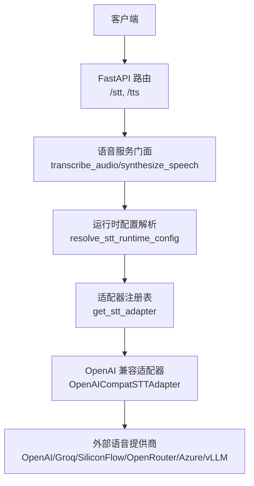
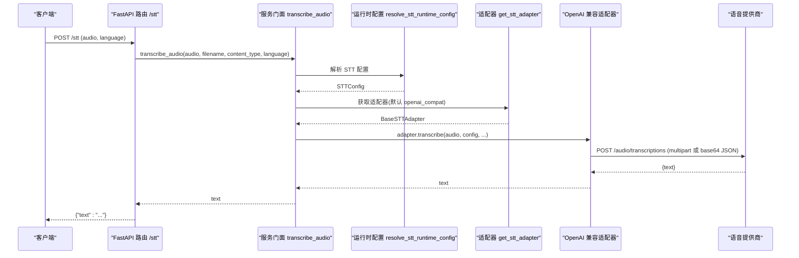
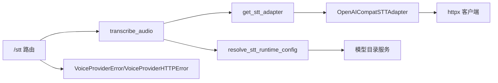

# 转录服务

<cite>
**本文引用的文件**
- [deeptutor/api/routers/voice.py](file://deeptutor/api/routers/voice.py)
- [deeptutor/services/voice/__init__.py](file://deeptutor/services/voice/__init__.py)
- [deeptutor/services/voice/base.py](file://deeptutor/services/voice/base.py)
- [deeptutor/services/voice/config.py](file://deeptutor/services/voice/config.py)
- [deeptutor/services/voice/adapters/openai_compat.py](file://deeptutor/services/voice/adapters/openai_compat.py)
- [deeptutor/services/voice/adapters/__init__.py](file://deeptutor/services/voice/adapters/__init__.py)
- [deeptutor/services/config/provider_runtime.py](file://deeptutor/services/config/provider_runtime.py)
- [deeptutor/partners/transcription.py](file://deeptutor/partners/transcription.py)
</cite>

## 目录
1. [简介](#简介)
2. [项目结构](#项目结构)
3. [核心组件](#核心组件)
4. [架构总览](#架构总览)
5. [详细组件分析](#详细组件分析)
6. [依赖关系分析](#依赖关系分析)
7. [性能与容量](#性能与容量)
8. [故障排除指南](#故障排除指南)
9. [结论](#结论)
10. [附录：配置、API 与最佳实践](#附录api-与最佳实践)

## 简介
本文件面向 DeepTutor 合作伙伴的“语音转文本（STT）”能力，系统性说明其技术架构、实现原理、支持的音频格式与编码、转录引擎集成方式、API 调用流程、结果处理、质量评估与后处理策略、实时与批量处理模式、缓存机制、配置与调优方法，以及使用示例与最佳实践。该服务通过统一的语音服务门面暴露 STT/TTS 能力，底层以 OpenAI 兼容适配器为主，并支持多种提供商（OpenAI、Groq、SiliconFlow、OpenRouter、Azure OpenAI、本地 vLLM/LM Studio 等）。

## 项目结构
- API 层：提供 /stt 和 /tts 路由，负责入参校验、大小限制、错误映射与响应封装。
- 服务门面：统一解析运行时配置、选择适配器、执行具体转录或合成。
- 适配器层：OpenAI 兼容适配器实现多提供商的统一 HTTP 调用；注册表按名称分发到具体适配器。
- 配置层：定义 TTS/STT 配置数据类、认证风格、请求样式等；运行时从模型目录解析出最终配置。
- 合作伙伴专用：提供一个基于 Groq Whisper 的独立转录提供者，便于在伙伴通道中直接调用。

图表来源
- [deeptutor/api/routers/voice.py:104-130](file://deeptutor/api/routers/voice.py#L104-L130)
- [deeptutor/services/voice/__init__.py:49-64](file://deeptutor/services/voice/__init__.py#L49-L64)
- [deeptutor/services/config/provider_runtime.py:272-311](file://deeptutor/services/config/provider_runtime.py#L272-L311)
- [deeptutor/services/voice/adapters/__init__.py:23-25](file://deeptutor/services/voice/adapters/__init__.py#L23-L25)
- [deeptutor/services/voice/adapters/openai_compat.py:287-375](file://deeptutor/services/voice/adapters/openai_compat.py#L287-L375)

章节来源
- [deeptutor/api/routers/voice.py:1-131](file://deeptutor/api/routers/voice.py#L1-L131)
- [deeptutor/services/voice/__init__.py:1-75](file://deeptutor/services/voice/__init__.py#L1-L75)
- [deeptutor/services/voice/adapters/__init__.py:1-48](file://deeptutor/services/voice/adapters/__init__.py#L1-L48)
- [deeptutor/services/config/provider_runtime.py:200-311](file://deeptutor/services/config/provider_runtime.py#L200-L311)

## 核心组件
- FastAPI 路由：接收上传音频与可选语言参数，进行大小限制与异常映射，调用服务门面完成转录。
- 服务门面：根据运行时配置选择 STT 适配器，透传语言、文件名与内容类型。
- 适配器：OpenAI 兼容适配器支持 multipart 表单上传与 base64 JSON 两种请求样式；解析返回文本。
- 配置：集中定义认证风格、请求样式、超时、默认模型等；运行时从模型目录解析为 STTConfig。
- 适配器注册表：按名称返回单例适配器，默认 openai_compat。
- 合作伙伴 Groq 提供者：独立于主服务门面的轻量实现，用于伙伴通道场景。

章节来源
- [deeptutor/api/routers/voice.py:104-130](file://deeptutor/api/routers/voice.py#L104-L130)
- [deeptutor/services/voice/__init__.py:49-64](file://deeptutor/services/voice/__init__.py#L49-L64)
- [deeptutor/services/voice/adapters/openai_compat.py:287-375](file://deeptutor/services/voice/adapters/openai_compat.py#L287-L375)
- [deeptutor/services/voice/config.py:46-61](file://deeptutor/services/voice/config.py#L46-L61)
- [deeptutor/services/voice/adapters/__init__.py:23-39](file://deeptutor/services/voice/adapters/__init__.py#L23-L39)
- [deeptutor/partners/transcription.py:10-61](file://deeptutor/partners/transcription.py#L10-L61)

## 架构总览
转录请求从浏览器或后端系统进入 FastAPI 路由，路由将音频字节与元信息交给服务门面；门面解析 STT 运行时配置并选择适配器；适配器以 OpenAI 兼容协议向提供商发起请求，解析文本返回给路由，再由路由封装为 JSON 响应。

图表来源
- [deeptutor/api/routers/voice.py:104-130](file://deeptutor/api/routers/voice.py#L104-L130)
- [deeptutor/services/voice/__init__.py:49-64](file://deeptutor/services/voice/__init__.py#L49-L64)
- [deeptutor/services/config/provider_runtime.py:272-311](file://deeptutor/services/config/provider_runtime.py#L272-L311)
- [deeptutor/services/voice/adapters/openai_compat.py:287-375](file://deeptutor/services/voice/adapters/openai_compat.py#L287-L375)

## 详细组件分析

### FastAPI 路由：/stt
- 功能：接收音频上传与可选语言，限制最大 25MB，调用服务门面进行转录，捕获配置错误或提供商错误并映射为 400/502。
- 关键点：空上传、超限、ProviderError 均会返回明确状态码；成功时返回 JSON 包含 text 字段。

章节来源
- [deeptutor/api/routers/voice.py:104-130](file://deeptutor/api/routers/voice.py#L104-L130)

### 服务门面：transcribe_audio
- 功能：解析 STT 运行时配置，覆盖语言参数，选择适配器并执行转录。
- 关键点：语言参数可覆盖配置中的默认语言；适配器由注册表按名称返回。

章节来源
- [deeptutor/services/voice/__init__.py:49-64](file://deeptutor/services/voice/__init__.py#L49-L64)

### 运行时配置：STTConfig 与 provider_runtime
- 配置项：model、provider_name、adapter、request_style、auth_style、api_key、base_url、api_version、extra_headers、language、request_timeout。
- 提供商清单：OpenAI、OpenRouter、Groq、SiliconFlow、Azure OpenAI、vLLM/Local、Custom；OpenRouter 默认使用 base64 JSON 请求样式。
- 解析逻辑：从模型目录读取 active profile/model，合并别名与默认值，生成 STTConfig。

章节来源
- [deeptutor/services/voice/config.py:46-61](file://deeptutor/services/voice/config.py#L46-L61)
- [deeptutor/services/config/provider_runtime.py:272-311](file://deeptutor/services/config/provider_runtime.py#L272-L311)

### 适配器：OpenAI 兼容 STT
- 请求样式：
  - multipart 表单：适用于 OpenAI/Groq/SiliconFlow/Azure；携带 file、model、response_format=json，可选 language。
  - base64 JSON：适用于 OpenRouter；body 包含 model、input_audio{data, format}，可选 language。
- 响应解析：优先取 JSON 的 text 字段；若为纯文本则直接返回；对 OpenRouter 的 chat-style 响应做兼容回退。
- 错误处理：非 2xx 响应转换为 VoiceProviderHTTPError，并附带状态码与截断 body。

章节来源
- [deeptutor/services/voice/adapters/openai_compat.py:287-375](file://deeptutor/services/voice/adapters/openai_compat.py#L287-L375)

### 适配器注册表
- 键名：openai_compat（默认）、openrouter_tts（仅 TTS）。
- 行为：按名称返回单例适配器；不支持的名称抛出 VoiceProviderError。

章节来源
- [deeptutor/services/voice/adapters/__init__.py:18-39](file://deeptutor/services/voice/adapters/__init__.py#L18-L39)

### 合作伙伴 Groq 转录提供者
- 用途：在伙伴通道中直接调用 Groq Whisper 进行转录。
- 行为：读取环境变量 API Key，检查文件存在性，POST 到 Groq 转录端点，返回 text；失败记录日志并返回空字符串。

章节来源
- [deeptutor/partners/transcription.py:10-61](file://deeptutor/partners/transcription.py#L10-L61)

### 基础抽象与工具
- 抽象基类：BaseSTTAdapter/BaseTTSAdapter 定义统一接口。
- 认证头构建：支持 Bearer、api-key、Token 三种风格。
- URL 拼接：安全拼接 audio 路径，保留查询串。
- Markdown 清理：TTS 前清理 Markdown，避免朗读代码块、表格等。

章节来源
- [deeptutor/services/voice/base.py:19-90](file://deeptutor/services/voice/base.py#L19-L90)
- [deeptutor/services/voice/base.py:107-133](file://deeptutor/services/voice/base.py#L107-L133)

## 依赖关系分析
- 路由依赖服务门面；门面依赖配置解析与适配器注册表；注册表依赖具体适配器；适配器依赖 httpx 与配置。
- 运行时配置依赖模型目录服务，解析 active profile/model 并生成 STTConfig。
- 错误类型在 base 中定义，被路由与适配器共同消费。

图表来源
- [deeptutor/api/routers/voice.py:104-130](file://deeptutor/api/routers/voice.py#L104-L130)
- [deeptutor/services/voice/__init__.py:49-64](file://deeptutor/services/voice/__init__.py#L49-L64)
- [deeptutor/services/config/provider_runtime.py:272-311](file://deeptutor/services/config/provider_runtime.py#L272-L311)
- [deeptutor/services/voice/adapters/openai_compat.py:287-375](file://deeptutor/services/voice/adapters/openai_compat.py#L287-L375)
- [deeptutor/services/voice/base.py:19-30](file://deeptutor/services/voice/base.py#L19-L30)

章节来源
- [deeptutor/services/voice/base.py:19-30](file://deeptutor/services/voice/base.py#L19-L30)
- [deeptutor/services/voice/adapters/openai_compat.py:287-375](file://deeptutor/services/voice/adapters/openai_compat.py#L287-L375)

## 性能与容量
- 上传限制：路由层限制单次音频不超过 25MB，防止恶意大文件。
- 超时控制：STTConfig.request_timeout 默认 120 秒，适配不同提供商耗时。
- 并发与 I/O：适配器使用异步 httpx 客户端，减少阻塞；建议在高并发场景下复用连接池。
- 提供商差异：OpenRouter 使用 base64 JSON 可能增加 CPU 开销；multipart 更通用但受网络带宽影响。
- 语言参数：显式指定 language 可减少提供商侧检测成本，提升准确率与速度。

[本节为通用指导，不直接分析具体文件]

## 故障排除指南
- 400 错误：空上传、缺少配置或无效参数。检查路由输入与 STTConfig 是否完整。
- 413 错误：音频超过 25MB。压缩音频或拆分片段。
- 502 错误：提供商返回非 2xx。查看 VoiceProviderHTTPError 的状态码与 body，确认 API Key、base_url、model 与 request_style。
- 无文本返回：检查适配器响应解析逻辑，确保返回体包含 text 字段或为纯文本。
- 合作伙伴 Groq 为空：确认环境变量已设置且文件存在；检查网络连通性与速率限制。

章节来源
- [deeptutor/api/routers/voice.py:104-130](file://deeptutor/api/routers/voice.py#L104-L130)
- [deeptutor/services/voice/base.py:19-30](file://deeptutor/services/voice/base.py#L19-L30)
- [deeptutor/services/voice/adapters/openai_compat.py:58-72](file://deeptutor/services/voice/adapters/openai_compat.py#L58-L72)
- [deeptutor/partners/transcription.py:31-61](file://deeptutor/partners/transcription.py#L31-L61)

## 结论
DeepTutor 的转录服务采用“路由—门面—配置—适配器—提供商”的分层架构，通过 OpenAI 兼容适配器统一对接多家语音提供商，具备灵活的认证与请求样式、清晰的错误处理与良好的可扩展性。配合模型目录的动态配置，可在不重启服务的情况下切换提供商与模型，满足实时与批量转录需求。

[本节为总结，不直接分析具体文件]

## 附录：配置、API 与最佳实践

### 支持的音频格式与编码
- 上传格式：路由接受任意二进制音频流，文件名与 MIME 类型由客户端传入；适配器会根据文件名后缀推断 base64 JSON 的 format（如 webm/mp3/wav/flac 等）。
- 推荐格式：mp3、wav、flac、opus、aac；采样率建议 16kHz–48kHz，单声道或立体声均可。
- PCM 注意：PCM 通常需包装为 WAV 容器以便浏览器播放；STT 可直接发送原始 PCM 字节，但需确保提供商支持。

章节来源
- [deeptutor/api/routers/voice.py:104-130](file://deeptutor/api/routers/voice.py#L104-L130)
- [deeptutor/services/voice/adapters/openai_compat.py:339-356](file://deeptutor/services/voice/adapters/openai_compat.py#L339-L356)

### 转录引擎集成与 API 调用
- 调用入口：POST /stt，表单字段包括 file、language（可选）。
- 配置来源：通过模型目录 services.stt 的 active profile/model 决定提供商、模型、认证与请求样式。
- 适配器选择：默认 openai_compat；OpenRouter 使用 base64 JSON 请求样式。
- 返回结果：JSON 对象包含 text 字段。

章节来源
- [deeptutor/api/routers/voice.py:104-130](file://deeptutor/api/routers/voice.py#L104-L130)
- [deeptutor/services/voice/__init__.py:49-64](file://deeptutor/services/voice/__init__.py#L49-L64)
- [deeptutor/services/config/provider_runtime.py:272-311](file://deeptutor/services/config/provider_runtime.py#L272-L311)
- [deeptutor/services/voice/adapters/openai_compat.py:287-375](file://deeptutor/services/voice/adapters/openai_compat.py#L287-L375)

### 实时转录与批量处理
- 实时转录：当前路由为同步上传—处理—返回；适合短音频片段。对于长音频或流式场景，建议在业务层分片上传或使用 WebSocket 封装。
- 批量处理：服务端未内置队列；可在应用层实现任务队列（如 Celery/RQ），将大文件或批处理任务异步化，轮询结果。

[本节为概念性说明，不直接分析具体文件]

### 缓存机制
- 路由层对 TTS 响应禁用缓存（no-store）；STT 未显式设置缓存策略。
- 建议：对相同音频指纹（哈希）的结果在服务端或网关层做短期缓存，降低重复转录成本。

章节来源
- [deeptutor/api/routers/voice.py:78-101](file://deeptutor/api/routers/voice.py#L78-L101)

### 转录质量评估与后处理
- 语言提示：显式设置 language 可提升识别准确率。
- 文本清洗：TTS 前会清理 Markdown；STT 输出可按需进行标点修复、数字标准化、敏感词过滤等后处理。
- 质量指标：可结合提供商返回的置信度（若可用）或下游评测集计算 WER/CER。

章节来源
- [deeptutor/services/voice/base.py:107-133](file://deeptutor/services/voice/base.py#L107-L133)

### 配置与调优
- 提供商选择：在模型目录 services.stt 中设置 active profile/model；OpenRouter 使用 base64 JSON 请求样式。
- 认证风格：Bearer、api-key（Azure）、Token（预留）；根据提供商要求配置 auth_style。
- 超时与头部：调整 request_timeout 与 extra_headers 以适配不同网关。
- 本地部署：vLLM/LM Studio 可通过 base_url 指向本地服务，is_local=true 时无需真实密钥。

章节来源
- [deeptutor/services/config/provider_runtime.py:272-311](file://deeptutor/services/config/provider_runtime.py#L272-L311)
- [deeptutor/services/voice/config.py:46-61](file://deeptutor/services/voice/config.py#L46-L61)

### 使用示例与最佳实践
- 最小调用：POST /stt，上传 mp3 或 wav，可选 language=zh；返回 {"text":"..."}。
- 最佳实践：
  - 控制文件大小与时长，必要时分片。
  - 显式指定 language 与合适的采样率。
  - 对高频重复音频启用缓存。
  - 监控提供商限流与错误码，实施重试与降级策略。
  - 在业务层实现批量任务队列与进度反馈。

[本节为通用指导，不直接分析具体文件]