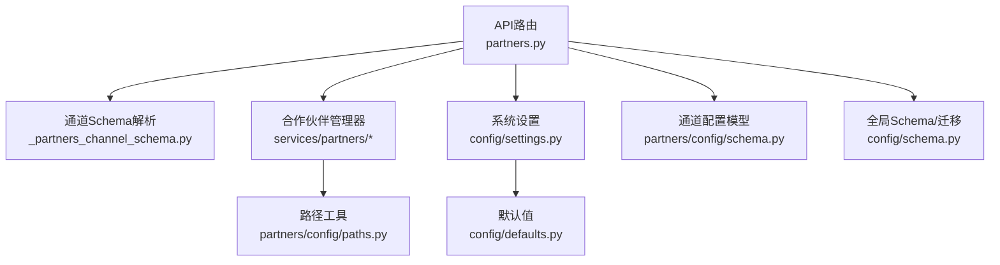
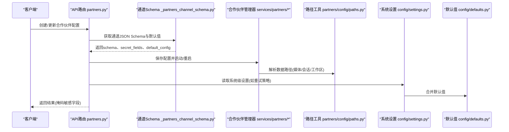
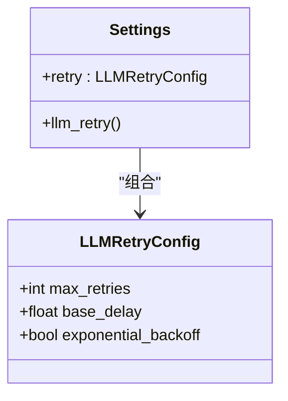
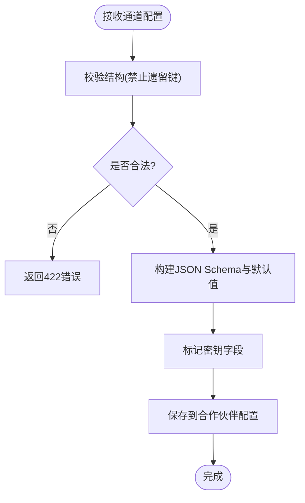
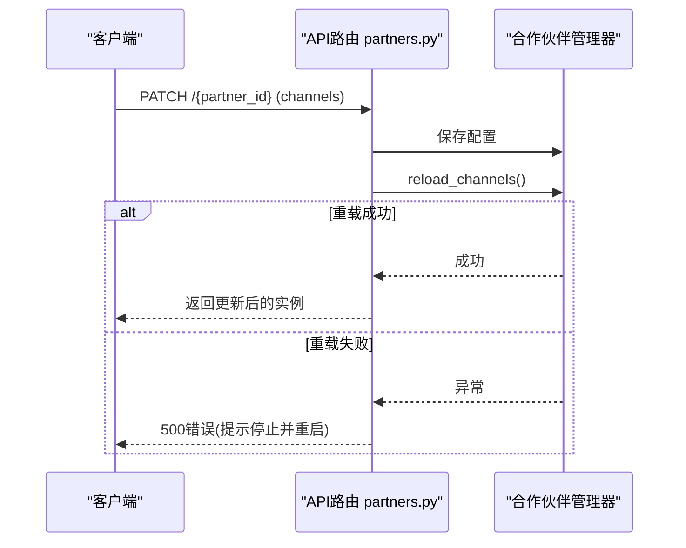
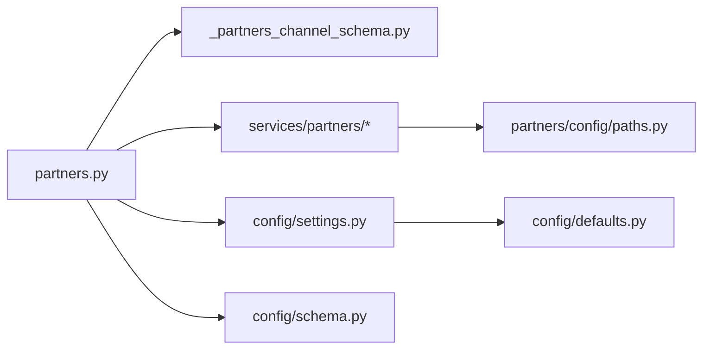

# 配置管理

<cite>
**本文引用的文件**
- [deeptutor/config/schema.py](file://deeptutor/config/schema.py)
- [deeptutor/config/settings.py](file://deeptutor/config/settings.py)
- [deeptutor/config/defaults.py](file://deeptutor/config/defaults.py)
- [deeptutor/config/accessors.py](file://deeptutor/config/accessors.py)
- [deeptutor/partners/config/schema.py](file://deeptutor/partners/config/schema.py)
- [deeptutor/partners/config/paths.py](file://deeptutor/partners/config/paths.py)
- [deeptutor/api/routers/partners.py](file://deeptutor/api/routers/partners.py)
- [deeptutor/api/routers/_partners_channel_schema.py](file://deeptutor/api/routers/_partners_channel_schema.py)
- [deeptutor/services/config/__init__.py](file://deeptutor/services/config/__init__.py)
</cite>

## 目录
1. [简介](#简介)
2. [项目结构](#项目结构)
3. [核心组件](#核心组件)
4. [架构总览](#架构总览)
5. [详细组件分析](#详细组件分析)
6. [依赖关系分析](#依赖关系分析)
7. [性能考虑](#性能考虑)
8. [故障排除指南](#故障排除指南)
9. [结论](#结论)
10. [附录：配置示例与最佳实践](#附录：配置示例与最佳实践)

## 简介
本文件面向DeepTutor的“合作伙伴配置管理系统”，聚焦于合作伙伴（Partner）的配置架构、验证机制、环境变量、动态更新、模板与默认值、多环境管理、安全存储、热重载、版本控制与迁移策略，并提供最佳实践与常见问题排查。文档基于仓库中的实际代码实现进行说明，确保读者能够准确理解并落地使用。

## 项目结构
DeepTutor将“系统级配置”和“合作伙伴级配置”分层管理：
- 系统级配置：通过Pydantic Settings与环境变量驱动，提供全局运行时参数（如LLM重试策略）。
- 合作伙伴级配置：以通道（Channel）为核心的结构化配置，支持JSON Schema驱动的表单渲染、默认值注入、密钥字段识别与掩码输出。
- 服务层配置：统一的配置加载与服务发现入口，便于扩展与测试。

图表来源
- [deeptutor/api/routers/partners.py:200-231](file://deeptutor/api/routers/partners.py#L200-L231)
- [deeptutor/api/routers/_partners_channel_schema.py:120-177](file://deeptutor/api/routers/_partners_channel_schema.py#L120-L177)
- [deeptutor/partners/config/paths.py:10-54](file://deeptutor/partners/config/paths.py#L10-L54)
- [deeptutor/config/settings.py:15-51](file://deeptutor/config/settings.py#L15-L51)
- [deeptutor/config/defaults.py:1-18](file://deeptutor/config/defaults.py#L1-L18)
- [deeptutor/partners/config/schema.py:9-51](file://deeptutor/partners/config/schema.py#L9-L51)
- [deeptutor/config/schema.py:6-39](file://deeptutor/config/schema.py#L6-L39)

章节来源
- [deeptutor/api/routers/partners.py:1-120](file://deeptutor/api/routers/partners.py#L1-L120)
- [deeptutor/api/routers/_partners_channel_schema.py:1-177](file://deeptutor/api/routers/_partners_channel_schema.py#L1-L177)
- [deeptutor/partners/config/paths.py:1-54](file://deeptutor/partners/config/paths.py#L1-L54)
- [deeptutor/config/settings.py:1-51](file://deeptutor/config/settings.py#L1-L51)
- [deeptutor/config/defaults.py:1-18](file://deeptutor/config/defaults.py#L1-L18)
- [deeptutor/partners/config/schema.py:1-51](file://deeptutor/partners/config/schema.py#L1-L51)
- [deeptutor/config/schema.py:1-39](file://deeptutor/config/schema.py#L1-L39)

## 核心组件
- 系统设置（Settings）：基于Pydantic Settings，通过环境变量前缀与嵌套分隔符自动装配，提供全局运行参数（例如LLM重试策略），并兼容旧属性访问。
- 默认配置（Defaults）：集中定义默认值，包括LLM模型、提供商及数据路径等。
- 配置访问器（Accessors）：封装对配置项的读取，提供默认回退值，降低调用方复杂度。
- 合作伙伴通道配置（ChannelsConfig）：以Pydantic模型描述通道配置，支持额外字段、发送重试次数等；结合Schema导出为JSON Schema供前端渲染。
- 通道Schema生成：自动发现通道类与其对应配置模型，内联引用、收集密钥字段、生成默认配置，暴露给前端用于动态表单。
- 路径工具：统一管理合作伙伴数据树路径（媒体、会话、工作区等），保证一致性与可维护性。
- 服务配置入口：统一导出配置相关服务与加载函数，便于模块间解耦与测试。

章节来源
- [deeptutor/config/settings.py:15-51](file://deeptutor/config/settings.py#L15-L51)
- [deeptutor/config/defaults.py:1-18](file://deeptutor/config/defaults.py#L1-L18)
- [deeptutor/config/accessors.py:1-19](file://deeptutor/config/accessors.py#L1-L19)
- [deeptutor/partners/config/schema.py:9-51](file://deeptutor/partners/config/schema.py#L9-L51)
- [deeptutor/api/routers/_partners_channel_schema.py:22-177](file://deeptutor/api/routers/_partners_channel_schema.py#L22-L177)
- [deeptutor/partners/config/paths.py:10-54](file://deeptutor/partners/config/paths.py#L10-L54)
- [deeptutor/services/config/__init__.py:1-114](file://deeptutor/services/config/__init__.py#L1-L114)

## 架构总览
下图展示了从API到配置加载、校验、持久化与热重载的整体流程，以及各组件之间的依赖关系。

图表来源
- [deeptutor/api/routers/partners.py:447-503](file://deeptutor/api/routers/partners.py#L447-L503)
- [deeptutor/api/routers/_partners_channel_schema.py:120-177](file://deeptutor/api/routers/_partners_channel_schema.py#L120-L177)
- [deeptutor/partners/config/paths.py:10-54](file://deeptutor/partners/config/paths.py#L10-L54)
- [deeptutor/config/settings.py:15-51](file://deeptutor/config/settings.py#L15-L51)
- [deeptutor/config/defaults.py:1-18](file://deeptutor/config/defaults.py#L1-L18)

## 详细组件分析

### 系统设置与环境变量
- 使用Pydantic Settings，通过环境变量前缀与嵌套分隔符装配配置。
- 提供默认值与弃用属性兼容，便于平滑升级。
- 适用于全局运行参数（如LLM重试策略），不直接绑定具体业务实体。

图表来源
- [deeptutor/config/settings.py:15-51](file://deeptutor/config/settings.py#L15-L51)

章节来源
- [deeptutor/config/settings.py:1-51](file://deeptutor/config/settings.py#L1-L51)

### 默认配置与继承机制
- 默认配置集中定义，包含LLM模型、提供商与数据路径等。
- 通过路径工具与运行时根目录计算默认路径，避免硬编码。
- 在应用启动时由Settings或加载器合并用户配置与默认值，形成最终配置。

章节来源
- [deeptutor/config/defaults.py:1-18](file://deeptutor/config/defaults.py#L1-L18)
- [deeptutor/partners/config/paths.py:10-54](file://deeptutor/partners/config/paths.py#L10-L54)

### 合作伙伴通道配置与验证
- 通道配置以Pydantic模型表达，支持额外字段与发送重试次数。
- API层对通道配置进行严格校验，拒绝非法结构与遗留键，返回422错误。
- 通道Schema导出为JSON Schema，前端据此渲染通用表单，支持默认值与密钥字段识别。

图表来源
- [deeptutor/api/routers/partners.py:200-231](file://deeptutor/api/routers/partners.py#L200-L231)
- [deeptutor/api/routers/_partners_channel_schema.py:120-177](file://deeptutor/api/routers/_partners_channel_schema.py#L120-L177)
- [deeptutor/partners/config/schema.py:9-51](file://deeptutor/partners/config/schema.py#L9-L51)

章节来源
- [deeptutor/partners/config/schema.py:1-51](file://deeptutor/partners/config/schema.py#L1-L51)
- [deeptutor/api/routers/partners.py:200-231](file://deeptutor/api/routers/partners.py#L200-L231)
- [deeptutor/api/routers/_partners_channel_schema.py:1-177](file://deeptutor/api/routers/_partners_channel_schema.py#L1-L177)

### 动态配置更新与热重载
- 更新通道配置后，若涉及通道监听器变更，会尝试热重载通道；失败时提示停止并重新启动。
- 启动/停止接口支持持久化“开机自启”意图，重启后恢复状态。
- 提供显式重载通道端点，便于运维操作。

图表来源
- [deeptutor/api/routers/partners.py:589-614](file://deeptutor/api/routers/partners.py#L589-L614)
- [deeptutor/api/routers/partners.py:623-663](file://deeptutor/api/routers/partners.py#L623-L663)

章节来源
- [deeptutor/api/routers/partners.py:589-663](file://deeptutor/api/routers/partners.py#L589-L663)

### 多环境配置管理
- 系统级设置通过环境变量注入，适合不同环境（开发/测试/生产）差异化配置。
- 默认值与路径计算基于运行时根目录，便于容器化与多租户部署。
- 服务配置入口集中导出加载函数，便于在不同环境中按需启用功能。

章节来源
- [deeptutor/config/settings.py:15-51](file://deeptutor/config/settings.py#L15-L51)
- [deeptutor/config/defaults.py:1-18](file://deeptutor/config/defaults.py#L1-L18)
- [deeptutor/services/config/__init__.py:1-114](file://deeptutor/services/config/__init__.py#L1-L114)

### 配置加密与安全存储
- 通道配置中包含密钥字段（如token、password），API响应默认掩码敏感字段，仅在需要时返回明文。
- 通道Schema生成过程中自动识别密钥字段，便于前端隐藏输入与脱敏展示。
- 建议在生产环境使用环境变量或外部密钥管理服务注入敏感信息。

章节来源
- [deeptutor/api/routers/partners.py:505-558](file://deeptutor/api/routers/partners.py#L505-L558)
- [deeptutor/api/routers/_partners_channel_schema.py:97-117](file://deeptutor/api/routers/_partners_channel_schema.py#L97-L117)

### 版本控制与迁移策略
- 全局配置Schema定义了当前版本号与迁移占位函数，便于未来进行配置结构的向后兼容迁移。
- 建议在每次破坏性变更时递增版本号，并在迁移函数中处理旧格式到新格式的转换。

章节来源
- [deeptutor/config/schema.py:31-39](file://deeptutor/config/schema.py#L31-L39)

## 依赖关系分析
- API路由依赖通道Schema生成器，以提供动态表单所需元数据。
- 合作伙伴管理器依赖路径工具，确保数据落盘位置一致。
- 系统设置与默认值共同决定全局行为，被多个模块消费。
- 服务配置入口作为聚合层，屏蔽内部模块细节，提升可测试性。

图表来源
- [deeptutor/api/routers/partners.py:200-231](file://deeptutor/api/routers/partners.py#L200-L231)
- [deeptutor/api/routers/_partners_channel_schema.py:120-177](file://deeptutor/api/routers/_partners_channel_schema.py#L120-L177)
- [deeptutor/partners/config/paths.py:10-54](file://deeptutor/partners/config/paths.py#L10-L54)
- [deeptutor/config/settings.py:15-51](file://deeptutor/config/settings.py#L15-L51)
- [deeptutor/config/defaults.py:1-18](file://deeptutor/config/defaults.py#L1-L18)
- [deeptutor/config/schema.py:6-39](file://deeptutor/config/schema.py#L6-L39)

章节来源
- [deeptutor/api/routers/partners.py:1-120](file://deeptutor/api/routers/partners.py#L1-L120)
- [deeptutor/api/routers/_partners_channel_schema.py:1-177](file://deeptutor/api/routers/_partners_channel_schema.py#L1-L177)
- [deeptutor/partners/config/paths.py:1-54](file://deeptutor/partners/config/paths.py#L1-L54)
- [deeptutor/config/settings.py:1-51](file://deeptutor/config/settings.py#L1-L51)
- [deeptutor/config/defaults.py:1-18](file://deeptutor/config/defaults.py#L1-L18)
- [deeptutor/config/schema.py:1-39](file://deeptutor/config/schema.py#L1-L39)

## 性能考虑
- 通道配置校验在API边界进行，尽早失败，减少无效请求进入后端逻辑。
- JSON Schema内联引用，避免前端解析复杂引用带来的开销。
- 热重载通道时捕获异常并给出明确提示，避免阻塞主流程。
- 系统级设置通过环境变量注入，减少启动时文件IO。

[本节为通用指导，无需特定文件来源]

## 故障排除指南
- 通道配置非法：检查是否包含遗留键或不符合Schema的结构，参考422错误详情。
- 通道重载失败：查看日志，必要时停止并重新启动合作伙伴。
- 密钥字段泄露：确认API响应是否开启掩码；编辑表单需显式请求包含密钥。
- 启动失败：检查自动启动开关与通道监听器状态，必要时手动触发启动。

章节来源
- [deeptutor/api/routers/partners.py:200-231](file://deeptutor/api/routers/partners.py#L200-L231)
- [deeptutor/api/routers/partners.py:589-614](file://deeptutor/api/routers/partners.py#L589-L614)
- [deeptutor/api/routers/partners.py:505-558](file://deeptutor/api/routers/partners.py#L505-L558)

## 结论
DeepTutor的合作伙伴配置管理系统通过清晰的层次化设计、严格的Schema校验、动态表单支持与敏感字段掩码，实现了高可用、可扩展且安全的配置能力。结合环境变量注入、默认值与迁移机制，能够满足多环境与长期演进的需求。建议在生产环境中遵循最佳实践，结合监控与审计，确保配置的正确性与安全性。

[本节为总结，无需特定文件来源]

## 附录：配置示例与最佳实践
- 系统级环境变量：通过环境变量前缀与嵌套分隔符设置全局参数（如LLM重试策略）。
- 通道配置：使用JSON Schema定义的字段进行配置，避免遗留键，关注密钥字段的安全输入。
- 默认值与路径：利用默认配置与路径工具，确保跨环境一致性。
- 热重载：更新通道配置后，优先尝试热重载；失败时按提示停止并重启。
- 版本迁移：在破坏性变更时递增版本号，并在迁移函数中处理旧格式。

[本节为通用指导，无需特定文件来源]