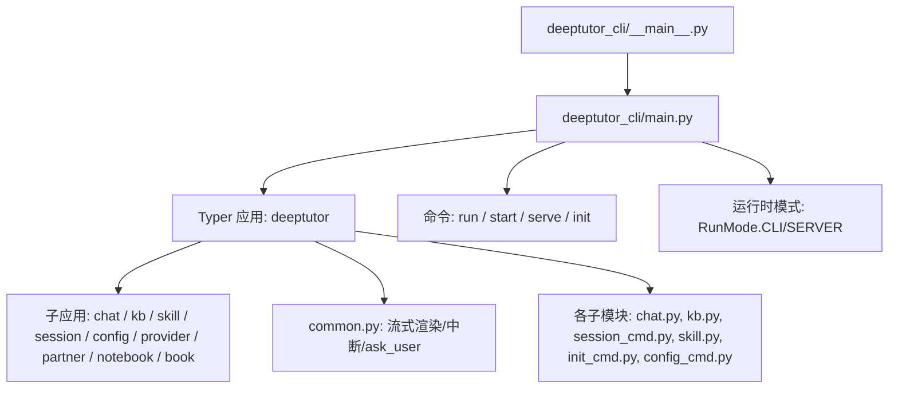
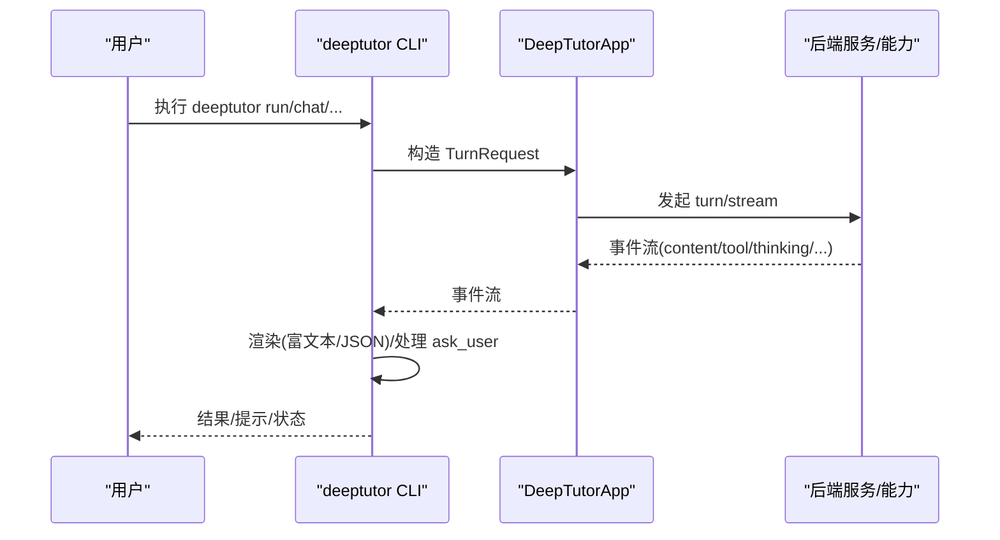
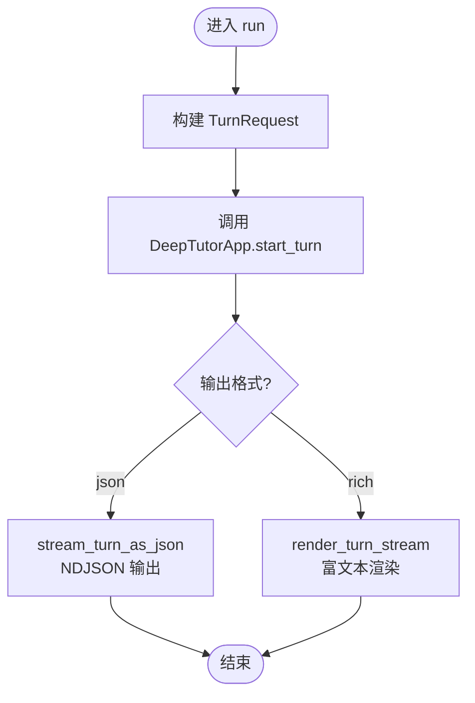
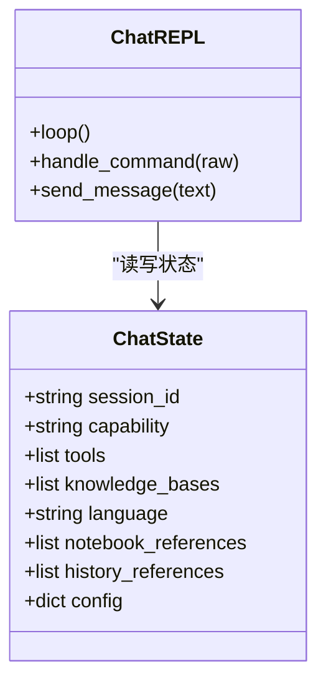
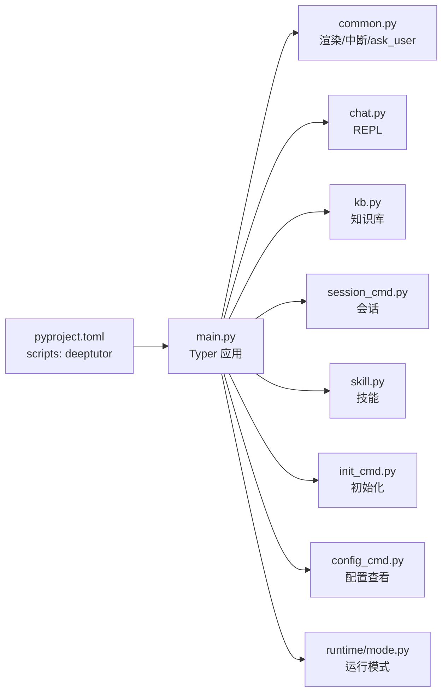

# CLI工具概览

<cite>
**本文引用的文件**
- [deeptutor_cli/__main__.py](file://deeptutor_cli/__main__.py)
- [deeptutor_cli/main.py](file://deeptutor_cli/main.py)
- [deeptutor_cli/common.py](file://deeptutor_cli/common.py)
- [deeptutor_cli/chat.py](file://deeptutor_cli/chat.py)
- [deeptutor_cli/init_cmd.py](file://deeptutor_cli/init_cmd.py)
- [deeptutor_cli/config_cmd.py](file://deeptutor_cli/config_cmd.py)
- [deeptutor_cli/kb.py](file://deeptutor_cli/kb.py)
- [deeptutor_cli/session_cmd.py](file://deeptutor_cli/session_cmd.py)
- [deeptutor_cli/skill.py](file://deeptutor_cli/skill.py)
- [packaging/deeptutor-cli/pyproject.toml](file://packaging/deeptutor-cli/pyproject.toml)
- [deeptutor/runtime/mode.py](file://deeptutor/runtime/mode.py)
</cite>

## 目录
1. [简介](#简介)
2. [项目结构](#项目结构)
3. [核心组件](#核心组件)
4. [架构总览](#架构总览)
5. [详细组件分析](#详细组件分析)
6. [依赖关系分析](#依赖关系分析)
7. [性能考虑](#性能考虑)
8. [故障排查指南](#故障排查指南)
9. [结论](#结论)
10. [附录：快速开始与常用命令](#附录快速开始与常用命令)

## 简介
DeepTutor CLI 是一个“agent-first”的命令行入口，围绕能力（capability）驱动的任务执行、交互式对话、知识库管理、会话管理、技能安装/发布等场景提供统一界面。它既支持单次任务执行（run），也支持交互式 REPL（chat），并可启动后端 API 服务（serve）或一体化启动（start）。CLI 通过 Typer 组织命令树，借助 DeepTutorApp 与后端服务交互，并以 Rich 进行终端渲染。

## 项目结构
CLI 以独立包形式暴露入口脚本，并通过 Typer 注册子命令和子应用：
- 入口与主命令：__main__.py、main.py
- 交互与通用逻辑：common.py、chat.py
- 初始化向导与配置查看：init_cmd.py、config_cmd.py
- 资源管理：kb.py（知识库）、session_cmd.py（会话）、skill.py（技能）
- 运行模式控制：runtime/mode.py
- 打包与脚本映射：packaging/deeptutor-cli/pyproject.toml

图表来源
- [deeptutor_cli/__main__.py:1-6](file://deeptutor_cli/__main__.py#L1-L6)
- [deeptutor_cli/main.py:29-72](file://deeptutor_cli/main.py#L29-L72)
- [deeptutor_cli/common.py:129-249](file://deeptutor_cli/common.py#L129-L249)
- [deeptutor/runtime/mode.py:13-48](file://deeptutor/runtime/mode.py#L13-L48)

章节来源
- [deeptutor_cli/__main__.py:1-6](file://deeptutor_cli/__main__.py#L1-L6)
- [deeptutor_cli/main.py:1-72](file://deeptutor_cli/main.py#L1-L72)
- [packaging/deeptutor-cli/pyproject.toml:52-53](file://packaging/deeptutor-cli/pyproject.toml#L52-L53)

## 核心组件
- 命令入口与模式设置：在 main.py 中创建 Typer 应用，注册所有子命令与子应用；设置运行模式为 CLI，并初始化日志。
- 统一能力执行入口 run：构建 TurnRequest 并调用 DeepTutorApp.start_turn/stream_turn，支持 rich/json 输出。
- 交互式聊天 chat：维护 ChatState，支持多轮对话、工具开关、知识库挂载、历史引用、笔记本引用、配置管理等。
- 资源管理：
  - kb：创建/添加/删除/搜索知识库，支持文档批量导入与 RAG 检索。
  - session：列出/查看/打开/重命名/删除会话。
  - skill：搜索/安装/登录/登出/发布/更新/列表/移除技能。
- 初始化向导 init：引导配置 LLM、Embedding、Search 等，并写入系统设置。
- 配置查看 config show：汇总当前端口、LLM、Embedding、Search、语言、工具等信息。

章节来源
- [deeptutor_cli/main.py:75-175](file://deeptutor_cli/main.py#L75-L175)
- [deeptutor_cli/chat.py:29-77](file://deeptutor_cli/chat.py#L29-L77)
- [deeptutor_cli/kb.py:61-287](file://deeptutor_cli/kb.py#L61-L287)
- [deeptutor_cli/session_cmd.py:15-102](file://deeptutor_cli/session_cmd.py#L15-L102)
- [deeptutor_cli/skill.py:74-564](file://deeptutor_cli/skill.py#L74-L564)
- [deeptutor_cli/init_cmd.py:412-549](file://deeptutor_cli/init_cmd.py#L412-L549)
- [deeptutor_cli/config_cmd.py:16-93](file://deeptutor_cli/config_cmd.py#L16-L93)

## 架构总览
CLI 作为 agent-first 接口，将用户意图转化为 TurnRequest，交由 DeepTutorApp 调度能力执行，并通过事件流（content、tool_call、tool_result、thinking、stage_* 等）实时渲染到终端。CLI 同时支持 JSON 管道输出，便于自动化集成。

图表来源
- [deeptutor_cli/main.py:75-114](file://deeptutor_cli/main.py#L75-L114)
- [deeptutor_cli/common.py:129-249](file://deeptutor_cli/common.py#L129-L249)
- [deeptutor_cli/chat.py:163-175](file://deeptutor_cli/chat.py#L163-L175)

## 详细组件分析

### 命令结构与子命令组织
- 顶层命令：
  - run：单轮能力执行（agent-first 入口）
  - start：启动后端+前端一体化服务
  - serve：仅启动 API 服务
  - init：交互式初始化向导
- 子应用（按功能分组）：
  - chat：交互式 REPL
  - kb：知识库管理
  - skill/skills：技能管理（含别名）
  - session：会话管理
  - plugin：插件信息
  - config：配置查看
  - provider：提供方认证
  - partner：伙伴渠道
  - notebook：笔记本管理
  - book：BookEngine 管理

章节来源
- [deeptutor_cli/main.py:29-72](file://deeptutor_cli/main.py#L29-L72)

### run 命令：能力执行的统一入口
- 参数包括 capability、message、session、tools、knowledge_bases、language、config、config_json、notebook_ref、history_ref、format。
- 内部构建 TurnRequest 并调用 DeepTutorApp.start_turn，随后根据格式选择 JSON 流或富文本渲染。
- 支持 Ctrl-C 中断、ask_user 自动空回复（非交互时）等健壮性设计。

图表来源
- [deeptutor_cli/main.py:75-114](file://deeptutor_cli/main.py#L75-L114)
- [deeptutor_cli/common.py:129-203](file://deeptutor_cli/common.py#L129-L203)

章节来源
- [deeptutor_cli/main.py:75-114](file://deeptutor_cli/main.py#L75-L114)
- [deeptutor_cli/common.py:129-203](file://deeptutor_cli/common.py#L129-L203)

### chat 命令：交互式 REPL
- 维护 ChatState（会话ID、能力、工具、知识库、语言、笔记本/历史引用、配置）。
- 支持内置命令：/quit、/new、/session、/status、/refs、/tool on/off、/cap、/kb、/history add/clear、/notebook add/clear、/show last|n、/regenerate/retry、/config show/set/clear。
- 通过 DeepTutorApp 发送消息，使用 common 中的渲染器处理事件流与 ask_user。

图表来源
- [deeptutor_cli/chat.py:29-77](file://deeptutor_cli/chat.py#L29-L77)
- [deeptutor_cli/chat.py:126-179](file://deeptutor_cli/chat.py#L126-L179)
- [deeptutor_cli/chat.py:182-268](file://deeptutor_cli/chat.py#L182-L268)

章节来源
- [deeptutor_cli/chat.py:29-77](file://deeptutor_cli/chat.py#L29-L77)
- [deeptutor_cli/chat.py:126-179](file://deeptutor_cli/chat.py#L126-L179)
- [deeptutor_cli/chat.py:182-268](file://deeptutor_cli/chat.py#L182-L268)

### 知识库管理 kb
- list/info/create/add/delete/search：支持文档路径与目录批量导入、默认 KB 设置、RAG 搜索。
- 内部通过 KnowledgeBaseManager 与 LlamaIndex 相关能力完成索引与检索。

章节来源
- [deeptutor_cli/kb.py:61-287](file://deeptutor_cli/kb.py#L61-L287)

### 会话管理 session
- list/show/open/delete/rename：列出会话、查看消息、进入 REPL 继续对话、删除与重命名。

章节来源
- [deeptutor_cli/session_cmd.py:15-102](file://deeptutor_cli/session_cmd.py#L15-L102)

### 技能管理 skill
- search/install/login/logout/publish/update/list/remove：从 Hub 搜索/安装技能，浏览器授权登录，发布/更新本地技能，列出本地技能及来源。

章节来源
- [deeptutor_cli/skill.py:74-564](file://deeptutor_cli/skill.py#L74-L564)

### 初始化向导 init
- 四步/五步向导：端口（可选）、LLM、Embedding、Search、审查保存。
- 写入 system.json、model_catalog.json、main.yaml 等配置文件，支持 --cli 模式跳过端口步骤。

章节来源
- [deeptutor_cli/init_cmd.py:412-549](file://deeptutor_cli/init_cmd.py#L412-L549)

### 配置查看 config
- config show：输出端口、LLM、Embedding、Search、语言、工具等当前配置摘要。

章节来源
- [deeptutor_cli/config_cmd.py:16-93](file://deeptutor_cli/config_cmd.py#L16-L93)

### 运行模式：CLI 与服务器
- main.py 在 CLI 入口设置 RunMode.CLI；serve 命令设置 RunMode.SERVER。
- 运行模式影响后续模块是否加载服务端依赖。

章节来源
- [deeptutor_cli/main.py:26-27](file://deeptutor_cli/main.py#L26-L27)
- [deeptutor_cli/main.py:132-175](file://deeptutor_cli/main.py#L132-L175)
- [deeptutor/runtime/mode.py:13-48](file://deeptutor/runtime/mode.py#L13-L48)

## 依赖关系分析
- CLI 包通过 pyproject.toml 暴露脚本 deeptutor -> main.main。
- main.py 集中注册 Typer 子应用与命令，依赖 logging、runtime mode、以及各子模块的 register 函数。
- common.py 提供统一的流式渲染、中断处理、ask_user 处理、工具结果缓冲等。
- 各子模块通过 Typer 的 app.add_typer 挂载到主应用。

图表来源
- [packaging/deeptutor-cli/pyproject.toml:52-53](file://packaging/deeptutor-cli/pyproject.toml#L52-L53)
- [deeptutor_cli/main.py:29-72](file://deeptutor_cli/main.py#L29-L72)
- [deeptutor_cli/common.py:129-249](file://deeptutor_cli/common.py#L129-L249)

章节来源
- [packaging/deeptutor-cli/pyproject.toml:52-53](file://packaging/deeptutor-cli/pyproject.toml#L52-L53)
- [deeptutor_cli/main.py:29-72](file://deeptutor_cli/main.py#L29-L72)

## 性能考虑
- 流式渲染：common 中对 content 分块进行缓冲并按 round 结算，避免频繁刷新终端；对长工具结果进行截断显示，支持 /show 展开。
- 中断处理：SIGINT 拦截器确保 Ctrl-C 安全取消 turn，不破坏 REPL 循环。
- JSON 输出：NDJSON 逐行输出，适合管道与自动化解析，避免富文本标记污染数据。
- 事件流优化：对 llm_chunk 与 call_status 做区分，减少不必要的渲染开销。

章节来源
- [deeptutor_cli/common.py:316-499](file://deeptutor_cli/common.py#L316-L499)
- [deeptutor_cli/common.py:264-293](file://deeptutor_cli/common.py#L264-L293)
- [deeptutor_cli/common.py:185-203](file://deeptutor_cli/common.py#L185-L203)

## 故障排查指南
- 启动 API 服务失败：若 uvicorn 未安装，会打印错误并退出；需安装完整依赖。
- ask_user 在非交互环境：自动提交空回复，避免挂起。
- 会话不存在：session 相关命令会提示未找到并返回非零退出码。
- 知识库操作失败：创建/添加/删除/搜索异常会打印错误并退出。
- 技能安装/发布失败：HubError、SkillImportError 等会被捕获并输出原因。
- 配置问题：config show 可快速检查端口、LLM、Embedding、Search 的状态与敏感信息遮蔽。

章节来源
- [deeptutor_cli/main.py:154-161](file://deeptutor_cli/main.py#L154-L161)
- [deeptutor_cli/common.py:521-534](file://deeptutor_cli/common.py#L521-L534)
- [deeptutor_cli/session_cmd.py:60-102](file://deeptutor_cli/session_cmd.py#L60-L102)
- [deeptutor_cli/kb.py:139-287](file://deeptutor_cli/kb.py#L139-L287)
- [deeptutor_cli/skill.py:108-170](file://deeptutor_cli/skill.py#L108-L170)
- [deeptutor_cli/config_cmd.py:16-93](file://deeptutor_cli/config_cmd.py#L16-L93)

## 结论
DeepTutor CLI 以“能力优先”的设计，将复杂的多 agent 工作流封装为简洁的命令与交互界面。通过 run 实现一次性任务执行，通过 chat 提供人类友好的多轮对话，配合 kb/session/skill 等资源管理能力，形成完整的 CLI 工作流。其流式渲染与中断处理保证了良好的用户体验，JSON 输出则满足自动化集成需求。

## 附录：快速开始与常用命令
- 安装与初始化
  - 仅 CLI：克隆仓库后安装 CLI-only 包，运行 deeptutor init --cli 配置 LLM/Embedding/Search。
  - 完整服务：pip install deeptutor，运行 deeptutor init。
- 常用命令示例
  - 对话：deeptutor run chat "什么是傅里叶变换？" -l zh
  - 深度解题：deeptutor run deep_solve "证明 n^3-n 能被 6 整除" -t rag --kb math-textbook
  - 智能出题：deeptutor run deep_question "线性代数" --config num_questions=5 --config difficulty=hard
  - 深度研究：deeptutor run deep_research "Transformer 最新进展" --config-json '{"mode":"report","depth":"deep","sources":["web","papers"]}'
  - 可视化：deeptutor run visualize "画出注意力机制的数据流图" --config render_mode=mermaid
  - 数学动画：deeptutor run math_animator "展示正弦函数变换" --config quality=high
  - 掌握式学习：deeptutor run mastery_path "带我系统掌握特征值和特征向量"
  - JSON 输出：deeptutor run deep_solve "求解 x^2=4" -f json
- 资源管理
  - 知识库：deeptutor kb create/list/info/add/search/delete
  - 会话：deeptutor session list/show/open/rename/delete
  - 技能：deeptutor skill search/install/login/logout/publish/update/list/remove
  - 配置：deeptutor config show
- 服务模式
  - 启动 API：deeptutor serve [--host] [--port] [--reload]
  - 启动一体化：deeptutor start [--home] [--dev]

章节来源
- [packaging/deeptutor-cli/pyproject.toml:5-53](file://packaging/deeptutor-cli/pyproject.toml#L5-L53)
- [deeptutor_cli/main.py:75-175](file://deeptutor_cli/main.py#L75-L175)
- [deeptutor_cli/kb.py:61-287](file://deeptutor_cli/kb.py#L61-L287)
- [deeptutor_cli/session_cmd.py:15-102](file://deeptutor_cli/session_cmd.py#L15-L102)
- [deeptutor_cli/skill.py:74-564](file://deeptutor_cli/skill.py#L74-L564)
- [deeptutor_cli/config_cmd.py:16-93](file://deeptutor_cli/config_cmd.py#L16-L93)