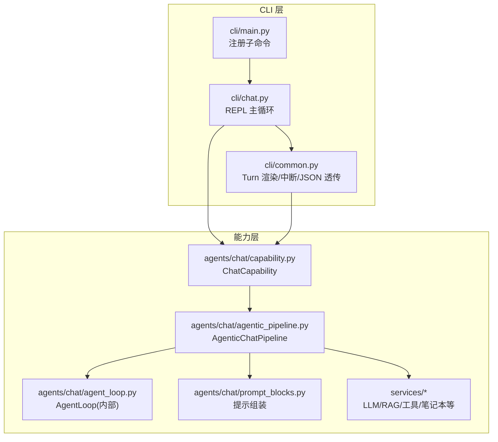
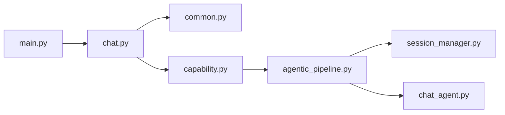

# 交互式聊天REPL

<cite>
**本文引用的文件**
- [deeptutor_cli/chat.py](file://deeptutor_cli/chat.py)
- [deeptutor_cli/common.py](file://deeptutor_cli/common.py)
- [deeptutor_cli/main.py](file://deeptutor_cli/main.py)
- [deeptutor/agents/chat/capability.py](file://deeptutor/agents/chat/capability.py)
- [deeptutor/agents/chat/agentic_pipeline.py](file://deeptutor/agents/chat/agentic_pipeline.py)
- [deeptutor/agents/chat/session_manager.py](file://deeptutor/agents/chat/session_manager.py)
- [deeptutor/agents/chat/chat_agent.py](file://deeptutor/agents/chat/chat_agent.py)
</cite>

## 目录
1. [简介](#简介)
2. [项目结构](#项目结构)
3. [核心组件](#核心组件)
4. [架构总览](#架构总览)
5. [详细组件分析](#详细组件分析)
6. [依赖关系分析](#依赖关系分析)
7. [性能注意事项](#性能注意事项)
8. [故障排除指南](#故障排除指南)
9. [结论](#结论)
10. [附录：常用命令与参数速查](#附录：常用命令与参数速查)

## 简介
本文件面向使用 DeepTutor CLI 的“交互式聊天 REPL”（即 `deeptutor chat`），提供从启动、会话管理、消息发送、能力与工具选择，到配置项（语言、知识库、笔记本引用等）的完整说明。文档同时覆盖交互流程、上下文与历史、常见场景示例、故障排除与性能优化建议，帮助你在命令行中高效开展日常问答、深度研究、可视化生成等工作。

## 项目结构
DeepTutor 的交互式聊天 REPL 由 CLI 层与后端能力层协同完成：
- CLI 层负责解析命令、维护本地状态、渲染流式输出、处理用户输入与命令。
- 能力层通过统一的“能力协议”将聊天封装为可编排的探索-响应循环，并挂载工具、知识库、笔记本等资源。



图表来源
- [deeptutor_cli/main.py:29-71](file://deeptutor_cli/main.py#L29-L71)
- [deeptutor_cli/chat.py:41-77](file://deeptutor_cli/chat.py#L41-L77)
- [deeptutor_cli/common.py:129-147](file://deeptutor_cli/common.py#L129-L147)
- [deeptutor/agents/chat/capability.py:12-27](file://deeptutor/agents/chat/capability.py#L12-L27)
- [deeptutor/agents/chat/agentic_pipeline.py:185-346](file://deeptutor/agents/chat/agentic_pipeline.py#L185-L346)

章节来源
- [deeptutor_cli/main.py:29-71](file://deeptutor_cli/main.py#L29-L71)
- [deeptutor_cli/chat.py:41-77](file://deeptutor_cli/chat.py#L41-L77)
- [deeptutor/agents/chat/capability.py:12-27](file://deeptutor/agents/chat/capability.py#L12-L27)
- [deeptutor/agents/chat/agentic_pipeline.py:185-346](file://deeptutor/agents/chat/agentic_pipeline.py#L185-L346)

## 核心组件
- CLI 聊天入口与状态机：负责启动 REPL、读取输入、解析命令、维护会话与能力/工具/知识库/笔记本引用等状态。
- Turn 渲染器：将后端的流式事件渲染为终端可读内容，支持 JSON 模式、ask_user 交互、Ctrl-C 中断、来源引用展示。
- 聊天能力与管道：将聊天包装为“探索-响应”循环，动态装配系统提示、工具清单、知识库种子、笔记本清单，并驱动 LLM 调用与工具执行。
- 会话管理器：持久化聊天会话（创建、追加消息、更新、摘要）。

章节来源
- [deeptutor_cli/chat.py:29-77](file://deeptutor_cli/chat.py#L29-L77)
- [deeptutor_cli/common.py:129-147](file://deeptutor_cli/common.py#L129-L147)
- [deeptutor/agents/chat/capability.py:12-27](file://deeptutor/agents/chat/capability.py#L12-L27)
- [deeptutor/agents/chat/agentic_pipeline.py:185-346](file://deeptutor/agents/chat/agentic_pipeline.py#L185-L346)
- [deeptutor/agents/chat/session_manager.py:20-164](file://deeptutor/agents/chat/session_manager.py#L20-L164)

## 架构总览
下图展示了从 CLI 输入到能力执行的端到端流程，包括命令解析、Turn 发起、流式渲染、工具调用与结果回显。

```mermaid
sequenceDiagram
participant U as "用户"
participant CLI as "cli/chat.py<br/>REPL"
participant COM as "cli/common.py<br/>run_turn_and_render"
participant APP as "DeepTutorApp"
participant CAP as "ChatCapability"
participant PIPE as "AgenticChatPipeline"
participant LOOP as "AgentLoop"
participant TOOLS as "工具/知识/笔记本"
participant LLM as "LLM 服务"
U->>CLI : 输入消息或命令
CLI->>COM : 构造 TurnRequest 并调用
COM->>APP : start_turn(request)
APP->>CAP : run(context, stream)
CAP->>PIPE : run(context, stream)
PIPE->>LOOP : 初始化并运行探索-响应循环
LOOP->>TOOLS : 按需调用工具/检索/写入
LOOP->>LLM : 多轮推理与回答
LLM-->>LOOP : 流式文本/工具调用
LOOP-->>PIPE : 阶段/工具/结果事件
PIPE-->>APP : 事件流
APP-->>COM : 事件流
COM-->>CLI : 渲染输出/来源/统计
CLI-->>U : 终端显示
```

图表来源
- [deeptutor_cli/chat.py:80-179](file://deeptutor_cli/chat.py#L80-L179)
- [deeptutor_cli/common.py:129-147](file://deeptutor_cli/common.py#L129-L147)
- [deeptutor/agents/chat/capability.py:25-27](file://deeptutor/agents/chat/capability.py#L25-L27)
- [deeptutor/agents/chat/agentic_pipeline.py:326-346](file://deeptutor/agents/chat/agentic_pipeline.py#L326-L346)

## 详细组件分析

### CLI 聊天 REPL 与命令
- 启动方式
  - 进入交互式 REPL：`deeptutor chat`
  - 单轮执行：`deeptutor run <capability> "<message>"`
- 启动参数（部分）
  - --session：恢复已有会话
  - --tool/-t：预启用工具
  - --capability/-c：初始能力（默认 chat）
  - --kb：预附加知识库
  - --notebook-ref：笔记本引用
  - --history-ref：历史会话引用
  - --language/-l：响应语言
  - --config/--config-json：能力配置键值对或 JSON
- REPL 内置命令（在聊天过程中输入以 / 开头的命令）
  - /quit：退出 REPL
  - /session：查看当前会话 ID
  - /status：打印当前状态（会话、能力、工具、知识库、历史、笔记本、语言、配置）
  - /new 或 /clear：新建聊天上下文
  - /regenerate 或 /retry：重新生成上一条用户消息的结果
  - /tool on|off <name>：开启/关闭某工具
  - /cap <name>：切换能力
  - /kb <name>|none：附加或清空知识库
  - /history add <id> | /history clear：添加/清空历史会话引用
  - /notebook add <ref> | /notebook clear：添加/清空笔记本引用
  - /show last|<n>：展开最近或指定编号的工具结果或思考过程
  - /refs：打印当前状态（同 /status 的格式化输出）
  - /config show|set|clear：查看/设置/清空能力配置
- 多行输入
  - 以反斜杠结尾可续行，最终合并为一整条消息提交

章节来源
- [deeptutor_cli/chat.py:41-77](file://deeptutor_cli/chat.py#L41-L77)
- [deeptutor_cli/chat.py:126-179](file://deeptutor_cli/chat.py#L126-L179)
- [deeptutor_cli/chat.py:182-268](file://deeptutor_cli/chat.py#L182-L268)
- [deeptutor_cli/chat.py:271-283](file://deeptutor_cli/chat.py#L271-L283)
- [deeptutor_cli/main.py:75-114](file://deeptutor_cli/main.py#L75-L114)

### Turn 渲染与交互
- 流式渲染
  - 将后端的 stage_start/content/tool_call/tool_result/error/sources/done 等事件逐步渲染到终端。
  - 支持 Markdown 输出、工具调用头与结果预览、来源引用列表、轮次/工具/Token/成本统计。
- ask_user 交互
  - 当工具需要用户输入时，REPL 会弹出问题卡片；非交互式环境自动返回空答案以保证流程继续。
- 中断与取消
  - 流式期间 Ctrl-C 会取消当前 turn，但不会退出 REPL；等待 ask_user 时 Ctrl-C 可中止提问。
- JSON 模式
  - 通过 `--format json` 将事件以 NDJSON 形式输出，便于外部消费。

章节来源
- [deeptutor_cli/common.py:129-147](file://deeptutor_cli/common.py#L129-L147)
- [deeptutor_cli/common.py:150-182](file://deeptutor_cli/common.py#L150-L182)
- [deeptutor_cli/common.py:185-249](file://deeptutor_cli/common.py#L185-L249)
- [deeptutor_cli/common.py:316-690](file://deeptutor_cli/common.py#L316-L690)

### 聊天能力与管道
- ChatCapability
  - 声明能力名称、描述、阶段（exploring/responding）、使用的工具集合、CLI 别名与请求 Schema。
- AgenticChatPipeline
  - 负责装配系统提示、工具清单、知识库种子、笔记本清单、能力专属块，构建消息序列，驱动 AgentLoop。
  - 控制每轮最大 Token、温度、最大轮数等；根据上下文与授权决定可用工具与执行权限。
  - 支持原生工具调用（OpenAI 兼容）与延迟加载的外部工具（MCP/CLI Apps）。
- AgentLoop（内部）
  - 实现“探索-响应”循环：多轮 LLM 推理与工具调用，直到无更多工具调用则结束。

章节来源
- [deeptutor/agents/chat/capability.py:12-27](file://deeptutor/agents/chat/capability.py#L12-L27)
- [deeptutor/agents/chat/agentic_pipeline.py:185-346](file://deeptutor/agents/chat/agentic_pipeline.py#L185-L346)
- [deeptutor/agents/chat/agentic_pipeline.py:348-458](file://deeptutor/agents/chat/agentic_pipeline.py#L348-L458)
- [deeptutor/agents/chat/agentic_pipeline.py:586-624](file://deeptutor/agents/chat/agentic_pipeline.py#L586-L624)

### 会话管理与历史
- SessionManager
  - 继承通用会话基类，为聊天模块提供会话创建、消息追加、更新与摘要。
  - 每个会话包含标题、消息列表、设置、时间戳等。
- 历史与会话引用
  - 可通过 --history-ref 在启动时引用历史会话；REPL 中也可用 /history add/clear 动态管理。
  - 管道会在系统提示中注入对话摘要，以压缩历史节省上下文窗口。

章节来源
- [deeptutor/agents/chat/session_manager.py:20-164](file://deeptutor/agents/chat/session_manager.py#L20-L164)
- [deeptutor/agents/chat/agentic_pipeline.py:374-415](file://deeptutor/agents/chat/agentic_pipeline.py#L374-L415)

### 简单聊天代理（轻量模式）
- ChatAgent
  - 提供轻量级多轮聊天能力，支持历史截断、RAG/Web 搜索增强、流式与非流式生成。
  - 适合不需要复杂工具链的场景，或作为其他能力的参考实现。

章节来源
- [deeptutor/agents/chat/chat_agent.py:21-66](file://deeptutor/agents/chat/chat_agent.py#L21-L66)
- [deeptutor/agents/chat/chat_agent.py:89-156](file://deeptutor/agents/chat/chat_agent.py#L89-L156)
- [deeptutor/agents/chat/chat_agent.py:158-228](file://deeptutor/agents/chat/chat_agent.py#L158-L228)
- [deeptutor/agents/chat/chat_agent.py:230-310](file://deeptutor/agents/chat/chat_agent.py#L230-L310)
- [deeptutor/agents/chat/chat_agent.py:312-431](file://deeptutor/agents/chat/chat_agent.py#L312-L431)

## 依赖关系分析
- CLI 依赖
  - main.py 注册各子命令（chat、run、start、serve 等）。
  - chat.py 依赖 common.py 的 Turn 渲染与工具结果缓存。
- 能力层依赖
  - capability.py 声明能力元数据并委托给 pipeline。
  - agentic_pipeline.py 聚合工具、知识库、笔记本、能力块，构建消息并驱动循环。
  - session_manager.py 提供会话持久化。
  - chat_agent.py 提供轻量聊天实现（可选）。



图表来源
- [deeptutor_cli/main.py:29-71](file://deeptutor_cli/main.py#L29-L71)
- [deeptutor_cli/chat.py:41-77](file://deeptutor_cli/chat.py#L41-L77)
- [deeptutor/agents/chat/capability.py:12-27](file://deeptutor/agents/chat/capability.py#L12-L27)
- [deeptutor/agents/chat/agentic_pipeline.py:185-346](file://deeptutor/agents/chat/agentic_pipeline.py#L185-L346)
- [deeptutor/agents/chat/session_manager.py:20-164](file://deeptutor/agents/chat/session_manager.py#L20-L164)
- [deeptutor/agents/chat/chat_agent.py:21-66](file://deeptutor/agents/chat/chat_agent.py#L21-L66)

章节来源
- [deeptutor_cli/main.py:29-71](file://deeptutor_cli/main.py#L29-L71)
- [deeptutor_cli/chat.py:41-77](file://deeptutor_cli/chat.py#L41-L77)
- [deeptutor/agents/chat/capability.py:12-27](file://deeptutor/agents/chat/capability.py#L12-L27)
- [deeptutor/agents/chat/agentic_pipeline.py:185-346](file://deeptutor/agents/chat/agentic_pipeline.py#L185-L346)

## 性能注意事项
- 上下文窗口与历史截断
  - 管道会在系统提示中注入对话摘要，避免过长历史导致窗口溢出。
  - 轻量 ChatAgent 支持按 Token 限制的历史截断。
- 轮次与 Token 预算
  - 管道支持 per-round 的 Token 上限与最大轮数，防止无限循环。
- 工具调用开销
  - 仅启用必要工具可减少模型负担；未配置的生成类工具会被自动剔除。
- 流式渲染
  - 使用流式输出提升首字延迟体验；JSON 模式适合自动化流水线。
- 中断与取消
  - 合理中断长时间任务，避免资源浪费。

[本节为通用指导，不直接分析具体文件]

## 故障排除指南
- 无法解码终端输入
  - 现象：UnicodeDecodeError
  - 处理：检查终端编码，确保 UTF-8；必要时重启终端。
- 无法恢复会话
  - 现象：Session not found
  - 处理：确认 --session 传入的 ID 有效；或使用 /new 新建会话。
- 无法重新生成
  - 现象：nothing_to_regenerate / regenerate_busy
  - 处理：先发送一条消息再重试；或在后台任务完成后重试。
- ask_user 阻塞
  - 现象：非交互式环境卡住
  - 处理：自动发送空答案继续；或在交互式环境输入答案。
- 工具不可用
  - 现象：工具不在可用列表
  - 处理：使用 /tool on 启用；或通过 --tool 启动时预启用；检查权限与配置。
- 能力切换无效
  - 现象：/cap 切换后行为不符预期
  - 处理：确认能力存在且已安装；必要时重启 REPL 或重新加载配置。

章节来源
- [deeptutor_cli/chat.py:126-179](file://deeptutor_cli/chat.py#L126-L179)
- [deeptutor_cli/chat.py:182-268](file://deeptutor_cli/chat.py#L182-L268)
- [deeptutor_cli/common.py:150-182](file://deeptutor_cli/common.py#L150-L182)
- [deeptutor_cli/common.py:500-534](file://deeptutor_cli/common.py#L500-L534)

## 结论
DeepTutor 的交互式聊天 REPL 提供了强大的命令行交互能力：支持多轮对话、能力与工具动态选择、知识库与笔记本引用、历史会话复用、流式渲染与中断控制。通过合理的配置与命令组合，你可以快速完成日常问答、深度研究、可视化生成等多种任务。建议在长会话中使用 /status 与 /refs 监控状态，结合 /tool 与 /kb 精准控制能力范围，以获得最佳体验。

[本节为总结性内容，不直接分析具体文件]

## 附录：常用命令与参数速查
- 启动与基础
  - deeptutor chat：进入交互式聊天 REPL
  - deeptutor run <capability> "<message>"：单轮执行能力
- 启动参数（节选）
  - --session：恢复会话
  - --tool/-t：预启用工具
  - --capability/-c：初始能力
  - --kb：预附加知识库
  - --notebook-ref：笔记本引用
  - --history-ref：历史会话引用
  - --language/-l：响应语言
  - --config/--config-json：能力配置
- REPL 命令（节选）
  - /quit：退出
  - /session：查看会话 ID
  - /status：打印状态
  - /new 或 /clear：新建上下文
  - /regenerate 或 /retry：重新生成上一条
  - /tool on|off <name>：开关工具
  - /cap <name>：切换能力
  - /kb <name>|none：附加/清空知识库
  - /history add <id> | /history clear：管理历史引用
  - /notebook add <ref> | /notebook clear：管理笔记本引用
  - /show last|<n>：展开工具结果或思考
  - /refs：打印状态
  - /config show|set|clear：管理能力配置

章节来源
- [deeptutor_cli/chat.py:41-77](file://deeptutor_cli/chat.py#L41-L77)
- [deeptutor_cli/chat.py:126-179](file://deeptutor_cli/chat.py#L126-L179)
- [deeptutor_cli/chat.py:182-268](file://deeptutor_cli/chat.py#L182-L268)
- [deeptutor_cli/main.py:75-114](file://deeptutor_cli/main.py#L75-L114)