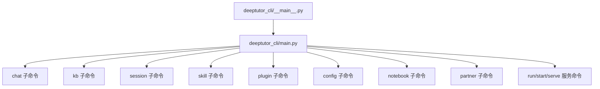
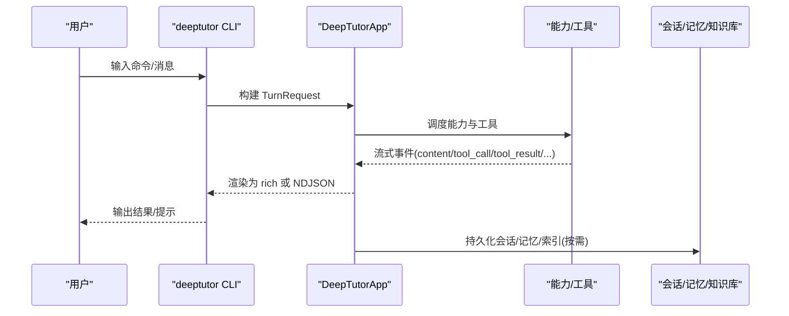
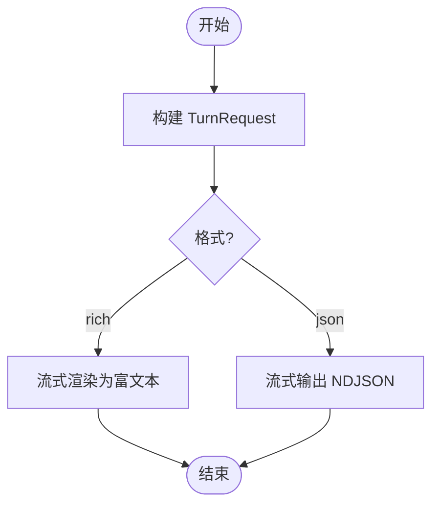
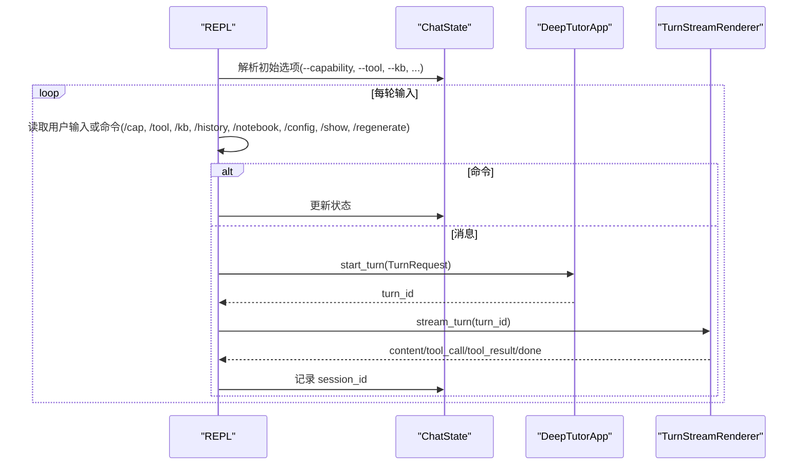
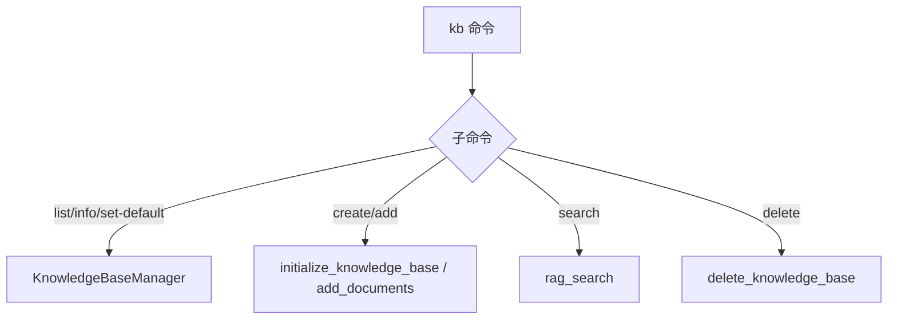
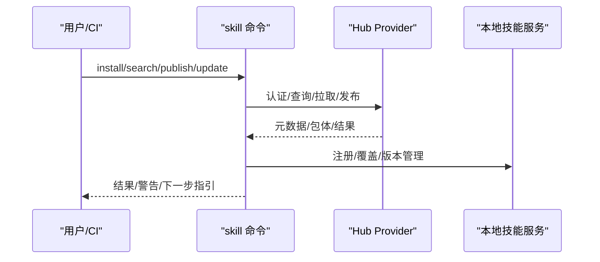
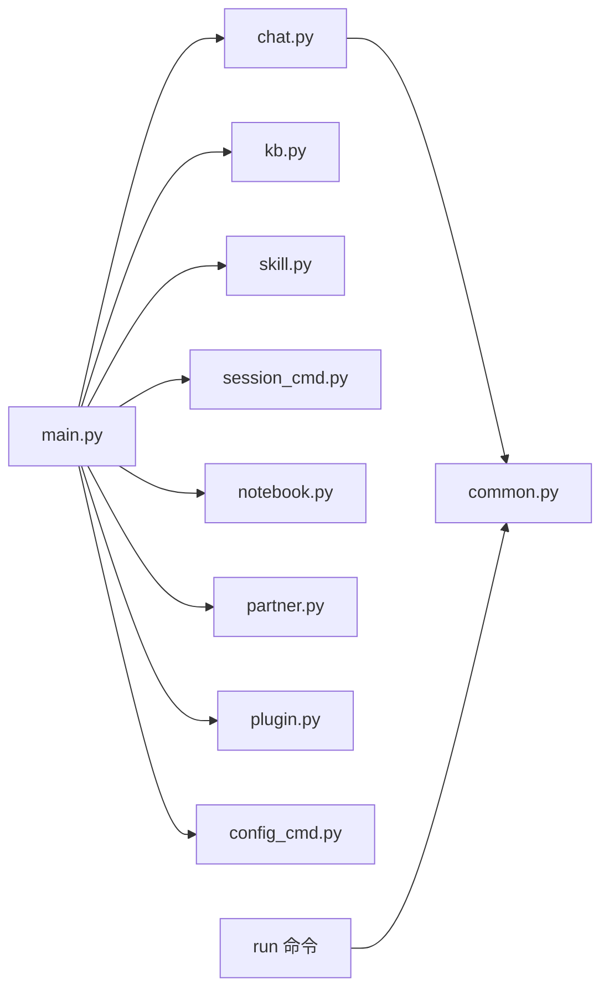

# 命令行工具

<cite>
**本文引用的文件**
- [__main__.py](file://deeptutor_cli/__main__.py)
- [main.py](file://deeptutor_cli/main.py)
- [chat.py](file://deeptutor_cli/chat.py)
- [common.py](file://deeptutor_cli/common.py)
- [kb.py](file://deeptutor_cli/kb.py)
- [skill.py](file://deeptutor_cli/skill.py)
- [memory.py](file://deeptutor_cli/memory.py)
- [session_cmd.py](file://deeptutor_cli/session_cmd.py)
- [config_cmd.py](file://deeptutor_cli/config_cmd.py)
- [notebook.py](file://deeptutor_cli/notebook.py)
- [partner.py](file://deeptutor_cli/partner.py)
- [plugin.py](file://deeptutor_cli/plugin.py)
- [README.md](file://README.md)
</cite>

## 目录
1. [简介](#简介)
2. [项目结构](#项目结构)
3. [核心组件](#核心组件)
4. [架构总览](#架构总览)
5. [详细组件分析](#详细组件分析)
6. [依赖关系分析](#依赖关系分析)
7. [性能与可观测性](#性能与可观测性)
8. [故障排除指南](#故障排除指南)
9. [结论](#结论)
10. [附录：快速参考与自动化示例](#附录：快速参考与自动化示例)

## 简介
本文件面向使用 DeepTutor 命令行工具的工程师与自动化流程，系统说明 CLI 的能力、命令语法、交互式 REPL 用法、批量与脚本化执行方式、知识库/技能/记忆等高级功能，以及 JSON 输出与外部系统集成方法。文档同时给出在 CI/CD 中集成 CLI 的可行路径与常见问题排查建议。

## 项目结构
CLI 入口由 Typer 组织，按能力域拆分子应用（聊天、知识库、会话、技能、插件、配置、笔记本、伙伴等），并通过统一入口注册命令。顶层提供单轮运行、启动 Web、启动 API 等服务型命令。

图表来源
- [main.py:29-73](file://deeptutor_cli/main.py#L29-L73)

章节来源
- [__main__.py:1-6](file://deeptutor_cli/__main__.py#L1-L6)
- [main.py:29-73](file://deeptutor_cli/main.py#L29-L73)

## 核心组件
- 统一入口与模式设置：设置 CLI 运行模式并初始化日志。
- 命令注册中心：将各子模块的命令挂载到主 Typer 应用。
- 单轮执行器：通过 `run` 命令以“能力+消息”的方式一次性调用，支持 JSON 输出。
- 交互式 REPL：`chat` 子命令提供会话级状态管理、工具开关、能力切换、知识基引用、历史引用、配置查看/设置等。
- 共享渲染与流式处理：基于事件流的富文本或 NDJSON 输出，支持中断、ask_user 自动应答、来源展示。
- 领域命令集：KB、Skill、Memory、Session、Notebook、Partner、Plugin、Config 等。

章节来源
- [main.py:75-179](file://deeptutor_cli/main.py#L75-L179)
- [chat.py:41-180](file://deeptutor_cli/chat.py#L41-L180)
- [common.py:129-250](file://deeptutor_cli/common.py#L129-L250)

## 架构总览
CLI 作为前端交互层，通过 DeepTutorApp 与后端能力/工具/存储交互；REPL 和 run 共用同一套请求构建与渲染管线。

图表来源
- [main.py:98-114](file://deeptutor_cli/main.py#L98-L114)
- [common.py:129-250](file://deeptutor_cli/common.py#L129-L250)

## 详细组件分析

### 单轮执行：deeptutor run
- 作用：以一次调用完成“能力 + 消息”的执行，适合脚本化与自动化。
- 关键参数：
  - capability：能力名（如 chat、deep_solve、deep_question、deep_research、visualize、math_animator、mastery_path）
  - message：要发送的消息
  - session：复用已有会话 ID
  - tool/-t：启用工具列表
  - --kb：关联的知识库
  - --notebook-ref/--history-ref：笔记本/历史引用
  - --language/-l：响应语言
  - --config/--config-json：能力配置键值对或 JSON
  - --format/-f：输出格式（rich | json）
- JSON 模式：当指定 --format json 时，会逐行输出 NDJSON 事件，便于管道处理与外部系统消费。

图表来源
- [main.py:75-114](file://deeptutor_cli/main.py#L75-L114)
- [common.py:185-203](file://deeptutor_cli/common.py#L185-L203)

章节来源
- [main.py:75-114](file://deeptutor_cli/main.py#L75-L114)
- [common.py:185-203](file://deeptutor_cli/common.py#L185-L203)

### 交互式 REPL：deeptutor chat
- 启动后可进行多轮对话，支持：
  - 能力选择：/cap <name>
  - 工具开关：/tool on|off <name>
  - 知识库绑定：/kb <name>|none
  - 历史引用：/history add <id> | /history clear
  - 笔记本引用：/notebook add <ref> | /notebook clear
  - 会话管理：/new 或 /clear 新建上下文；/session 查看当前会话
  - 重新生成：/regenerate 或 /retry 重跑上一条用户消息
  - 查看工具结果：/show last|<n>
  - 配置查看/设置：/config show|set|clear
- 非交互态下的 ask_user：若标准输入不可交互，会自动提交空回复以避免挂起。
- 中断：Ctrl-C 可在流式过程中取消当前 turn，不影响 REPL 继续运行。

图表来源
- [chat.py:41-180](file://deeptutor_cli/chat.py#L41-L180)
- [common.py:205-250](file://deeptutor_cli/common.py#L205-L250)

章节来源
- [chat.py:41-180](file://deeptutor_cli/chat.py#L41-L180)
- [common.py:205-250](file://deeptutor_cli/common.py#L205-L250)

### 知识库管理：deeptutor kb
- 常用命令：
  - list：列出所有知识库（支持 rich/json）
  - info：查看知识库详情
  - set-default：设置默认知识库
  - create：从文档创建新知识库（支持 --doc 与 --docs-dir）
  - add：向现有知识库添加文档
  - search：搜索知识库（hybrid 等模式，支持 rich/json）
  - delete：删除知识库（可选 --force）
- 内部实现要点：
  - 文档收集去重，支持递归扫描目录
  - 异步执行索引/检索任务
  - 错误时返回明确提示并退出码

图表来源
- [kb.py:61-287](file://deeptutor_cli/kb.py#L61-L287)

章节来源
- [kb.py:61-287](file://deeptutor_cli/kb.py#L61-L287)

### 技能管理：deeptutor skill
- 功能：
  - search：搜索技能仓库（支持 hub、limit）
  - install：安装技能（支持 --name、--force、--allow-unverified）
  - login/logout：浏览器授权登录/登出，令牌本地保存
  - publish/update：发布/更新技能（支持 --yes 非交互模式用于 CI）
  - list/remove：列出/移除本地技能
- 安全门：
  - 安全判定、防御性解压、frontmatter 规范化、来源锁定文件
- CI 友好：
  - 可通过环境变量或 --token 传入令牌；--yes 跳过交互

图表来源
- [skill.py:74-564](file://deeptutor_cli/skill.py#L74-L564)

章节来源
- [skill.py:74-564](file://deeptutor_cli/skill.py#L74-L564)

### 记忆查看：deeptutor memory
- show：显示 L3（合并视图）、L2（各表面文档）或单个文档
- clear：清空全部记忆、仅 L1 trace、或某表面的 L1
- 特点：直接读取文件存储的记忆，便于审计与编辑

章节来源
- [memory.py:20-100](file://deeptutor_cli/memory.py#L20-L100)

### 会话管理：deeptutor session
- list：列出会话（支持 limit）
- show：查看会话及消息（rich/json）
- open：以已有会话进入 REPL
- rename/delete：重命名或删除会话

章节来源
- [session_cmd.py:15-102](file://deeptutor_cli/session_cmd.py#L15-L102)

### 笔记本管理：deeptutor notebook
- list/create/show：列出/创建/查看笔记本及其记录
- add-md/replace-md：将 Markdown 文件添加或替换为记录
- remove-record：删除记录

章节来源
- [notebook.py:15-122](file://deeptutor_cli/notebook.py#L15-L122)

### 伙伴管理：deeptutor partner
- list/start/stop/create：列出/启停/创建伙伴实例

章节来源
- [partner.py:16-104](file://deeptutor_cli/partner.py#L16-L104)

### 插件与能力：deeptutor plugin
- list：列出已注册的工具与能力
- info：查看工具或能力的详细信息（含 OpenAI schema、可用性、默认配置等）

章节来源
- [plugin.py:19-82](file://deeptutor_cli/plugin.py#L19-L82)

### 配置查看：deeptutor config
- show：打印当前配置摘要（端口、LLM、Embedding、Search、语言、工具等）

章节来源
- [config_cmd.py:16-93](file://deeptutor_cli/config_cmd.py#L16-L93)

## 依赖关系分析
- 入口与路由：main.py 集中注册各子命令，形成清晰的命令树。
- 运行时：run 命令通过 DeepTutorApp 发起 turn；chat 子命令维护 ChatState 并在循环中复用会话。
- 渲染与流：common.py 提供统一的流式渲染、NDJSON 输出、ask_user 处理、中断与来源展示。
- 领域服务：kb/skill/memory/session/notebook/partner/plugin/config 各自封装领域逻辑，依赖对应服务模块。

图表来源
- [main.py:29-73](file://deeptutor_cli/main.py#L29-L73)
- [chat.py:41-180](file://deeptutor_cli/chat.py#L41-L180)
- [common.py:129-250](file://deeptutor_cli/common.py#L129-L250)

章节来源
- [main.py:29-73](file://deeptutor_cli/main.py#L29-L73)

## 性能与可观测性
- 流式渲染：按阶段/内容块增量输出，减少首屏延迟。
- 中断控制：SIGINT 拦截，避免 Ctrl-C 导致进程退出，而是取消当前 turn。
- 资源统计：输出 rounds/tools/tokens/cost 等摘要信息，便于评估成本与性能。
- JSON 模式：NDJSON 逐行输出，便于管道与外部系统高效消费。

章节来源
- [common.py:205-250](file://deeptutor_cli/common.py#L205-L250)
- [common.py:316-385](file://deeptutor_cli/common.py#L316-L385)

## 故障排除指南
- 无法解码终端输入：检查终端编码，重试。
- ask_user 在非交互环境：自动提交空回复，不会阻塞。
- 无法重新生成：需先发送过消息；或在有转进行中禁止重新生成。
- 知识库不存在/未找到：确认名称与默认设置。
- 技能安装失败：检查 hub 连接、令牌、安全判定；必要时加 --allow-unverified。
- 服务启动失败：缺少 uvicorn 依赖时会有明确提示；Windows 下使用 ProactorEventLoop。

章节来源
- [chat.py:126-180](file://deeptutor_cli/chat.py#L126-L180)
- [common.py:150-183](file://deeptutor_cli/common.py#L150-L183)
- [main.py:132-175](file://deeptutor_cli/main.py#L132-L175)
- [kb.py:117-287](file://deeptutor_cli/kb.py#L117-L287)
- [skill.py:108-170](file://deeptutor_cli/skill.py#L108-L170)

## 结论
DeepTutor CLI 提供了从交互式对话到脚本化执行的完整能力，支持丰富的领域操作（知识库、技能、记忆、会话、笔记本、伙伴、插件、配置）。其统一的流式渲染与 JSON 输出使得 CLI 既适合人机交互，也易于被其他 Agent 或 CI/CD 流水线集成。

## 附录：快速参考与自动化示例

### 常用命令速查
- 初始化与启动
  - deeptutor init：创建工作区配置
  - deeptutor start [--home PATH] [--dev]：启动后端+前端
  - deeptutor serve [--port PORT]：仅启动 FastAPI 后端
- 单轮执行
  - deeptutor run <capability> "<message>" [--tool ...] [--kb ...] [--config ...] [--format json]
- 交互式 REPL
  - deeptutor chat [--capability ...] [--tool ...] [--kb ...]
  - REPL 内命令：/cap、/tool on|off、/kb、/history、/notebook、/config、/show、/regenerate、/new、/clear、/session、/refs
- 知识库
  - deeptutor kb list/info/create/add/search/set-default/delete
- 技能
  - deeptutor skill search/install/list/remove/login/logout/publish/update
- 记忆
  - deeptutor memory show/clear
- 会话
  - deeptutor session list/show/open/rename/delete
- 笔记本
  - deeptutor notebook list/create/show/add-md/replace-md/remove-record
- 伙伴
  - deeptutor partner list/start/stop/create
- 插件与配置
  - deeptutor plugin list/info
  - deeptutor config show

章节来源
- [README.md:680-742](file://README.md#L680-L742)
- [main.py:75-179](file://deeptutor_cli/main.py#L75-L179)
- [chat.py:41-180](file://deeptutor_cli/chat.py#L41-L180)
- [kb.py:61-287](file://deeptutor_cli/kb.py#L61-L287)
- [skill.py:74-564](file://deeptutor_cli/skill.py#L74-L564)
- [memory.py:20-100](file://deeptutor_cli/memory.py#L20-L100)
- [session_cmd.py:15-102](file://deeptutor_cli/session_cmd.py#L15-L102)
- [notebook.py:15-122](file://deeptutor_cli/notebook.py#L15-L122)
- [partner.py:16-104](file://deeptutor_cli/partner.py#L16-L104)
- [plugin.py:19-82](file://deeptutor_cli/plugin.py#L19-L82)
- [config_cmd.py:16-93](file://deeptutor_cli/config_cmd.py#L16-L93)

### 自动化工作流示例
- 单轮 JSON 输出并管道处理
  - 示例思路：使用 --format json 获取 NDJSON，用 jq 提取 session_id 或最终答案，再串联下一轮。
- 链式会话
  - 捕获上一轮的 session_id，作为下一轮的 --session 参数，实现状态保持。
- 批量知识库索引
  - 使用 kb create/add 批量导入文档，结合 --docs-dir 递归扫描。
- 技能发布流水线
  - 使用 skill publish --yes 配合 --track 与 --version，在 CI 中非交互发布。
- 定时任务
  - 结合 cron 或系统调度器定期执行 deeptutor run 或 kb search，并将结果写入笔记或知识库。

章节来源
- [common.py:185-203](file://deeptutor_cli/common.py#L185-L203)
- [skill.py:242-363](file://deeptutor_cli/skill.py#L242-L363)
- [kb.py:139-227](file://deeptutor_cli/kb.py#L139-L227)

### 与其他工具的集成
- 作为 Agent 工具：将 deeptutor run 包装为工具，供 Claude Code、Codex、OpenCode 等调用；传递 --format json 获得结构化输出。
- 与 CI/CD 集成：在 GitHub Actions 或其他流水线中安装 CLI，执行 init/run/kb/skill 等命令，产出工件或报告。
- 与外部系统对接：通过 NDJSON 输出接入日志系统、监控系统或下游数据处理管道。

章节来源
- [README.md:701-718](file://README.md#L701-L718)
- [common.py:185-203](file://deeptutor_cli/common.py#L185-L203)