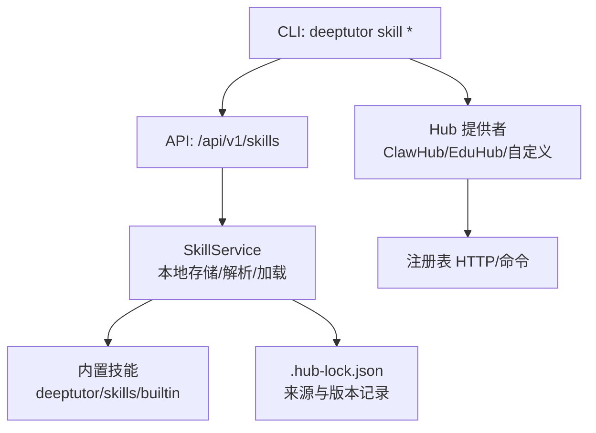
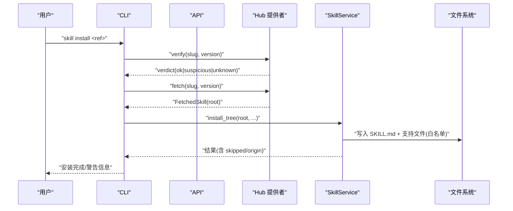

# 技能管理

<cite>
**本文引用的文件**
- [SKILL.md](file://SKILL.md)
- [skills.py](file://deeptutor/api/routers/skills.py)
- [skill.py](file://deeptutor_cli/skill.py)
- [service.py](file://deeptutor/services/skill/service.py)
- [hub.py](file://deeptutor/services/skill/hub.py)
- [skill_access.py](file://deeptutor/multi_user/skill_access.py)
- [docx SKILL.md](file://deeptutor/skills/builtin/docx/SKILL.md)
- [pdf SKILL.md](file://deeptutor/skills/builtin/pdf/SKILL.md)
- [README.md](file://README.md)
</cite>

## 目录
1. [简介](#简介)
2. [项目结构](#项目结构)
3. [核心组件](#核心组件)
4. [架构总览](#架构总览)
5. [详细组件分析](#详细组件分析)
6. [依赖与冲突管理](#依赖与冲突管理)
7. [性能与安全性](#性能与安全性)
8. [故障排查指南](#故障排查指南)
9. [结论](#结论)
10. [附录：常用命令与模板](#附录：常用命令与模板)

## 简介
本文件面向 DeepTutor 的“技能（Skill）”体系，覆盖从安装、配置到启用的完整生命周期，重点说明：
- 如何从技能中心（EduHub、ClawHub 等）搜索、安装、更新和发布技能。
- 技能的结构与组织方式，尤其是 SKILL.md 的前置元数据与正文要求。
- 技能的启用/禁用机制、版本管理与多用户授权可见性。
- 自定义技能的开发与发布流程，以及常见使用示例与配置模板。
- 依赖管理与冲突解决的最佳实践。

## 项目结构
DeepTutor 的技能系统由 CLI、API、服务层与内置技能组成：
- CLI 提供 skill search/install/list/publish/update/login/logout 等命令。
- API 暴露 /api/v1/skills 路由，支持浏览、安装、创建、更新、删除与标签管理。
- 服务层 SkillService 负责本地存储、解析、运行时加载与导入策略。
- Hub 提供者（ClawHubProvider、CommandProvider）对接外部注册表。
- 内置技能位于 deeptutor/skills/builtin，作为只读基线能力。

图表来源
- [skill.py:74-564](file://deeptutor_cli/skill.py#L74-L564)
- [skills.py:124-306](file://deeptutor/api/routers/skills.py#L124-L306)
- [service.py:215-800](file://deeptutor/services/skill/service.py#L215-L800)
- [hub.py:238-720](file://deeptutor/services/skill/hub.py#L238-L720)

章节来源
- [skill.py:74-564](file://deeptutor_cli/skill.py#L74-L564)
- [skills.py:124-306](file://deeptutor/api/routers/skills.py#L124-L306)
- [service.py:215-800](file://deeptutor/services/skill/service.py#L215-L800)
- [hub.py:238-720](file://deeptutor/services/skill/hub.py#L238-L720)

## 核心组件
- SkillService：统一读写用户层与内置层技能；解析 frontmatter；检查 requires 可用性；生成 manifest；安全导入包。
- Hub 提供者：封装搜索、下载、校验、发布；支持 clawhub 类型与 command 类型。
- CLI 命令：search/install/list/remove/login/publish/update。
- API 路由：list/create/update/delete/install/tags 等。
- 多用户访问控制：非管理员仅能看到被授权的 admin 技能。

章节来源
- [service.py:215-800](file://deeptutor/services/skill/service.py#L215-L800)
- [hub.py:238-720](file://deeptutor/services/skill/hub.py#L238-L720)
- [skill.py:74-564](file://deeptutor_cli/skill.py#L74-L564)
- [skills.py:124-306](file://deeptutor/api/routers/skills.py#L124-L306)
- [skill_access.py:14-76](file://deeptutor/multi_user/skill_access.py#L14-L76)

## 架构总览
技能从注册表下载到本地并进入用户工作区，经过安全门（verdict、后缀白名单、大小限制、符号链接拒绝、always 剥离），最终由 SkillService 注册为可用技能。运行时通过 manifest + read_skill 按需加载，避免污染系统提示。

图表来源
- [skill.py:108-170](file://deeptutor_cli/skill.py#L108-L170)
- [hub.py:673-720](file://deeptutor/services/skill/hub.py#L673-L720)
- [service.py:627-708](file://deeptutor/services/skill/service.py#L627-L708)

## 详细组件分析

### 技能结构与 SKILL.md 规范
- 每个技能是一个目录，根目录必须包含 SKILL.md。
- SKILL.md 采用 YAML frontmatter + Markdown 正文。
- frontmatter 关键字段：
  - name：技能名（小写字母、数字、短横线）。
  - description：简短描述，用于清单展示。
  - tags：可选的用户可见分类标签。
  - always：是否将正文注入系统提示（默认 false；导入时强制剥离）。
  - requires：可用性门禁，如 bins（PATH 中的二进制）、env（环境变量）、sandbox（执行沙箱类型）。
- 正文内容即“玩法手册”，指导模型在匹配任务时调用 read_skill 获取并遵循。

章节来源
- [service.py:27-47](file://deeptutor/services/skill/service.py#L27-L47)
- [service.py:346-390](file://deeptutor/services/skill/service.py#L346-L390)
- [docx SKILL.md:1-207](file://deeptutor/skills/builtin/docx/SKILL.md#L1-L207)
- [pdf SKILL.md:1-270](file://deeptutor/skills/builtin/pdf/SKILL.md#L1-L270)

### 安装与配置
- 搜索：deeptutor skill search "关键词" [--hub hub] [--limit N]
- 安装：deeptutor skill install <hub>:<slug>[@version] [--name local-name] [--force] [--allow-unverified]
- 列表：deeptutor skill list
- 移除：deeptutor skill remove <name>
- Web 端：学习空间 → 技能 → 从 EduHub 导入；或浏览器内浏览 catalog/detail。
- 多用户：管理员安装后需授权才可见给普通用户。

章节来源
- [skill.py:74-170](file://deeptutor_cli/skill.py#L74-L170)
- [skills.py:143-187](file://deeptutor/api/routers/skills.py#L143-L187)
- [skills.py:233-267](file://deeptutor/api/routers/skills.py#L233-L267)
- [README.md:766-814](file://README.md#L766-L814)

### 启用、禁用与版本管理
- 启用/禁用：通过 requires 声明依赖（bins/env/sandbox）。若环境不满足，技能在清单中标记为不可用，不会生效。
- 版本管理：
  - 安装时可指定 @version 或 latest。
  - 发布/更新：deeptutor skill publish ./my-skill [--version v] [--track ...]；update 支持回退 latest 指针或发布新版本。
  - 来源与版本记录写入 .hub-lock.json，便于审计与升级路径。
- 多用户可见性：admin 安装的技能对普通用户不可见，除非通过授权分配。

章节来源
- [service.py:366-390](file://deeptutor/services/skill/service.py#L366-L390)
- [service.py:627-708](file://deeptutor/services/skill/service.py#L627-L708)
- [skill.py:242-521](file://deeptutor_cli/skill.py#L242-L521)
- [skill_access.py:14-76](file://deeptutor/multi_user/skill_access.py#L14-L76)

### 自定义技能开发与发布流程
- 开发：
  - 新建目录，编写 SKILL.md（frontmatter + 正文），必要时添加 references/ 等支持文件。
  - 使用 preflight 检查格式与大小限制。
- 登录：deeptutor skill login [--hub hub] [--no-browser]
- 发布：deeptutor skill publish ./my-skill [--version v] [--slug slug] [--track track] [--hub hub] [--token token] [--yes]
- 更新：deeptutor skill update [--hub hub] [--token token]（交互式选择技能与动作：回退或发布新版本）

章节来源
- [skill.py:242-521](file://deeptutor_cli/skill.py#L242-L521)
- [hub.py:776-800](file://deeptutor/services/skill/hub.py#L776-L800)

### 常用技能使用示例与配置模板
- 内置文档处理技能：
  - docx：读取/创建/编辑 Word，提取文本与表格，生成报告、目录、页码、修订与批注。
  - pdf：提取文本/表格、合并/拆分/旋转/水印/加密、填表、渲染图片、CJK 字体处理。
- 典型用法：
  - 通过 chat/run 能力挂载工具（如 exec、rag、web_search），并在需要时调用 read_skill 按指引操作文件。
  - 在 requires 中声明 sandbox: shell 以启用沙箱执行。

章节来源
- [docx SKILL.md:1-207](file://deeptutor/skills/builtin/docx/SKILL.md#L1-L207)
- [pdf SKILL.md:1-270](file://deeptutor/skills/builtin/pdf/SKILL.md#L1-L270)
- [SKILL.md:25-57](file://SKILL.md#L25-L57)

## 依赖与冲突管理
- 依赖声明：
  - requires.bins：命令行工具需在 PATH 中可用。
  - requires.env：必需的环境变量。
  - requires.sandbox：需要沙箱能力（如 shell）。
- 可用性检测：
  - 启动时计算 manifest 行，标记 available 与 missing 项；不可用时不会生效。
- 冲突解决：
  - 同名技能：用户层会覆盖内置层；安装同名技能需 --force。
  - 多来源：来自不同 hub 的同名技能可通过重命名 --name 区分。
  - 多用户：admin 技能需授权后才对用户可见，避免误用。
- 安全导入：
  - 后缀白名单、文件大小/总数上限、禁止符号链接、拒绝可执行位、剥离 always。
  - 注册表 verdict 为 suspicious 时默认拒绝，除非显式允许。

章节来源
- [service.py:366-390](file://deeptutor/services/skill/service.py#L366-L390)
- [service.py:627-708](file://deeptutor/services/skill/service.py#L627-L708)
- [service.py:762-800](file://deeptutor/services/skill/service.py#L762-L800)
- [hub.py:673-720](file://deeptutor/services/skill/hub.py#L673-L720)
- [README.md:788-814](file://README.md#L788-L814)

## 性能与安全性
- 性能：
  - 清单模式：仅在匹配任务时按需读取 SKILL.md，避免上下文膨胀。
  - 最大读取限制：read_skill 有字符上限，防止超大文件影响上下文窗口。
- 安全性：
  - 安全门：verdict → 安全解压 → 后缀白名单 → always 剥离 → 来源记录。
  - 多用户隔离：非管理员不可写内置技能，不可见未授权 admin 技能。
  - 网络超时与错误处理：HTTP 请求带超时，失败抛出 HubError。

章节来源
- [service.py:74-77](file://deeptutor/services/skill/service.py#L74-L77)
- [service.py:627-708](file://deeptutor/services/skill/service.py#L627-L708)
- [hub.py:673-720](file://deeptutor/services/skill/hub.py#L673-L720)
- [skills.py:190-211](file://deeptutor/api/routers/skills.py#L190-L211)

## 故障排查指南
- 安装失败：
  - 检查 ref 格式：<hub>:<slug>[@version]。
  - 查看 verdict 是否为 suspicious；如需继续，加 --allow-unverified。
  - 确认网络可达与凭据有效（publish/update 需要登录或 token）。
- 技能不可用：
  - 查看清单中的 missing 字段，补齐 bins/env/sandbox。
  - 确认沙箱能力已启用。
- 权限问题：
  - 非管理员无法修改内置技能；尝试删除/更新时会报错。
  - 多用户环境下，admin 技能需授权后才可见。
- 日志与诊断：
  - 使用 skill list 查看来源与版本。
  - 检查 .hub-lock.json 了解安装来源与时间戳。

章节来源
- [skill.py:108-170](file://deeptutor_cli/skill.py#L108-L170)
- [skills.py:233-306](file://deeptutor/api/routers/skills.py#L233-L306)
- [service.py:366-390](file://deeptutor/services/skill/service.py#L366-L390)
- [skill_access.py:14-76](file://deeptutor/multi_user/skill_access.py#L14-L76)

## 结论
DeepTutor 的技能系统以 SKILL.md 为核心，结合 CLI、API、服务层与 Hub 提供者，实现了安全的跨源技能分发与按需加载。通过严格的导入安全门、依赖声明与多用户授权，既保证了扩展性又兼顾了安全性与可维护性。建议在生产环境中优先使用受信任的注册表，明确依赖与版本，并通过授权机制控制技能可见性与使用范围。

## 附录：常用命令与模板
- 搜索与安装
  - deeptutor skill search "关键词" [--hub hub] [--limit N]
  - deeptutor skill install <hub>:<slug>[@version] [--name local-name] [--force] [--allow-unverified]
  - deeptutor skill list
  - deeptutor skill remove <name>
- 登录与发布
  - deeptutor skill login [--hub hub] [--no-browser]
  - deeptutor skill publish ./my-skill [--version v] [--slug slug] [--track track] [--hub hub] [--token token] [--yes]
  - deeptutor skill update [--hub hub] [--token token]
- SKILL.md 模板要点
  - frontmatter：name、description、tags、requires（bins/env/sandbox）、always（谨慎使用）。
  - 正文：清晰的任务指引、工具调用顺序、输出位置与验证步骤。

章节来源
- [skill.py:74-564](file://deeptutor_cli/skill.py#L74-L564)
- [service.py:27-47](file://deeptutor/services/skill/service.py#L27-L47)
- [README.md:766-814](file://README.md#L766-L814)