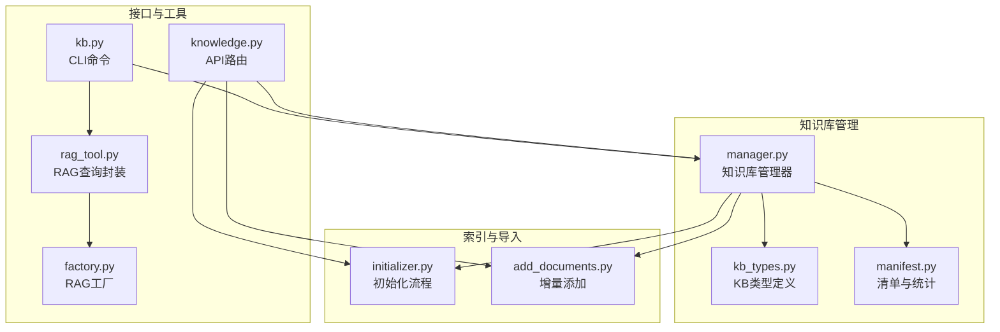
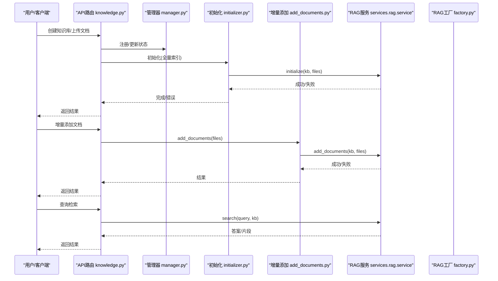
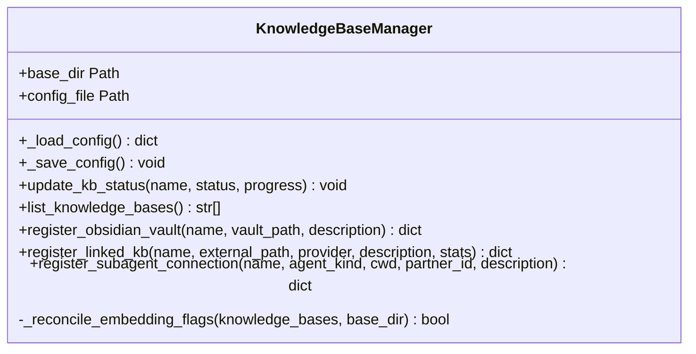
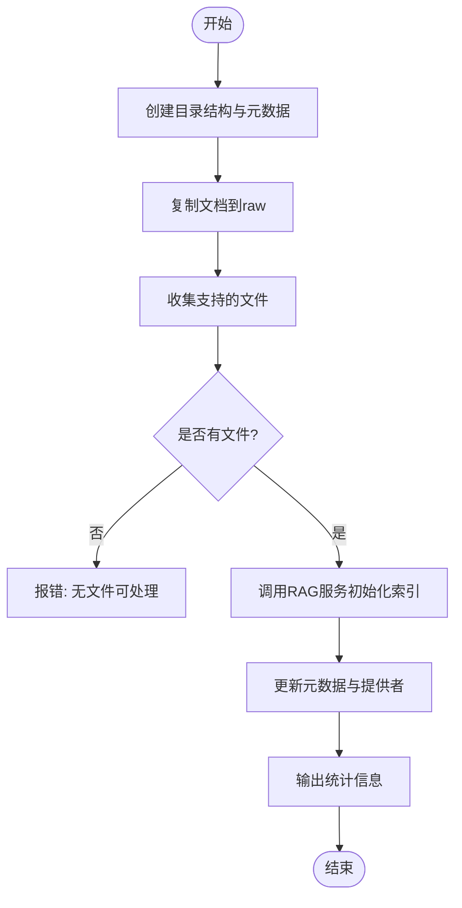
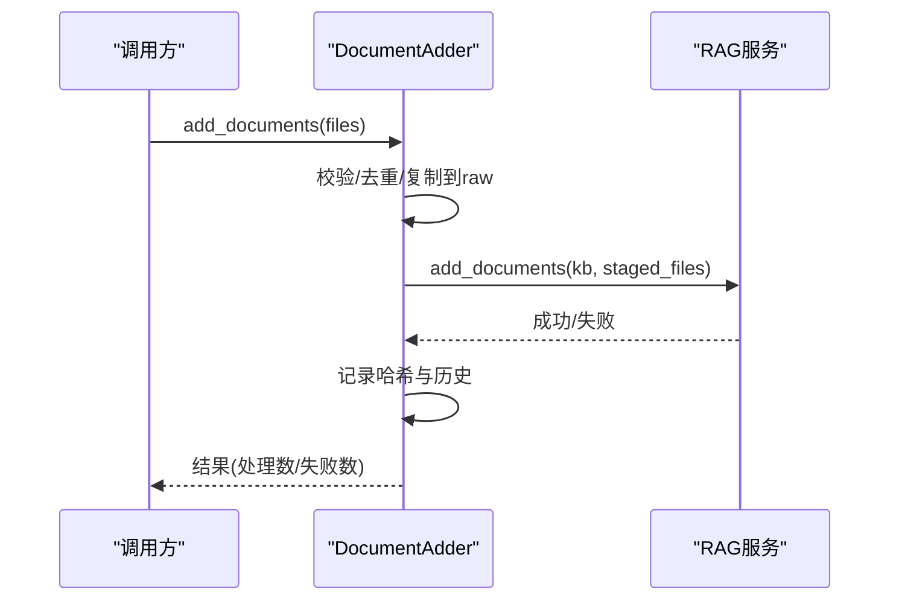
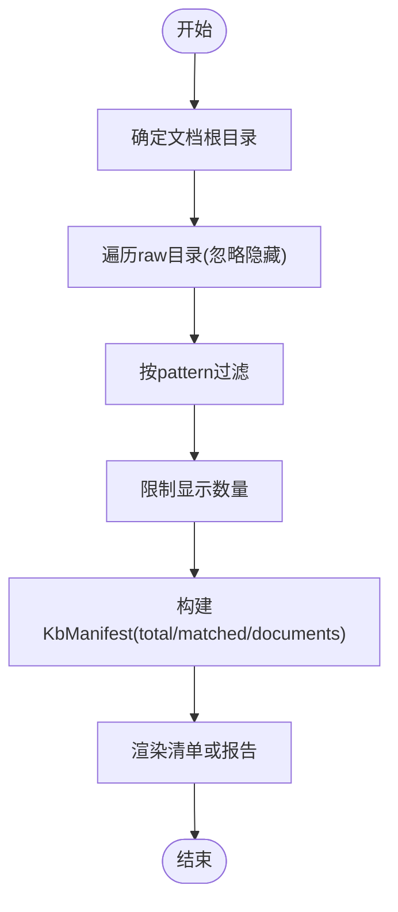
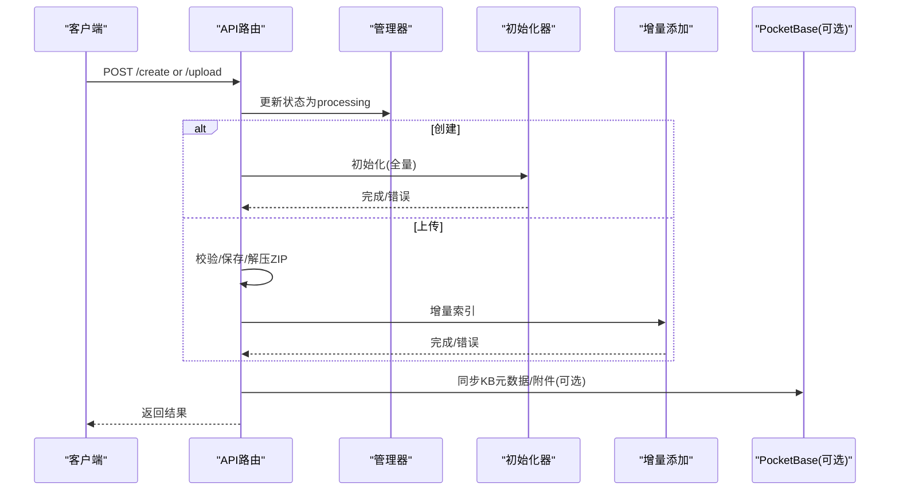
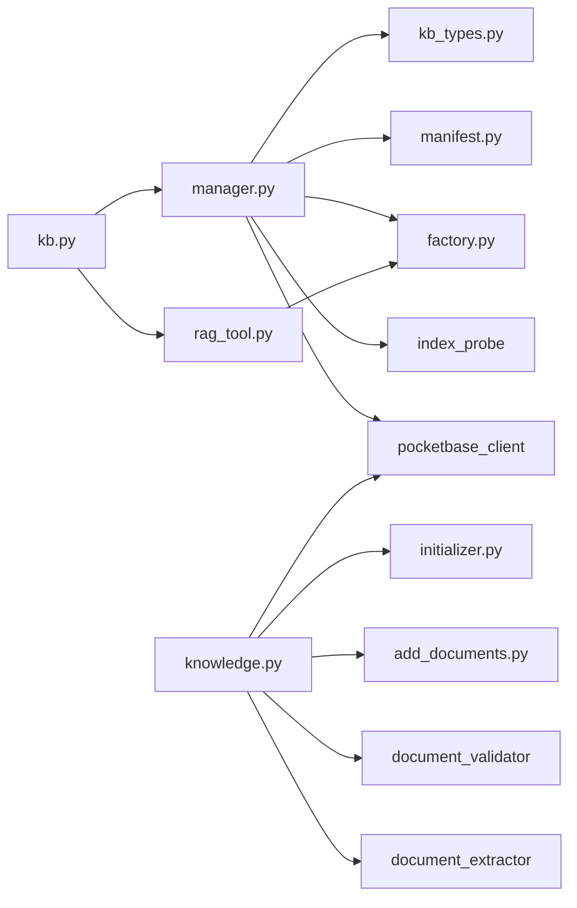

# 知识库管理

<cite>
**本文引用的文件**
- [manager.py](file://deeptutor/knowledge/manager.py)
- [initializer.py](file://deeptutor/knowledge/initializer.py)
- [add_documents.py](file://deeptutor/knowledge/add_documents.py)
- [manifest.py](file://deeptutor/knowledge/manifest.py)
- [kb_types.py](file://deeptutor/knowledge/kb_types.py)
- [knowledge.py](file://deeptutor/api/routers/knowledge.py)
- [rag_tool.py](file://deeptutor/tools/rag_tool.py)
- [factory.py](file://deeptutor/services/rag/factory.py)
- [kb.py](file://deeptutor_cli/kb.py)
</cite>

## 目录
1. [简介](#简介)
2. [项目结构](#项目结构)
3. [核心组件](#核心组件)
4. [架构总览](#架构总览)
5. [详细组件分析](#详细组件分析)
6. [依赖关系分析](#依赖关系分析)
7. [性能考虑](#性能考虑)
8. [故障排除指南](#故障排除指南)
9. [结论](#结论)
10. [附录](#附录)

## 简介
本文件面向DeepTutor的知识库（Knowledge Base）管理，覆盖创建、配置、文档导入、索引构建与更新、查询检索、批量操作与自动化脚本，以及不同使用场景的配置示例、性能调优与故障排除。系统支持多种RAG引擎类型：LlamaIndex、GraphRAG、LightRAG、PageIndex，并通过统一的RAG服务与API路由进行编排。

## 项目结构
知识库相关代码主要分布在以下模块：
- 管理与元数据：manager.py、kb_types.py、manifest.py
- 初始化与增量索引：initializer.py、add_documents.py
- API路由与上传处理：api/routers/knowledge.py
- RAG工具与工厂：tools/rag_tool.py、services/rag/factory.py
- CLI命令：deeptutor_cli/kb.py

**图示来源**
- [manager.py:244-341](file://deeptutor/knowledge/manager.py#L244-L341)
- [initializer.py:26-129](file://deeptutor/knowledge/initializer.py#L26-L129)
- [add_documents.py:144-337](file://deeptutor/knowledge/add_documents.py#L144-L337)
- [knowledge.py:99-141](file://deeptutor/api/routers/knowledge.py#L99-L141)
- [rag_tool.py:15-51](file://deeptutor/tools/rag_tool.py#L15-L51)
- [factory.py:590-645](file://deeptutor/services/rag/factory.py#L590-L645)
- [kb.py:61-183](file://deeptutor_cli/kb.py#L61-L183)

**章节来源**
- [manager.py:244-341](file://deeptutor/knowledge/manager.py#L244-L341)
- [knowledge.py:99-141](file://deeptutor/api/routers/knowledge.py#L99-L141)

## 核心组件
- 知识库管理器（KnowledgeBaseManager）：负责注册、列出、状态更新、自动发现与清理孤儿条目、嵌入指纹对齐、PocketBase同步等。
- 初始化器（KnowledgeBaseInitializer）：创建目录结构、复制文档、调用RAG服务进行全量索引，并更新元数据。
- 增量添加器（DocumentAdder）：校验与暂存文件、去重、通过RAG服务增量索引，记录哈希与历史。
- 清单与统计（manifest）：提供知识库文档清单、数量、匹配过滤与本地化展示。
- 类型定义（kb_types）：区分普通索引型KB与连接型KB（Obsidian、Linked、Subagent、LightRAG Server、IMA）。
- API路由（knowledge.py）：提供创建、上传、链接外部索引、删除、搜索等REST接口，包含进度广播与任务日志。
- RAG工具（rag_tool.py）：统一查询入口，封装RAGService的search/initialize/delete。
- RAG工厂（factory.py）：提供提供者名称归一化、可用性检查（GraphRAG/LightRAG/Pageindex）、默认提供者等。
- CLI（kb.py）：命令行创建、添加、删除、搜索、列表与信息查看。

**章节来源**
- [manager.py:244-489](file://deeptutor/knowledge/manager.py#L244-L489)
- [initializer.py:26-223](file://deeptutor/knowledge/initializer.py#L26-L223)
- [add_documents.py:144-337](file://deeptutor/knowledge/add_documents.py#L144-L337)
- [manifest.py:69-200](file://deeptutor/knowledge/manifest.py#L69-L200)
- [kb_types.py:1-116](file://deeptutor/knowledge/kb_types.py#L1-L116)
- [knowledge.py:590-721](file://deeptutor/api/routers/knowledge.py#L590-L721)
- [rag_tool.py:15-77](file://deeptutor/tools/rag_tool.py#L15-L77)
- [factory.py:590-645](file://deeptutor/services/rag/factory.py#L590-L645)
- [kb.py:61-287](file://deeptutor_cli/kb.py#L61-L287)

## 架构总览
知识库管理的整体流程包括：创建与初始化、文档导入与增量索引、查询检索、批量操作与自动化。

**图示来源**
- [knowledge.py:752-800](file://deeptutor/api/routers/knowledge.py#L752-L800)
- [initializer.py:144-223](file://deeptutor/knowledge/initializer.py#L144-L223)
- [add_documents.py:258-337](file://deeptutor/knowledge/add_documents.py#L258-L337)
- [rag_tool.py:15-51](file://deeptutor/tools/rag_tool.py#L15-L51)
- [factory.py:590-645](file://deeptutor/services/rag/factory.py#L590-L645)

## 详细组件分析

### 知识库管理器（KnowledgeBaseManager）
- 职责：加载/保存配置、列出/注册/删除知识库、状态与进度更新、嵌入指纹对齐、PocketBase同步、自动发现与孤儿清理。
- 关键方法：
  - update_kb_status：更新状态、进度、最后索引时间与动作，并在ready时写入嵌入签名与版本信息。
  - list_knowledge_bases：清理孤儿、扫描未注册的有效KB并自动注册。
  - register_obsidian_vault/register_linked_kb/register_subagent_connection：注册连接型KB（只读指针）。
  - _reconcile_embedding_flags：根据当前嵌入配置与磁盘版本对齐needs_reindex与embedding_mismatch。

**图示来源**
- [manager.py:244-489](file://deeptutor/knowledge/manager.py#L244-L489)
- [manager.py:515-600](file://deeptutor/knowledge/manager.py#L515-L600)
- [manager.py:691-777](file://deeptutor/knowledge/manager.py#L691-L777)

**章节来源**
- [manager.py:244-489](file://deeptutor/knowledge/manager.py#L244-L489)
- [manager.py:515-600](file://deeptutor/knowledge/manager.py#L515-L600)
- [manager.py:691-777](file://deeptutor/knowledge/manager.py#L691-L777)

### 初始化流程（KnowledgeBaseInitializer）
- 职责：创建目录结构、复制文档、调用RAG服务进行全量索引、更新元数据与状态。
- 关键步骤：
  - create_directory_structure：创建raw目录、写入metadata.json、注册到配置。
  - process_documents：收集支持的文件、调用RAGService.initialize、更新进度与元数据。
  - display_statistics_generic：输出基础统计（原始文件数、索引版本、使用的提供者）。

**图示来源**
- [initializer.py:109-129](file://deeptutor/knowledge/initializer.py#L109-L129)
- [initializer.py:144-223](file://deeptutor/knowledge/initializer.py#L144-L223)
- [initializer.py:229-243](file://deeptutor/knowledge/initializer.py#L229-L243)

**章节来源**
- [initializer.py:109-243](file://deeptutor/knowledge/initializer.py#L109-L243)

### 增量文档添加（DocumentAdder）
- 职责：校验与暂存文件、内容去重、增量索引、记录哈希与历史。
- 关键逻辑：
  - add_documents：校验文件、复制到raw、保留目录结构、跳过重复。
  - process_new_documents：逐个调用RAGService.add_documents，记录成功与失败。
  - update_metadata：更新last_indexed_at/count/action与update_history。

**图示来源**
- [add_documents.py:216-337](file://deeptutor/knowledge/add_documents.py#L216-L337)
- [add_documents.py:339-431](file://deeptutor/knowledge/add_documents.py#L339-L431)

**章节来源**
- [add_documents.py:216-337](file://deeptutor/knowledge/add_documents.py#L216-L337)
- [add_documents.py:339-431](file://deeptutor/knowledge/add_documents.py#L339-L431)

### 清单与统计（manifest）
- 职责：读取磁盘上的文档清单，提供总数、匹配数、截断显示与本地化文案；为聊天系统提示与kb_files工具提供权威事实。
- 关键点：
  - iter_kb_documents：深度优先遍历，忽略隐藏文件与符号链接目录。
  - build_manifest：按pattern过滤，计算total/matched/documents。
  - render_manifest_note/render_manifest_report：生成系统提示块与工具报告。

**图示来源**
- [manifest.py:111-200](file://deeptutor/knowledge/manifest.py#L111-L200)
- [manifest.py:341-402](file://deeptutor/knowledge/manifest.py#L341-L402)

**章节来源**
- [manifest.py:111-200](file://deeptutor/knowledge/manifest.py#L111-L200)
- [manifest.py:341-402](file://deeptutor/knowledge/manifest.py#L341-L402)

### 知识库类型（kb_types）
- 普通索引型KB：在data/knowledge_bases下拥有raw与索引存储。
- 连接型KB（只读指针）：
  - obsidian：指向用户Markdown仓库，不索引，由Obsidian能力直接导航。
  - linked：指向已构建的外部引擎索引文件夹，按绑定提供者直接检索。
  - subagent：指向连接的智能体后端（本地CLI或伙伴），通过consult_subagent驱动。
  - lightrag_server：指向外部LightRAG服务器，检索通过HTTP /query。
  - ima：指向腾讯IMA知识库，检索通过OpenAPI。

**章节来源**
- [kb_types.py:1-116](file://deeptutor/knowledge/kb_types.py#L1-L116)

### API路由（knowledge.py）
- 职责：提供知识库CRUD、文件上传、ZIP解压、进度广播、任务日志、提供者校验与格式限制。
- 关键功能：
  - 创建与初始化：后台任务执行初始化，更新状态与进度。
  - 上传与增量索引：安全保存文件、ZIP解压、校验扩展名与大小、触发增量索引。
  - 链接外部索引：验证路径与提供者，注册linked KB。
  - 提供者就绪检查：PageIndex需API Key；GraphRAG需安装可选包；LightRAG需安装可选包。
  - 格式限制：PageIndex仅接受特定扩展名。

**图示来源**
- [knowledge.py:200-228](file://deeptutor/api/routers/knowledge.py#L200-L228)
- [knowledge.py:230-487](file://deeptutor/api/routers/knowledge.py#L230-L487)
- [knowledge.py:590-669](file://deeptutor/api/routers/knowledge.py#L590-L669)
- [knowledge.py:752-800](file://deeptutor/api/routers/knowledge.py#L752-L800)

**章节来源**
- [knowledge.py:200-487](file://deeptutor/api/routers/knowledge.py#L200-L487)
- [knowledge.py:590-669](file://deeptutor/api/routers/knowledge.py#L590-L669)
- [knowledge.py:752-800](file://deeptutor/api/routers/knowledge.py#L752-L800)

### RAG工具与工厂（rag_tool.py、factory.py）
- rag_tool.py：封装RAGService的search/initialize/delete，支持多用户资源解析。
- factory.py：提供者名称归一化、可用性检查（GraphRAG/LightRAG/Pageindex）、默认提供者。

**章节来源**
- [rag_tool.py:15-77](file://deeptutor/tools/rag_tool.py#L15-L77)
- [factory.py:590-645](file://deeptutor/services/rag/factory.py#L590-L645)

### CLI命令（kb.py）
- 提供list/info/set-default/create/add/delete/search命令，便于本地快速操作。

**章节来源**
- [kb.py:61-287](file://deeptutor_cli/kb.py#L61-L287)

## 依赖关系分析
- 管理器依赖：
  - kb_types：判断连接型KB，避免误删与误索引。
  - manifest：获取文档清单用于统计与提示。
  - services.rag.factory：提供者归一化与可用性检查。
  - services.rag.index_probe：探测索引版本与就绪状态。
  - services.pocketbase_client：可选同步KB元数据与附件。
- API路由依赖：
  - initializer/add_documents：执行初始化与增量索引。
  - document_validator/document_extractor：文件安全校验与文本提取。
  - progress_broadcaster/task_log_stream：进度与日志推送。
- 工具与CLI：
  - rag_tool：统一查询入口。
  - factory：提供者能力检查。

**图示来源**
- [manager.py:20-45](file://deeptutor/knowledge/manager.py#L20-L45)
- [knowledge.py:33-75](file://deeptutor/api/routers/knowledge.py#L33-L75)
- [rag_tool.py:12-13](file://deeptutor/tools/rag_tool.py#L12-L13)
- [kb.py:19-23](file://deeptutor_cli/kb.py#L19-L23)

**章节来源**
- [manager.py:20-45](file://deeptutor/knowledge/manager.py#L20-L45)
- [knowledge.py:33-75](file://deeptutor/api/routers/knowledge.py#L33-L75)
- [rag_tool.py:12-13](file://deeptutor/tools/rag_tool.py#L12-L13)
- [kb.py:19-23](file://deeptutor_cli/kb.py#L19-L23)

## 性能考虑
- 并发与事件循环：
  - 文件保存与ZIP解压在worker线程执行，避免阻塞FastAPI事件循环（参考知识路由中的_off_loop包装）。
  - 增量索引中哈希计算通过asyncio.to_thread运行，减少主循环阻塞。
- 索引版本与嵌入指纹：
  - 管理器在加载配置时对齐嵌入指纹，必要时标记needs_reindex与embedding_mismatch，避免不一致导致的检索问题。
- 清单与统计：
  - 清单遍历忽略隐藏文件与符号链接目录，限制显示数量，降低上下文窗口压力。
- 提供者就绪检查：
  - PageIndex需要API Key；GraphRAG与LightRAG需要安装可选包，提前检查可减少无效请求。

[本节为通用指导，无需具体文件引用]

## 故障排除指南
- 常见错误与处理：
  - 无文档可处理：初始化阶段若未找到支持的文件，会抛出错误；请确认raw目录中存在受支持的文件。
  - 连接型KB不可写：对obsidian/linked/subagent/lightrag_server/ima类型的KB进行上传或重建索引将拒绝，因为它们是指针且只读。
  - 提供者未就绪：PageIndex缺少API Key、GraphRAG/LightRAG未安装时会返回明确错误信息，请按提示配置或安装。
  - 旧版索引格式：legacy rag_storage存在时需先重建索引才能进行增量添加。
- 调试建议：
  - 查看任务日志与进度：API路由使用任务流管理器记录日志，可通过task_id追踪。
  - 检查元数据与清单：manifest提供权威文档清单，可用于核对实际文件与索引状态。
  - PocketBase同步失败：为best-effort，不影响本地主路径，可在日志中查看具体异常。

**章节来源**
- [knowledge.py:602-669](file://deeptutor/api/routers/knowledge.py#L602-L669)
- [knowledge.py:695-721](file://deeptutor/api/routers/knowledge.py#L695-L721)
- [initializer.py:161-167](file://deeptutor/knowledge/initializer.py#L161-L167)
- [manifest.py:142-190](file://deeptutor/knowledge/manifest.py#L142-L190)

## 结论
DeepTutor的知识库管理提供了完整的生命周期支持：从创建、导入、索引到查询与批量操作，并通过统一的RAG服务与API路由实现多引擎兼容。管理器确保状态一致性与嵌入指纹对齐，清单模块提供权威文档事实，API路由保障安全与可观测性。针对不同场景（个人学习、团队协作、企业部署），可按需选择RAG引擎与连接型KB，结合CLI与API进行自动化与集成。

[本节为总结，无需具体文件引用]

## 附录

### 支持的RAG引擎与配置要点
- LlamaIndex（默认）：标准向量检索，需配置嵌入模型与维度。
- GraphRAG：图增强检索，需安装可选包并满足可用性检查。
- LightRAG：轻量检索，需安装可选包并满足可用性检查。
- PageIndex：页面级索引，需配置API Key并接受特定扩展名。

**章节来源**
- [factory.py:590-645](file://deeptutor/services/rag/factory.py#L590-L645)
- [knowledge.py:602-669](file://deeptutor/api/routers/knowledge.py#L602-L669)

### 使用场景配置示例
- 个人学习：
  - 使用LlamaIndex作为默认提供者，创建本地知识库，上传PDF/Markdown文档，定期增量添加新资料。
  - 通过CLI快速创建与添加文档，使用search进行问答。
- 团队协作：
  - 使用API路由进行批量上传与链接外部索引（linked），集中管理团队文档。
  - 启用PocketBase同步以在管理面板可见，配合权限控制访问知识库。
- 企业部署：
  - 选择GraphRAG或LightRAG以获得更强的语义理解或轻量化检索。
  - 通过API路由进行严格的安全校验与格式限制，结合任务日志与进度广播进行运维监控。

[本节为概念性内容，无需具体文件引用]

### 批量操作与自动化脚本
- CLI批量：
  - 使用kb create/add命令，支持--doc与--docs-dir参数，自动收集支持的文件。
- API批量：
  - 通过POST上传多个文件与ZIP压缩包，服务端进行安全校验与解压，再触发增量索引。
- 自动化：
  - 结合任务ID与日志流，编写脚本监控初始化与增量索引进度，失败时重试或告警。

**章节来源**
- [kb.py:139-227](file://deeptutor_cli/kb.py#L139-L227)
- [knowledge.py:230-487](file://deeptutor/api/routers/knowledge.py#L230-L487)