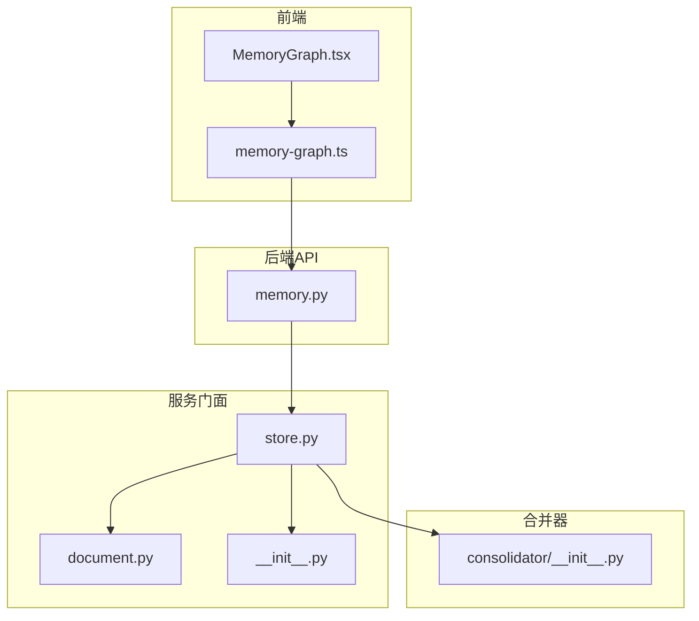
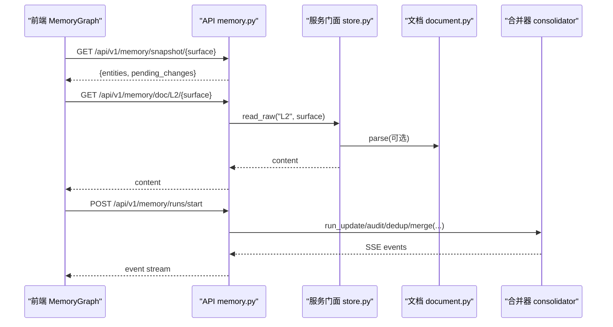
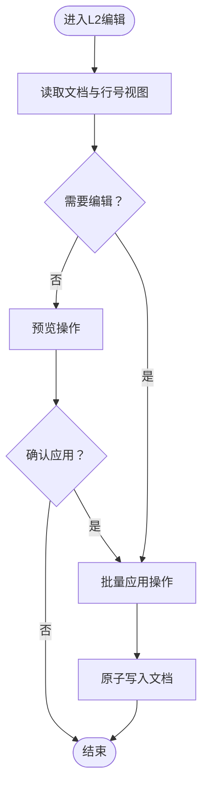
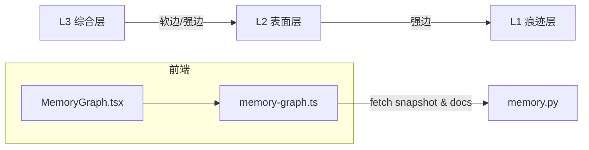
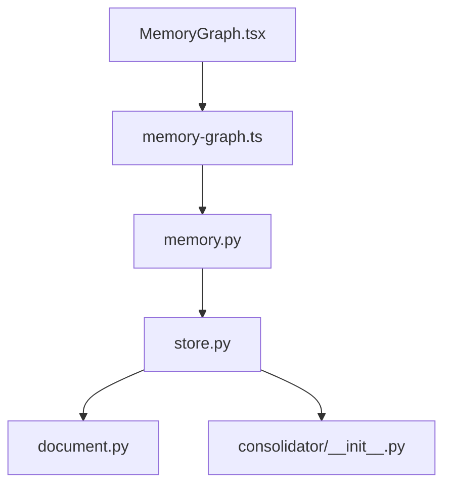

# 记忆操作

<cite>
**本文引用的文件**
- [deeptutor/api/routers/memory.py](file://deeptutor/api/routers/memory.py)
- [deeptutor/services/memory/__init__.py](file://deeptutor/services/memory/__init__.py)
- [deeptutor/services/memory/store.py](file://deeptutor/services/memory/store.py)
- [deeptutor/services/memory/document.py](file://deeptutor/services/memory/document.py)
- [deeptutor/services/memory/consolidator/__init__.py](file://deeptutor/services/memory/consolidator/__init__.py)
- [web/components/memory/MemoryGraph.tsx](file://web/components/memory/MemoryGraph.tsx)
- [web/lib/memory-graph.ts](file://web/lib/memory-graph.ts)
</cite>

## 目录
1. [简介](#简介)
2. [项目结构](#项目结构)
3. [核心组件](#核心组件)
4. [架构总览](#架构总览)
5. [详细组件分析](#详细组件分析)
6. [依赖关系分析](#依赖关系分析)
7. [性能考虑](#性能考虑)
8. [故障排除指南](#故障排除指南)
9. [结论](#结论)
10. [附录](#附录)

## 简介
本文件面向DeepTutor的“三层记忆系统”（L1痕迹层、L2表面层、L3综合层），提供从查看、管理到优化的一站式操作文档。内容涵盖：
- 记忆的创建、编辑、删除与搜索
- 记忆图可视化与关系分析工具的使用
- 记忆的导出、导入与备份
- 记忆与智能体对话的集成方式
- 最佳实践与性能调优建议
- 常见问题排查

## 项目结构
记忆子系统由后端API路由、服务门面、文档解析与合并器，以及前端可视化组件共同构成。整体组织如下：
- API路由：暴露工作台的CRUD、运行任务、设置、快照与追踪等接口
- 服务门面：统一封装L1/L2/L3读写、原子写入、概览统计与迁移逻辑
- 文档模型：Markdown文档的解析与序列化，支持新旧格式兼容
- 合并器：驱动LLM进行增量更新、审计、去重与合并
- 前端可视化：基于快照构建同心圆记忆图，支持缩放、拖拽、高亮与导航

图表来源
- [deeptutor/api/routers/memory.py:1-786](file://deeptutor/api/routers/memory.py#L1-L786)
- [deeptutor/services/memory/store.py:1-460](file://deeptutor/services/memory/store.py#L1-L460)
- [deeptutor/services/memory/document.py:1-236](file://deeptutor/services/memory/document.py#L1-L236)
- [deeptutor/services/memory/consolidator/__init__.py:1-63](file://deeptutor/services/memory/consolidator/__init__.py#L1-L63)
- [web/components/memory/MemoryGraph.tsx:1-800](file://web/components/memory/MemoryGraph.tsx#L1-L800)
- [web/lib/memory-graph.ts:1-763](file://web/lib/memory-graph.ts#L1-L763)

章节来源
- [deeptutor/api/routers/memory.py:1-786](file://deeptutor/api/routers/memory.py#L1-L786)
- [deeptutor/services/memory/__init__.py:1-43](file://deeptutor/services/memory/__init__.py#L1-L43)

## 核心组件
- 三层记忆模型
  - L1痕迹层：原始事件追加日志，按表面与日期分片存储，用于溯源与审计
  - L2表面层：每个业务表面（如聊天、笔记、问答等）的事实汇总，以带脚注的Markdown表示
  - L3综合层：用户画像、近期摘要、知识范围等综合信息，供智能体在对话中读取
- 关键能力
  - 文档解析与序列化：支持新旧两种引用格式，保证往返一致
  - 原子写入与并发安全：基于异步锁与临时文件替换，避免竞态
  - 长任务编排：通过运行管理器启动更新/审计/去重/合并任务，SSE流式回传事件
  - 快照与差异：实时镜像工作区实体，记录待提交变更
  - 设置与迁移：记忆子树配置持久化；v1/v2与旧表面键名迁移

章节来源
- [deeptutor/services/memory/store.py:1-460](file://deeptutor/services/memory/store.py#L1-L460)
- [deeptutor/services/memory/document.py:1-236](file://deeptutor/services/memory/document.py#L1-L236)
- [deeptutor/services/memory/consolidator/__init__.py:1-63](file://deeptutor/services/memory/consolidator/__init__.py#L1-L63)

## 架构总览
下图展示了从前端可视化到后端API与服务门面的调用链，以及合并器的任务执行流程。

图表来源
- [web/lib/memory-graph.ts:241-284](file://web/lib/memory-graph.ts#L241-L284)
- [deeptutor/api/routers/memory.py:308-350](file://deeptutor/api/routers/memory.py#L308-L350)
- [deeptutor/services/memory/store.py:125-163](file://deeptutor/services/memory/store.py#L125-L163)
- [deeptutor/services/memory/document.py:105-182](file://deeptutor/services/memory/document.py#L105-L182)

## 详细组件分析

### L1痕迹层：查看与管理
- 查看轨迹
  - 使用“轨迹浏览器”接口分页获取某表面的事件列表，支持偏移与限制
  - 可删除指定日期的轨迹文件或清空某表面全部轨迹
- 快照与差异
  - 获取当前实体的快照，并返回与上次持久化的差异
  - 刷新快照以重新计算差异，或查询/清理差异列表
- 适用场景
  - 审计与回溯：定位某条事实的来源事件
  - 数据治理：清理过期或错误轨迹，释放空间

章节来源
- [deeptutor/api/routers/memory.py:680-722](file://deeptutor/api/routers/memory.py#L680-L722)
- [deeptutor/api/routers/memory.py:728-786](file://deeptutor/api/routers/memory.py#L728-L786)

### L2表面层：创建、编辑、删除与搜索
- 创建与更新
  - 通过运行任务触发“更新”模式，将L1事件增量抽取为L2事实
  - 支持语言、预算、迭代次数与LLM选择参数
- 编辑与保存
  - 直接覆盖文档内容（原子写入）
  - 批量应用预览后的操作（添加/编辑/删除条目）
- 删除与重置
  - 删除单个条目（按ULID）
  - 重置文档与其元数据，使下次更新从头开始
- 行号视图与导航
  - 提供去除脚注的行号视图，便于人工校对与定位
  - 支持根据L3中的引用跳转到对应L2文档锚点
- 搜索
  - 结合“轨迹浏览器”与“行号视图”，可按关键词快速定位相关条目

图表来源
- [deeptutor/api/routers/memory.py:140-166](file://deeptutor/api/routers/memory.py#L140-L166)
- [deeptutor/api/routers/memory.py:574-608](file://deeptutor/api/routers/memory.py#L574-L608)
- [deeptutor/api/routers/memory.py:649-674](file://deeptutor/api/routers/memory.py#L649-L674)
- [deeptutor/services/memory/store.py:106-121](file://deeptutor/services/memory/store.py#L106-L121)

章节来源
- [deeptutor/api/routers/memory.py:140-166](file://deeptutor/api/routers/memory.py#L140-L166)
- [deeptutor/api/routers/memory.py:574-608](file://deeptutor/api/routers/memory.py#L574-L608)
- [deeptutor/api/routers/memory.py:649-674](file://deeptutor/api/routers/memory.py#L649-L674)
- [deeptutor/services/memory/store.py:106-121](file://deeptutor/services/memory/store.py#L106-L121)

### L3综合层：创建、编辑与偏好写入
- 创建与更新
  - 通过运行任务对除“偏好”外的三个槽位（画像、近期、范围）进行综合
  - “偏好”由对话工具直接写入，不经过自动合并
- 编辑与幂等性
  - 偏好写入具备重复检测，避免重复添加相同偏好
  - 支持编辑已有偏好项，并关联当前对话轮次的L1引用
- 读取与拼接
  - 可将所有L3文档拼接为一段文本，供智能体在对话中读取上下文

章节来源
- [deeptutor/services/memory/store.py:144-163](file://deeptutor/services/memory/store.py#L144-L163)
- [deeptutor/services/memory/store.py:194-257](file://deeptutor/services/memory/store.py#L194-L257)
- [deeptutor/services/memory/store.py:93-103](file://deeptutor/services/memory/store.py#L93-L103)

### 记忆图可视化与关系分析
- 数据来源
  - 前端并行拉取各表面的L1快照与L2/L3文档，解析后构建节点与边
- 布局与交互
  - 同心圆布局：L3为核心，L2为中圈，L1为外圈；簇大小与数量成比例
  - 支持缩放、拖拽、层级开关、节点高亮与邻域扩散（BFS两跳）
  - 悬停显示预览，点击跳转至对应页面
- 关系分析
  - 强边：L2→L1具体实体；L3→L2具体条目
  - 软边：L3→L2表面聚合（通过虚拟锚点）
  - 邻域高亮帮助理解跨层引用链

图表来源
- [web/components/memory/MemoryGraph.tsx:1-800](file://web/components/memory/MemoryGraph.tsx#L1-L800)
- [web/lib/memory-graph.ts:241-284](file://web/lib/memory-graph.ts#L241-L284)
- [web/lib/memory-graph.ts:322-656](file://web/lib/memory-graph.ts#L322-L656)

章节来源
- [web/components/memory/MemoryGraph.tsx:1-800](file://web/components/memory/MemoryGraph.tsx#L1-L800)
- [web/lib/memory-graph.ts:1-763](file://web/lib/memory-graph.ts#L1-L763)

### 导出、导入与备份
- 导出
  - 通过“快照”接口获取当前实体的完整列表，用于离线分析或外部工具导入
  - 通过“文档读取”接口导出L2/L3 Markdown原文
- 导入
  - 使用“批量应用操作”将外部生成的增删改操作应用到目标文档
  - 使用“覆盖写入”直接替换文档内容（谨慎使用）
- 备份
  - 启动时自动将旧版文件迁移至备份目录
  - 可通过“备份列表”接口查看历史备份目录及文件清单

章节来源
- [deeptutor/api/routers/memory.py:84-93](file://deeptutor/api/routers/memory.py#L84-L93)
- [deeptutor/api/routers/memory.py:124-134](file://deeptutor/api/routers/memory.py#L124-L134)
- [deeptutor/api/routers/memory.py:649-674](file://deeptutor/api/routers/memory.py#L649-L674)
- [deeptutor/services/memory/store.py:330-356](file://deeptutor/services/memory/store.py#L330-L356)

### 与智能体对话的集成
- 读取记忆
  - 智能体在对话中读取拼接后的L3内容作为长期上下文
- 写入偏好
  - 对话过程中通过工具写入用户偏好，具备幂等性与引用绑定
- 事件追踪
  - 每次写入均附带当前对话轮的L1引用，便于追溯与审计

章节来源
- [deeptutor/services/memory/store.py:93-103](file://deeptutor/services/memory/store.py#L93-L103)
- [deeptutor/services/memory/store.py:194-257](file://deeptutor/services/memory/store.py#L194-L257)

## 依赖关系分析
- 模块耦合
  - API路由依赖服务门面与合并器，负责请求校验与任务编排
  - 服务门面封装文档解析、原子写入、概览统计与迁移逻辑
  - 前端可视化依赖API提供的快照与文档接口，并在本地构建图结构
- 外部依赖
  - 文件系统路径服务（按用户隔离）
  - 运行时任务管理器（长任务生命周期管理）
  - LLM服务（合并器驱动）

图表来源
- [deeptutor/api/routers/memory.py:1-786](file://deeptutor/api/routers/memory.py#L1-L786)
- [deeptutor/services/memory/store.py:1-460](file://deeptutor/services/memory/store.py#L1-L460)
- [deeptutor/services/memory/document.py:1-236](file://deeptutor/services/memory/document.py#L1-L236)
- [deeptutor/services/memory/consolidator/__init__.py:1-63](file://deeptutor/services/memory/consolidator/__init__.py#L1-L63)
- [web/components/memory/MemoryGraph.tsx:1-800](file://web/components/memory/MemoryGraph.tsx#L1-L800)
- [web/lib/memory-graph.ts:1-763](file://web/lib/memory-graph.ts#L1-L763)

章节来源
- [deeptutor/api/routers/memory.py:1-786](file://deeptutor/api/routers/memory.py#L1-L786)
- [deeptutor/services/memory/store.py:1-460](file://deeptutor/services/memory/store.py#L1-L460)

## 性能考虑
- 并发控制
  - 使用异步锁保护同一文档的并发写入，避免竞争条件
  - 原子写入通过临时文件+替换，降低写放大与损坏风险
- 任务编排
  - 长任务交由运行管理器托管，客户端通过SSE重连与游标续传
  - 支持取消与撤销最近一次写入，提升容错能力
- 前端渲染
  - 图布局采用确定性算法与分层聚类，减少重绘开销
  - 邻域高亮限制在两跳内，避免全图遍历带来的卡顿
- 数据量控制
  - 快照与轨迹支持分页与限制，防止大响应导致内存压力
  - 定期清理过期轨迹与差异，保持磁盘占用可控

章节来源
- [deeptutor/services/memory/store.py:71-78](file://deeptutor/services/memory/store.py#L71-L78)
- [deeptutor/services/memory/store.py:106-121](file://deeptutor/services/memory/store.py#L106-L121)
- [deeptutor/api/routers/memory.py:308-350](file://deeptutor/api/routers/memory.py#L308-L350)
- [deeptutor/api/routers/memory.py:409-453](file://deeptutor/api/routers/memory.py#L409-L453)
- [web/lib/memory-graph.ts:322-656](file://web/lib/memory-graph.ts#L322-L656)

## 故障排除指南
- 常见错误与处理
  - 未知表面或槽位：检查传入的layer/key是否合法
  - 任务冲突：当有活跃任务时，重置或应用操作会被拒绝，先取消任务再重试
  - 条目不存在：删除条目前需确认条目存在，否则返回未找到
  - 偏好写入限制：preferences不可被自动合并，只能通过工具写入
- 调试建议
  - 使用“轨迹浏览器”查看某表面的事件序列，定位问题源头
  - 使用“行号视图”对照LLM所见内容与用户可见内容，确保一致性
  - 使用“快照差异”检查工作区与持久化状态是否同步
- 恢复策略
  - 使用“备份列表”查看历史备份，必要时回滚
  - 使用“撤销最近写入”快速回退错误修改

章节来源
- [deeptutor/api/routers/memory.py:62-78](file://deeptutor/api/routers/memory.py#L62-L78)
- [deeptutor/api/routers/memory.py:159-166](file://deeptutor/api/routers/memory.py#L159-L166)
- [deeptutor/api/routers/memory.py:169-219](file://deeptutor/api/routers/memory.py#L169-L219)
- [deeptutor/api/routers/memory.py:308-350](file://deeptutor/api/routers/memory.py#L308-L350)
- [deeptutor/api/routers/memory.py:680-722](file://deeptutor/api/routers/memory.py#L680-L722)

## 结论
DeepTutor的记忆系统通过清晰的三层结构与完善的API/前端工具，实现了从原始事件到综合知识的自动化加工与可视化。借助长任务编排、原子写入与快照机制，系统在易用性与可靠性之间取得平衡。遵循本文的最佳实践与调优建议，可在大规模数据下保持稳定与高效。

## 附录
- 术语表
  - 表面（Surface）：业务来源（如聊天、笔记、问答等）
  - 槽位（Slot）：L3文档的分类（画像、近期、范围、偏好）
  - 条目（Entry）：L2/L3中的一条事实或陈述，带有唯一ULID
  - 引用（Ref）：指向L1事件的标识，用于溯源
- 常用操作速查
  - 查看概览：GET /overview
  - 读取文档：GET /doc/{layer}/{key}
  - 覆盖写入：PUT /doc/{layer}/{key}
  - 删除条目：DELETE /doc/{layer}/{key}/entry/{id}
  - 启动任务：POST /runs/start
  - 查看任务：GET /runs/{run_id}
  - 事件流：GET /runs/{run_id}/events?since=N
  - 快照与差异：GET /snapshot/{surface}，POST /snapshot/{surface}/refresh
  - 轨迹浏览：GET /trace/{surface}
  - 设置读写：GET/PUT /settings