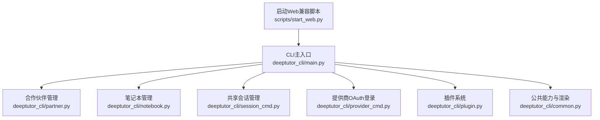
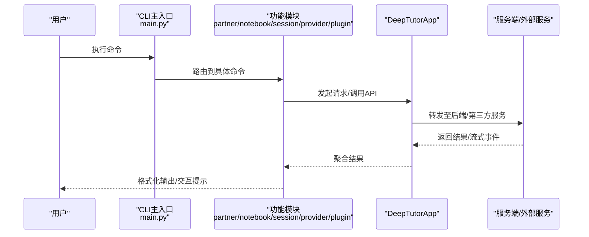
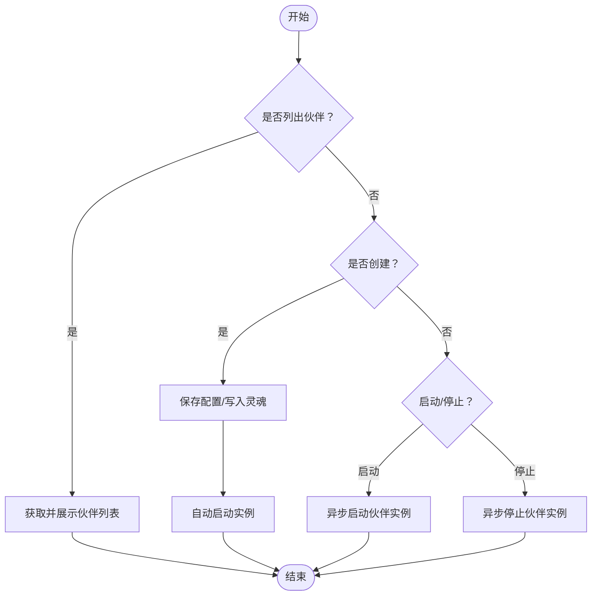
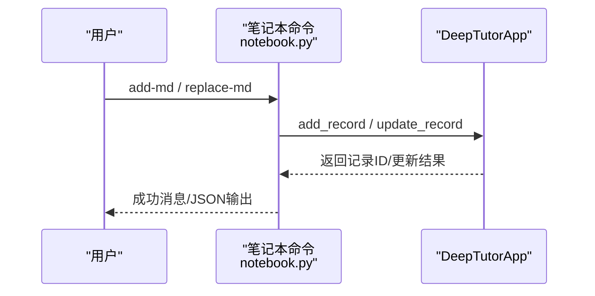
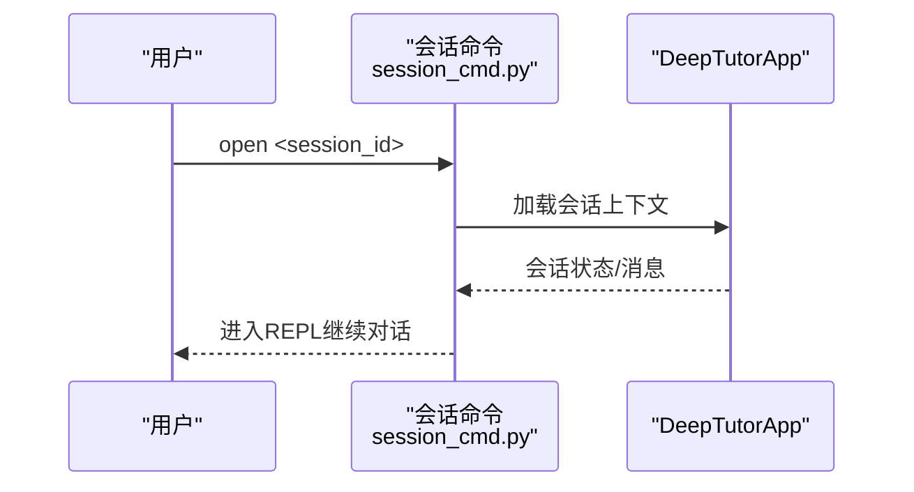
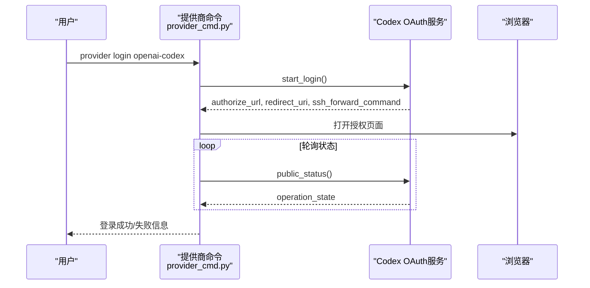
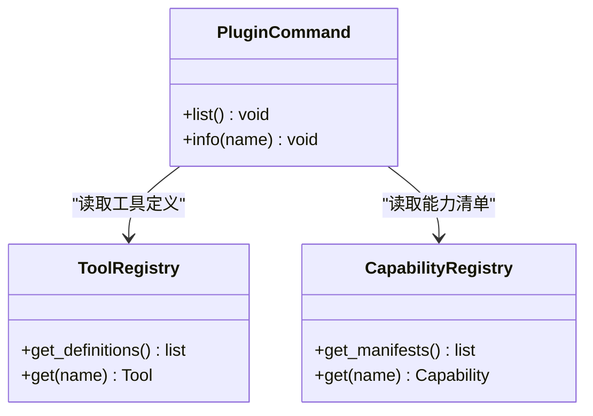
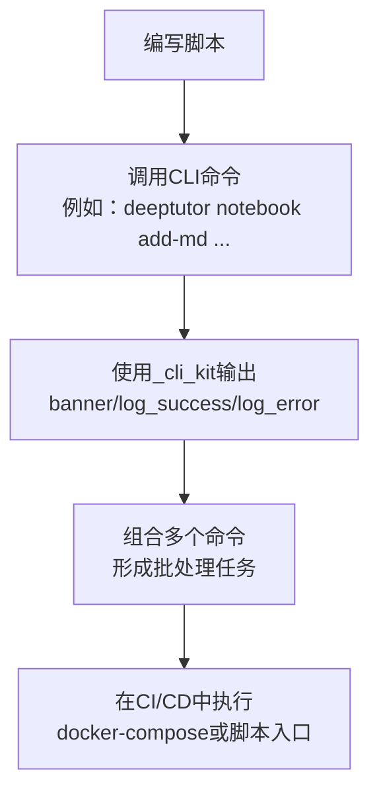
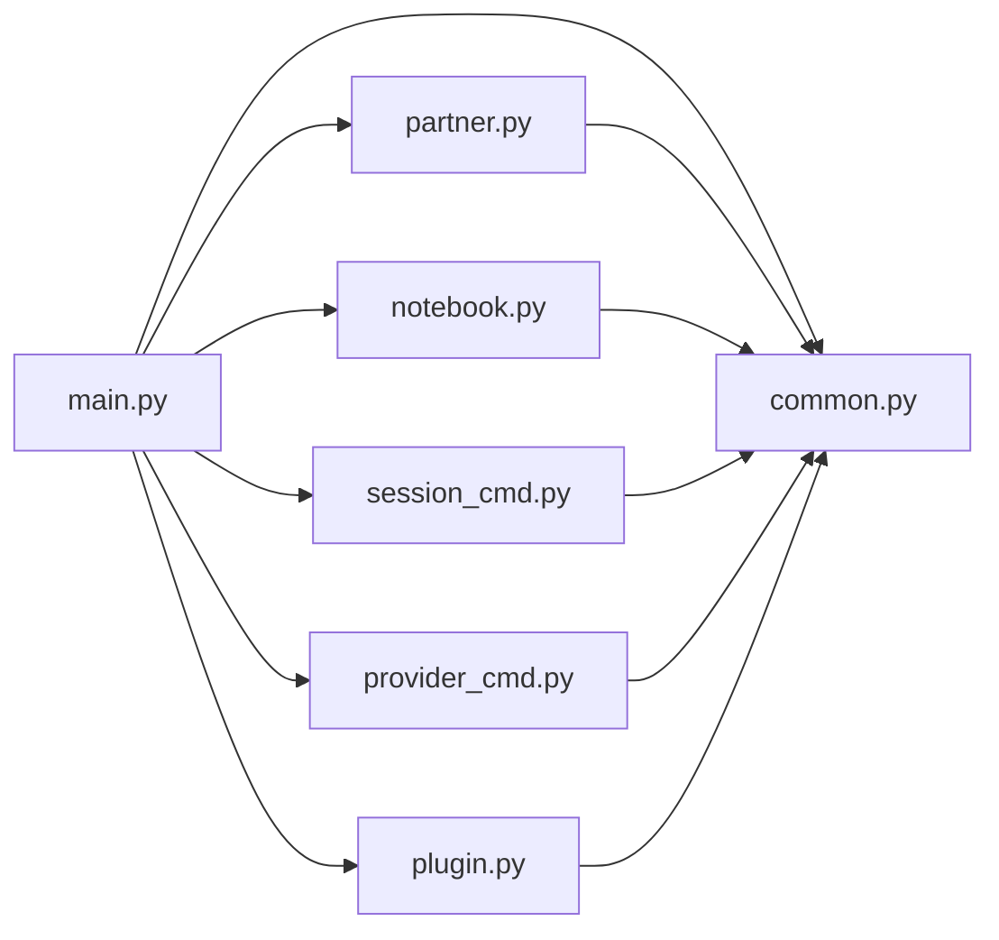

# 高级功能

<cite>
**本文引用的文件**
- [deeptutor_cli/main.py](file://deeptutor_cli/main.py)
- [deeptutor_cli/partner.py](file://deeptutor_cli/partner.py)
- [deeptutor_cli/notebook.py](file://deeptutor_cli/notebook.py)
- [deeptutor_cli/session_cmd.py](file://deeptutor_cli/session_cmd.py)
- [deeptutor_cli/provider_cmd.py](file://deeptutor_cli/provider_cmd.py)
- [deeptutor_cli/plugin.py](file://deeptutor_cli/plugin.py)
- [deeptutor_cli/common.py](file://deeptutor_cli/common.py)
- [scripts/start_web.py](file://scripts/start_web.py)
- [scripts/_cli_kit.py](file://scripts/_cli_kit.py)
</cite>

## 目录
1. [简介](#简介)
2. [项目结构](#项目结构)
3. [核心组件](#核心组件)
4. [架构总览](#架构总览)
5. [详细组件分析](#详细组件分析)
6. [依赖关系分析](#依赖关系分析)
7. [性能考虑](#性能考虑)
8. [故障排查指南](#故障排查指南)
9. [结论](#结论)
10. [附录](#附录)

## 简介
本章节面向DeepTutor CLI的高级使用场景，聚焦以下能力：
- 合作伙伴管理：创建、启动/停止伙伴实例，查看状态与通道；对接IM平台（通过渠道抽象）与会话管理。
- 笔记本操作：创建笔记本、添加/替换Markdown记录、列出与展示记录。
- 共享会话：列出、查看、打开、重命名与删除会话，支持交互式REPL继续对话。
- 提供商OAuth登录：OpenAI Codex OAuth登录流程与GitHub Copilot认证校验。
- 插件系统：工具与能力的注册、列举与详情查询，便于扩展与集成。
- 自动化工作流：基于CLI命令的批处理与脚本化操作示例，结合通用脚本工具。
- 与其他工具及CI/CD集成：提供启动后端/前端、兼容脚本入口以及流水线集成建议。

## 项目结构
CLI以Typer组织子命令，按功能划分模块：
- 主入口：注册各子应用与命令，统一日志与运行模式设置。
- 子应用：partner、notebook、session、provider、plugin等各自实现命令注册。
- 公共能力：common提供统一的请求构建、流式渲染、交互输入与错误处理。
- 脚本：start_web等用于兼容旧入口或快速启动Web服务。

**图表来源**
- [deeptutor_cli/main.py:29-72](file://deeptutor_cli/main.py#L29-L72)
- [scripts/start_web.py:14-35](file://scripts/start_web.py#L14-L35)

**章节来源**
- [deeptutor_cli/main.py:29-72](file://deeptutor_cli/main.py#L29-L72)
- [scripts/start_web.py:14-35](file://scripts/start_web.py#L14-L35)

## 核心组件
- 合作伙伴管理：提供list、create、start、stop命令，调用PartnerManager进行配置持久化与实例生命周期管理。
- 笔记本操作：提供list、create、show、remove-record、add-md、replace-md命令，封装对DeepTutorApp的CRUD与导入导出。
- 共享会话：提供list、show、open、delete、rename命令，支持进入已有会话的交互式聊天。
- 提供商OAuth：提供login命令，支持openai-codex与github-copilot两种提供商的认证流程。
- 插件系统：提供list、info命令，读取工具与能力注册表，输出可用扩展清单与元数据。
- 公共能力：统一构建TurnRequest、流式事件渲染、ask_user交互、中断处理与JSON输出。

**章节来源**
- [deeptutor_cli/partner.py:16-104](file://deeptutor_cli/partner.py#L16-L104)
- [deeptutor_cli/notebook.py:15-122](file://deeptutor_cli/notebook.py#L15-L122)
- [deeptutor_cli/session_cmd.py:15-102](file://deeptutor_cli/session_cmd.py#L15-L102)
- [deeptutor_cli/provider_cmd.py:15-104](file://deeptutor_cli/provider_cmd.py#L15-L104)
- [deeptutor_cli/plugin.py:19-82](file://deeptutor_cli/plugin.py#L19-L82)
- [deeptutor_cli/common.py:129-249](file://deeptutor_cli/common.py#L129-L249)

## 架构总览
CLI作为用户入口，将命令路由到对应模块，并通过DeepTutorApp与服务端交互。合作伙伴、笔记本与会话等模块分别封装业务逻辑；提供商OAuth通过专用服务完成浏览器授权与令牌管理；插件系统通过注册表暴露可用能力与工具。

**图表来源**
- [deeptutor_cli/main.py:29-72](file://deeptutor_cli/main.py#L29-L72)
- [deeptutor_cli/common.py:129-249](file://deeptutor_cli/common.py#L129-L249)

## 详细组件分析

### 合作伙伴管理（IM平台集成与会话管理）
- 列表：显示所有已配置的伙伴实例，包括名称、状态、模型与通道。
- 创建：保存配置并可选写入“灵魂”人设，自动启动实例。
- 启动/停止：异步启动或停止指定伙伴实例，返回成功与否。
- IM集成：通过channels抽象接入不同IM平台；会话由伙伴实例维护，可通过会话ID在CLI中继续交互。

**图表来源**
- [deeptutor_cli/partner.py:16-104](file://deeptutor_cli/partner.py#L16-L104)

**章节来源**
- [deeptutor_cli/partner.py:16-104](file://deeptutor_cli/partner.py#L16-L104)

### 笔记本操作（记录创建、编辑与导入导出）
- 列表/展示：列出笔记本与记录，支持rich或json格式输出。
- 创建：新建笔记本并返回元信息。
- 导入：将本地Markdown文件作为记录添加到指定笔记本，支持自定义标题与类型。
- 编辑：用新Markdown内容替换现有记录的输出。
- 删除：移除指定记录。

**图表来源**
- [deeptutor_cli/notebook.py:15-122](file://deeptutor_cli/notebook.py#L15-L122)

**章节来源**
- [deeptutor_cli/notebook.py:15-122](file://deeptutor_cli/notebook.py#L15-L122)

### 共享会话管理（创建、分享与协作）
- 列表/查看：分页列出会话，查看会话内容与消息历史。
- 打开：进入已有会话的交互式聊天REPL，继续对话。
- 重命名/删除：修改会话标题或删除会话及其全部消息。
- 协作：通过会话ID在不同终端或进程间复用同一上下文，便于多人协作与任务拆分。

**图表来源**
- [deeptutor_cli/session_cmd.py:15-102](file://deeptutor_cli/session_cmd.py#L15-L102)

**章节来源**
- [deeptutor_cli/session_cmd.py:15-102](file://deeptutor_cli/session_cmd.py#L15-L102)

### 提供商OAuth登录配置与管理
- OpenAI Codex：启动浏览器授权流程，轮询状态直至完成或失败，输出可用模型数量与当前活动模型。
- GitHub Copilot：通过轻量请求验证现有Copilot认证是否有效。
- 错误处理：捕获认证异常并给出友好提示，支持取消操作。

**图表来源**
- [deeptutor_cli/provider_cmd.py:15-104](file://deeptutor_cli/provider_cmd.py#L15-L104)

**章节来源**
- [deeptutor_cli/provider_cmd.py:15-104](file://deeptutor_cli/provider_cmd.py#L15-L104)

### 插件系统的扩展机制与插件管理
- 列举：展示已注册的工具与能力清单，包含名称、类型与描述摘要。
- 详情：查询特定工具或能力的OpenAI Schema、阶段、默认配置、可用性等信息。
- 扩展：通过工具注册表与能力注册表动态发现与加载，便于二次开发与集成。

**图表来源**
- [deeptutor_cli/plugin.py:19-82](file://deeptutor_cli/plugin.py#L19-L82)

**章节来源**
- [deeptutor_cli/plugin.py:19-82](file://deeptutor_cli/plugin.py#L19-L82)

### 自动化工作流示例（批处理与脚本化操作）
- 批处理：通过循环调用CLI命令（如批量导入Markdown、批量重命名会话、批量列出笔记），结合shell脚本或Python脚本实现自动化。
- 脚本化工具：使用scripts/_cli_kit中的banner、log_success、log_error辅助函数统一输出风格，便于流水线日志解析。
- 启动Web：scripts/start_web.py兼容旧入口，调用runtime launcher启动后端与前端，适合容器化部署与CI环境。

**图表来源**
- [scripts/_cli_kit.py:16-31](file://scripts/_cli_kit.py#L16-L31)
- [scripts/start_web.py:14-35](file://scripts/start_web.py#L14-L35)

**章节来源**
- [scripts/_cli_kit.py:16-31](file://scripts/_cli_kit.py#L16-L31)
- [scripts/start_web.py:14-35](file://scripts/start_web.py#L14-L35)

### 与其他工具的集成方法与CI/CD流水线集成指南
- 与IDE/编辑器：通过CLI命令生成或更新笔记本记录，配合版本控制实现文档即代码。
- 与知识库：利用notebook记录作为知识源，结合RAG工具进行检索增强。
- CI/CD：在流水线中安装CLI依赖，执行测试用例与质量检查；使用start_web启动服务进行端到端测试；通过脚本输出结构化日志以便收集与分析。

[本节为概念性说明，不直接分析具体文件]

## 依赖关系分析
CLI模块之间通过Typer注册与DeepTutorApp解耦，降低耦合度：
- main.py负责命令注册与全局设置。
- 各子模块仅关注自身业务逻辑，通过app客户端与服务端交互。
- common提供统一的流式渲染与交互，避免重复实现。

**图表来源**
- [deeptutor_cli/main.py:29-72](file://deeptutor_cli/main.py#L29-L72)
- [deeptutor_cli/common.py:129-249](file://deeptutor_cli/common.py#L129-L249)

**章节来源**
- [deeptutor_cli/main.py:29-72](file://deeptutor_cli/main.py#L29-L72)
- [deeptutor_cli/common.py:129-249](file://deeptutor_cli/common.py#L129-L249)

## 性能考虑
- 流式渲染：common中的TurnStreamRenderer按事件流逐步渲染，减少内存占用并提升响应速度。
- 参数压缩：工具调用参数摘要限制长度，避免终端溢出。
- 异步处理：合作伙伴启动/停止、会话操作均使用异步接口，提高并发能力。
- 资源清理：在错误或中断时及时释放状态与资源，防止泄漏。

[本节为一般性指导，不直接分析具体文件]

## 故障排查指南
- 登录失败：检查浏览器是否能打开授权URL，确认回调地址与SSH隧道命令正确；查看public_status的错误码。
- 会话未找到：确认会话ID是否正确，必要时重新列出会话。
- 笔记本记录不存在：检查记录ID与笔记本ID匹配，确保路径存在且编码正确。
- 插件未注册：确认工具与能力已正确安装并加载，使用plugin info查看详情。
- 启动失败：检查依赖是否安装完整，必要时使用serve命令单独启动API服务并查看端口与WS大小配置。

**章节来源**
- [deeptutor_cli/provider_cmd.py:36-76](file://deeptutor_cli/provider_cmd.py#L36-L76)
- [deeptutor_cli/session_cmd.py:54-102](file://deeptutor_cli/session_cmd.py#L54-L102)
- [deeptutor_cli/notebook.py:68-122](file://deeptutor_cli/notebook.py#L68-L122)
- [deeptutor_cli/plugin.py:42-82](file://deeptutor_cli/plugin.py#L42-L82)
- [deeptutor_cli/main.py:132-175](file://deeptutor_cli/main.py#L132-L175)

## 结论
DeepTutor CLI提供了完善的合作伙伴管理、笔记本操作、共享会话、提供商OAuth登录与插件管理能力，并通过公共能力模块实现一致的交互体验。借助脚本工具与CI/CD集成，可实现自动化工作流与持续交付。建议在生产环境中合理配置WebSocket大小与超时参数，确保稳定性与性能。

[本节为总结性内容，不直接分析具体文件]

## 附录
- 常用命令速查：
  - 合作伙伴：list、create、start、stop
  - 笔记本：list、create、show、add-md、replace-md、remove-record
  - 会话：list、show、open、rename、delete
  - 提供商：login openai-codex | github-copilot
  - 插件：list、info
- 启动方式：
  - deeptutor start：启动后端+前端
  - deeptutor serve：仅启动API服务
  - scripts/start_web.py：兼容旧入口

[本节为补充信息，不直接分析具体文件]