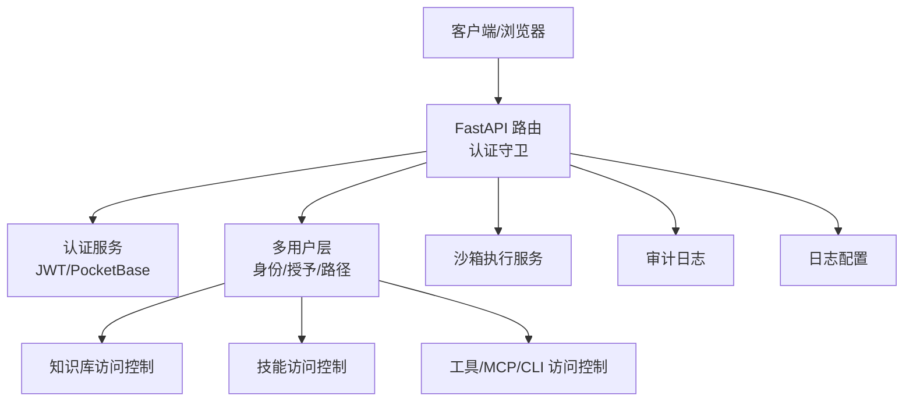
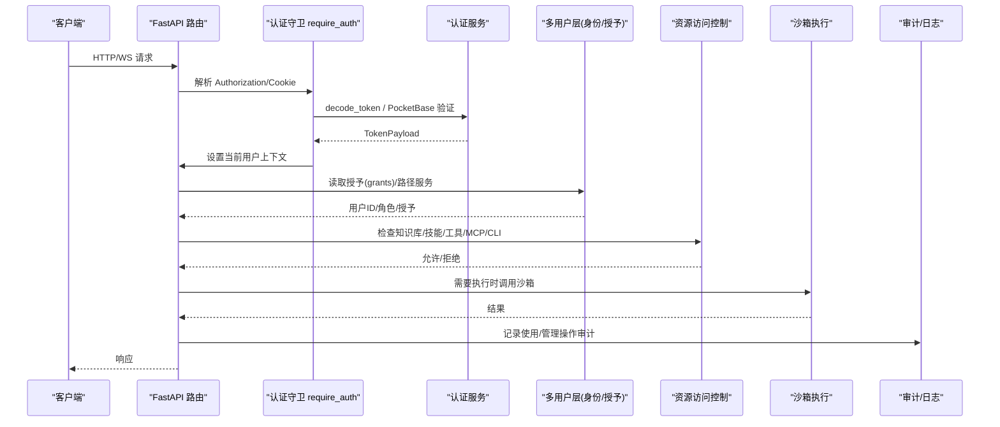
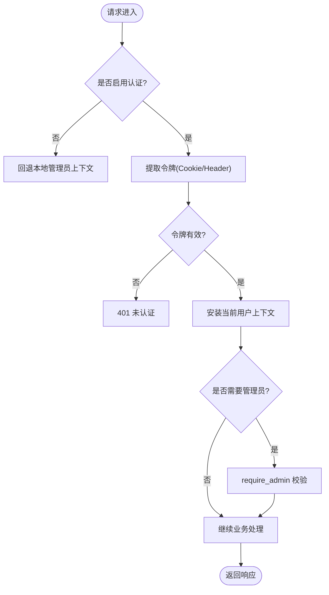
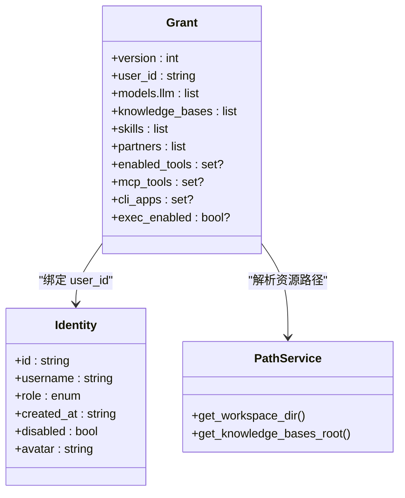
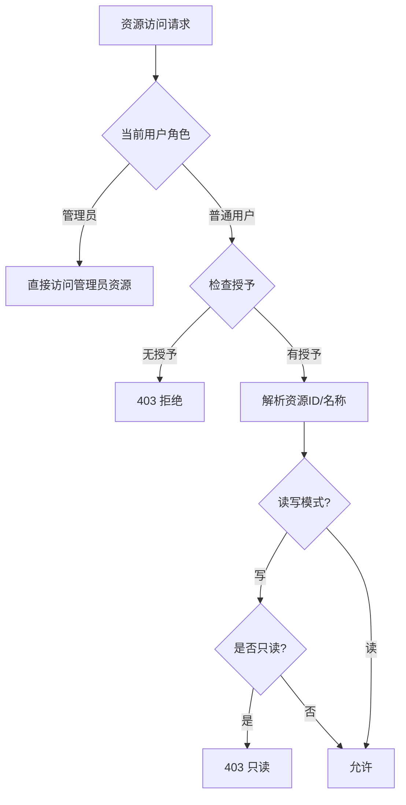
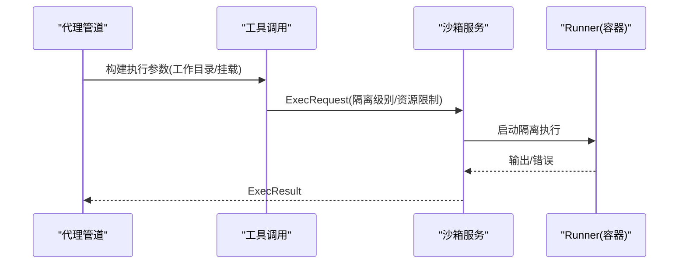
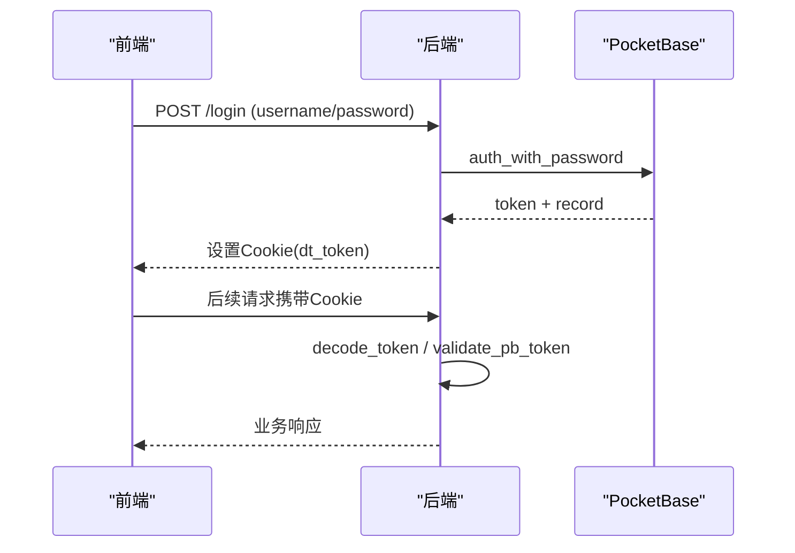
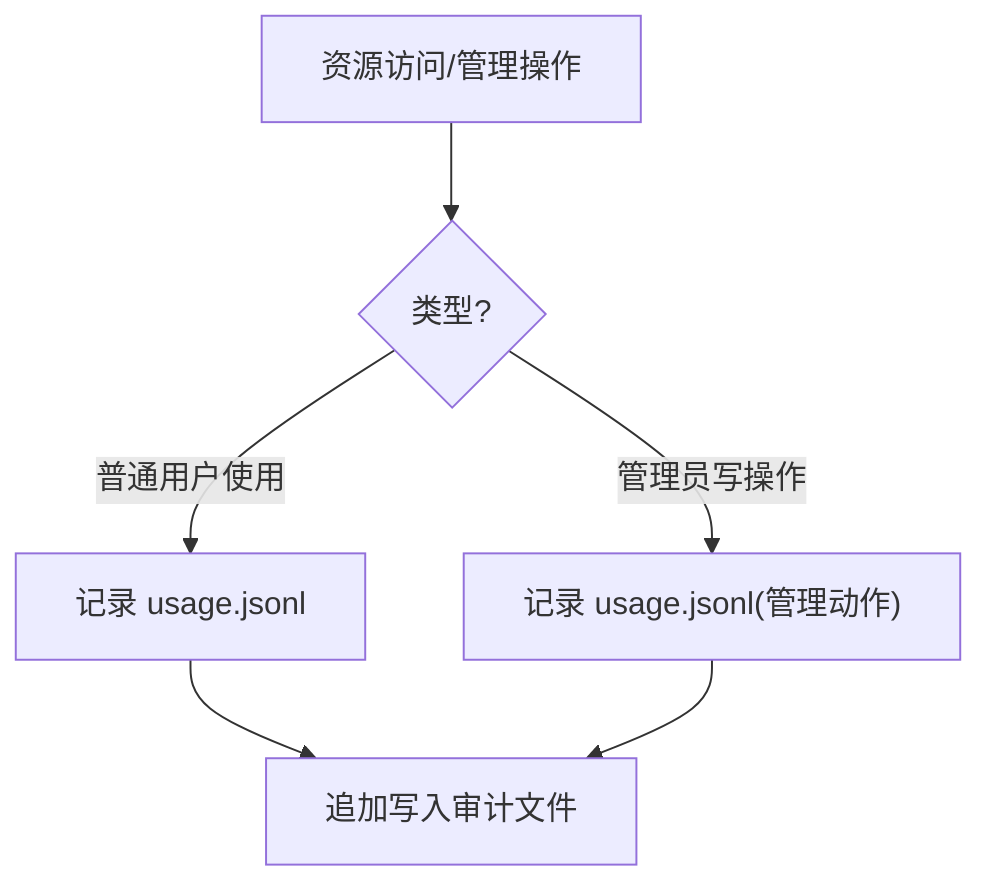
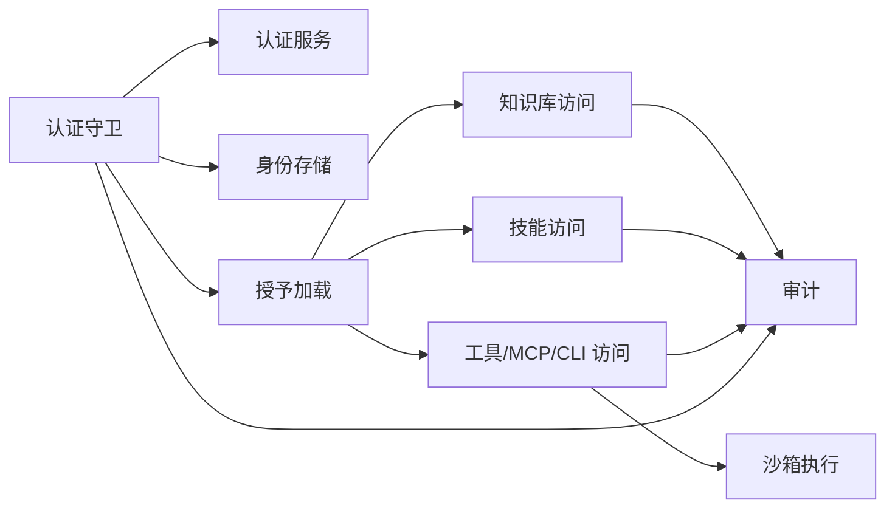

# 安全与权限

<cite>
**本文引用的文件**
- [auth.py](file://deeptutor/api/routers/auth.py)
- [auth_service.py](file://deeptutor/services/auth.py)
- [identity.py](file://deeptutor/multi_user/identity.py)
- [grants.py](file://deeptutor/multi_user/grants.py)
- [knowledge_access.py](file://deeptutor/multi_user/knowledge_access.py)
- [skill_access.py](file://deeptutor/multi_user/skill_access.py)
- [tool_access.py](file://deeptutor/multi_user/tool_access.py)
- [router_admin.py](file://deeptutor/multi_user/router.py)
- [audit.py](file://deeptutor/multi_user/audit.py)
- [configure_logging.py](file://deeptutor/logging/configure.py)
- [sandbox_init.py](file://deeptutor/services/sandbox/__init__.py)
- [agentic_pipeline.py](file://deeptutor/agents/chat/agentic_pipeline.py)
- [docker_compose.yml](file://docker-compose.yml)
- [compose.yaml](file://compose.yaml)
- [pre_commit_config.yaml](file://.pre-commit-config.yaml)
- [secrets_baseline.json](file://.secrets.baseline)
</cite>

## 目录
1. [简介](#简介)
2. [项目结构](#项目结构)
3. [核心组件](#核心组件)
4. [架构总览](#架构总览)
5. [详细组件分析](#详细组件分析)
6. [依赖关系分析](#依赖关系分析)
7. [性能与安全权衡](#性能与安全权衡)
8. [故障排查指南](#故障排查指南)
9. [结论](#结论)
10. [附录：企业级配置清单](#附录企业级配置清单)

## 简介
本文件系统性阐述 DeepTutor 的安全与权限控制机制，覆盖多用户部署的安全架构、认证授权流程（JWT/PocketBase）、资源访问控制（知识库、技能、工具等）、沙箱执行隔离、OAuth 集成、安全配置最佳实践、漏洞防护、审计日志与企业级策略落地。文档以代码为依据，提供可追溯的源码路径与图示，帮助读者从高层到实现细节全面掌握系统安全设计。

## 项目结构
DeepTutor 的安全能力主要分布在以下模块：
- API 层鉴权与路由守卫：统一认证依赖、Cookie/JWT 处理、管理员校验
- 多用户身份与授权：用户存储、角色、授予（grants）与资源可见性
- 资源访问控制：知识库、技能、工具、MCP、CLI 应用
- 沙箱与执行隔离：受限执行、资源限制、工作目录挂载
- 第三方认证：PocketBase、Codex OAuth
- 审计与日志：使用审计、管理操作审计、结构化日志

图表来源
- [auth.py:237-348](file://deeptutor/api/routers/auth.py#L237-L348)
- [auth_service.py:220-281](file://deeptutor/services/auth.py#L220-L281)
- [identity.py:124-190](file://deeptutor/multi_user/identity.py#L124-L190)
- [knowledge_access.py:69-151](file://deeptutor/multi_user/knowledge_access.py#L69-L151)
- [skill_access.py:14-76](file://deeptutor/multi_user/skill_access.py#L14-L76)
- [tool_access.py:36-104](file://deeptutor/multi_user/tool_access.py#L36-L104)
- [sandbox_init.py:1-28](file://deeptutor/services/sandbox/__init__.py#L1-L28)
- [audit.py:13-81](file://deeptutor/multi_user/audit.py#L13-L81)
- [configure_logging.py:37-78](file://deeptutor/logging/configure.py#L37-L78)

章节来源
- [auth.py:1-872](file://deeptutor/api/routers/auth.py#L1-L872)
- [auth_service.py:1-379](file://deeptutor/services/auth.py#L1-L379)
- [identity.py:1-326](file://deeptutor/multi_user/identity.py#L1-L326)
- [grants.py:1-138](file://deeptutor/multi_user/grants.py#L1-L138)
- [knowledge_access.py:1-282](file://deeptutor/multi_user/knowledge_access.py#L1-L282)
- [skill_access.py:1-76](file://deeptutor/multi_user/skill_access.py#L1-L76)
- [tool_access.py:1-114](file://deeptutor/multi_user/tool_access.py#L1-L114)
- [router_admin.py:1-229](file://deeptutor/multi_user/router.py#L1-L229)
- [audit.py:1-81](file://deeptutor/multi_user/audit.py#L1-L81)
- [configure_logging.py:1-78](file://deeptutor/logging/configure.py#L1-L78)
- [sandbox_init.py:1-28](file://deeptutor/services/sandbox/__init__.py#L1-L28)
- [agentic_pipeline.py:557-584](file://deeptutor/agents/chat/agentic_pipeline.py#L557-L584)
- [docker_compose.yml:76-139](file://docker-compose.yml#L76-L139)
- [compose.yaml:29-49](file://compose.yaml#L29-L49)
- [pre_commit_config.yaml:64-90](file://.pre-commit-config.yaml#L64-L90)
- [secrets_baseline.json:1-354](file://.secrets.baseline#L1-L354)

## 核心组件
- 认证与授权网关：基于 FastAPI 依赖注入的统一认证入口，支持 Cookie 与 Bearer 令牌，自动安装当前用户上下文；管理员专用守卫。
- 多用户身份与授予：用户存储、角色、授予（模型、知识库、技能、伙伴、工具、MCP、CLI 应用、执行开关），按用户隔离资源。
- 资源访问控制：知识库读写、技能可见性、工具白名单、MCP 工具白名单、CLI 应用白名单。
- 沙箱执行：受控执行环境，隔离级别与资源限制，工作目录挂载，第三方 CLI 应用执行隔离。
- 第三方认证：PocketBase 模式与 Codex OAuth 回调。
- 审计与日志：使用审计与管理操作审计，结构化 JSONL 日志输出。

章节来源
- [auth.py:237-348](file://deeptutor/api/routers/auth.py#L237-L348)
- [identity.py:124-190](file://deeptutor/multi_user/identity.py#L124-L190)
- [grants.py:16-138](file://deeptutor/multi_user/grants.py#L16-L138)
- [knowledge_access.py:69-151](file://deeptutor/multi_user/knowledge_access.py#L69-L151)
- [skill_access.py:14-76](file://deeptutor/multi_user/skill_access.py#L14-L76)
- [tool_access.py:36-104](file://deeptutor/multi_user/tool_access.py#L36-L104)
- [sandbox_init.py:1-28](file://deeptutor/services/sandbox/__init__.py#L1-L28)
- [audit.py:13-81](file://deeptutor/multi_user/audit.py#L13-L81)
- [configure_logging.py:37-78](file://deeptutor/logging/configure.py#L37-L78)

## 架构总览
下图展示请求进入后的认证、授权、资源访问与执行隔离的关键路径。

图表来源
- [auth.py:237-348](file://deeptutor/api/routers/auth.py#L237-L348)
- [auth_service.py:220-281](file://deeptutor/services/auth.py#L220-L281)
- [identity.py:124-190](file://deeptutor/multi_user/identity.py#L124-L190)
- [grants.py:60-138](file://deeptutor/multi_user/grants.py#L60-L138)
- [knowledge_access.py:69-151](file://deeptutor/multi_user/knowledge_access.py#L69-L151)
- [skill_access.py:14-76](file://deeptutor/multi_user/skill_access.py#L14-L76)
- [tool_access.py:36-104](file://deeptutor/multi_user/tool_access.py#L36-L104)
- [audit.py:13-81](file://deeptutor/multi_user/audit.py#L13-L81)

## 详细组件分析

### 认证与授权流程（JWT 与 PocketBase）
- 登录：支持内置 JWT（HS256）或 PocketBase 模式。成功返回并设置 HttpOnly Cookie，携带过期时间。
- 鉴权：每个受保护端点通过 require_auth 依赖注入，从 Header/Bearer 或 Cookie 提取令牌，解码后安装当前用户上下文。
- 管理员：require_admin 在启用认证时要求 admin 角色；禁用认证时回退为本地管理员。
- WebSocket：ws_require_auth 在 accept 前完成鉴权，失败关闭连接。
- 会话：Cookie 属性根据是否 HTTPS 动态选择 SameSite 与 Secure；登出删除 Cookie。

图表来源
- [auth.py:237-348](file://deeptutor/api/routers/auth.py#L237-L348)
- [auth_service.py:220-281](file://deeptutor/services/auth.py#L220-L281)

章节来源
- [auth.py:237-348](file://deeptutor/api/routers/auth.py#L237-L348)
- [auth_service.py:220-281](file://deeptutor/services/auth.py#L220-L281)

### 多用户身份与授予（Grants）
- 用户存储：JSON 文件持久化，支持迁移与并发写锁，首用户自动成为管理员。
- 授予模型：包含 LLM 模型、知识库、技能、伙伴、工具白名单、MCP 工具、CLI 应用、执行开关等。
- 规范化与校验：写入前归一化为 v2 结构，禁止敏感字段（密钥、路径等）。
- 管理员分配：通过管理员路由获取可分配资源列表，并为用户设置授予。

图表来源
- [grants.py:16-138](file://deeptutor/multi_user/grants.py#L16-L138)
- [identity.py:124-190](file://deeptutor/multi_user/identity.py#L124-L190)
- [router_admin.py:118-167](file://deeptutor/multi_user/router.py#L118-L167)

章节来源
- [identity.py:124-190](file://deeptutor/multi_user/identity.py#L124-L190)
- [grants.py:16-138](file://deeptutor/multi_user/grants.py#L16-L138)
- [router_admin.py:118-167](file://deeptutor/multi_user/router.py#L118-L167)

### 资源访问控制
- 知识库：
  - 管理员可访问全部；普通用户仅能访问自身知识库或被授予的管理员知识库（只读）。
  - 默认别名映射到当前用户的默认知识库。
  - 写入时强制检查授予与只读标记。
- 技能：
  - 非管理员需显式授予才能访问管理员空间中的技能；否则 403。
- 工具与 MCP：
  - 可选工具白名单由授予决定；MCP 工具对非管理员默认拒绝，除非明确授予。
  - CLI 应用同样默认拒绝，必须显式授予。
- 执行开关：
  - exec_enabled 可在 SYSTEM 隔离下按用户覆盖执行策略。

图表来源
- [knowledge_access.py:69-151](file://deeptutor/multi_user/knowledge_access.py#L69-L151)
- [skill_access.py:14-76](file://deeptutor/multi_user/skill_access.py#L14-L76)
- [tool_access.py:36-104](file://deeptutor/multi_user/tool_access.py#L36-L104)

章节来源
- [knowledge_access.py:69-151](file://deeptutor/multi_user/knowledge_access.py#L69-L151)
- [skill_access.py:14-76](file://deeptutor/multi_user/skill_access.py#L14-L76)
- [tool_access.py:36-104](file://deeptutor/multi_user/tool_access.py#L36-L104)

### 沙箱安全机制
- 隔离级别：
  - SYSTEM：通过独立 runner 容器执行不受信任命令，主进程不执行不可信代码。
  - APPLICATION：仅在管理员或特定场景允许执行。
- 工作目录与挂载：
  - 每次任务创建独立工作目录，按工具类型挂载只读/读写卷。
  - CLI 应用与代码执行共享任务目录以便产物互通。
- 资源限制：
  - 通过沙箱服务接口声明资源限制与挂载项，确保最小权限。
- 执行策略门控：
  - 管道中依据隔离级别与授予的 exec_enabled 决定是否允许执行。

图表来源
- [agentic_pipeline.py:557-584](file://deeptutor/agents/chat/agentic_pipeline.py#L557-L584)
- [agentic_pipeline.py:943-976](file://deeptutor/agents/chat/agentic_pipeline.py#L943-L976)
- [sandbox_init.py:1-28](file://deeptutor/services/sandbox/__init__.py#L1-L28)
- [docker_compose.yml:76-139](file://docker-compose.yml#L76-L139)

章节来源
- [agentic_pipeline.py:557-584](file://deeptutor/agents/chat/agentic_pipeline.py#L557-L584)
- [agentic_pipeline.py:943-976](file://deeptutor/agents/chat/agentic_pipeline.py#L943-L976)
- [sandbox_init.py:1-28](file://deeptutor/services/sandbox/__init__.py#L1-L28)
- [docker_compose.yml:76-139](file://docker-compose.yml#L76-L139)

### OAuth 集成与第三方服务认证
- PocketBase 模式：
  - 登录/注册代理至 PocketBase，服务端缓存令牌校验结果，减少网络开销。
  - 管理员通过 PocketBase 管理面板创建，角色映射为 user/admin。
- Codex OAuth：
  - 提供回调页面接收授权码与状态，处理错误并返回友好提示。

图表来源
- [auth_service.py:288-342](file://deeptutor/services/auth.py#L288-L342)
- [auth.py:436-480](file://deeptutor/api/routers/auth.py#L436-L480)
- [auth.py:373-399](file://deeptutor/api/routers/auth.py#L373-L399)

章节来源
- [auth_service.py:288-342](file://deeptutor/services/auth.py#L288-L342)
- [auth.py:373-399](file://deeptutor/api/routers/auth.py#L373-L399)
- [auth.py:436-480](file://deeptutor/api/routers/auth.py#L436-L480)

### 安全配置最佳实践与漏洞防护
- 传输安全：
  - Cookie 的 Secure/SameSite 根据部署环境动态设置，避免跨域与本地开发问题。
- 密码与密钥：
  - 使用 bcrypt 哈希存储密码；JWT 使用 HS256 与稳定 secret 文件；支持迁移旧 secret。
- 输入校验：
  - 用户名/邮箱正则校验；头像上传进行魔数检测，拒绝 SVG 以防存储型 XSS；限制大小。
- 授予校验：
  - 写入授予时禁止敏感字段（api_key、secret、password、token、path、base_url 等）。
- 容器与运行：
  - 容器内只读根文件系统，仅 tmpfs 可写；端口绑定仅限本地回环；非 root 用户运行。
- 预提交扫描：
  - 集成 detect-secrets 与 bandit 进行密钥泄露与常见安全问题扫描。

章节来源
- [auth.py:23-31](file://deeptutor/api/routers/auth.py#L23-L31)
- [auth_service.py:82-96](file://deeptutor/services/auth.py#L82-L96)
- [auth_service.py:220-281](file://deeptutor/services/auth.py#L220-L281)
- [identity.py:303-326](file://deeptutor/multi_user/identity.py#L303-L326)
- [auth.py:582-704](file://deeptutor/api/routers/auth.py#L582-L704)
- [grants.py:115-133](file://deeptutor/multi_user/grants.py#L115-L133)
- [compose.yaml:29-49](file://compose.yaml#L29-L49)
- [pre_commit_config.yaml:64-90](file://.pre-commit-config.yaml#L64-L90)
- [secrets_baseline.json:1-354](file://.secrets.baseline#L1-L354)

### 安全审计与日志记录
- 使用审计：
  - 记录普通用户对管理员资源的访问（如知识库查询），跳过管理员自访问以减少噪音。
- 管理操作审计：
  - 记录管理员的写操作（授予变更、用户 CRUD 等），包含执行者与被操作目标摘要。
- 结构化日志：
  - 控制台与文件输出，JSONL 格式，支持轮转与上下文过滤。

图表来源
- [audit.py:13-81](file://deeptutor/multi_user/audit.py#L13-L81)
- [configure_logging.py:37-78](file://deeptutor/logging/configure.py#L37-L78)

章节来源
- [audit.py:13-81](file://deeptutor/multi_user/audit.py#L13-L81)
- [configure_logging.py:37-78](file://deeptutor/logging/configure.py#L37-L78)

## 依赖关系分析
- 认证依赖链：路由依赖 require_auth -> 认证服务 -> 用户存储/外部认证。
- 资源访问依赖：知识/技能/工具访问均依赖当前用户上下文与授予。
- 执行依赖：管道在执行前检查隔离级别与授予的执行开关，再调用沙箱服务。
- 审计依赖：所有关键访问与管理员操作均触发审计写入。

图表来源
- [auth.py:237-348](file://deeptutor/api/routers/auth.py#L237-L348)
- [grants.py:60-138](file://deeptutor/multi_user/grants.py#L60-L138)
- [knowledge_access.py:69-151](file://deeptutor/multi_user/knowledge_access.py#L69-L151)
- [skill_access.py:14-76](file://deeptutor/multi_user/skill_access.py#L14-L76)
- [tool_access.py:36-104](file://deeptutor/multi_user/tool_access.py#L36-L104)
- [audit.py:13-81](file://deeptutor/multi_user/audit.py#L13-L81)

章节来源
- [auth.py:237-348](file://deeptutor/api/routers/auth.py#L237-L348)
- [grants.py:60-138](file://deeptutor/multi_user/grants.py#L60-L138)
- [knowledge_access.py:69-151](file://deeptutor/multi_user/knowledge_access.py#L69-L151)
- [skill_access.py:14-76](file://deeptutor/multi_user/skill_access.py#L14-L76)
- [tool_access.py:36-104](file://deeptutor/multi_user/tool_access.py#L36-L104)
- [audit.py:13-81](file://deeptutor/multi_user/audit.py#L13-L81)

## 性能与安全权衡
- 认证性能：
  - PocketBase 模式对令牌校验进行内存缓存（约 60 秒），降低网络延迟。
- 资源访问：
  - 知识库管理器使用 lru_cache 提升重复访问效率。
- 执行隔离：
  - SYSTEM 隔离更安全但引入额外通信开销；APPLICATION 隔离适合可信环境。
- 审计与日志：
  - 异步追加写入，不影响主请求链路；结构化日志便于集中采集与分析。

章节来源
- [auth_service.py:242-261](file://deeptutor/services/auth.py#L242-L261)
- [knowledge_access.py:24-27](file://deeptutor/multi_user/knowledge_access.py#L24-L27)
- [agentic_pipeline.py:557-584](file://deeptutor/agents/chat/agentic_pipeline.py#L557-L584)
- [audit.py:19-27](file://deeptutor/multi_user/audit.py#L19-L27)
- [configure_logging.py:58-71](file://deeptutor/logging/configure.py#L58-L71)

## 故障排查指南
- 无法登录：
  - 检查认证是否启用、用户是否存在、密码哈希是否正确；PocketBase 模式下确认 URL 与网络连通。
- 令牌无效：
  - 确认 Cookie 或 Authorization 头是否正确传递；检查过期时间与签名密钥。
- 资源不可见：
  - 核查授予是否包含对应资源；管理员知识库对普通用户只读且需显式授予。
- 执行被拒：
  - 检查隔离级别与授予的 exec_enabled；确认沙箱 runner 可用。
- 审计缺失：
  - 确认审计文件路径可写；审计写入失败不会中断请求，需检查文件系统权限。

章节来源
- [auth.py:436-480](file://deeptutor/api/routers/auth.py#L436-L480)
- [auth_service.py:220-281](file://deeptutor/services/auth.py#L220-L281)
- [knowledge_access.py:69-151](file://deeptutor/multi_user/knowledge_access.py#L69-L151)
- [tool_access.py:89-96](file://deeptutor/multi_user/tool_access.py#L89-L96)
- [audit.py:19-27](file://deeptutor/multi_user/audit.py#L19-L27)

## 结论
DeepTutor 的安全与权限体系围绕“认证—授权—资源访问—执行隔离—审计”形成闭环。通过统一的认证守卫、细粒度的授予模型、严格的资源访问控制与安全的沙箱执行，系统在多用户环境下实现了强隔离与可控访问。结合 PocketBase/Codex OAuth 集成、容器化安全配置与预提交安全扫描，能够满足企业级部署的安全需求。建议在生产环境中启用 SYSTEM 隔离、严格授予最小权限、开启审计与结构化日志，并定期审查授予与访问记录。

## 附录：企业级配置清单
- 启用认证并配置令牌过期时间；生产环境使用 HTTPS 以启用 Secure Cookie。
- 使用 PocketBase 作为外部身份源，或在单实例部署中使用内置 JWT。
- 为每个非管理员用户配置最小必要授予（模型、知识库、技能、工具、MCP、CLI 应用）。
- 启用 SYSTEM 隔离执行，确保主进程不执行不可信代码；配置沙箱 runner 侧边服务。
- 容器化部署：只读根文件系统、仅本地回环端口绑定、非 root 用户运行。
- 启用审计与结构化日志，集中收集 usage.jsonl 与 JSONL 日志。
- 预提交阶段启用 detect-secrets 与 bandit，防止密钥泄露与常见安全问题。

章节来源
- [auth_service.py:42-53](file://deeptutor/services/auth.py#L42-L53)
- [auth.py:23-31](file://deeptutor/api/routers/auth.py#L23-L31)
- [grants.py:16-44](file://deeptutor/multi_user/grants.py#L16-L44)
- [docker_compose.yml:76-139](file://docker-compose.yml#L76-L139)
- [compose.yaml:29-49](file://compose.yaml#L29-L49)
- [audit.py:13-81](file://deeptutor/multi_user/audit.py#L13-L81)
- [configure_logging.py:37-78](file://deeptutor/logging/configure.py#L37-L78)
- [pre_commit_config.yaml:64-90](file://.pre-commit-config.yaml#L64-L90)