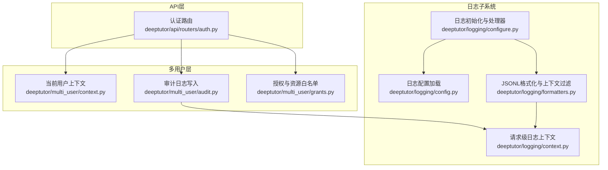
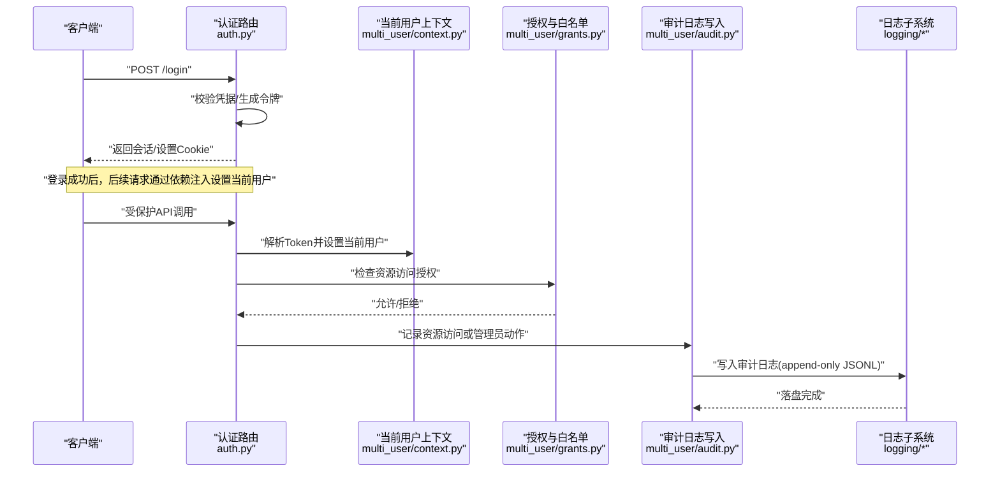
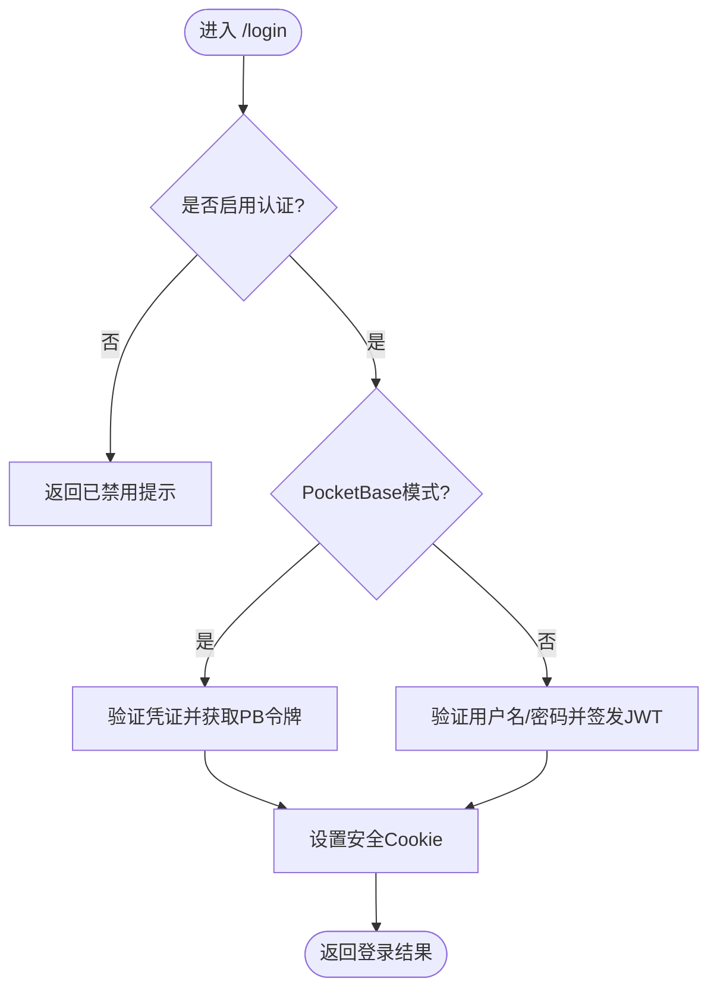
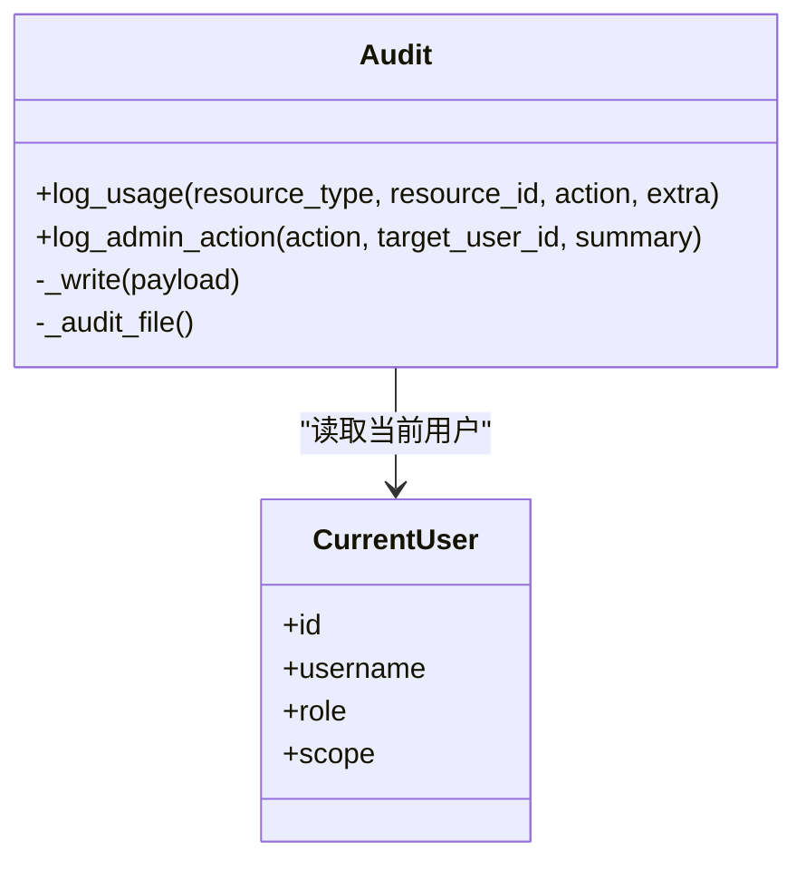
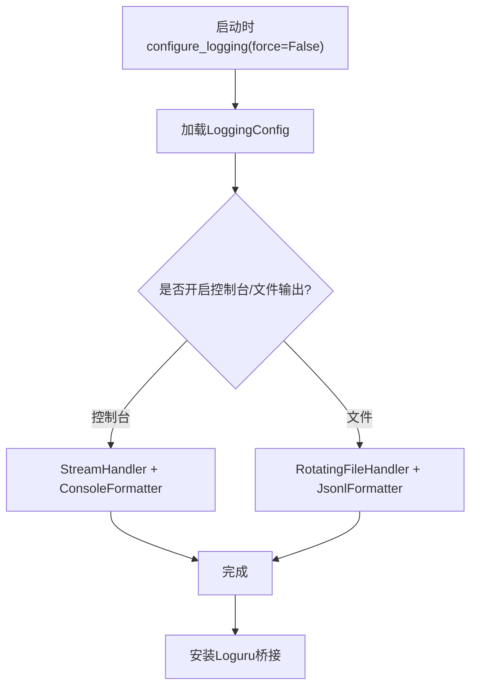
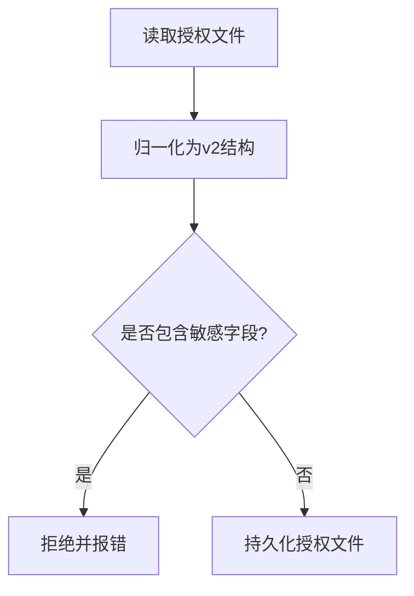
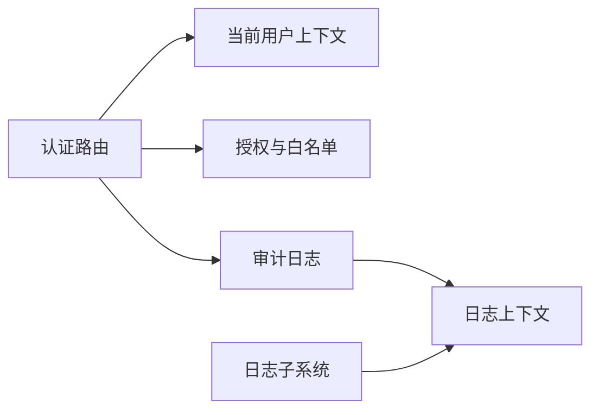

# 安全审计与日志

<cite>
**本文引用的文件**
- [deeptutor/multi_user/audit.py](file://deeptutor/multi_user/audit.py)
- [deeptutor/logging/configure.py](file://deeptutor/logging/configure.py)
- [deeptutor/logging/formatters.py](file://deeptutor/logging/formatters.py)
- [deeptutor/logging/config.py](file://deeptutor/logging/config.py)
- [deeptutor/logging/context.py](file://deeptutor/logging/context.py)
- [deeptutor/api/routers/auth.py](file://deeptutor/api/routers/auth.py)
- [deeptutor/multi_user/context.py](file://deeptutor/multi_user/context.py)
- [deeptutor/multi_user/grants.py](file://deeptutor/multi_user/grants.py)
</cite>

## 目录
1. [简介](#简介)
2. [项目结构](#项目结构)
3. [核心组件](#核心组件)
4. [架构总览](#架构总览)
5. [详细组件分析](#详细组件分析)
6. [依赖关系分析](#依赖关系分析)
7. [性能考量](#性能考量)
8. [故障排查指南](#故障排查指南)
9. [结论](#结论)
10. [附录](#附录)

## 简介
本文件面向DeepTutor的安全审计与日志系统，聚焦以下目标：
- 记录并追踪关键安全事件：用户登录、权限变更、资源访问等。
- 统一结构化日志格式与标准化字段，便于后续分析与查询。
- 提供实时安全监控与告警思路（异常行为检测、威胁识别）。
- 说明日志存储策略：本地存储、远程收集与归档管理。
- 给出日志分析方法：查询语法、统计报表与可视化展示建议。
- 隐私保护与数据脱敏策略，确保敏感信息不被泄露。
- 如何集成第三方安全信息与事件管理（SIEM）系统。

## 项目结构
DeepTutor在“多用户层”和“日志子系统”之间形成清晰的职责边界：
- 多用户层负责身份上下文、授权与审计事件写入。
- 日志子系统负责日志配置、格式化、输出与上下文注入。
- API路由层负责认证流程与关键操作的入口点。

图表来源
- [deeptutor/api/routers/auth.py:216-348](file://deeptutor/api/routers/auth.py#L216-L348)
- [deeptutor/multi_user/context.py:14-45](file://deeptutor/multi_user/context.py#L14-L45)
- [deeptutor/multi_user/audit.py:13-81](file://deeptutor/multi_user/audit.py#L13-L81)
- [deeptutor/logging/configure.py:37-77](file://deeptutor/logging/configure.py#L37-L77)
- [deeptutor/logging/formatters.py:13-49](file://deeptutor/logging/formatters.py#L13-L49)
- [deeptutor/logging/config.py:9-49](file://deeptutor/logging/config.py#L9-L49)
- [deeptutor/logging/context.py:10-39](file://deeptutor/logging/context.py#L10-L39)

章节来源
- [deeptutor/api/routers/auth.py:216-348](file://deeptutor/api/routers/auth.py#L216-L348)
- [deeptutor/multi_user/context.py:14-45](file://deeptutor/multi_user/context.py#L14-L45)
- [deeptutor/multi_user/audit.py:13-81](file://deeptutor/multi_user/audit.py#L13-L81)
- [deeptutor/logging/configure.py:37-77](file://deeptutor/logging/configure.py#L37-L77)
- [deeptutor/logging/formatters.py:13-49](file://deeptutor/logging/formatters.py#L13-L49)
- [deeptutor/logging/config.py:9-49](file://deeptutor/logging/config.py#L9-L49)
- [deeptutor/logging/context.py:10-39](file://deeptutor/logging/context.py#L10-L39)

## 核心组件
- 认证与鉴权入口：提供登录、登出、状态查询、管理员操作等接口，并在成功时设置当前用户上下文。
- 审计日志：记录普通用户对受管资源的访问以及管理员的写操作（如权限变更、用户CRUD）。
- 日志子系统：统一配置日志级别、输出目标（控制台/文件）、JSONL结构化格式，并通过过滤器将请求级上下文注入每条日志。
- 授权与资源白名单：以逻辑ID形式管理模型、知识库、技能、工具、MCP工具、CLI应用等访问控制，避免在授权文件中出现敏感信息。

章节来源
- [deeptutor/api/routers/auth.py:216-348](file://deeptutor/api/routers/auth.py#L216-L348)
- [deeptutor/multi_user/audit.py:13-81](file://deeptutor/multi_user/audit.py#L13-L81)
- [deeptutor/logging/configure.py:37-77](file://deeptutor/logging/configure.py#L37-L77)
- [deeptutor/logging/formatters.py:13-49](file://deeptutor/logging/formatters.py#L13-L49)
- [deeptutor/logging/config.py:9-49](file://deeptutor/logging/config.py#L9-L49)
- [deeptutor/multi_user/grants.py:16-138](file://deeptutor/multi_user/grants.py#L16-L138)

## 架构总览
下图展示了从认证到审计的关键调用链，以及日志子系统的注入点。

图表来源
- [deeptutor/api/routers/auth.py:216-348](file://deeptutor/api/routers/auth.py#L216-L348)
- [deeptutor/multi_user/context.py:14-45](file://deeptutor/multi_user/context.py#L14-L45)
- [deeptutor/multi_user/grants.py:90-138](file://deeptutor/multi_user/grants.py#L90-L138)
- [deeptutor/multi_user/audit.py:13-81](file://deeptutor/multi_user/audit.py#L13-L81)
- [deeptutor/logging/configure.py:37-77](file://deeptutor/logging/configure.py#L37-L77)

## 详细组件分析

### 认证与登录流程（含审计触发点）
- 登录接口支持两种模式：内置JWT+bcrypt与PocketBase模式；均会设置安全的Cookie属性。
- 成功登录后，后续请求通过依赖注入将当前用户安装到请求级上下文中，供审计与路径服务使用。
- 管理员接口需要额外角色校验，失败返回403。

图表来源
- [deeptutor/api/routers/auth.py:436-480](file://deeptutor/api/routers/auth.py#L436-L480)
- [deeptutor/api/routers/auth.py:483-491](file://deeptutor/api/routers/auth.py#L483-L491)
- [deeptutor/api/routers/auth.py:216-348](file://deeptutor/api/routers/auth.py#L216-L348)

章节来源
- [deeptutor/api/routers/auth.py:216-348](file://deeptutor/api/routers/auth.py#L216-L348)
- [deeptutor/api/routers/auth.py:436-491](file://deeptutor/api/routers/auth.py#L436-L491)

### 审计日志：结构与写入策略
- 普通用户资源访问：记录时间、用户标识、资源类型、资源ID、动作及可选扩展字段；管理员自访问不重复记录以避免噪声。
- 管理员写操作：记录执行者、目标用户（可选）、动作与摘要；用于权限变更、用户管理等。
- 写入策略：追加式JSONL文件，失败不影响业务请求；自动创建必要目录。

图表来源
- [deeptutor/multi_user/audit.py:13-81](file://deeptutor/multi_user/audit.py#L13-L81)
- [deeptutor/multi_user/context.py:14-45](file://deeptutor/multi_user/context.py#L14-L45)

章节来源
- [deeptutor/multi_user/audit.py:13-81](file://deeptutor/multi_user/audit.py#L13-L81)
- [deeptutor/multi_user/context.py:14-45](file://deeptutor/multi_user/context.py#L14-L45)

### 日志子系统：配置、格式化与上下文注入
- 配置加载：从运行时配置读取日志级别、是否输出到控制台/文件、日志目录、轮转大小与备份数量。
- 初始化：为根日志器添加带上下文过滤的控制台与文件处理器；桥接Loguru；保证可重入与强制刷新能力。
- 格式化：每条日志为单行JSON对象，包含时间戳、级别、日志器名、消息与结构化上下文；异常堆栈单独字段。
- 上下文：通过ContextVar维护请求级字段（如request_id、turn_id、session_id、task_id、capability、stage、sink），由过滤器自动注入。

图表来源
- [deeptutor/logging/configure.py:37-77](file://deeptutor/logging/configure.py#L37-L77)
- [deeptutor/logging/config.py:9-49](file://deeptutor/logging/config.py#L9-L49)
- [deeptutor/logging/formatters.py:13-49](file://deeptutor/logging/formatters.py#L13-L49)
- [deeptutor/logging/context.py:10-39](file://deeptutor/logging/context.py#L10-L39)

章节来源
- [deeptutor/logging/configure.py:37-77](file://deeptutor/logging/configure.py#L37-L77)
- [deeptutor/logging/config.py:9-49](file://deeptutor/logging/config.py#L9-L49)
- [deeptutor/logging/formatters.py:13-49](file://deeptutor/logging/formatters.py#L13-L49)
- [deeptutor/logging/context.py:10-39](file://deeptutor/logging/context.py#L10-L39)

### 授权与资源白名单：最小权限与防泄漏
- 授权文件仅包含逻辑ID（如模型名、知识库名、技能名、工具名等），不包含密钥、路径、base_url等敏感字段。
- 对历史v1授权进行无损归一化至v2，缺失字段默认放开（除MCP工具与CLI应用默认拒绝）。
- 保存前进行严格校验，拒绝包含敏感键名的授权载荷。

图表来源
- [deeptutor/multi_user/grants.py:60-138](file://deeptutor/multi_user/grants.py#L60-L138)

章节来源
- [deeptutor/multi_user/grants.py:60-138](file://deeptutor/multi_user/grants.py#L60-L138)

## 依赖关系分析
- 认证路由依赖当前用户上下文与授权模块，以确保每次请求具备正确的身份与权限判断。
- 审计日志依赖当前用户上下文，以便记录操作主体与目标。
- 日志子系统通过过滤器将请求级上下文注入每条日志，使审计与运行日志具备一致的可关联性。

图表来源
- [deeptutor/api/routers/auth.py:216-348](file://deeptutor/api/routers/auth.py#L216-L348)
- [deeptutor/multi_user/context.py:14-45](file://deeptutor/multi_user/context.py#L14-L45)
- [deeptutor/multi_user/audit.py:13-81](file://deeptutor/multi_user/audit.py#L13-L81)
- [deeptutor/logging/context.py:10-39](file://deeptutor/logging/context.py#L10-L39)

章节来源
- [deeptutor/api/routers/auth.py:216-348](file://deeptutor/api/routers/auth.py#L216-L348)
- [deeptutor/multi_user/context.py:14-45](file://deeptutor/multi_user/context.py#L14-L45)
- [deeptutor/multi_user/audit.py:13-81](file://deeptutor/multi_user/audit.py#L13-L81)
- [deeptutor/logging/context.py:10-39](file://deeptutor/logging/context.py#L10-L39)

## 性能考量
- 审计写入采用追加模式且异常吞掉，确保不影响主请求延迟。
- 日志文件使用轮转处理器，限制文件大小与备份数量，避免磁盘增长失控。
- 日志上下文通过ContextVar传递，开销极低，适合高并发场景。
- 授权文件读写为轻量JSON，建议在高频路径上结合缓存以减少I/O。

[本节为通用指导，无需特定文件引用]

## 故障排查指南
- 无法写入审计日志：检查系统目录是否存在与可写权限；确认SYSTEM_ROOT指向正确；即使写入失败也不会中断业务。
- 日志未输出到文件：确认配置文件中的file_output与log_dir是否正确；检查日志级别是否高于实际输出级别。
- 上下文字段缺失：确认是否在请求范围内绑定了日志上下文；检查过滤器是否生效。
- 授权校验失败：检查授权文件是否包含被禁止的敏感字段；确认归一化后的结构是否符合预期。

章节来源
- [deeptutor/multi_user/audit.py:13-27](file://deeptutor/multi_user/audit.py#L13-L27)
- [deeptutor/logging/configure.py:58-71](file://deeptutor/logging/configure.py#L58-L71)
- [deeptutor/logging/formatters.py:13-23](file://deeptutor/logging/formatters.py#L13-L23)
- [deeptutor/multi_user/grants.py:115-133](file://deeptutor/multi_user/grants.py#L115-L133)

## 结论
DeepTutor的安全审计与日志系统通过“认证-授权-审计-日志”的分层设计，实现了关键操作的完整记录与可追溯性。结构化JSONL日志与请求级上下文使得跨模块关联分析成为可能；授权文件的白名单机制与敏感字段校验保障了最小权限与数据安全。在此基础上，可通过外部采集与SIEM集成实现集中化监控与告警。

[本节为总结性内容，无需特定文件引用]

## 附录

### 结构化日志字段与审计字段规范
- 运行日志（JSONL）字段
  - timestamp：UTC时间戳
  - level：日志级别
  - logger：日志器名称
  - message：人类可读消息
  - context：请求级上下文（request_id、turn_id、session_id、task_id、capability、stage、sink）
  - exception：异常堆栈（如有）
- 审计日志字段
  - 资源访问：time、user_id、username、resource_type、resource_id、action、extra（可选）
  - 管理员动作：time、actor_id、actor_username、actor_role、action、target_user_id（可选）、summary（可选）

章节来源
- [deeptutor/logging/formatters.py:26-39](file://deeptutor/logging/formatters.py#L26-L39)
- [deeptutor/logging/context.py:10-18](file://deeptutor/logging/context.py#L10-L18)
- [deeptutor/multi_user/audit.py:29-81](file://deeptutor/multi_user/audit.py#L29-L81)

### 实时安全监控与告警建议
- 指标采集
  - 登录失败次数、频繁失败IP、非工作时间登录
  - 管理员动作频率、批量权限变更
  - 资源访问异常（同一用户短时间内大量不同资源访问）
- 告警规则示例
  - 单位时间内登录失败超过阈值
  - 管理员动作中出现敏感目标（如exec_enabled、mcp_tools）
  - 非管理员尝试访问受限资源
- 实现方式
  - 基于日志流（JSONL）的实时消费（如Fluent Bit/Filebeat -> Kafka/ES）
  - 规则引擎（阈值、滑动窗口、关联分析）
  - 通知渠道（邮件、IM、Webhook）

[本节为概念性指导，无需特定文件引用]

### 日志存储策略与归档管理
- 本地存储
  - 控制台输出用于开发调试
  - 文件输出使用轮转处理器，按大小与数量控制
- 远程收集
  - 通过日志采集器将本地JSONL转发至中央日志平台
- 归档管理
  - 按日期/租户/环境分目录
  - 冷热分层与保留策略（合规要求）
  - 索引与查询优化（按timestamp、level、context字段）

章节来源
- [deeptutor/logging/configure.py:58-71](file://deeptutor/logging/configure.py#L58-L71)
- [deeptutor/logging/config.py:9-49](file://deeptutor/logging/config.py#L9-L49)

### 日志分析方法与可视化
- 查询语法建议
  - 按时间范围、级别、logger、context字段筛选
  - 关联request_id/turn_id/session_id进行链路追踪
- 统计报表
  - 登录成功率、失败原因分布
  - 管理员动作TOP列表
  - 资源访问热度与异常峰值
- 可视化
  - 时序图（登录失败趋势）
  - 热力图（资源访问密度）
  - 拓扑图（用户-资源访问关系）

[本节为通用指导，无需特定文件引用]

### 隐私保护与数据脱敏策略
- 授权文件仅包含逻辑ID，禁止存放密钥、路径、base_url等敏感字段。
- 日志中避免记录明文密码、令牌、个人身份信息；如需记录，请脱敏或哈希。
- 头像上传与存储采用白名单格式与魔数校验，防止恶意文件执行。
- Cookie设置遵循安全策略（HttpOnly、SameSite、Secure条件启用）。

章节来源
- [deeptutor/multi_user/grants.py:115-133](file://deeptutor/multi_user/grants.py#L115-L133)
- [deeptutor/api/routers/auth.py:63-78](file://deeptutor/api/routers/auth.py#L63-L78)
- [deeptutor/api/routers/auth.py:582-704](file://deeptutor/api/routers/auth.py#L582-L704)

### 与第三方SIEM系统集成
- 采集层
  - 使用Filebeat/Fluent Bit/Vector等采集本地JSONL日志
  - 通过Kafka/HTTP/Syslog转发至SIEM（如Splunk、Elastic SIEM、Azure Sentinel）
- 解析与映射
  - 将运行日志与审计日志映射到SIEM标准字段（event_time、severity、src_ip、user、action等）
  - 利用context字段进行关联分析
- 告警与响应
  - 在SIEM侧定义规则与告警策略
  - 联动工单系统与自动化响应（封禁IP、冻结账号、下发补丁）

[本节为概念性指导，无需特定文件引用]