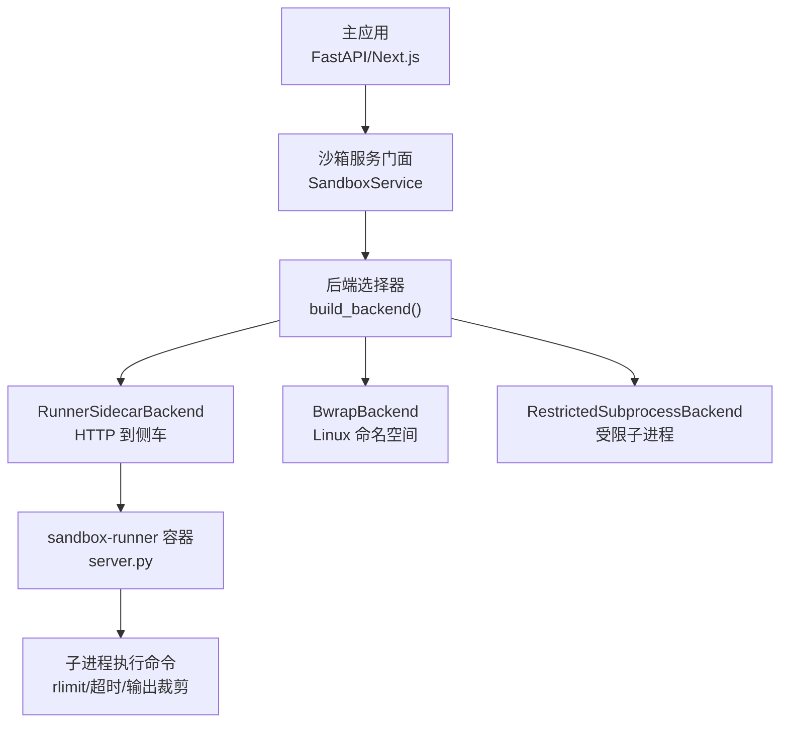
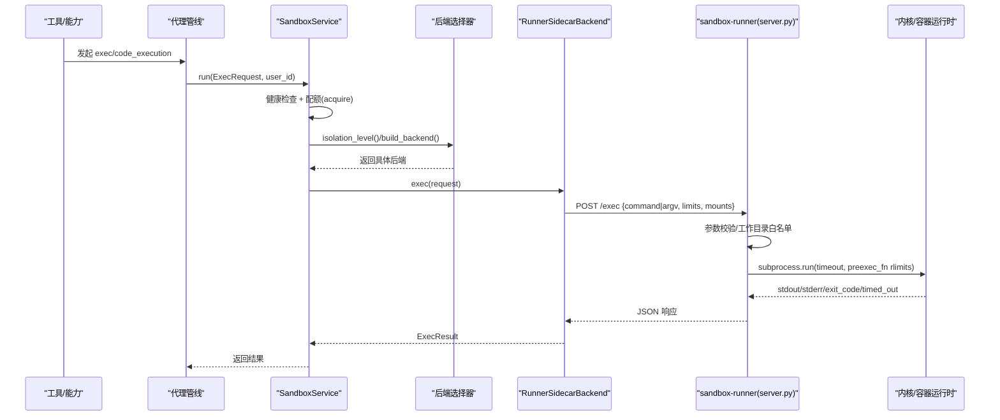
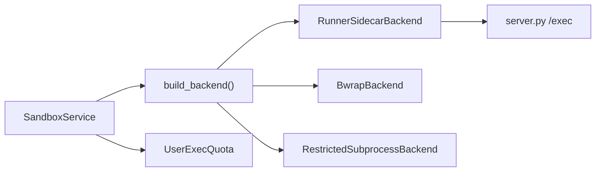

# 沙箱安全

<cite>
**本文引用的文件**
- [Dockerfile](file://Dockerfile)
- [Dockerfile.runner](file://Dockerfile.runner)
- [docker-compose.yml](file://docker-compose.yml)
- [CONTAINERIZATION.md](file://CONTAINERIZATION.md)
- [service.py](file://deeptutor/services/sandbox/service.py)
- [backends.py](file://deeptutor/services/sandbox/backends.py)
- [config.py](file://deeptutor/services/sandbox/config.py)
- [quota.py](file://deeptutor/services/sandbox/quota.py)
- [spec.py](file://deeptutor/services/sandbox/spec.py)
- [server.py](file://deeptutor/services/sandbox/runner/server.py)
- [agentic_pipeline.py](file://deeptutor/agents/chat/agentic_pipeline.py)
</cite>

## 目录
1. [简介](#简介)
2. [项目结构](#项目结构)
3. [核心组件](#核心组件)
4. [架构总览](#架构总览)
5. [详细组件分析](#详细组件分析)
6. [依赖关系分析](#依赖关系分析)
7. [性能与资源限制](#性能与资源限制)
8. [故障排查指南](#故障排查指南)
9. [结论](#结论)
10. [附录：配置与扩展指南](#附录：配置与扩展指南)

## 简介
本文件系统性说明 DeepTutor 的沙箱安全机制，覆盖代码执行环境的隔离策略（进程隔离、文件系统限制、网络访问控制）、资源配额管理（CPU、内存、磁盘、时间）、后端实现（Docker 容器侧车、bwrap 命名空间、受限子进程）、恶意代码检测与防护（行为监控与异常阻断）、安全配置（网络策略、文件权限、资源限制）、逃逸防护与漏洞修复策略，以及如何扩展新的沙箱后端与自定义安全策略。

## 项目结构
DeepTutor 将“沙箱”作为独立服务层，通过统一的服务门面暴露执行能力；后端抽象支持多种隔离方式；运行期由 Docker Compose 编排主应用与“沙箱侧车”，侧车以最小特权容器执行不受信任的命令。

图表来源
- [service.py:29-95](file://deeptutor/services/sandbox/service.py#L29-L95)
- [backends.py:34-110](file://deeptutor/services/sandbox/backends.py#L34-L110)
- [config.py:66-84](file://deeptutor/services/sandbox/config.py#L66-L84)
- [server.py:178-264](file://deeptutor/services/sandbox/runner/server.py#L178-L264)

章节来源
- [Dockerfile:119-125](file://Dockerfile#L119-L125)
- [Dockerfile.runner:1-17](file://Dockerfile.runner#L1-L17)
- [docker-compose.yml:101-175](file://docker-compose.yml#L101-L175)

## 核心组件
- 沙箱服务门面：提供健康检查、隔离级别判定、用户级配额与执行入口。
- 后端抽象与实现：
  - RunnerSidecarBackend：通过 HTTP 调用独立侧车容器执行命令，系统级隔离。
  - BwrapBackend：在 Linux 上使用 bubblewrap 创建挂载命名空间，系统级隔离。
  - RestrictedSubprocessBackend：清理环境变量并限制工作目录的本地子进程，应用级隔离。
- 配置与选择：根据环境变量自动选择可用后端，默认优先侧车，其次 bwrap，最后受限子进程。
- 配额管理：按用户并发与速率限制，防止滥用与资源耗尽。
- 数据模型：统一的执行请求/结果、资源限制、挂载点定义。

章节来源
- [service.py:29-95](file://deeptutor/services/sandbox/service.py#L29-L95)
- [backends.py:34-222](file://deeptutor/services/sandbox/backends.py#L34-L222)
- [config.py:32-84](file://deeptutor/services/sandbox/config.py#L32-L84)
- [quota.py:23-79](file://deeptutor/services/sandbox/quota.py#L23-L79)
- [spec.py:16-142](file://deeptutor/services/sandbox/spec.py#L16-L142)

## 架构总览
下图展示从上层工具/能力到具体执行后端的完整调用链，以及侧车容器的资源限制与输入校验。

图表来源
- [service.py:74-95](file://deeptutor/services/sandbox/service.py#L74-L95)
- [backends.py:56-110](file://deeptutor/services/sandbox/backends.py#L56-L110)
- [server.py:178-264](file://deeptutor/services/sandbox/runner/server.py#L178-L264)

## 详细组件分析

### 隔离机制
- 进程隔离
  - 侧车容器：主应用不直接执行不受信任命令，所有命令在独立的 sandbox-runner 容器中执行，最小化攻击面。
  - bwrap 命名空间：在 Linux 上通过 bubblewrap 创建隔离的挂载命名空间，绑定只读系统目录，仅暴露必要路径。
  - 受限子进程：在非 Linux 或开发环境降级为清理环境变量+限定工作目录的子进程，无操作系统级隔离。
- 文件系统限制
  - 侧车容器根文件系统只读，仅允许写入 tmpfs 与共享工作区卷。
  - 工作目录必须位于允许的根路径下（如 workspace/users），拒绝越界路径。
  - CLI 应用目录以只读方式挂载，防止逃逸后篡改可执行入口。
- 网络访问控制
  - 侧车容器不对外暴露端口，仅通过内部网络被主应用访问。
  - 容器未显式启用网络时，默认无出站网络；如需网络能力，应通过容器运行时策略明确放行。

章节来源
- [Dockerfile.runner:1-17](file://Dockerfile.runner#L1-L17)
- [docker-compose.yml:119-164](file://docker-compose.yml#L119-L164)
- [server.py:152-175](file://deeptutor/services/sandbox/runner/server.py#L152-L175)
- [backends.py:112-173](file://deeptutor/services/sandbox/backends.py#L112-L173)
- [backends.py:176-207](file://deeptutor/services/sandbox/backends.py#L176-L207)

### 资源配额管理
- 并发与速率限制（进程内）
  - 每用户并发上限：基于信号量控制同时运行的执行数。
  - 滑动窗口速率限制：每分钟最多启动 N 次执行，超限抛出配额异常。
- 单次执行资源限制（尽力而为）
  - 超时：子进程超时强制终止。
  - 内存：通过 RLIMIT_AS 设置虚拟地址空间上限；容器 cgroup mem_limit 作为权威兜底。
  - CPU：RLIMIT_CPU 限制 CPU 秒数，超限时触发信号终止。
  - 输出大小：对 stdout/stderr 进行头尾裁剪，避免大输出拖垮链路。
- 磁盘限制
  - 通过容器 tmpfs 与工作区卷大小控制；建议结合宿主机/存储策略限制容量。

章节来源
- [quota.py:23-79](file://deeptutor/services/sandbox/quota.py#L23-L79)
- [server.py:109-149](file://deeptutor/services/sandbox/runner/server.py#L109-L149)
- [server.py:220-264](file://deeptutor/services/sandbox/runner/server.py#L220-L264)
- [docker-compose.yml:148-164](file://docker-compose.yml#L148-L164)

### 后端实现
- Docker 容器侧车（推荐）
  - 主应用通过 HTTP 调用侧车 /exec 接口执行命令；侧车容器最小化依赖、非 root 运行、只读根文件系统、严格卷挂载。
- bwrap 命名空间（Linux 裸机）
  - 使用 bubblewrap 构建隔离环境，绑定只读系统目录，按需挂载工作目录，支持 argv 直接执行以避免 shell 注入。
- 受限子进程（开发/降级）
  - 清理环境变量至安全集合，限定工作目录，无操作系统级隔离，需管理员显式开启。

章节来源
- [backends.py:47-110](file://deeptutor/services/sandbox/backends.py#L47-L110)
- [backends.py:112-173](file://deeptutor/services/sandbox/backends.py#L112-L173)
- [backends.py:176-207](file://deeptutor/services/sandbox/backends.py#L176-L207)
- [config.py:66-84](file://deeptutor/services/sandbox/config.py#L66-L84)

### 恶意代码检测与防护
- 行为监控
  - 输出长度限制与裁剪，避免信息泄露与资源消耗。
  - 超时与 CPU/内存限制，抑制长时间占用与内存膨胀。
  - 工作目录白名单校验，阻止读写敏感路径。
- 异常阻断
  - 非法参数（类型/格式）立即拒绝。
  - 子进程启动失败或崩溃时，返回 runner 级错误而非静默失败。
  - 配额超限直接中断执行，保护系统稳定性。

章节来源
- [server.py:178-264](file://deeptutor/services/sandbox/runner/server.py#L178-L264)
- [quota.py:23-79](file://deeptutor/services/sandbox/quota.py#L23-L79)
- [service.py:74-95](file://deeptutor/services/sandbox/service.py#L74-L95)

### 安全配置指南
- 网络策略
  - 侧车容器不暴露端口，仅内部网络可达。
  - 主应用与侧车通过 docker 网络通信，避免宿主暴露。
- 文件权限
  - 侧车容器以非 root 用户运行，根文件系统只读，仅允许写入 tmpfs 与受控卷。
  - CLI 应用目录只读挂载，防止逃逸后篡改。
- 资源限制
  - 容器级：pids_limit、mem_limit、cpus（可选）。
  - 进程级：RLIMIT_AS、RLIMIT_CPU、RLIMIT_NOFILE。
  - 应用级：超时、输出大小限制、配额。

章节来源
- [docker-compose.yml:119-175](file://docker-compose.yml#L119-L175)
- [Dockerfile.runner:85-110](file://Dockerfile.runner#L85-L110)
- [server.py:109-149](file://deeptutor/services/sandbox/runner/server.py#L109-L149)

### 沙箱逃逸防护与漏洞修复策略
- 最小特权原则
  - 侧车容器 cap_drop ALL、no-new-privileges、只读根文件系统。
- 输入校验与白名单
  - 严格校验请求体字段类型；工作目录必须在允许根路径下。
- 隔离边界
  - 侧车不挂载 data/system，避免访问认证凭据；CLI 应用目录只读。
- 回退与降级
  - 当侧车不可用时，健康检查失败，服务返回不可用状态，避免静默降级到不安全模式。
- 漏洞修复策略
  - 及时更新基础镜像与依赖；保持侧车镜像精简，减少攻击面。
  - 定期审计工作目录与挂载策略，确保白名单与只读策略生效。
  - 强化配额与超时策略，降低潜在利用窗口。

章节来源
- [docker-compose.yml:148-164](file://docker-compose.yml#L148-L164)
- [server.py:152-175](file://deeptutor/services/sandbox/runner/server.py#L152-L175)
- [service.py:45-69](file://deeptutor/services/sandbox/service.py#L45-L69)

### 扩展新后端与自定义安全策略
- 新增后端步骤
  - 实现 SandboxBackend 抽象类，定义 level 与 exec/health 方法。
  - 在 build_backend 中按部署形态选择新后端。
  - 在 service 中复用现有健康检查与配额流程。
- 自定义安全策略
  - 调整 ResourceLimits 默认值与传入值，控制超时、内存、CPU、输出大小。
  - 在工作目录白名单基础上增加更细粒度的路径策略。
  - 在配额模块中引入分布式计数以支持多副本部署。

章节来源
- [backends.py:34-45](file://deeptutor/services/sandbox/backends.py#L34-L45)
- [config.py:66-84](file://deeptutor/services/sandbox/config.py#L66-L84)
- [spec.py:33-41](file://deeptutor/services/sandbox/spec.py#L33-L41)
- [quota.py:27-79](file://deeptutor/services/sandbox/quota.py#L27-L79)

## 依赖关系分析
- 服务门面依赖后端选择器与健康检查；后端选择器依据环境变量决定使用侧车、bwrap 或受限子进程。
- 侧车 server.py 依赖标准库 HTTP 服务与子进程执行；通过 rlimit 与超时实施资源限制。
- 配额模块依赖 asyncio 信号量与滑动窗口队列，按用户维度隔离。
- 上层工具/能力通过管道注入工作目录与挂载点，驱动沙箱执行。

图表来源
- [service.py:29-95](file://deeptutor/services/sandbox/service.py#L29-L95)
- [config.py:66-84](file://deeptutor/services/sandbox/config.py#L66-L84)
- [backends.py:47-207](file://deeptutor/services/sandbox/backends.py#L47-L207)
- [quota.py:27-79](file://deeptutor/services/sandbox/quota.py#L27-L79)

章节来源
- [service.py:29-95](file://deeptutor/services/sandbox/service.py#L29-L95)
- [config.py:66-84](file://deeptutor/services/sandbox/config.py#L66-L84)
- [backends.py:47-207](file://deeptutor/services/sandbox/backends.py#L47-L207)
- [quota.py:27-79](file://deeptutor/services/sandbox/quota.py#L27-L79)

## 性能与资源限制
- 超时与输出裁剪：避免长耗时与大输出影响整体吞吐。
- 内存与 CPU 限制：容器级 cgroup 与进程级 rlimit 双重保障。
- 并发与速率：按用户维度限制并发与每分钟启动次数，防止单用户独占资源。
- 磁盘 I/O：通过只读根文件系统与受控卷减少不必要写操作；tmpfs 用于临时文件。

章节来源
- [server.py:220-264](file://deeptutor/services/sandbox/runner/server.py#L220-L264)
- [docker-compose.yml:148-164](file://docker-compose.yml#L148-L164)
- [quota.py:27-79](file://deeptutor/services/sandbox/quota.py#L27-L79)

## 故障排查指南
- 侧车不可达
  - 现象：健康检查失败，执行返回不可用错误。
  - 排查：检查 sandbox-runner 容器是否启动、端口是否可达、网络是否连通。
- 工作目录越界
  - 现象：执行被拒绝，提示不在允许根路径下。
  - 排查：确认 workdir 是否在 workspace/users 等允许目录下。
- 配额超限
  - 现象：执行被拒绝，提示并发或速率限制。
  - 排查：降低并发或等待下一分钟窗口；调整 max_concurrent/max_per_minute。
- 输出过大
  - 现象：输出被裁剪，可能丢失中间内容。
  - 排查：增大 max_output_chars 或优化命令输出。

章节来源
- [service.py:45-69](file://deeptutor/services/sandbox/service.py#L45-L69)
- [server.py:152-175](file://deeptutor/services/sandbox/runner/server.py#L152-L175)
- [quota.py:27-79](file://deeptutor/services/sandbox/quota.py#L27-L79)

## 结论
DeepTutor 的沙箱安全机制以“侧车容器为主、bwrap 与受限子进程为辅”的多层隔离策略为核心，配合严格的文件系统限制、网络控制、资源配额与输入校验，有效降低了不受信任代码执行的风险。通过健康检查与降级策略，系统在侧车不可用时仍能安全回退。生产部署推荐使用侧车方案，并结合容器运行时策略进一步加固。

## 附录：配置与扩展指南
- 关键环境变量
  - DEEPTUTOR_SANDBOX_RUNNER_URL：启用侧车后端。
  - DEEPTUTOR_SANDBOX_ALLOW_SUBPROCESS：启用受限子进程后端（开发/降级）。
  - DEEPTUTOR_SANDBOX_MAX_CONCURRENT：每用户最大并发。
  - DEEPTUTOR_SANDBOX_MAX_PER_MINUTE：每用户每分钟最大执行次数。
  - DEEPTUTOR_RUNNER_ALLOWED_WORKDIRS：侧车允许的工作目录根路径。
- 容器与安全
  - 侧车容器：只读根文件系统、非 root、cap_drop ALL、no-new-privileges、pids_limit、mem_limit。
  - 主应用：通过 supervisord 以非 root 用户运行子进程。
- 扩展建议
  - 新增后端：实现抽象类并在选择器中注册。
  - 策略增强：细化工作目录白名单、引入分布式配额、增加行为审计日志。

章节来源
- [config.py:32-84](file://deeptutor/services/sandbox/config.py#L32-L84)
- [docker-compose.yml:119-175](file://docker-compose.yml#L119-L175)
- [Dockerfile:119-125](file://Dockerfile#L119-L125)
- [CONTAINERIZATION.md:268-362](file://CONTAINERIZATION.md#L268-L362)