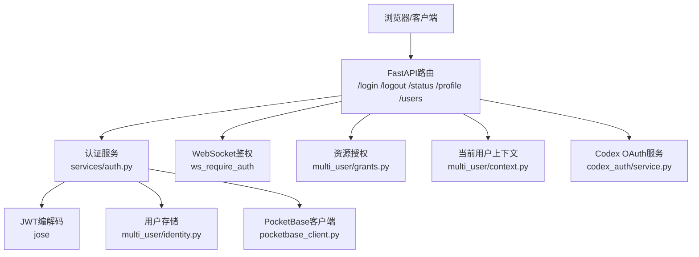
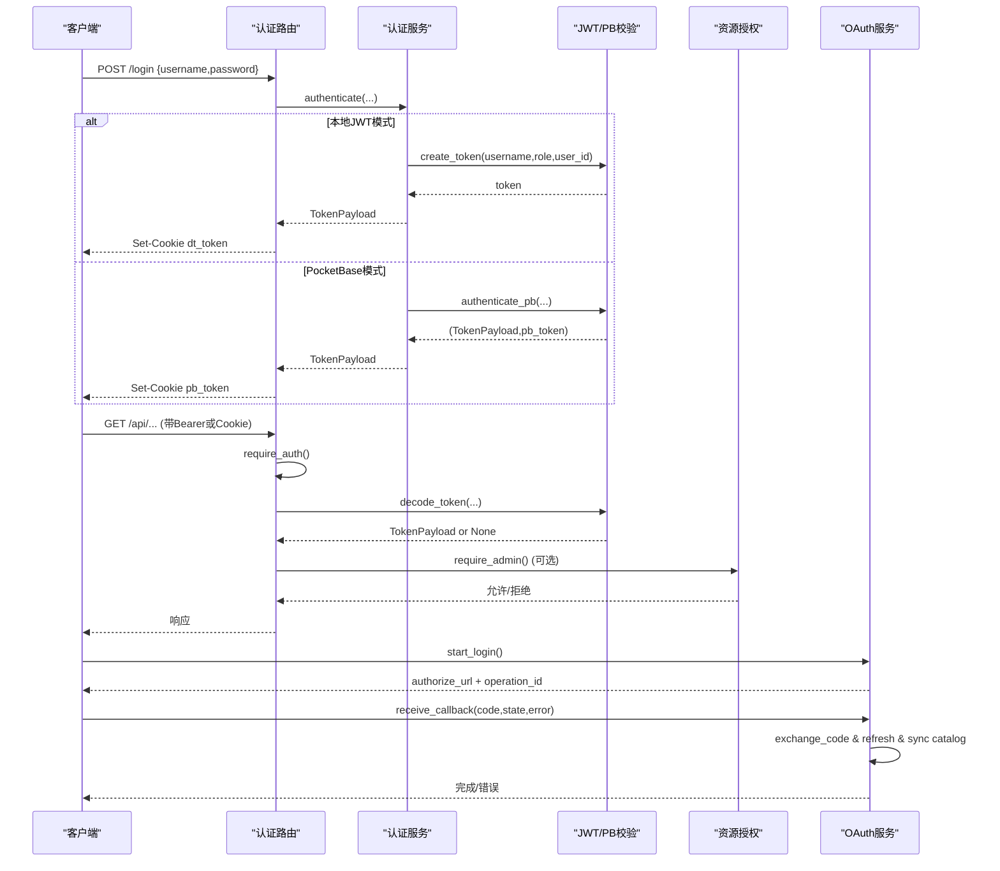
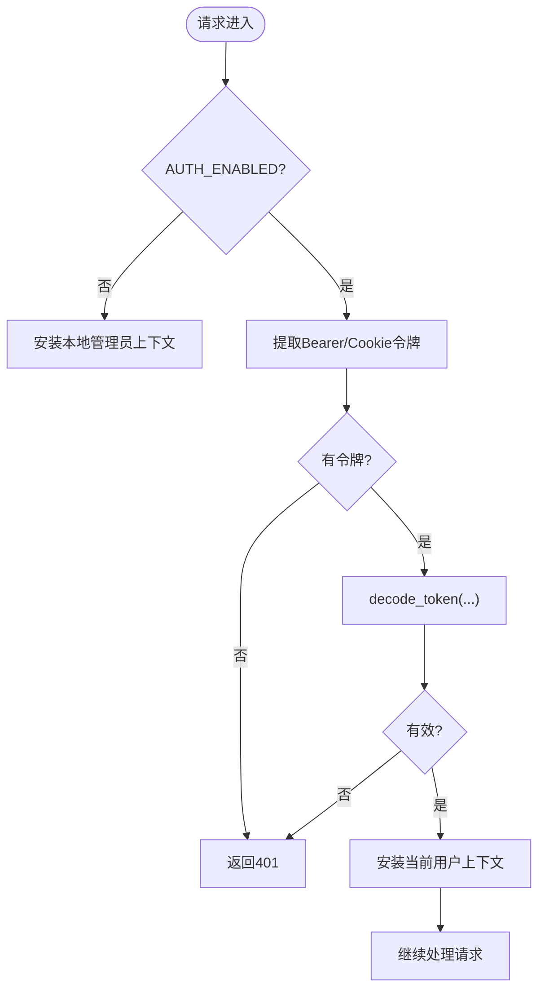
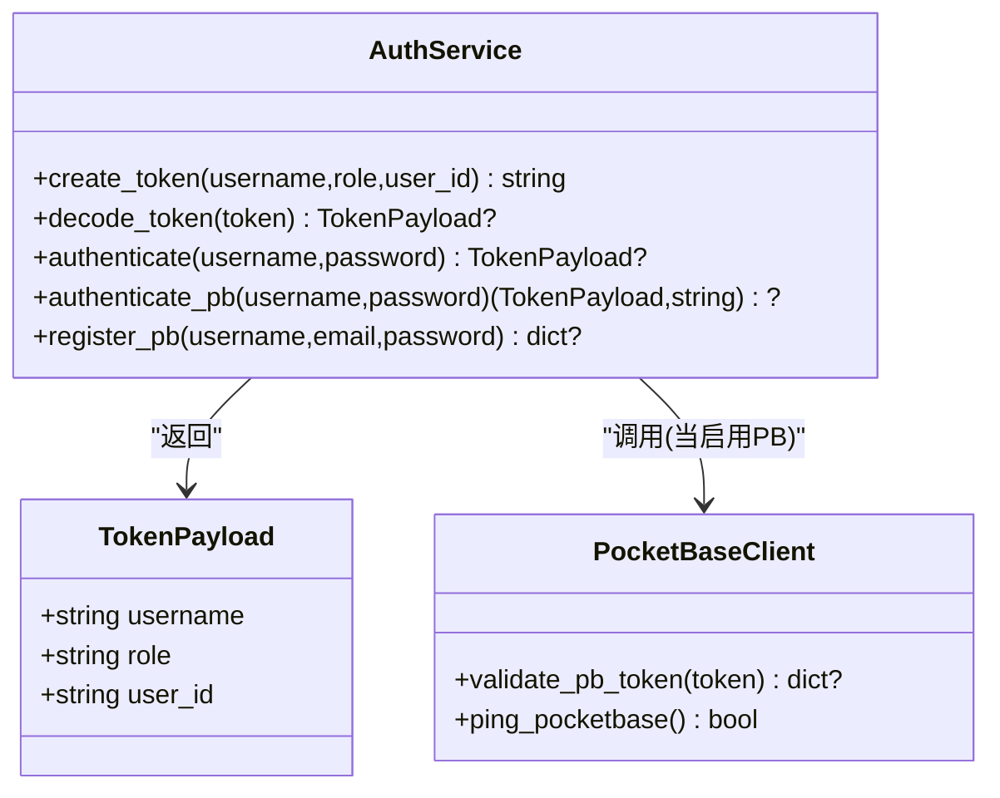
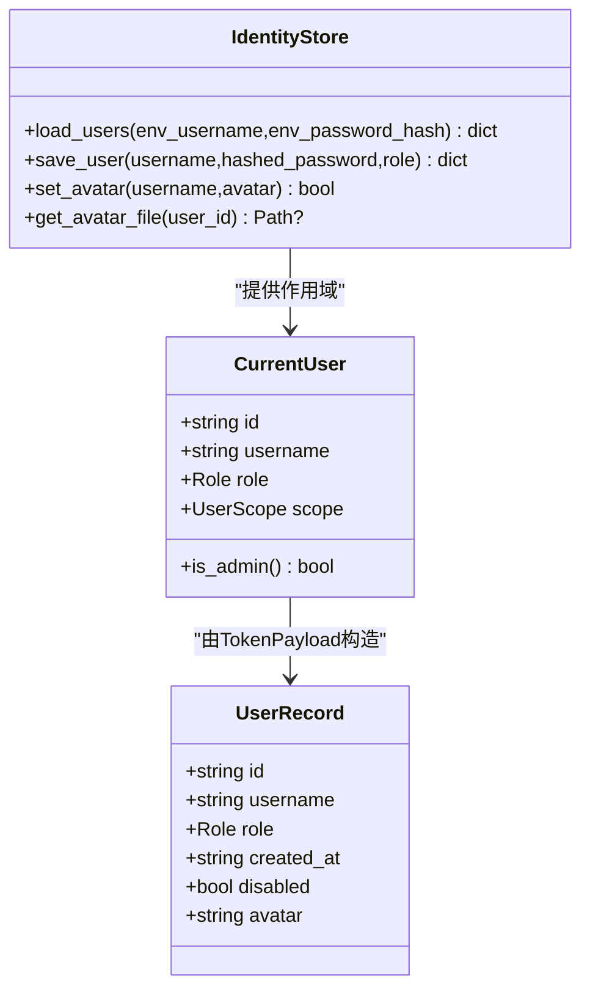
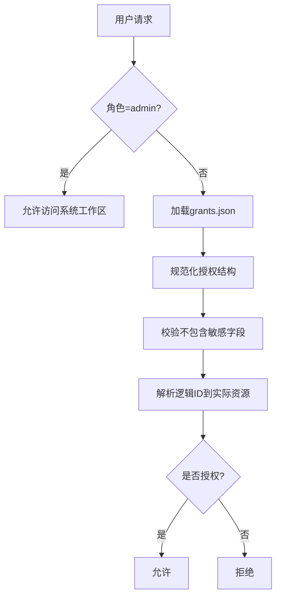
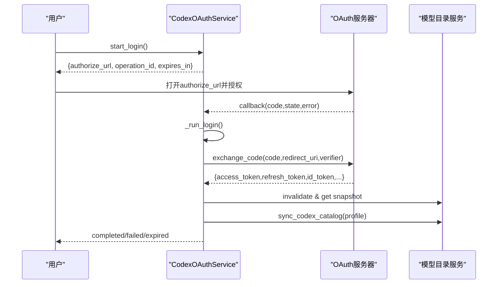
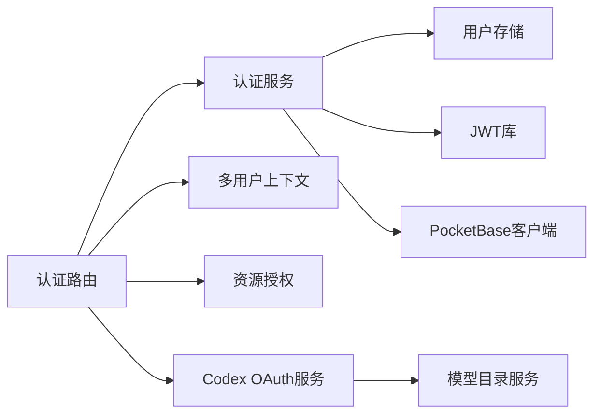

# 认证与授权

<cite>
**本文引用的文件**
- [deeptutor/api/routers/auth.py](file://deeptutor/api/routers/auth.py)
- [deeptutor/services/auth.py](file://deeptutor/services/auth.py)
- [deeptutor/multi_user/identity.py](file://deeptutor/multi_user/identity.py)
- [deeptutor/multi_user/models.py](file://deeptutor/multi_user/models.py)
- [deeptutor/multi_user/context.py](file://deeptutor/multi_user/context.py)
- [deeptutor/services/pocketbase_client.py](file://deeptutor/services/pocketbase_client.py)
- [deeptutor/services/codex_auth/service.py](file://deeptutor/services/codex_auth/service.py)
- [deeptutor/multi_user/grants.py](file://deeptutor/multi_user/grants.py)
- [compose.codex-oauth.yaml](file://compose.codex-oauth.yaml)
</cite>

## 目录
1. [简介](#简介)
2. [项目结构](#项目结构)
3. [核心组件](#核心组件)
4. [架构总览](#架构总览)
5. [详细组件分析](#详细组件分析)
6. [依赖关系分析](#依赖关系分析)
7. [性能考虑](#性能考虑)
8. [故障排查指南](#故障排查指南)
9. [结论](#结论)
10. [附录](#附录)

## 简介
本文件面向DeepTutor的认证与授权子系统，覆盖以下目标：
- 用户身份验证机制：JWT令牌生成、校验与刷新；PocketBase模式下的令牌校验。
- 多用户会话管理：Cookie/头部的令牌传递、WebSocket鉴权、超时处理与并发控制。
- 基于角色的访问控制（RBAC）：管理员与普通用户的权限差异及资源授权。
- OAuth集成流程：OpenAI Codex OAuth登录、回调、模型目录同步与登出。
- 安全配置指南：密码策略、会话安全、令牌管理与敏感信息保护。
- 错误处理与安全审计：认证失败响应、日志记录与可观测性。
- 企业级认证方案：PocketBase作为外部身份源的使用方式与扩展建议（LDAP/SAML）。

## 项目结构
认证与授权相关代码主要分布在以下模块：
- API路由层：提供登录、注册、状态查询、个人资料、用户管理等HTTP端点，以及WebSocket鉴权依赖。
- 服务层：负责密码哈希、用户存储、JWT编解码、PocketBase集成等。
- 多用户层：维护用户身份、角色、作用域、头像、授权策略等。
- OAuth服务：实现Codex OAuth的登录流程、回调处理、令牌刷新与模型目录同步。
- PocketBase客户端：封装外部身份源的连接、健康检查与令牌校验缓存。

**图表来源**
- [deeptutor/api/routers/auth.py:237-348](file://deeptutor/api/routers/auth.py#L237-L348)
- [deeptutor/services/auth.py:220-281](file://deeptutor/services/auth.py#L220-L281)
- [deeptutor/multi_user/identity.py:124-190](file://deeptutor/multi_user/identity.py#L124-L190)
- [deeptutor/services/pocketbase_client.py:111-161](file://deeptutor/services/pocketbase_client.py#L111-L161)
- [deeptutor/services/codex_auth/service.py:188-263](file://deeptutor/services/codex_auth/service.py#L188-L263)

**章节来源**
- [deeptutor/api/routers/auth.py:1-872](file://deeptutor/api/routers/auth.py#L1-L872)
- [deeptutor/services/auth.py:1-379](file://deeptutor/services/auth.py#L1-L379)
- [deeptutor/multi_user/identity.py:1-326](file://deeptutor/multi_user/identity.py#L1-L326)
- [deeptutor/services/pocketbase_client.py:1-197](file://deeptutor/services/pocketbase_client.py#L1-L197)
- [deeptutor/services/codex_auth/service.py:1-877](file://deeptutor/services/codex_auth/service.py#L1-L877)

## 核心组件
- 认证路由与依赖：提供登录、注销、状态、个人资料、用户管理接口；定义require_auth与require_admin依赖，支持Header Bearer与Cookie双通道鉴权，并内置WebSocket鉴权。
- 认证服务：负责密码哈希与校验、用户CRUD、JWT创建与解码、PocketBase模式切换与令牌校验。
- 多用户身份与作用域：维护用户记录、角色、头像、作用域路径；通过ContextVar在请求上下文中注入当前用户。
- 资源授权：为普通用户提供细粒度资源授权（模型、知识库、技能、工具、MCP工具、CLI应用、执行能力）。
- OAuth服务：实现Codex OAuth登录、回调、令牌刷新、模型目录同步与登出，包含并发锁与操作状态机。
- PocketBase客户端：封装外部身份源连接、健康检查与令牌校验缓存（内存TTL），支持无静态密钥的令牌验证。

**章节来源**
- [deeptutor/api/routers/auth.py:237-348](file://deeptutor/api/routers/auth.py#L237-L348)
- [deeptutor/services/auth.py:220-281](file://deeptutor/services/auth.py#L220-L281)
- [deeptutor/multi_user/context.py:14-46](file://deeptutor/multi_user/context.py#L14-L46)
- [deeptutor/multi_user/grants.py:16-138](file://deeptutor/multi_user/grants.py#L16-L138)
- [deeptutor/services/codex_auth/service.py:188-263](file://deeptutor/services/codex_auth/service.py#L188-L263)
- [deeptutor/services/pocketbase_client.py:111-161](file://deeptutor/services/pocketbase_client.py#L111-L161)

## 架构总览
认证与授权的整体流程如下：
- 登录：客户端提交用户名/密码至/login；后端根据配置选择本地JWT或PocketBase模式；成功后设置Cookie或返回PocketBase token。
- 鉴权：后续请求通过require_auth从Authorization头或Cookie提取令牌；标准模式使用本地JWT解码，PocketBase模式调用auth-refresh并缓存结果。
- 授权：通过require_admin限制管理员操作；普通用户通过grants进行资源级授权。
- WebSocket：ws_require_auth在握手前校验token，确保连接级别鉴权。
- OAuth：Codex OAuth通过start_login生成授权URL，回调后交换code换取凭证，刷新模型目录并持久化。

**图表来源**
- [deeptutor/api/routers/auth.py:436-480](file://deeptutor/api/routers/auth.py#L436-L480)
- [deeptutor/services/auth.py:220-281](file://deeptutor/services/auth.py#L220-L281)
- [deeptutor/services/pocketbase_client.py:111-161](file://deeptutor/services/pocketbase_client.py#L111-L161)
- [deeptutor/services/codex_auth/service.py:237-355](file://deeptutor/services/codex_auth/service.py#L237-L355)

## 详细组件分析

### 组件A：认证路由与依赖（HTTP与WebSocket）
- 依赖注入：
  - require_auth：从Authorization头或Cookie提取令牌；若未启用认证则安装本地管理员上下文；否则解码令牌并安装当前用户。
  - require_admin：在require_auth基础上校验角色为admin；禁用认证时视为管理员。
  - ws_require_auth：在WebSocket accept前校验token（query或cookie），失败关闭连接。
- Cookie属性：根据是否HTTPS动态设置SameSite与Secure，保证跨源与开发环境兼容。
- 端点：
  - /status：返回认证开关、当前用户信息与头像。
  - /login：支持本地JWT与PocketBase两种模式，成功后设置Cookie。
  - /logout：删除Cookie。
  - /register：仅首用户可自助注册；之后需管理员创建。
  - /profile：查看与更新头像标记；上传头像进行格式与大小校验。
  - /users：管理员列出用户；管理员创建用户。

**图表来源**
- [deeptutor/api/routers/auth.py:237-348](file://deeptutor/api/routers/auth.py#L237-L348)
- [deeptutor/api/routers/auth.py:402-480](file://deeptutor/api/routers/auth.py#L402-L480)

**章节来源**
- [deeptutor/api/routers/auth.py:237-348](file://deeptutor/api/routers/auth.py#L237-L348)
- [deeptutor/api/routers/auth.py:402-480](file://deeptutor/api/routers/auth.py#L402-L480)
- [deeptutor/api/routers/auth.py:599-745](file://deeptutor/api/routers/auth.py#L599-L745)

### 组件B：认证服务（JWT与PocketBase）
- 密码哈希与校验：使用bcrypt；verify_password异常时返回False。
- 用户存储：优先读取多用户JSON存储；支持迁移旧格式；首次用户自动提升为管理员。
- JWT：
  - create_token：编码sub、role、uid、exp、iat。
  - decode_token：标准模式使用本地密钥解码；PocketBase模式调用auth-refresh并缓存结果（TTL=60秒）。
- PocketBase：
  - authenticate_pb：使用email/password登录，返回TokenPayload与pb_token。
  - register_pb：创建用户记录。
  - validate_pb_token：调用auth-refresh并缓存payload。

**图表来源**
- [deeptutor/services/auth.py:68-75](file://deeptutor/services/auth.py#L68-L75)
- [deeptutor/services/auth.py:220-281](file://deeptutor/services/auth.py#L220-L281)
- [deeptutor/services/auth.py:288-342](file://deeptutor/services/auth.py#L288-L342)
- [deeptutor/services/pocketbase_client.py:111-161](file://deeptutor/services/pocketbase_client.py#L111-L161)

**章节来源**
- [deeptutor/services/auth.py:1-379](file://deeptutor/services/auth.py#L1-L379)
- [deeptutor/services/pocketbase_client.py:1-197](file://deeptutor/services/pocketbase_client.py#L1-L197)

### 组件C：多用户身份与作用域
- 身份存储：users.json持久化用户记录；支持迁移与并发写入锁；头像文件按user_id存储。
- 上下文：通过ContextVar在当前请求中注入CurrentUser；可从TokenPayload构造。
- 作用域：根据用户ID与角色计算工作区根路径，隔离数据。

**图表来源**
- [deeptutor/multi_user/models.py:13-84](file://deeptutor/multi_user/models.py#L13-L84)
- [deeptutor/multi_user/identity.py:124-190](file://deeptutor/multi_user/identity.py#L124-L190)
- [deeptutor/multi_user/context.py:14-46](file://deeptutor/multi_user/context.py#L14-L46)

**章节来源**
- [deeptutor/multi_user/identity.py:1-326](file://deeptutor/multi_user/identity.py#L1-L326)
- [deeptutor/multi_user/models.py:1-84](file://deeptutor/multi_user/models.py#L1-L84)
- [deeptutor/multi_user/context.py:1-46](file://deeptutor/multi_user/context.py#L1-L46)

### 组件D：资源授权（RBAC与细粒度授权）
- 角色：admin与user；管理员拥有系统工作区，普通用户受限。
- 授权策略：grants.json为每个非管理员用户定义模型、知识库、技能、伙伴、工具、MCP工具、CLI应用、执行能力的白名单或默认策略。
- 校验：保存授权时禁止包含敏感字段（如api_key、secret、password、token、path、base_url）。

**图表来源**
- [deeptutor/multi_user/grants.py:16-138](file://deeptutor/multi_user/grants.py#L16-L138)

**章节来源**
- [deeptutor/multi_user/grants.py:1-138](file://deeptutor/multi_user/grants.py#L1-L138)

### 组件E：OAuth集成（Codex）
- 登录流程：
  - start_login：生成PKCE、state、回调端口、authorize_url，启动异步任务等待回调。
  - receive_callback：校验state与code，交换code获取凭证，持久化并刷新模型目录。
  - 状态机：waiting→exchanging→fetching_models→completed/failed/expired/cancelled。
- 令牌刷新：
  - get_token：若凭证即将过期则refresh_credentials，并更新存储。
  - recover_after_unauthorized：401恢复流程，重新刷新凭证。
- 登出：
  - logout：取消登录、撤销凭证、清理目录缓存、移除模型目录中的托管配置。

**图表来源**
- [deeptutor/services/codex_auth/service.py:237-355](file://deeptutor/services/codex_auth/service.py#L237-L355)
- [deeptutor/services/codex_auth/service.py:427-463](file://deeptutor/services/codex_auth/service.py#L427-L463)
- [deeptutor/services/codex_auth/service.py:493-527](file://deeptutor/services/codex_auth/service.py#L493-L527)

**章节来源**
- [deeptutor/services/codex_auth/service.py:1-877](file://deeptutor/services/codex_auth/service.py#L1-L877)

## 依赖关系分析
- 路由层依赖认证服务与多用户上下文，统一处理HTTP与WebSocket鉴权。
- 认证服务依赖用户存储与JWT库；在PocketBase模式下依赖外部客户端。
- 多用户层提供身份与作用域，被路由与服务层共同使用。
- 授权层独立于认证，针对非管理员用户进行资源级控制。
- OAuth服务与模型目录服务交互，将登录状态映射到可用模型集合。

**图表来源**
- [deeptutor/api/routers/auth.py:237-348](file://deeptutor/api/routers/auth.py#L237-L348)
- [deeptutor/services/auth.py:220-281](file://deeptutor/services/auth.py#L220-L281)
- [deeptutor/services/codex_auth/service.py:188-263](file://deeptutor/services/codex_auth/service.py#L188-L263)

**章节来源**
- [deeptutor/api/routers/auth.py:1-872](file://deeptutor/api/routers/auth.py#L1-L872)
- [deeptutor/services/auth.py:1-379](file://deeptutor/services/auth.py#L1-L379)
- [deeptutor/services/codex_auth/service.py:1-877](file://deeptutor/services/codex_auth/service.py#L1-L877)

## 性能考虑
- 令牌校验缓存：PocketBase模式对auth-refresh结果进行内存缓存（TTL=60秒），减少网络开销。
- 并发控制：
  - 用户写入使用线程锁避免竞态条件（首次注册提升管理员）。
  - OAuth服务使用asyncio.Lock保护登录操作、刷新、目录同步与推理互斥。
- 头像上传：服务端基于魔数检测图片格式，限制大小并原子替换文件，避免损坏与XSS风险。
- 会话Cookie：根据HTTPS状态设置SameSite与Secure，兼顾开发与生产环境。

[本节为通用性能讨论，不直接分析具体文件]

## 故障排查指南
- 认证失败：
  - 401未认证：缺少令牌或令牌无效；检查Authorization头或Cookie是否正确携带。
  - 403禁止访问：非管理员尝试管理员操作；确认角色或使用require_admin保护的端点。
  - 400/415/413：个人资料上传失败（格式、大小、用户不存在）；检查头像类型与大小限制。
- PocketBase不可用：
  - 健康检查失败会记录警告；服务可能回退到SQLite直到PB可用；检查integrations.pocketbase_url与凭据。
- OAuth登录失败：
  - state不匹配或code缺失：检查回调参数与状态一致性；重试登录。
  - 账户变更或凭证失效：触发recover_after_unauthorized流程重新刷新。
- 日志与审计：
  - 登录成功/失败、用户创建/删除、头像上传等操作均有日志记录；结合部署日志系统进行审计。

**章节来源**
- [deeptutor/api/routers/auth.py:237-348](file://deeptutor/api/routers/auth.py#L237-L348)
- [deeptutor/api/routers/auth.py:436-480](file://deeptutor/api/routers/auth.py#L436-L480)
- [deeptutor/services/pocketbase_client.py:164-197](file://deeptutor/services/pocketbase_client.py#L164-L197)
- [deeptutor/services/codex_auth/service.py:308-397](file://deeptutor/services/codex_auth/service.py#L308-L397)

## 结论
DeepTutor的认证与授权系统提供了灵活的本地JWT与外部身份源（PocketBase）两种模式，并通过细粒度授权实现RBAC。OAuth集成支持Codex登录与模型目录同步，具备完善的并发控制与错误处理。建议在企业环境中结合外部身份源与策略引擎，扩展LDAP/SAML等协议以满足合规要求。

[本节为总结性内容，不直接分析具体文件]

## 附录

### 安全配置指南
- 密码策略：
  - 注册时最小长度校验（至少8位）；建议使用强密码。
  - 密码以bcrypt哈希存储，避免明文。
- 会话安全：
  - Cookie设置httponly、sameSite与secure（依据HTTPS）；避免XSS与跨站泄露。
  - 令牌有效期可通过配置调整；过期后需重新登录。
- 令牌管理：
  - 本地JWT使用稳定密钥文件；首次启用时自动生成并保护权限。
  - PocketBase模式通过auth-refresh校验令牌，无需静态密钥。
- 敏感信息保护：
  - 授权策略禁止包含敏感字段（api_key、secret、password、token、path、base_url）。
  - 头像文件按user_id存储，服务端基于魔数检测格式，限制大小并原子替换。

**章节来源**
- [deeptutor/api/routers/auth.py:93-120](file://deeptutor/api/routers/auth.py#L93-L120)
- [deeptutor/api/routers/auth.py:649-704](file://deeptutor/api/routers/auth.py#L649-L704)
- [deeptutor/multi_user/identity.py:303-326](file://deeptutor/multi_user/identity.py#L303-L326)
- [deeptutor/multi_user/grants.py:115-133](file://deeptutor/multi_user/grants.py#L115-L133)

### 企业级认证方案（LDAP/SAML）
- 当前仓库未直接实现LDAP或SAML；可通过以下方式扩展：
  - 使用外部身份源（如PocketBase）对接LDAP/SAML网关，后端仅校验外部令牌。
  - 在认证路由中添加新的Provider适配器，复用require_auth与require_admin逻辑。
  - 将外部用户映射到内部角色与授权策略，保持RBAC一致。
- 参考配置：
  - compose.codex-oauth.yaml用于编排Codex OAuth相关服务；可按需添加LDAP/SAML网关容器。

**章节来源**
- [compose.codex-oauth.yaml](file://compose.codex-oauth.yaml)