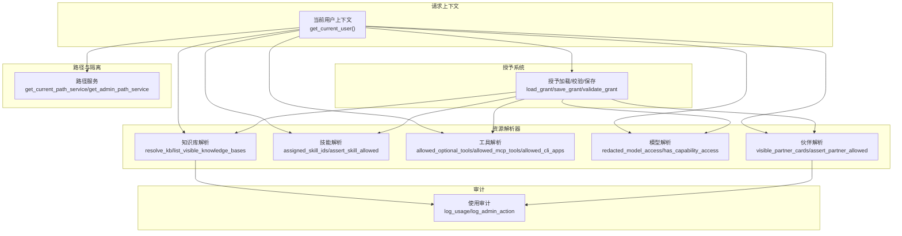
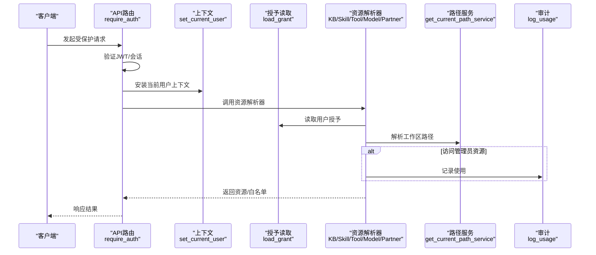
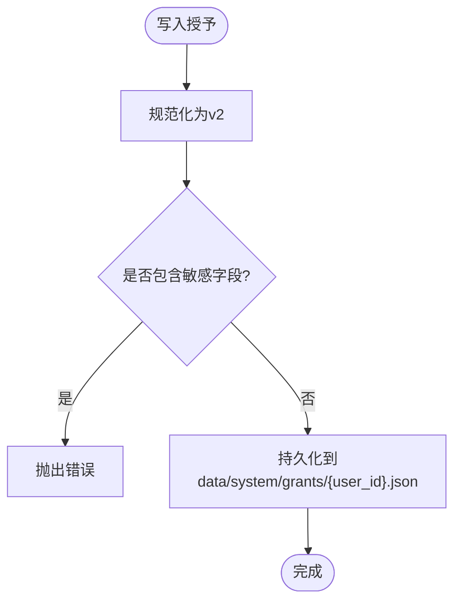
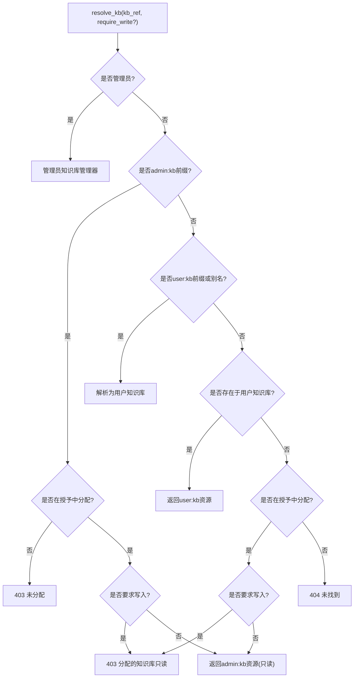
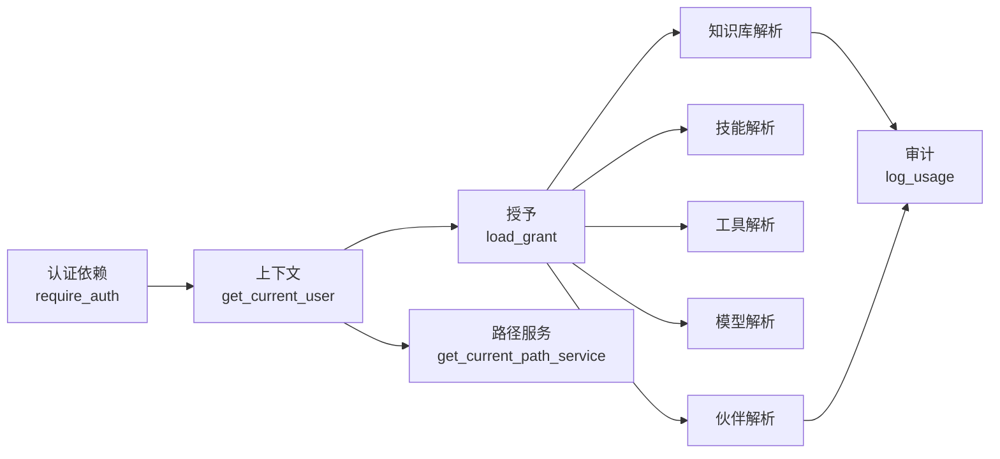

# 资源访问控制

<cite>
**本文引用的文件**
- [grants.py](file://deeptutor/multi_user/grants.py)
- [models.py](file://deeptutor/multi_user/models.py)
- [knowledge_access.py](file://deeptutor/multi_user/knowledge_access.py)
- [skill_access.py](file://deeptutor/multi_user/skill_access.py)
- [tool_access.py](file://deeptutor/multi_user/tool_access.py)
- [partner_access.py](file://deeptutor/multi_user/partner_access.py)
- [model_access.py](file://deeptutor/multi_user/model_access.py)
- [audit.py](file://deeptutor/multi_user/audit.py)
- [context.py](file://deeptutor/multi_user/context.py)
- [paths.py](file://deeptutor/multi_user/paths.py)
- [auth.py](file://deeptutor/api/routers/auth.py)
</cite>

## 目录
1. [简介](#简介)
2. [项目结构](#项目结构)
3. [核心组件](#核心组件)
4. [架构总览](#架构总览)
5. [详细组件分析](#详细组件分析)
6. [依赖关系分析](#依赖关系分析)
7. [性能考虑](#性能考虑)
8. [故障排查指南](#故障排查指南)
9. [结论](#结论)
10. [附录](#附录)

## 简介
本文件面向DeepTutor的多用户资源访问控制，系统性说明“授予（Grant）”机制、权限模型与继承、冲突解决策略、资源隔离、动态权限检查与缓存、最佳实践、审计与违规检测，以及复杂场景（团队共享、资源委派）的设计与落地。目标是帮助读者在不深入代码的前提下理解系统如何保证不同用户之间的数据安全性与最小权限原则。

## 项目结构
多用户访问控制集中在 multi_user 模块中，围绕“当前用户上下文 + 授予文件 + 资源解析器”的三层结构组织：
- 上下文：请求级当前用户身份与作用域（admin/user），用于决定路径与服务根。
- 授予：以JSON形式存储每个非管理员用户的资源授权清单（知识库、技能、工具、MCP工具、CLI应用、执行开关等）。
- 资源解析器：按类型（知识库、技能、工具、模型、伙伴）进行可见性与读写校验，并输出统一资源对象或白名单集合。

图表来源
- [context.py:11-46](file://deeptutor/multi_user/context.py#L11-L46)
- [grants.py:16-138](file://deeptutor/multi_user/grants.py#L16-L138)
- [knowledge_access.py:69-216](file://deeptutor/multi_user/knowledge_access.py#L69-L216)
- [skill_access.py:14-76](file://deeptutor/multi_user/skill_access.py#L14-L76)
- [tool_access.py:36-105](file://deeptutor/multi_user/tool_access.py#L36-L105)
- [model_access.py:59-156](file://deeptutor/multi_user/model_access.py#L59-L156)
- [partner_access.py:26-84](file://deeptutor/multi_user/partner_access.py#L26-L84)
- [paths.py:89-161](file://deeptutor/multi_user/paths.py#L89-L161)
- [audit.py:29-81](file://deeptutor/multi_user/audit.py#L29-L81)

章节来源
- [context.py:11-46](file://deeptutor/multi_user/context.py#L11-L46)
- [paths.py:1-161](file://deeptutor/multi_user/paths.py#L1-L161)

## 核心组件
- 当前用户上下文：通过ContextVar在请求内维护CurrentUser，包含id、username、role和scope；未设置时回退到本地管理员。
- 授予（Grant）：v2结构的JSON文件，记录用户对LLM模型、知识库、技能、伙伴、可选工具、MCP工具、CLI应用、执行开关等的授权。支持规范化、校验、持久化。
- 资源解析器：针对知识库、技能、工具、模型、伙伴提供统一的可见性/可写性判定，返回资源对象或白名单集合。
- 路径与隔离：基于scope区分admin与user工作区，确保文件系统层面的隔离；系统目录存放账户、授予、审计等。
- 审计：记录普通用户对管理员资源的访问及管理员操作，便于合规与问题定位。

章节来源
- [models.py:13-84](file://deeptutor/multi_user/models.py#L13-L84)
- [grants.py:16-138](file://deeptutor/multi_user/grants.py#L16-L138)
- [knowledge_access.py:69-216](file://deeptutor/multi_user/knowledge_access.py#L69-L216)
- [skill_access.py:14-76](file://deeptutor/multi_user/skill_access.py#L14-L76)
- [tool_access.py:36-105](file://deeptutor/multi_user/tool_access.py#L36-L105)
- [model_access.py:59-156](file://deeptutor/multi_user/model_access.py#L59-L156)
- [partner_access.py:26-84](file://deeptutor/multi_user/partner_access.py#L26-L84)
- [paths.py:89-161](file://deeptutor/multi_user/paths.py#L89-L161)
- [audit.py:29-81](file://deeptutor/multi_user/audit.py#L29-L81)

## 架构总览
下图展示了从HTTP请求进入、鉴权、上下文建立，到资源访问控制与审计的完整流程。

图表来源
- [auth.py:216-348](file://deeptutor/api/routers/auth.py#L216-L348)
- [context.py:11-46](file://deeptutor/multi_user/context.py#L11-L46)
- [grants.py:90-112](file://deeptutor/multi_user/grants.py#L90-L112)
- [knowledge_access.py:69-216](file://deeptutor/multi_user/knowledge_access.py#L69-L216)
- [paths.py:149-161](file://deeptutor/multi_user/paths.py#L149-L161)
- [audit.py:29-55](file://deeptutor/multi_user/audit.py#L29-L55)

## 详细组件分析

### 授予（Grant）系统
- 数据结构：v2授予包含版本、用户ID、模型列表、知识库、技能、伙伴、可选工具、MCP工具、CLI应用、执行开关等字段。空授予提供默认值。
- 规范化与校验：将历史/外部输入归一化为v2形状；拒绝包含敏感字段（如密钥、路径等）的授予，防止越权。
- 存储与读取：按用户ID落盘为JSON；读取失败或不存在时回退为空授予；保存前再次校验。
- 语义约定：
  - 工具白名单：None表示不限制（仅管理员），[]表示禁止，具体列表为显式允许。
  - MCP工具与CLI应用：对非管理员默认拒绝，需管理员显式授予名称。
  - 执行开关：叠加部署级执行策略，仅在能隔离用户的系统中生效。

图表来源
- [grants.py:16-138](file://deeptutor/multi_user/grants.py#L16-L138)

章节来源
- [grants.py:16-138](file://deeptutor/multi_user/grants.py#L16-L138)

### 知识库访问控制
- 资源标识：采用前缀区分来源，“admin:kb:<name>”与“user:kb:<name>”。
- 解析规则：
  - 管理员：直接访问管理员知识库。
  - 非管理员：
    - 若引用“admin:kb:...”，必须在授予中分配且只读。
    - 若引用用户空间或别名（如“default/current/默认/默认知识库/当前知识库”），解析为用户知识库。
    - 若名称匹配用户已存在知识库则允许；否则检查是否在授予中分配，分配则只读。
- 列出可见项：管理员列出自身知识库；非管理员合并自身与授予的管理员知识库（标注来源、是否只读、是否需要重新索引等）。
- RAG与清单：提供安全访问元数据与文档清单的接口，避免绕过可见性规则。

图表来源
- [knowledge_access.py:45-164](file://deeptutor/multi_user/knowledge_access.py#L45-L164)

章节来源
- [knowledge_access.py:69-216](file://deeptutor/multi_user/knowledge_access.py#L69-L216)

### 技能访问控制
- 授予来源：非管理员只能访问授予中的技能（来自管理员工作区），并以只读方式呈现。
- 能力检查：assert_skill_allowed在非管理员且未授予时返回403；管理员不受限。
- 信息聚合：assigned_skill_infos返回管理员分配的技能详情，附带source=“admin”、assigned=True、read_only=True。

章节来源
- [skill_access.py:14-76](file://deeptutor/multi_user/skill_access.py#L14-L76)

### 工具与执行访问控制
- 可选工具：enabled_tools为None表示不限制（管理员），否则为白名单集合。
- MCP工具：mcp_tools为None表示不限制（管理员），非管理员缺失时为拒绝；用于过滤延迟加载的工具。
- CLI应用：cli_apps为None表示不限制（管理员），非管理员缺失时为拒绝；第三方应用在沙箱中运行，需显式授权。
- 执行开关：exec_enabled叠加部署策略，True/False/None分别表示强制允许、强制拒绝、遵循部署策略。
- 白名单合并：combine_whitelists用于将调用方范围与用户授予交集，实现更细粒度控制。

章节来源
- [tool_access.py:36-105](file://deeptutor/multi_user/tool_access.py#L36-L105)

### 模型访问控制
- 来源：管理员授予的LLM配置 + 个人绑定（owner-bound）的个人模型。
- 脱敏视图：redacted_model_access仅暴露可用项，隐藏不可用或所有者绑定的配置。
- 能力门控：has_capability_access判断某能力是否有可用模型；apply_allowed_llm_selection在服务端严格校验选择，防止越权。

章节来源
- [model_access.py:59-156](file://deeptutor/multi_user/model_access.py#L59-L156)

### 伙伴访问控制
- 伙伴为进程级资源，由管理员管理；非管理员只能通过授予看到并连接特定伙伴。
- visible_partner_cards仅返回伙伴的身份卡片字段，不暴露内部配置。
- assert_partner_allowed在未授予时返回403。

章节来源
- [partner_access.py:26-84](file://deeptutor/multi_user/partner_access.py#L26-L84)

### 路径与资源隔离
- 工作区布局：
  - data/：管理员工作区根
  - data/users/<uid>：每个非管理员用户的工作区
  - data/partners/<id>：伙伴工作区
  - data/system：系统状态（账户、授予、审计、索引）
- 作用域：
  - admin_scope：管理员作用域
  - scope_for_user：根据用户ID与作用域生成路径服务
  - get_current_path_service：根据当前用户返回对应路径服务，自动创建必要目录
- 所有者密钥：owner_secrets_dir与get_owner_secrets_dir用于存放不应被沙箱看到的凭据，权限严格限制。

章节来源
- [paths.py:1-262](file://deeptutor/multi_user/paths.py#L1-L262)

### 动态权限检查与缓存
- 运行时检查点：
  - 认证依赖：require_auth/ws_require_auth在入口建立当前用户上下文。
  - 资源解析：各access模块在每次请求时读取授予并做决策。
- 缓存策略：
  - 知识库管理器按base_dir缓存实例，减少重复构造开销。
  - 授予读取为轻量JSON，通常无需额外缓存；如需高频访问可在上层加短期缓存。
- 审计：
  - log_usage记录普通用户对管理员资源的访问（如RAG查询）。
  - log_admin_action记录管理员写操作（如授予变更、用户CRUD）。

章节来源
- [knowledge_access.py:24-27](file://deeptutor/multi_user/knowledge_access.py#L24-L27)
- [audit.py:29-81](file://deeptutor/multi_user/audit.py#L29-L81)
- [auth.py:216-348](file://deeptutor/api/routers/auth.py#L216-L348)

## 依赖关系分析
- 上下文依赖：所有访问控制均依赖get_current_user()获取当前身份与作用域。
- 授予依赖：各access模块通过load_grant读取用户授予，结合角色与路径服务做决策。
- 路径依赖：通过get_current_path_service/get_admin_path_service确保读写发生在正确的工作区。
- 审计依赖：在访问管理员资源时触发审计记录，便于追踪与合规。

图表来源
- [auth.py:216-348](file://deeptutor/api/routers/auth.py#L216-L348)
- [context.py:11-46](file://deeptutor/multi_user/context.py#L11-L46)
- [grants.py:90-112](file://deeptutor/multi_user/grants.py#L90-L112)
- [paths.py:149-161](file://deeptutor/multi_user/paths.py#L149-L161)
- [knowledge_access.py:69-216](file://deeptutor/multi_user/knowledge_access.py#L69-L216)
- [partner_access.py:26-84](file://deeptutor/multi_user/partner_access.py#L26-L84)
- [audit.py:29-81](file://deeptutor/multi_user/audit.py#L29-L81)

章节来源
- [auth.py:216-348](file://deeptutor/api/routers/auth.py#L216-L348)
- [context.py:11-46](file://deeptutor/multi_user/context.py#L11-L46)
- [grants.py:90-112](file://deeptutor/multi_user/grants.py#L90-L112)
- [paths.py:149-161](file://deeptutor/multi_user/paths.py#L149-L161)

## 性能考虑
- 知识库管理器缓存：按base_dir缓存KnowledgeBaseManager实例，避免重复初始化。
- 授予读取成本：JSON读取开销较低；在高并发场景下可考虑短期内存缓存（注意一致性）。
- 审计写入：追加写入JSONL，尽量异步或忽略异常，避免阻塞主流程。
- 路径服务缓存：按作用域缓存PathService实例，减少重复构建。

[本节为通用指导，不直接分析具体文件]

## 故障排查指南
- 401未认证：检查require_auth是否正确安装当前用户上下文；确认JWT/cookie有效。
- 403未授权：
  - 知识库：确认是否分配了管理员知识库；写入操作在分配模式下被拒绝。
  - 技能/伙伴：确认授予中包含相应条目。
  - 工具/MCP/CLI：确认授予中设置了正确的白名单；非管理员缺失时为拒绝。
- 404未找到：知识库名称不存在或未分配；检查别名与默认知识库配置。
- 审计日志：查看data/system/audit/usage.jsonl，定位普通用户对管理员资源的访问。

章节来源
- [auth.py:237-348](file://deeptutor/api/routers/auth.py#L237-L348)
- [knowledge_access.py:69-216](file://deeptutor/multi_user/knowledge_access.py#L69-L216)
- [skill_access.py:64-76](file://deeptutor/multi_user/skill_access.py#L64-L76)
- [partner_access.py:37-48](file://deeptutor/multi_user/partner_access.py#L37-L48)
- [tool_access.py:44-105](file://deeptutor/multi_user/tool_access.py#L44-L105)
- [audit.py:29-81](file://deeptutor/multi_user/audit.py#L29-L81)

## 结论
DeepTutor的资源访问控制以“授予（Grant）+ 上下文 + 资源解析器 + 路径隔离 + 审计”为核心，实现了细粒度的权限管理与数据安全。通过明确的默认拒绝策略、管理员显式授权、只读分配模式、白名单合并与严格的校验，系统在保障灵活性的同时确保了最小权限原则。配合审计与故障排查手段，可有效支撑团队协作与资源委派等复杂场景。

[本节为总结，不直接分析具体文件]

## 附录

### 最佳实践
- 最小权限原则：为非管理员用户仅授予必要的资源与工具；MCP工具与CLI应用默认拒绝，按需开启。
- 批量授权：通过集中编辑授予文件或使用管理接口批量更新；注意校验敏感字段。
- 只读分配：管理员知识库分配给非管理员时保持只读，避免误改。
- 模型选择：使用redacted_model_access与apply_allowed_llm_selection确保前端展示与服务端校验一致。
- 审计与监控：定期审查usage.jsonl与admin动作日志，发现异常访问。

[本节为通用指导，不直接分析具体文件]

### 复杂场景设计
- 团队共享：管理员将知识库、技能、伙伴授予多个用户；通过list_visible_knowledge_bases与visible_partner_cards统一呈现。
- 资源委派：通过授予将特定资源临时授予其他用户；结合审计记录委派使用情况。
- 跨能力协作：在聊天管道中结合mcp_tools_filter与enabled_tools，实现按调用方范围的动态工具可见性。

[本节为概念性内容，不直接分析具体文件]