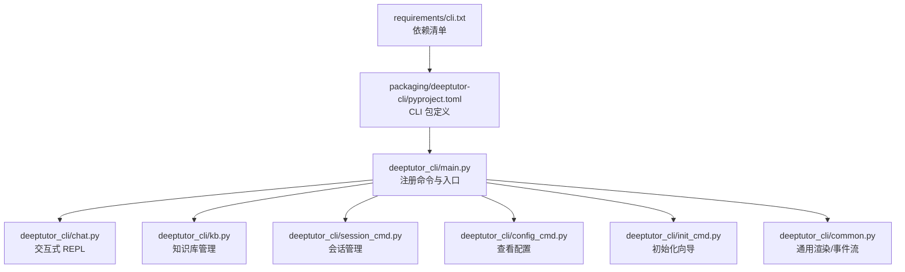
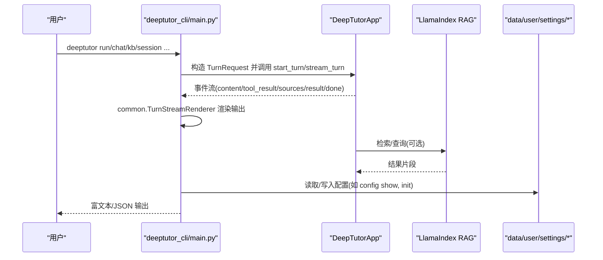
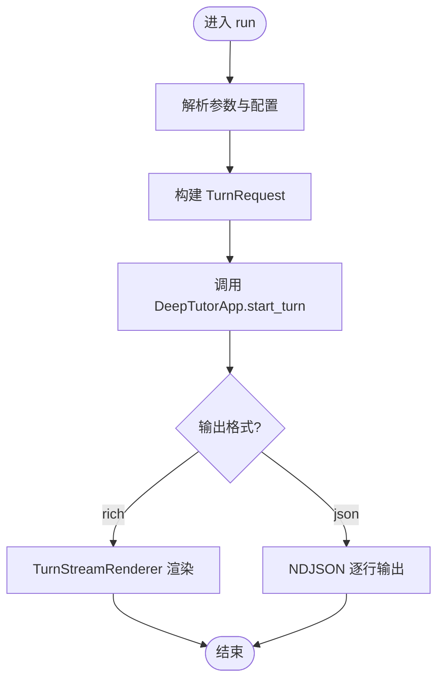
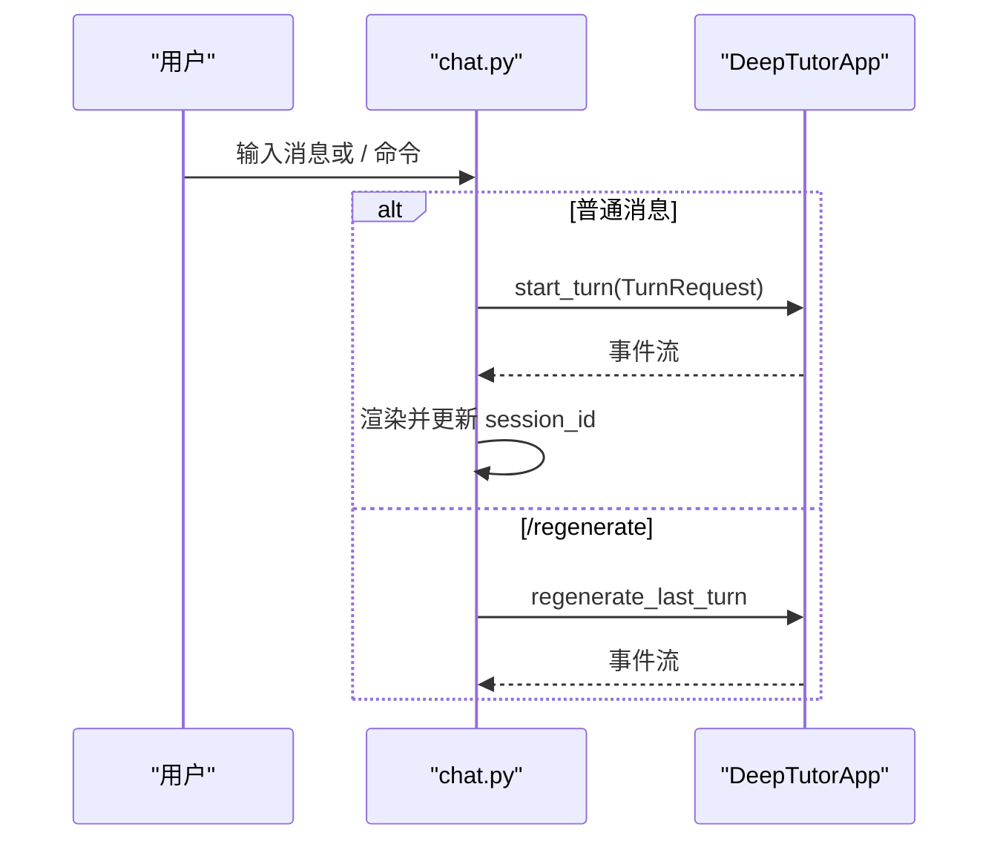
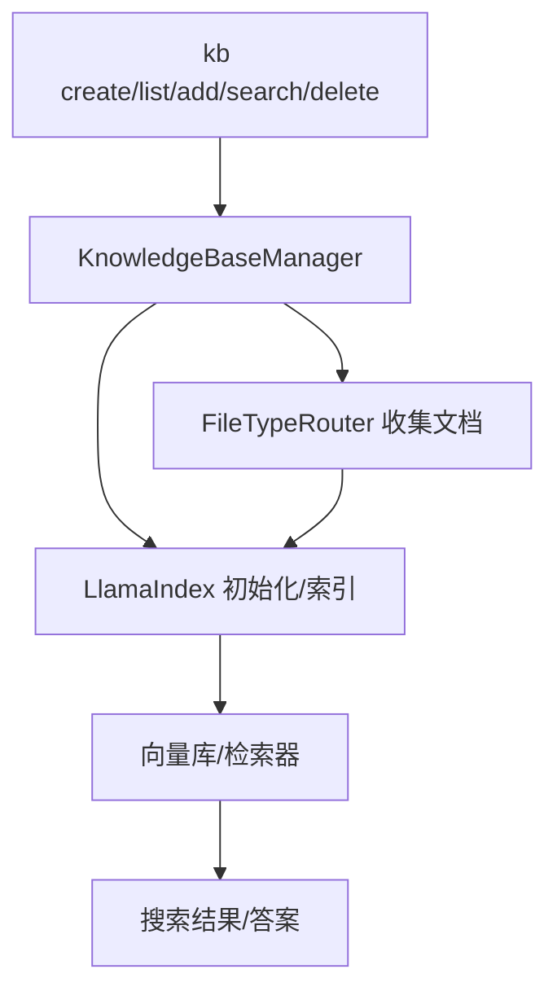
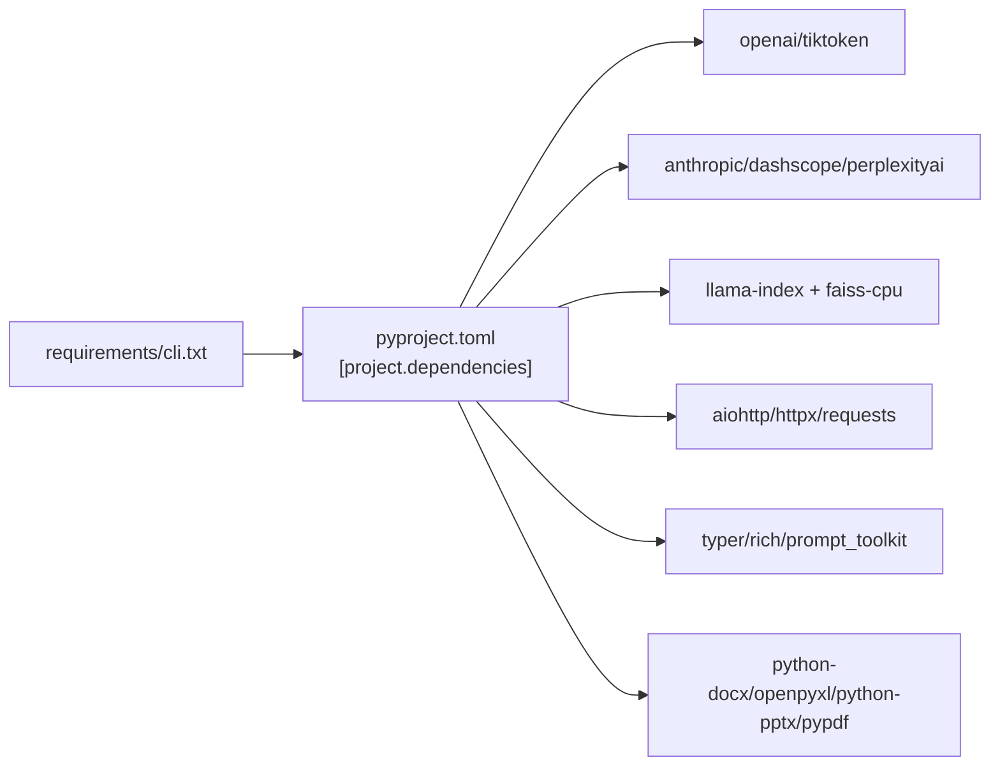

# CLI模式

<cite>
**本文引用的文件**
- [deeptutor_cli/README.md](file://deeptutor_cli/README.md)
- [packaging/deeptutor-cli/pyproject.toml](file://packaging/deeptutor-cli/pyproject.toml)
- [requirements/cli.txt](file://requirements/cli.txt)
- [deeptutor_cli/main.py](file://deeptutor_cli/main.py)
- [deeptutor_cli/chat.py](file://deeptutor_cli/chat.py)
- [deeptutor_cli/kb.py](file://deeptutor_cli/kb.py)
- [deeptutor_cli/session_cmd.py](file://deeptutor_cli/session_cmd.py)
- [deeptutor_cli/config_cmd.py](file://deeptutor_cli/config_cmd.py)
- [deeptutor_cli/init_cmd.py](file://deeptutor_cli/init_cmd.py)
- [deeptutor_cli/common.py](file://deeptutor_cli/common.py)
- [CONTAINERIZATION.md](file://CONTAINERIZATION.md)
</cite>

## 目录
1. [简介](#简介)
2. [项目结构](#项目结构)
3. [核心组件](#核心组件)
4. [架构总览](#架构总览)
5. [详细组件分析](#详细组件分析)
6. [依赖关系分析](#依赖关系分析)
7. [性能考虑](#性能考虑)
8. [故障排除指南](#故障排除指南)
9. [结论](#结论)
10. [附录](#附录)

## 简介
本指南面向仅使用命令行（CLI-only）的 DeepTutor 用户，覆盖适用场景与优势、从源码安装 CLI 包、常用命令（聊天、知识库管理、会话操作等）、配置文件结构与设置方法、与其他工具集成及自动化脚本示例，以及故障排除与性能调优建议。CLI-only 模式适合：
- 无头服务器或容器环境中的自动化任务
- 批量处理与脚本化工作流
- 开发者调试与快速验证能力
- 需要最小依赖集、避免 Web 前端启动的场景

## 项目结构
DeepTutor CLI 以 Typer 构建命令树，提供 run、chat、kb、session、config、provider、init 等子命令；通过 common 模块统一渲染与事件流处理；通过 init_wizard 引导式配置 LLM/Embedding/Search；通过 packaging/deeptutor-cli 打包为独立可分发包。

图表来源
- [deeptutor_cli/main.py:29-73](file://deeptutor_cli/main.py#L29-L73)
- [packaging/deeptutor-cli/pyproject.toml:5-53](file://packaging/deeptutor-cli/pyproject.toml#L5-L53)
- [requirements/cli.txt:1-66](file://requirements/cli.txt#L1-L66)

章节来源
- [deeptutor_cli/main.py:29-73](file://deeptutor_cli/main.py#L29-L73)
- [packaging/deeptutor-cli/pyproject.toml:5-53](file://packaging/deeptutor-cli/pyproject.toml#L5-L53)
- [requirements/cli.txt:1-66](file://requirements/cli.txt#L1-L66)

## 核心组件
- 命令入口与分组：Typer 应用集中注册 chat、kb、session、config、provider、book、plugin、skill、partner 等子命令，并提供 run/start/serve 等顶层命令。
- 交互聊天：chat 子命令实现多轮对话 REPL，支持 /tool、/cap、/kb、/history、/notebook、/config 等内置命令。
- 知识库：kb 子命令支持 list/info/create/add/delete/search，底层调用 KnowledgeBaseManager 与 LlamaIndex RAG。
- 会话：session 子命令支持 list/show/open/rename/delete，基于 DeepTutorApp 进行持久化操作。
- 配置：config show 输出系统端口、LLM/Embedding/Search 运行时配置摘要。
- 初始化：init --cli 引导式配置 LLM、Embedding、Search，并写入 data/user/settings 下的 JSON/YAML。

章节来源
- [deeptutor_cli/main.py:29-73](file://deeptutor_cli/main.py#L29-L73)
- [deeptutor_cli/chat.py:41-78](file://deeptutor_cli/chat.py#L41-L78)
- [deeptutor_cli/kb.py:61-287](file://deeptutor_cli/kb.py#L61-L287)
- [deeptutor_cli/session_cmd.py:15-52](file://deeptutor_cli/session_cmd.py#L15-L52)
- [deeptutor_cli/config_cmd.py:16-93](file://deeptutor_cli/config_cmd.py#L16-L93)
- [deeptutor_cli/init_cmd.py:412-550](file://deeptutor_cli/init_cmd.py#L412-L550)

## 架构总览
CLI 模式将用户输入转换为 TurnRequest，交由 DeepTutorApp 执行 turn，并通过 common 的事件渲染器将流式事件输出到终端；知识库与搜索由 LlamaIndex 驱动；配置由 init_wizard 生成并持久化到 data/user/settings。

图表来源
- [deeptutor_cli/main.py:75-115](file://deeptutor_cli/main.py#L75-L115)
- [deeptutor_cli/common.py:129-147](file://deeptutor_cli/common.py#L129-L147)
- [deeptutor_cli/kb.py:251-287](file://deeptutor_cli/kb.py#L251-L287)
- [deeptutor_cli/config_cmd.py:16-93](file://deeptutor_cli/config_cmd.py#L16-L93)
- [CONTAINERIZATION.md:345-362](file://CONTAINERIZATION.md#L345-L362)

## 详细组件分析

### 运行能力：run
- 功能：单次执行任意 capability（如 chat、deep_solve、deep_question、deep_research、visualize、math_animator、mastery_path），支持工具启用、知识库挂载、语言、会话延续、capability 配置、笔记本/历史引用、输出格式。
- 关键流程：解析参数 → 构建 TurnRequest → 调用 DeepTutorApp.start_turn → 渲染事件流 → 返回 session/turn。

图表来源
- [deeptutor_cli/main.py:75-115](file://deeptutor_cli/main.py#L75-L115)
- [deeptutor_cli/common.py:129-147](file://deeptutor_cli/common.py#L129-L147)

章节来源
- [deeptutor_cli/main.py:75-115](file://deeptutor_cli/main.py#L75-L115)
- [deeptutor_cli/README.md:48-115](file://deeptutor_cli/README.md#L48-L115)

### 交互式聊天：chat
- 功能：多轮对话 REPL，支持切换 capability、工具开关、知识库挂载、历史/笔记本引用、配置管理、重跑上一条消息、展开工具结果等。
- 关键流程：初始化 ChatState → 恢复会话偏好 → 循环读取输入 → 构造 TurnRequest → 渲染事件流 → 维护状态。

图表来源
- [deeptutor_cli/chat.py:41-78](file://deeptutor_cli/chat.py#L41-L78)
- [deeptutor_cli/chat.py:80-180](file://deeptutor_cli/chat.py#L80-L180)
- [deeptutor_cli/common.py:150-183](file://deeptutor_cli/common.py#L150-L183)

章节来源
- [deeptutor_cli/chat.py:41-180](file://deeptutor_cli/chat.py#L41-L180)
- [deeptutor_cli/README.md:119-155](file://deeptutor_cli/README.md#L119-L155)

### 知识库管理：kb
- 功能：list/info/set-default/create/add/delete/search。
- 关键点：文档收集去重、名称校验、异步初始化/追加索引、搜索模式与提供者信息输出。

图表来源
- [deeptutor_cli/kb.py:28-58](file://deeptutor_cli/kb.py#L28-L58)
- [deeptutor_cli/kb.py:139-183](file://deeptutor_cli/kb.py#L139-L183)
- [deeptutor_cli/kb.py:185-227](file://deeptutor_cli/kb.py#L185-L227)
- [deeptutor_cli/kb.py:251-287](file://deeptutor_cli/kb.py#L251-L287)

章节来源
- [deeptutor_cli/kb.py:61-287](file://deeptutor_cli/kb.py#L61-L287)
- [deeptutor_cli/README.md:170-181](file://deeptutor_cli/README.md#L170-L181)

### 会话管理：session
- 功能：list/show/open/rename/delete。
- 关键点：列表展示、详情打印、打开已有会话进入 REPL、删除与重命名。

章节来源
- [deeptutor_cli/session_cmd.py:15-52](file://deeptutor_cli/session_cmd.py#L15-L52)
- [deeptutor_cli/session_cmd.py:54-102](file://deeptutor_cli/session_cmd.py#L54-L102)
- [deeptutor_cli/README.md:183-191](file://deeptutor_cli/README.md#L183-L191)

### 配置查看：config
- 功能：show 输出系统端口、LLM/Embedding/Search 运行时配置摘要（含密钥遮蔽）。
- 关键点：加载 system.json、model_catalog.json、main.yaml，聚合运行时信息。

章节来源
- [deeptutor_cli/config_cmd.py:16-93](file://deeptutor_cli/config_cmd.py#L16-L93)
- [CONTAINERIZATION.md:345-362](file://CONTAINERIZATION.md#L345-L362)

### 初始化向导：init
- 功能：引导式配置 LLM、Embedding、Search，并写入 data/user/settings。
- CLI-only 模式：跳过端口步骤，仍创建 system.json、auth.json、integrations.json、model_catalog.json、main.yaml、agents.yaml。
- 关键点：重置运行时单例、选择提供商、拉取模型列表、连通性探测、审查并保存。

章节来源
- [deeptutor_cli/init_cmd.py:412-550](file://deeptutor_cli/init_cmd.py#L412-L550)
- [deeptutor_cli/README.md:8-35](file://deeptutor_cli/README.md#L8-L35)

## 依赖关系分析
- CLI-only 包定义在 packaging/deeptutor-cli/pyproject.toml，包含 LLM SDK、RAG（LlamaIndex + FAISS）、文档解析、HTTP 客户端、CLI 框架等依赖。
- requirements/cli.txt 与 pyproject 保持同步，便于 Docker/CI 直接安装。
- 版本约束说明：Python 版本限制（>=3.11,<3.14）以避免某些编译依赖问题；FAISS 用于 ANN 检索替代暴力搜索。

图表来源
- [packaging/deeptutor-cli/pyproject.toml:15-50](file://packaging/deeptutor-cli/pyproject.toml#L15-L50)
- [requirements/cli.txt:11-66](file://requirements/cli.txt#L11-L66)

章节来源
- [packaging/deeptutor-cli/pyproject.toml:1-80](file://packaging/deeptutor-cli/pyproject.toml#L1-L80)
- [requirements/cli.txt:1-66](file://requirements/cli.txt#L1-L66)

## 性能考虑
- 大知识库检索：默认使用 LlamaIndex + FAISS 进行近似最近邻检索，提升大规模 KB 的召回效率。
- 流式渲染：common 中 TurnStreamRenderer 对内容块缓冲并按轮次结算，减少终端刷新开销。
- 工具结果截断：长输出被截断显示，完整内容可通过 /show 展开，降低终端压力。
- 事件中断：Ctrl-C 安全取消当前 turn，避免阻塞整个 CLI。
- 进程事件循环：Windows 下切换到 ProactorEventLoop 以支持子进程 API（如数学动画渲染）。

章节来源
- [packaging/deeptutor-cli/pyproject.toml:38-42](file://packaging/deeptutor-cli/pyproject.toml#L38-L42)
- [deeptutor_cli/common.py:205-249](file://deeptutor_cli/common.py#L205-L249)
- [deeptutor_cli/common.py:747-776](file://deeptutor_cli/common.py#L747-L776)
- [deeptutor_cli/main.py:148-153](file://deeptutor_cli/main.py#L148-L153)

## 故障排除指南
- 缺少 API 服务依赖：若通过 CLI-only 包运行 serve，会提示需安装完整 deeptutor 包。
- 会话不存在：open/show/delete 时若未找到会话，会报错并退出。
- 知识库不存在：kb add/search 前需确保已存在目标知识库。
- 配置错误：init 过程中若探测失败，可重试并更换 API Key；config show 可查看当前绑定与状态。
- 终端编码问题：非 UTF-8 终端可能无法正确解码输入，需检查终端编码。
- ask_user 在非交互模式下自动提交空回复，避免挂起。

章节来源
- [deeptutor_cli/main.py:154-161](file://deeptutor_cli/main.py#L154-L161)
- [deeptutor_cli/session_cmd.py:60-92](file://deeptutor_cli/session_cmd.py#L60-L92)
- [deeptutor_cli/kb.py:191-227](file://deeptutor_cli/kb.py#L191-L227)
- [deeptutor_cli/config_cmd.py:16-93](file://deeptutor_cli/config_cmd.py#L16-L93)
- [deeptutor_cli/chat.py:126-138](file://deeptutor_cli/chat.py#L126-L138)
- [deeptutor_cli/common.py:185-203](file://deeptutor_cli/common.py#L185-L203)

## 结论
CLI-only 模式为 DeepTutor 提供了轻量、可脚本化的交互方式，适用于自动化、批处理与开发调试。通过 run 与 chat 两条路径，结合 kb、session、config、provider、init 等命令，用户可以高效完成知识注入、对话交互与配置管理。配合合理的依赖与性能优化策略，可在多种环境中稳定运行。

## 附录

### 安装与初始化（CLI-only）
- 克隆仓库并创建虚拟环境后，安装 CLI-only 包并运行初始化向导：
  - 参考命令与说明见 README。
- 初始化向导会创建 data/user/settings 下的配置文件，包括 system.json、auth.json、integrations.json、model_catalog.json、main.yaml、agents.yaml。

章节来源
- [deeptutor_cli/README.md:8-35](file://deeptutor_cli/README.md#L8-L35)
- [CONTAINERIZATION.md:345-362](file://CONTAINERIZATION.md#L345-L362)

### 常用命令速查
- 运行能力：deeptutor run <capability> <message> [选项]
- 交互式聊天：deeptutor chat [选项]
- 知识库：deeptutor kb list/info/create/add/delete/search
- 会话：deeptutor session list/show/open/rename/delete
- 配置：deeptutor config show
- 提供方认证：deeptutor provider login <provider>

章节来源
- [deeptutor_cli/README.md:48-231](file://deeptutor_cli/README.md#L48-L231)

### 典型工作流
- 创建知识库 → 用知识库解题 → 基于知识库出题 → 深度研究某课题 → 查看会话记录。

章节来源
- [deeptutor_cli/README.md:255-275](file://deeptutor_cli/README.md#L255-L275)

### 与其他工具的集成与自动化脚本示例
- 与 LLM 提供商：通过 model_catalog.json 配置 binding/base_url/api_key/model，init 向导支持探测连通性。
- 与搜索引擎：search 提供商可配置 base_url 与 api_key，或通过环境变量注入。
- 与文档解析：支持 PDF/DOCX/XLSX/PPTX/PDF 等格式，kb create/add 可批量导入。
- 自动化脚本示例思路：
  - 使用 deeptutor run -f json 获取结构化输出，供下游脚本解析。
  - 使用 deeptutor kb create/add 批量导入文档，再执行 deep_solve/deep_question/deep_research。
  - 使用 deeptutor session open 继续历史会话，结合 /regenerate 重跑。
  - 使用 SSH 隧道完成 OAuth 回调（provider login），适用于远程部署。

章节来源
- [deeptutor_cli/README.md:224-252](file://deeptutor_cli/README.md#L224-L252)
- [packaging/deeptutor-cli/pyproject.toml:15-50](file://packaging/deeptutor-cli/pyproject.toml#L15-L50)
- [deeptutor_cli/kb.py:34-58](file://deeptutor_cli/kb.py#L34-L58)