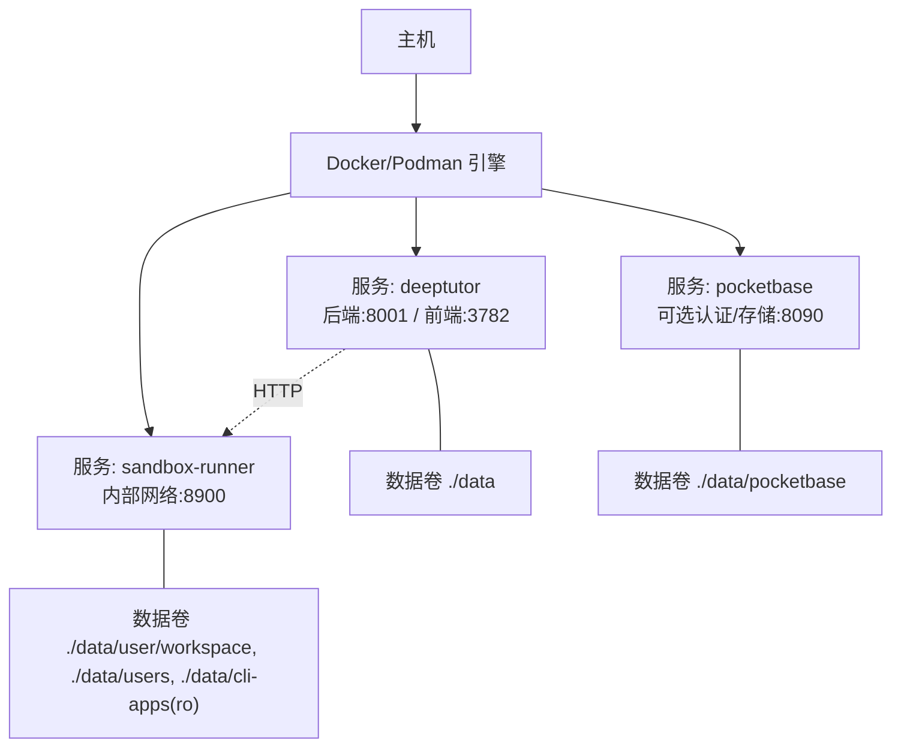
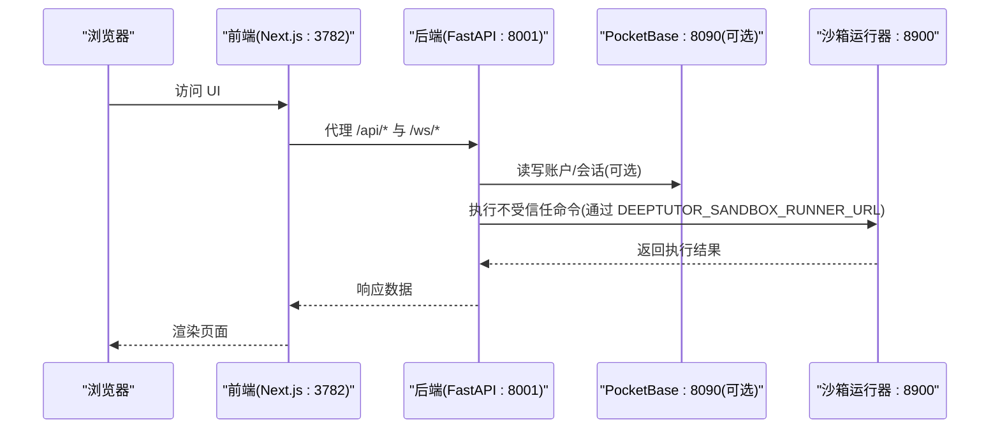
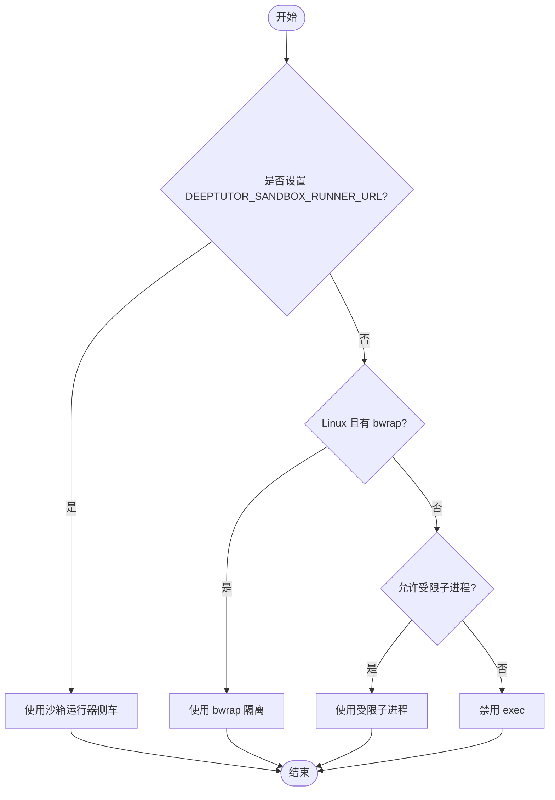
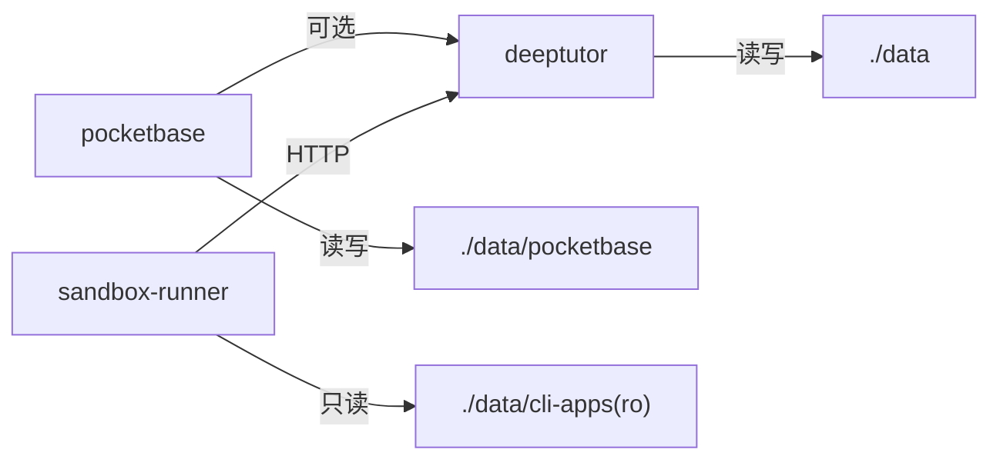

# Docker Compose编排部署

<cite>
**本文引用的文件**
- [compose.yaml](file://compose.yaml)
- [docker-compose.yml](file://docker-compose.yml)
- [docker-compose.dev.yml](file://docker-compose.dev.yml)
- [Dockerfile](file://Dockerfile)
- [Dockerfile.runner](file://Dockerfile.runner)
- [scripts/docker_compose.py](file://scripts/docker_compose.py)
- [CONTAINERIZATION.md](file://CONTAINERIZATION.md)
- [deeptutor/services/sandbox/config.py](file://deeptutor/services/sandbox/config.py)
</cite>

## 目录
1. [简介](#简介)
2. [项目结构](#项目结构)
3. [核心组件](#核心组件)
4. [架构总览](#架构总览)
5. [详细组件分析](#详细组件分析)
6. [依赖关系分析](#依赖关系分析)
7. [性能与资源限制](#性能与资源限制)
8. [故障排查指南](#故障排查指南)
9. [结论](#结论)
10. [附录：Kubernetes 部署建议](#附录kubernetes-部署建议)

## 简介
本指南面向使用 Docker Compose 部署 DeepTutor 的团队与个人，重点说明多容器架构（主应用容器与沙箱运行器容器的分离）、服务定义、网络与数据卷管理、开发/生产配置差异、沙箱安全机制（通过环境变量与侧车通信）、外部服务集成（PocketBase）、健康检查与日志收集，以及如何在 Kubernetes 中复用这些配置。

## 项目结构
DeepTutor 的容器化编排由以下关键文件构成：
- compose.yaml：Podman 友好、rootless、只读根文件系统的最小化编排（仅 deeptutor + 可选 pocketbase）。
- docker-compose.yml：包含完整侧车的编排（deeptutor + pocketbase + sandbox-runner），默认启用沙箱隔离执行。
- docker-compose.dev.yml：开发覆盖层，挂载源码实现前后端热重载。
- Dockerfile：构建生产镜像（后端 FastAPI + 前端 Next.js），含 supervisord 进程管理与入口脚本。
- Dockerfile.runner：沙箱运行器镜像，仅包含最小依赖与 HTTP server，用于执行不受信任的命令。
- scripts/docker_compose.py：从运行时 JSON 设置渲染端口映射并调用 docker compose。
- CONTAINERIZATION.md：容器化部署、配置与安全说明。

图表来源
- [docker-compose.yml:51-175](file://docker-compose.yml#L51-L175)
- [compose.yaml:67-196](file://compose.yaml#L67-L196)

章节来源
- [docker-compose.yml:1-183](file://docker-compose.yml#L1-L183)
- [compose.yaml:1-207](file://compose.yaml#L1-L207)
- [Dockerfile:1-504](file://Dockerfile#L1-L504)
- [Dockerfile.runner:1-111](file://Dockerfile.runner#L1-L111)
- [scripts/docker_compose.py:1-113](file://scripts/docker_compose.py#L1-L113)
- [CONTAINERIZATION.md:1-468](file://CONTAINERIZATION.md#L1-L468)

## 核心组件
- 主应用容器（deeptutor）
  - 后端：FastAPI 监听 8001（可配置）
  - 前端：Next.js 监听 3782（可配置）
  - 进程管理：supervisord 启动 backend/frontend，并以非 root 用户运行
  - 入口脚本：加载 data/user/settings/*.json 导出环境变量，统一配置来源
- 沙箱运行器容器（sandbox-runner）
  - 仅暴露内部网络 8900，不对外发布端口
  - 以最小权限执行不受信任命令，具备资源限制与只读根文件系统
  - 通过 DEEPTUTOR_SANDBOX_RUNNER_URL 与主应用通信
- 可选认证/存储侧车（pocketbase）
  - 提供账户与会话存储，需通过 integrations.json 激活
  - 数据持久化到 ./data/pocketbase

章节来源
- [Dockerfile:211-259](file://Dockerfile#L211-L259)
- [Dockerfile:263-315](file://Dockerfile#L263-L315)
- [Dockerfile:317-439](file://Dockerfile#L317-L439)
- [docker-compose.yml:51-175](file://docker-compose.yml#L51-L175)
- [compose.yaml:67-196](file://compose.yaml#L67-L196)
- [Dockerfile.runner:1-111](file://Dockerfile.runner#L1-L111)

## 架构总览
DeepTutor 采用“主应用 + 沙箱侧车”的分离式架构。主应用负责业务逻辑与 Web 服务；沙箱运行器在独立容器中执行不受信任的代码，避免主进程暴露敏感数据或获得过多权限。两者通过内部网络与 HTTP 通信。

图表来源
- [docker-compose.yml:51-175](file://docker-compose.yml#L51-L175)
- [compose.yaml:67-196](file://compose.yaml#L67-L196)
- [Dockerfile:317-439](file://Dockerfile#L317-L439)

## 详细组件分析

### 服务定义与网络配置
- 服务
  - pocketbase：可选，提供认证与存储，端口 8090，数据挂载至 ./data/pocketbase
  - deeptutor：后端 8001、前端 3782，数据挂载至 ./data
  - sandbox-runner：内部服务 8900，仅内部网络可达
- 网络
  - 自定义 bridge 网络 deeptutor-network（或 podman 下的 deeptutor 网络）
  - 所有服务加入同一网络以便互相发现
- 端口绑定
  - 生产与开发均支持通过环境变量覆盖宿主端口映射
  - Podman 版本默认仅绑定回环地址（127.0.0.1），更安全

章节来源
- [docker-compose.yml:21-183](file://docker-compose.yml#L21-L183)
- [compose.yaml:67-207](file://compose.yaml#L67-L207)

### 数据卷管理
- 主数据树
  - ./data 挂载到 /app/data，包含运行时设置、工作区、知识库、日志等
- PocketBase 数据
  - ./data/pocketbase 挂载到 /pb_data、/pb_public、/pb_hooks
- 沙箱运行器数据
  - 仅挂载必要的工作区与 CLI 应用目录，且 cli-apps 为只读
  - 避免挂载 data/system，防止泄露鉴权凭据

章节来源
- [docker-compose.yml:65-144](file://docker-compose.yml#L65-L144)
- [compose.yaml:87-157](file://compose.yaml#L87-L157)

### 开发环境与生产环境配置
- 生产
  - 使用 production target 构建镜像，supervisord 管理进程
  - 入口脚本从 data/user/settings/*.json 加载配置并导出环境变量
- 开发
  - 使用 development target，挂载源码目录实现热重载
  - 前端使用 next dev，后端 uvicorn --reload
  - 便于快速迭代与调试

章节来源
- [Dockerfile:441-504](file://Dockerfile#L441-L504)
- [docker-compose.dev.yml:1-52](file://docker-compose.dev.yml#L1-L52)

### 沙箱安全机制
- 后端选择策略
  - 若设置 DEEPTUTOR_SANDBOX_RUNNER_URL，则优先使用 RunnerSidecarBackend
  - 否则在 Linux 上尝试 bwrap；如允许则使用受限子进程；否则禁用 exec
- 通信方式
  - 主应用通过 HTTP 调用 http://sandbox-runner:8900
  - 运行器容器仅暴露内部端口，不对外暴露
- 资源限制
  - 运行器容器限制 CPU/内存/进程数，只读根文件系统，最小权限用户
- 数据可见性
  - 仅挂载工作区与 CLI 应用目录，避免敏感数据泄露

图表来源
- [deeptutor/services/sandbox/config.py:1-93](file://deeptutor/services/sandbox/config.py#L1-L93)
- [docker-compose.yml:76-117](file://docker-compose.yml#L76-L117)

章节来源
- [deeptutor/services/sandbox/config.py:1-93](file://deeptutor/services/sandbox/config.py#L1-L93)
- [docker-compose.yml:76-175](file://docker-compose.yml#L76-L175)
- [Dockerfile.runner:1-111](file://Dockerfile.runner#L1-L111)

### 外部服务集成（PocketBase）
- 激活方式
  - 在 integrations.json 中设置 pocketbase_url 为 http://pocketbase:8090
- 数据持久化
  - 将 PocketBase 的数据目录挂载到 ./data/pocketbase
- 健康检查
  - 对 /api/health 进行探测，确保服务就绪

章节来源
- [docker-compose.yml:21-49](file://docker-compose.yml#L21-L49)
- [compose.yaml:67-110](file://compose.yaml#L67-L110)

### 启动脚本与健康检查
- 启动脚本
  - entrypoint.sh：初始化目录、加载 JSON 配置、导出环境变量、启动 supervisord
  - start-backend.sh：启动 FastAPI（uvicorn），动态计算 WebSocket 最大帧大小与 keep-alive 超时
  - start-frontend.sh：启动 Next.js standalone 服务器
- 健康检查
  - 后端：curl 探测根路径
  - 前端：通过 Next.js 服务可用性
  - PocketBase：/api/health
  - 沙箱运行器：/health 探针

章节来源
- [Dockerfile:263-315](file://Dockerfile#L263-L315)
- [Dockerfile:317-439](file://Dockerfile#L317-L439)
- [docker-compose.yml:85-96](file://docker-compose.yml#L85-L96)
- [docker-compose.yml:166-172](file://docker-compose.yml#L166-L172)
- [compose.yaml:99-110](file://compose.yaml#L99-L110)
- [compose.yaml:168-182](file://compose.yaml#L168-L182)

### 日志收集
- 容器标准输出
  - supervisord 子进程将日志输出到 stdout/stderr，可通过 docker logs 查看
- 应用日志文件
  - 后端写入 data/user/logs/ai_tutor_*.log
- 开发模式
  - 可选择注释掉 json-file 驱动以直接控制台输出

章节来源
- [Dockerfile:231-259](file://Dockerfile#L231-L259)
- [Dockerfile:263-293](file://Dockerfile#L263-L293)
- [docker-compose.dev.yml:42-48](file://docker-compose.dev.yml#L42-L48)

## 依赖关系分析
- 服务间依赖
  - deeptutor 依赖 pocketbase（可选）与 sandbox-runner（推荐）
  - 通过 depends_on 与 healthcheck 确保顺序启动
- 网络依赖
  - 所有服务在同一桥接网络内，通过服务名解析
- 数据依赖
  - 主应用与沙箱共享工作区路径，保证 host_path == sandbox_path

图表来源
- [docker-compose.yml:92-99](file://docker-compose.yml#L92-L99)
- [docker-compose.yml:136-144](file://docker-compose.yml#L136-L144)

章节来源
- [docker-compose.yml:92-99](file://docker-compose.yml#L92-L99)
- [compose.yaml:178-182](file://compose.yaml#L178-L182)

## 性能与资源限制
- 资源限制
  - 沙箱运行器：pids_limit=256，mem_limit=1g，只读根文件系统
  - 主应用：可启用 pids_limit、mem_limit、cpus（根据宿主机 cgroup 能力）
- 网络与 I/O
  - 使用 tmpfs 减少磁盘写入压力
  - 合理设置 WebSocket 最大帧大小与 keep-alive 超时，避免连接过早关闭
- 缓存与构建
  - 前端构建阶段缓存依赖，生产镜像使用 standalone 输出减小体积

章节来源
- [docker-compose.yml:148-165](file://docker-compose.yml#L148-L165)
- [compose.yaml:183-196](file://compose.yaml#L183-L196)
- [Dockerfile:263-293](file://Dockerfile#L263-L293)

## 故障排查指南
- 常见错误
  - pidfile 写入失败：旧镜像可能写入 /var/run，新镜像已移至 /tmp
  - 后端不可达：检查后端是否启动成功与 DEEPTUTOR_API_BASE_URL 是否正确
  - 权限问题：named volume 在 rootless podman 下可能出现 UID 不匹配，改用 bind mount 或 :U 后缀
  - sed 报错：新镜像不再修改 bundle，若出现请升级镜像
- 诊断步骤
  - 查看容器日志：docker logs -f deeptutor
  - 检查健康检查：docker inspect 或 podman inspect
  - 验证端口映射：确认宿主端口与服务端口一致
  - 校验 JSON 配置：data/user/settings/*.json 是否为空或格式错误

章节来源
- [CONTAINERIZATION.md:406-468](file://CONTAINERIZATION.md#L406-L468)

## 结论
DeepTutor 的容器化编排提供了灵活的多容器部署方案：生产环境推荐使用 docker-compose.yml 以启用沙箱隔离；轻量或 rootless 场景可使用 compose.yaml；开发环境通过 docker-compose.dev.yml 实现热重载。通过统一的 JSON 配置与入口脚本，系统具备良好的可维护性与安全性。

## 附录：Kubernetes 部署建议
- 将 compose 中的服务映射为 Deployment/Service
  - deeptutor：后端 Service :8001，前端 Service :3782
  - pocketbase：可选 Service :8090
  - sandbox-runner：ClusterIP Service :8900，仅内部访问
- 数据持久化
  - 使用 PersistentVolume 挂载 /app/data 与 /app/data/pocketbase
  - 沙箱运行器挂载工作区与 CLI 应用目录（cli-apps 只读）
- 环境变量
  - 主应用设置 DEEPTUTOR_SANDBOX_RUNNER_URL=http://sandbox-runner:8900
  - 其他运行时参数通过 ConfigMap 注入或读取 data/user/settings/*.json
- 健康检查与探针
  - Liveness/Readiness 探针对应各服务的健康检查端点
- 资源限制
  - 为每个 Pod 设置 requests/limits，沙箱运行器严格限制 CPU/内存/进程数
- 安全加固
  - 使用非 root 用户运行 Pod
  - 只读根文件系统（如可行）
  - 最小权限网络策略，仅允许必要通信

[本节为概念性指导，未直接分析具体代码文件]