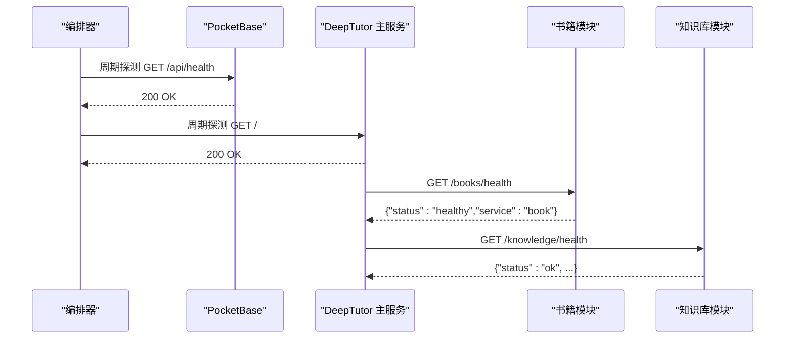
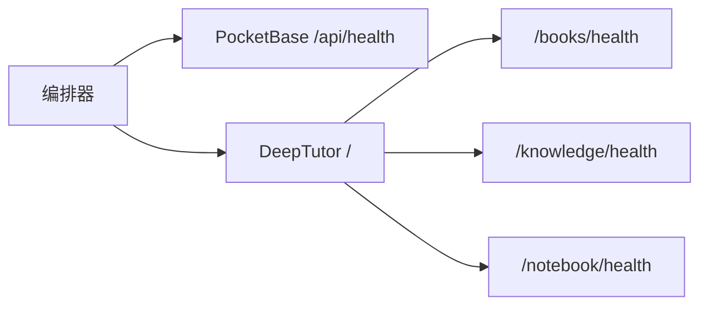

# 健康检查与监控

<cite>
**本文引用的文件**
- [Dockerfile](file://Dockerfile)
- [compose.yaml](file://compose.yaml)
- [docker-compose.yml](file://docker-compose.yml)
- [deeptutor/services/pocketbase_client.py](file://deeptutor/services/pocketbase_client.py)
- [deeptutor/api/routers/book.py](file://deeptutor/api/routers/book.py)
- [deeptutor/api/routers/knowledge.py](file://deeptutor/api/routers/knowledge.py)
- [deeptutor/book/kb_health.py](file://deeptutor/book/kb_health.py)
- [deeptutor/logging/process_stream.py](file://deeptutor/logging/process_stream.py)
- [deeptutor/logging/loguru_bridge.py](file://deeptutor/logging/loguru_bridge.py)
</cite>

## 目录
1. [简介](#简介)
2. [项目结构](#项目结构)
3. [核心组件](#核心组件)
4. [架构总览](#架构总览)
5. [详细组件分析](#详细组件分析)
6. [依赖关系分析](#依赖关系分析)
7. [性能考虑](#性能考虑)
8. [故障诊断指南](#故障诊断指南)
9. [结论](#结论)
10. [附录](#附录)

## 简介
本指南聚焦 DeepTutor 的健康检查与监控配置，覆盖以下要点：
- PocketBase 服务的健康检查（基于 wget 的 /api/health 探测与重试机制）
- DeepTutor 主应用的健康检查逻辑（基于 curl 对后端 API 的监控）
- 健康检查的时间间隔、超时时间与重试策略
- 自定义健康检查端点的开发指南
- 日志收集与监控指标导出方法
- 在 Kubernetes 环境中的集成方式
- 故障诊断与性能监控最佳实践

## 项目结构
DeepTutor 通过容器编排（Compose/Docker）提供内置健康检查能力；同时后端暴露若干健康检查路由，便于上层编排系统或外部探针进行更细粒度的服务可用性检测。

```mermaid
graph TB
A["编排层<br/>Compose/Docker"] --> B["PocketBase 服务<br/>:8090"]
A --> C["DeepTutor 主服务<br/>FastAPI :8001 + Next.js :3782"]
B --> |/api/health| B
C --> |/ (根路径)| C
C --> |/books/health| C
C --> |/knowledge/health| C
C --> |/notebook/health| C
```

图表来源
- [compose.yaml:99-110](file://compose.yaml#L99-L110)
- [compose.yaml:168-177](file://compose.yaml#L168-L177)
- [docker-compose.yml:44-49](file://docker-compose.yml#L44-L49)
- [docker-compose.yml:85-90](file://docker-compose.yml#L85-L90)
- [deeptutor/api/routers/book.py:143-145](file://deeptutor/api/routers/book.py#L143-L145)
- [deeptutor/api/routers/knowledge.py:993-1009](file://deeptutor/api/routers/knowledge.py#L993-L1009)

章节来源
- [compose.yaml:67-182](file://compose.yaml#L67-L182)
- [docker-compose.yml:21-99](file://docker-compose.yml#L21-L99)

## 核心组件
- PocketBase 健康检查：使用 wget 探测 /api/health，具备 interval/timeout/retries/start_period 等参数。
- DeepTutor 主服务健康检查：使用 curl 探测根路径 /，具备相同参数集。
- 应用内健康检查端点：
  - 书籍模块：/books/health
  - 知识库模块：/knowledge/health
  - 笔记本模块：/notebook/health
- PocketBase 连通性探测：启动时通过 httpx 调用 /api/health，记录日志并返回状态。
- 容器级健康检查：Dockerfile 中定义 HEALTHCHECK，读取运行时端口并探测根路径。

章节来源
- [compose.yaml:99-110](file://compose.yaml#L99-L110)
- [compose.yaml:168-177](file://compose.yaml#L168-L177)
- [docker-compose.yml:44-49](file://docker-compose.yml#L44-L49)
- [docker-compose.yml:85-90](file://docker-compose.yml#L85-L90)
- [deeptutor/api/routers/book.py:143-145](file://deeptutor/api/routers/book.py#L143-L145)
- [deeptutor/api/routers/knowledge.py:993-1009](file://deeptutor/api/routers/knowledge.py#L993-L1009)
- [deeptutor/services/pocketbase_client.py:164-196](file://deeptutor/services/pocketbase_client.py#L164-L196)
- [Dockerfile:414-436](file://Dockerfile#L414-L436)

## 架构总览
下图展示了编排层、PocketBase、DeepTutor 以及内部健康检查端点之间的交互关系。



图表来源
- [compose.yaml:99-110](file://compose.yaml#L99-L110)
- [compose.yaml:168-177](file://compose.yaml#L168-L177)
- [deeptutor/api/routers/book.py:143-145](file://deeptutor/api/routers/book.py#L143-L145)
- [deeptutor/api/routers/knowledge.py:993-1009](file://deeptutor/api/routers/knowledge.py#L993-L1009)

## 详细组件分析

### PocketBase 健康检查（wget）
- 命令与参数：使用 wget --quiet --tries=1 --spider 访问 http://localhost:8090/api/health。
- 时间间隔：interval=10s
- 超时：timeout=5s
- 重试：retries=3
- 启动宽限期：start_period=10s
- 行为说明：当 PocketBase 不可用时，编排器会将其标记为不健康，影响依赖它的服务启动顺序。

章节来源
- [compose.yaml:99-110](file://compose.yaml#L99-L110)
- [docker-compose.yml:44-49](file://docker-compose.yml#L44-L49)

### DeepTutor 主服务健康检查（curl）
- 命令与参数：使用 curl -fsS 访问 http://localhost:8001/（或动态端口）。
- 时间间隔：interval=30s
- 超时：timeout=10s
- 重试：retries=3
- 启动宽限期：start_period=60s
- 行为说明：确保 FastAPI 进程已就绪并可响应请求。

章节来源
- [compose.yaml:168-177](file://compose.yaml#L168-L177)
- [docker-compose.yml:85-90](file://docker-compose.yml#L85-L90)

### 应用内健康检查端点
- 书籍模块：GET /books/health，返回服务名与状态。
- 知识库模块：GET /knowledge/health，返回配置与基础目录状态、知识库数量等。
- 笔记本模块：GET /notebook/health（存在对应路由）。
- 用途：供编排器或外部探针进行更细粒度健康检查，例如验证数据目录是否可读写、索引是否可用等。

章节来源
- [deeptutor/api/routers/book.py:143-145](file://deeptutor/api/routers/book.py#L143-L145)
- [deeptutor/api/routers/knowledge.py:993-1009](file://deeptutor/api/routers/knowledge.py#L993-L1009)

### PocketBase 连通性探测（httpx）
- 启动阶段通过 httpx.AsyncClient 调用 PocketBase /api/health，设置超时 5s。
- 成功：记录健康检查通过日志。
- 失败：记录警告日志，提示会话将回退到 SQLite 直到 PocketBase 恢复。
- 适用场景：用于快速发现配置错误或网络问题，避免静默失败。

章节来源
- [deeptutor/services/pocketbase_client.py:164-196](file://deeptutor/services/pocketbase_client.py#L164-L196)

### 容器级健康检查（Dockerfile）
- 健康检查脚本：读取 /app/data/user/settings/system.json 中的 backend_port，默认 8001，然后访问 http://localhost:{port}/。
- 健康检查参数：interval=30s, timeout=10s, start_period=60s, retries=3。
- 作用：在不依赖 Compose 的情况下，也能通过 Docker 原生 HEALTHCHECK 判断容器健康。

章节来源
- [Dockerfile:414-436](file://Dockerfile#L414-L436)

### 知识健康与日志扫描（kb_health）
- 功能：扫描每本书的 log.md，统计错误条目、块失败次数、最近编译/错误时间，并识别重复失败模式。
- 输出：结构化报告，可用于维护仪表盘与健康告警。
- 适用场景：定位反复出现的编译或处理失败，辅助排障。

章节来源
- [deeptutor/book/kb_health.py:233-296](file://deeptutor/book/kb_health.py#L233-L296)

## 依赖关系分析
- 编排层依赖：
  - PocketBase 健康检查通过 wget 探测 /api/health。
  - DeepTutor 主服务健康检查通过 curl 探测根路径。
  - 主服务依赖 PocketBase 健康状态（depends_on condition: service_healthy）。
- 应用内依赖：
  - 各模块暴露独立健康检查路由，便于分层探测。
  - PocketBase 客户端在启动时主动探测 /api/health，提升可观测性。



图表来源
- [compose.yaml:178-180](file://compose.yaml#L178-L180)
- [deeptutor/api/routers/book.py:143-145](file://deeptutor/api/routers/book.py#L143-L145)
- [deeptutor/api/routers/knowledge.py:993-1009](file://deeptutor/api/routers/knowledge.py#L993-L1009)

章节来源
- [compose.yaml:178-180](file://compose.yaml#L178-L180)

## 性能考虑
- 健康检查频率与开销：
  - PocketBase 检查间隔较短（10s），适合快速感知数据库侧不可用。
  - DeepTutor 主服务检查间隔较长（30s），降低对业务接口的压力。
- 超时与重试：
  - 合理的超时与重试能避免短暂抖动导致的误判。
  - 启动宽限期（start_period）给服务足够时间完成初始化。
- 建议：
  - 在高负载环境下可适当延长 interval 或增大 timeout。
  - 对于关键依赖（如 PocketBase），保持较短 interval 以尽早发现问题。

[本节为通用指导，不直接分析具体文件]

## 故障诊断指南
- 常见问题定位：
  - PocketBase 不可达：检查网络、端口映射、/api/health 可达性与认证配置。
  - DeepTutor 根路径无响应：确认 FastAPI 进程已启动且端口绑定正确。
  - 模块健康检查异常：分别访问 /books/health、/knowledge/health、/notebook/health 获取详细信息。
- 日志与可观测性：
  - 应用日志：通过 process_stream 捕获进程级日志事件，便于集中采集。
  - Loguru 桥接：将 loguru 日志转发至标准 logging，统一出口。
  - 知识健康：通过 kb_health 扫描 log.md，识别重复失败与错误趋势。
- 建议流程：
  - 先检查编排层健康状态（wget/curl 结果）。
  - 再检查应用内健康端点返回内容。
  - 最后查看日志与知识健康报告，定位根因。

章节来源
- [deeptutor/logging/process_stream.py:17-49](file://deeptutor/logging/process_stream.py#L17-L49)
- [deeptutor/logging/loguru_bridge.py:9-28](file://deeptutor/logging/loguru_bridge.py#L9-L28)
- [deeptutor/book/kb_health.py:233-296](file://deeptutor/book/kb_health.py#L233-L296)

## 结论
DeepTutor 提供了多层次的健康检查与监控能力：
- 编排层通过 wget/curl 对 PocketBase 与主服务进行周期性探测。
- 应用内暴露细粒度健康检查端点，便于分层诊断。
- 启动阶段主动探测 PocketBase，增强可观测性。
- 结合日志与知识健康扫描，形成完整的故障定位闭环。
在生产环境中，建议根据负载与稳定性需求调整健康检查参数，并结合日志与指标系统进行持续监控。

[本节为总结性内容，不直接分析具体文件]

## 附录

### 自定义健康检查端点开发指南
- 目标：为新增模块或服务提供轻量、幂等的健康检查接口。
- 建议规范：
  - 路径：/modules/<name>/health
  - 方法：GET
  - 返回：包含 status 字段与可选的详细状态信息
  - 超时：尽量短，避免阻塞
  - 幂等：可被频繁调用
- 示例参考：
  - 书籍模块：/books/health
  - 知识库模块：/knowledge/health
  - 笔记本模块：/notebook/health

章节来源
- [deeptutor/api/routers/book.py:143-145](file://deeptutor/api/routers/book.py#L143-L145)
- [deeptutor/api/routers/knowledge.py:993-1009](file://deeptutor/api/routers/knowledge.py#L993-L1009)

### Kubernetes 集成建议
- LivenessProbe：
  - 针对 PocketBase：HTTP GET /api/health，interval=10s，timeout=5s，retries=3，initialDelaySeconds=10
  - 针对 DeepTutor：HTTP GET /，interval=30s，timeout=10s，retries=3，initialDelaySeconds=60
- ReadinessProbe：
  - 可使用 /books/health 或 /knowledge/health 作为更严格的就绪检查
- StartupProbe：
  - 若服务启动较慢，可增加 initialDelaySeconds 或使用 startupProbe 替代 liveness 初期检查
- 资源限制：
  - 合理设置 CPU/Memory 限制，避免健康检查导致资源争用
- 日志与指标：
  - 将 stdout/stderr 接入集中式日志系统
  - 暴露 Prometheus 指标端点（如需），配合抓取与告警

[本节为概念性指导，不直接分析具体文件]

### 日志收集与监控指标导出
- 日志收集：
  - 使用 process_stream 捕获进程级日志事件，便于统一采集
  - 安装 loguru 桥接，将 loguru 日志转发至标准 logging，简化采集链路
- 监控指标：
  - 可在健康检查端点中附加关键指标（如知识库数量、配置状态）
  - 结合外部监控系统（Prometheus/Grafana）实现可视化与告警

章节来源
- [deeptutor/logging/process_stream.py:17-49](file://deeptutor/logging/process_stream.py#L17-L49)
- [deeptutor/logging/loguru_bridge.py:9-28](file://deeptutor/logging/loguru_bridge.py#L9-L28)
- [deeptutor/api/routers/knowledge.py:993-1009](file://deeptutor/api/routers/knowledge.py#L993-L1009)