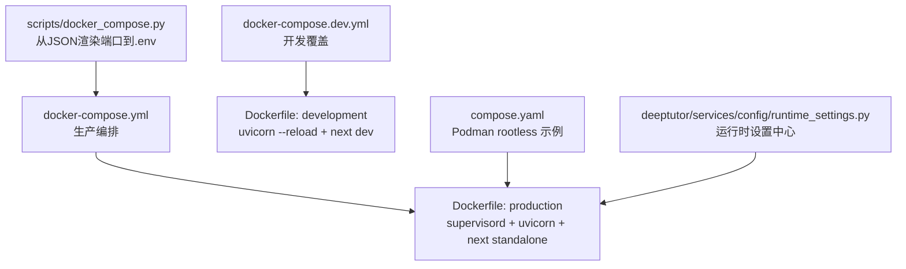
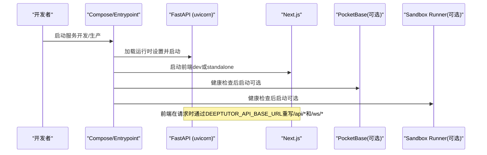
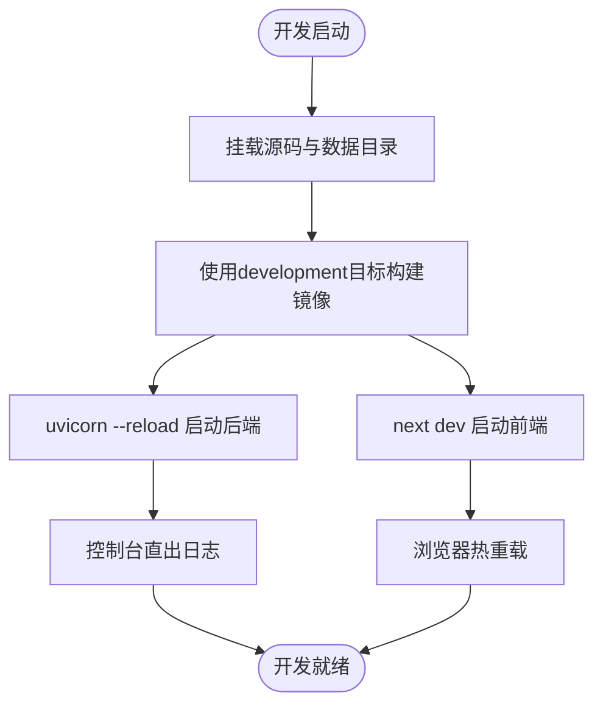
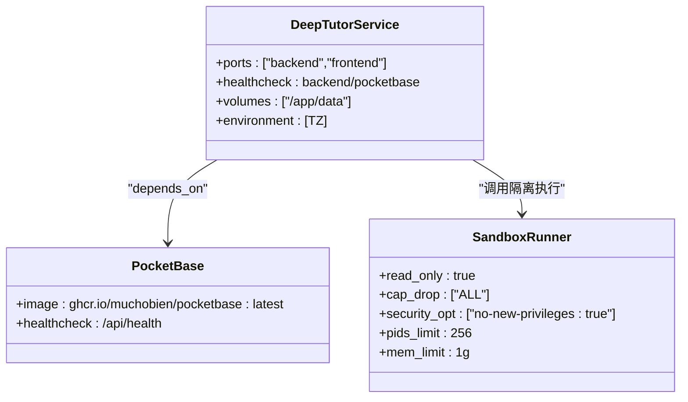
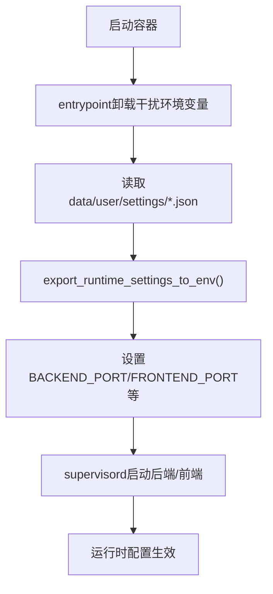
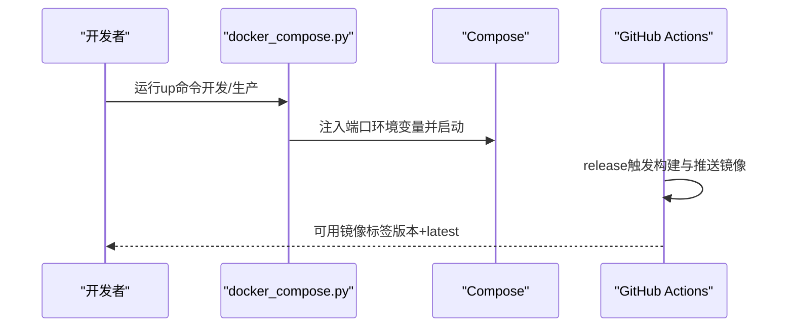
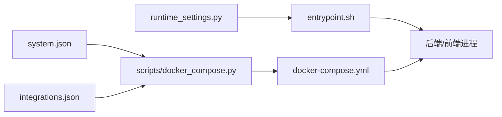

# 开发与生产环境配置

<cite>
**本文引用的文件**
- [docker-compose.dev.yml](file://docker-compose.dev.yml)
- [docker-compose.yml](file://docker-compose.yml)
- [compose.yaml](file://compose.yaml)
- [Dockerfile](file://Dockerfile)
- [scripts/docker_compose.py](file://scripts/docker_compose.py)
- [.github/workflows/docker-release.yml](file://.github/workflows/docker-release.yml)
- [deeptutor/services/config/runtime_settings.py](file://deeptutor/services/config/runtime_settings.py)
</cite>

## 目录
1. [简介](#简介)
2. [项目结构](#项目结构)
3. [核心组件](#核心组件)
4. [架构总览](#架构总览)
5. [详细组件分析](#详细组件分析)
6. [依赖关系分析](#依赖关系分析)
7. [性能考虑](#性能考虑)
8. [故障排除指南](#故障排除指南)
9. [结论](#结论)
10. [附录](#附录)

## 简介
本指南面向DeepTutor的开发者与运维人员，系统性对比开发环境与生产环境的容器化配置差异，覆盖热重载、调试模式、开发工具集成、资源限制、安全加固、性能调优、环境变量管理、配置验证、CI/CD集成、迁移注意事项与环境切换脚本等主题。文档中的所有技术细节均基于仓库中的配置文件与脚本实现。

## 项目结构
DeepTutor使用多阶段Docker构建与Compose编排：
- 开发环境：通过docker-compose.dev.yml叠加开发特性（源码挂载、热重载、开发工具）。
- 生产环境：通过docker-compose.yml或compose.yaml运行预构建镜像，强调只读根文件系统、最小权限、健康检查与资源限制。
- 入口与启动：Dockerfile定义production与development两个目标，分别输出生产型与开发型supervisord程序配置；entrypoint统一从JSON运行时设置导出环境变量并启动服务。
- 端口渲染：scripts/docker_compose.py将data/user/settings/*.json中的端口映射为Compose环境变量，避免在Compose中直接读取JSON。

图表来源
- [docker-compose.yml:21-183](file://docker-compose.yml#L21-L183)
- [docker-compose.dev.yml:1-52](file://docker-compose.dev.yml#L1-L52)
- [compose.yaml:67-207](file://compose.yaml#L67-L207)
- [Dockerfile:102-504](file://Dockerfile#L102-L504)
- [scripts/docker_compose.py:45-107](file://scripts/docker_compose.py#L45-L107)
- [deeptutor/services/config/runtime_settings.py:15-67](file://deeptutor/services/config/runtime_settings.py#L15-L67)

章节来源
- [docker-compose.yml:1-183](file://docker-compose.yml#L1-L183)
- [docker-compose.dev.yml:1-52](file://docker-compose.dev.yml#L1-L52)
- [compose.yaml:1-207](file://compose.yaml#L1-L207)
- [Dockerfile:1-504](file://Dockerfile#L1-L504)
- [scripts/docker_compose.py:1-113](file://scripts/docker_compose.py#L1-L113)
- [deeptutor/services/config/runtime_settings.py:1-200](file://deeptutor/services/config/runtime_settings.py#L1-L200)

## 核心组件
- 后端服务：FastAPI（uvicorn），默认端口由system.json决定，支持WebSocket附件大小动态计算与keep-alive超时控制。
- 前端服务：Next.js独立服务器（生产）或开发服务器（开发），通过web/proxy.ts在请求时重写API与WS路径至后端。
- 认证与存储侧车：可选PocketBase，提供用户认证与数据存储能力。
- 沙箱执行器：sandbox-runner作为隔离执行环境，主应用不直接执行不受信任代码。
- 运行时设置：所有运行时参数集中在data/user/settings/*.json，entrypoint启动时加载并导出为进程环境变量。

章节来源
- [Dockerfile:231-315](file://Dockerfile#L231-L315)
- [Dockerfile:317-439](file://Dockerfile#L317-L439)
- [docker-compose.yml:51-175](file://docker-compose.yml#L51-L175)
- [compose.yaml:67-207](file://compose.yaml#L67-L207)
- [deeptutor/services/config/runtime_settings.py:15-67](file://deeptutor/services/config/runtime_settings.py#L15-L67)

## 架构总览
下图展示了开发/生产两种模式下服务的启动流程与关键差异点。

图表来源
- [Dockerfile:317-439](file://Dockerfile#L317-L439)
- [docker-compose.yml:51-175](file://docker-compose.yml#L51-L175)
- [compose.yaml:120-182](file://compose.yaml#L120-L182)

## 详细组件分析

### 开发环境特殊配置（docker-compose.dev.yml）
- 热重载：
  - 后端：development目标下uvicorn启用--reload，配合源码卷挂载实现修改即生效。
  - 前端：使用next dev开发服务器，监听本地端口并提供HMR。
- 源码挂载：
  - 后端与前端源码以只读方式挂载到容器内，便于IDE联调与实时编辑。
- 数据持久化：
  - 用户数据、知识库、记忆等目录挂载到宿主./data，保证重启不丢失。
- 日志与网络：
  - 开发时可注释掉json-file驱动以便直接在控制台查看日志；网络沿用deeptutor-network。

图表来源
- [docker-compose.dev.yml:17-52](file://docker-compose.dev.yml#L17-L52)
- [Dockerfile:444-504](file://Dockerfile#L444-L504)

章节来源
- [docker-compose.dev.yml:1-52](file://docker-compose.dev.yml#L1-L52)
- [Dockerfile:444-504](file://Dockerfile#L444-L504)

### 生产环境优化配置（docker-compose.yml / compose.yaml）
- 资源限制与安全加固：
  - sandbox-runner采用read_only根文件系统、最小权限cap_drop ALL、no-new-privileges、pids_limit与mem_limit限制。
  - compose.yaml对deeptutor服务启用read_only与tmpfs限定可写区域，userns_mode keep-id确保UID对齐。
- 健康检查：
  - 后端与PocketBase均配置健康检查，确保依赖就绪后再启动。
- 端口渲染与绑定：
  - 通过scripts/docker_compose.py从system.json/integrations.json渲染端口变量，避免硬编码。
- 前端代理与API基址：
  - 前端在请求时读取DEEPTUTOR_API_BASE_URL重写API与WS路径，无需构建期替换。

图表来源
- [docker-compose.yml:101-175](file://docker-compose.yml#L101-L175)
- [compose.yaml:67-182](file://compose.yaml#L67-L182)

章节来源
- [docker-compose.yml:21-183](file://docker-compose.yml#L21-L183)
- [compose.yaml:67-207](file://compose.yaml#L67-L207)

### 环境变量管理与配置验证
- 运行时设置中心：
  - runtime_settings.py集中管理系统、认证、集成等默认值与校验范围，如聊天附件大小、沙箱子进程开关等。
- entrypoint职责：
  - 启动时卸载可能干扰的环境变量，再从data/user/settings/*.json导出为进程环境变量，确保单一事实来源。
- 端口渲染脚本：
  - scripts/docker_compose.py读取system.json与integrations.json生成docker.env，供Compose使用，避免手动维护.env。

图表来源
- [Dockerfile:317-439](file://Dockerfile#L317-L439)
- [deeptutor/services/config/runtime_settings.py:15-67](file://deeptutor/services/config/runtime_settings.py#L15-L67)
- [scripts/docker_compose.py:45-107](file://scripts/docker_compose.py#L45-L107)

章节来源
- [Dockerfile:317-439](file://Dockerfile#L317-L439)
- [deeptutor/services/config/runtime_settings.py:1-200](file://deeptutor/services/config/runtime_settings.py#L1-L200)
- [scripts/docker_compose.py:1-113](file://scripts/docker_compose.py#L1-L113)

### 环境切换与自动化部署流程
- 开发切换：
  - 使用python scripts/docker_compose.py -f docker-compose.yml -f docker-compose.dev.yml up启动开发叠加配置。
- 生产切换：
  - 使用python scripts/docker_compose.py up -d启动生产编排；或使用compose.yaml在Podman环境下运行。
- CI/CD集成：
  - .github/workflows/docker-release.yml在发布时构建多平台镜像并推送到GHCR，包含SBOM与缓存加速。

图表来源
- [docker-compose.yml:1-19](file://docker-compose.yml#L1-L19)
- [docker-compose.dev.yml:1-10](file://docker-compose.dev.yml#L1-L10)
- [scripts/docker_compose.py:80-107](file://scripts/docker_compose.py#L80-L107)
- [.github/workflows/docker-release.yml:13-73](file://.github/workflows/docker-release.yml#L13-L73)

章节来源
- [docker-compose.yml:1-19](file://docker-compose.yml#L1-L19)
- [docker-compose.dev.yml:1-10](file://docker-compose.dev.yml#L1-L10)
- [scripts/docker_compose.py:80-107](file://scripts/docker_compose.py#L80-L107)
- [.github/workflows/docker-release.yml:13-73](file://.github/workflows/docker-release.yml#L13-L73)

### 差异点与迁移注意事项
- 构建目标：
  - 开发使用development目标（含node_modules与dev服务器），生产使用production目标（standalone输出）。
- 卷挂载：
  - 开发挂载源码与数据目录；生产仅挂载数据目录，保持只读根文件系统。
- 端口与网络：
  - 生产通过脚本渲染端口，避免硬编码；Podman示例使用loopback绑定增强安全性。
- 迁移要点：
  - 从旧版布局升级到当前data树需一次性迁移（参考compose.ghcr.yml注释说明）。
  - 前端API基址在远程部署时需设置next_public_api_base_external，否则浏览器无法访问后端。

章节来源
- [Dockerfile:102-169](file://Dockerfile#L102-L169)
- [docker-compose.ghcr.yml:22-37](file://docker-compose.ghcr.yml#L22-L37)
- [compose.yaml:144-167](file://compose.yaml#L144-L167)

## 依赖关系分析
- 服务间依赖：
  - deeptutor依赖pocketbase（可选）与sandbox-runner（可选），通过healthcheck确保顺序启动。
- 配置依赖：
  - 运行时设置集中于JSON，entrypoint统一导出；scripts/docker_compose.py依赖system.json与integrations.json渲染端口。
- 外部依赖：
  - 镜像拉取策略、QEMU与Buildx用于多平台构建；缓存策略提升CI效率。

图表来源
- [scripts/docker_compose.py:45-107](file://scripts/docker_compose.py#L45-L107)
- [docker-compose.yml:21-183](file://docker-compose.yml#L21-L183)
- [Dockerfile:317-439](file://Dockerfile#L317-L439)
- [deeptutor/services/config/runtime_settings.py:15-67](file://deeptutor/services/config/runtime_settings.py#L15-L67)

章节来源
- [scripts/docker_compose.py:45-107](file://scripts/docker_compose.py#L45-L107)
- [docker-compose.yml:21-183](file://docker-compose.yml#L21-L183)
- [Dockerfile:317-439](file://Dockerfile#L317-L439)
- [deeptutor/services/config/runtime_settings.py:15-67](file://deeptutor/services/config/runtime_settings.py#L15-L67)

## 性能考虑
- 后端WebSocket与Keep-Alive：
  - uvicorn启动时根据系统设置动态计算ws-max-size与timeout-keep-alive，避免大附件上传被截断与连接过早关闭。
- 沙箱资源限制：
  - sandbox-runner限制pids与内存，防止滥用；read_only与最小权限降低攻击面。
- 前端代理：
  - web/proxy.ts在请求时重写API与WS路径，减少构建期耦合，提高部署灵活性。
- 缓存与构建优化：
  - CI使用GHA缓存与BuildKit多平台构建，缩短构建时间。

章节来源
- [Dockerfile:263-295](file://Dockerfile#L263-L295)
- [docker-compose.yml:148-165](file://docker-compose.yml#L148-L165)
- [.github/workflows/docker-release.yml:57-73](file://.github/workflows/docker-release.yml#L57-L73)

## 故障排除指南
- 端口冲突：
  - 通过system.json调整backend_port/frontend_port/pocketbase_port，重新运行脚本渲染端口。
- 前端无法访问后端：
  - 远程部署需设置next_public_api_base_external；本地部署确保浏览器可达的localhost映射正确。
- 沙箱执行失败：
  - 检查sandbox-runner是否健康；确认DEEPTUTOR_SANDBOX_RUNNER_URL指向正确地址。
- 权限问题：
  - Podman rootless使用userns_mode keep-id与:U卷挂载确保UID一致；必要时清理并重载数据目录。
- 健康检查失败：
  - 查看后端与PocketBase健康检查端点；确认依赖服务已就绪。

章节来源
- [scripts/docker_compose.py:45-107](file://scripts/docker_compose.py#L45-L107)
- [docker-compose.ghcr.yml:22-37](file://docker-compose.ghcr.yml#L22-L37)
- [docker-compose.yml:85-97](file://docker-compose.yml#L85-L97)
- [compose.yaml:99-111](file://compose.yaml#L99-L111)

## 结论
DeepTutor通过多阶段构建与Compose编排实现了清晰的开发/生产分离：开发环境侧重热重载与调试体验，生产环境强调安全、稳定与性能。统一的运行时设置与脚本化工具简化了环境切换与部署流程。建议在CI/CD中固化镜像构建与发布流程，并在生产环境中严格遵循只读根文件系统、最小权限与资源限制的最佳实践。

## 附录
- 常用命令参考：
  - 开发：python scripts/docker_compose.py -f docker-compose.yml -f docker-compose.dev.yml up
  - 生产：python scripts/docker_compose.py up -d
  - Podman：podman compose -f compose.yaml up -d
- 关键配置位置：
  - data/user/settings/system.json：端口、CORS、附件策略等
  - data/user/settings/integrations.json：PocketBase集成
  - data/user/settings/auth.json：认证开关与凭据
  - data/user/settings/model_catalog.json：模型提供者配置

章节来源
- [docker-compose.yml:1-19](file://docker-compose.yml#L1-L19)
- [compose.yaml:13-26](file://compose.yaml#L13-L26)
- [Dockerfile:317-439](file://Dockerfile#L317-L439)