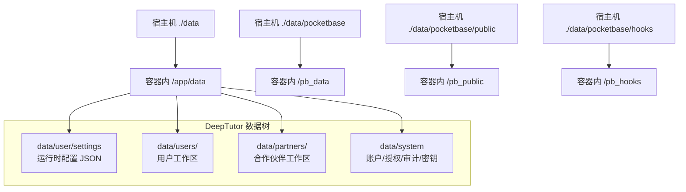
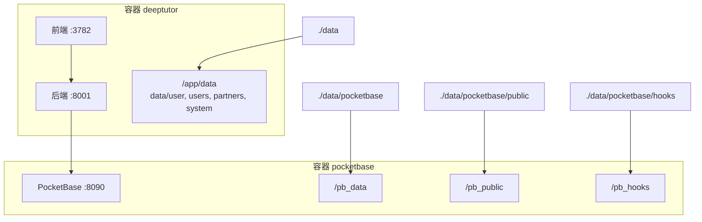
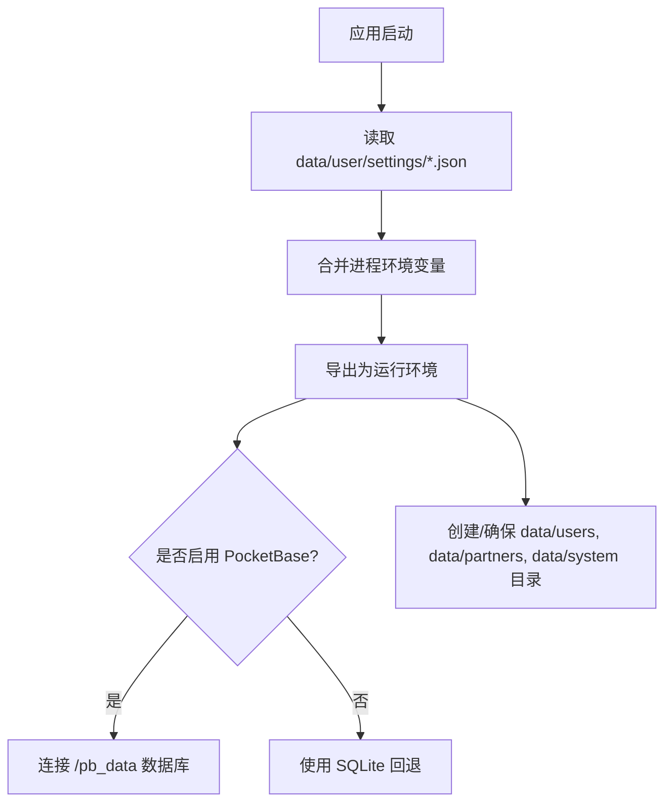
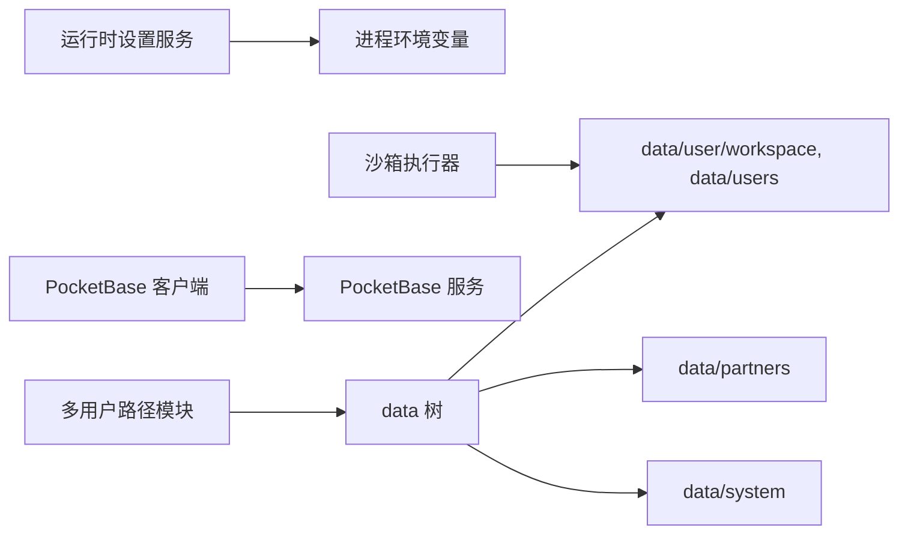

# 数据持久化配置

<cite>
**本文引用的文件**
- [compose.yaml](file://compose.yaml)
- [docker-compose.yml](file://docker-compose.yml)
- [Dockerfile](file://Dockerfile)
- [CONTAINERIZATION.md](file://CONTAINERIZATION.md)
- [paths.py（多用户路径）](file://deeptutor/multi_user/paths.py)
- [paths.py（合作伙伴路径）](file://deeptutor/partners/config/paths.py)
- [runtime_settings.py（运行时设置服务）](file://deeptutor/services/config/runtime_settings.py)
- [pocketbase_client.py（PocketBase 客户端）](file://deeptutor/services/pocketbase_client.py)
- [pb_setup.py（集合初始化脚本）](file://scripts/pb_setup.py)
</cite>

## 目录
1. [简介](#简介)
2. [项目结构](#项目结构)
3. [核心组件](#核心组件)
4. [架构总览](#架构总览)
5. [详细组件分析](#详细组件分析)
6. [依赖关系分析](#依赖关系分析)
7. [性能与权限注意事项](#性能与权限注意事项)
8. [故障排查指南](#故障排查指南)
9. [结论](#结论)
10. [附录：备份与恢复、迁移与升级](#附录备份与恢复迁移与升级)

## 简介
本指南聚焦 DeepTutor 的数据持久化配置，覆盖以下内容：
- data 目录的组织结构与各子目录用途（data/user/settings、data/users、data/partners、data/system）。
- bind mount 与 named volumes 的选择原因，特别是在 rootless 模式下避免权限问题。
- PocketBase 的数据目录结构（/pb_data、/pb_public、/pb_hooks）及其作用。
- 数据备份与恢复的最佳实践。
- 数据迁移与版本升级的注意事项。

## 项目结构
DeepTutor 将全部可持久化数据集中在宿主机的 ./data 目录下，并通过容器卷挂载到应用内部路径。该设计使得“一个树”即可被备份和迁移。

图表来源
- [compose.yaml:147-157](file://compose.yaml#L147-L157)
- [docker-compose.yml:65-74](file://docker-compose.yml#L65-L74)
- [paths.py（多用户路径）:35-39](file://deeptutor/multi_user/paths.py#L35-L39)

章节来源
- [compose.yaml:147-157](file://compose.yaml#L147-L157)
- [docker-compose.yml:65-74](file://docker-compose.yml#L65-L74)
- [paths.py（多用户路径）:35-39](file://deeptutor/multi_user/paths.py#L35-L39)

## 核心组件
- 运行时设置服务：负责从 data/user/settings/*.json 加载并合并进程环境变量，导出为运行所需的环境变量。
- 多用户路径解析：定义 data 下 user、users、partners、system 的布局与迁移逻辑。
- 合作伙伴路径：定义 data/partners 下的组织方式与访问边界。
- PocketBase 集成：可选的外部认证与存储侧车，使用独立的 /pb_* 目录。

章节来源
- [runtime_settings.py（运行时设置服务）:309-558](file://deeptutor/services/config/runtime_settings.py#L309-L558)
- [paths.py（多用户路径）:1-15](file://deeptutor/multi_user/paths.py#L1-L15)
- [paths.py（合作伙伴路径）:10-53](file://deeptutor/partners/config/paths.py#L10-L53)
- [pocketbase_client.py（PocketBase 客户端）:1-166](file://deeptutor/services/pocketbase_client.py#L1-L166)

## 架构总览
DeepTutor 由两个主要部分组成：
- DeepTutor 主服务：后端（FastAPI）+ 前端（Next.js），通过 supervisord 管理，所有可写表面在 tmpfs，数据通过 bind mount 持久化。
- PocketBase 侧车（可选）：提供认证与会话等能力，数据通过 bind mount 持久化到宿主机的 ./data/pocketbase。

图表来源
- [compose.yaml:67-182](file://compose.yaml#L67-L182)
- [docker-compose.yml:21-99](file://docker-compose.yml#L21-L99)

章节来源
- [compose.yaml:67-182](file://compose.yaml#L67-L182)
- [docker-compose.yml:21-99](file://docker-compose.yml#L21-L99)

## 详细组件分析

### data 目录组织结构
- data/user/settings：运行时配置目录，包含 system.json、auth.json、integrations.json、model_catalog.json、interface.json、main.yaml、agents.yaml 等。启动时会被读取并导出为进程环境变量，用于控制端口、CORS、认证、模型目录、外部 API 基址等。
- data/users/<uid>：每个非管理员用户的独立工作区，包含聊天历史、笔记、协作写作产物、知识库索引、内存等。
- data/partners/<id>：合作伙伴（合成用户）的工作区，包含其会话、媒体、工作空间等；该目录锚定在管理员工作区根下，不随请求上下文变化。
- data/system：部署级状态，包括账户、授权、审计日志以及按所有者隔离的密钥（user-secrets）。该目录不会挂载进沙箱执行器，防止敏感信息泄露。

图表来源
- [runtime_settings.py（运行时设置服务）:309-558](file://deeptutor/services/config/runtime_settings.py#L309-L558)
- [paths.py（多用户路径）:128-137](file://deeptutor/multi_user/paths.py#L128-L137)

章节来源
- [CONTAINERIZATION.md:345-362](file://CONTAINERIZATION.md#L345-L362)
- [paths.py（多用户路径）:35-39](file://deeptutor/multi_user/paths.py#L35-L39)
- [paths.py（合作伙伴路径）:10-53](file://deeptutor/partners/config/paths.py#L10-L53)
- [runtime_settings.py（运行时设置服务）:309-558](file://deeptutor/services/config/runtime_settings.py#L309-L558)

### 绑定挂载 vs 命名卷：rootless 模式下的选择
- 选择绑定挂载的原因：
  - 在 rootless Podman 中，使用 userns_mode: keep-id 时，容器内进程以宿主 UID 运行；bind mount 的文件归属与宿主一致，读写权限自然对齐。
  - 命名卷在 rootless 下通常由 podman 自动创建并以映射后的 UID（如 100000）拥有，导致首次写入出现权限错误。
- 具体实现：
  - DeepTutor 主服务将 ./data 绑定挂载到 /app/data，并使用 :U 后缀保证 UID 映射。
  - PocketBase 将 ./data/pocketbase 分别绑定到 /pb_data、/pb_public、/pb_hooks，同样使用 :U 后缀。

章节来源
- [compose.yaml:202-207](file://compose.yaml#L202-L207)
- [compose.yaml:87-96](file://compose.yaml#L87-L96)
- [compose.yaml:147-157](file://compose.yaml#L147-L157)

### PocketBase 数据目录与作用
- /pb_data：PocketBase 的数据库与内部状态目录（SQLite 文件等）。
- /pb_public：静态资源目录，供 Web 访问。
- /pb_hooks：钩子脚本目录，用于扩展 PocketBase 行为。
- 这些目录通过绑定挂载到宿主机的 ./data/pocketbase，便于备份与迁移。

章节来源
- [compose.yaml:87-96](file://compose.yaml#L87-L96)
- [docker-compose.yml:33-41](file://docker-compose.yml#L33-L41)

### 沙箱执行器的数据可见性
- 沙箱执行器仅挂载工作区相关目录（data/user/workspace、data/users、data/cli-apps 只读），不挂载 data/system，避免执行器接触敏感密钥。
- 对于非管理员账号，沙箱会看到整个 data/users/<uid> 根，因此跨用户可见性在该范围内是可接受的信任假设。

章节来源
- [docker-compose.yml:119-144](file://docker-compose.yml#L119-L144)

## 依赖关系分析
- 运行时设置服务依赖 data/user/settings/*.json，并在启动时导出环境变量。
- 多用户路径模块负责确保 data 树的存在与迁移。
- PocketBase 客户端仅在配置了 integrations.pocketbase_url 时启用，否则使用 SQLite 回退。
- 沙箱执行器依赖共享的工作区目录，但不接触 data/system。

图表来源
- [runtime_settings.py（运行时设置服务）:309-558](file://deeptutor/services/config/runtime_settings.py#L309-L558)
- [paths.py（多用户路径）:35-39](file://deeptutor/multi_user/paths.py#L35-L39)
- [pocketbase_client.py（PocketBase 客户端）:42-108](file://deeptutor/services/pocketbase_client.py#L42-L108)
- [docker-compose.yml:119-144](file://docker-compose.yml#L119-L144)

章节来源
- [runtime_settings.py（运行时设置服务）:309-558](file://deeptutor/services/config/runtime_settings.py#L309-L558)
- [paths.py（多用户路径）:35-39](file://deeptutor/multi_user/paths.py#L35-L39)
- [pocketbase_client.py（PocketBase 客户端）:42-108](file://deeptutor/services/pocketbase_client.py#L42-L108)
- [docker-compose.yml:119-144](file://docker-compose.yml#L119-L144)

## 性能与权限注意事项
- 只读根文件系统：容器根文件系统设为只读，仅允许必要的 tmpfs 写入，降低攻击面并提高一致性。
- 权限对齐：在 rootless keep-id 模式下，bind mount 的文件属主与宿主一致，避免首次写入权限错误。
- 最小化挂载：沙箱执行器仅挂载必要的工作区目录，减少不必要的数据暴露。
- 健康检查：对 PocketBase 与 DeepTutor 均配置健康检查，便于编排工具判断服务就绪。

章节来源
- [compose.yaml:28-48](file://compose.yaml#L28-L48)
- [compose.yaml:127-143](file://compose.yaml#L127-L143)
- [docker-compose.yml:148-165](file://docker-compose.yml#L148-L165)

## 故障排查指南
- 无法写入 data 目录：
  - 确认使用的是绑定挂载而非命名卷，尤其是在 rootless 模式下。
  - 检查 compose 中的 :U 后缀是否正确启用 UID 映射。
- PocketBase 未启动或不可用：
  - 检查 integrations.json 中的 pocketbase_url、admin_email、admin_password 是否配置正确。
  - 首次启动后需运行集合初始化脚本 pb_setup.py。
- 沙箱执行器权限不足：
  - 确认只挂载了工作区目录，且 data/system 未被挂载。
  - 检查 tmpfs 大小与权限是否满足需求。

章节来源
- [compose.yaml:202-207](file://compose.yaml#L202-L207)
- [pb_setup.py（集合初始化脚本）:77-116](file://scripts/pb_setup.py#L77-L116)
- [docker-compose.yml:119-144](file://docker-compose.yml#L119-L144)

## 结论
DeepTutor 采用集中式 data 目录与绑定挂载策略，结合 rootless keep-id 模式，实现了安全、可移植且易于备份的数据持久化方案。运行时配置通过 JSON 文件与环境变量叠加，灵活可控；PocketBase 作为可选侧车，提供可扩展的认证与存储能力。沙箱执行器严格限制数据可见性，保障安全性。

## 附录：备份与恢复、迁移与升级

### 备份与恢复最佳实践
- 备份范围：
  - 完整备份 ./data（包含 data/user/settings、data/users、data/partners、data/system）。
  - 单独备份 ./data/pocketbase（包含 /pb_data、/pb_public、/pb_hooks）。
- 恢复步骤：
  - 停止服务，将备份目录恢复到宿主机对应路径。
  - 重启服务，确保数据目录权限与 UID 映射正确。
- 建议：
  - 定期快照或归档，保留多个版本以便回滚。
  - 对敏感目录（data/system）加强访问控制。

章节来源
- [compose.yaml:147-157](file://compose.yaml#L147-L157)
- [compose.yaml:87-96](file://compose.yaml#L87-L96)

### 数据迁移与版本升级注意事项
- 旧版 multi-user 布局迁移：
  - 系统会在首次访问时自动将 legacy multi-user 目录迁移至 data 树，目标存在时不会覆盖，遗留项记录日志以便人工处理。
- 文档解析配置迁移：
  - 旧版 mineru.json 会自动重命名为 document_parsing.json，并迁移为 v2 结构。
- PocketBase 集合初始化：
  - 首次启用 PocketBase 后需运行 pb_setup.py 创建集合，脚本幂等，重复运行安全。
- 升级前建议：
  - 备份 data 与 pocketbase 目录。
  - 检查 integrations.json 与 system.json 的配置兼容性。
  - 验证健康检查与服务状态。

章节来源
- [paths.py（多用户路径）:48-86](file://deeptutor/multi_user/paths.py#L48-L86)
- [runtime_settings.py（运行时设置服务）:591-608](file://deeptutor/services/config/runtime_settings.py#L591-L608)
- [pb_setup.py（集合初始化脚本）:77-116](file://scripts/pb_setup.py#L77-L116)