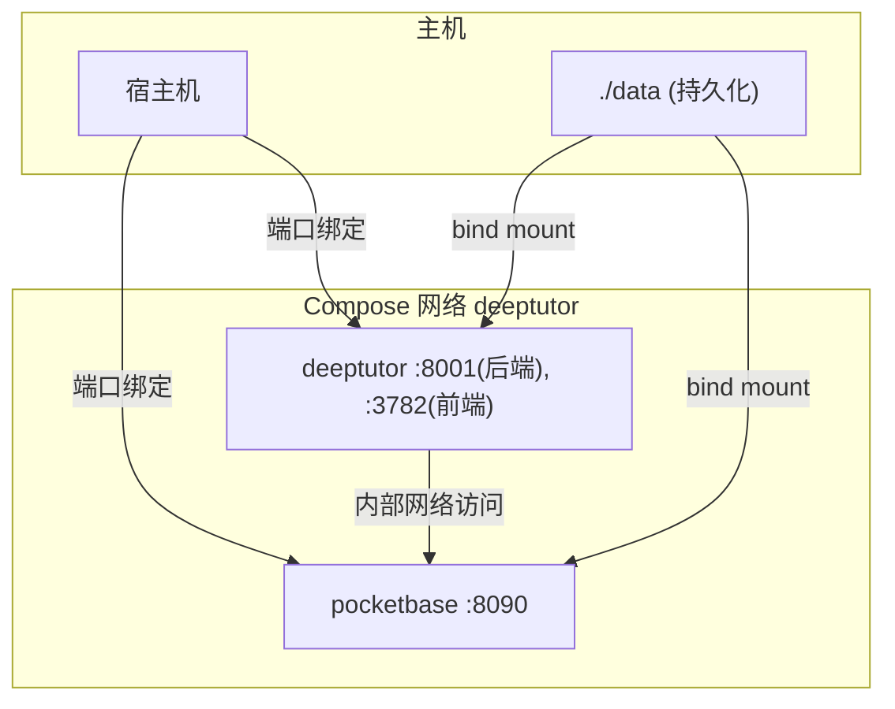
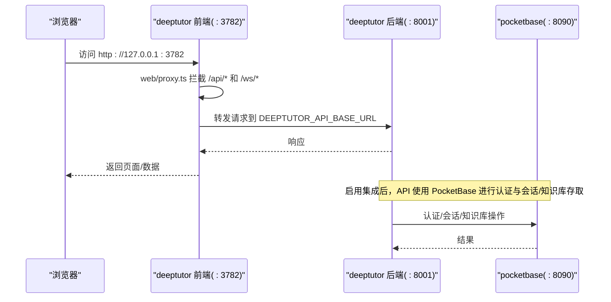
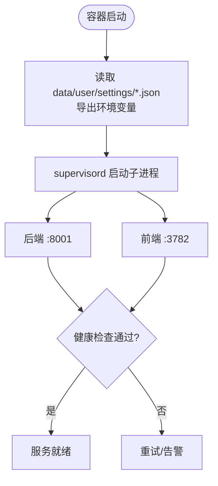
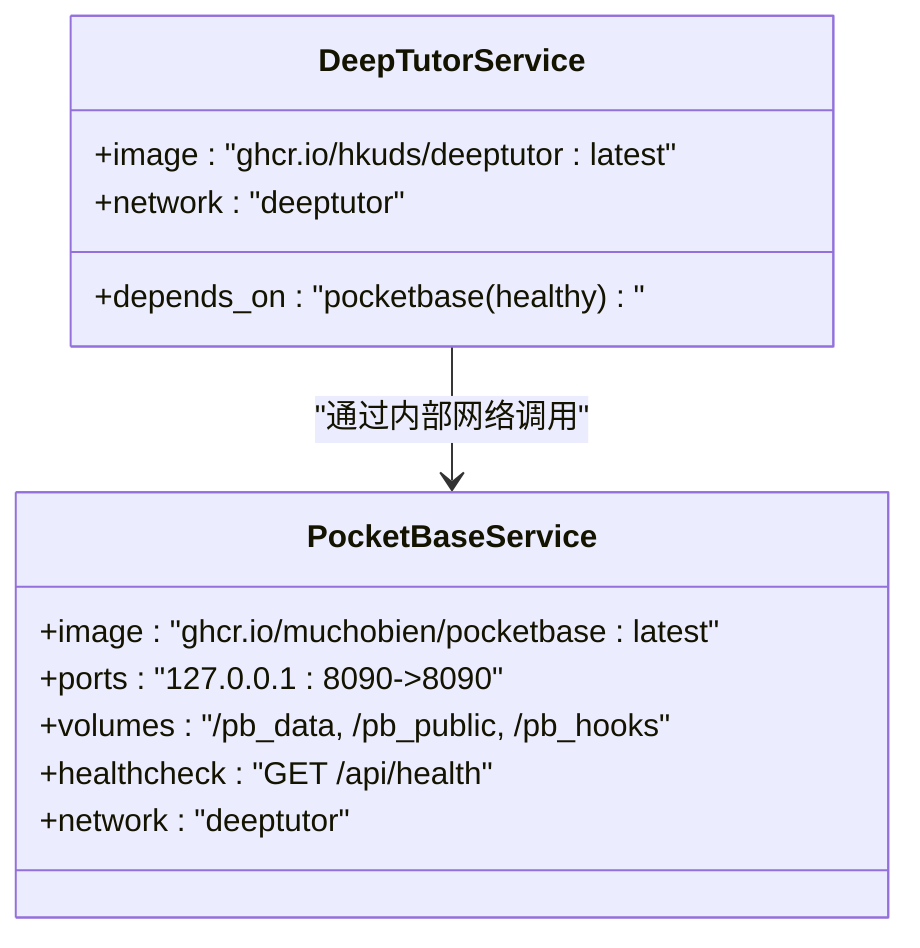
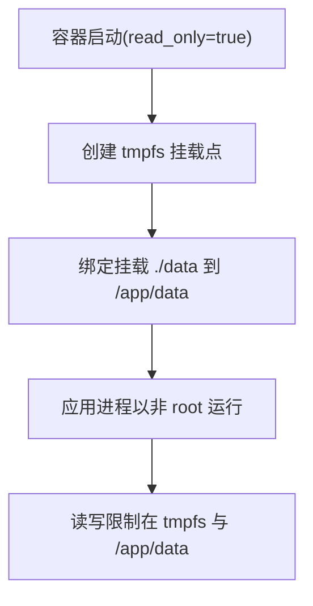
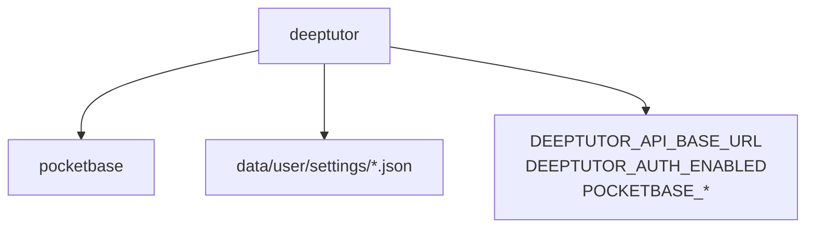

# 服务配置详解

<cite>
**本文引用的文件**
- [compose.yaml](file://compose.yaml)
- [docker-compose.yml](file://docker-compose.yml)
- [docker-compose.dev.yml](file://docker-compose.dev.yml)
- [CONTAINERIZATION.md](file://CONTAINERIZATION.md)
- [deeptutor/services/pocketbase_client.py](file://deeptutor/services/pocketbase_client.py)
- [deeptutor/services/config/runtime_settings.py](file://deeptutor/services/config/runtime_settings.py)
- [scripts/pb_setup.py](file://scripts/pb_setup.py)
</cite>

## 目录
1. [简介](#简介)
2. [项目结构](#项目结构)
3. [核心组件](#核心组件)
4. [架构总览](#架构总览)
5. [详细组件分析](#详细组件分析)
6. [依赖关系分析](#依赖关系分析)
7. [性能与安全考量](#性能与安全考量)
8. [故障排除指南](#故障排除指南)
9. [结论](#结论)
10. [附录：常见配置修改与排错清单](#附录：常见配置修改与排错清单)

## 简介
本文件聚焦于 DeepTutor 的 Docker Compose 服务配置，深入解释 compose.yaml 中定义的两个核心服务：
- deeptutor 主应用服务（后端 FastAPI + 前端 Next.js）
- pocketbase 认证存储服务（可选的多用户认证与会话/知识库存储侧车）

文档涵盖镜像、端口映射、数据卷挂载、环境变量、健康检查、网络与服务间通信，并重点说明 rootless 模式下的 userns_mode: keep-id、只读根文件系统安全设计以及 tmpfs 临时文件系统的目的与权限设置。同时提供常见配置项修改指南与故障排除方法。

## 项目结构
DeepTutor 提供多种运行形态：
- 单容器直跑（推荐快速体验）
- docker-compose 编排（含 PocketBase 与 sandbox-runner 侧车）
- Podman rootless + 只读根文件系统（compose.yaml 为默认安全起点）

图表来源
- [compose.yaml:67-182](file://compose.yaml#L67-L182)
- [docker-compose.yml:21-100](file://docker-compose.yml#L21-L100)

章节来源
- [compose.yaml:1-64](file://compose.yaml#L1-L64)
- [CONTAINERIZATION.md:13-32](file://CONTAINERIZATION.md#L13-L32)

## 核心组件
- deeptutor 服务
  - 镜像：ghcr.io/hkuds/deeptutor:latest
  - 角色：在同一容器内通过 supervisord 启动后端（FastAPI :8001）与前端（Next.js :3782），进程以非 root 用户运行
  - 端口：仅绑定到 127.0.0.1，避免暴露到局域网
  - 数据卷：将宿主 ./data 挂载至 /app/data，承载运行时设置、工作区、知识库、日志等
  - 环境变量：TZ；可选 POCKETBASE_URL/POCKETBASE_EXTERNAL_URL（注释示例）
  - 健康检查：curl 探测后端根路径
  - 依赖：pocketbase 必须 healthy 后才启动
  - 网络：加入 deeptutor 桥接网络

- pocketbase 服务
  - 镜像：ghcr.io/muchobien/pocketbase:latest
  - 角色：可选的多用户认证与会话/知识库存储侧车
  - 端口：仅绑定到 127.0.0.1
  - 数据卷：将宿主 ./data/pocketbase 的三个子目录分别挂载至 /pb_data、/pb_public、/pb_hooks
  - 健康检查：wget 探测 /api/health
  - 网络：加入 deeptutor 桥接网络

章节来源
- [compose.yaml:67-182](file://compose.yaml#L67-L182)

## 架构总览
DeepTutor 在 compose.yaml 中以“最小必要”原则编排两个服务：
- deeptutor 作为主服务，负责业务逻辑与 Web 界面
- pocketbase 作为可选侧车，提供多用户认证与会话/知识库存储

两者通过 Compose 内置网络相互发现与通信。deeptutor 通过运行时设置导出 DEEPTUTOR_API_BASE_URL，由前端代理在请求时转发 API/WebSocket 流量。

图表来源
- [compose.yaml:120-182](file://compose.yaml#L120-L182)
- [CONTAINERIZATION.md:33-51](file://CONTAINERIZATION.md#L33-L51)
- [deeptutor/services/config/runtime_settings.py:522-545](file://deeptutor/services/config/runtime_settings.py#L522-L545)

## 详细组件分析

### deeptutor 服务详解
- 镜像与运行方式
  - 使用 ghcr.io/hkuds/deeptutor:latest，包含后端与前端，由 supervisord 管理
  - 进程以非 root 用户运行，supervisord 子进程通过 user= 指令切换至 UID 1000
- 端口映射
  - 127.0.0.1:${HOST_PORT_BACKEND:-8001}:8001
  - 127.0.0.1:${HOST_PORT_FRONTEND:-3782}:3782
- 数据卷挂载
  - ./data:/app/data:U（:U 表示 chown 给 mapped UID，配合 keep-id）
- 环境变量
  - TZ=${TZ:-UTC}
  - 可选 POCKETBASE_URL、POCKETBASE_EXTERNAL_URL（注释示例）
- 健康检查
  - curl -fsS http://localhost:8001/
- 依赖关系
  - depends_on: pocketbase condition: service_healthy
- 网络
  - 加入 deeptutor 网络

图表来源
- [compose.yaml:120-182](file://compose.yaml#L120-L182)
- [CONTAINERIZATION.md:345-379](file://CONTAINERIZATION.md#L345-L379)

章节来源
- [compose.yaml:120-182](file://compose.yaml#L120-L182)
- [CONTAINERIZATION.md:345-379](file://CONTAINERIZATION.md#L345-L379)

### pocketbase 服务详解
- 镜像与运行方式
  - 使用 ghcr.io/muchobien/pocketbase:latest
- 端口映射
  - 127.0.0.1:${HOST_PORT_POCKETBASE:-8090}:8090
- 数据卷挂载
  - ./data/pocketbase:/pb_data:U
  - ./data/pocketbase/public:/pb_public:U
  - ./data/pocketbase/hooks:/pb_hooks:U
- 健康检查
  - wget --quiet --tries=1 --spider http://localhost:8090/api/health
- 网络
  - 加入 deeptutor 网络

图表来源
- [compose.yaml:74-111](file://compose.yaml#L74-L111)
- [compose.yaml:120-182](file://compose.yaml#L120-L182)

章节来源
- [compose.yaml:74-111](file://compose.yaml#L74-L111)

### Rootless 与只读根文件系统安全设计
- userns_mode: keep-id
  - 将容器内的 UID 映射回宿主用户的 UID，使得宿主创建的目录在容器内仍由当前用户拥有
  - 所有 volume 挂载均带 :U 后缀，自动 chown 给 mapped UID，避免权限问题
- read_only: true
  - 容器根文件系统只读，唯一可写区域为 tmpfs 与 bind mount 的 ./data
- tmpfs 临时文件系统
  - /tmp：Python/Node/Next.js/supervisord 的临时空间
  - /run、/var/run：标准运行时目录（pidfile 等）
  - /var/log：日志输出
  - /root、/home：兜底写入路径，防止意外写入
  - 各 tmpfs 设置了合理的 size 与 mode，确保必要的可写性与隔离性

图表来源
- [compose.yaml:28-33](file://compose.yaml#L28-L33)
- [compose.yaml:127-143](file://compose.yaml#L127-L143)
- [CONTAINERIZATION.md:250-294](file://CONTAINERIZATION.md#L250-L294)

章节来源
- [compose.yaml:28-33](file://compose.yaml#L28-L33)
- [compose.yaml:127-143](file://compose.yaml#L127-L143)
- [CONTAINERIZATION.md:250-294](file://CONTAINERIZATION.md#L250-L294)

### 环境变量与运行时配置
- 运行时配置统一来自 data/user/settings/*.json，容器入口会在每次启动时读取 JSON 并导出环境变量
- 关键变量
  - DEEPTUTOR_API_BASE_URL：由 next_public_api_base 或 next_public_api_base_external 决定，用于前端代理转发
  - DEEPTUTOR_AUTH_ENABLED：是否启用认证
  - POCKETBASE_*：PocketBase 集成相关 URL、端口、外部地址、管理员账号密码
- 注意：不要通过 Compose 的环境变量覆盖这些值，应编辑 JSON 后重启服务

章节来源
- [compose.yaml:49-62](file://compose.yaml#L49-L62)
- [CONTAINERIZATION.md:345-379](file://CONTAINERIZATION.md#L345-L379)
- [deeptutor/services/config/runtime_settings.py:522-545](file://deeptutor/services/config/runtime_settings.py#L522-L545)

### 网络与服务间通信机制
- 网络模型
  - 自定义 bridge 网络 deeptutor，服务间通过服务名解析互访
- 通信路径
  - 浏览器访问前端 :3782，前端代理将 /api/* 与 /ws/* 转发到后端 :8001
  - 启用集成后，后端通过内部网络访问 pocketbase:8090 进行认证与会话/知识库操作

图表来源
- [compose.yaml:198-200](file://compose.yaml#L198-L200)
- [compose.yaml:120-182](file://compose.yaml#L120-L182)
- [deeptutor/services/pocketbase_client.py:47-108](file://deeptutor/services/pocketbase_client.py#L47-L108)

章节来源
- [compose.yaml:198-200](file://compose.yaml#L198-L200)
- [deeptutor/services/pocketbase_client.py:47-108](file://deeptutor/services/pocketbase_client.py#L47-L108)

## 依赖关系分析
- deeptutor 依赖 pocketbase 健康状态
- 运行时配置依赖 JSON 文件，入口程序在启动时读取并导出环境变量
- PocketBase 客户端在首次使用时建立连接并缓存，支持令牌校验与缓存

图表来源
- [compose.yaml:178-182](file://compose.yaml#L178-L182)
- [deeptutor/services/config/runtime_settings.py:522-545](file://deeptutor/services/config/runtime_settings.py#L522-L545)
- [deeptutor/services/pocketbase_client.py:47-108](file://deeptutor/services/pocketbase_client.py#L47-L108)

章节来源
- [compose.yaml:178-182](file://compose.yaml#L178-L182)
- [deeptutor/services/config/runtime_settings.py:522-545](file://deeptutor/services/config/runtime_settings.py#L522-L545)
- [deeptutor/services/pocketbase_client.py:47-108](file://deeptutor/services/pocketbase_client.py#L47-L108)

## 性能与安全考量
- 性能
  - tmpfs 大小按需调整（如 /tmp、/var/log），避免过大影响内存占用
  - 健康检查间隔与超时合理设置，减少不必要的重试开销
- 安全
  - read_only 根文件系统 + tmpfs 限定可写范围
  - userns_mode: keep-id 降低逃逸风险（逃逸后仅为宿主普通用户权限）
  - 端口仅绑定 127.0.0.1，避免暴露到局域网
  - 不信任代码执行走 sandbox-runner（在 docker-compose.yml 中提供，compose.yaml 未包含）

[本节为通用指导，无需特定文件引用]

## 故障排除指南
- 常见问题
  - 无法写入 pidfile：确保 /tmp 或 /var/run 的 tmpfs 具备正确权限（mode=1777）
  - 页面加载但设置页提示“后端不可达”：检查后端是否启动成功及 DEEPTUTOR_API_BASE_URL 是否正确
  - 首次 JSON 写入权限被拒：使用 bind mount 而非命名卷，或使用 :U 后缀
  - 无法连接 Docker/Podman 守护进程：确认 podman socket 已启动或设置 DOCKER_HOST
  - 旧镜像 sed -i 报错：拉取最新镜像，不再需要构建期替换
  - 设置页不接受 API base URL：直接编辑 system.json 中的 next_public_api_base_external

章节来源
- [CONTAINERIZATION.md:406-439](file://CONTAINERIZATION.md#L406-L439)

## 结论
compose.yaml 提供了 DeepTutor 的安全默认部署形态：rootless、只读根文件系统、最小可写面、仅本地端口绑定、基于 JSON 的运行时配置。pocketbase 作为可选侧车，提供多用户认证与会话/知识库存储能力。通过合理的 tmpfs 与数据卷设计，既保证了安全性，又兼顾了可维护性与可观测性。

[本节为总结性内容，无需特定文件引用]

## 附录：常见配置修改与排错清单
- 修改端口
  - 在 data/user/settings/system.json 中修改 backend_port/frontend_port，并在 Compose 的 ports 映射中同步更新 HOST_PORT_* 环境变量
- 启用 PocketBase
  - 在 integrations.json 中设置 pocketbase_url 为 http://pocketbase:8090
  - 首次启动后运行 scripts/pb_setup.py 初始化集合
- 调整 tmpfs 大小
  - 根据负载调整 /tmp、/var/log 等 tmpfs 的 size
- 健康检查失败
  - 检查对应服务的健康检查命令与端口可达性
- 权限问题
  - 确保 volume 挂载带 :U 后缀，或在 rootful 环境下确保目录所有权一致

章节来源
- [compose.yaml:85-96](file://compose.yaml#L85-L96)
- [compose.yaml:144-157](file://compose.yaml#L144-L157)
- [scripts/pb_setup.py:1-42](file://scripts/pb_setup.py#L1-L42)
- [CONTAINERIZATION.md:364-379](file://CONTAINERIZATION.md#L364-L379)