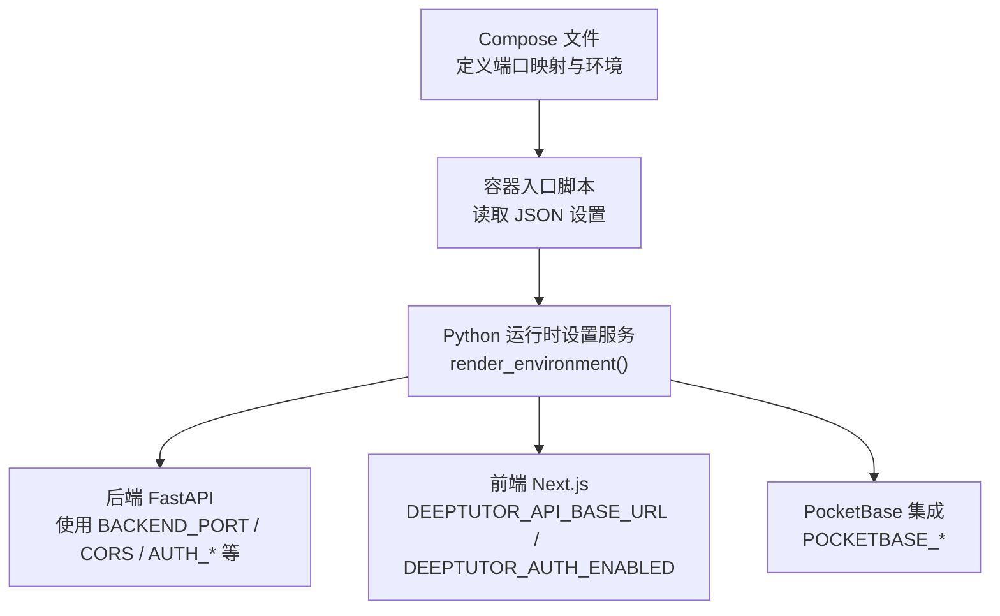
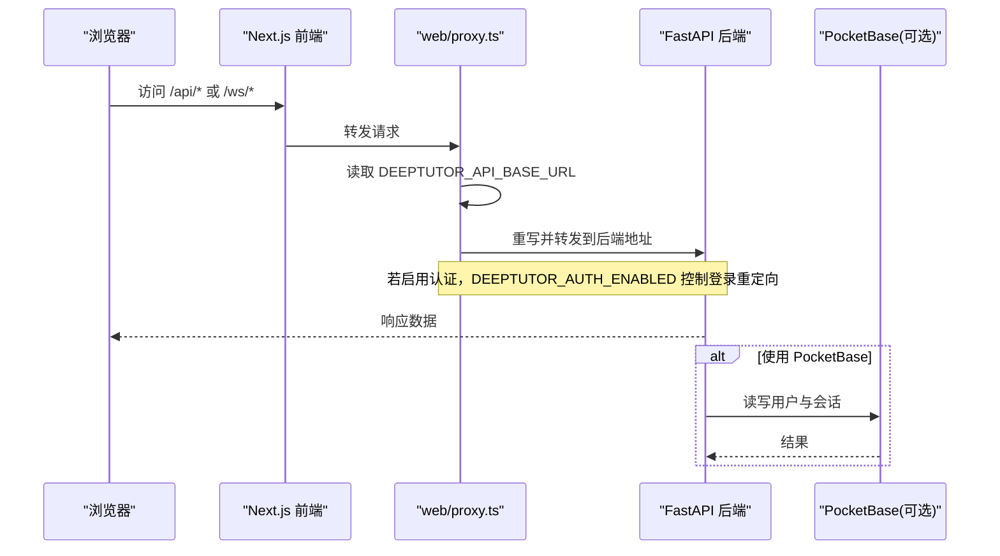
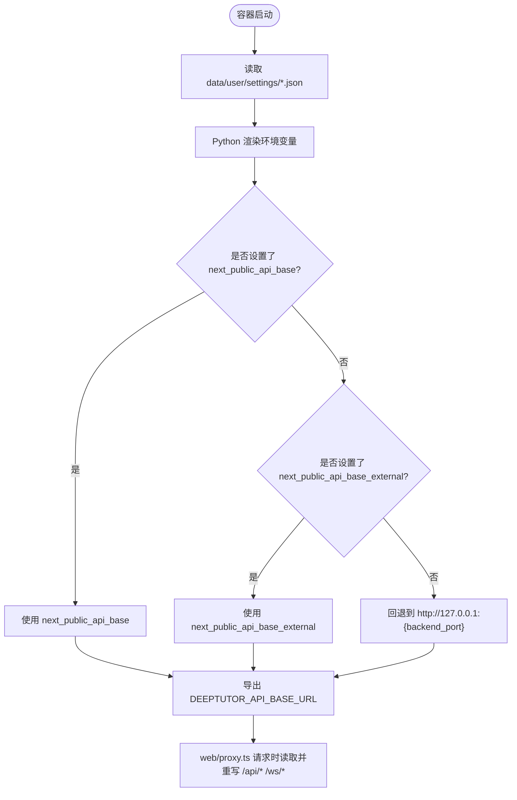
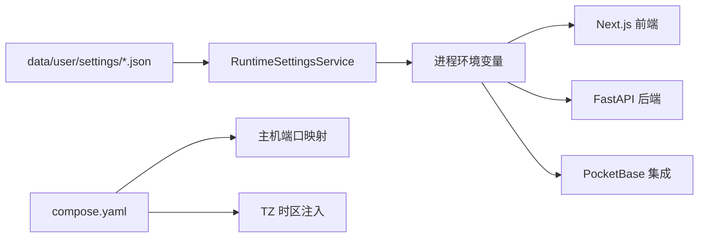

# 环境变量配置

<cite>
**本文引用的文件**
- [compose.yaml](file://compose.yaml)
- [Dockerfile](file://Dockerfile)
- [runtime_settings.py](file://deeptutor/services/config/runtime_settings.py)
- [docker_compose.py](file://scripts/docker_compose.py)
- [CONTAINERIZATION.md](file://CONTAINERIZATION.md)
</cite>

## 目录
1. [简介](#简介)
2. [项目结构](#项目结构)
3. [核心组件](#核心组件)
4. [架构总览](#架构总览)
5. [详细组件分析](#详细组件分析)
6. [依赖关系分析](#依赖关系分析)
7. [性能注意事项](#性能注意事项)
8. [故障排除指南](#故障排除指南)
9. [结论](#结论)
10. [附录](#附录)

## 简介
本参考文档聚焦 DeepTutor 的环境变量与运行时配置，覆盖端口、时区、PocketBase、API Base URL 动态加载机制、不同部署环境的配置示例，以及验证与故障排除方法。DeepTutor 的推荐做法是：通过 data/user/settings/*.json 管理运行期配置，容器启动时由入口脚本读取 JSON 并导出为进程环境变量；项目根目录的 .env 不被应用直接消费。

## 项目结构
- 运行时设置集中保存在 data/user/settings/ 下的 system.json、auth.json、integrations.json 等文件中。
- 容器镜像在启动阶段调用 Python 模块将 JSON 设置渲染为进程环境变量，供后端（FastAPI）和前端（Next.js）使用。
- Compose 文件负责主机端口映射与时区注入；可选 PocketBase 侧车提供多用户认证与存储。

**图示来源**
- [compose.yaml:145-167](file://compose.yaml#L145-L167)
- [Dockerfile:369-392](file://Dockerfile#L369-L392)
- [runtime_settings.py:500-546](file://deeptutor/services/config/runtime_settings.py#L500-L546)

**章节来源**
- [compose.yaml:145-167](file://compose.yaml#L145-L167)
- [Dockerfile:369-392](file://Dockerfile#L369-L392)
- [runtime_settings.py:500-546](file://deeptutor/services/config/runtime_settings.py#L500-L546)

## 核心组件
- 运行时设置服务：从 JSON 加载系统、认证、集成等配置，并将它们渲染为进程环境变量，供子进程与中间件使用。
- 容器入口脚本：在启动时卸载旧的环境变量，重新从 JSON 导出最新值，确保每次启动都“热更新”。
- Compose：暴露 HOST_PORT_BACKEND、HOST_PORT_FRONTEND、HOST_PORT_POCKETBASE 等主机端口，并注入 TZ 时区。
- Docker Compose 辅助脚本：根据 JSON 生成 docker.env，用于 compose 端口插值。

**章节来源**
- [runtime_settings.py:500-546](file://deeptutor/services/config/runtime_settings.py#L500-L546)
- [Dockerfile:369-392](file://Dockerfile#L369-L392)
- [compose.yaml:145-167](file://compose.yaml#L145-L167)
- [docker_compose.py:45-70](file://scripts/docker_compose.py#L45-L70)

## 架构总览
下图展示了请求从浏览器到后端的代理重写流程，以及环境变量如何影响该流程。

**图示来源**
- [runtime_settings.py:521-546](file://deeptutor/services/config/runtime_settings.py#L521-L546)
- [Dockerfile:382-392](file://Dockerfile#L382-L392)
- [compose.yaml:165-167](file://compose.yaml#L165-L167)

## 详细组件分析

### 端口与环境变量
- HOST_PORT_BACKEND：Compose 中后端对外端口，默认 8001。
- HOST_PORT_FRONTEND：Compose 中前端对外端口，默认 3782。
- HOST_PORT_POCKETBASE：Compose 中 PocketBase 对外端口，默认 8090。
- 这些主机端口通过 compose.yaml 的 ports 映射生效，并在健康检查中使用。

注意：
- 容器内部端口固定为 8001（后端）、3782（前端）、8090（PocketBase）。
- 如需修改，请同时调整 compose.yaml 的端口映射与 system.json 中的 backend_port/frontend_port。

**章节来源**
- [compose.yaml:86](file://compose.yaml#L86)
- [compose.yaml:145-146](file://compose.yaml#L145-L146)
- [compose.yaml:168-177](file://compose.yaml#L168-L177)

### 时区 TZ
- 通过 compose.yaml 注入 TZ，影响 Python 时间处理与 Next.js 启动时的本地化行为。
- 建议设置为 IANA 时区字符串（如 Asia/Shanghai），避免使用非标准缩写。

**章节来源**
- [compose.yaml:159-160](file://compose.yaml#L159-L160)

### PocketBase 集成
- integrations.json 中可配置 pocketbase_url、pocketbase_port、pocketbase_external_url、管理员邮箱与密码。
- 运行时设置服务会将这些值导出为 POCKETBASE_URL、POCKETBASE_PORT、POCKETBASE_EXTERNAL_URL、POCKETBASE_ADMIN_EMAIL、POCKETBASE_ADMIN_PASSWORD。
- 容器可通过注释掉的 environment 行启用 PocketBase，或在 integrations.json 中设置 pocketbase_url 指向网络内服务名。

用途说明：
- POCKETBASE_URL：容器内后端访问 PocketBase 的地址。
- POCKETBASE_EXTERNAL_URL：外部客户端访问 PocketBase 的地址（例如反向代理后的域名）。

**章节来源**
- [runtime_settings.py:60-67](file://deeptutor/services/config/runtime_settings.py#L60-L67)
- [runtime_settings.py:541-545](file://deeptutor/services/config/runtime_settings.py#L541-L545)
- [runtime_settings.py:661-673](file://deeptutor/services/config/runtime_settings.py#L661-L673)
- [compose.yaml:165-167](file://compose.yaml#L165-L167)

### DEEPTUTOR_API_BASE_URL 的动态加载机制
- 该变量不是构建时占位符，而是每次启动由入口脚本调用 Python 模块从 JSON 设置导出。
- 优先级：system.next_public_api_base > system.next_public_api_base_external > 回退到 http://127.0.0.1:{backend_port}。
- web/proxy.ts 在请求时读取该变量，将 /api/* 与 /ws/* 重写至后端地址；同时使用 DEEPTUTOR_AUTH_ENABLED 控制登录重定向。
- 因此，修改 system.json 后重启服务即可生效，无需重建前端包。

**图示来源**
- [runtime_settings.py:521-546](file://deeptutor/services/config/runtime_settings.py#L521-L546)
- [Dockerfile:369-392](file://Dockerfile#L369-L392)

**章节来源**
- [runtime_settings.py:521-546](file://deeptutor/services/config/runtime_settings.py#L521-L546)
- [Dockerfile:369-392](file://Dockerfile#L369-L392)
- [CONTAINERIZATION.md:364-379](file://CONTAINERIZATION.md#L364-L379)

### 不同部署环境的环境变量配置示例
- 开发环境（本地 Podman/Docker Compose）
  - 设置 TZ=Asia/Shanghai（或本机时区）。
  - 保持默认端口或使用 HOST_PORT_* 自定义主机端口。
  - 如需多用户认证，启用 PocketBase 并在 integrations.json 中设置 pocketbase_url。
- 测试环境（CI/CD 或隔离容器）
  - 通过 data/user/settings/system.json 指定 next_public_api_base_external 为测试域。
  - 关闭或限制认证（AUTH_ENABLED=false），便于自动化测试。
- 生产环境（反向代理/云托管）
  - 设置 next_public_api_base_external 为公网域名。
  - 开启认证（AUTH_ENABLED=true），并配置安全 Cookie 与令牌过期策略。
  - 如需 PocketBase，设置 POCKETBASE_EXTERNAL_URL 为外部可达地址。

提示：
- 所有运行期配置优先编辑 data/user/settings/*.json，然后重启服务。
- 项目根目录的 .env 不会被应用直接消费；Compose 仅用于端口映射与时区注入。

**章节来源**
- [compose.yaml:145-167](file://compose.yaml#L145-L167)
- [CONTAINERIZATION.md:364-379](file://CONTAINERIZATION.md#L364-L379)
- [runtime_settings.py:500-546](file://deeptutor/services/config/runtime_settings.py#L500-L546)

### 通过配置文件动态更新运行时的环境变量
- 入口脚本在每次启动时执行 Python 模块，将 JSON 设置导出为进程环境变量，覆盖旧值。
- 这意味着修改 system.json、auth.json、integrations.json 后，只需重启服务即可生效。
- Docker Compose 辅助脚本会基于 JSON 生成 docker.env，用于端口插值，避免手动维护 .env。

**章节来源**
- [Dockerfile:369-392](file://Dockerfile#L369-L392)
- [docker_compose.py:45-70](file://scripts/docker_compose.py#L45-L70)

## 依赖关系分析
- 运行时设置服务是环境变量渲染的核心，被容器入口脚本调用。
- Compose 负责将主机端口映射到容器内部固定端口，并注入 TZ。
- PocketBase 作为可选侧车，通过 integrations.json 与 POCKETBASE_* 环境变量接入。

**图示来源**
- [runtime_settings.py:500-546](file://deeptutor/services/config/runtime_settings.py#L500-L546)
- [compose.yaml:145-167](file://compose.yaml#L145-L167)

**章节来源**
- [runtime_settings.py:500-546](file://deeptutor/services/config/runtime_settings.py#L500-L546)
- [compose.yaml:145-167](file://compose.yaml#L145-L167)

## 性能注意事项
- 端口范围校验：后端与前端端口会被限制在合法范围内，避免非法值导致服务无法启动。
- 附件大小与 WebSocket 帧上限：受系统设置与 uvicorn 启动参数共同影响，过大附件可能需要重启以刷新帧上限。
- 时区一致性：确保 TZ 与业务预期一致，避免日志与调度任务出现时间偏差。

**章节来源**
- [runtime_settings.py:277-285](file://deeptutor/services/config/runtime_settings.py#L277-L285)
- [Dockerfile:474-475](file://Dockerfile#L474-L475)

## 故障排除指南
- API 重写失败（/api/* 或 /ws/* 无法到达后端）
  - 检查 DEEPTUTOR_API_BASE_URL 是否正确（优先 next_public_api_base，其次 next_public_api_base_external，最后回退到 127.0.0.1:{backend_port}）。
  - 确认后端绑定 IPv4 且端口正确；避免使用 localhost 在双栈环境下解析为 ::1 的问题。
- 认证跳转异常
  - 检查 DEEPTUTOR_AUTH_ENABLED 是否与期望一致；必要时在 integrations.json 中启用 PocketBase。
- 端口冲突
  - 修改 system.json 中的 backend_port/frontend_port，并同步更新 compose.yaml 的 HOST_PORT_* 映射。
- PocketBase 不可达
  - 确认 integrations.json 中 pocketbase_url 指向容器网络内的服务名；外部访问需设置 POCKETBASE_EXTERNAL_URL。
- 时区不正确
  - 检查 compose.yaml 中 TZ 设置；确保与业务区域一致。

**章节来源**
- [runtime_settings.py:521-546](file://deeptutor/services/config/runtime_settings.py#L521-L546)
- [compose.yaml:159-167](file://compose.yaml#L159-L167)
- [CONTAINERIZATION.md:364-379](file://CONTAINERIZATION.md#L364-L379)

## 结论
DeepTutor 的环境变量体系围绕 data/user/settings/*.json 构建，容器启动时统一渲染为进程环境变量，保证前后端与集成服务的一致性。端口、时区、PocketBase 与 API Base URL 的配置均遵循“编辑 JSON + 重启”的原则，既简化了部署，又避免了构建期占位符带来的复杂性。

## 附录
- 关键环境变量清单（按用途分组）
  - 端口相关
    - HOST_PORT_BACKEND：主机后端端口映射（默认 8001）
    - HOST_PORT_FRONTEND：主机前端端口映射（默认 3782）
    - HOST_PORT_POCKETBASE：主机 PocketBase 端口映射（默认 8090）
  - 时区
    - TZ：系统时区（影响 Python 与 Next.js）
  - PocketBase
    - POCKETBASE_URL：容器内后端访问地址
    - POCKETBASE_PORT：容器内 PocketBase 端口
    - POCKETBASE_EXTERNAL_URL：外部访问地址
    - POCKETBASE_ADMIN_EMAIL / POCKETBASE_ADMIN_PASSWORD：管理员凭据
  - API 与认证
    - DEEPTUTOR_API_BASE_URL：前端代理重写后端地址（动态加载）
    - DEEPTUTOR_AUTH_ENABLED：是否启用认证（控制登录重定向）

**章节来源**
- [compose.yaml:86](file://compose.yaml#L86)
- [compose.yaml:145-167](file://compose.yaml#L145-L167)
- [runtime_settings.py:500-546](file://deeptutor/services/config/runtime_settings.py#L500-L546)
- [Dockerfile:369-392](file://Dockerfile#L369-L392)