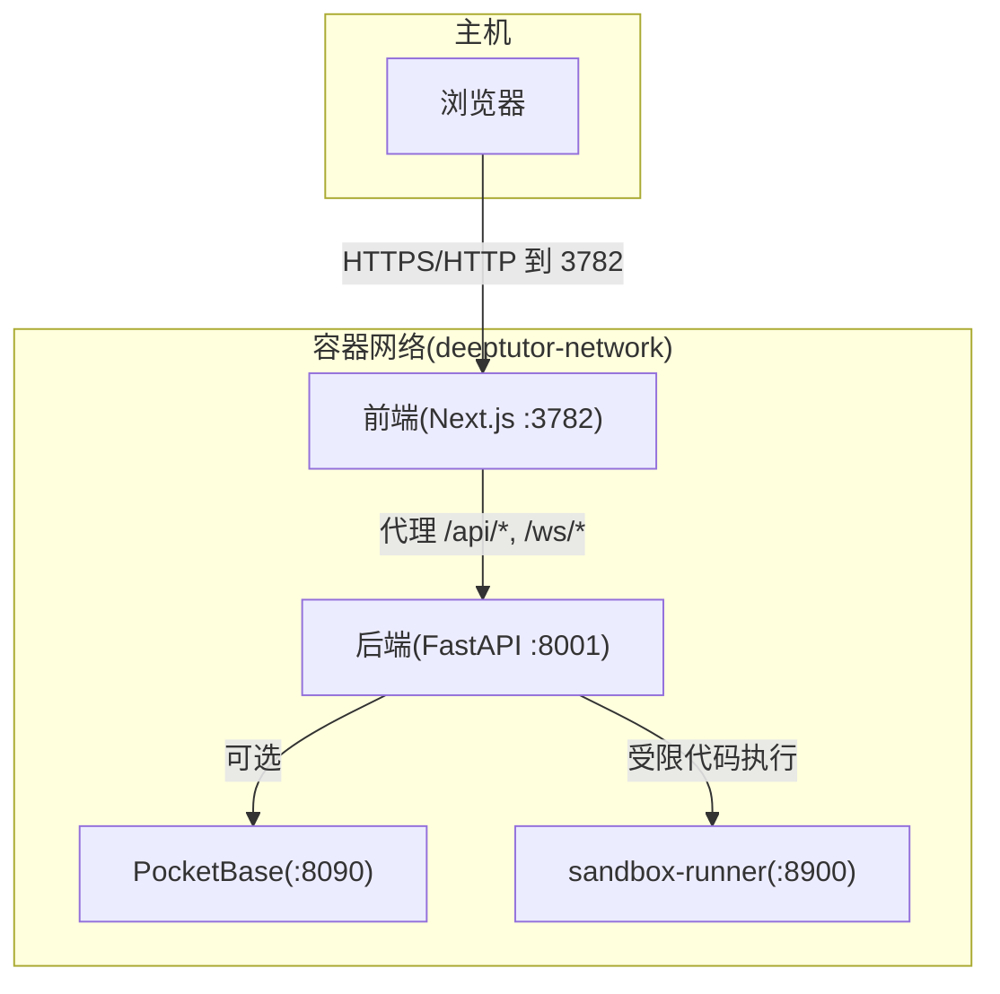
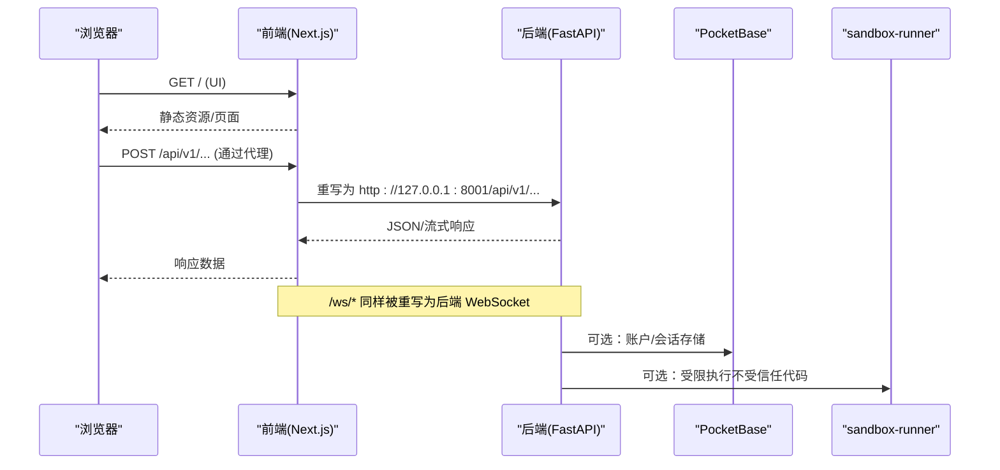
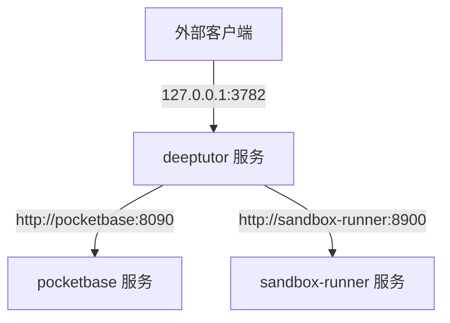
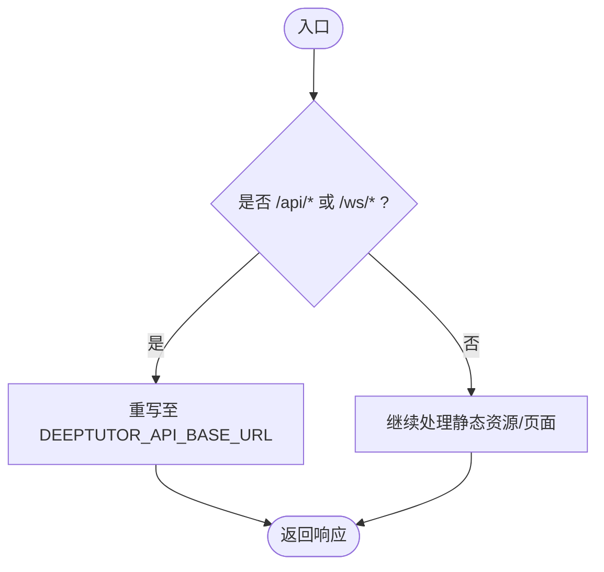
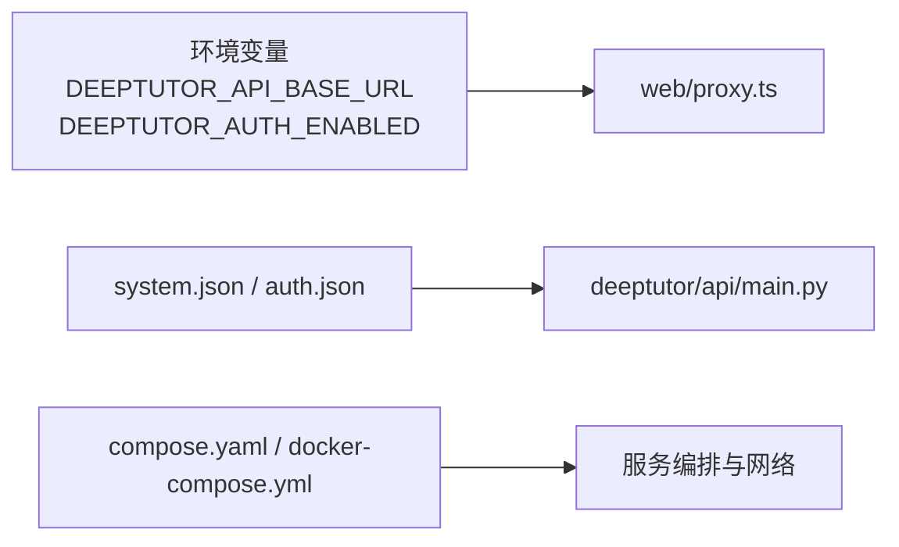

# 网络与安全配置

<cite>
**本文引用的文件**
- [compose.yaml](file://compose.yaml)
- [docker-compose.yml](file://docker-compose.yml)
- [Dockerfile](file://Dockerfile)
- [CONTAINERIZATION.md](file://CONTAINERIZATION.md)
- [web/proxy.ts](file://web/proxy.ts)
- [web/lib/api.ts](file://web/lib/api.ts)
- [deeptutor/api/main.py](file://deeptutor/api/main.py)
- [deeptutor/api/routers/settings.py](file://deeptutor/api/routers/settings.py)
- [tests/api/test_cors_settings.py](file://tests/api/test_cors_settings.py)
- [assets/README/README_ES.md](file://assets/README/README_ES.md)
</cite>

## 目录
1. [简介](#简介)
2. [项目结构](#项目结构)
3. [核心组件](#核心组件)
4. [架构总览](#架构总览)
5. [详细组件分析](#详细组件分析)
6. [依赖关系分析](#依赖关系分析)
7. [性能考虑](#性能考虑)
8. [故障排查指南](#故障排查指南)
9. [结论](#结论)
10. [附录](#附录)

## 简介
本文件聚焦 DeepTutor 的网络与安全配置，覆盖以下主题：
- bridge 网络模式与服务间通信机制
- localhost（127.0.0.1）绑定安全策略与外部访问扩展
- rootless 容器环境下的网络安全要点
- 只读根文件系统（read_only: true）的安全优势
- tmpfs 临时文件系统的权限控制与安全隔离
- 防火墙规则建议与网络安全最佳实践
- 生产环境部署的网络优化建议

## 项目结构
DeepTutor 提供三种运行形态：
- 单容器直跑（docker run）
- Docker Compose（含 PocketBase 与 sandbox-runner 侧车）
- Podman Compose（rootless + 只读根文件系统）

关键编排与安全要点：
- compose.yaml：默认使用 bridge 网络、loopback 端口绑定、read_only 根文件系统、tmpfs 写入面、userns_mode: keep-id。
- docker-compose.yml：包含 sandbox-runner 侧车，用于执行不受信任的代码；仅内部网络可达。
- Dockerfile：定义后端（FastAPI）与前端（Next.js）进程以非 root 用户运行，supervisord 管理进程生命周期。
- web/proxy.ts：在请求时根据 DEEPTUTOR_API_BASE_URL 将 /api/* 和 /ws/* 重写至后端，避免前端打包期硬编码后端地址。

图表来源
- [compose.yaml:198-200](file://compose.yaml#L198-L200)
- [docker-compose.yml:177-183](file://docker-compose.yml#L177-L183)
- [Dockerfile:231-259](file://Dockerfile#L231-L259)

章节来源
- [compose.yaml:1-63](file://compose.yaml#L1-L63)
- [docker-compose.yml:1-19](file://docker-compose.yml#L1-L19)
- [Dockerfile:101-126](file://Dockerfile#L101-L126)

## 核心组件
- 前端代理（web/proxy.ts）：读取 DEEPTUTOR_API_BASE_URL，将 /api/* 与 /ws/* 重写至后端；同时实现登录态校验与重定向。
- 后端 CORS 设置（deeptutor/api/main.py）：根据 system.json 与 auth.json 动态构建允许的来源列表。
- 运行时设置导出（deeptutor/api/routers/settings.py）：聚合系统设置并暴露给前端 UI。
- 容器编排（compose.yaml/docker-compose.yml）：定义 bridge 网络、端口映射、只读根文件系统、tmpfs 挂载、服务依赖与健康检查。
- 沙箱侧车（docker-compose.yml）：隔离执行不受信任代码，限制资源与权限。

章节来源
- [web/proxy.ts:13-23](file://web/proxy.ts#L13-L23)
- [web/proxy.ts:42-71](file://web/proxy.ts#L42-L71)
- [deeptutor/api/main.py:85-101](file://deeptutor/api/main.py#L85-L101)
- [deeptutor/api/routers/settings.py:505-534](file://deeptutor/api/routers/settings.py#L505-L534)
- [compose.yaml:120-182](file://compose.yaml#L120-L182)
- [docker-compose.yml:101-175](file://docker-compose.yml#L101-L175)

## 架构总览
下图展示典型部署中浏览器、前端代理、后端、可选的 PocketBase 以及沙箱侧车的交互路径。

图表来源
- [web/proxy.ts:42-56](file://web/proxy.ts#L42-L56)
- [docker-compose.yml:101-175](file://docker-compose.yml#L101-L175)
- [compose.yaml:120-182](file://compose.yaml#L120-L182)

## 详细组件分析

### Bridge 网络模式与服务间通信
- 网络驱动：bridge 模式为各服务提供隔离的私有网络，服务间通过服务名解析互访。
- 服务发现：pocketbase 与 deeptutor 在同一网络下可通过服务名互通；sandbox-runner 仅在内部网络可达，不对外暴露端口。
- 健康检查：各服务定义 healthcheck，确保依赖就绪后再启动。

图表来源
- [compose.yaml:198-200](file://compose.yaml#L198-L200)
- [docker-compose.yml:177-183](file://docker-compose.yml#L177-L183)

章节来源
- [compose.yaml:67-182](file://compose.yaml#L67-L182)
- [docker-compose.yml:21-175](file://docker-compose.yml#L21-L175)

### localhost（127.0.0.1）绑定安全策略与外部访问扩展
- 默认策略：所有对外端口均以 127.0.0.1 前缀绑定，仅本机可访问，避免意外暴露到局域网或公网。
- 扩展外部访问：
  - 移除 127.0.0.1 前缀以在所有接口上监听（需配合反向代理/防火墙）。
  - 使用反向代理（Nginx/Traefik）终止 TLS，并将 /api/* 与 /ws/* 转发至后端。
  - 远程部署时，浏览器与服务器不在同一主机，需通过 SSH 隧道或反向代理桥接回调路径。
- 前端代理：web/proxy.ts 在请求时读取 DEEPTUTOR_API_BASE_URL，将 API/WS 请求重写至后端，无需在浏览器端直接访问后端端口。

图表来源
- [web/proxy.ts:42-56](file://web/proxy.ts#L42-L56)
- [web/lib/api.ts:1-38](file://web/lib/api.ts#L1-L38)

章节来源
- [compose.yaml:28-49](file://compose.yaml#L28-L49)
- [CONTAINERIZATION.md:171-199](file://CONTAINERIZATION.md#L171-L199)
- [assets/README/README_ES.md:495-507](file://assets/README/README_ES.md#L495-L507)

### rootless 容器环境下的网络安全考虑
- userns_mode: keep-id：容器内 UID 映射到宿主用户，即使逃逸也仅获得宿主用户权限，降低风险。
- read_only: true：根文件系统不可写，仅允许 tmpfs 与 bind mount 的数据目录写入，减少持久化攻击面。
- 最小权限：应用进程以非 root 用户（UID 1000）运行；supervisord 作为 PID 1 保持必要能力以派生子进程。
- 侧车隔离：sandbox-runner 仅内部网络可达，且具备严格的资源限制与只读根文件系统。

章节来源
- [compose.yaml:28-49](file://compose.yaml#L28-L49)
- [CONTAINERIZATION.md:250-342](file://CONTAINERIZATION.md#L250-L342)
- [docker-compose.yml:146-165](file://docker-compose.yml#L146-L165)

### 只读根文件系统（read_only: true）的安全优势
- 防止运行时篡改镜像层文件，降低恶意注入与持久化后门风险。
- 明确可写面：仅 tmpfs 与数据卷可写，便于审计与容量规划。
- 与 rootless 结合：进一步缩小潜在影响范围。

章节来源
- [compose.yaml:28-49](file://compose.yaml#L28-L49)
- [CONTAINERIZATION.md:268-293](file://CONTAINERIZATION.md#L268-L293)

### tmpfs 临时文件系统的权限控制与安全隔离
- 用途：为 Python/Node/Next.js/supervisord 等提供临时写入空间（/tmp、/run、/var/run、/var/log、/root、/home）。
- 权限模型：通过 mode 参数控制访问权限（如 1777 世界可写、0755 仅所有者可写），限制敏感路径的写入范围。
- 隔离效果：临时数据不会持久化到宿主机，重启即清理，避免残留敏感信息。

章节来源
- [compose.yaml:127-143](file://compose.yaml#L127-L143)
- [CONTAINERIZATION.md:278-281](file://CONTAINERIZATION.md#L278-L281)

### 防火墙规则建议与网络安全最佳实践
- 端口暴露原则：
  - 仅暴露必要的 Web 端口（默认 3782），后端端口（8001）通常不需要对外暴露。
  - 若需调试 API，仅对 127.0.0.1 暴露，并通过反向代理访问。
- 反向代理：
  - 在代理层启用 HTTPS、HSTS、CSP、X-Frame-Options 等安全头。
  - 限制请求大小、超时与并发，防止滥用。
- 源白名单：
  - 在 system.json 中精确配置 cors_origins，避免通配符。
  - 测试用例验证了开启认证后必须显式指定来源。
- 回调与 OAuth：
  - 本地开发可使用临时端口桥接；远程部署通过 SSH 隧道或反向代理桥接回调路径，避免公开回调端口。

章节来源
- [tests/api/test_cors_settings.py:10-39](file://tests/api/test_cors_settings.py#L10-L39)
- [CONTAINERIZATION.md:93-144](file://CONTAINERIZATION.md#L93-L144)
- [assets/README/README_ES.md:495-507](file://assets/README/README_ES.md#L495-L507)

### 生产环境部署的网络配置优化建议
- 单一入口：仅暴露前端端口（3782），由反向代理统一处理 TLS 与路由。
- 拆分部署：如需分离前后端，设置 next_public_api_base 为容器内可达的后端地址，并确保代理正确转发 /api/* 与 /ws/*。
- 资源限制：为容器设置 CPU/内存/PID 限制，防止资源耗尽。
- 日志与监控：集中收集日志，设置告警阈值；定期审查访问日志与错误日志。
- 密钥管理：敏感配置（如模型 API Key、JWT 密钥）应通过安全的密钥管理服务注入，避免明文落盘。

章节来源
- [CONTAINERIZATION.md:171-199](file://CONTAINERIZATION.md#L171-L199)
- [compose.yaml:183-196](file://compose.yaml#L183-L196)

## 依赖关系分析
- 前端代理依赖环境变量 DEEPTUTOR_API_BASE_URL 与 DEEPTUTOR_AUTH_ENABLED，这些变量由容器入口从 data/user/settings/*.json 导出。
- 后端 CORS 设置依赖 system.json 与 auth.json，动态计算允许的源。
- 编排文件定义了服务间的网络依赖与健康检查顺序。

图表来源
- [web/proxy.ts:13-23](file://web/proxy.ts#L13-L23)
- [deeptutor/api/main.py:85-101](file://deeptutor/api/main.py#L85-L101)
- [compose.yaml:198-200](file://compose.yaml#L198-L200)

章节来源
- [web/lib/api.ts:1-38](file://web/lib/api.ts#L1-L38)
- [deeptutor/api/routers/settings.py:505-534](file://deeptutor/api/routers/settings.py#L505-L534)

## 性能考虑
- 连接复用：uvicorn 与前端代理均使用合理的 keep-alive 超时，避免空闲连接过早关闭导致的请求失败。
- 大消息支持：WebSocket 最大帧大小根据附件策略动态计算，避免上传被截断。
- 资源限制：在生产环境中为容器设置 pids_limit、mem_limit、cpus，防止资源争用。

章节来源
- [Dockerfile:281-292](file://Dockerfile#L281-L292)
- [compose.yaml:183-196](file://compose.yaml#L183-L196)

## 故障排查指南
- 后端不可达：检查前端代理是否正确重写 /api/* 与 /ws/*；确认 DEEPTUTOR_API_BASE_URL 指向正确的后端地址。
- 端口冲突：使用脚本检测并提示占用端口，必要时自动释放或更换端口。
- 权限问题：rootless keep-id 下，确保数据目录为宿主用户所有；必要时使用 :U 后缀进行 chown。
- 回调失败：远程部署时使用 SSH 隧道或反向代理桥接回调路径，确保回调端口仅对本地回环暴露。

章节来源
- [CONTAINERIZATION.md:406-439](file://CONTAINERIZATION.md#L406-L439)
- [assets/README/README_ES.md:495-507](file://assets/README/README_ES.md#L495-L507)

## 结论
DeepTutor 在网络与安全方面采用“默认最小暴露”的策略：
- 使用 bridge 网络隔离服务间通信，仅通过内部网络访问敏感服务。
- 默认以 127.0.0.1 绑定端口，避免意外暴露；外部访问通过反向代理与隧道实现。
- rootless + read_only + tmpfs 的组合显著降低运行时攻击面。
- 前端代理解耦后端地址，简化部署与迁移。
- 生产环境应结合反向代理、CORS 白名单、资源限制与日志监控，形成完整的安全基线。

## 附录
- 快速参考：
  - 仅暴露前端端口：-p 127.0.0.1:3782:3782
  - 需要调试 API：-p 127.0.0.1:8001:8001（仅限本机）
  - 远程回调桥接：SSH 隧道或反向代理，确保回调端口仅对本地回环暴露
  - 只读根文件系统：--read-only 或 compose.yaml 中的 read_only: true
  - tmpfs 写入面：/tmp、/run、/var/run、/var/log、/root、/home

章节来源
- [CONTAINERIZATION.md:56-92](file://CONTAINERIZATION.md#L56-L92)
- [compose.yaml:120-182](file://compose.yaml#L120-L182)