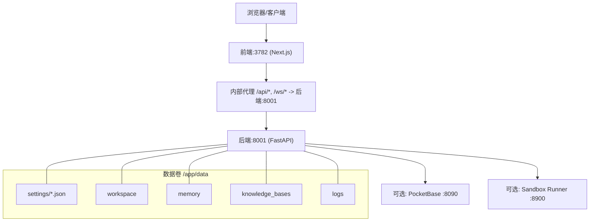
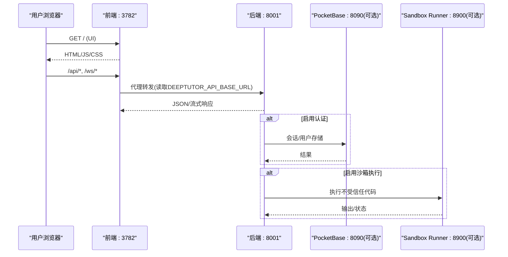
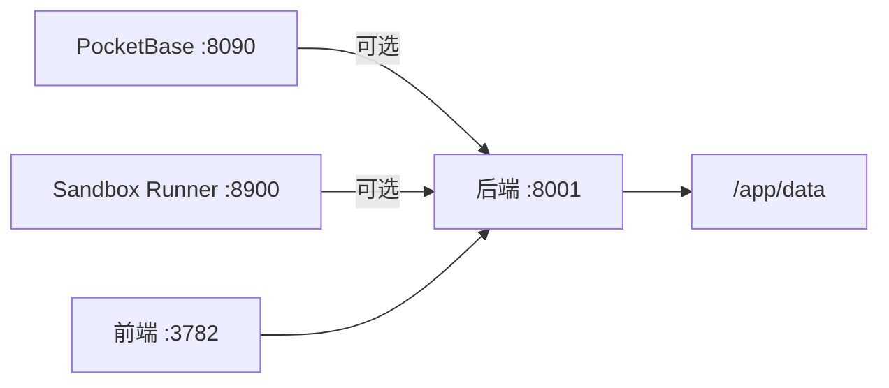

# Docker部署

<cite>
**本文引用的文件**
- [Dockerfile](file://Dockerfile)
- [Dockerfile.runner](file://Dockerfile.runner)
- [compose.yaml](file://compose.yaml)
- [docker-compose.yml](file://docker-compose.yml)
- [docker-compose.dev.yml](file://docker-compose.dev.yml)
- [compose.codex-oauth.yaml](file://compose.codex-oauth.yaml)
- [CONTAINERIZATION.md](file://CONTAINERIZATION.md)
- [scripts/docker_compose.py](file://scripts/docker_compose.py)
- [deeptutor/services/config/runtime_settings.py](file://deeptutor/services/config/runtime_settings.py)
</cite>

## 目录
1. [简介](#简介)
2. [项目结构](#项目结构)
3. [核心组件](#核心组件)
4. [架构总览](#架构总览)
5. [详细组件分析](#详细组件分析)
6. [依赖关系分析](#依赖关系分析)
7. [性能与安全](#性能与安全)
8. [故障排查](#故障排查)
9. [结论](#结论)
10. [附录：常用命令与配置清单](#附录：常用命令与配置清单)

## 简介
本指南面向使用容器化方式部署 DeepTutor 的运维与开发者，覆盖单容器运行、多容器编排（含 PocketBase 与沙箱执行器）、数据持久化、网络与反向代理、本地 LLM 集成（Ollama、LM Studio 等）、生产安全加固、资源限制、健康检查、日志与监控等主题。文档基于仓库中的镜像构建脚本、Compose 配置与运行时设置逻辑整理而成，确保与实际代码一致。

## 项目结构
DeepTutor 提供三种主要部署形态：
- 单容器：一个镜像同时包含 FastAPI 后端与 Next.js 前端，由 supervisord 管理进程。
- Compose（Docker）：主服务 + PocketBase（可选）+ sandbox-runner（可选）。
- Podman（rootless）：只读根文件系统 + tmpfs 临时目录 + 宿主目录绑定挂载。

图表来源
- [Dockerfile:174-189](file://Dockerfile#L174-L189)
- [compose.yaml:147-157](file://compose.yaml#L147-L157)
- [docker-compose.yml:65-74](file://docker-compose.yml#L65-L74)

章节来源
- [Dockerfile:1-504](file://Dockerfile#L1-L504)
- [compose.yaml:1-207](file://compose.yaml#L1-L207)
- [docker-compose.yml:1-183](file://docker-compose.yml#L1-L183)
- [CONTAINERIZATION.md:1-468](file://CONTAINERIZATION.md#L1-L468)

## 核心组件
- 镜像与进程模型
  - 单镜像内通过 supervisord 启动两个子进程：后端（uvicorn）与前端（Next.js standalone）。
  - 默认暴露端口：后端 8001，前端 3782。
  - 健康检查：对后端根路径发起 HTTP 探测。
- 数据持久化
  - 所有用户数据、配置、工作区、知识库、内存、日志统一位于容器内 /app/data，需绑定到宿主机或命名卷。
- 运行时配置
  - 入口脚本在启动时从 data/user/settings/*.json 加载并导出环境变量，供前后端使用；不依赖 .env 文件。
- 可选侧车
  - PocketBase：用于认证与会话存储（可选）。
  - Sandbox Runner：隔离执行不受信任的代码（可选，推荐生产使用）。

章节来源
- [Dockerfile:218-259](file://Dockerfile#L218-L259)
- [Dockerfile:264-315](file://Dockerfile#L264-L315)
- [Dockerfile:317-439](file://Dockerfile#L317-L439)
- [Dockerfile:414-436](file://Dockerfile#L414-L436)
- [compose.yaml:67-197](file://compose.yaml#L67-L197)
- [docker-compose.yml:21-183](file://docker-compose.yml#L21-L183)
- [CONTAINERIZATION.md:13-52](file://CONTAINERIZATION.md#L13-L52)

## 架构总览
下图展示了单容器与多容器的典型交互：浏览器仅访问前端端口，前端通过内置代理将 API 与 WebSocket 请求转发到同容器内的后端；可选的 PocketBase 与 Sandbox Runner 作为侧车提供服务。

图表来源
- [Dockerfile:264-315](file://Dockerfile#L264-L315)
- [Dockerfile:317-439](file://Dockerfile#L317-L439)
- [compose.yaml:120-197](file://compose.yaml#L120-L197)
- [docker-compose.yml:51-183](file://docker-compose.yml#L51-L183)

## 详细组件分析

### 单容器部署（docker run）
- 用途：快速体验与开发测试。
- 端口映射：建议仅暴露前端 3782；后端 8001 仅在需要直接调用 API 时暴露。
- 数据卷：将 /app/data 持久化到宿主机或命名卷。
- 健康检查：镜像自带 healthcheck，可配合 docker inspect 查看。
- 反向代理：只需将外部域名指向 3782；前端会按请求时间将 /api/* 和 /ws/* 转发到后端。

章节来源
- [CONTAINERIZATION.md:56-91](file://CONTAINERIZATION.md#L56-L91)
- [Dockerfile:430-439](file://Dockerfile#L430-L439)

### 多容器编排（Docker Compose）
- 服务组成
  - deeptutor：后端+前端，绑定 data 目录，健康检查后端根路径。
  - pocketbase：可选，用于认证与会话存储。
  - sandbox-runner：可选，隔离执行不受信任代码，仅内部网络可达。
- 端口映射：可通过环境变量控制宿主端口，默认后端 8001、前端 3782、PocketBase 8090。
- 数据卷：
  - deeptutor 挂载 ./data:/app/data。
  - pocketbase 挂载 /pb_data、/pb_public、/pb_hooks。
  - sandbox-runner 挂载 workspace、users、cli-apps（只读）。
- 网络：bridge 网络，服务间通过服务名通信。
- 依赖：deeptutor 依赖 pocketbase 与 sandbox-runner 健康就绪。

章节来源
- [docker-compose.yml:21-183](file://docker-compose.yml#L21-L183)

### Podman rootless 部署（compose.yaml）
- 特点
  - read_only: true，仅允许 tmpfs 与绑定挂载写入。
  - userns_mode: keep-id，保持宿主 UID 映射。
  - 端口绑定默认仅 127.0.0.1，避免暴露到局域网。
  - 不使用命名卷（避免 UID 映射导致权限问题），改用宿主目录绑定。
- 数据卷：./data:/app/data:U（自动 chown 到宿主 UID）。
- 健康检查：对后端根路径 curl 探测。

章节来源
- [compose.yaml:1-207](file://compose.yaml#L1-L207)

### 数据持久化与目录布局
- 关键目录
  - data/user/settings：运行时配置（system.json、auth.json、integrations.json、model_catalog.json 等）。
  - data/user/workspace：用户工作区（聊天、笔记、协作等）。
  - data/memory：记忆数据。
  - data/knowledge_bases：知识库。
  - data/user/logs：日志。
- 首次启动会自动创建必要目录；entrypoint 会 chown 给非 root 用户。

章节来源
- [Dockerfile:174-189](file://Dockerfile#L174-L189)
- [Dockerfile:356-367](file://Dockerfile#L356-L367)
- [CONTAINERIZATION.md:345-379](file://CONTAINERIZATION.md#L345-L379)

### 网络设置与反向代理
- 单容器模式
  - 浏览器访问 :3782；前端通过 web/proxy.ts 将 /api/* 与 /ws/* 转发到后端（默认 http://127.0.0.1:8001）。
  - 反向代理只需监听 :3782，无需暴露 :8001。
- 拆分部署（后端独立容器）
  - 在 system.json 中设置 next_public_api_base 为前端容器能访问的后端地址。
  - entrypoint 会导出 DEEPTUTOR_API_BASE_URL 供前端代理使用。
- CORS
  - 使用前端 origins 控制，可在 system.json 中配置 cors_origins。

章节来源
- [CONTAINERIZATION.md:171-209](file://CONTAINERIZATION.md#L171-L209)
- [Dockerfile:317-409](file://Dockerfile#L317-L409)
- [deeptutor/services/config/runtime_settings.py:500-546](file://deeptutor/services/config/runtime_settings.py#L500-L546)

### 环境变量与运行时配置
- 入口脚本会重置一系列环境变量并从 JSON 重新导出，因此应以编辑 JSON 为主，而非通过 compose env 传递。
- 重要导出变量
  - BACKEND_PORT、FRONTEND_PORT：后端与前端端口。
  - NEXT_PUBLIC_API_BASE、NEXT_PUBLIC_API_BASE_EXTERNAL：前端公开 API 基址。
  - DEEPTUTOR_API_BASE_URL：前端服务器侧使用的后端地址（用于代理转发）。
  - AUTH_ENABLED、DEEPTUTOR_AUTH_ENABLED：是否启用认证。
  - POCKETBASE_*：PocketBase 相关配置。
- Compose 端口渲染
  - scripts/docker_compose.py 会从 system.json/integrations.json 生成 docker.env，注入 DEEPTUTOR_DOCKER_*_PORT。

章节来源
- [Dockerfile:317-409](file://Dockerfile#L317-L409)
- [deeptutor/services/config/runtime_settings.py:500-546](file://deeptutor/services/config/runtime_settings.py#L500-L546)
- [scripts/docker_compose.py:45-77](file://scripts/docker_compose.py#L45-L77)

### 与本地 LLM 服务集成（Ollama、LM Studio 等）
- Docker 环境下 localhost 指向容器自身，应使用 host.docker.internal 或通过 --add-host 添加 host-gateway。
- 在 Settings → Models 中将 provider base_url 指向 host.docker.internal 对应端口。
- Linux 下也可使用 --network=host 模式，此时可直接用 localhost，但需注意绑定地址与防火墙策略。

章节来源
- [CONTAINERIZATION.md:210-247](file://CONTAINERIZATION.md#L210-L247)

### 安全配置与最小权限
- 非 root 运行：supervisord 子进程以 deeptutor 用户运行。
- 只读根文件系统：Podman 模式下启用 read_only，并通过 tmpfs 提供必要的可写路径。
- 沙箱执行：推荐使用 sandbox-runner 隔离不受信任代码；或在 system.json 中调整 sandbox_allow_subprocess。
- 认证：启用 auth.json 后，前端代理会根据 DEEPTUTOR_AUTH_ENABLED 决定是否要求登录。
- 网络安全：Compose 默认仅绑定 127.0.0.1；如需外网访问请显式放开。

章节来源
- [Dockerfile:191-200](file://Dockerfile#L191-L200)
- [compose.yaml:28-48](file://compose.yaml#L28-L48)
- [docker-compose.yml:101-175](file://docker-compose.yml#L101-L175)
- [CONTAINERIZATION.md:443-467](file://CONTAINERIZATION.md#L443-L467)

### 性能优化与资源限制
- 内存与进程限制
  - Podman 示例中可开启 pids_limit、mem_limit、cpus 等资源限制（cgroup v2 生效）。
- 附件大小与 WS 帧上限
  - 启动脚本根据系统设置动态计算 ws-max-size，避免大附件被截断。
- 连接保持
  - uvicorn 的 keep-alive 超时与前端代理保持一致，减少连接竞争导致的错误。
- 只读根文件系统与 tmpfs 容量
  - 合理设置 tmpfs 大小，避免频繁写入导致 IO 压力。

章节来源
- [compose.yaml:183-197](file://compose.yaml#L183-L197)
- [Dockerfile:281-292](file://Dockerfile#L281-L292)
- [Dockerfile:470-498](file://Dockerfile#L470-L498)

### 健康检查、日志与监控
- 健康检查
  - 镜像内置 healthcheck 探测后端根路径。
  - Compose/Podman 也定义了各自的健康检查。
- 日志
  - supervisord 子进程输出到 stdout/stderr，可通过 docker logs 或 podman logs 收集。
  - 应用层日志写入 data/user/logs。
- 监控建议
  - 结合容器平台指标（CPU、内存、磁盘 IO）与日志聚合系统进行监控告警。

章节来源
- [Dockerfile:414-436](file://Dockerfile#L414-L436)
- [compose.yaml:168-177](file://compose.yaml#L168-L177)
- [docker-compose.yml:85-90](file://docker-compose.yml#L85-L90)

## 依赖关系分析
- 服务依赖
  - deeptutor 依赖 pocketbase（若启用）与 sandbox-runner（若启用）的健康状态。
- 数据依赖
  - 所有运行时配置与用户数据集中在 /app/data，需保证持久化与权限正确。
- 网络依赖
  - 前端通过 DEEPTUTOR_API_BASE_URL 将 /api/* 与 /ws/* 转发到后端；拆分部署时需确保该地址可达。

图表来源
- [docker-compose.yml:92-99](file://docker-compose.yml#L92-L99)
- [compose.yaml:178-182](file://compose.yaml#L178-L182)
- [Dockerfile:174-189](file://Dockerfile#L174-L189)

章节来源
- [docker-compose.yml:51-183](file://docker-compose.yml#L51-L183)
- [compose.yaml:120-197](file://compose.yaml#L120-L197)

## 性能与安全
- 性能
  - 合理设置附件大小上限与 WS 帧上限，避免大文件传输失败。
  - 使用只读根文件系统与 tmpfs 提升稳定性与安全性。
  - 在生产环境启用资源限制（pids_limit、mem_limit、cpus）。
- 安全
  - 启用认证与 CORS 白名单。
  - 使用 sandbox-runner 隔离不受信任代码执行。
  - 仅暴露必要端口，优先绑定 127.0.0.1。

章节来源
- [compose.yaml:183-197](file://compose.yaml#L183-L197)
- [docker-compose.yml:148-175](file://docker-compose.yml#L148-L175)
- [CONTAINERIZATION.md:443-467](file://CONTAINERIZATION.md#L443-L467)

## 故障排查
- 常见症状
  - “Backend unreachable”：通常是后端未启动或拆分部署时 DEEPTUTOR_API_BASE_URL 配置错误。
  - 首次 JSON 写入权限错误：Podman 命名卷 UID 映射导致，改用宿主目录绑定或使用 :U 后缀。
  - pidfile 写入失败：旧镜像可能写入 /var/run，新镜像已改为 /tmp/supervisord.pid。
- 处理建议
  - 查看容器日志定位后端启动失败原因。
  - 确认 system.json 中 next_public_api_base_external 与端口映射一致。
  - 在 Podman 中使用宿主目录绑定并确保拥有者匹配。

章节来源
- [CONTAINERIZATION.md:406-439](file://CONTAINERIZATION.md#L406-L439)

## 结论
DeepTutor 的容器化方案提供了灵活且安全的部署选项：单容器适合快速上手，Compose 与 Podman 支持更复杂的生产场景。通过数据持久化、网络与反向代理的正确配置、本地 LLM 集成以及安全加固与资源限制，可以在不同环境中稳定运行。建议在生产环境采用只读根文件系统、sandbox-runner 隔离执行、启用认证与 CORS 白名单，并结合日志与监控系统进行运维保障。

## 附录：常用命令与配置清单

- 单容器运行
  - 仅暴露前端端口，数据持久化到命名卷或宿主目录。
  - 健康检查与日志通过容器平台获取。

- Compose（Docker）
  - 使用 scripts/docker_compose.py 自动生成端口环境变量。
  - 按需启用 pocketbase 与 sandbox-runner。

- Podman（rootless）
  - 使用 compose.yaml，启用 read_only 与 userns_mode: keep-id。
  - 端口默认仅绑定 127.0.0.1。

- 本地 LLM 集成
  - 使用 host.docker.internal 或 --network=host 模式。
  - 在 Settings → Models 中配置 provider base_url。

- 反向代理
  - 仅需监听前端端口；前端会代理 /api/* 与 /ws/* 到后端。
  - 拆分部署时在 system.json 设置 next_public_api_base。

- 健康检查与日志
  - 使用容器平台健康检查与日志收集。
  - 应用日志位于 data/user/logs。

章节来源
- [CONTAINERIZATION.md:56-247](file://CONTAINERIZATION.md#L56-L247)
- [docker-compose.yml:1-183](file://docker-compose.yml#L1-L183)
- [compose.yaml:1-207](file://compose.yaml#L1-L207)
- [scripts/docker_compose.py:1-113](file://scripts/docker_compose.py#L1-L113)