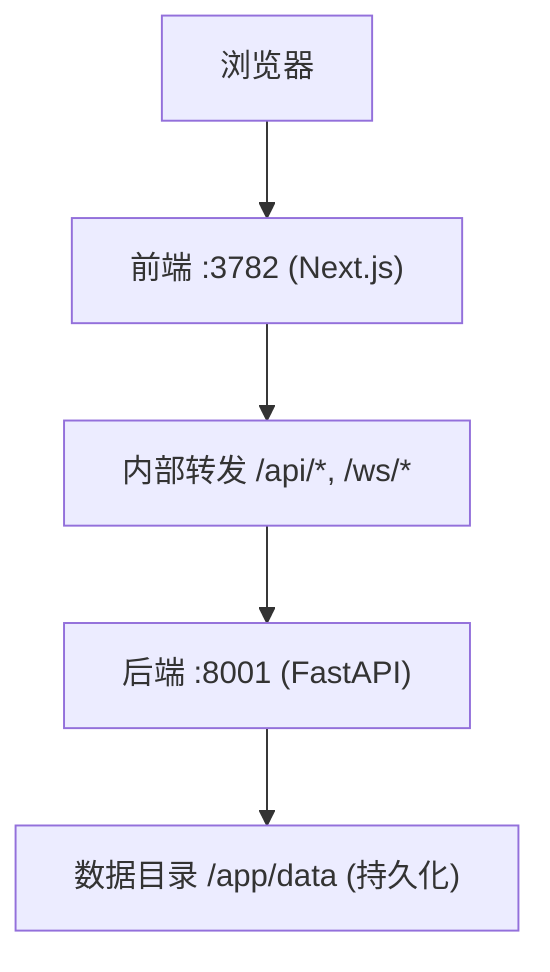
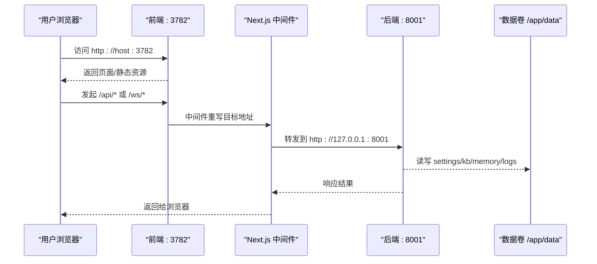
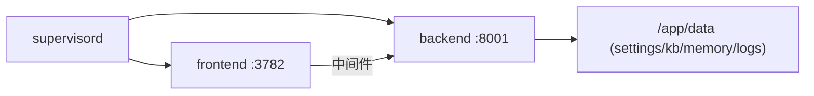

# 单容器部署

<cite>
**本文引用的文件**
- [Dockerfile](file://Dockerfile)
- [compose.yaml](file://compose.yaml)
- [docker-compose.yml](file://docker-compose.yml)
- [CONTAINERIZATION.md](file://CONTAINERIZATION.md)
- [runtime_settings.py](file://deeptutor/services/config/runtime_settings.py)
- [main.py](file://deeptutor/api/main.py)
</cite>

## 目录
1. [简介](#简介)
2. [项目结构](#项目结构)
3. [核心组件](#核心组件)
4. [架构总览](#架构总览)
5. [详细组件分析](#详细组件分析)
6. [依赖关系分析](#依赖关系分析)
7. [性能考虑](#性能考虑)
8. [故障排查指南](#故障排查指南)
9. [结论](#结论)
10. [附录](#附录)

## 简介
本指南面向希望使用官方镜像 ghcr.io/hkuds/deeptutor:latest 进行“单容器”快速部署的用户。你将学会：
- 使用 docker run 启动 DeepTutor，并理解端口映射（前端 3782、后端 8001）
- 通过数据卷挂载实现配置、知识库、记忆等持久化
- 在反向代理（Nginx/Apache）后安全暴露服务
- 连接本地 LLM 服务（Ollama、LM Studio 等），包括 host.docker.internal 与 Linux 环境替代方案
- 生产环境的优化与安全加固建议

## 项目结构
DeepTutor 的官方镜像将 FastAPI 后端与 Next.js 前端打包在同一容器中，由 supervisord 管理两个进程：
- 后端：FastAPI，默认监听 8001
- 前端：Next.js 独立模式，默认监听 3782
- 入口脚本负责加载运行时设置（JSON）、导出环境变量、启动 supervisord

图表来源
- [Dockerfile:234-259](file://Dockerfile#L234-L259)
- [Dockerfile:264-315](file://Dockerfile#L264-L315)
- [Dockerfile:317-410](file://Dockerfile#L317-L410)

章节来源
- [Dockerfile:17-190](file://Dockerfile#L17-L190)
- [Dockerfile:234-315](file://Dockerfile#L234-L315)
- [Dockerfile:317-410](file://Dockerfile#L317-L410)

## 核心组件
- 镜像构建与运行
  - 多阶段构建：前端静态资源 + Python 依赖 + 生产镜像
  - 进程管理：supervisord 管理 backend/frontend 子进程
  - 健康检查：对后端根路径做 HTTP 探测
- 运行时配置
  - 所有运行时设置位于 data/user/settings/*.json
  - 入口脚本每次启动从 JSON 导出环境变量，供前后端使用
- 端口与网络
  - 前端 3782：对外暴露的主要入口
  - 后端 8001：可选暴露；UI 通过容器内中间件转发到后端

章节来源
- [Dockerfile:101-190](file://Dockerfile#L101-L190)
- [Dockerfile:234-315](file://Dockerfile#L234-L315)
- [Dockerfile:317-410](file://Dockerfile#L317-L410)
- [runtime_settings.py:15-42](file://deeptutor/services/config/runtime_settings.py#L15-L42)
- [runtime_settings.py:500-546](file://deeptutor/services/config/runtime_settings.py#L500-L546)

## 架构总览
下图展示了单容器部署下的请求流转与数据持久化路径。

图表来源
- [Dockerfile:264-315](file://Dockerfile#L264-L315)
- [Dockerfile:317-410](file://Dockerfile#L317-L410)
- [runtime_settings.py:500-546](file://deeptutor/services/config/runtime_settings.py#L500-L546)

## 详细组件分析

### 快速部署（docker run）
- 基本命令要点
  - 镜像：ghcr.io/hkuds/deeptutor:latest
  - 端口：至少映射 3782；8001 可选（仅用于直接调用 API 或调试）
  - 数据卷：将宿主目录或命名卷挂载到 /app/data，确保配置、知识库、记忆、日志等持久化
- 典型用法
  - 使用命名卷：适合快速体验，重启不丢数据
  - 绑定宿主目录：便于编辑 settings/*.json 和备份

说明
- 首次启动会在 /app/data/user/settings 下生成 system.json、auth.json、integrations.json、model_catalog.json 等
- 通过 Web 设置页或直接编辑 JSON 调整模型提供商、端口、CORS 等

章节来源
- [CONTAINERIZATION.md:56-91](file://CONTAINERIZATION.md#L56-L91)
- [Dockerfile:174-190](file://Dockerfile#L174-L190)
- [Dockerfile:317-410](file://Dockerfile#L317-L410)

### 端口说明
- 3782（前端）：必须暴露给宿主或反向代理，浏览器只与前端通信
- 8001（后端）：可选暴露；UI 通过容器内中间件将 /api/*、/ws/* 转发到后端，无需对外暴露 8001

注意
- 若修改了 system.json 中的 frontend_port/backend_port，需同步更新 -p 映射右侧容器端口

章节来源
- [Dockerfile:264-315](file://Dockerfile#L264-L315)
- [Dockerfile:430-436](file://Dockerfile#L430-L436)
- [CONTAINERIZATION.md:73-87](file://CONTAINERIZATION.md#L73-L87)

### 数据持久化
- 关键目录
  - /app/data/user/settings：运行时设置（system.json、auth.json、integrations.json、model_catalog.json 等）
  - /app/data/knowledge_bases：知识库
  - /app/data/memory：记忆数据
  - /app/data/user/workspace：工作区（聊天、笔记、协作等）
  - /app/data/user/logs：日志
- 推荐挂载方式
  - 命名卷：简单快捷，适合单机体验
  - 绑定宿主目录：便于备份与外部工具编辑

章节来源
- [Dockerfile:174-190](file://Dockerfile#L174-L190)
- [CONTAINERIZATION.md:17-21](file://CONTAINERIZATION.md#L17-L21)
- [CONTAINERIZATION.md:146-169](file://CONTAINERIZATION.md#L146-L169)

### 反向代理（Nginx/Apache）
- 单容器场景通常只需将域名/TLS 终止指向 3782 即可
- 需要 WebSocket 支持时，确保代理转发 Upgrade 头
- CORS 配置应基于前端“源”（origin），而非 API URL

提示
- 若采用“拆分部署”（后端与前端在不同容器/主机），需在 system.json 中设置 next_public_api_base，使前端服务器能到达后端

章节来源
- [CONTAINERIZATION.md:171-209](file://CONTAINERIZATION.md#L171-L209)
- [main.py:85-101](file://deeptutor/api/main.py#L85-L101)

### 连接本地 LLM（Ollama、LM Studio 等）
- Docker Desktop（macOS/Windows）
  - 使用 host.docker.internal 作为 Base URL
  - 示例：http://host.docker.internal:11434/v1（Ollama）
- Linux 环境
  - 方案一：添加 --add-host=host.docker.internal:host-gateway，再使用 host.docker.internal
  - 方案二：使用 --network=host，此时容器共享宿主机网络，可直接用 localhost 访问宿主服务；同时可设置 BACKEND_HOST/FRONTEND_HOST=127.0.0.1 限制监听范围

注意
- 在 bridge 模式下不要将后端/前端绑定到 127.0.0.1，否则会破坏端口映射

章节来源
- [CONTAINERIZATION.md:210-247](file://CONTAINERIZATION.md#L210-L247)
- [compose.yaml:158-167](file://compose.yaml#L158-L167)

### 生产环境优化与安全加固
- 最小暴露面
  - 仅暴露 3782；8001 仅在调试时暴露
- 反向代理
  - 启用 HTTPS、HSTS、限流、WAF
  - 正确转发 WebSocket 升级头
- 资源限制
  - 为容器设置 CPU/内存/PID 限制，避免资源耗尽
- 只读根文件系统（Podman 推荐）
  - read_only: true + tmpfs 写入必要系统目录
  - userns_mode: keep-id 配合 :U 挂载，保证权限一致
- 认证与 CORS
  - 开启 auth 后，设置 cors_origins 为精确的前端源
- 健康检查与自恢复
  - 使用 HEALTHCHECK 与 restart policy 提升可用性

章节来源
- [compose.yaml:120-197](file://compose.yaml#L120-L197)
- [CONTAINERIZATION.md:250-343](file://CONTAINERIZATION.md#L250-L343)
- [CONTAINERIZATION.md:443-468](file://CONTAINERIZATION.md#L443-L468)

## 依赖关系分析
- 进程依赖
  - supervisord 启动 backend/frontend 两个子进程
  - 前端通过中间件将 /api/*、/ws/* 转发到后端
- 配置依赖
  - 入口脚本读取 data/user/settings/*.json 并导出环境变量
  - 后端根据 system.json 决定端口、CORS、附件策略等
- 网络依赖
  - 前端与后端在同一容器内通过 127.0.0.1 通信
  - 外部仅与前端交互（3782）

图表来源
- [Dockerfile:234-259](file://Dockerfile#L234-L259)
- [Dockerfile:317-410](file://Dockerfile#L317-L410)
- [runtime_settings.py:500-546](file://deeptutor/services/config/runtime_settings.py#L500-L546)

章节来源
- [Dockerfile:234-315](file://Dockerfile#L234-L315)
- [runtime_settings.py:500-546](file://deeptutor/services/config/runtime_settings.py#L500-L546)

## 性能考虑
- 前端静态资源已预构建，生产镜像以 standalone 模式运行，减少运行时开销
- uvicorn 启动参数动态计算 WS 帧大小与 Keep-Alive 超时，适配大附件上传
- 合理设置附件大小上限与字符预算，避免上下文过大影响推理速度
- 在生产环境中限制容器资源（CPU/内存/PID），防止异常负载拖垮主机

章节来源
- [Dockerfile:159-164](file://Dockerfile#L159-L164)
- [Dockerfile:264-293](file://Dockerfile#L264-L293)
- [runtime_settings.py:31-42](file://deeptutor/services/config/runtime_settings.py#L31-L42)

## 故障排查指南
- 页面加载但“后端不可达”
  - 检查后端是否启动成功（查看容器日志）
  - 确认 DEEPTUTOR_API_BASE_URL 是否正确（拆分部署时）
- 无法写入 settings 文件
  - 使用绑定宿主目录并确保权限正确；或使用 :U 挂载（Podman）
- 端口冲突
  - 修改 system.json 中的端口并重启容器；或停止占用进程
- 本地 LLM 连接失败
  - Docker Desktop 使用 host.docker.internal；Linux 使用 --add-host 或 --network=host

章节来源
- [CONTAINERIZATION.md:406-440](file://CONTAINERIZATION.md#L406-L440)
- [compose.yaml:168-177](file://compose.yaml#L168-L177)

## 结论
使用官方镜像进行单容器部署非常简便：只需映射 3782 端口并挂载 /app/data 即可运行。后端 8001 端口可选暴露，主要用于调试或直连 API。通过 system.json 统一管理运行时配置，结合反向代理、认证与资源限制，即可满足生产环境的安全与稳定性需求。连接本地 LLM 时，推荐使用 host.docker.internal（macOS/Windows）或 --network=host（Linux）。

## 附录

### 常用命令参考
- 使用命名卷快速启动
  - 镜像：ghcr.io/hkuds/deeptutor:latest
  - 端口：-p 127.0.0.1:3782:3782
  - 数据卷：-v deeptutor-data:/app/data
- 使用宿主目录持久化
  - 将宿主目录绑定到 /app/data，便于编辑 settings/*.json 与备份

章节来源
- [CONTAINERIZATION.md:56-91](file://CONTAINERIZATION.md#L56-L91)

### 反向代理要点
- 仅将域名/TLS 终止指向 3782
- 确保 WebSocket 升级头被正确转发
- 设置 CORS 为前端源的精确匹配

章节来源
- [CONTAINERIZATION.md:171-209](file://CONTAINERIZATION.md#L171-L209)
- [main.py:85-101](file://deeptutor/api/main.py#L85-L101)

### 本地 LLM 连接速查
- macOS/Windows（Docker Desktop）
  - Base URL 使用 host.docker.internal
- Linux
  - 方案一：--add-host=host.docker.internal:host-gateway
  - 方案二：--network=host，并使用 localhost

章节来源
- [CONTAINERIZATION.md:210-247](file://CONTAINERIZATION.md#L210-L247)