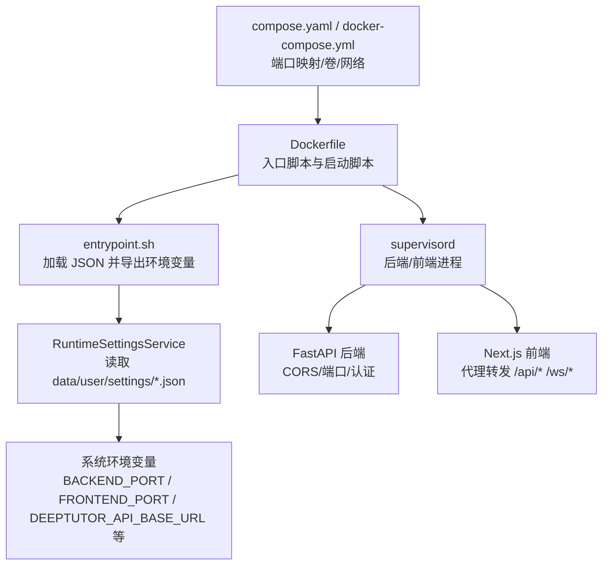
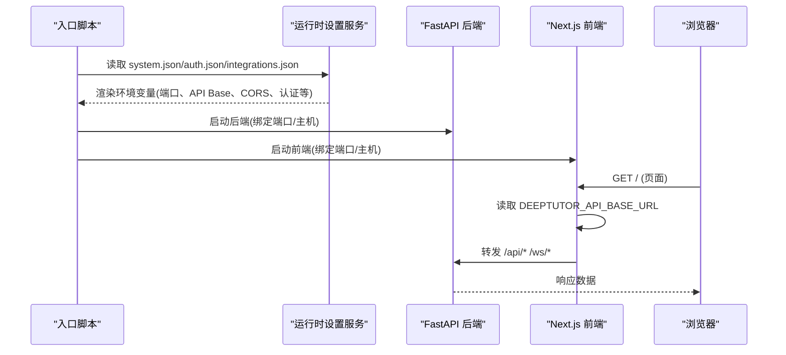
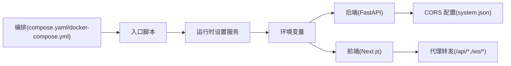

# 容器配置管理

<cite>
**本文引用的文件**
- [Dockerfile](file://Dockerfile)
- [compose.yaml](file://compose.yaml)
- [docker-compose.yml](file://docker-compose.yml)
- [CONTAINERIZATION.md](file://CONTAINERIZATION.md)
- [runtime_settings.py](file://deeptutor/services/config/runtime_settings.py)
- [loader.py](file://deeptutor/services/config/loader.py)
- [home.py](file://deeptutor/runtime/home.py)
- [main.py](file://deeptutor/api/main.py)
- [next.config.js](file://web/next.config.js)
</cite>

## 目录
1. [简介](#简介)
2. [项目结构](#项目结构)
3. [核心组件](#核心组件)
4. [架构总览](#架构总览)
5. [详细组件分析](#详细组件分析)
6. [依赖关系分析](#依赖关系分析)
7. [性能考虑](#性能考虑)
8. [故障排除指南](#故障排除指南)
9. [结论](#结论)
10. [附录：部署模板与迁移策略](#附录：部署模板与迁移策略)

## 简介
本指南面向在容器中部署 DeepTutor 的运维与开发者，聚焦“运行时配置”的来源、优先级、热重载机制与验证规则。重点覆盖：
- 环境变量：DEEPTUTOR_HOME、BACKEND_HOST、FRONTEND_HOST、DEEPTUTOR_SANDBOX_ALLOW_SUBPROCESS 等
- system.json 结构与字段含义（端口、CORS、API 基础路径等）
- 不同部署场景的配置模板（开发、测试、生产）
- 配置热重载与校验规则
- 版本管理与迁移策略
- 常见配置错误与排障

## 项目结构
DeepTutor 的容器化运行由镜像构建脚本、编排文件和运行时设置共同决定：
- 镜像构建：Dockerfile 定义后端（FastAPI）和前端（Next.js）启动方式、入口脚本与环境导出逻辑
- 编排：compose.yaml 与 docker-compose.yml 提供本地/生产编排示例与网络、卷挂载、健康检查
- 运行时设置：data/user/settings/*.json（system.json、auth.json、integrations.json 等）是单一事实来源；入口脚本每次启动都会读取并导出为进程环境变量，供前后端使用

图表来源
- [Dockerfile:263-315](file://Dockerfile#L263-L315)
- [Dockerfile:317-409](file://Dockerfile#L317-L409)
- [compose.yaml:120-182](file://compose.yaml#L120-L182)
- [docker-compose.yml:54-99](file://docker-compose.yml#L54-L99)

章节来源
- [Dockerfile:263-409](file://Dockerfile#L263-L409)
- [compose.yaml:120-182](file://compose.yaml#L120-L182)
- [docker-compose.yml:54-99](file://docker-compose.yml#L54-L99)

## 核心组件
- 运行时设置服务：从 data/user/settings/*.json 加载并规范化配置，支持进程环境变量覆盖，渲染出子进程所需的环境变量
- 入口脚本：启动时卸载可能干扰的旧环境变量，重新从 JSON 导出最新值，再启动 supervisord 及其子进程
- 前端代理：Next.js 中间件在请求时读取 DEEPTUTOR_API_BASE_URL，将 /api/* 与 /ws/* 转发到后端
- 后端 CORS：根据 system.json 中的 cors_origin/cors_origins 动态构建允许源

章节来源
- [runtime_settings.py:15-42](file://deeptutor/services/config/runtime_settings.py#L15-L42)
- [runtime_settings.py:500-546](file://deeptutor/services/config/runtime_settings.py#L500-L546)
- [Dockerfile:317-409](file://Dockerfile#L317-L409)
- [next.config.js:47-76](file://web/next.config.js#L47-L76)
- [main.py:85-101](file://deeptutor/api/main.py#L85-L101)

## 架构总览
DeepTutor 容器内采用“JSON 驱动 + 环境变量透传”的模式：
- 所有运行时配置以 JSON 形式持久化在 data/user/settings 下
- 容器启动时，入口脚本调用运行时设置服务，将 JSON 配置渲染为环境变量（如 BACKEND_PORT、FRONTEND_PORT、DEEPTUTOR_API_BASE_URL、DEEPTUTOR_AUTH_ENABLED 等）
- 前端通过 Next.js 中间件在请求时读取 DEEPTUTOR_API_BASE_URL，实现无侵入的 API/WS 转发
- 后端基于 system.json 的 CORS 配置动态构建允许的源列表

图表来源
- [Dockerfile:317-409](file://Dockerfile#L317-L409)
- [runtime_settings.py:500-546](file://deeptutor/services/config/runtime_settings.py#L500-L546)
- [next.config.js:47-76](file://web/next.config.js#L47-L76)

## 详细组件分析

### 环境变量与优先级
- DEEPTUTOR_HOME：运行时工作区根目录。解析优先级：显式参数 > 环境变量 > 当前工作目录。返回 <home>/data 作为数据根
- BACKEND_HOST、FRONTEND_HOST：后端/前端监听的主机地址（默认 0.0.0.0）。用于容器内外可达性控制
- DEEPTUTOR_SANDBOX_ALLOW_SUBPROCESS：是否允许受限子进程执行代码（文档生成等工具链依赖）。默认开启；若启用沙箱侧车则优先走侧车
- 其他关键环境变量（由 JSON 渲染）：
  - BACKEND_PORT、FRONTEND_PORT：后端/前端端口
  - NEXT_PUBLIC_API_BASE_EXTERNAL、NEXT_PUBLIC_API_BASE：浏览器可见的 API Base（外部/内部）
  - CORS_ORIGIN、CORS_ORIGINS：CORS 允许源
  - DISABLE_SSL_VERIFY：禁用 SSL 证书校验
  - CHAT_ATTACHMENT_DIR、CHAT_ATTACHMENT_MAX_*：聊天附件策略
  - AUTH_ENABLED、AUTH_USERNAME、AUTH_PASSWORD_HASH、AUTH_TOKEN_EXPIRE_HOURS、AUTH_COOKIE_SECURE：认证开关与凭据
  - POCKETBASE_*：集成 PocketBase 相关
  - DEEPTUTOR_API_BASE_URL、DEEPTUTOR_AUTH_ENABLED：前端代理转发与登录重定向开关

注意：容器入口会卸载一批环境变量（如 BACKEND_PORT、NEXT_PUBLIC_API_BASE 等），确保“JSON 是唯一事实来源”，避免 Compose 或宿主环境残留影响行为。

章节来源
- [home.py:12-27](file://deeptutor/runtime/home.py#L12-L27)
- [runtime_settings.py:500-546](file://deeptutor/services/config/runtime_settings.py#L500-L546)
- [runtime_settings.py:612-642](file://deeptutor/services/config/runtime_settings.py#L612-L642)
- [Dockerfile:317-354](file://Dockerfile#L317-L354)

### system.json 结构与字段
system.json 是系统级运行时配置的核心，包含：
- version：配置版本（用于迁移与兼容）
- backend_port：后端端口（默认 8001）
- frontend_port：前端端口（默认 3782）
- next_public_api_base_external：浏览器可见的外部 API Base（云/外网场景）
- next_public_api_base：浏览器可见的内部 API Base（典型内网场景）
- cors_origin、cors_origins：CORS 允许源（字符串或数组，会被规范化）
- disable_ssl_verify：是否禁用 SSL 校验
- chat_attachment_dir：聊天附件目录
- sandbox_allow_subprocess：是否允许受限子进程执行
- chat_attachment_max_file_mb、chat_attachment_max_total_mb、chat_attachment_max_chars_per_doc、chat_attachment_max_chars_total：聊天附件大小与字符数限制

这些字段在加载时会被规范化与边界约束（例如端口范围、整数钳制、布尔转换、CORS 源规范化）。

章节来源
- [runtime_settings.py:15-42](file://deeptutor/services/config/runtime_settings.py#L15-L42)
- [runtime_settings.py:872-896](file://deeptutor/services/config/runtime_settings.py#L872-L896)

### 端口与主机绑定
- 后端启动脚本读取 BACKEND_HOST 与 BACKEND_PORT，默认 0.0.0.0:8001
- 前端启动脚本读取 FRONTEND_HOST 与 FRONTEND_PORT，默认 0.0.0.0:3782
- 编排文件中可映射宿主机端口到容器端口（仅回环或全接口取决于 compose 配置）

章节来源
- [Dockerfile:263-295](file://Dockerfile#L263-L295)
- [Dockerfile:297-315](file://Dockerfile#L297-L315)
- [compose.yaml:144-146](file://compose.yaml#L144-L146)
- [docker-compose.yml:61-63](file://docker-compose.yml#L61-L63)

### CORS 配置
- 后端在启动时根据 system.json 的 cors_origin 与 cors_origins 构建允许源列表，同时内置 localhost/127.0.0.1 的前端端口来源
- 前端代理不受 CORS 影响（同源转发），但跨域请求需后端正确放行

章节来源
- [main.py:85-101](file://deeptutor/api/main.py#L85-L101)
- [runtime_settings.py:872-896](file://deeptutor/services/config/runtime_settings.py#L872-L896)

### API 基础路径与前端代理
- 前端通过 web/proxy.ts 在请求时读取 DEEPTUTOR_API_BASE_URL，将 /api/* 与 /ws/* 转发到后端
- DEEPTUTOR_API_BASE_URL 由运行时设置服务渲染，优先使用 next_public_api_base_external，其次 next_public_api_base，最后回退到 127.0.0.1:backend_port
- 前端构建阶段不注入 API Base，避免硬编码；运行时通过环境变量动态生效

章节来源
- [runtime_settings.py:500-546](file://deeptutor/services/config/runtime_settings.py#L500-L546)
- [next.config.js:47-76](file://web/next.config.js#L47-L76)
- [CONTAINERIZATION.md:33-52](file://CONTAINERIZATION.md#L33-L52)

### 认证与集成
- auth.json：控制认证开关、用户名、密码哈希、Token 过期时间、Cookie Secure 标志
- integrations.json：PocketBase 集成 URL、端口、外部 URL、管理员账号等
- 这些配置同样会被渲染为环境变量，供前后端与子进程使用

章节来源
- [runtime_settings.py:51-67](file://deeptutor/services/config/runtime_settings.py#L51-L67)
- [runtime_settings.py:500-546](file://deeptutor/services/config/runtime_settings.py#L500-L546)

## 依赖关系分析
- 入口脚本依赖运行时设置服务导出环境变量
- 前端依赖 DEEPTUTOR_API_BASE_URL 进行请求转发
- 后端依赖 system.json 的 CORS 配置与端口设置
- 编排文件负责端口映射、卷挂载、网络与健康检查

图表来源
- [Dockerfile:317-409](file://Dockerfile#L317-L409)
- [runtime_settings.py:500-546](file://deeptutor/services/config/runtime_settings.py#L500-L546)
- [compose.yaml:120-182](file://compose.yaml#L120-L182)
- [docker-compose.yml:54-99](file://docker-compose.yml#L54-L99)

章节来源
- [Dockerfile:317-409](file://Dockerfile#L317-L409)
- [runtime_settings.py:500-546](file://deeptutor/services/config/runtime_settings.py#L500-L546)
- [compose.yaml:120-182](file://compose.yaml#L120-L182)
- [docker-compose.yml:54-99](file://docker-compose.yml#L54-L99)

## 性能考虑
- 端口与主机绑定：合理设置 BACKEND_HOST/FRONTEND_HOST 以避免不必要的网络开销
- CORS 源数量：过多源会增加预检请求与匹配成本，建议精确配置
- 附件策略：调整 chat_attachment_max_* 以平衡上传体验与内存/CPU 占用
- 沙箱执行：在生产环境建议使用沙箱侧车（docker-compose.yml 中 sandbox-runner），避免在主进程中执行不可信代码

[本节为通用指导，无需特定文件引用]

## 故障排除指南
- 端口冲突：检查 system.json 的 backend_port/frontend_port 与编排文件的端口映射是否一致；重启服务使新端口生效
- CORS 错误：确认 cors_origin/cors_origins 包含前端实际访问域名与端口；注意协议与端口必须匹配
- API 转发失败：检查 DEEPTUTOR_API_BASE_URL 是否正确指向后端；确保前端代理能访问该地址
- 认证问题：确认 auth.json 的 enabled 与 cookie_secure 设置；浏览器与后端协议需一致（http/https）
- 沙箱执行失败：若未启用侧车，确认 DEEPTUTOR_SANDBOX_ALLOW_SUBPROCESS 与系统能力（bwrap/受限子进程）

章节来源
- [runtime_settings.py:872-896](file://deeptutor/services/config/runtime_settings.py#L872-L896)
- [main.py:85-101](file://deeptutor/api/main.py#L85-L101)
- [runtime_settings.py:500-546](file://deeptutor/services/config/runtime_settings.py#L500-L546)
- [docker-compose.yml:101-175](file://docker-compose.yml#L101-L175)

## 结论
DeepTutor 的容器配置以 JSON 为中心，通过入口脚本在每次启动时导出为环境变量，前后端按需读取，实现灵活、可观测且安全的配置管理。遵循本文指南可快速完成多环境部署、调优与排障。

[本节为总结，无需特定文件引用]

## 附录：部署模板与迁移策略

### 开发环境模板
- 使用 compose.yaml 或 docker-compose.yml 启动，端口映射到 127.0.0.1
- 设置 system.json 的 next_public_api_base 为空，让前端代理自动回退到后端本地地址
- 如需本地 LLM，provider base_url 使用 host.docker.internal 或 podman 的 containers.internal
- 可启用 DEEPTUTOR_SANDBOX_ALLOW_SUBPROCESS=1 以便本地调试代码执行

章节来源
- [compose.yaml:144-167](file://compose.yaml#L144-L167)
- [docker-compose.yml:16-18](file://docker-compose.yml#L16-L18)
- [runtime_settings.py:500-546](file://deeptutor/services/config/runtime_settings.py#L500-L546)

### 测试环境模板
- 固定端口与主机，关闭不必要功能（如沙箱子进程）
- 配置 CORS 仅允许测试域名与端口
- 使用独立的 data 卷或目录隔离测试数据

章节来源
- [compose.yaml:144-182](file://compose.yaml#L144-L182)
- [docker-compose.yml:61-99](file://docker-compose.yml#L61-L99)

### 生产环境模板
- 使用 HTTPS 反向代理，设置 cors_origins 为精确的生产域名
- 启用认证（auth.json enabled=true），并根据需要设置 cookie_secure
- 使用沙箱侧车执行不可信代码，主进程保持最小权限
- 定期备份 data 目录（含 settings、workspace、knowledge_bases 等）

章节来源
- [CONTAINERIZATION.md:435-468](file://CONTAINERIZATION.md#L435-L468)
- [docker-compose.yml:101-175](file://docker-compose.yml#L101-L175)
- [runtime_settings.py:500-546](file://deeptutor/services/config/runtime_settings.py#L500-L546)

### 配置热重载机制
- 入口脚本每次启动都会重新加载 JSON 并导出环境变量，因此修改 system.json 后需重启服务
- 前端代理在请求时读取 DEEPTUTOR_API_BASE_URL，无需重建前端包
- 后端 CORS 与端口等在启动时应用，修改后需重启

章节来源
- [Dockerfile:317-409](file://Dockerfile#L317-L409)
- [next.config.js:47-76](file://web/next.config.js#L47-L76)

### 配置验证规则
- 端口范围：1-65535，超出则回退默认值
- 布尔值：支持多种真/假字符串表示
- CORS 源：自动规范化（协议、端口、域名）
- 附件策略：文件大小与总大小存在上下界钳制，字符数也有范围限制

章节来源
- [runtime_settings.py:259-289](file://deeptutor/services/config/runtime_settings.py#L259-L289)
- [runtime_settings.py:872-896](file://deeptutor/services/config/runtime_settings.py#L872-L896)

### 版本管理与迁移策略
- system.json 包含 version 字段，用于识别配置版本
- 文档解析配置已从 v1 迁移到 v2，首次加载会自动迁移旧文件
- 未来可通过 schema 与迁移函数实现向后兼容

章节来源
- [runtime_settings.py:15-42](file://deeptutor/services/config/runtime_settings.py#L15-L42)
- [runtime_settings.py:591-608](file://deeptutor/services/config/runtime_settings.py#L591-L608)
- [schema.py:31-39](file://deeptutor/config/schema.py#L31-L39)