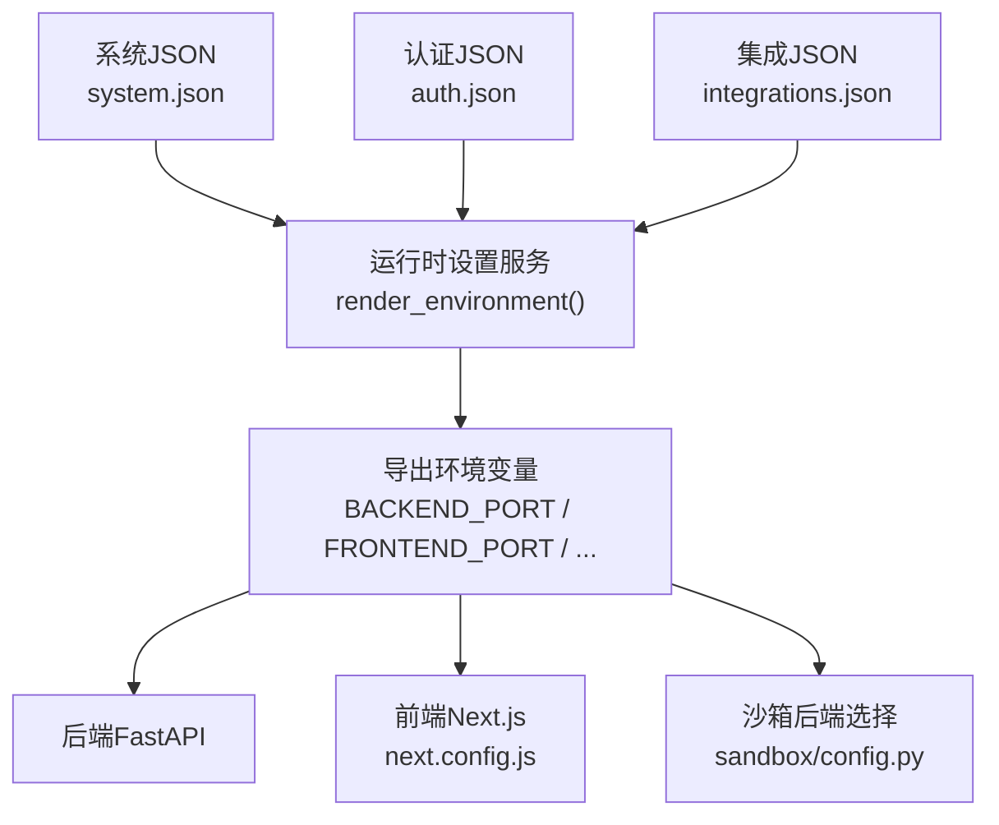
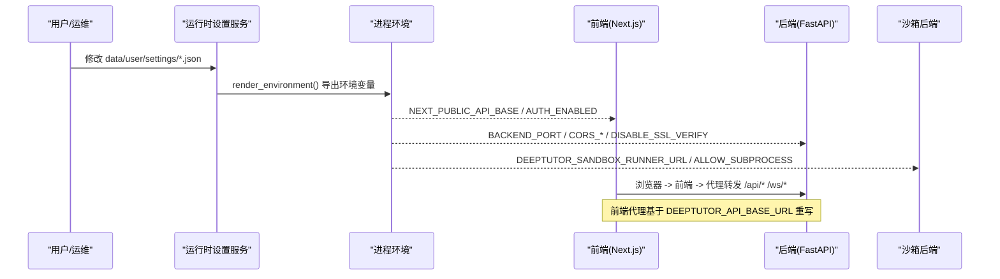
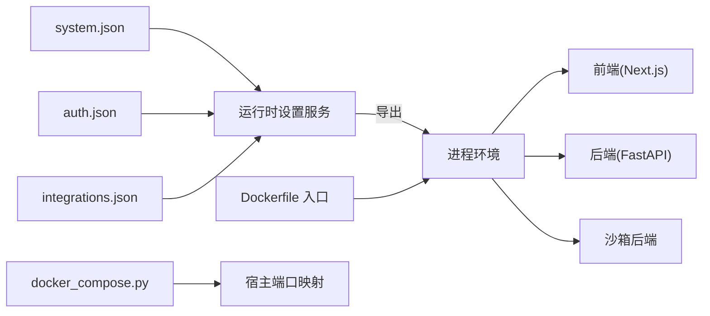

# 环境变量配置

<cite>
**本文引用的文件**
- [runtime_settings.py](file://deeptutor/services/config/runtime_settings.py)
- [home.py](file://deeptutor/runtime/home.py)
- [config.py](file://deeptutor/services/sandbox/config.py)
- [launcher.py](file://deeptutor/runtime/launcher.py)
- [Dockerfile](file://Dockerfile)
- [next.config.js](file://web/next.config.js)
- [docker_compose.py](file://scripts/docker_compose.py)
- [compose.yaml](file://compose.yaml)
- [docker-compose.yml](file://docker-compose.yml)
</cite>

## 目录
1. [简介](#简介)
2. [项目结构](#项目结构)
3. [核心组件](#核心组件)
4. [架构总览](#架构总览)
5. [详细组件分析](#详细组件分析)
6. [依赖关系分析](#依赖关系分析)
7. [性能注意事项](#性能注意事项)
8. [故障排查指南](#故障排查指南)
9. [结论](#结论)
10. [附录](#附录)

## 简介
本文件为 DeepTutor 的环境变量配置权威说明，覆盖运行时关键环境变量及其作用、默认值、数据类型与示例；提供开发、测试、生产环境的最佳实践模板；说明环境变量的优先级与覆盖规则；给出验证规则与常见错误解决方案；并提供 Docker 与 docker-compose 中的设置示例。重点涵盖 DEEPTUTOR_HOME、BACKEND_PORT、FRONTEND_PORT、DEEPTUTOR_SANDBOX_ALLOW_SUBPROCESS 等关键项。

## 项目结构
DeepTutor 的运行时配置以 JSON 为中心（data/user/settings/*.json），进程环境变量作为部署级覆盖层。启动时由运行时服务统一读取并渲染到子进程环境，前端构建期与运行期分别通过 Next.js 配置与环境变量获取 API 基址与认证开关。

图表来源
- [runtime_settings.py:500-546](file://deeptutor/services/config/runtime_settings.py#L500-L546)
- [next.config.js:47-76](file://web/next.config.js#L47-L76)
- [config.py:32-84](file://deeptutor/services/sandbox/config.py#L32-L84)

章节来源
- [runtime_settings.py:500-546](file://deeptutor/services/config/runtime_settings.py#L500-L546)
- [next.config.js:47-76](file://web/next.config.js#L47-L76)
- [config.py:32-84](file://deeptutor/services/sandbox/config.py#L32-L84)

## 核心组件
- 运行时设置服务：集中加载 system/auth/integrations JSON，并将非模型类配置渲染为进程环境变量，供后端、前端与子进程使用。
- 运行时家目录解析：决定数据根路径（DEEPTUTOR_HOME）。
- 沙箱后端选择：根据环境变量选择受限子进程、bwrap 或 runner sidecar。
- 前端代理与构建：Next.js 在构建期与运行期读取环境变量，重写 API 请求与登录重定向。
- 容器化入口：Dockerfile 入口将运行时设置导出为环境变量，供 supervisord 子进程使用。

章节来源
- [runtime_settings.py:309-558](file://deeptutor/services/config/runtime_settings.py#L309-L558)
- [home.py:8-27](file://deeptutor/runtime/home.py#L8-L27)
- [config.py:32-84](file://deeptutor/services/sandbox/config.py#L32-L84)
- [next.config.js:47-76](file://web/next.config.js#L47-L76)
- [Dockerfile:369-402](file://Dockerfile#L369-L402)

## 架构总览
下图展示从 JSON 设置到各组件消费环境变量的完整链路，包括端口、API 基址、认证开关、沙箱策略等。

图表来源
- [runtime_settings.py:500-546](file://deeptutor/services/config/runtime_settings.py#L500-L546)
- [next.config.js:47-76](file://web/next.config.js#L47-L76)
- [config.py:32-84](file://deeptutor/services/sandbox/config.py#L32-L84)

## 详细组件分析

### 运行时家目录：DEEPTUTOR_HOME
- 用途：指定 DeepTutor 运行时工作区根目录，数据位于 <home>/data。
- 类型：字符串（路径）
- 默认值：未设置时使用当前工作目录
- 优先级：显式参数 > 环境变量 > 当前工作目录
- 示例：export DEEPTUTOR_HOME=/opt/deeptutor/data
- 影响范围：所有读写 data 子目录的服务（知识库、会话、日志等）

章节来源
- [home.py:8-27](file://deeptutor/runtime/home.py#L8-L27)
- [launcher.py:933-933](file://deeptutor/runtime/launcher.py#L933-L933)
- [launcher.py:1023-1043](file://deeptutor/runtime/launcher.py#L1023-L1043)

### 端口与网络：BACKEND_PORT、FRONTEND_PORT、PORT
- 用途：后端与前端监听端口；PORT 用于前端 Node 运行时。
- 类型：整数（端口号）
- 默认值：BACKEND_PORT=8001，FRONTEND_PORT=3782，PORT=FRONTEND_PORT
- 来源：JSON system.json 的 backend_port/frontend_port，可被环境变量覆盖
- 示例：export BACKEND_PORT=8001; export FRONTEND_PORT=3782
- 注意：Compose 映射宿主机端口通过脚本生成 DEEPTUTOR_DOCKER_* 变量，避免直接编辑 compose env

章节来源
- [runtime_settings.py:500-508](file://deeptutor/services/config/runtime_settings.py#L500-L508)
- [Dockerfile:379-392](file://Dockerfile#L379-L392)
- [docker_compose.py:45-70](file://scripts/docker_compose.py#L45-L70)
- [compose.yaml:144-146](file://compose.yaml#L144-L146)
- [docker-compose.yml:61-63](file://docker-compose.yml#L61-L63)

### API 基址与代理：NEXT_PUBLIC_API_BASE、NEXT_PUBLIC_API_BASE_EXTERNAL、DEEPTUTOR_API_BASE_URL
- 用途：
  - NEXT_PUBLIC_API_BASE_EXTERNAL：外部可达的 API 基址（优先）
  - NEXT_PUBLIC_API_BASE：内部 API 基址
  - DEEPTUTOR_API_BASE_URL：前端服务器侧代理使用的后端地址（重写 /api/* /ws/*）
- 类型：字符串（URL）
- 默认值：若为空则回退到 http://127.0.0.1:BACKEND_PORT
- 优先级：NEXT_PUBLIC_API_BASE_EXTERNAL > next_public_api_base_external > NEXT_PUBLIC_API_BASE > next_public_api_base > 回退
- 示例：export NEXT_PUBLIC_API_BASE_EXTERNAL=https://api.example.com
- 注意：前端构建期与运行期均会读取这些变量；代理在请求时动态改写目标

章节来源
- [runtime_settings.py:508-540](file://deeptutor/services/config/runtime_settings.py#L508-L540)
- [next.config.js:47-76](file://web/next.config.js#L47-L76)
- [Dockerfile:382-389](file://Dockerfile#L382-L389)

### 认证开关：AUTH_ENABLED、NEXT_PUBLIC_AUTH_ENABLED、DEEPTUTOR_AUTH_ENABLED
- 用途：控制是否启用内置认证；NEXT_PUBLIC_AUTH_ENABLED 暴露给前端；DEEPTUTOR_AUTH_ENABLED 供前端服务器端代理逻辑使用
- 类型：布尔（true/false）
- 默认值：false
- 来源：auth.json 的 enabled，可被环境变量覆盖
- 示例：export AUTH_ENABLED=true; export NEXT_PUBLIC_AUTH_ENABLED=true
- 注意：Dockerfile 入口会导出 DEEPTUTOR_AUTH_ENABLED 给前端中间件

章节来源
- [runtime_settings.py:515-520](file://deeptutor/services/config/runtime_settings.py#L515-L520)
- [runtime_settings.py:521-540](file://deeptutor/services/config/runtime_settings.py#L521-L540)
- [Dockerfile:382-389](file://Dockerfile#L382-L389)
- [next.config.js:66-73](file://web/next.config.js#L66-L73)

### 沙箱执行：DEEPTUTOR_SANDBOX_ALLOW_SUBPROCESS、DEEPTUTOR_SANDBOX_RUNNER_URL
- 用途：
  - DEEPTUTOR_SANDBOX_RUNNER_URL：启用 runner sidecar（推荐的生产隔离方式）
  - DEEPTUTOR_SANDBOX_ALLOW_SUBPROCESS：允许受限子进程模式（仅当无 runner 且无 bwrap 时生效）
- 类型：字符串（URL）/ 布尔（true/1/yes/on）
- 默认值：runner_url 为空；allow_subprocess=false
- 行为：
  - 设置了 runner_url → 使用 RunnerSidecarBackend
  - Linux + 可用 bwrap → 使用 BwrapBackend
  - allow_subprocess=true → 使用 RestrictedSubprocessBackend
  - 否则 → 不启用沙箱（exec 禁用）
- 示例：export DEEPTUTOR_SANDBOX_RUNNER_URL=http://sandbox-runner:8900
- 注意：生产环境建议始终启用 runner sidecar；本地开发可开启受限子进程

章节来源
- [config.py:32-84](file://deeptutor/services/sandbox/config.py#L32-L84)
- [runtime_settings.py:514-514](file://deeptutor/services/config/runtime_settings.py#L514-L514)
- [docker-compose.yml:76-83](file://docker-compose.yml#L76-L83)

### CORS 与 SSL：CORS_ORIGIN、CORS_ORIGINS、DISABLE_SSL_VERIFY
- 用途：
  - CORS_ORIGIN/CORS_ORIGINS：允许的跨域来源
  - DISABLE_SSL_VERIFY：是否禁用 SSL 证书校验（调试用）
- 类型：字符串（单个或逗号分隔列表）/ 布尔
- 默认值：空串 / false
- 示例：export CORS_ORIGINS="http://localhost:3782,https://example.com"
- 注意：后端启动时会合并默认 localhost 来源与自定义来源

章节来源
- [runtime_settings.py:510-513](file://deeptutor/services/config/runtime_settings.py#L510-L513)
- [api/main.py:85-101](file://deeptutor/api/main.py#L85-L101)

### 聊天附件限制：CHAT_ATTACHMENT_MAX_FILE_MB、CHAT_ATTACHMENT_MAX_TOTAL_MB、CHAT_ATTACHMENT_MAX_CHARS_PER_DOC、CHAT_ATTACHMENT_MAX_CHARS_TOTAL、CHAT_ATTACHMENT_DIR
- 用途：控制上传文件大小、总量与文本提取字符预算；指定附件存储目录
- 类型：整数（MB/字符）/ 字符串（路径）
- 默认值：见系统默认（具体数值由系统默认定义）
- 示例：export CHAT_ATTACHMENT_MAX_FILE_MB=20
- 注意：部分限制在 WebSocket 帧大小上需重启生效

章节来源
- [runtime_settings.py:31-42](file://deeptutor/services/config/runtime_settings.py#L31-L42)
- [runtime_settings.py:634-641](file://deeptutor/services/config/runtime_settings.py#L634-L641)

### PocketBase 集成：POCKETBASE_URL、POCKETBASE_PORT、POCKETBASE_EXTERNAL_URL、POCKETBASE_ADMIN_EMAIL、POCKETBASE_ADMIN_PASSWORD
- 用途：配置可选的 PocketBase 认证/存储侧车
- 类型：字符串/整数
- 默认值：空串/8090
- 示例：export POCKETBASE_URL=http://pocketbase:8090
- 注意：compose.yaml 中可通过 integrations.json 激活

章节来源
- [runtime_settings.py:541-545](file://deeptutor/services/config/runtime_settings.py#L541-L545)
- [compose.yaml:69-73](file://compose.yaml#L69-L73)

### MinerU 文档解析：MINERU_MODE、MINERU_API_BASE_URL、MINERU_API_TOKEN、MINERU_LOCAL_CLI_PATH、MINERU_MODEL_SOURCE、MINERU_MODEL_DOWNLOAD_ENDPOINT、MINERU_MODEL_VERSION、MINERU_LANGUAGE、MINERU_ALLOW_LOCAL_MODEL_DOWNLOAD
- 用途：切换本地/云端 MinerU 模式、配置令牌、下载源与语言等
- 类型：字符串/布尔
- 默认值：见引擎默认
- 示例：export MINERU_MODE=cloud; export MINERU_API_TOKEN=...
- 注意：本地模式可能触发模型下载，需显式允许

章节来源
- [runtime_settings.py:675-695](file://deeptutor/services/config/runtime_settings.py#L675-L695)

### LLM 重试：LLM_RETRY__MAX_RETRIES、LLM_RETRY__BASE_DELAY、LLM_RETRY__EXPONENTIAL_BACKOFF
- 用途：控制大模型调用重试次数、基础延迟与指数退避
- 类型：整数/浮点/布尔
- 默认值：max_retries=8, base_delay=5.0, exponential_backoff=True
- 示例：export LLM_RETRY__MAX_RETRIES=5

章节来源
- [settings.py:1-51](file://deeptutor/config/settings.py#L1-L51)

### 忽略进程覆盖：DEEPTUTOR_IGNORE_PROCESS_ENV_OVERRIDES
- 用途：当设置为真时，忽略进程环境变量对 JSON 设置的覆盖，保证 JSON 为唯一事实来源
- 类型：布尔
- 示例：export DEEPTUTOR_IGNORE_PROCESS_ENV_OVERRIDES=true

章节来源
- [runtime_settings.py:254-256](file://deeptutor/services/config/runtime_settings.py#L254-L256)
- [runtime_settings.py:609-610](file://deeptutor/services/config/runtime_settings.py#L609-L610)

## 依赖关系分析
- 运行时设置服务是环境变量渲染中心，向后端、前端、沙箱模块输出一致的值。
- 前端通过 next.config.js 在构建期与运行期读取相关变量，实现代理与认证开关。
- 容器入口将 JSON 设置导出为环境变量，确保 supervisord 子进程获得一致配置。
- Compose 脚本从 JSON 渲染宿主端口映射，避免手动维护 .env。

图表来源
- [runtime_settings.py:500-546](file://deeptutor/services/config/runtime_settings.py#L500-L546)
- [next.config.js:47-76](file://web/next.config.js#L47-L76)
- [Dockerfile:369-402](file://Dockerfile#L369-L402)
- [docker_compose.py:45-70](file://scripts/docker_compose.py#L45-L70)

章节来源
- [runtime_settings.py:500-546](file://deeptutor/services/config/runtime_settings.py#L500-L546)
- [next.config.js:47-76](file://web/next.config.js#L47-L76)
- [Dockerfile:369-402](file://Dockerfile#L369-L402)
- [docker_compose.py:45-70](file://scripts/docker_compose.py#L45-L70)

## 性能注意事项
- 合理设置聊天附件大小与字符预算，避免过大负载进入 LLM 上下文。
- 谨慎调整 LLM 重试参数，避免雪崩式重试导致资源耗尽。
- 在生产环境启用 runner sidecar 或 bwrap，避免在主进程中执行不受信代码。
- 使用 HTTPS 与正确的 CORS 配置，减少跨域开销与安全成本。

## 故障排查指南
- 无法访问后端 API
  - 检查 NEXT_PUBLIC_API_BASE_EXTERNAL/NEXT_PUBLIC_API_BASE 是否正确
  - 确认 DEEPTUTOR_API_BASE_URL 指向了后端实际地址
  - 参考：[runtime_settings.py:508-540](file://deeptutor/services/config/runtime_settings.py#L508-L540)
- 前端代理不转发 /api/* /ws/*
  - 确认前端服务器已设置 DEEPTUTOR_API_BASE_URL 与 DEEPTUTOR_AUTH_ENABLED
  - 参考：[Dockerfile:382-389](file://Dockerfile#L382-L389)
- 沙箱执行失败
  - 未设置 runner_url 且未安装 bwrap 时，需设置 DEEPTUTOR_SANDBOX_ALLOW_SUBPROCESS=true
  - 参考：[config.py:32-84](file://deeptutor/services/sandbox/config.py#L32-L84)
- 端口冲突
  - 通过 system.json 修改端口或使用脚本重新渲染 docker.env
  - 参考：[docker_compose.py:45-70](file://scripts/docker_compose.py#L45-L70)
- 认证未生效
  - 检查 AUTH_ENABLED 与 NEXT_PUBLIC_AUTH_ENABLED 是否一致
  - 参考：[runtime_settings.py:515-520](file://deeptutor/services/config/runtime_settings.py#L515-L520)

章节来源
- [runtime_settings.py:508-540](file://deeptutor/services/config/runtime_settings.py#L508-L540)
- [config.py:32-84](file://deeptutor/services/sandbox/config.py#L32-L84)
- [docker_compose.py:45-70](file://scripts/docker_compose.py#L45-L70)
- [runtime_settings.py:515-520](file://deeptutor/services/config/runtime_settings.py#L515-L520)

## 结论
DeepTutor 的环境变量体系以 JSON 设置为事实来源，进程环境变量作为部署级覆盖。通过统一的渲染机制，后端、前端与沙箱模块获得一致配置。生产环境应优先使用 runner sidecar，严格管理 CORS 与 SSL，并通过脚本与容器入口保持配置一致性。

## 附录

### 环境变量优先级与覆盖规则
- JSON 设置（system/auth/integrations）为默认与持久化来源
- 进程环境变量作为部署覆盖，按字段映射到 JSON 键
- 当设置 DEEPTUTOR_IGNORE_PROCESS_ENV_OVERRIDES=true 时，忽略进程覆盖，JSON 为唯一来源
- 前端构建期与运行期分别读取 NEXT_PUBLIC_* 与 DEEPTUTOR_* 变量

章节来源
- [runtime_settings.py:254-256](file://deeptutor/services/config/runtime_settings.py#L254-L256)
- [runtime_settings.py:609-610](file://deeptutor/services/config/runtime_settings.py#L609-L610)
- [next.config.js:47-76](file://web/next.config.js#L47-L76)

### 不同部署场景的配置模板

- 开发环境（本地源码）
  - 设置 DEEPTUTOR_HOME 指向工作区
  - 使用默认端口或按需调整 BACKEND_PORT/FRONTEND_PORT
  - 如需本地执行代码，设置 DEEPTUTOR_SANDBOX_ALLOW_SUBPROCESS=true
  - 示例：
    - export DEEPTUTOR_HOME=/path/to/workspace
    - export BACKEND_PORT=8001
    - export FRONTEND_PORT=3782
    - export DEEPTUTOR_SANDBOX_ALLOW_SUBPROCESS=true

- 测试环境（容器化）
  - 通过 system.json 配置端口与 API 基址
  - 使用脚本渲染 docker.env 并启动 compose
  - 示例：
    - python scripts/docker_compose.py up -d

- 生产环境（容器化 + 安全）
  - 启用 runner sidecar：DEEPTUTOR_SANDBOX_RUNNER_URL=http://sandbox-runner:8900
  - 配置 HTTPS 与正确 CORS
  - 关闭不必要的调试选项（如 DISABLE_SSL_VERIFY）
  - 示例：
    - export DEEPTUTOR_SANDBOX_RUNNER_URL=http://sandbox-runner:8900
    - export CORS_ORIGIN=https://app.example.com
    - export NEXT_PUBLIC_API_BASE_EXTERNAL=https://api.example.com

### Docker 与 docker-compose 设置示例

- Dockerfile 入口导出
  - 启动时从 JSON 设置导出环境变量，供 supervisord 子进程使用
  - 参考：[Dockerfile:369-402](file://Dockerfile#L369-L402)

- docker-compose.yml
  - 通过 DEEPTUTOR_DOCKER_* 变量映射宿主端口
  - 设置 DEEPTUTOR_SANDBOX_RUNNER_URL 启用隔离执行
  - 参考：[docker-compose.yml:61-83](file://docker-compose.yml#L61-L83)

- compose.yaml（Podman）
  - 使用只读根文件系统与 tmpfs 提升安全性
  - 通过 data/user/settings/*.json 管理运行时配置
  - 参考：[compose.yaml:120-167](file://compose.yaml#L120-L167)

- docker_compose.py
  - 从 JSON 渲染 DEEPTUTOR_DOCKER_BACKEND_PORT/FRONTEND_PORT/POCKETBASE_PORT
  - 自动注入 --env-file 到 compose 命令
  - 参考：[docker_compose.py:45-70](file://scripts/docker_compose.py#L45-L70)