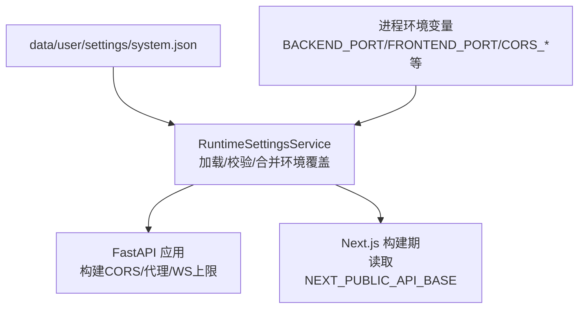
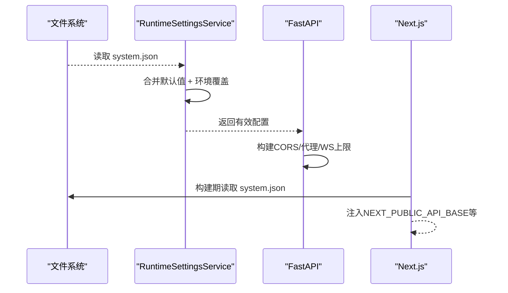
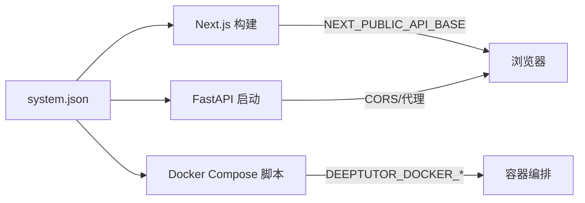

# 系统配置文件

<cite>
**本文引用的文件**
- [runtime_settings.py](file://deeptutor/services/config/runtime_settings.py)
- [settings.py](file://deeptutor/api/routers/settings.py)
- [main.py](file://deeptutor/api/main.py)
- [next.config.js](file://web/next.config.js)
- [docker_compose.py](file://scripts/docker_compose.py)
- [test_runtime_settings.py](file://tests/services/config/test_runtime_settings.py)
</cite>

## 目录
1. [简介](#简介)
2. [项目结构](#项目结构)
3. [核心组件](#核心组件)
4. [架构总览](#架构总览)
5. [详细组件分析](#详细组件分析)
6. [依赖关系分析](#依赖关系分析)
7. [性能注意事项](#性能注意事项)
8. [故障排查指南](#故障排查指南)
9. [结论](#结论)
10. [附录](#附录)

## 简介
本指南聚焦于 system.json 配置文件的完整管理说明，覆盖端口设置、CORS、API 基础路径、SSL 验证、附件目录与上传限制等关键项；解释字段间的关系与依赖、校验规则与错误处理机制；并提供不同部署场景下的配置模板与最佳实践。同时说明配置热重载机制与迁移策略。

## 项目结构
system.json 由运行时配置服务统一加载、校验并持久化到 data/user/settings/system.json。前端 Next.js 在构建时读取该文件以决定浏览器端 API 基址；后端 FastAPI 启动时根据 system.json（及进程环境变量）生成 CORS、代理与 WebSocket 帧上限等运行参数。

图表来源
- [runtime_settings.py:309-363](file://deeptutor/services/config/runtime_settings.py#L309-L363)
- [main.py:85-101](file://deeptutor/api/main.py#L85-L101)
- [next.config.js:47-76](file://web/next.config.js#L47-L76)

章节来源
- [runtime_settings.py:15-48](file://deeptutor/services/config/runtime_settings.py#L15-L48)
- [next.config.js:47-76](file://web/next.config.js#L47-L76)
- [main.py:85-101](file://deeptutor/api/main.py#L85-L101)

## 核心组件
- 运行时配置服务：负责读取 system.json、合并默认值与环境变量覆盖、规范化字段、持久化写入。
- 网络设置 API：提供查询与更新 network 相关字段（端口、公共 API 基址、CORS）。
- 前端构建期配置：Next.js 构建时读取 system.json 的端口与 API 基址，注入到浏览器可用的环境变量。
- Docker 集成脚本：从 system.json 导出端口到 compose 环境变量。

章节来源
- [runtime_settings.py:309-363](file://deeptutor/services/config/runtime_settings.py#L309-L363)
- [settings.py:505-635](file://deeptutor/api/routers/settings.py#L505-L635)
- [next.config.js:47-76](file://web/next.config.js#L47-L76)
- [docker_compose.py:45-70](file://scripts/docker_compose.py#L45-L70)

## 架构总览
system.json 是“持久化配置源”，进程环境变量是“部署覆盖层”。加载顺序为：默认值 → 文件 → 环境覆盖（仅生效不持久化）。所有数值型字段均经过规范化与范围钳制，非法值会被回退或裁剪。

图表来源
- [runtime_settings.py:350-363](file://deeptutor/services/config/runtime_settings.py#L350-L363)
- [main.py:85-101](file://deeptutor/api/main.py#L85-L101)
- [next.config.js:47-76](file://web/next.config.js#L47-L76)

## 详细组件分析

### system.json 字段定义与行为
- version: 配置版本标识，用于未来迁移。
- backend_port: 后端服务监听端口，范围 1-65535，默认 8001。
- frontend_port: 前端开发/预览端口，范围 1-65535，默认 3782。
- next_public_api_base_external: 浏览器端使用的 API 基址（外部），优先级高于 next_public_api_base。
- next_public_api_base: 浏览器端使用的 API 基址（内部），为空则回退到后端地址。
- cors_origin: 单个额外允许的来源（字符串）。
- cors_origins: 多个允许的来源（数组或可解析的字符串），会标准化为协议+主机形式。
- disable_ssl_verify: 是否禁用 SSL 证书校验（布尔）。
- chat_attachment_dir: 聊天附件存储目录（字符串）。
- sandbox_allow_subprocess: 是否允许受限子进程执行（布尔，默认开启）。
- chat_attachment_max_file_mb: 单文件最大大小（MB），范围 1-1024，默认 20。
- chat_attachment_max_total_mb: 单次消息总大小（MB），范围 1-2048，默认 25；若小于单文件大小，将被提升到等于单文件大小。
- chat_attachment_max_chars_per_doc: 每文档提取字符上限，范围 10,000-5,000,000，默认 200,000。
- chat_attachment_max_chars_total: 单次消息提取字符总量上限，范围同上，默认 150,000。

注意：
- public_api_base 作为别名会被归一化为 next_public_api_base_external。
- cors_origins 支持逗号或分号分隔的字符串，也会被标准化为带协议的来源列表。
- 端口与大小限制会在保存时被钳制到合法范围，非法输入不会导致崩溃，而是被修正。

章节来源
- [runtime_settings.py:15-48](file://deeptutor/services/config/runtime_settings.py#L15-L48)
- [runtime_settings.py:872-913](file://deeptutor/services/config/runtime_settings.py#L872-L913)
- [test_runtime_settings.py:155-173](file://tests/services/config/test_runtime_settings.py#L155-L173)

### 端口与 API 基址的关系
- 浏览器端 API 基址选择优先级：next_public_api_base_external > next_public_api_base > http://localhost:{backend_port}。
- 前端构建期 NEXT_PUBLIC_API_BASE 的取值优先级：进程环境变量 NEXT_PUBLIC_API_BASE_EXTERNAL > system.json 的 next_public_api_base_external > 进程环境变量 NEXT_PUBLIC_API_BASE > system.json 的 next_public_api_base > 基于 backend_port 的本地地址。
- 后端 CORS 来源包含前端端口对应的 localhost 与 127.0.0.1，以及用户配置的额外来源。

章节来源
- [next.config.js:47-76](file://web/next.config.js#L47-L76)
- [settings.py:505-546](file://deeptutor/api/routers/settings.py#L505-L546)
- [main.py:85-101](file://deeptutor/api/main.py#L85-L101)

### CORS 配置
- 支持通过 cors_origin（单值）与 cors_origins（多值）共同指定。
- 来源会被标准化为带协议的 URL，自动补齐协议与主机名。
- 当认证启用时，CORS 模式更严格；未启用时允许更多远程来源。

章节来源
- [main.py:85-101](file://deeptutor/api/main.py#L85-L101)
- [settings.py:505-546](file://deeptutor/api/routers/settings.py#L505-L546)

### SSL 验证
- disable_ssl_verify 控制是否跳过 SSL 证书校验。通常不建议在生产环境关闭。

章节来源
- [runtime_settings.py:15-48](file://deeptutor/services/config/runtime_settings.py#L15-L48)

### 附件目录与上传限制
- chat_attachment_dir 指定附件存储目录。
- 上传限制包括单文件大小、单次消息总大小、每文档与总字符数上限。
- WebSocket 帧上限会根据总大小动态计算，确保大附件能传输；但修改后需重启后端才能生效。

章节来源
- [runtime_settings.py:872-913](file://deeptutor/services/config/runtime_settings.py#L872-L913)
- [runtime_settings.py:981-1016](file://deeptutor/services/config/runtime_settings.py#L981-L1016)
- [settings.py:638-690](file://deeptutor/api/routers/settings.py#L638-L690)

### 配置更新与生效
- 通过 /api/v1/settings/network 与 /api/v1/settings/chat-attachments 接口更新 system.json 中的网络与附件限制。
- 端口与 API 基址变更后，前端需要重新构建以获取新的 NEXT_PUBLIC_API_BASE。
- 附件总大小变更会影响 WebSocket 帧上限，需要重启后端服务。

章节来源
- [settings.py:620-690](file://deeptutor/api/routers/settings.py#L620-L690)
- [next.config.js:47-76](file://web/next.config.js#L47-L76)

### 环境变量覆盖
- 支持通过环境变量覆盖 system.json 的值，但不持久化到文件。
- 常见覆盖键：BACKEND_PORT、FRONTEND_PORT、NEXT_PUBLIC_API_BASE_EXTERNAL、PUBLIC_API_BASE、NEXT_PUBLIC_API_BASE、CORS_ORIGIN、CORS_ORIGINS、DISABLE_SSL_VERIFY、CHAT_ATTACHMENT_DIR、DEEPTUTOR_SANDBOX_ALLOW_SUBPROCESS、CHAT_ATTACHMENT_MAX_FILE_MB、CHAT_ATTACHMENT_MAX_TOTAL_MB、CHAT_ATTACHMENT_MAX_CHARS_PER_DOC、CHAT_ATTACHMENT_MAX_CHARS_TOTAL。
- 可通过 DEEPTUTOR_IGNORE_PROCESS_ENV_OVERRIDES 忽略进程环境变量覆盖。

章节来源
- [runtime_settings.py:612-642](file://deeptutor/services/config/runtime_settings.py#L612-L642)
- [runtime_settings.py:500-546](file://deeptutor/services/config/runtime_settings.py#L500-L546)
- [test_runtime_settings.py:60-79](file://tests/services/config/test_runtime_settings.py#L60-L79)

### 配置迁移
- system.json 使用 version 字段进行版本管理。当前系统配置版本为 1。
- 文档解析配置已从旧版 mineru.json 迁移至 document_parsing.json，并在首次加载时自动重命名与结构升级。
- 新增字段会被安全地写入文件，缺失字段会使用默认值。

章节来源
- [runtime_settings.py:591-608](file://deeptutor/services/config/runtime_settings.py#L591-L608)
- [runtime_settings.py:770-813](file://deeptutor/services/config/runtime_settings.py#L770-L813)
- [test_runtime_settings.py:323-381](file://tests/services/config/test_runtime_settings.py#L323-L381)

### 热重载机制
- system.json 的读取是“按需加载”的：每次调用 load_system 都会重新读取文件并合并环境覆盖。因此，修改 system.json 后，下一次请求即可看到新值。
- 但某些运行时参数（如 WebSocket 帧上限）在进程启动时确定，修改后需要重启后端。
- 前端构建期变量（NEXT_PUBLIC_API_BASE）在构建时固定，修改后需重新构建前端。

章节来源
- [runtime_settings.py:350-363](file://deeptutor/services/config/runtime_settings.py#L350-L363)
- [runtime_settings.py:981-1016](file://deeptutor/services/config/runtime_settings.py#L981-L1016)
- [next.config.js:47-76](file://web/next.config.js#L47-L76)

## 依赖关系分析
- 前端依赖 system.json 的端口与 API 基址来决定构建时的浏览器 API 地址。
- 后端依赖 system.json 的 CORS 与端口来构建跨域策略与代理规则。
- Docker 脚本依赖 system.json 的端口来生成 compose 环境变量。

图表来源
- [next.config.js:47-76](file://web/next.config.js#L47-L76)
- [main.py:85-101](file://deeptutor/api/main.py#L85-L101)
- [docker_compose.py:45-70](file://scripts/docker_compose.py#L45-L70)

章节来源
- [next.config.js:47-76](file://web/next.config.js#L47-L76)
- [main.py:85-101](file://deeptutor/api/main.py#L85-L101)
- [docker_compose.py:45-70](file://scripts/docker_compose.py#L45-L70)

## 性能注意事项
- 附件总大小越大，WebSocket 帧上限越高，可能影响内存与带宽。建议根据实际业务调整。
- CORS 来源过多会增加请求校验开销，应仅添加必要来源。
- 关闭 SSL 校验会降低安全性，仅在受信任内网调试时使用。

[本节为通用指导，不直接分析具体文件]

## 故障排查指南
- 端口冲突：检查 backend_port 与 frontend_port 是否与其他服务冲突。
- CORS 错误：确认 cors_origin 与 cors_origins 已包含前端域名与协议。
- 前端无法访问后端：检查 next_public_api_base_external 与 next_public_api_base 是否正确指向后端地址。
- 附件上传失败：检查 chat_attachment_max_file_mb 与 chat_attachment_max_total_mb 是否满足需求；若增大总大小，需重启后端以应用新的 WebSocket 帧上限。
- 环境变量未生效：确认未设置 DEEPTUTOR_IGNORE_PROCESS_ENV_OVERRIDES；检查环境变量名称与值格式。

章节来源
- [runtime_settings.py:872-913](file://deeptutor/services/config/runtime_settings.py#L872-L913)
- [runtime_settings.py:981-1016](file://deeptutor/services/config/runtime_settings.py#L981-L1016)
- [settings.py:638-690](file://deeptutor/api/routers/settings.py#L638-L690)

## 结论
system.json 是 DeepTutor 的核心运行时配置源，结合环境变量覆盖实现灵活的部署能力。通过统一的加载与校验机制，确保配置的安全性与一致性。管理员可通过 API 或编辑文件进行配置，但需注意部分变更需要重启或重新构建。遵循本文的最佳实践与排障指南，可有效降低配置错误的风险。

[本节为总结性内容，不直接分析具体文件]

## 附录

### 配置示例（system.json）
以下为典型配置示例（字段值仅为示意，请根据实际部署调整）：
- 端口：backend_port=8001，frontend_port=3782
- API 基址：next_public_api_base_external="https://api.example.com"
- CORS：cors_origin=""，cors_origins=["https://app.example.com", "http://localhost:3000"]
- SSL：disable_ssl_verify=false
- 附件：chat_attachment_dir="/data/attachments"，chat_attachment_max_file_mb=50，chat_attachment_max_total_mb=100
- 沙箱：sandbox_allow_subprocess=true

章节来源
- [runtime_settings.py:15-48](file://deeptutor/services/config/runtime_settings.py#L15-L48)
- [runtime_settings.py:872-913](file://deeptutor/services/config/runtime_settings.py#L872-L913)

### 不同部署场景的配置模板
- 本地开发：
  - backend_port=8001，frontend_port=3782
  - next_public_api_base=""（回退到本地后端）
  - cors_origins=["http://localhost:3000", "http://127.0.0.1:3000"]
- 生产环境（反向代理）：
  - next_public_api_base_external="https://yourdomain.com"
  - cors_origins=["https://yourdomain.com"]
  - disable_ssl_verify=false
- Docker 部署：
  - 通过 docker_compose.py 从 system.json 导出端口到 DEEPTUTOR_DOCKER_BACKEND_PORT 等变量
  - 确保容器间网络可达，必要时设置 next_public_api_base_external 为容器可访问的地址

章节来源
- [docker_compose.py:45-70](file://scripts/docker_compose.py#L45-L70)
- [next.config.js:47-76](file://web/next.config.js#L47-L76)

### 环境变量参考
- 覆盖 system.json 的环境变量：
  - BACKEND_PORT、FRONTEND_PORT
  - NEXT_PUBLIC_API_BASE_EXTERNAL、PUBLIC_API_BASE、NEXT_PUBLIC_API_BASE
  - CORS_ORIGIN、CORS_ORIGINS
  - DISABLE_SSL_VERIFY
  - CHAT_ATTACHMENT_DIR
  - DEEPTUTOR_SANDBOX_ALLOW_SUBPROCESS
  - CHAT_ATTACHMENT_MAX_FILE_MB、CHAT_ATTACHMENT_MAX_TOTAL_MB
  - CHAT_ATTACHMENT_MAX_CHARS_PER_DOC、CHAT_ATTACHMENT_MAX_CHARS_TOTAL
- 忽略环境变量覆盖：
  - DEEPTUTOR_IGNORE_PROCESS_ENV_OVERRIDES=true

章节来源
- [runtime_settings.py:612-642](file://deeptutor/services/config/runtime_settings.py#L612-L642)
- [runtime_settings.py:500-546](file://deeptutor/services/config/runtime_settings.py#L500-L546)