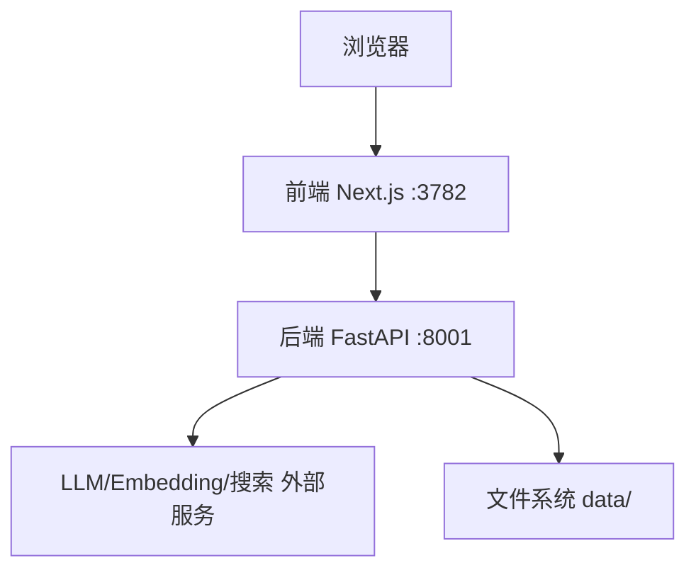
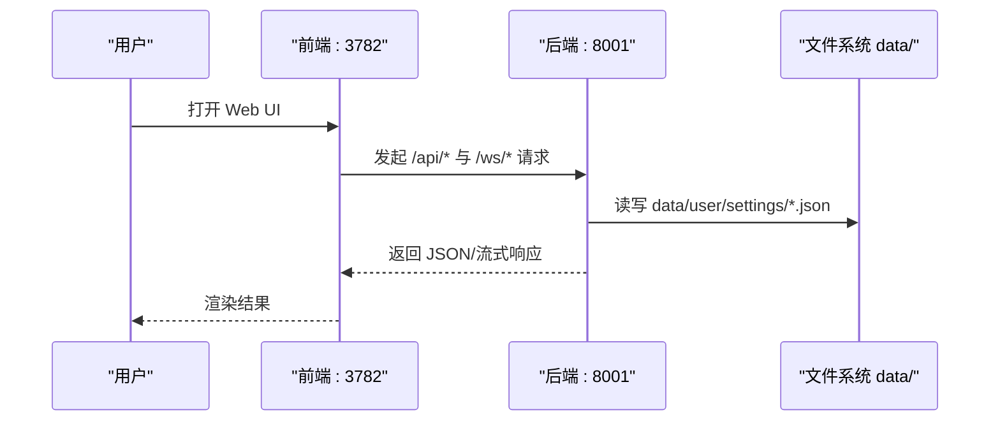
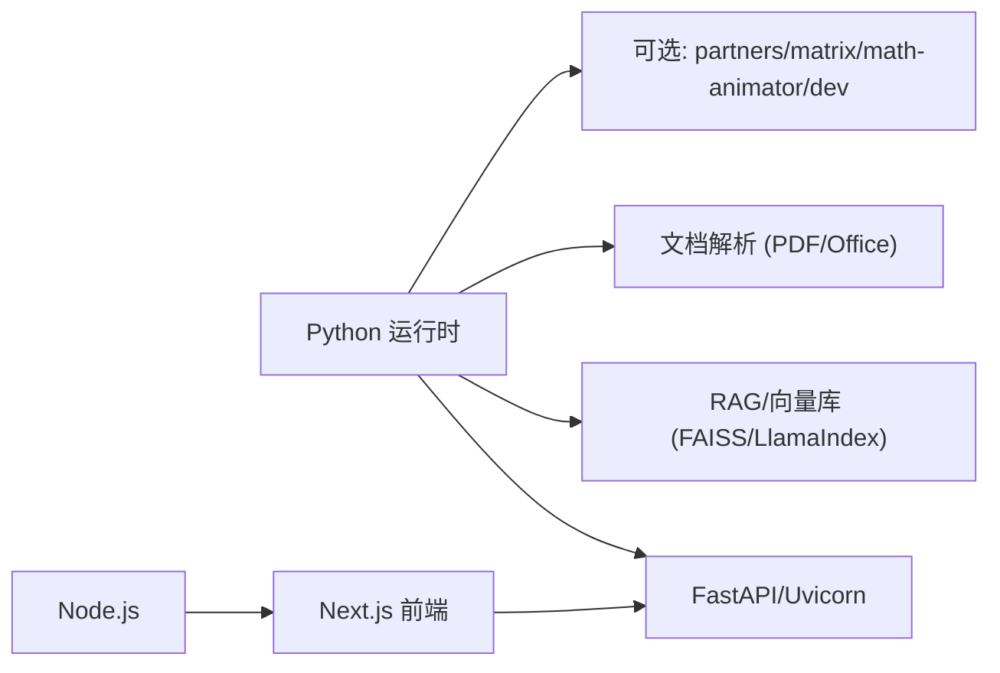

# 单机部署配置

<cite>
**本文引用的文件**
- [README.md](file://README.md)
- [pyproject.toml](file://pyproject.toml)
- [requirements.txt](file://requirements.txt)
- [requirements/server.txt](file://requirements/server.txt)
- [scripts/start_web.py](file://scripts/start_web.py)
- [deeptutor/runtime/launcher.py](file://deeptutor/runtime/launcher.py)
- [deeptutor/config/settings.py](file://deeptutor/config/settings.py)
- [deeptutor/services/config/runtime_settings.py](file://deeptutor/services/config/runtime_settings.py)
- [deeptutor/multi_user/paths.py](file://deeptutor/multi_user/paths.py)
- [compose.yaml](file://compose.yaml)
- [CONTAINERIZATION.md](file://CONTAINERIZATION.md)
</cite>

## 目录
1. [简介](#简介)
2. [项目结构](#项目结构)
3. [核心组件](#核心组件)
4. [架构总览](#架构总览)
5. [详细组件分析](#详细组件分析)
6. [依赖关系分析](#依赖关系分析)
7. [性能考虑](#性能考虑)
8. [故障排查指南](#故障排查指南)
9. [结论](#结论)
10. [附录](#附录)

## 简介
本指南面向在本地机器上以“单机模式”安装并运行 DeepTutor 的用户，覆盖 Python 环境要求、依赖安装、配置文件设置、启动命令、数据目录与权限、常见问题与调优建议。DeepTutor 提供多种安装方式（PyPI、源码、Docker/Podman），但无论哪种方式，工作区布局一致：所有运行时配置与数据位于当前目录下的 data/user/settings/（或通过环境变量 DEEPTUTOR_HOME 指定）。

适用场景与限制
- 适用：个人学习、本地开发、单用户演示、小型团队内部试用。
- 限制：默认关闭多用户认证；如需多人隔离需启用认证并使用多用户工作区布局；容器化部署时需注意宿主机端口与网络访问策略。

## 项目结构
- 后端服务：FastAPI + Uvicorn，负责 API、会话、RAG、记忆、工具执行等。
- 前端服务：Next.js 静态站点，浏览器仅与前端通信，通过内置代理转发 /api/* 与 /ws/* 到后端。
- 配置与数据：统一位于 data/user/settings/*.json（系统、模型、集成、界面、行为等）以及 data/ 下各工作区。
- 启动入口：命令行 deeptutor start 会同时拉起后端与前端，或单独使用 serve 启动后端。

图表来源
- [README.md:202-221](file://README.md#L202-L221)
- [CONTAINERIZATION.md:15-52](file://CONTAINERIZATION.md#L15-L52)

章节来源
- [README.md:202-221](file://README.md#L202-L221)
- [CONTAINERIZATION.md:15-52](file://CONTAINERIZATION.md#L15-L52)

## 核心组件
- 运行时启动器：负责发现/创建 workspace、读取 settings、启动前后端进程、健康检查与优雅退出。
- 运行时设置服务：从 data/user/settings/*.json 加载配置，导出环境变量供子进程使用。
- 路径与工作区：data/user 为管理员工作区，data/users/<uid> 为普通用户工作区，data/partners 为伙伴工作区，data/system 存放账户、授权、审计与密钥。
- 配置项：system.json（端口、CORS、上传限制等）、model_catalog.json（模型与密钥）、auth.json（认证开关）、integrations.json（第三方集成）、interface.json（界面语言/主题）、main.yaml/agents.yaml（运行时默认值与能力参数）。

章节来源
- [deeptutor/runtime/launcher.py:1-200](file://deeptutor/runtime/launcher.py#L1-L200)
- [deeptutor/services/config/runtime_settings.py:305-585](file://deeptutor/services/config/runtime_settings.py#L305-L585)
- [deeptutor/multi_user/paths.py:1-233](file://deeptutor/multi_user/paths.py#L1-L233)
- [README.md:432-448](file://README.md#L432-L448)

## 架构总览
单机部署的典型流程：
- 初始化：运行 deeptutor init 生成 data/user/settings 下的配置文件。
- 启动：运行 deeptutor start 同时启动后端与前端；或只运行后端用于脚本调用。
- 访问：浏览器打开前端地址（默认 http://127.0.0.1:3782），前端将 /api/* 与 /ws/* 请求转发给后端。

图表来源
- [README.md:202-221](file://README.md#L202-L221)
- [CONTAINERIZATION.md:15-52](file://CONTAINERIZATION.md#L15-L52)

章节来源
- [README.md:202-221](file://README.md#L202-L221)
- [CONTAINERIZATION.md:15-52](file://CONTAINERIZATION.md#L15-L52)

## 详细组件分析

### 环境与依赖
- Python 版本：>=3.11 且 <3.14（受部分依赖限制）。
- Node.js：运行打包后的 Next.js 需要 Node 运行时（PyPI 安装自带独立前端；源码开发建议使用 Node 22 LTS）。
- 可选扩展：partners（IM 通道）、matrix（Matrix 通道）、math-animator（Manim 动画）、dev（测试与开发工具）。

安装步骤（推荐 PyPI）
- 创建工作目录并进入。
- 安装 deeptutor。
- 运行 deeptutor init 交互式配置端口与模型。
- 运行 deeptutor start 启动前后端。

安装步骤（源码）
- 克隆仓库，创建虚拟环境。
- 安装后端依赖与前端依赖。
- 运行 deeptutor init 与 deeptutor start --dev。

章节来源
- [pyproject.toml:8-21](file://pyproject.toml#L8-L21)
- [README.md:207-246](file://README.md#L207-L246)
- [requirements/server.txt:1-32](file://requirements/server.txt#L1-L32)

### 启动流程与命令
- 统一入口：deeptutor start [--home PATH] [--dev]
  - --home：指定运行时工作区根目录。
  - --dev：使用 Next.js 开发服务器（带 HMR）。
- 仅后端：deeptutor serve [--port PORT]
- 兼容脚本：scripts/start_web.py 作为旧版兼容入口，最终调用 runtime launcher。

启动后行为
- 自动检测并保存后端/前端端口到 system.json。
- 启动后端与前端进程，进行健康检查，输出日志。
- Ctrl+C 停止两个进程。

章节来源
- [scripts/start_web.py:1-40](file://scripts/start_web.py#L1-L40)
- [deeptutor/runtime/launcher.py:1-200](file://deeptutor/runtime/launcher.py#L1-L200)
- [README.md:207-246](file://README.md#L207-L246)

### 配置管理
- 配置文件位置：data/user/settings/*.json（JSON/YAML）。
- 关键文件
  - system.json：后端/前端端口、公共 API base、CORS、SSL 校验、附件目录与大小限制等。
  - model_catalog.json：LLM/Embedding/Search 提供者、API Key、活跃模型。
  - auth.json：是否开启认证、用户名、密码哈希、Token/Cookie 设置。
  - integrations.json：PocketBase 等集成配置。
  - interface.json：界面语言、主题、侧边栏偏好。
  - main.yaml/agents.yaml：运行时默认值与能力参数。
- 环境变量注入：RuntimeSettingsService 在启动时将 settings 渲染为环境变量，供子进程使用；项目根 .env 不作为应用配置读取。

章节来源
- [README.md:432-448](file://README.md#L432-L448)
- [deeptutor/services/config/runtime_settings.py:305-585](file://deeptutor/services/config/runtime_settings.py#L305-L585)

### 数据目录结构与权限
- 目录布局
  - data/user：管理员工作区与全局设置。
  - data/users/<uid>：每个非管理员用户的隔离工作区。
  - data/partners/<id>/workspace：伙伴工作区。
  - data/system：账户、授权、审计、每拥有者的密钥（user-secrets）。
- 权限要点
  - 确保 data 目录对运行用户可写。
  - user-secrets 目录需严格限制为仅所有者可读写（启动时会强制设置权限）。
  - 若使用容器，请挂载宿主目录并保持 UID 一致（Podman userns_mode: keep-id）。

章节来源
- [deeptutor/multi_user/paths.py:1-233](file://deeptutor/multi_user/paths.py#L1-L233)

### 单机部署的适用场景与限制
- 适用
  - 单人使用、本地调试、快速体验、离线或内网环境。
  - 通过 Docker/Podman 一键启动，便于迁移与备份。
- 限制
  - 默认无多用户认证；如需多人隔离需手动启用认证并配置授权。
  - 代码执行沙箱默认允许子进程执行（sandbox_allow_subprocess=true），在宿主机执行模型生成的代码需谨慎。
  - 容器内 localhost 指向容器自身，访问宿主机本地模型服务需使用 host.docker.internal 或 host networking。

章节来源
- [README.md:408-429](file://README.md#L408-L429)
- [README.md:659-678](file://README.md#L659-L678)
- [compose.yaml:120-197](file://compose.yaml#L120-L197)

## 依赖关系分析
- 核心运行时依赖：FastAPI、Uvicorn、WebSockets、HTTP 客户端、文档解析库、向量检索（FAISS/LlamaIndex）等。
- 可选依赖：partners（IM SDK）、matrix（Matrix 通道）、math-animator（Manim 及系统依赖 LaTeX/ffmpeg 等）、dev（测试与 lint）。
- 前端依赖：Node.js 与 npm 包（web/package.json），源码开发需安装 web 依赖。

图表来源
- [pyproject.toml:21-71](file://pyproject.toml#L21-L71)
- [pyproject.toml:76-235](file://pyproject.toml#L76-L235)
- [requirements/server.txt:1-32](file://requirements/server.txt#L1-L32)

章节来源
- [pyproject.toml:21-71](file://pyproject.toml#L21-L71)
- [pyproject.toml:76-235](file://pyproject.toml#L76-L235)
- [requirements/server.txt:1-32](file://requirements/server.txt#L1-L32)

## 性能考虑
- 内存与并发
  - 单实例部署时，合理设置后端/前端端口避免冲突。
  - 大知识库检索优先选择 FAISS 向量存储以提升查询性能。
- 模型与重试
  - 可通过 LLM 重试配置调整最大重试次数、基础延迟与指数退避策略。
- 沙箱执行
  - 如不需要生成 Office 文件，可将 sandbox_allow_subprocess 设为 false 以降低风险与开销。
- 容器资源
  - 在 Compose 中可按需设置 pids_limit、mem_limit、cpus 等限制。

章节来源
- [deeptutor/config/settings.py:1-51](file://deeptutor/config/settings.py#L1-L51)
- [compose.yaml:183-197](file://compose.yaml#L183-L197)
- [README.md:408-429](file://README.md#L408-L429)

## 故障排查指南
- 端口占用
  - 启动时会自动检测端口占用并提示更换；也可在 system.json 中修改 backend_port/frontend_port。
- 前端卡住或锁文件
  - 删除 web/.next/dev/lock 与 web/.next/lock 后重试。
- 容器内无法访问宿主机模型服务
  - 使用 host.docker.internal 或 host networking 访问宿主机本地服务。
- 认证与回调
  - 本地临时 Codex OAuth 桥接需额外映射 1455/1457 端口，完成后恢复原配置。
- 权限问题
  - 确保 data 目录与 user-secrets 目录权限正确；容器中使用 keep-id 与绑定挂载保持 UID 一致。

章节来源
- [README.md:272-284](file://README.md#L272-L284)
- [README.md:338-363](file://README.md#L338-L363)
- [README.md:93-144](file://README.md#L93-L144)
- [deeptutor/multi_user/paths.py:128-138](file://deeptutor/multi_user/paths.py#L128-L138)

## 结论
DeepTutor 的单机部署以“一个工作区、一套配置、一键启动”为核心，适合个人与小型团队快速上手。通过合理的依赖选择、配置优化与权限管理，可在本地获得稳定、可扩展的智能学习环境。对于更高可用性或多人协作需求，可平滑过渡到容器化或多用户部署。

## 附录
- 常用命令
  - deeptutor init：初始化或更新 data/user/settings。
  - deeptutor start [--home PATH] [--dev]：启动后端+前端。
  - deeptutor serve [--port PORT]：仅启动后端。
  - deeptutor chat/run/kb/skill/memory/session 等：CLI 功能。
- 参考文档
  - 容器化部署与 Podman 安全加固说明。
  - 各模块配置参考（系统、模型、集成、界面、行为）。

章节来源
- [README.md:680-742](file://README.md#L680-L742)
- [CONTAINERIZATION.md:1-200](file://CONTAINERIZATION.md#L1-L200)