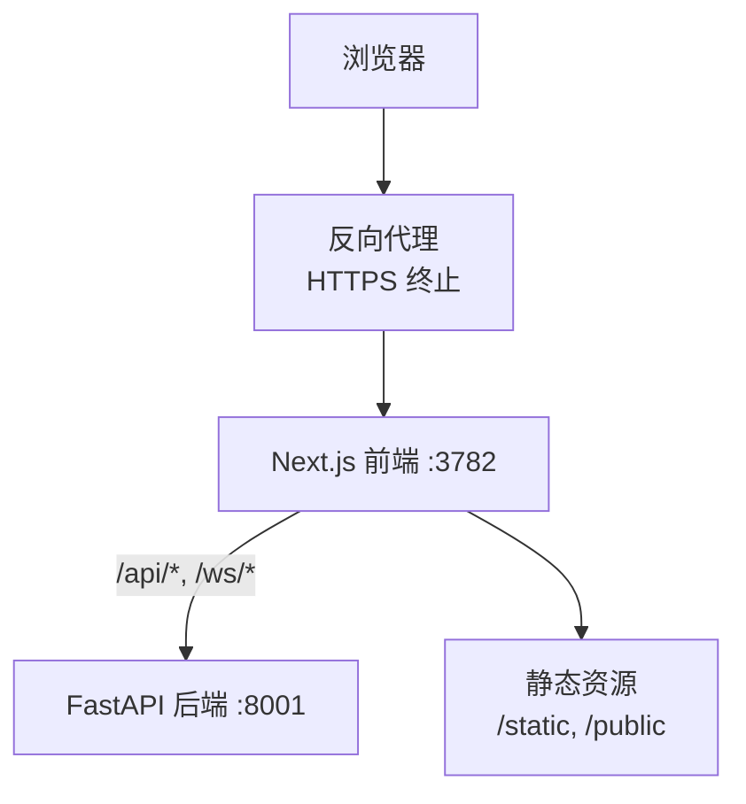
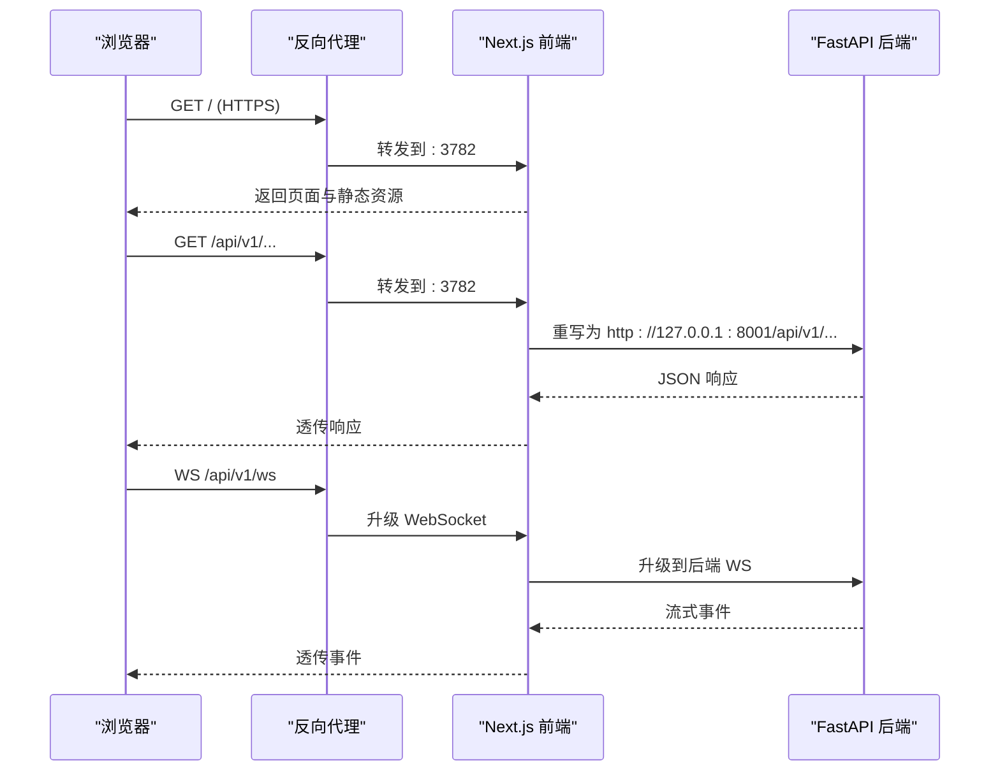
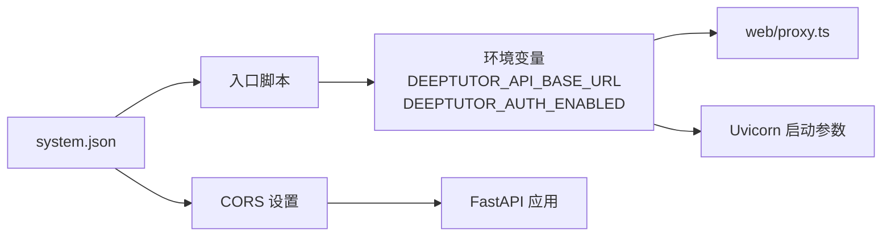

# 反向代理部署配置

<cite>
**本文引用的文件**
- [README.md](file://README.md)
- [CONTAINERIZATION.md](file://CONTAINERIZATION.md)
- [Dockerfile](file://Dockerfile)
- [compose.yaml](file://compose.yaml)
- [web/proxy.ts](file://web/proxy.ts)
- [deeptutor/api/main.py](file://deeptutor/api/main.py)
- [deeptutor/services/config/runtime_settings.py](file://deeptutor/services/config/runtime_settings.py)
- [web/lib/unified-ws.ts](file://web/lib/unified-ws.ts)
- [tests/api/test_cors_settings.py](file://tests/api/test_cors_settings.py)
</cite>

## 目录
1. [简介](#简介)
2. [项目结构](#项目结构)
3. [核心组件](#核心组件)
4. [架构总览](#架构总览)
5. [详细组件分析](#详细组件分析)
6. [依赖关系分析](#依赖关系分析)
7. [性能考虑](#性能考虑)
8. [故障排查指南](#故障排查指南)
9. [结论](#结论)
10. [附录：反向代理配置示例](#附录反向代理配置示例)

## 简介
本指南面向在生产环境中使用 Nginx、Apache 或其他反向代理托管 DeepTutor 的运维与开发者。内容涵盖 HTTPS/SSL 终止、请求转发规则、WebSocket 支持、静态资源缓存、安全头设置、负载均衡与高可用，以及性能优化与安全加固建议。DeepTutor 推荐将反向代理指向前端端口（默认 3782），由 Next.js 中间件在服务端将 /api/* 与 /ws/* 转发到后端（默认 8001）。因此，大多数情况下只需暴露前端端口即可。

## 项目结构
- 前端：Next.js 独立服务器，监听 3782，提供 UI 并负责服务端代理转发。
- 后端：FastAPI + Uvicorn，监听 8001，提供 API 与 WebSocket。
- 容器化：单镜像同时包含前后端，通过 supervisord 管理进程；入口脚本从 data/user/settings/system.json 读取运行时配置并导出环境变量。
- 反向代理：仅需要把公网流量终止在代理层，并将请求转发至容器的 3782 端口。

图表来源
- [Dockerfile:264-313](file://Dockerfile#L264-L313)
- [web/proxy.ts:13-23](file://web/proxy.ts#L13-L23)

章节来源
- [README.md:202-337](file://README.md#L202-L337)
- [CONTAINERIZATION.md:13-52](file://CONTAINERIZATION.md#L13-L52)
- [Dockerfile:264-313](file://Dockerfile#L264-L313)

## 核心组件
- 前端代理中间件 web/proxy.ts：在服务端根据 DEEPTUTOR_API_BASE_URL 将 /api/* 和 /ws/* 重写至后端地址。
- 后端启动参数：Uvicorn 的 --ws-max-size 与 --timeout-keep-alive 由运行时计算得出，避免大附件上传被截断与空闲连接竞争关闭。
- CORS 策略：基于系统设置的 cors_origin/cors_origins 构建允许源列表，认证开启时更严格。
- WebSocket 客户端：统一 WS 客户端具备心跳、重连与恢复能力，适合长连接场景。

章节来源
- [web/proxy.ts:13-23](file://web/proxy.ts#L13-L23)
- [Dockerfile:264-293](file://Dockerfile#L264-L293)
- [deeptutor/services/config/runtime_settings.py:1014-1031](file://deeptutor/services/config/runtime_settings.py#L1014-L1031)
- [deeptutor/api/main.py:85-101](file://deeptutor/api/main.py#L85-L101)
- [web/lib/unified-ws.ts:157-314](file://web/lib/unified-ws.ts#L157-L314)

## 架构总览
DeepTutor 采用“前端单一入口”模式：浏览器只访问前端域名（如 https://deeptutor.example.com），所有 /api/* 与 /ws/* 请求由 Next.js 在服务端转发到后端。反向代理仅需处理 TLS 终止、静态资源缓存、安全头与必要的超时/缓冲配置。

图表来源
- [web/proxy.ts:42-56](file://web/proxy.ts#L42-L56)
- [Dockerfile:264-293](file://Dockerfile#L264-L293)

## 详细组件分析

### 反向代理与请求转发
- 单容器部署：只需将反向代理指向 3782。浏览器发起相对路径的 /api/* 与 /ws/*，Next.js 在服务端将其转发到后端（默认 http://127.0.0.1:8001）。
- 拆分部署：当后端位于不同容器或主机时，需在 data/user/settings/system.json 中设置 next_public_api_base（或 next_public_api_base_external），以便前端服务侧正确重写目标地址。
- 注意：DEEFTUTOR_API_BASE_URL 是前端服务侧使用的后端地址，不会发送到浏览器。

章节来源
- [CONTAINERIZATION.md:171-199](file://CONTAINERIZATION.md#L171-L199)
- [web/proxy.ts:13-23](file://web/proxy.ts#L13-L23)

### WebSocket 连接配置
- 前端统一 WS 客户端会连接到 /api/v1/ws，具备心跳检测与指数退避重连，并在重连时尝试恢复当前 turn 的序列号。
- 反向代理需确保：
  - 启用 WebSocket 升级（Upgrade: websocket, Connection: Upgrade）。
  - 保持长连接超时大于应用层心跳间隔。
  - 合理设置最大消息体大小以承载聊天附件等数据。
- 后端 Uvicorn 的 --ws-max-size 与 --timeout-keep-alive 由运行时动态计算与设置，避免大帧被截断与空闲连接竞争关闭导致的 ECONNRESET。

章节来源
- [web/lib/unified-ws.ts:157-314](file://web/lib/unified-ws.ts#L157-L314)
- [Dockerfile:264-293](file://Dockerfile#L264-L293)
- [deeptutor/services/config/runtime_settings.py:1014-1031](file://deeptutor/services/config/runtime_settings.py#L1014-L1031)

### 静态资源缓存
- Next.js 生产构建输出静态资源（/static、/public），反向代理可对这些资源启用强缓存与压缩，降低带宽与延迟。
- 典型策略：对 JS/CSS/图片设置长期缓存（如一年）与 ETag/Last-Modified；对 HTML 设置短缓存或不缓存。

章节来源
- [Dockerfile:159-164](file://Dockerfile#L159-L164)

### 安全头与跨域（CORS）
- 反向代理应设置标准安全头（如 HSTS、X-Frame-Options、Referrer-Policy、Content-Security-Policy 等）。
- DeepTutor 的 CORS 基于前端 origin 控制：
  - 未启用认证时，默认允许常见 HTTP/HTTPS 浏览器来源。
  - 启用认证后，需在 system.json 中精确配置 cors_origins。
- 测试用例验证了来源规范化与预检请求（OPTIONS）行为。

章节来源
- [deeptutor/api/main.py:85-101](file://deeptutor/api/main.py#L85-L101)
- [tests/api/test_cors_settings.py:42-75](file://tests/api/test_cors_settings.py#L42-L75)
- [CONTAINERIZATION.md:200-208](file://CONTAINERIZATION.md#L200-L208)

### 负载均衡与高可用
- 多实例部署：在同一域名下运行多个 DeepTutor 实例，由反向代理进行轮询或加权分发。
- 会话与状态：
  - 若启用认证，建议使用粘性会话（sticky session）或外部会话存储（如 Redis）以保证同一用户请求路由到同一实例。
  - 共享持久化目录（data/）或使用外部存储（数据库、对象存储）保证状态一致。
- 健康检查：利用后端健康端点（如 /）进行实例健康探测，剔除异常节点。

章节来源
- [Dockerfile:414-436](file://Dockerfile#L414-L436)
- [CONTAINERIZATION.md:171-199](file://CONTAINERIZATION.md#L171-L199)

### 性能优化建议
- 反向代理层：
  - 启用 gzip/brotli 压缩。
  - 合理设置 keepalive、proxy_read_timeout、proxy_send_timeout 以匹配长连接与流式响应。
  - 对静态资源启用缓存与 CDN。
- 应用层：
  - 后端 Uvicorn 的 --timeout-keep-alive 已设置为较长时间以避免与前端代理的空闲连接竞争关闭。
  - 调整 ws-max-size 以适配附件大小限制。
- 网络层：
  - 使用 TCP Fast Open、HTTP/2 或 HTTP/3 提升吞吐与首包速度。

章节来源
- [Dockerfile:264-293](file://Dockerfile#L264-L293)
- [deeptutor/services/config/runtime_settings.py:1014-1031](file://deeptutor/services/config/runtime_settings.py#L1014-L1031)

### 安全加固建议
- 强制 HTTPS 与 HSTS。
- 限制请求体大小与上传类型，防止恶意负载。
- 启用认证后，严格配置 cors_origins，避免跨站请求伪造。
- 最小权限原则：容器内非 root 运行，读写面受限。
- 日志与审计：集中收集代理与应用日志，监控异常访问。

章节来源
- [CONTAINERIZATION.md:443-467](file://CONTAINERIZATION.md#L443-L467)
- [tests/api/test_cors_settings.py:42-75](file://tests/api/test_cors_settings.py#L42-L75)

## 依赖关系分析
- 前端代理依赖环境变量 DEEPTUTOR_API_BASE_URL 与 DEEPTUTOR_AUTH_ENABLED，这些由容器入口脚本从 system.json 导出。
- 后端启动参数依赖运行时配置计算出的 ws-max-size 与 keep-alive 超时。
- CORS 配置来源于 system.json 中的 cors_origin/cors_origins，并在认证开启时更严格。

图表来源
- [Dockerfile:317-409](file://Dockerfile#L317-L409)
- [web/proxy.ts:13-23](file://web/proxy.ts#L13-L23)
- [deeptutor/api/main.py:85-101](file://deeptutor/api/main.py#L85-L101)

章节来源
- [Dockerfile:317-409](file://Dockerfile#L317-L409)
- [web/proxy.ts:13-23](file://web/proxy.ts#L13-L23)
- [deeptutor/api/main.py:85-101](file://deeptutor/api/main.py#L85-L101)

## 性能考虑
- 静态资源缓存：对 JS/CSS/图片设置长期缓存与压缩，减少重复下载。
- 长连接与超时：确保代理与应用的 keepalive 时间匹配，避免空闲连接过早关闭导致 500。
- 大附件上传：根据 system.json 的附件限制调整 ws-max-size，避免消息体过大被截断。
- 并发与队列：在高并发场景下，结合反向代理的连接池与队列机制，平滑突发流量。

章节来源
- [Dockerfile:264-293](file://Dockerfile#L264-L293)
- [deeptutor/services/config/runtime_settings.py:1014-1031](file://deeptutor/services/config/runtime_settings.py#L1014-L1031)

## 故障排查指南
- 页面加载但设置页提示“后端不可达”：通常是后端未启动或拆分部署时 DEEPTUTOR_API_BASE_URL 配置错误。检查容器日志与系统设置。
- WebSocket 频繁断开：确认代理是否支持 WebSocket 升级，并设置合理的超时与缓冲。
- CORS 报错：检查 system.json 中的 cors_origins，确保与前端域名一致；认证开启时需精确配置。
- 上传失败：核对 ws-max-size 与代理的请求体大小限制，确保与附件策略一致。

章节来源
- [CONTAINERIZATION.md:406-439](file://CONTAINERIZATION.md#L406-L439)
- [web/lib/unified-ws.ts:157-314](file://web/lib/unified-ws.ts#L157-L314)
- [tests/api/test_cors_settings.py:42-75](file://tests/api/test_cors_settings.py#L42-L75)

## 结论
DeepTutor 的反向代理部署以“前端单一入口”为核心，简化了 HTTPS 终止与请求转发复杂度。通过合理配置代理层的安全头、缓存、超时与 WebSocket 支持，并结合应用层的 CORS、WS 大小与 keep-alive 设置，可实现高性能、高可用的生产环境。在多实例与拆分部署场景中，务必关注会话粘性与状态一致性，并通过健康检查实现自动故障转移。

## 附录：反向代理配置示例

以下示例为通用模板，请根据实际环境调整端口、域名与证书路径。

- Nginx 基础配置要点
  - 监听 443 并启用 SSL。
  - 将 / 转发到前端 :3782。
  - 对 /api/* 与 /ws/* 启用 WebSocket 升级。
  - 设置合适的 proxy_read_timeout、proxy_send_timeout、client_max_body_size。
  - 对静态资源启用缓存与压缩。

- Apache 基础配置要点
  - 启用 mod_ssl 与 mod_proxy_wstunnel。
  - 将 / 与 /api/*、/ws/* 代理到后端服务。
  - 设置超时与请求体大小限制。
  - 对静态资源启用缓存与压缩。

- 关键注意事项
  - 单容器部署：只需暴露前端端口（3782）。
  - 拆分部署：在 system.json 中设置 next_public_api_base 或 next_public_api_base_external。
  - CORS：认证开启时，精确配置 cors_origins。
  - WebSocket：确保代理支持升级并保持长连接。

章节来源
- [CONTAINERIZATION.md:171-199](file://CONTAINERIZATION.md#L171-L199)
- [web/proxy.ts:13-23](file://web/proxy.ts#L13-L23)
- [Dockerfile:264-293](file://Dockerfile#L264-L293)