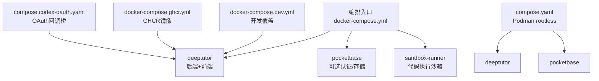
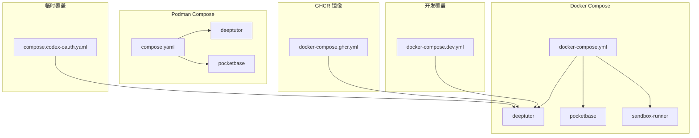
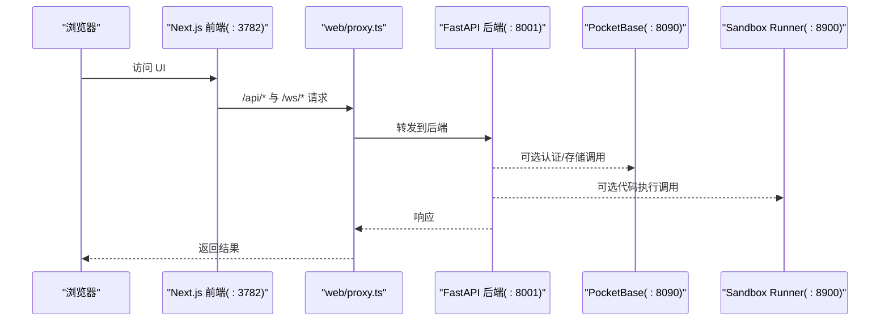
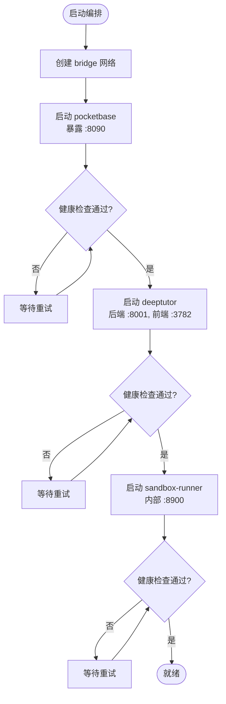
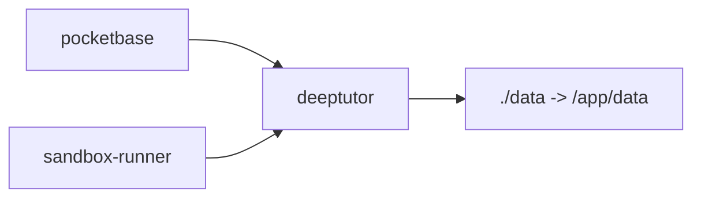

# 多容器编排配置

<cite>
**本文引用的文件**
- [compose.yaml](file://compose.yaml)
- [docker-compose.yml](file://docker-compose.yml)
- [docker-compose.dev.yml](file://docker-compose.dev.yml)
- [docker-compose.ghcr.yml](file://docker-compose.ghcr.yml)
- [compose.codex-oauth.yaml](file://compose.codex-oauth.yaml)
- [Dockerfile](file://Dockerfile)
- [Dockerfile.runner](file://Dockerfile.runner)
- [scripts/docker_compose.py](file://scripts/docker_compose.py)
- [CONTAINERIZATION.md](file://CONTAINERIZATION.md)
</cite>

## 目录
1. [简介](#简介)
2. [项目结构](#项目结构)
3. [核心组件](#核心组件)
4. [架构总览](#架构总览)
5. [详细组件分析](#详细组件分析)
6. [依赖关系分析](#依赖关系分析)
7. [性能与扩展性](#性能与扩展性)
8. [故障排查指南](#故障排查指南)
9. [结论](#结论)
10. [附录：完整编排示例与最佳实践](#附录完整编排示例与最佳实践)

## 简介
本指南面向使用 Docker Compose 或 Podman Compose 进行 DeepTutor 多服务编排的读者，覆盖服务定义、网络、数据卷、服务间通信、健康检查、重启策略、开发/生产差异、以及服务扩展与负载均衡等主题。DeepTutor 提供两种典型形态：
- 单镜像多进程（后端 FastAPI + 前端 Next.js）+ 可选 PocketBase 认证存储侧车
- 可选沙箱执行器侧车（sandbox-runner），用于隔离执行不受信任的代码

## 项目结构
仓库根目录包含多种编排与构建文件，分别服务于不同运行场景：
- compose.yaml：Podman rootless 推荐编排，只读根文件系统，绑定挂载 ./data，仅 deeptutor 与 pocketbase 两个服务
- docker-compose.yml：Docker Compose 默认编排，包含 deeptutor、pocketbase、sandbox-runner 三个服务
- docker-compose.dev.yml：开发覆盖层，启用热重载并挂载源码目录
- docker-compose.ghcr.yml：直接使用 GHCR 预构建镜像的简化编排
- compose.codex-oauth.yaml：临时为 Codex OAuth 回调桥接暴露额外端口的覆盖层
- Dockerfile / Dockerfile.runner：主应用与沙箱侧车的多阶段构建
- scripts/docker_compose.py：从运行时 JSON 设置渲染端口环境变量并调用 docker compose
- CONTAINERIZATION.md：容器化部署说明与注意事项

图表来源
- [docker-compose.yml:21-183](file://docker-compose.yml#L21-L183)
- [compose.yaml:67-207](file://compose.yaml#L67-L207)
- [docker-compose.dev.yml:12-52](file://docker-compose.dev.yml#L12-L52)
- [docker-compose.ghcr.yml:39-72](file://docker-compose.ghcr.yml#L39-L72)
- [compose.codex-oauth.yaml:5-10](file://compose.codex-oauth.yaml#L5-L10)

章节来源
- [docker-compose.yml:1-183](file://docker-compose.yml#L1-L183)
- [compose.yaml:1-207](file://compose.yaml#L1-L207)
- [docker-compose.dev.yml:1-52](file://docker-compose.dev.yml#L1-L52)
- [docker-compose.ghcr.yml:1-72](file://docker-compose.ghcr.yml#L1-L72)
- [compose.codex-oauth.yaml:1-10](file://compose.codex-oauth.yaml#L1-L10)

## 核心组件
- deeptutor：统一镜像内同时运行后端（FastAPI，默认 8001）和前端（Next.js，默认 3782），由 supervisord 管理进程；通过 web/proxy.ts 将浏览器请求中的 /api/* 与 /ws/* 转发到后端
- pocketbase：可选的多用户认证与存储侧车（默认 8090），可通过 integrations.json 启用
- sandbox-runner：独立的轻量侧车，仅暴露 HTTP 接口在内部网络，用于安全执行不受信任的命令（默认 8900）

关键特性
- 健康检查：各服务均定义了 healthcheck，确保依赖启动顺序与可用性
- 重启策略：restart: unless-stopped，保证服务异常退出后自动恢复
- 数据持久化：通过绑定挂载 ./data 到 /app/data，保存配置、工作区、知识库、日志等
- 网络：bridge 网络，服务间通过服务名解析通信
- 安全：rootless（Podman）、只读根文件系统（tmpfs 写入点）、最小权限用户（UID 1000）

章节来源
- [Dockerfile:234-259](file://Dockerfile#L234-L259)
- [Dockerfile:317-439](file://Dockerfile#L317-L439)
- [docker-compose.yml:27-176](file://docker-compose.yml#L27-L176)
- [compose.yaml:74-197](file://compose.yaml#L74-L197)
- [Dockerfile.runner:19-111](file://Dockerfile.runner#L19-L111)

## 架构总览
下图展示了三种常见编排形态及其交互关系：

图表来源
- [docker-compose.yml:21-183](file://docker-compose.yml#L21-L183)
- [compose.yaml:67-207](file://compose.yaml#L67-L207)
- [docker-compose.dev.yml:12-52](file://docker-compose.dev.yml#L12-L52)
- [docker-compose.ghcr.yml:39-72](file://docker-compose.ghcr.yml#L39-L72)
- [compose.codex-oauth.yaml:5-10](file://compose.codex-oauth.yaml#L5-L10)

## 详细组件分析

### 服务定义与生命周期
- deeptutor
  - 进程模型：supervisord 管理 backend 与 frontend，各自以非 root 用户运行
  - 端口：后端 8001，前端 3782（可配置）
  - 健康检查：curl 访问后端根路径
  - 依赖：可选依赖 pocketbase 与 sandbox-runner（health 条件）
  - 数据：绑定挂载 ./data 到 /app/data
  - 网络：加入 deeptutor-network
- pocketbase
  - 作用：可选认证与存储侧车
  - 端口：8090
  - 健康检查：wget 访问 /api/health
  - 数据：绑定挂载 pb_data、pb_public、pb_hooks
  - 网络：加入 deeptutor-network
- sandbox-runner
  - 作用：隔离执行不受信任命令
  - 端口：8900（仅内部网络）
  - 安全：只读根文件系统、限制资源、最小权限
  - 数据：共享 workspace 与 cli-apps（只读）

图表来源
- [Dockerfile:234-259](file://Dockerfile#L234-L259)
- [docker-compose.yml:54-99](file://docker-compose.yml#L54-L99)
- [docker-compose.yml:112-176](file://docker-compose.yml#L112-L176)
- [compose.yaml:120-182](file://compose.yaml#L120-L182)

章节来源
- [docker-compose.yml:27-176](file://docker-compose.yml#L27-L176)
- [compose.yaml:74-197](file://compose.yaml#L74-L197)
- [Dockerfile.runner:19-111](file://Dockerfile.runner#L19-L111)

### 网络配置与服务间通信
- 网络驱动：bridge
- 服务发现：通过服务名（如 pocketbase、sandbox-runner）在容器内解析
- 端口映射：
  - 开发/生产：后端 8001、前端 3782、PocketBase 8090
  - 临时 OAuth 回调：1455/1457（仅登录期间）
- 本地 LLM 访问：使用 host.docker.internal 指向宿主机服务

图表来源
- [docker-compose.yml:44-99](file://docker-compose.yml#L44-L99)
- [docker-compose.yml:166-176](file://docker-compose.yml#L166-L176)
- [compose.yaml:99-182](file://compose.yaml#L99-L182)

章节来源
- [docker-compose.yml:177-183](file://docker-compose.yml#L177-L183)
- [compose.yaml:198-207](file://compose.yaml#L198-L207)
- [CONTAINERIZATION.md:210-247](file://CONTAINERIZATION.md#L210-L247)

### 数据卷管理与持久化
- 统一数据树：./data 映射到 /app/data，包含：
  - data/user/settings：运行时配置（system.json、auth.json、integrations.json、model_catalog.json 等）
  - data/users：按用户的工作区
  - data/partners：合作伙伴相关数据
  - data/system：账户、授权、审计、密钥等系统数据
  - data/knowledge_bases：知识库
  - data/memory：记忆
  - data/cli-apps：已安装的 CLI 应用（对 runner 只读）
- Podman rootless 建议：使用绑定挂载而非命名卷，避免 UID 映射导致的权限问题
- 沙箱侧车数据：workspace 与 cli-apps 共享，但 system 不暴露给 runner

章节来源
- [docker-compose.yml:65-75](file://docker-compose.yml#L65-L75)
- [docker-compose.yml:136-145](file://docker-compose.yml#L136-L145)
- [compose.yaml:87-96](file://compose.yaml#L87-L96)
- [compose.yaml:147-157](file://compose.yaml#L147-L157)
- [CONTAINERIZATION.md:345-380](file://CONTAINERIZATION.md#L345-L380)

### 健康检查与重启策略
- 健康检查
  - pocketbase：wget 访问 /api/health
  - deeptutor：curl 访问后端根路径
  - sandbox-runner：HTTP 健康端点
- 重启策略：unless-stopped
- 依赖启动顺序：depends_on + condition: service_healthy

章节来源
- [docker-compose.yml:44-99](file://docker-compose.yml#L44-L99)
- [docker-compose.yml:166-176](file://docker-compose.yml#L166-L176)
- [compose.yaml:99-182](file://compose.yaml#L99-L182)

### 开发环境与生产环境差异
- 开发覆盖（docker-compose.dev.yml）
  - 目标镜像 target: development
  - 挂载源码目录实现热重载（backend/frontend）
  - 挂载数据子目录便于本地调试
- 生产镜像（Dockerfile production）
  - 静态构建前端，独立运行 server.js
  - 最小化依赖，优化启动与内存
- 端口与环境变量
  - 通过 scripts/docker_compose.py 从 system.json/integrations.json 渲染端口环境变量
  - 运行时配置集中在 data/user/settings/*.json，不建议通过 Compose env 直接覆盖

章节来源
- [docker-compose.dev.yml:12-52](file://docker-compose.dev.yml#L12-L52)
- [Dockerfile:442-504](file://Dockerfile#L442-L504)
- [scripts/docker_compose.py:45-70](file://scripts/docker_compose.py#L45-L70)
- [CONTAINERIZATION.md:345-380](file://CONTAINERIZATION.md#L345-L380)

### 服务扩展与负载均衡
- 水平扩展
  - 当前编排未内置负载均衡器；可在外部引入 Nginx/Traefik 作为反向代理，将流量分发到多个 deeptutor 实例
  - 注意会话与状态：若启用认证，需考虑会话共享（例如外部 session store）
- 资源限制
  - 可在 Compose 中配置 pids_limit、mem_limit、cpus（cgroup v2 支持）
  - sandbox-runner 已配置严格资源限制
- 弹性伸缩
  - 结合编排平台（Kubernetes/Docker Swarm）实现自动扩缩容
  - 保持数据卷与网络一致性

章节来源
- [docker-compose.yml:148-165](file://docker-compose.yml#L148-L165)
- [compose.yaml:183-197](file://compose.yaml#L183-L197)

## 依赖关系分析
- deeptutor 依赖
  - pocketbase：可选，用于多用户认证与存储
  - sandbox-runner：可选，用于隔离执行不受信任代码
- 网络依赖
  - 所有服务在同一 bridge 网络，通过服务名通信
- 数据依赖
  - 统一数据树 ./data，确保跨服务一致性与持久化

图表来源
- [docker-compose.yml:92-99](file://docker-compose.yml#L92-L99)
- [docker-compose.yml:136-145](file://docker-compose.yml#L136-L145)
- [compose.yaml:178-182](file://compose.yaml#L178-L182)

章节来源
- [docker-compose.yml:92-99](file://docker-compose.yml#L92-L99)
- [compose.yaml:178-182](file://compose.yaml#L178-L182)

## 性能与扩展性
- 只读根文件系统（Podman rootless）减少攻击面，提升安全性
- tmpfs 限定写入范围，避免磁盘碎片与权限问题
- 资源限制：pids_limit、mem_limit、cpus 控制进程与内存使用
- 前端静态构建与独立运行降低启动时间
- 沙箱侧车隔离执行，保护主应用安全

[本节为通用指导，不直接分析具体文件]

## 故障排查指南
- PID 文件写入失败：旧镜像可能尝试写入 /var/run/supervisord.pid；新镜像已改为 /tmp/supervisord.pid
- 后端不可达：检查后端是否启动成功，确认 DEEPTUTOR_API_BASE_URL 是否正确（拆分部署时）
- Podman 连接错误：确保 podman.socket 已启动或设置 DOCKER_HOST
- 权限拒绝：使用绑定挂载而非命名卷，或使用 :U 后缀解决 UID 映射问题
- 设置页无法接受 API 地址：直接在 system.json 中设置 next_public_api_base_external

章节来源
- [CONTAINERIZATION.md:406-440](file://CONTAINERIZATION.md#L406-L440)

## 结论
DeepTutor 提供了灵活的多容器编排方案，既支持 Docker Compose 也支持 Podman Compose。通过统一的运行时配置、健康检查、重启策略与数据持久化，能够在开发与生产环境中稳定运行。对于高可用与横向扩展，建议在外部引入负载均衡器与编排平台，并结合资源限制与安全加固策略。

[本节为总结，不直接分析具体文件]

## 附录：完整编排示例与最佳实践

### 使用 Docker Compose 启动（含侧车）
- 前置准备：确保 data/user/settings 存在并配置 model_catalog.json
- 启动命令：python scripts/docker_compose.py up -d
- 停止与重建：down / up --force-recreate

章节来源
- [docker-compose.yml:1-19](file://docker-compose.yml#L1-L19)
- [scripts/docker_compose.py:80-108](file://scripts/docker_compose.py#L80-L108)

### 使用 Podman Compose 启动（rootless，只读根文件系统）
- 前置准备：cp .env.example .env 并编辑（如需）
- 启动命令：podman compose -f compose.yaml up -d
- 查看状态：podman compose -f compose.yaml ps
- 日志跟踪：podman compose -f compose.yaml logs -f deeptutor

章节来源
- [compose.yaml:1-27](file://compose.yaml#L1-L27)
- [compose.yaml:67-207](file://compose.yaml#L67-L207)

### 开发模式（热重载）
- 叠加开发覆盖：python scripts/docker_compose.py -f docker-compose.yml -f docker-compose.dev.yml up
- 特点：挂载源码目录，启用 uvicorn --reload 与 next dev

章节来源
- [docker-compose.dev.yml:1-52](file://docker-compose.dev.yml#L1-L52)

### 使用 GHCR 预构建镜像
- 启动命令：python scripts/docker_compose.py -f docker-compose.ghcr.yml up -d
- 版本固定：修改 image tag 为特定版本

章节来源
- [docker-compose.ghcr.yml:1-72](file://docker-compose.ghcr.yml#L1-L72)

### 临时 Codex OAuth 回调桥
- 适用场景：登录期间需要暴露固定回调端口
- 叠加覆盖：podman compose -f compose.yaml -f compose.codex-oauth.yaml up -d --force-recreate deeptutor
- 完成后移除覆盖并重建

章节来源
- [compose.codex-oauth.yaml:1-10](file://compose.codex-oauth.yaml#L1-L10)
- [CONTAINERIZATION.md:93-145](file://CONTAINERIZATION.md#L93-L145)

### 运行时配置要点
- 配置文件位置：data/user/settings/*.json
- 关键文件：
  - system.json：端口、API base、CORS、附件目录
  - auth.json：认证开关、用户名、密码哈希、令牌/Cookie 设置
  - integrations.json：PocketBase 与侧车集成
  - model_catalog.json：LLM、嵌入、搜索提供者配置
- 变更方式：编辑 JSON 后重启服务，不建议通过 Compose env 覆盖

章节来源
- [CONTAINERIZATION.md:345-380](file://CONTAINERIZATION.md#L345-L380)

### 安全与加固建议
- 使用 rootless 与只读根文件系统（Podman）
- 限制资源：pids_limit、mem_limit、cpus
- 最小权限：非 root 用户运行应用进程
- 隔离执行：启用 sandbox-runner 执行不受信任代码

章节来源
- [docker-compose.yml:148-165](file://docker-compose.yml#L148-L165)
- [compose.yaml:183-197](file://compose.yaml#L183-L197)
- [CONTAINERIZATION.md:443-468](file://CONTAINERIZATION.md#L443-L468)