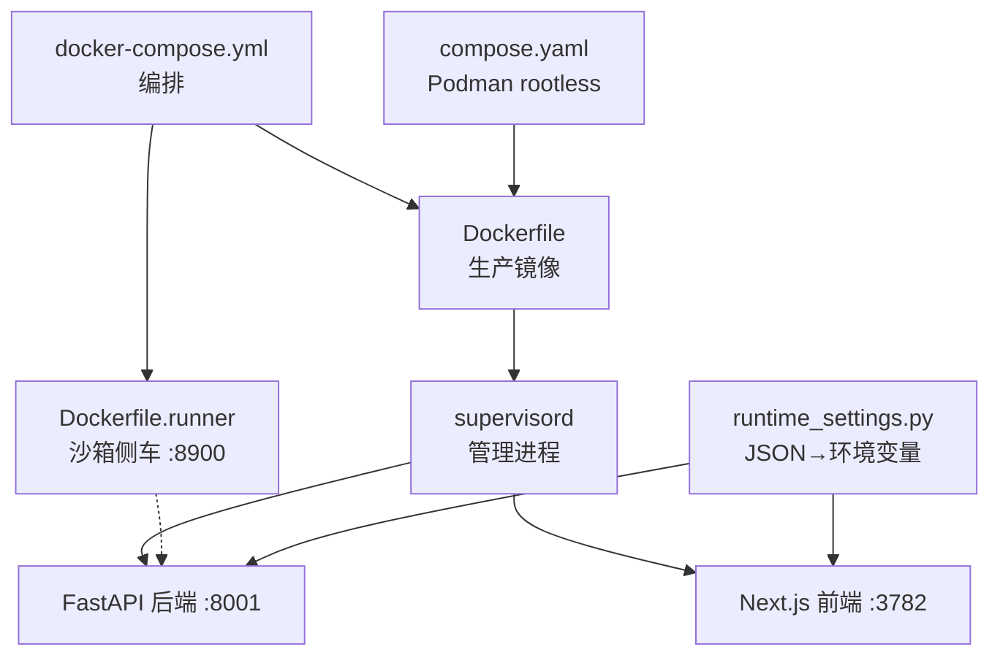
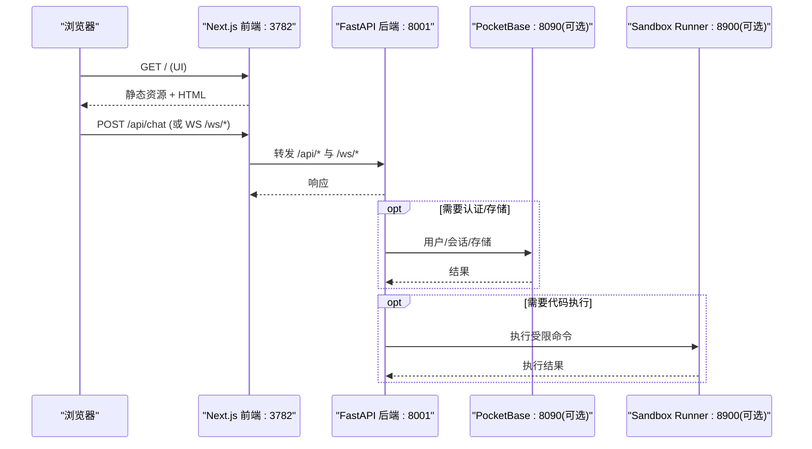
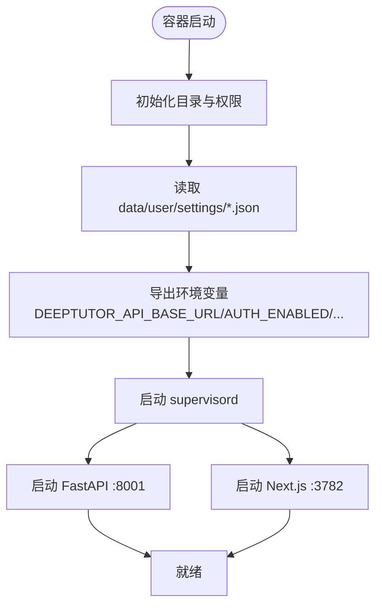
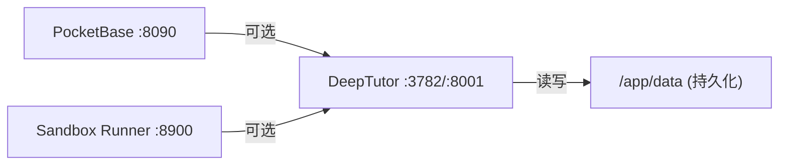

# 容器化部署配置

<cite>
**本文引用的文件**
- [Dockerfile](file://Dockerfile)
- [Dockerfile.runner](file://Dockerfile.runner)
- [compose.yaml](file://compose.yaml)
- [docker-compose.yml](file://docker-compose.yml)
- [docker-compose.dev.yml](file://docker-compose.dev.yml)
- [scripts/docker_compose.py](file://scripts/docker_compose.py)
- [CONTAINERIZATION.md](file://CONTAINERIZATION.md)
- [.dockerignore](file://.dockerignore)
- [deeptutor/services/config/runtime_settings.py](file://deeptutor/services/config/runtime_settings.py)
</cite>

## 目录
1. [简介](#简介)
2. [项目结构](#项目结构)
3. [核心组件](#核心组件)
4. [架构总览](#架构总览)
5. [详细组件分析](#详细组件分析)
6. [依赖关系分析](#依赖关系分析)
7. [性能与资源限制](#性能与资源限制)
8. [故障排查指南](#故障排查指南)
9. [结论](#结论)
10. [附录：常用命令与环境变量速查](#附录：常用命令与环境变量速查)

## 简介
本指南面向使用 Docker/Podman 部署 DeepTutor 的运维与开发者，覆盖镜像构建、容器运行参数、环境变量与运行时配置、端口映射、数据持久化、网络与安全、以及监控与日志收集等主题。文档基于仓库中的多阶段 Dockerfile、Compose 编排与运行时设置服务，提供可直接落地的命令示例与最佳实践。

## 项目结构
DeepTutor 的容器化由以下关键文件协同完成：
- 生产镜像定义：Dockerfile（多阶段构建，包含前端 Next.js 静态产物与后端 FastAPI）
- 沙箱执行器镜像：Dockerfile.runner（最小化侧车，用于隔离执行不受信任的代码）
- Compose 编排：docker-compose.yml（默认编排，含 PocketBase 与 sandbox-runner）、compose.yaml（Podman rootless 安全模式）
- 开发覆盖：docker-compose.dev.yml（源码热重载）
- 运行时设置：runtime_settings.py（JSON 驱动的配置中心，入口脚本在启动时读取并导出环境变量）
- 辅助脚本：scripts/docker_compose.py（从 JSON 渲染 Compose 端口映射）
- 忽略规则：.dockerignore（缩小构建上下文）

图表来源
- [Dockerfile:102-165](file://Dockerfile#L102-L165)
- [Dockerfile:218-259](file://Dockerfile#L218-L259)
- [Dockerfile.runner:19-111](file://Dockerfile.runner#L19-L111)
- [docker-compose.yml:21-183](file://docker-compose.yml#L21-L183)
- [compose.yaml:67-199](file://compose.yaml#L67-L199)
- [deeptutor/services/config/runtime_settings.py:500-546](file://deeptutor/services/config/runtime_settings.py#L500-L546)

章节来源
- [Dockerfile:1-504](file://Dockerfile#L1-L504)
- [Dockerfile.runner:1-111](file://Dockerfile.runner#L1-L111)
- [docker-compose.yml:1-183](file://docker-compose.yml#L1-L183)
- [compose.yaml:1-207](file://compose.yaml#L1-L207)
- [scripts/docker_compose.py:1-113](file://scripts/docker_compose.py#L1-L113)
- [CONTAINERIZATION.md:1-468](file://CONTAINERIZATION.md#L1-L468)
- [.dockerignore:1-139](file://.dockerignore#L1-L139)
- [deeptutor/services/config/runtime_settings.py:15-68](file://deeptutor/services/config/runtime_settings.py#L15-L68)

## 核心组件
- 生产镜像（Dockerfile）
  - 多阶段构建：Node 前端构建 → Python 依赖安装 → 最终镜像合并
  - 内置 supervisord 管理后端与前端进程，统一输出到 stdout/stderr
  - 健康检查与健康探针指向后端根路径
  - 暴露端口：8001（后端）、3782（前端）
- 沙箱侧车（Dockerfile.runner）
  - 仅包含最小依赖与工具链，以非 root 用户运行
  - 通过 HTTP 接口接受主应用请求，隔离执行不受信任代码
  - 暴露端口：8900（内部网络）
- Compose 编排
  - docker-compose.yml：默认编排，包含 deeptutor、pocketbase、sandbox-runner
  - compose.yaml：Podman rootless + 只读根文件系统 + tmpfs 临时目录
  - docker-compose.dev.yml：开发模式，挂载源码实现热重载
- 运行时设置（runtime_settings.py）
  - 所有运行时配置集中在 data/user/settings/*.json
  - 启动时读取 JSON 并导出为环境变量（如 DEEPTUTOR_API_BASE_URL、AUTH_ENABLED 等）
  - 支持系统、认证、集成、解析引擎等多类配置

章节来源
- [Dockerfile:102-165](file://Dockerfile#L102-L165)
- [Dockerfile:218-259](file://Dockerfile#L218-L259)
- [Dockerfile:414-439](file://Dockerfile#L414-L439)
- [Dockerfile.runner:19-111](file://Dockerfile.runner#L19-L111)
- [docker-compose.yml:21-183](file://docker-compose.yml#L21-L183)
- [compose.yaml:67-199](file://compose.yaml#L67-L199)
- [deeptutor/services/config/runtime_settings.py:500-546](file://deeptutor/services/config/runtime_settings.py#L500-L546)

## 架构总览
DeepTutor 单镜像同时承载后端与前端，通过 Next.js 中间件将 /api/* 和 /ws/* 转发至同容器内的后端；可选 PocketBase 作为认证/存储侧车；可选 sandbox-runner 作为受控代码执行侧车。

图表来源
- [Dockerfile:264-315](file://Dockerfile#L264-L315)
- [docker-compose.yml:21-183](file://docker-compose.yml#L21-L183)
- [compose.yaml:67-199](file://compose.yaml#L67-L199)
- [deeptutor/services/config/runtime_settings.py:500-546](file://deeptutor/services/config/runtime_settings.py#L500-L546)

## 详细组件分析

### 镜像构建与运行
- 构建目标
  - 生产镜像：包含 Node 运行时、Python 依赖、Next.js 独立输出、应用源码与启动脚本
  - 开发镜像：额外挂载 node_modules 与源码，启用热重载
- 运行要点
  - 数据卷：必须挂载 /app/data（建议宿主机 ./data），用于 settings、workspace、memory、knowledge_bases、logs
  - 端口映射：通常只需对外暴露 3782；如需直接访问 API，再暴露 8001
  - 健康检查：容器内健康检查探测后端根路径
  - 启动流程：entrypoint 初始化目录、加载 JSON 设置并导出环境变量，然后交由 supervisord 拉起后端与前端

图表来源
- [Dockerfile:317-412](file://Dockerfile#L317-L412)
- [Dockerfile:218-259](file://Dockerfile#L218-L259)
- [deeptutor/services/config/runtime_settings.py:500-546](file://deeptutor/services/config/runtime_settings.py#L500-L546)

章节来源
- [Dockerfile:17-52](file://Dockerfile#L17-L52)
- [Dockerfile:102-165](file://Dockerfile#L102-L165)
- [Dockerfile:264-315](file://Dockerfile#L264-L315)
- [Dockerfile:317-412](file://Dockerfile#L317-L412)
- [Dockerfile:441-504](file://Dockerfile#L441-L504)

### 容器文件系统与数据持久化
- 关键目录
  - /app/data/user/settings：运行时配置（system.json、auth.json、integrations.json、model_catalog.json 等）
  - /app/data/user/workspace：管理员工作区
  - /app/data/users/<uid>：按用户的工作区
  - /app/data/knowledge_bases：知识库
  - /app/data/memory：记忆
  - /app/data/partners：合作伙伴相关
  - /app/data/system：系统级状态（JWT、账户、授权、审计、令牌等）
  - /app/data/cli-apps：已安装的 CLI 应用（对 sandbox-runner 只读）
  - /app/data/user/logs：日志输出
- 持久化策略
  - 推荐将宿主 ./data 绑定挂载到 /app/data，确保重启后配置与数据不丢失
  - 注意：named volume 在 Podman rootless keep-id 下可能产生 UID 不匹配问题，优先使用 bind mount

章节来源
- [Dockerfile:174-189](file://Dockerfile#L174-L189)
- [docker-compose.yml:65-75](file://docker-compose.yml#L65-L75)
- [compose.yaml:147-157](file://compose.yaml#L147-L157)
- [CONTAINERIZATION.md:146-169](file://CONTAINERIZATION.md#L146-L169)

### 端口映射与网络配置
- 默认端口
  - 后端：8001（FastAPI）
  - 前端：3782（Next.js）
  - PocketBase（可选）：8090
  - Sandbox Runner（可选）：8900（仅内部网络）
- 绑定策略
  - 推荐仅对外暴露 3782；若需直接调用 API，再暴露 8001
  - 本地 LLM（Ollama/LM Studio/vLLM 等）可通过 host.docker.internal 或 --network=host 访问
- 网络
  - docker-compose.yml 使用 bridge 网络 deeptutor-network
  - compose.yaml 使用 bridge 网络 deeptutor，且端口默认绑定 127.0.0.1

章节来源
- [Dockerfile:430-431](file://Dockerfile#L430-L431)
- [docker-compose.yml:61-64](file://docker-compose.yml#L61-L64)
- [docker-compose.yml:112-175](file://docker-compose.yml#L112-L175)
- [compose.yaml:85-86](file://compose.yaml#L85-L86)
- [compose.yaml:144-146](file://compose.yaml#L144-L146)
- [CONTAINERIZATION.md:210-247](file://CONTAINERIZATION.md#L210-L247)

### 环境变量与运行时配置
- 配置来源优先级
  - 启动时 entrypoint 会重置一批环境变量，并从 data/user/settings/*.json 重新导出
  - 因此推荐使用 Web Settings 页面或直接编辑 JSON 进行配置，而非通过 Compose env 注入
- 关键导出变量（节选）
  - BACKEND_PORT、FRONTEND_PORT
  - NEXT_PUBLIC_API_BASE、NEXT_PUBLIC_API_BASE_EXTERNAL
  - CORS_ORIGIN、CORS_ORIGINS
  - DISABLE_SSL_VERIFY、CHAT_ATTACHMENT_DIR
  - AUTH_ENABLED、AUTH_USERNAME、AUTH_PASSWORD_HASH、AUTH_TOKEN_EXPIRE_HOURS、AUTH_COOKIE_SECURE
  - NEXT_PUBLIC_AUTH_ENABLED
  - DEEPTUTOR_API_BASE_URL、DEEPTUTOR_AUTH_ENABLED
  - POCKETBASE_URL、POCKETBASE_PORT、POCKETBASE_EXTERNAL_URL、POCKETBASE_ADMIN_EMAIL、POCKETBASE_ADMIN_PASSWORD
- 说明
  - DEEPTUTOR_API_BASE_URL 是前端服务器端转发后端地址，不是浏览器可见 URL
  - 当 auth 启用时，web/proxy.ts 会依据 DEEPTUTOR_AUTH_ENABLED 决定是否要求登录

章节来源
- [Dockerfile:317-412](file://Dockerfile#L317-L412)
- [deeptutor/services/config/runtime_settings.py:500-546](file://deeptutor/services/config/runtime_settings.py#L500-L546)
- [CONTAINERIZATION.md:345-380](file://CONTAINERIZATION.md#L345-L380)

### 沙箱执行器（Sandbox Runner）
- 作用
  - 隔离执行不受信任的命令，避免在主容器中运行恶意代码
- 镜像特点
  - 最小依赖，非 root 用户运行，只读根文件系统，tmpfs 临时目录
  - 仅暴露 8900 端口，仅供内部网络访问
- 集成方式
  - 通过环境变量 DEEPTUTOR_SANDBOX_RUNNER_URL 指向 http://sandbox-runner:8900
  - 主应用通过 HTTP 调用侧车执行命令，结果返回给主流程

章节来源
- [Dockerfile.runner:1-111](file://Dockerfile.runner#L1-L111)
- [docker-compose.yml:76-84](file://docker-compose.yml#L76-L84)
- [docker-compose.yml:101-175](file://docker-compose.yml#L101-L175)

### 监控与健康检查
- 容器健康检查
  - 后端：探测 http://localhost:8001/
  - PocketBase：探测 http://localhost:8090/api/health
  - Sandbox Runner：探测 http://localhost:8900/health
- 日志
  - supervisord 子进程输出到 stdout/stderr，可通过 docker logs 或 podman logs 查看
  - 应用也写入 data/user/logs 下的日志文件

章节来源
- [Dockerfile:414-439](file://Dockerfile#L414-L439)
- [docker-compose.yml:85-90](file://docker-compose.yml#L85-L90)
- [docker-compose.yml:166-172](file://docker-compose.yml#L166-L172)
- [compose.yaml:99-110](file://compose.yaml#L99-L110)
- [compose.yaml:168-177](file://compose.yaml#L168-L177)

### 开发与调试
- 开发覆盖
  - 使用 docker-compose.dev.yml 可挂载源码实现前后端热重载
  - 开发镜像 target=development，启用 uvicorn --reload 与 next dev
- 端口渲染
  - scripts/docker_compose.py 从 system.json/integrations.json 渲染 Compose 端口环境变量，避免手动维护

章节来源
- [docker-compose.dev.yml:1-52](file://docker-compose.dev.yml#L1-L52)
- [scripts/docker_compose.py:1-113](file://scripts/docker_compose.py#L1-L113)

## 依赖关系分析
- 服务间依赖
  - deeptutor 依赖 pocketbase（可选，但编排中声明 depends_on 且条件为 healthy）
  - deeptutor 依赖 sandbox-runner（可选，编排中声明 depends_on 且条件为 healthy）
- 网络依赖
  - 所有服务位于同一桥接网络，通过服务名互相访问
- 配置依赖
  - runtime_settings.py 将 JSON 配置导出为环境变量，供后端与前端使用

图表来源
- [docker-compose.yml:92-99](file://docker-compose.yml#L92-L99)
- [docker-compose.yml:112-175](file://docker-compose.yml#L112-L175)
- [compose.yaml:178-182](file://compose.yaml#L178-L182)

章节来源
- [docker-compose.yml:21-183](file://docker-compose.yml#L21-L183)
- [compose.yaml:67-199](file://compose.yaml#L67-L199)

## 性能与资源限制
- 内存与 CPU
  - 可在 Compose 中设置 mem_limit、cpus、pids_limit 等资源限制（compose.yaml 中给出注释示例）
  - sandbox-runner 已设置 pids_limit 与 mem_limit，防止失控
- 只读根文件系统
  - compose.yaml 对所有服务启用 read_only:true，并通过 tmpfs 提供必要的写路径
- 附件大小与 WebSocket
  - 后端启动时根据配置动态计算 ws-max-size，避免大附件被截断
- 连接保持
  - 后端 uvicorn 设置 timeout-keep-alive，与前端代理保持一致，减少连接竞争导致的错误

章节来源
- [compose.yaml:183-196](file://compose.yaml#L183-L196)
- [docker-compose.yml:148-165](file://docker-compose.yml#L148-L165)
- [Dockerfile:281-292](file://Dockerfile#L281-L292)

## 故障排查指南
- 常见症状与处理
  - “Backend unreachable”：通常是后端未启动或 DEEPTUTOR_API_BASE_URL 配置错误；检查容器日志与 JSON 配置
  - PID 文件写入失败：旧镜像可能尝试写入 /var/run/supervisord.pid；新镜像已改为 /tmp/supervisord.pid
  - 首次 JSON 写入权限错误：Podman named volume 的 UID 映射导致；改用 bind mount 或加 :U 后缀
  - 无法连接 Docker/Podman：确认 socket 与用户态服务已启动
- 定位步骤
  - 查看容器日志：docker logs -f deeptutor
  - 检查健康检查：docker inspect 或 podman inspect
  - 校验 JSON 配置：data/user/settings/system.json、auth.json、integrations.json
  - 验证端口映射：确保 3782 已对外暴露，必要时再暴露 8001

章节来源
- [CONTAINERIZATION.md:406-440](file://CONTAINERIZATION.md#L406-L440)
- [compose.yaml:325-342](file://compose.yaml#L325-L342)

## 结论
DeepTutor 的容器化方案提供了灵活而安全的部署形态：单镜像快速上手、Compose 编排扩展能力、Podman rootless 强化安全。通过 JSON 驱动的运行时配置与 supervisord 进程管理，结合可选的 PocketBase 与 sandbox-runner，既能满足单机试用，也能支撑生产环境的多服务协作与强隔离需求。

## 附录：常用命令与环境变量速查
- 快速启动（单镜像）
  - 仅暴露前端：docker run -p 127.0.0.1:3782:3782 -v deeptutor-data:/app/data ghcr.io/hkuds/deeptutor:latest
  - 同时暴露后端：在上述基础上追加 -p 127.0.0.1:8001:8001
- Compose 启动
  - 默认编排：python scripts/docker_compose.py up -d
  - Podman rootless：podman compose -f compose.yaml up -d
- 常用环境变量（由 JSON 导出，不建议直接覆盖）
  - DEEPTUTOR_API_BASE_URL、DEEPTUTOR_AUTH_ENABLED
  - BACKEND_PORT、FRONTEND_PORT
  - AUTH_ENABLED、AUTH_USERNAME、AUTH_PASSWORD_HASH、AUTH_TOKEN_EXPIRE_HOURS、AUTH_COOKIE_SECURE
  - POCKETBASE_URL、POCKETBASE_PORT、POCKETBASE_EXTERNAL_URL、POCKETBASE_ADMIN_EMAIL、POCKETBASE_ADMIN_PASSWORD
  - CORS_ORIGIN、CORS_ORIGINS、DISABLE_SSL_VERIFY、CHAT_ATTACHMENT_DIR

章节来源
- [CONTAINERIZATION.md:56-91](file://CONTAINERIZATION.md#L56-L91)
- [CONTAINERIZATION.md:171-209](file://CONTAINERIZATION.md#L171-L209)
- [CONTAINERIZATION.md:250-317](file://CONTAINERIZATION.md#L250-L317)
- [deeptutor/services/config/runtime_settings.py:500-546](file://deeptutor/services/config/runtime_settings.py#L500-L546)