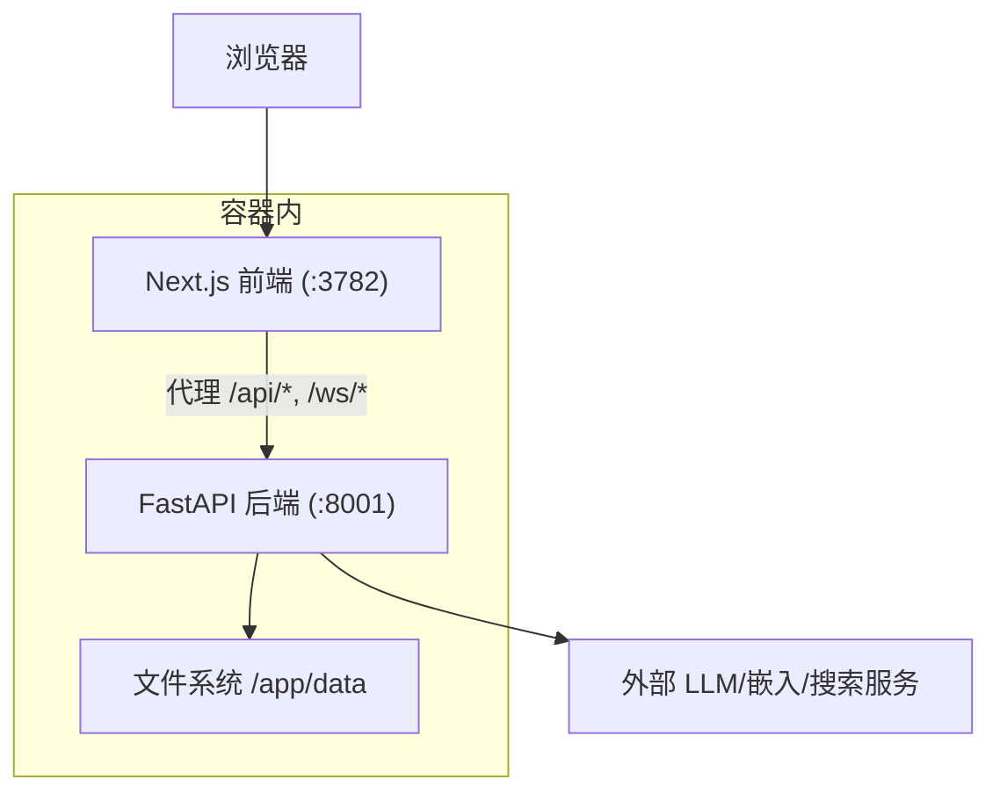
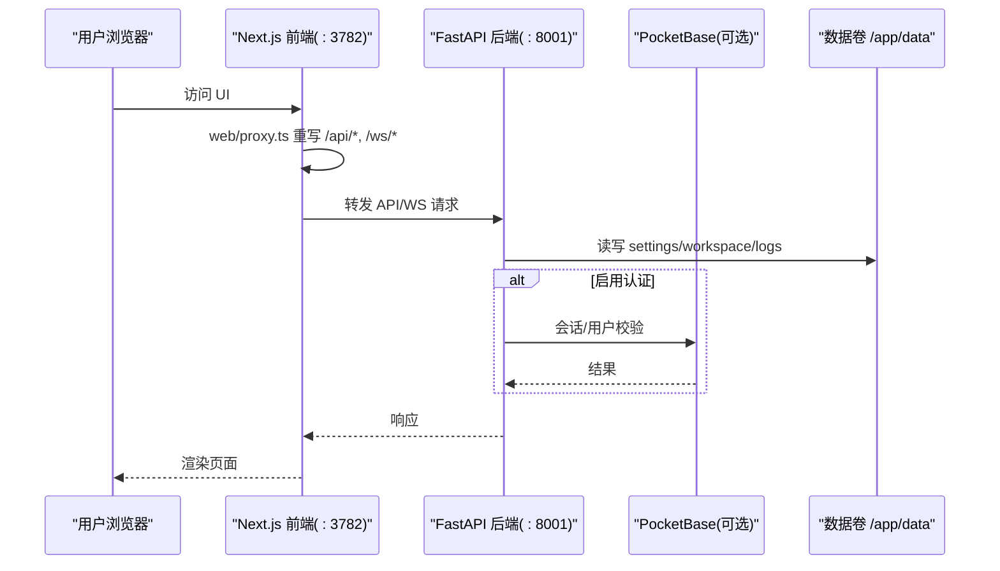
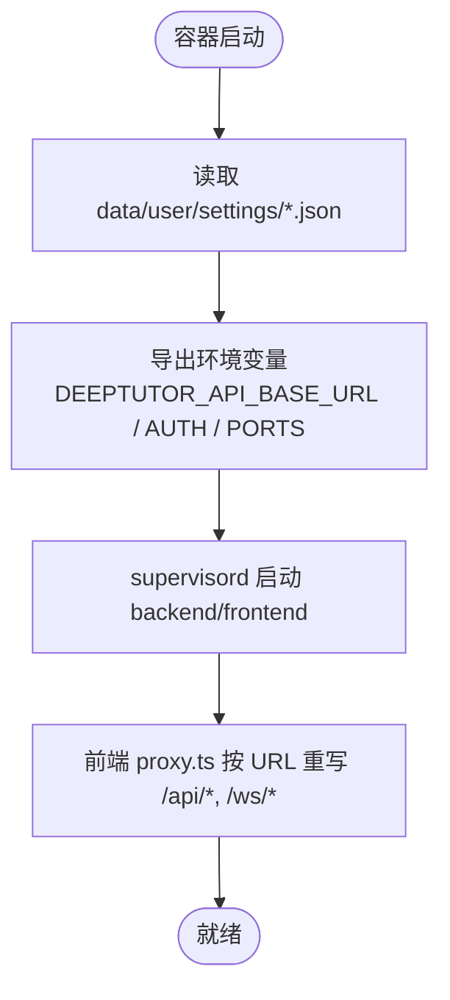
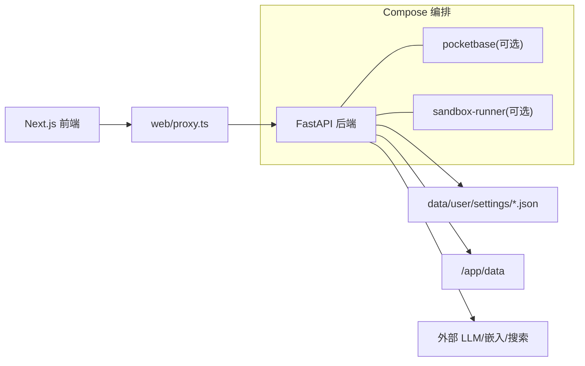

# 部署场景配置

<cite>
**本文引用的文件**
- [Dockerfile](file://Dockerfile)
- [docker-compose.yml](file://docker-compose.yml)
- [compose.yaml](file://compose.yaml)
- [docker-compose.dev.yml](file://docker-compose.dev.yml)
- [compose.codex-oauth.yaml](file://compose.codex-oauth.yaml)
- [CONTAINERIZATION.md](file://CONTAINERIZATION.md)
- [scripts/docker_compose.py](file://scripts/docker_compose.py)
- [deeptutor/api/main.py](file://deeptutor/api/main.py)
- [web/proxy.ts](file://web/proxy.ts)
</cite>

## 目录
1. [简介](#简介)
2. [项目结构](#项目结构)
3. [核心组件](#核心组件)
4. [架构总览](#架构总览)
5. [详细组件分析](#详细组件分析)
6. [依赖关系分析](#依赖关系分析)
7. [性能与资源配置建议](#性能与资源配置建议)
8. [故障排除指南](#故障排除指南)
9. [结论](#结论)
10. [附录：各部署场景完整配置示例](#附录各部署场景完整配置示例)

## 简介
本指南面向不同部署场景，提供单机、容器化、多容器编排、反向代理等部署方式的完整配置说明。内容涵盖网络配置、端口映射、数据持久化、安全加固、性能优化与常见问题排查。所有配置均以仓库中现有镜像与编排文件为依据，确保可复现与可维护。

## 项目结构
DeepTutor 提供统一的容器镜像，内置 FastAPI 后端（默认 8001）与 Next.js 前端（默认 3782），通过 supervisord 管理进程。数据统一挂载到 /app/data，包含运行时设置、工作区、知识库、日志等。支持 Docker 与 Podman 两种运行方式，并提供 Compose 编排以集成可选的 PocketBase 认证/存储侧车以及沙箱执行器。

图表来源
- [Dockerfile:235-259](file://Dockerfile#L235-L259)
- [Dockerfile:264-313](file://Dockerfile#L264-L313)
- [Dockerfile:318-409](file://Dockerfile#L318-L409)

章节来源
- [Dockerfile:17-51](file://Dockerfile#L17-L51)
- [Dockerfile:104-165](file://Dockerfile#L104-L165)
- [Dockerfile:211-259](file://Dockerfile#L211-L259)
- [Dockerfile:264-313](file://Dockerfile#L264-L313)
- [Dockerfile:318-409](file://Dockerfile#L318-L409)

## 核心组件
- 镜像与进程管理
  - 多阶段构建：前端静态产物 + Node 运行时 + Python 依赖 + 生产镜像
  - supervisord 启动 backend/frontend，非 root 用户运行
  - 入口脚本在启动时从 data/user/settings/*.json 加载运行时配置并导出环境变量
- 网络与代理
  - 前端通过 web/proxy.ts 将 /api/* 和 /ws/* 转发至后端（基于 DEEPTUTOR_API_BASE_URL）
  - 单容器部署无需暴露后端端口；分割部署需配置 next_public_api_base
- 数据持久化
  - 统一挂载 /app/data，包含 settings、workspace、memory、knowledge_bases、logs 等
- 可选侧车
  - PocketBase：用于认证与会话存储（可选）
  - sandbox-runner：隔离执行不受信代码（Compose 模式）

章节来源
- [Dockerfile:235-259](file://Dockerfile#L235-L259)
- [Dockerfile:264-313](file://Dockerfile#L264-L313)
- [Dockerfile:318-409](file://Dockerfile#L318-L409)
- [CONTAINERIZATION.md:13-52](file://CONTAINERIZATION.md#L13-L52)
- [CONTAINERIZATION.md:171-199](file://CONTAINERIZATION.md#L171-L199)

## 架构总览
下图展示了单容器与多容器编排下的请求路径、数据流与依赖关系。

图表来源
- [Dockerfile:264-313](file://Dockerfile#L264-L313)
- [Dockerfile:318-409](file://Dockerfile#L318-L409)
- [docker-compose.yml:21-99](file://docker-compose.yml#L21-L99)
- [compose.yaml:67-182](file://compose.yaml#L67-L182)

## 详细组件分析

### 运行时配置加载与环境变量
- 入口脚本会重置一系列环境变量，并从 data/user/settings/*.json 重新导出，保证 JSON 为唯一真实来源
- 关键导出包括 DEEPTUTOR_API_BASE_URL、DEEPTUTOR_AUTH_ENABLED、BACKEND_PORT、FRONTEND_PORT 等
- 前端通过 web/proxy.ts 读取 DEEPTUTOR_API_BASE_URL 进行服务端重写，避免构建期硬编码

图表来源
- [Dockerfile:318-409](file://Dockerfile#L318-L409)
- [CONTAINERIZATION.md:345-379](file://CONTAINERIZATION.md#L345-L379)

章节来源
- [Dockerfile:318-409](file://Dockerfile#L318-L409)
- [CONTAINERIZATION.md:345-379](file://CONTAINERIZATION.md#L345-L379)

### 端口与网络
- 默认后端 8001、前端 3782，可通过 system.json 修改并在 Compose 中映射
- 单容器部署只需暴露前端端口；分割部署需设置 next_public_api_base
- CORS 使用前端 origins，可在 system.json 中配置 cors_origins

章节来源
- [docker-compose.yml:54-99](file://docker-compose.yml#L54-L99)
- [compose.yaml:120-182](file://compose.yaml#L120-L182)
- [deeptutor/api/main.py:85-101](file://deeptutor/api/main.py#L85-L101)
- [CONTAINERIZATION.md:171-209](file://CONTAINERIZATION.md#L171-L209)

### 数据持久化
- 统一挂载 /app/data，包含 settings、workspace、memory、knowledge_bases、logs、system、users、partners、cli-apps 等
- 推荐 bind mount 宿主目录以便备份与权限控制；Podman rootless 建议使用 :U 后缀或宿主目录

章节来源
- [docker-compose.yml:65-74](file://docker-compose.yml#L65-L74)
- [compose.yaml:147-157](file://compose.yaml#L147-L157)
- [CONTAINERIZATION.md:146-169](file://CONTAINERIZATION.md#L146-L169)

### 可选侧车：PocketBase 与 Sandbox Runner
- PocketBase：可选认证/存储侧车，需在 integrations.json 中配置 pocketbase_url
- Sandbox Runner：隔离执行不受信代码，仅内部网络可达，限制资源与权限

章节来源
- [docker-compose.yml:21-49](file://docker-compose.yml#L21-L49)
- [docker-compose.yml:101-175](file://docker-compose.yml#L101-L175)
- [compose.yaml:67-111](file://compose.yaml#L67-L111)

## 依赖关系分析
- 前端依赖后端接口，通过代理转发；后端依赖系统设置、模型目录、工具链
- Compose 编排中 deeptutor 依赖 pocketbase 与 sandbox-runner 健康检查
- 开发覆盖层 docker-compose.dev.yml 挂载源码以实现热重载

图表来源
- [docker-compose.yml:54-99](file://docker-compose.yml#L54-L99)
- [docker-compose.yml:101-175](file://docker-compose.yml#L101-L175)
- [compose.yaml:67-182](file://compose.yaml#L67-L182)

章节来源
- [docker-compose.yml:54-99](file://docker-compose.yml#L54-L99)
- [docker-compose.yml:101-175](file://docker-compose.yml#L101-L175)
- [compose.yaml:67-182](file://compose.yaml#L67-L182)

## 性能与资源配置建议
- 资源限制
  - 在 Compose 中为 sandbox-runner 设置 pids_limit、mem_limit，限制不受信代码的资源消耗
  - 对 deeptutor 服务可按主机能力设置 cpus、mem_limit、pids_limit（Podman 文档中有注释示例）
- 内存与缓存
  - 生产镜像已设置 MALLOC_ARENA_MAX/MALLOC_TRIM_THRESHOLD_ 等环境变量优化内存行为
  - 合理设置附件大小与 WS 帧上限，避免大附件上传被截断
- 网络与代理
  - 单容器部署只暴露前端端口，减少攻击面
  - 分割部署务必正确设置 next_public_api_base，避免跨域与连接问题
- 日志与监控
  - 日志输出到 stdout/stderr 与 data/user/logs，便于集中采集
  - 使用 healthcheck 探测后端可用性

章节来源
- [docker-compose.yml:148-175](file://docker-compose.yml#L148-L175)
- [compose.yaml:183-196](file://compose.yaml#L183-L196)
- [Dockerfile:110-117](file://Dockerfile#L110-L117)
- [Dockerfile:281-292](file://Dockerfile#L281-L292)

## 故障排除指南
- 后端不可达
  - 检查容器日志中 backend 进程是否启动成功
  - 分割部署确认 DEEPTUTOR_API_BASE_URL 指向正确的后端地址
- PID 文件写入失败
  - 旧镜像可能尝试写入 /var/run/supervisord.pid；当前镜像已改为 /tmp，若仍报错请升级镜像或调整 tmpfs
- 权限错误
  - 使用 named volume 可能出现 UID 不匹配；改用 bind mount 或在 Podman 中使用 :U 后缀
- Codex OAuth 临时回调
  - 登录期间需要临时映射 1455/1457 到前端端口，完成登录后移除覆盖层
- 本地 LLM 连接
  - Docker 内 localhost 指向容器自身；使用 host.docker.internal 或通过 --network=host 访问宿主机服务

章节来源
- [CONTAINERIZATION.md:406-468](file://CONTAINERIZATION.md#L406-L468)
- [compose.yaml:168-177](file://compose.yaml#L168-L177)
- [compose.codex-oauth.yaml:1-10](file://compose.codex-oauth.yaml#L1-L10)
- [CONTAINERIZATION.md:210-247](file://CONTAINERIZATION.md#L210-L247)

## 结论
DeepTutor 提供一致的容器镜像与灵活的编排方案，支持从单机到多容器的多种部署形态。通过 JSON 驱动的运行时配置、前端代理转发与安全加固策略，能够在不同环境中稳定运行。结合合理的资源限制、网络规划与数据持久化，可满足从个人学习到团队协作的多类需求。

## 附录：各部署场景完整配置示例

### 场景一：单机部署（直接运行镜像）
- 适用：快速体验、本地调试
- 要点：
  - 仅暴露前端端口 3782；后端通过容器内代理访问
  - 使用命名卷或 bind mount 持久化 /app/data
  - 首次启动会在 /app/data/user/settings 生成配置文件，后续通过 Web 设置页编辑

参考命令（见文档）
- 运行镜像并挂载数据卷
- 查看日志、停止与删除容器

章节来源
- [CONTAINERIZATION.md:56-92](file://CONTAINERIZATION.md#L56-L92)
- [Dockerfile:430-439](file://Dockerfile#L430-L439)

### 场景二：容器化部署（Docker Compose）
- 适用：生产环境、含可选侧车
- 要点：
  - 使用 scripts/docker_compose.py 自动根据 system.json/integrations.json 渲染端口映射
  - 默认包含 pocketbase（可选）与 sandbox-runner（可选）
  - 数据统一挂载 ./data 到 /app/data

步骤概览
- 准备 data/user/settings 目录与配置文件
- 运行编排并验证健康检查
- 如需开发热重载，叠加 docker-compose.dev.yml

章节来源
- [docker-compose.yml:1-19](file://docker-compose.yml#L1-L19)
- [docker-compose.yml:21-99](file://docker-compose.yml#L21-L99)
- [docker-compose.yml:101-175](file://docker-compose.yml#L101-L175)
- [scripts/docker_compose.py:45-77](file://scripts/docker_compose.py#L45-L77)
- [docker-compose.dev.yml:1-52](file://docker-compose.dev.yml#L1-L52)

### 场景三：多容器编排（Podman Rootless + 只读根文件系统）
- 适用：高安全要求、最小权限原则
- 要点：
  - 使用 compose.yaml，read_only: true，tmpfs 挂载必要系统目录
  - userns_mode: keep-id 配合 :U 卷挂载实现宿主 UID 映射
  - 端口绑定默认仅 127.0.0.1，按需放开
  - 不包含 sandbox-runner，应用回退到 bwrap 或受限子进程

步骤概览
- 复制 .env.example 并编辑（如需）
- 使用 podman compose 拉起服务并查看状态与日志
- 如需自定义资源限制，取消注释相应配置

章节来源
- [compose.yaml:1-63](file://compose.yaml#L1-L63)
- [compose.yaml:67-182](file://compose.yaml#L67-L182)
- [compose.yaml:183-207](file://compose.yaml#L183-L207)
- [CONTAINERIZATION.md:250-343](file://CONTAINERIZATION.md#L250-L343)

### 场景四：反向代理部署（Nginx/TLS 终止）
- 适用：对外提供服务、统一域名与证书管理
- 要点：
  - 单容器部署：将域名解析到容器前端端口（3782），无需额外 API Base 配置
  - 分割部署：在 system.json 中设置 next_public_api_base，使前端能到达后端
  - CORS：在 system.json 中配置 cors_origins 为实际前端域名
  - WebSocket：确保代理允许 Upgrade 与 Connection 头透传

配置建议
- 监听 443，终止 TLS，将 / 与 /api/*、/ws/* 转发到后端或前端（视部署形态）
- 设置合适的超时与缓冲参数，避免长连接中断
- 开启 Gzip/Brotli 压缩以提升性能

章节来源
- [CONTAINERIZATION.md:171-209](file://CONTAINERIZATION.md#L171-L209)
- [deeptutor/api/main.py:85-101](file://deeptutor/api/main.py#L85-L101)

### 场景五：Codex OAuth 临时回调桥接
- 适用：OpenAI Codex 登录流程
- 要点：
  - 登录期间临时映射 1455/1457 到前端端口
  - 完成后移除覆盖层，释放端口

步骤概览
- 使用 compose.codex-oauth.yaml 作为覆盖层拉起服务
- 完成登录后重建基础服务以移除临时端口

章节来源
- [compose.codex-oauth.yaml:1-10](file://compose.codex-oauth.yaml#L1-L10)
- [CONTAINERIZATION.md:93-144](file://CONTAINERIZATION.md#L93-L144)

### 场景六：本地 LLM 接入（Ollama/LM Studio/vLLM 等）
- 要点：
  - Docker 内 localhost 不等于宿主机；使用 host.docker.internal 或 --network=host
  - 在 Settings → Models 中配置 Base URL 指向宿主机服务
  - 注意防火墙与端口开放策略

章节来源
- [CONTAINERIZATION.md:210-247](file://CONTAINERIZATION.md#L210-L247)