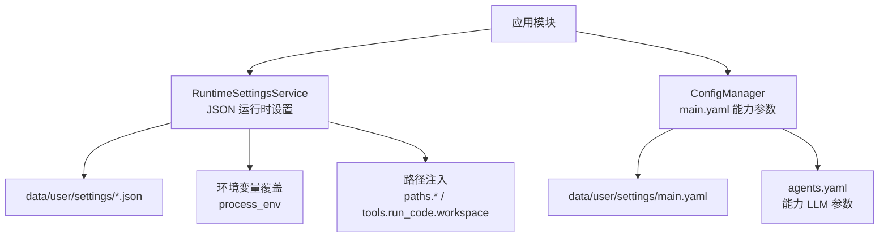
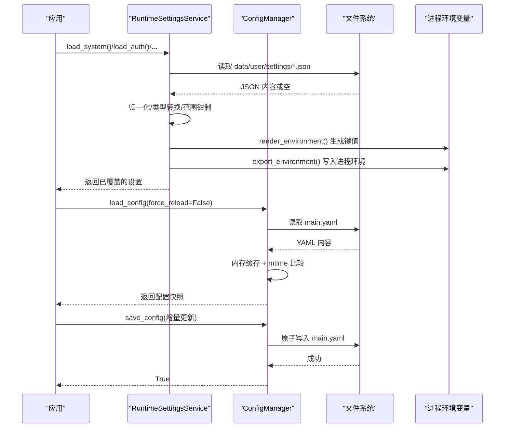
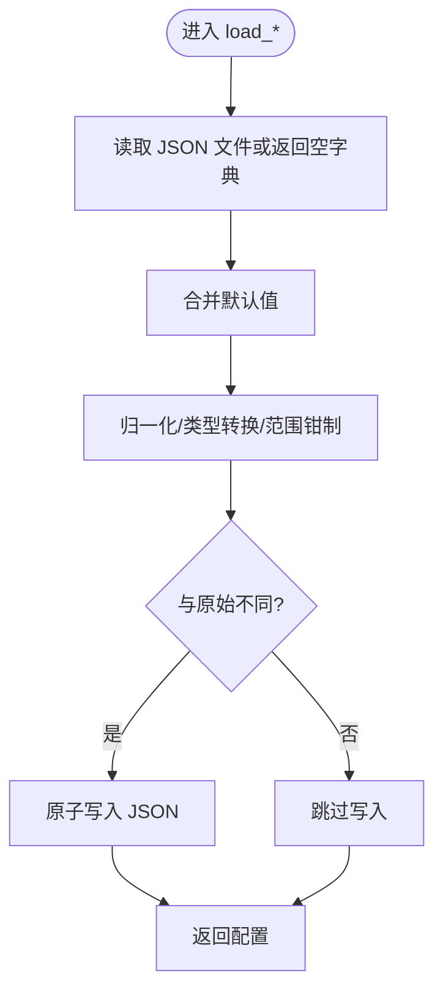
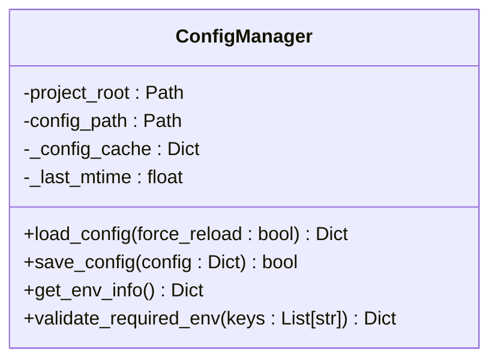
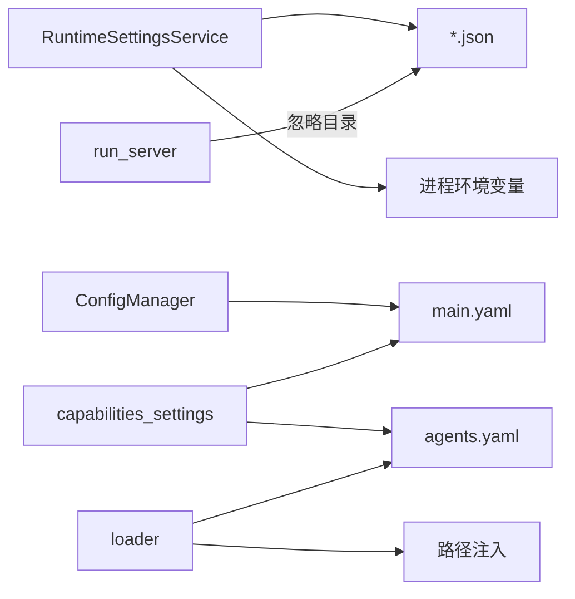

# 配置验证与热重载

<cite>
**本文引用的文件**
- [deeptutor/config/schema.py](file://deeptutor/config/schema.py)
- [deeptutor/config/settings.py](file://deeptutor/config/settings.py)
- [deeptutor/config/accessors.py](file://deeptutor/config/accessors.py)
- [deeptutor/config/defaults.py](file://deeptutor/config/defaults.py)
- [deeptutor/services/config/loader.py](file://deeptutor/services/config/loader.py)
- [deeptutor/services/config/runtime_settings.py](file://deeptutor/services/config/runtime_settings.py)
- [deeptutor/services/config/capabilities_settings.py](file://deeptutor/services/config/capabilities_settings.py)
- [deeptutor/utils/config_manager.py](file://deeptutor/utils/config_manager.py)
- [deeptutor/api/run_server.py](file://deeptutor/api/run_server.py)
</cite>

## 目录
1. [简介](#简介)
2. [项目结构](#项目结构)
3. [核心组件](#核心组件)
4. [架构总览](#架构总览)
5. [详细组件分析](#详细组件分析)
6. [依赖关系分析](#依赖关系分析)
7. [性能考虑](#性能考虑)
8. [故障排查指南](#故障排查指南)
9. [结论](#结论)
10. [附录](#附录)

## 简介
本文件聚焦 DeepTutor 的配置验证与热重载机制，覆盖以下目标：
- 配置文件的数据格式、校验规则与默认值来源
- 运行时设置（JSON）与能力参数（YAML）的加载、合并与持久化
- 环境变量覆盖策略与进程内导出
- 配置变更对系统运行的影响、监控与日志记录
- 版本兼容性与迁移策略
- 调试工具与故障诊断方法

## 项目结构
配置体系由“运行时设置服务”和“能力参数管理器”组成，分别负责 JSON 与 YAML 两类配置的加载、校验、合并与持久化。

**图表来源**
- [deeptutor/services/config/runtime_settings.py:309-589](file://deeptutor/services/config/runtime_settings.py#L309-L589)
- [deeptutor/utils/config_manager.py:12-91](file://deeptutor/utils/config_manager.py#L12-L91)
- [deeptutor/services/config/loader.py:23-78](file://deeptutor/services/config/loader.py#L23-L78)

**章节来源**
- [deeptutor/services/config/runtime_settings.py:309-589](file://deeptutor/services/config/runtime_settings.py#L309-L589)
- [deeptutor/utils/config_manager.py:12-91](file://deeptutor/utils/config_manager.py#L12-L91)
- [deeptutor/services/config/loader.py:23-78](file://deeptutor/services/config/loader.py#L23-L78)

## 核心组件
- 运行时设置服务（RuntimeSettingsService）
  - 管理 system.json、auth.json、integrations.json、document_parsing.json、llamaindex.json、graphrag.json、lightrag.json、pageindex.json 等
  - 提供 load/save 接口，内部执行归一化、范围钳制、类型转换与环境变量覆盖
  - 支持将非模型类设置渲染为进程环境变量，供子进程使用
- 能力参数管理器（ConfigManager）
  - 管理 main.yaml（能力运行时的非 LLM 参数），具备内存缓存与基于 mtime 的热更新
  - 原子写入（临时文件 + os.replace）保障并发安全
- 统一加载器（loader）
  - 解析 agents.yaml、注入运行时路径、语言代码标准化、读取聊天/智能体参数
- 能力设置桥接（capabilities_settings）
  - 将 UI 暴露的统一 schema 拆分写回 agents.yaml 与 main.yaml，并做严格类型与范围校验
- Pydantic 配置模型（settings/schema）
  - 定义环境前缀、嵌套分隔符、字段校验与迁移占位

**章节来源**
- [deeptutor/services/config/runtime_settings.py:309-589](file://deeptutor/services/config/runtime_settings.py#L309-L589)
- [deeptutor/utils/config_manager.py:12-91](file://deeptutor/utils/config_manager.py#L12-L91)
- [deeptutor/services/config/loader.py:151-200](file://deeptutor/services/config/loader.py#L151-L200)
- [deeptutor/services/config/capabilities_settings.py:297-432](file://deeptutor/services/config/capabilities_settings.py#L297-L432)
- [deeptutor/config/settings.py:15-50](file://deeptutor/config/settings.py#L15-L50)
- [deeptutor/config/schema.py:6-38](file://deeptutor/config/schema.py#L6-L38)

## 架构总览
下图展示配置从磁盘到进程的完整链路，包括环境变量覆盖、路径注入、校验与持久化。

**图表来源**
- [deeptutor/services/config/runtime_settings.py:350-558](file://deeptutor/services/config/runtime_settings.py#L350-L558)
- [deeptutor/utils/config_manager.py:55-91](file://deeptutor/utils/config_manager.py#L55-L91)

## 详细组件分析

### 运行时设置服务（RuntimeSettingsService）
- 职责
  - 加载/保存多类 JSON 配置（system/auth/integrations/document_parsing/llamaindex/graphrag/lightrag/pageindex）
  - 应用进程环境变量覆盖（可开关）
  - 渲染并导出为非模型类的进程环境变量
  - 迁移旧版 document_parsing 文件（mineru.json → document_parsing.json）
- 关键行为
  - 所有 load_* 均调用 _load_or_create：若不存在则创建默认值；若存在则归一化后落盘（差异时）
  - 端口、布尔、整数等字段通过专用 coerce 函数进行安全转换与范围钳制
  - 文档解析引擎 v2 结构包含多个引擎切片，v1 扁平结构自动迁移
- 热更新
  - 通过 render_environment/export_environment 将当前设置同步到进程环境，供后续子进程或模块读取

**图表来源**
- [deeptutor/services/config/runtime_settings.py:573-589](file://deeptutor/services/config/runtime_settings.py#L573-L589)

**章节来源**
- [deeptutor/services/config/runtime_settings.py:15-188](file://deeptutor/services/config/runtime_settings.py#L15-L188)
- [deeptutor/services/config/runtime_settings.py:259-289](file://deeptutor/services/config/runtime_settings.py#L259-L289)
- [deeptutor/services/config/runtime_settings.py:350-558](file://deeptutor/services/config/runtime_settings.py#L350-L558)
- [deeptutor/services/config/runtime_settings.py:591-608](file://deeptutor/services/config/runtime_settings.py#L591-L608)

### 能力参数管理器（ConfigManager）
- 职责
  - 管理 main.yaml（能力运行时的非 LLM 参数）
  - 线程安全的单例模式，带内存缓存与 mtime 检测
  - 原子写入（临时文件 + fsync + os.replace）
- 热更新
  - load_config 在 mtime 变化或强制刷新时重新读取
  - save_config 会合并现有配置并原子替换文件，同时更新缓存时间戳

**图表来源**
- [deeptutor/utils/config_manager.py:12-91](file://deeptutor/utils/config_manager.py#L12-L91)

**章节来源**
- [deeptutor/utils/config_manager.py:12-91](file://deeptutor/utils/config_manager.py#L12-L91)

### 统一加载器（loader）
- 职责
  - 解析 agents.yaml，注入运行时路径（paths.*、tools.run_code.workspace）
  - 提供 get_agent_params/get_chat_params 读取能力级 LLM 参数
  - 语言代码标准化（en/zh/其他保留）
- 关键点
  - 路径注入确保工作区与日志目录始终指向运行时根下的真实路径
  - 未找到 agents.yaml 会抛出明确错误，便于定位缺失配置

**章节来源**
- [deeptutor/services/config/loader.py:23-78](file://deeptutor/services/config/loader.py#L23-L78)
- [deeptutor/services/config/loader.py:151-200](file://deeptutor/services/config/loader.py#L151-L200)
- [deeptutor/services/config/loader.py:202-313](file://deeptutor/services/config/loader.py#L202-L313)

### 能力设置桥接（capabilities_settings）
- 职责
  - 将 UI 暴露的统一 schema 拆分为 agents.yaml 与 main.yaml 的对应片段
  - 对 temperature、max_tokens、max_rounds、tool_timeout 等进行严格类型与范围校验
  - 清理历史遗留键，避免污染配置
- 关键点
  - 读路径：合并默认值与用户配置，保证前端表单始终有可用值
  - 写路径：仅写入受控字段，未知键丢弃，防止误改

**章节来源**
- [deeptutor/services/config/capabilities_settings.py:40-89](file://deeptutor/services/config/capabilities_settings.py#L40-L89)
- [deeptutor/services/config/capabilities_settings.py:146-171](file://deeptutor/services/config/capabilities_settings.py#L146-L171)
- [deeptutor/services/config/capabilities_settings.py:297-432](file://deeptutor/services/config/capabilities_settings.py#L297-L432)

### Pydantic 配置模型与环境变量
- Settings（LLM 重试等）
  - 使用 env_prefix="LLM_" 与 env_nested_delimiter="__" 映射环境变量
  - 提供向后兼容属性（如 llm_retry 弃用提示）
- AppConfig（通用配置模型）
  - 校验 llm 段必须为映射且包含 model 字段
  - 提供 CURRENT_SCHEMA_VERSION 与 migrate_config 占位

**章节来源**
- [deeptutor/config/settings.py:15-50](file://deeptutor/config/settings.py#L15-L50)
- [deeptutor/config/schema.py:6-38](file://deeptutor/config/schema.py#L6-L38)

### 默认值与访问器
- defaults.py：提供默认 LLM 模型与路径
- accessors.py：提供便捷读取 llm_model/llm_provider/user_data_dir 的封装

**章节来源**
- [deeptutor/config/defaults.py:5-17](file://deeptutor/config/defaults.py#L5-L17)
- [deeptutor/config/accessors.py:4-18](file://deeptutor/config/accessors.py#L4-L18)

## 依赖关系分析
- RuntimeSettingsService 依赖路径服务与原子写入工具，负责 JSON 配置的生命周期
- ConfigManager 依赖 loader 提供的 settings 目录解析，负责 main.yaml 的缓存与原子写入
- capabilities_settings 同时依赖 loader（agents.yaml）与 ConfigManager（main.yaml）
- loader 注入运行时路径，使配置中的路径与实际部署一致
- API 启动器排除 data/node_modules/.next 等目录触发重载，避免频繁重启

**图表来源**
- [deeptutor/services/config/runtime_settings.py:309-558](file://deeptutor/services/config/runtime_settings.py#L309-L558)
- [deeptutor/utils/config_manager.py:12-91](file://deeptutor/utils/config_manager.py#L12-L91)
- [deeptutor/services/config/capabilities_settings.py:297-432](file://deeptutor/services/config/capabilities_settings.py#L297-L432)
- [deeptutor/services/config/loader.py:23-78](file://deeptutor/services/config/loader.py#L23-L78)
- [deeptutor/api/run_server.py:41-59](file://deeptutor/api/run_server.py#L41-L59)

**章节来源**
- [deeptutor/services/config/runtime_settings.py:309-558](file://deeptutor/services/config/runtime_settings.py#L309-L558)
- [deeptutor/utils/config_manager.py:12-91](file://deeptutor/utils/config_manager.py#L12-L91)
- [deeptutor/services/config/capabilities_settings.py:297-432](file://deeptutor/services/config/capabilities_settings.py#L297-L432)
- [deeptutor/services/config/loader.py:23-78](file://deeptutor/services/config/loader.py#L23-L78)
- [deeptutor/api/run_server.py:41-59](file://deeptutor/api/run_server.py#L41-L59)

## 性能考虑
- 配置读取缓存
  - ConfigManager 使用内存缓存与 mtime 检测，减少重复 I/O
  - RuntimeSettingsService 在归一化结果变化时才落盘，降低写放大
- 原子写入
  - 使用临时文件 + fsync + os.replace，避免部分写入导致配置损坏
- 环境变量覆盖
  - 集中处理，避免分散逻辑带来的额外开销
- 路径注入
  - 仅在加载时计算一次，避免运行时重复解析

[本节为通用性能建议，不直接分析具体文件]

## 故障排查指南
- 常见错误与原因
  - 找不到配置或必需字段缺失
    - 现象：加载 agents.yaml 或 main.yaml 时报错或缺少 key
    - 排查：确认 data/user/settings 下文件是否存在；检查必填字段是否齐全
  - 环境变量覆盖未生效
    - 现象：修改了进程环境变量但配置未变化
    - 排查：确认 include_process_overrides=True 的路径；检查 DEEPTUTOR_IGNORE_PROCESS_ENV_OVERRIDES 是否开启
  - 端口无效或被拒绝
    - 现象：后端/前端端口无法绑定
    - 排查：端口是否在 1-65535；是否被占用；CORS_ORIGINS 格式是否正确
  - 文档解析引擎配置异常
    - 现象：解析失败或下载模型被阻止
    - 排查：检查 allow_local_model_download；确认 engine 名称与版本；查看迁移后的 document_parsing.json
- 日志与监控
  - 配置写入/读取失败通常伴随异常堆栈，结合日志定位具体步骤
  - 使用 render_environment 输出的键值核对实际生效的环境变量
- 调试工具
  - 使用 capabilities_settings_dict 获取当前能力设置的完整视图
  - 使用 ConfigManager.get_env_info 查看运行时关键键值
  - 使用 loader.parse_language 验证语言代码规范化结果

**章节来源**
- [deeptutor/services/config/loader.py:202-247](file://deeptutor/services/config/loader.py#L202-L247)
- [deeptutor/services/config/runtime_settings.py:500-558](file://deeptutor/services/config/runtime_settings.py#L500-L558)
- [deeptutor/utils/config_manager.py:99-124](file://deeptutor/utils/config_manager.py#L99-L124)
- [deeptutor/services/config/capabilities_settings.py:297-307](file://deeptutor/services/config/capabilities_settings.py#L297-L307)

## 结论
DeepTutor 的配置体系以“运行时设置服务 + 能力参数管理器”为核心，结合 Pydantic 校验、环境变量覆盖、路径注入与原子写入，实现了高可靠、易维护、可观测的配置管理。通过统一的 schema 与严格的类型/范围约束，既保证了安全性，也提升了可配置性。配合 mtime 热更新与进程环境变量导出，系统在不停机场景下也能安全地响应配置变更。

[本节为总结性内容，不直接分析具体文件]

## 附录

### 配置数据格式与校验规则
- JSON 运行时设置（system/auth/integrations/document_parsing/llamaindex/graphrag/lightrag/pageindex）
  - 字段类型与范围由各自 normalizer 控制（端口、布尔、整数区间、字符串裁剪等）
  - 文档解析引擎采用 v2 结构，含 engines 子对象；v1 扁平结构首次加载自动迁移
- YAML 能力参数（agents.yaml/main.yaml）
  - temperature/max_tokens 等数值经 coerce 函数限制范围
  - 历史遗留键在写入时被清理，避免污染
- 环境变量
  - 通过 RuntimeSettingsService 的 apply_*_process_overrides 集中映射
  - 可通过 DEEPTUTOR_IGNORE_PROCESS_ENV_OVERRIDES 关闭覆盖

**章节来源**
- [deeptutor/services/config/runtime_settings.py:259-289](file://deeptutor/services/config/runtime_settings.py#L259-L289)
- [deeptutor/services/config/runtime_settings.py:612-723](file://deeptutor/services/config/runtime_settings.py#L612-L723)
- [deeptutor/services/config/capabilities_settings.py:146-171](file://deeptutor/services/config/capabilities_settings.py#L146-L171)
- [deeptutor/services/config/loader.py:171-199](file://deeptutor/services/config/loader.py#L171-L199)

### 热重载工作原理与实现机制
- 进程内热更新
  - ConfigManager 基于 mtime 检测 main.yaml 变更，下次 load_config 自动刷新缓存
  - RuntimeSettingsService 每次 load_* 都会重新读取并归一化，确保最新状态
- 进程外热重载（开发模式）
  - run_server 中配置 reload_excludes，排除 data/node_modules/.next 等目录，避免无关文件触发重启
- 注意事项
  - 某些 WebSocket 帧大小等全局设置在进程启动时确定，修改后需重启才能完全生效

**章节来源**
- [deeptutor/utils/config_manager.py:55-91](file://deeptutor/utils/config_manager.py#L55-L91)
- [deeptutor/api/run_server.py:41-59](file://deeptutor/api/run_server.py#L41-L59)

### 版本兼容性与迁移策略
- 文档解析引擎
  - v1 扁平 mineru.json 首次加载自动迁移至 v2 结构的 document_parsing.json，并锁定 active engine
- 配置模型
  - CURRENT_SCHEMA_VERSION 与 migrate_config 预留扩展点，未来可按版本迁移
- 兼容性读取
  - 多处提供 legacy keys 过滤与降级逻辑，确保旧配置仍可工作

**章节来源**
- [deeptutor/services/config/runtime_settings.py:591-608](file://deeptutor/services/config/runtime_settings.py#L591-L608)
- [deeptutor/services/config/runtime_settings.py:770-800](file://deeptutor/services/config/runtime_settings.py#L770-L800)
- [deeptutor/config/schema.py:31-38](file://deeptutor/config/schema.py#L31-L38)

### 配置监控与日志记录
- 监控
  - render_environment 输出当前生效的环境变量，可用于外部监控或健康检查
  - capabilities_settings_dict 提供能力参数的统一视图，便于审计
- 日志
  - 配置读写失败会抛出异常，结合日志定位问题
  - 建议在关键入口（API、任务调度）记录配置来源与变更事件

**章节来源**
- [deeptutor/services/config/runtime_settings.py:500-558](file://deeptutor/services/config/runtime_settings.py#L500-L558)
- [deeptutor/services/config/capabilities_settings.py:297-307](file://deeptutor/services/config/capabilities_settings.py#L297-L307)

### 配置变更对系统运行的影响与注意事项
- 立即生效
  - 进程内：下一次 load_config/load_* 即生效（mtime 检测或每次读取）
  - 环境变量：export_environment 后立即对后续子进程生效
- 需要重启
  - 全局 WebSocket 帧大小、监听端口等启动期参数，修改后需重启服务
- 安全建议
  - 使用原子写入与范围钳制，避免非法值影响稳定性
  - 谨慎修改 CORS 与认证相关设置，避免跨域或鉴权异常

**章节来源**
- [deeptutor/utils/config_manager.py:55-91](file://deeptutor/utils/config_manager.py#L55-L91)
- [deeptutor/services/config/runtime_settings.py:500-558](file://deeptutor/services/config/runtime_settings.py#L500-L558)