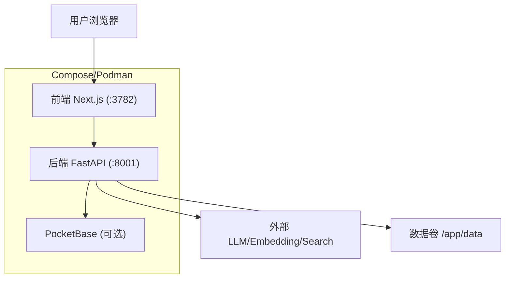
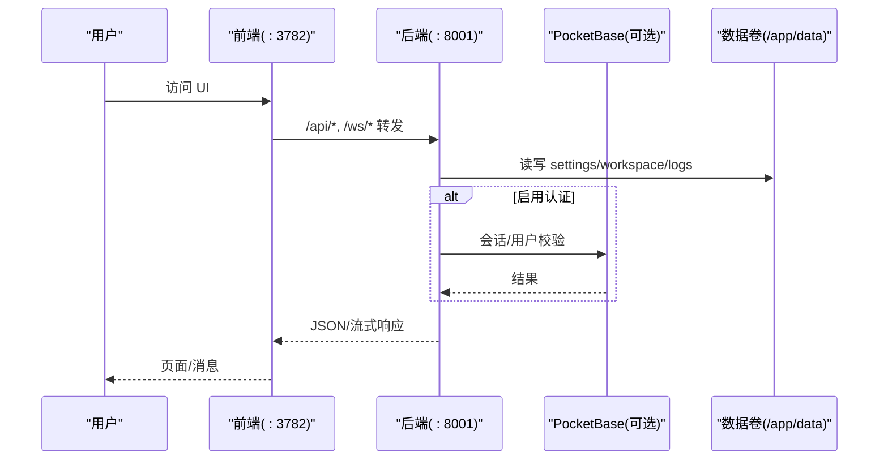
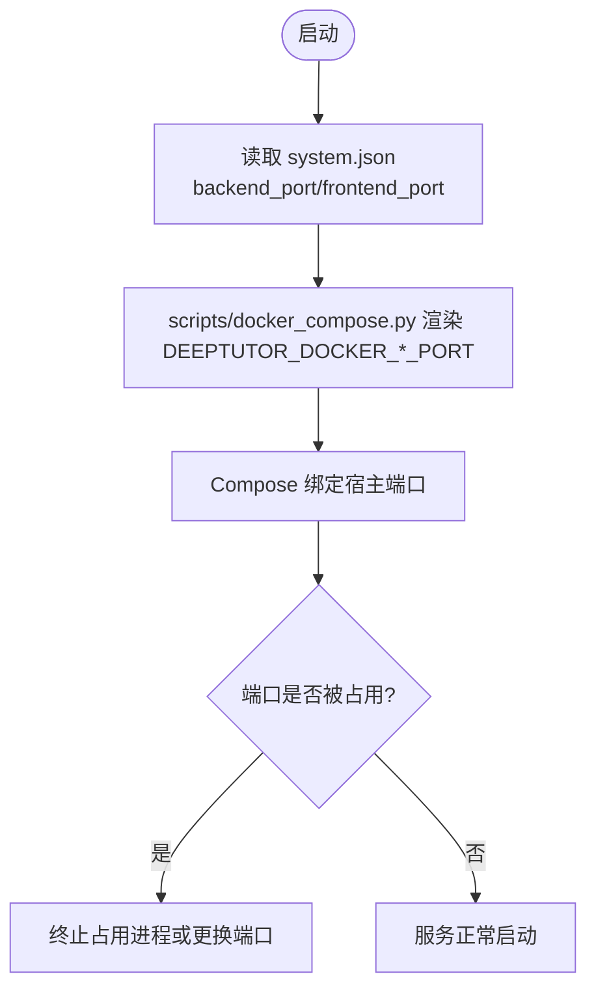
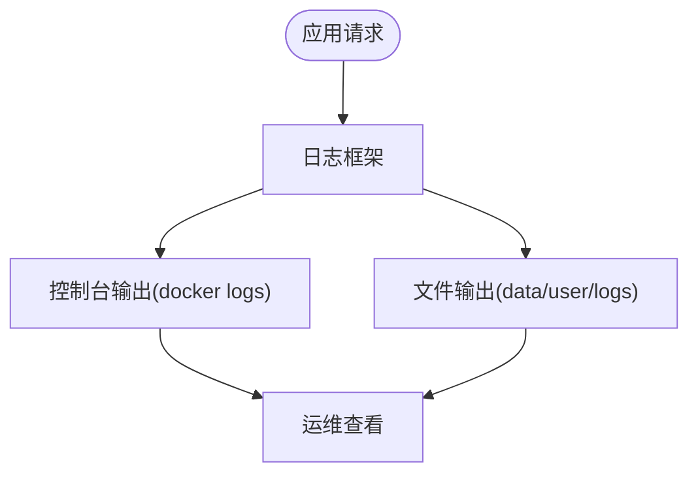
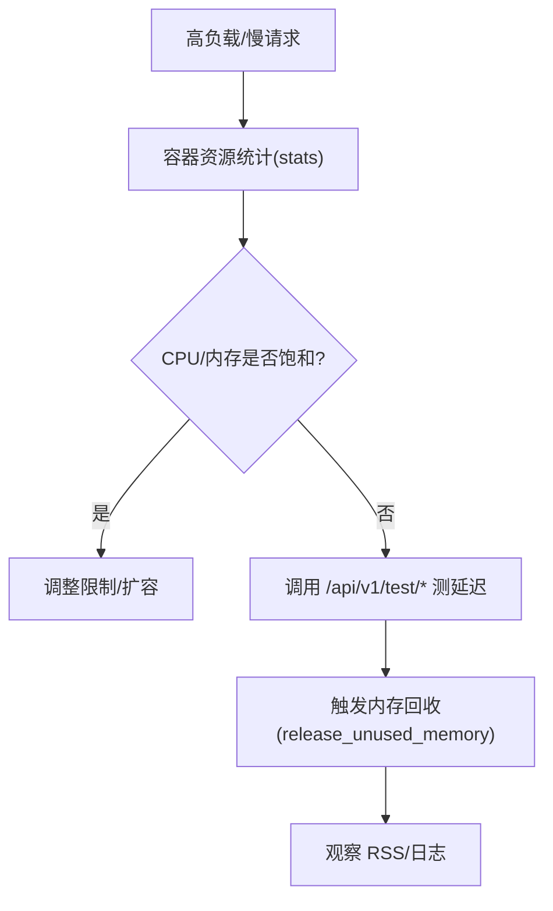
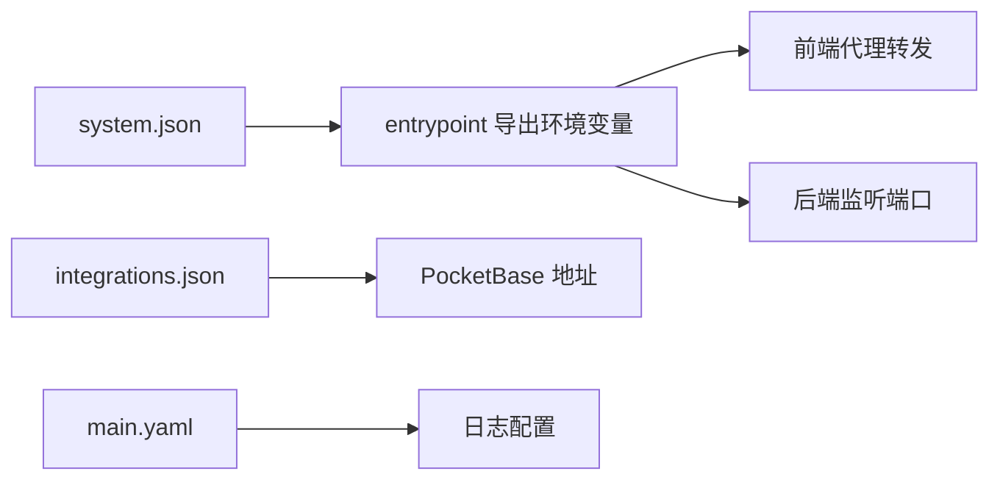

# 故障排除

<cite>
**本文引用的文件**
- [compose.yaml](file://compose.yaml)
- [docker-compose.yml](file://docker-compose.yml)
- [Dockerfile](file://Dockerfile)
- [CONTAINERIZATION.md](file://CONTAINERIZATION.md)
- [scripts/docker_compose.py](file://scripts/docker_compose.py)
- [deeptutor/logging/config.py](file://deeptutor/logging/config.py)
- [deeptutor/runtime/memory_reclaim.py](file://deeptutor/runtime/memory_reclaim.py)
- [deeptutor/utils/error_rate_tracker.py](file://deeptutor/utils/error_rate_tracker.py)
- [deeptutor/api/routers/system.py](file://deeptutor/api/routers/system.py)
</cite>

## 目录
1. [简介](#简介)
2. [项目结构](#项目结构)
3. [核心组件](#核心组件)
4. [架构总览](#架构总览)
5. [详细组件分析](#详细组件分析)
6. [依赖关系分析](#依赖关系分析)
7. [性能注意事项](#性能注意事项)
8. [故障排除指南](#故障排除指南)
9. [结论](#结论)
10. [附录](#附录)

## 简介
本指南面向使用容器部署 DeepTutor 的运维与开发者，聚焦常见部署问题（端口冲突、权限、网络）、日志查看与分析、容器间通信调试、性能诊断（资源监控、慢查询、内存泄漏）以及自动化诊断与告警配置。文档基于仓库中的 Compose/Dockerfile/脚本与运行时模块，提供可操作的步骤与排错路径。

## 项目结构
DeepTutor 容器化部署主要涉及以下文件：
- 编排与镜像构建：compose.yaml、docker-compose.yml、Dockerfile
- 运行说明与排错提示：CONTAINERIZATION.md
- 动态端口渲染脚本：scripts/docker_compose.py
- 运行时日志配置：deeptutor/logging/config.py
- 内存回收工具：deeptutor/runtime/memory_reclaim.py
- 错误率追踪：deeptutor/utils/error_rate_tracker.py
- 系统状态与健康检查 API：deeptutor/api/routers/system.py

图表来源
- [compose.yaml:120-182](file://compose.yaml#L120-L182)
- [docker-compose.yml:54-99](file://docker-compose.yml#L54-L99)
- [Dockerfile:234-259](file://Dockerfile#L234-L259)

章节来源
- [compose.yaml:1-207](file://compose.yaml#L1-L207)
- [docker-compose.yml:1-183](file://docker-compose.yml#L1-L183)
- [Dockerfile:1-504](file://Dockerfile#L1-L504)
- [CONTAINERIZATION.md:1-468](file://CONTAINERIZATION.md#L1-L468)

## 核心组件
- 服务进程
  - 后端：FastAPI + Uvicorn，默认端口 8001
  - 前端：Next.js Standalone，默认端口 3782
  - 可选侧车：PocketBase（认证/存储），默认端口 8090
- 进程管理：supervisord 启动并守护前后端子进程
- 数据持久化：/app/data 下的 settings、workspace、memory、knowledge_bases、logs
- 健康检查：容器级 healthcheck 与后端 /status 等接口

章节来源
- [Dockerfile:234-259](file://Dockerfile#L234-L259)
- [Dockerfile:317-439](file://Dockerfile#L317-L439)
- [compose.yaml:67-182](file://compose.yaml#L67-L182)
- [docker-compose.yml:21-99](file://docker-compose.yml#L21-L99)

## 架构总览

图表来源
- [compose.yaml:120-182](file://compose.yaml#L120-L182)
- [docker-compose.yml:54-99](file://docker-compose.yml#L54-L99)
- [Dockerfile:234-259](file://Dockerfile#L234-L259)

## 详细组件分析

### 端口冲突排查
- 现象
  - 容器启动失败或端口无法绑定
  - 本地访问 3782/8001/8090 被占用
- 根因
  - host 端口映射与 system.json 中 backend_port/frontend_port/pocketbase_port 不一致
  - 宿主机已有进程占用目标端口
- 处理步骤
  - 通过 scripts/docker_compose.py 从 system.json/integrations.json 渲染端口环境变量，避免手动写错
  - 在 compose.yaml 中确认 HOST_PORT_* 与环境变量映射
  - 若为 rootless podman，确保端口绑定为 127.0.0.1: 前缀（仅本机可达）
  - 如确需暴露到局域网，移除 127.0.0.1: 前缀；生产建议通过反向代理统一入口

图表来源
- [scripts/docker_compose.py:45-77](file://scripts/docker_compose.py#L45-L77)
- [compose.yaml:144-146](file://compose.yaml#L144-L146)
- [docker-compose.yml:61-63](file://docker-compose.yml#L61-L63)

章节来源
- [scripts/docker_compose.py:1-113](file://scripts/docker_compose.py#L1-L113)
- [compose.yaml:144-146](file://compose.yaml#L144-L146)
- [docker-compose.yml:61-63](file://docker-compose.yml#L61-L63)

### 权限问题排查
- 现象
  - 首次写入 JSON 报 PermissionError
  - 容器内进程无法写入 /var/run 或 /tmp
- 根因
  - Podman rootless keep-id 下命名卷 UID 不匹配
  - 只读根文件系统未挂载 tmpfs 或 bind mount 权限不足
- 处理步骤
  - 使用 bind mount ./data:/app/data:U（Podman）或确保宿主目录属主正确
  - 确保 tmpfs 包含 /tmp、/run、/var/run、/var/log、/root、/home
  - 避免对只读根文件系统直接写入，所有持久化走 /app/data

章节来源
- [compose.yaml:28-63](file://compose.yaml#L28-L63)
- [compose.yaml:127-143](file://compose.yaml#L127-L143)
- [CONTAINERIZATION.md:250-343](file://CONTAINERIZATION.md#L250-L343)

### 网络连接问题排查
- 现象
  - 前端能加载但“后端不可达”
  - 调用外部 LLM/Embedding/Search 失败
  - PocketBase 连接失败
- 根因
  - 容器内 localhost 不等于宿主 localhost
  - 拆分部署时 DEEPTUTOR_API_BASE_URL 指向错误
  - 防火墙/安全组/反向代理拦截
  - PocketBase 未启动或 URL 配置错误
- 处理步骤
  - 单容器：无需暴露 :8001，前端通过内部代理访问后端
  - 拆分部署：在 system.json 设置 next_public_api_base/next_public_api_base_external，重启生效
  - 宿主 LLM：使用 host.docker.internal（Docker）或 host.containers.internal（Podman）
  - 验证连通性：curl 容器内 http://localhost:8001/ 与 /api/v1/status
  - PocketBase：确保 integrations.pocketbase_url 指向 http://pocketbase:8090 且服务 healthy

章节来源
- [CONTAINERIZATION.md:171-247](file://CONTAINERIZATION.md#L171-L247)
- [compose.yaml:165-167](file://compose.yaml#L165-L167)
- [docker-compose.yml:27-49](file://docker-compose.yml#L27-L49)

### 容器间通信与服务发现
- 网络模型
  - docker-compose.yml 使用 bridge 网络 deeptutor-network
  - compose.yaml 使用 bridge 网络 deeptutor
- 服务发现
  - 同网络内以服务名访问：http://pocketbase:8090、http://sandbox-runner:8900
  - 注意 sandbox-runner 仅在 docker-compose.yml 形态暴露内部服务
- 诊断
  - 进入容器执行 curl/wget 测试
  - 检查 depends_on 与 healthcheck 条件

章节来源
- [docker-compose.yml:92-99](file://docker-compose.yml#L92-L99)
- [docker-compose.yml:101-175](file://docker-compose.yml#L101-L175)
- [compose.yaml:178-182](file://compose.yaml#L178-L182)

### 日志查看与分析
- 容器日志
  - supervisord 将子进程 stdout/stderr 输出到容器标准输出，可用 docker logs 或 podman logs 查看
  - 关注 [program:backend] 与 [program:frontend] 启动行
- 应用日志
  - 默认写入 data/user/logs（由 main.yaml logging 配置控制）
  - 可通过 web Settings → Logging 调整级别与落盘策略
- 系统日志
  - 容器内 /var/log 由 tmpfs 承载，重启丢失；如需持久化请额外挂载
- 健康检查
  - 容器 healthcheck 探测后端根路径
  - 后端 /api/v1/status 提供 LLM/Embedding/Search 配置状态

图表来源
- [Dockerfile:234-259](file://Dockerfile#L234-L259)
- [Dockerfile:414-439](file://Dockerfile#L414-L439)
- [deeptutor/logging/config.py:25-49](file://deeptutor/logging/config.py#L25-L49)
- [deeptutor/api/routers/system.py:61-145](file://deeptutor/api/routers/system.py#L61-L145)

章节来源
- [Dockerfile:234-259](file://Dockerfile#L234-L259)
- [Dockerfile:414-439](file://Dockerfile#L414-L439)
- [deeptutor/logging/config.py:1-50](file://deeptutor/logging/config.py#L1-L50)
- [deeptutor/api/routers/system.py:61-145](file://deeptutor/api/routers/system.py#L61-L145)

### 性能问题诊断
- 资源使用监控
  - 容器层：docker stats / podman stats
  - 进程层：top/htop 观察 uvicorn/node 子进程
  - 限制：可在 compose 中设置 mem_limit/cpus/pids_limit（cgroup v2 生效）
- 慢查询/慢请求
  - 使用 /api/v1/test/llm、/test/embeddings、/test/search 测量端到端延迟
  - 结合后端日志与 provider 错误率追踪定位瓶颈
- 内存泄漏检测
  - 大任务后触发垃圾回收与内存释放（Linux 上尝试 malloc_trim）
  - 观察 RSS 回落情况，必要时重启受影响的 worker

图表来源
- [compose.yaml:192-196](file://compose.yaml#L192-L196)
- [deeptutor/runtime/memory_reclaim.py:17-41](file://deeptutor/runtime/memory_reclaim.py#L17-L41)
- [deeptutor/api/routers/system.py:148-323](file://deeptutor/api/routers/system.py#L148-L323)

章节来源
- [compose.yaml:192-196](file://compose.yaml#L192-L196)
- [deeptutor/runtime/memory_reclaim.py:1-74](file://deeptutor/runtime/memory_reclaim.py#L1-L74)
- [deeptutor/api/routers/system.py:148-323](file://deeptutor/api/routers/system.py#L148-L323)

## 依赖关系分析
- 服务依赖
  - deeptutor 依赖 pocketbase（health 条件）
  - sandbox-runner 仅 docker-compose.yml 形态存在，用于隔离执行
- 配置依赖
  - 端口与 API Base 来自 system.json/integrations.json，由 entrypoint 导出为环境变量
  - 日志级别与落盘由 main.yaml 控制

图表来源
- [Dockerfile:317-409](file://Dockerfile#L317-L409)
- [compose.yaml:157-167](file://compose.yaml#L157-L167)
- [docker-compose.yml:27-49](file://docker-compose.yml#L27-L49)

章节来源
- [Dockerfile:317-409](file://Dockerfile#L317-L409)
- [compose.yaml:157-167](file://compose.yaml#L157-L167)
- [docker-compose.yml:27-49](file://docker-compose.yml#L27-L49)

## 性能注意事项
- 合理设置附件大小与 keep-alive 超时，避免 WS 帧过大导致中断
- 拆分部署时确保代理链路与 TLS 终止器性能充足
- 对高频 LLM/Embedding 调用开启错误率追踪与熔断（见 error_rate_tracker）
- 定期清理日志与 workspace 临时文件，避免磁盘增长

[本节为通用指导，不直接分析具体文件]

## 故障排除指南

### 常见问题与解决步骤
- 端口冲突
  - 使用 scripts/docker_compose.py 渲染端口，避免硬编码
  - 在 compose.yaml 中确认 HOST_PORT_* 映射
  - 若端口被占用，终止对应进程或更换端口
- 权限问题
  - 使用 bind mount ./data:/app/data:U（Podman）或确保宿主目录属主
  - 确保 tmpfs 覆盖 /tmp、/run、/var/run、/var/log、/root、/home
- 网络连接
  - 单容器无需暴露 :8001；拆分部署需设置 next_public_api_base/external
  - 宿主 LLM 使用 host.docker.internal 或 host.containers.internal
  - 验证 /api/v1/status 与各 test 接口
- 认证/存储
  - 启用 PocketBase 时，确保 integrations.pocketbase_url 正确且服务 healthy
  - 多用户场景建议使用外部身份源

章节来源
- [scripts/docker_compose.py:45-77](file://scripts/docker_compose.py#L45-L77)
- [compose.yaml:127-146](file://compose.yaml#L127-L146)
- [CONTAINERIZATION.md:171-247](file://CONTAINERIZATION.md#L171-L247)
- [docker-compose.yml:27-49](file://docker-compose.yml#L27-L49)

### 日志查看与分析方法
- 容器日志
  - docker logs -f <container> 或 podman logs -f <container>
  - 关注 supervisord 子进程启动行与异常堆栈
- 应用日志
  - data/user/logs 下的 ai_tutor_*.log
  - 通过 main.yaml 调整 level、max_bytes、backup_count
- 系统日志
  - 容器内 /var/log 为 tmpfs，重启丢失；如需持久化请单独挂载
- 健康检查
  - 容器 healthcheck 探测后端根路径
  - /api/v1/status 返回后端、LLM、Embedding、Search 的状态

章节来源
- [Dockerfile:234-259](file://Dockerfile#L234-L259)
- [Dockerfile:414-439](file://Dockerfile#L414-L439)
- [deeptutor/logging/config.py:25-49](file://deeptutor/logging/config.py#L25-L49)
- [deeptutor/api/routers/system.py:61-145](file://deeptutor/api/routers/system.py#L61-L145)

### 容器间通信调试
- 使用 curl/wget 在容器内测试服务可达性
- 检查网络名称与端口映射
- 对于 sandbox-runner，仅内部网络可达，不要暴露到宿主
- 使用 depends_on 与 healthcheck 保证启动顺序

章节来源
- [docker-compose.yml:92-99](file://docker-compose.yml#L92-L99)
- [docker-compose.yml:101-175](file://docker-compose.yml#L101-L175)
- [compose.yaml:178-182](file://compose.yaml#L178-L182)

### 性能问题诊断
- 资源监控
  - docker stats / podman stats
  - 调整 mem_limit/cpus/pids_limit
- 慢请求
  - 调用 /api/v1/test/llm、/test/embeddings、/test/search 获取响应时间
- 内存泄漏
  - 触发 release_unused_memory 进行 GC 与 malloc_trim（Linux）
  - 观察 RSS 变化与日志

章节来源
- [compose.yaml:192-196](file://compose.yaml#L192-L196)
- [deeptutor/runtime/memory_reclaim.py:17-41](file://deeptutor/runtime/memory_reclaim.py#L17-L41)
- [deeptutor/api/routers/system.py:148-323](file://deeptutor/api/routers/system.py#L148-L323)

### 常见错误码与解决步骤
- 端口占用
  - 表现：启动失败或端口无法绑定
  - 解决：scripts/docker_compose.py 渲染端口；终止占用进程或更换端口
- 权限拒绝
  - 表现：首次写入 JSON 报 PermissionError
  - 解决：使用 bind mount ./data:/app/data:U 或修正宿主目录属主
- 后端不可达
  - 表现：UI 显示“Backend unreachable”
  - 解决：检查后端是否启动、DEEPTUTOR_API_BASE_URL 是否正确、代理转发规则
- 认证/存储异常
  - 表现：登录失败或会话丢失
  - 解决：检查 PocketBase 服务状态与 integrations.pocketbase_url

章节来源
- [scripts/docker_compose.py:45-77](file://scripts/docker_compose.py#L45-L77)
- [compose.yaml:127-146](file://compose.yaml#L127-L146)
- [CONTAINERIZATION.md:406-440](file://CONTAINERIZATION.md#L406-L440)

### 社区支持与问题报告最佳实践
- 收集信息
  - 容器版本、Compose/Dockerfile 版本
  - system.json/integrations.json/main.yaml 关键片段（脱敏）
  - 容器日志与应用日志（最近 200 行）
  - /api/v1/status 与 /api/v1/test/* 的结果
- 复现步骤
  - 最小化配置复现问题，尽量在单容器形态下验证
- 提交渠道
  - 在 GitHub Issues 中附上上述信息与复现步骤

[本节为通用指导，不直接分析具体文件]

## 结论
通过理解容器的端口映射、权限模型、网络拓扑与日志体系，并结合内置的健康检查与测试接口，可以快速定位和解决 DeepTutor 容器部署中的常见问题。配合错误率追踪与内存回收机制，能有效提升稳定性与性能。

[本节为总结，不直接分析具体文件]

## 附录

### 自动化诊断脚本示例
- 基础健康检查
  - 调用 /api/v1/status 与 /api/v1/test/llm、/test/embeddings、/test/search，记录成功/失败与耗时
- 端口与进程检查
  - 使用 netstat/ss 检查端口占用，必要时终止冲突进程
- 日志采集
  - 自动抓取容器日志与应用日志，压缩归档

[本节为通用指导，不直接分析具体文件]

### 监控告警配置示例
- 指标采集
  - 容器 CPU/内存/磁盘 I/O 使用率
  - 后端请求成功率与延迟（/api/v1/test/*）
- 告警阈值
  - 错误率超过阈值（error_rate_tracker 可集成熔断）
  - 内存 RSS 持续高位且回收无效
- 通知渠道
  - 邮件/IM/企业微信等

[本节为通用指导，不直接分析具体文件]