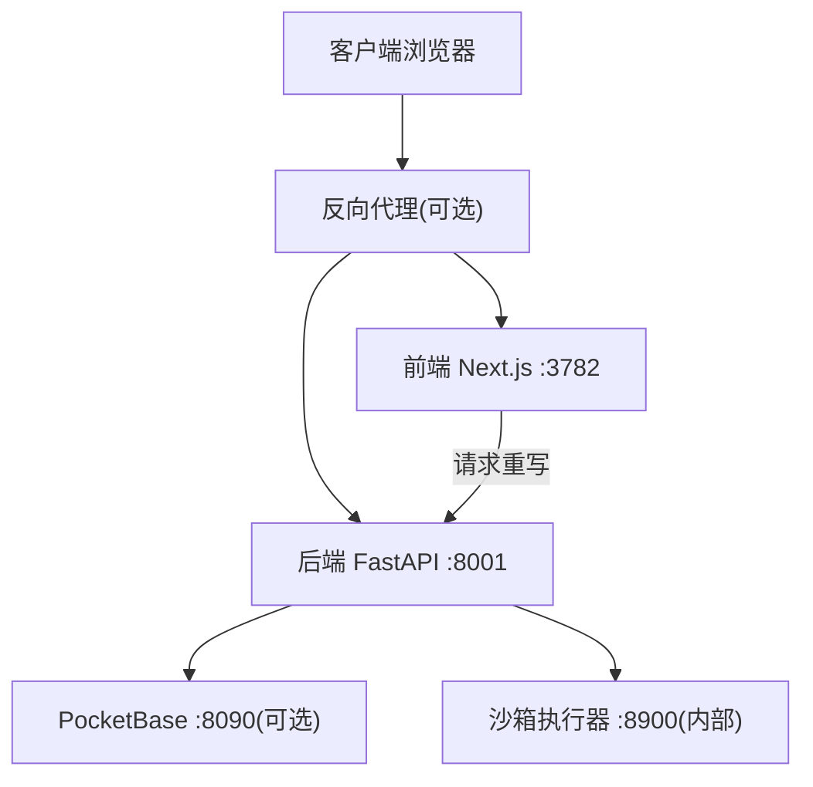
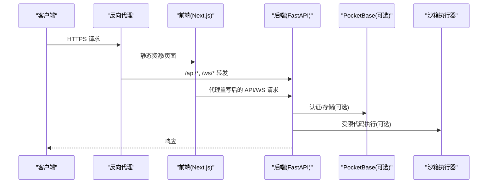
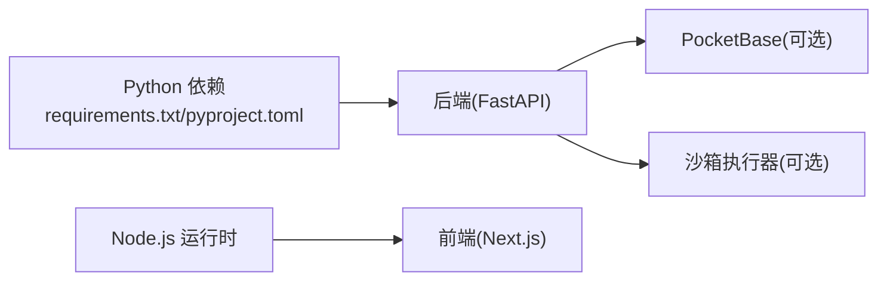

# 生产环境部署

<cite>
**本文引用的文件**
- [Dockerfile](file://Dockerfile)
- [docker-compose.yml](file://docker-compose.yml)
- [compose.yaml](file://compose.yaml)
- [pyproject.toml](file://pyproject.toml)
- [requirements.txt](file://requirements.txt)
- [deeptutor/services/config/runtime_settings.py](file://deeptutor/services/config/runtime_settings.py)
- [web/next.config.js](file://web/next.config.js)
- [deeptutor/api/main.py](file://deeptutor/api/main.py)
</cite>

## 目录
1. [简介](#简介)
2. [项目结构](#项目结构)
3. [核心组件](#核心组件)
4. [架构总览](#架构总览)
5. [详细组件分析](#详细组件分析)
6. [依赖关系分析](#依赖关系分析)
7. [性能考虑](#性能考虑)
8. [故障排查指南](#故障排查指南)
9. [结论](#结论)
10. [附录](#附录)

## 简介
本指南面向在生产环境中部署 DeepTutor 的运维与平台工程团队，覆盖系统要求、反向代理配置（Nginx/Apache/Traefik）、SSL/TLS 证书管理（含 Let’s Encrypt 自动续期）、监控与日志收集（Prometheus、结构化日志、错误追踪）、性能优化（连接池、缓存、资源限制）、备份与恢复策略，以及安全加固最佳实践（防火墙、访问控制、审计日志）。文档中的端口、路径与环境变量均以仓库内实际实现为依据。

## 项目结构
DeepTutor 提供容器化的一体化镜像，包含：
- 后端：FastAPI + Uvicorn（默认监听 8001）
- 前端：Next.js 独立模式（默认监听 3782）
- 可选侧车：PocketBase（认证/存储，默认 8090）
- 沙箱执行器：sandbox-runner（隔离执行不受信命令，内部网络可达）

运行时数据与配置统一挂载到 /app/data（容器内），宿主机映射为 ./data。入口脚本在启动时从 data/user/settings/*.json 加载运行时设置并导出环境变量，供前后端使用。

图表来源
- [Dockerfile:235-315](file://Dockerfile#L235-L315)
- [docker-compose.yml:21-183](file://docker-compose.yml#L21-L183)
- [compose.yaml:67-197](file://compose.yaml#L67-L197)

章节来源
- [Dockerfile:17-165](file://Dockerfile#L17-L165)
- [docker-compose.yml:21-183](file://docker-compose.yml#L21-L183)
- [compose.yaml:67-197](file://compose.yaml#L67-L197)

## 核心组件
- 运行环境与进程管理
  - 使用 supervisord 同时启动后端与前端，并以非 root 用户运行应用进程。
  - 健康检查通过 HTTP 探测后端根路径。
- 运行时配置中心
  - 所有运行时配置以 JSON 形式保存在 data/user/settings 下（system.json、auth.json、integrations.json 等）。
  - 启动时读取 JSON 并导出为进程环境变量，前后端按优先级读取。
- 外部依赖
  - PocketBase 作为可选的多用户认证与存储侧车。
  - sandbox-runner 用于隔离执行不受信代码，仅内部网络可达。

章节来源
- [Dockerfile:218-315](file://Dockerfile#L218-L315)
- [Dockerfile:414-439](file://Dockerfile#L414-L439)
- [deeptutor/services/config/runtime_settings.py:309-558](file://deeptutor/services/config/runtime_settings.py#L309-L558)
- [docker-compose.yml:21-183](file://docker-compose.yml#L21-L183)
- [compose.yaml:67-197](file://compose.yaml#L67-L197)

## 架构总览
下图展示了生产部署中各组件的交互关系与数据流向。

图表来源
- [Dockerfile:235-315](file://Dockerfile#L235-L315)
- [docker-compose.yml:51-175](file://docker-compose.yml#L51-L175)
- [compose.yaml:112-197](file://compose.yaml#L112-L197)
- [deeptutor/api/main.py:85-101](file://deeptutor/api/main.py#L85-L101)

## 详细组件分析

### 系统要求（CPU/内存/磁盘）
- CPU
  - 最低：2 核（单实例）
  - 推荐：4 核及以上（多租户/高并发场景）
- 内存
  - 最低：4 GB
  - 推荐：8–16 GB（启用 RAG/解析引擎或大模型调用频繁时）
- 磁盘
  - 最低：20 GB（含系统、依赖、日志、知识库与用户工作区）
  - 推荐：50+ GB（知识库增长、附件与媒体生成产物较多时）
- 运行时
  - Python 3.11–3.13（受限于 pyproject 约束）
  - Node.js 22（构建阶段；生产镜像已内置）
  - 容器运行时：Docker/Podman（支持 rootless 与只读根文件系统）

章节来源
- [pyproject.toml:8-18](file://pyproject.toml#L8-L18)
- [Dockerfile:62-165](file://Dockerfile#L62-L165)
- [compose.yaml:120-197](file://compose.yaml#L120-L197)

### 反向代理配置（Nginx/Apache/Traefik）
- 通用要点
  - 将 HTTPS 终止于反向代理，再以 HTTP 转发至后端 8001 与前端 3782。
  - 开启 WebSocket 支持（/ws/* 路径）。
  - 合理设置超时与缓冲，避免长连接被提前关闭。
  - 建议启用 Gzip/Brotli 压缩静态资源。
- Nginx
  - 关键指令：proxy_pass、proxy_set_header Upgrade/Connection、client_max_body_size、proxy_read_timeout。
- Apache
  - 关键模块：mod_proxy、mod_proxy_wstunnel、mod_ssl。
  - 注意：ProxyPass 与 ProxyPassReverse 对 /api 与 /ws 的路径重写。
- Traefik
  - 关键中间件：headers、stripPrefix（如需）、TLS 证书管理（ACME）。
- 注意事项
  - 若使用容器编排，请确保代理所在容器能访问 deeptutor 服务端口（或通过宿主端口暴露）。
  - 若启用认证，需配合后端的 DEEPTUTOR_AUTH_ENABLED 与 cookie secure 设置。

章节来源
- [Dockerfile:264-315](file://Dockerfile#L264-L315)
- [docker-compose.yml:61-90](file://docker-compose.yml#L61-L90)
- [compose.yaml:144-177](file://compose.yaml#L144-L177)

### SSL/TLS 证书配置与管理（含 Let’s Encrypt 自动续期）
- 证书来源
  - 自有证书：由 CA 签发，放置于代理服务器指定目录。
  - Let’s Encrypt：通过 ACME 协议自动申请与续期（如 certbot 或 Traefik ACME）。
- 代理层终止
  - 建议在反向代理处终止 TLS，后端与前端之间走内网 HTTP。
- 自动续期
  - Cron 定时任务或集成式方案（Traefik ACME）确保证书不过期。
- 安全建议
  - 强制 HTTPS、禁用旧版协议与弱密码套件。
  - 启用 HSTS、OCSP Stapling（视代理能力）。
  - 谨慎处理 Cookie Secure 标志（生产应启用）。

章节来源
- [deeptutor/services/config/runtime_settings.py:500-546](file://deeptutor/services/config/runtime_settings.py#L500-L546)
- [web/next.config.js:47-76](file://web/next.config.js#L47-L76)

### 监控与日志收集
- 指标采集
  - 后端基于 FastAPI/Uvicorn，可结合 Prometheus 客户端抓取自定义指标（如 QPS、延迟、错误率）。
  - 容器健康检查已内置，可通过编排平台探针观察存活状态。
- 日志收集
  - 应用日志输出到 stdout/stderr，便于容器日志驱动收集（如 ELK/Loki）。
  - 结构化日志建议使用 JSON 格式，便于检索与分析。
- 错误追踪
  - 建议接入 APM（如 Sentry）或集中式错误上报，记录异常堆栈与上下文。
- 可观测性建议
  - 为关键接口添加请求 ID 透传。
  - 对 LLM 调用、RAG 检索、文件解析等耗时步骤埋点。

章节来源
- [Dockerfile:235-315](file://Dockerfile#L235-L315)
- [Dockerfile:414-439](file://Dockerfile#L414-L439)

### 性能优化建议
- 连接与超时
  - 调整 Uvicorn 的 keep-alive 与 WS 帧大小，避免代理与后端超时不一致导致连接重置。
  - 反向代理侧设置合理的 proxy_read_timeout 与 client_max_body_size。
- 资源限制
  - 为容器设置 CPU/内存上限，防止单实例占用过多资源。
  - 沙箱执行器已限制 pids 与内存，避免恶意负载影响主进程。
- 缓存策略
  - 静态资源缓存（CDN/代理层 Cache-Control）。
  - 数据库/向量检索结果缓存（根据业务需求评估）。
- 扩展性
  - 水平扩展后端实例，配合负载均衡与健康检查。
  - 将 PocketBase 与知识库存储外置到高性能持久卷或托管服务。

章节来源
- [Dockerfile:264-315](file://Dockerfile#L264-L315)
- [docker-compose.yml:148-175](file://docker-compose.yml#L148-L175)
- [compose.yaml:120-197](file://compose.yaml#L120-L197)

### 备份与恢复策略
- 备份范围
  - 数据目录：./data（包含 user/workspace、users、partners、system、knowledge_bases、memory、logs 等）。
  - 配置文件：data/user/settings/*.json（system.json、auth.json、integrations.json 等）。
  - 外部依赖：PocketBase 数据目录（如启用）。
- 备份频率
  - 建议每日全量 + 增量（依据数据变更频率）。
- 恢复演练
  - 定期验证备份可用性与恢复流程。
- 灾难恢复计划
  - 明确 RTO/RPO，准备备用节点与自动化恢复脚本。
  - 敏感信息（密钥、令牌）单独加密备份并严格管控访问。

章节来源
- [docker-compose.yml:65-74](file://docker-compose.yml#L65-L74)
- [compose.yaml:147-157](file://compose.yaml#L147-L157)
- [deeptutor/services/config/runtime_settings.py:309-558](file://deeptutor/services/config/runtime_settings.py#L309-L558)

### 安全加固最佳实践
- 网络与访问控制
  - 仅暴露必要端口（代理层终止 TLS，后端/前端不直接对外）。
  - 沙箱执行器仅内部网络可达，禁止主机端口映射。
- 最小权限
  - 应用以非 root 用户运行，容器根文件系统只读（tmpfs 写入临时目录）。
  - 限制容器能力（cap_drop ALL），仅授予必要权限。
- 审计与合规
  - 启用访问日志与操作审计（代理与应用层）。
  - 对敏感配置（认证、集成）进行加密存储与最小可见性。
- 漏洞与依赖
  - 定期扫描镜像与依赖漏洞，及时更新基础镜像与依赖包。
  - 遵循最小安装原则，移除不必要的工具与库。

章节来源
- [docker-compose.yml:101-175](file://docker-compose.yml#L101-L175)
- [compose.yaml:67-197](file://compose.yaml#L67-L197)
- [Dockerfile:191-215](file://Dockerfile#L191-L215)

## 依赖关系分析
- 运行时依赖
  - Python 依赖集中在 requirements 与 pyproject 中，生产镜像预装。
  - Node.js 用于前端构建与运行（生产镜像已内置）。
- 服务间依赖
  - deeptutor 服务依赖 pocketbase（可选）与 sandbox-runner（可选）。
  - 前端通过代理重写访问后端 API/WS。

图表来源
- [requirements.txt:1-23](file://requirements.txt#L1-L23)
- [pyproject.toml:8-18](file://pyproject.toml#L8-L18)
- [docker-compose.yml:21-183](file://docker-compose.yml#L21-L183)

章节来源
- [requirements.txt:1-23](file://requirements.txt#L1-L23)
- [pyproject.toml:8-18](file://pyproject.toml#L8-L18)
- [docker-compose.yml:21-183](file://docker-compose.yml#L21-L183)

## 性能考虑
- 连接池与超时
  - 合理设置 Uvicorn 的 keep-alive 与 WS 帧大小，避免代理与后端超时不一致导致连接重置。
  - 反向代理侧设置合理的 proxy_read_timeout 与 client_max_body_size。
- 资源限制
  - 为容器设置 CPU/内存上限，防止单实例占用过多资源。
  - 沙箱执行器已限制 pids 与内存，避免恶意负载影响主进程。
- 缓存策略
  - 静态资源缓存（CDN/代理层 Cache-Control）。
  - 数据库/向量检索结果缓存（根据业务需求评估）。
- 扩展性
  - 水平扩展后端实例，配合负载均衡与健康检查。
  - 将 PocketBase 与知识库存储外置到高性能持久卷或托管服务。

章节来源
- [Dockerfile:264-315](file://Dockerfile#L264-L315)
- [docker-compose.yml:148-175](file://docker-compose.yml#L148-L175)
- [compose.yaml:120-197](file://compose.yaml#L120-L197)

## 故障排查指南
- 启动失败
  - 检查 data/user/settings/*.json 是否存在且格式正确。
  - 查看容器日志（stdout/stderr）定位错误。
- 端口冲突
  - 确认 8001/3782/8090 未被占用，或在 compose 中调整端口映射。
- 认证问题
  - 核对 auth.json 与集成配置（如 PocketBase URL/External URL）。
  - 确认代理是否传递正确的 Host/Origin 头。
- 沙箱执行失败
  - 检查 sandbox-runner 是否健康且可达。
  - 确认权限与 tmpfs 空间充足。

章节来源
- [Dockerfile:414-439](file://Dockerfile#L414-L439)
- [docker-compose.yml:85-97](file://docker-compose.yml#L85-L97)
- [compose.yaml:168-177](file://compose.yaml#L168-L177)
- [deeptutor/services/config/runtime_settings.py:500-558](file://deeptutor/services/config/runtime_settings.py#L500-L558)

## 结论
DeepTutor 的生产部署以容器化为核心，提供一体化镜像与清晰的运行时配置中心。通过反向代理终止 TLS、启用监控与日志收集、实施资源限制与安全加固，可在生产环境中获得稳定、可扩展且安全的运行体验。建议结合业务规模选择合适的硬件配置与扩展策略，并建立完善的备份与恢复机制。

## 附录
- 常用命令
  - 构建与启动：参考 docker-compose 脚本说明。
  - 查看日志：docker logs/podman logs。
  - 健康检查：curl 后端根路径。
- 配置位置
  - 运行时设置：data/user/settings/*.json
  - 数据目录：./data（容器内 /app/data）

章节来源
- [docker-compose.yml:1-19](file://docker-compose.yml#L1-L19)
- [compose.yaml:1-22](file://compose.yaml#L1-L22)
- [Dockerfile:174-190](file://Dockerfile#L174-L190)