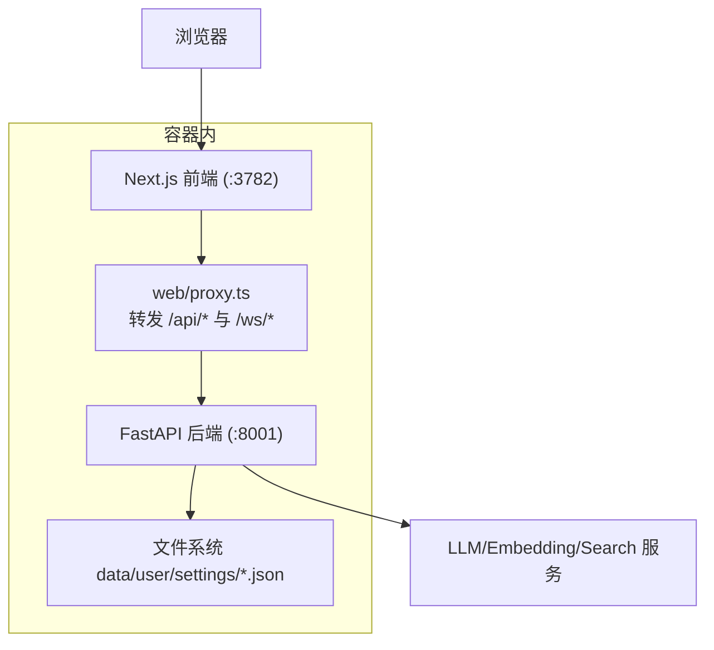
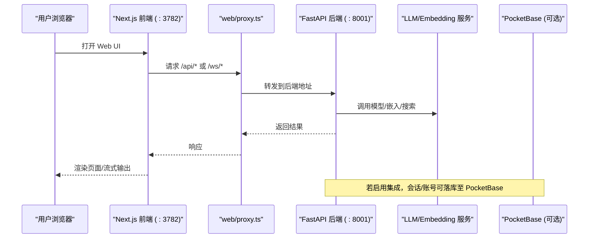
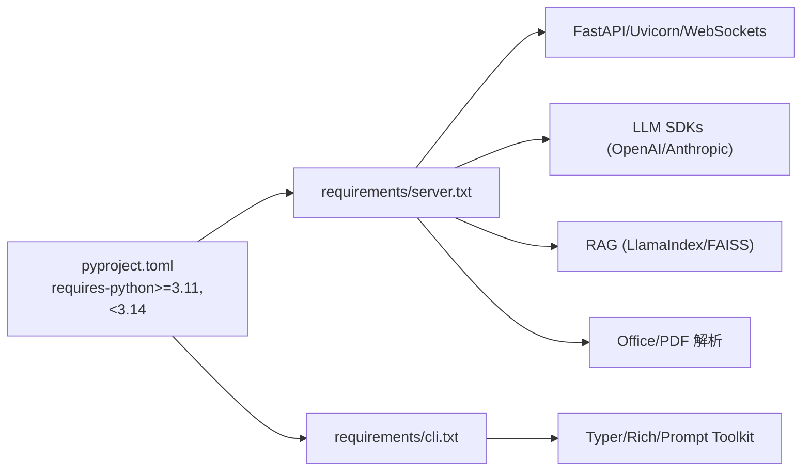
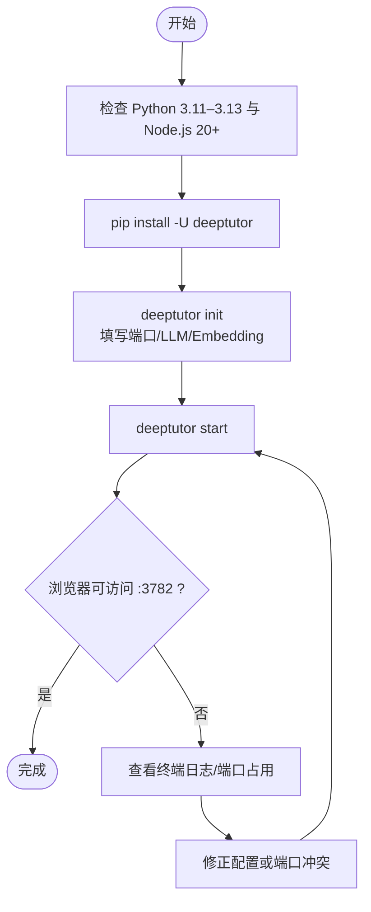

# 安装与部署

<cite>
**本文引用的文件**
- [README.md](file://README.md)
- [pyproject.toml](file://pyproject.toml)
- [requirements.txt](file://requirements.txt)
- [requirements/server.txt](file://requirements/server.txt)
- [requirements/cli.txt](file://requirements/cli.txt)
- [Dockerfile](file://Dockerfile)
- [docker-compose.yml](file://docker-compose.yml)
- [compose.yaml](file://compose.yaml)
- [CONTAINERIZATION.md](file://CONTAINERIZATION.md)
- [scripts/start_web.py](file://scripts/start_web.py)
- [packaging/deeptutor-cli/pyproject.toml](file://packaging/deeptutor-cli/pyproject.toml)
</cite>

## 目录
1. [简介](#简介)
2. [项目结构](#项目结构)
3. [核心组件](#核心组件)
4. [架构总览](#架构总览)
5. [详细组件分析](#详细组件分析)
6. [依赖关系分析](#依赖关系分析)
7. [性能注意事项](#性能注意事项)
8. [故障排除指南](#故障排除指南)
9. [结论](#结论)
10. [附录](#附录)

## 简介
本文件提供 DeepTutor 的完整安装与部署指南，覆盖四种方式：从 PyPI 安装、从源码安装、Docker 容器化部署、以及 CLI-only 模式。文档包含环境要求（Python 3.11–3.13、Node.js 20+）、依赖安装、配置设置、启动流程、Docker 端口/数据持久化/网络/反向代理配置、开发环境搭建（调试与热重载），以及常见问题与验证步骤。每种部署方式均给出可操作的命令和验证方法。

## 项目结构
DeepTutor 由后端 FastAPI、前端 Next.js、CLI 工具、以及可选的 PocketBase 侧车组成。生产镜像通过多阶段构建将前端静态资源与 Python 运行时打包，使用 supervisord 同时管理后端与前端进程。

图表来源
- [Dockerfile:263-315](file://Dockerfile#L263-L315)
- [Dockerfile:317-410](file://Dockerfile#L317-L410)
- [docker-compose.yml:54-99](file://docker-compose.yml#L54-L99)

章节来源
- [Dockerfile:17-52](file://Dockerfile#L17-L52)
- [Dockerfile:62-100](file://Dockerfile#L62-L100)
- [Dockerfile:102-165](file://Dockerfile#L102-L165)
- [docker-compose.yml:21-99](file://docker-compose.yml#L21-L99)

## 核心组件
- 后端：FastAPI + Uvicorn，暴露 REST/WebSocket API，读取 data/user/settings 下的 JSON/YAML 配置。
- 前端：Next.js 独立服务器，内置代理将 /api/* 与 /ws/* 转发到后端。
- CLI：deeptutor 命令集，支持 chat/run/kb/memory/config 等。
- 可选侧车：PocketBase（认证/存储）与 sandbox-runner（代码执行沙箱）。

章节来源
- [Dockerfile:234-259](file://Dockerfile#L234-L259)
- [docker-compose.yml:21-99](file://docker-compose.yml#L21-L99)
- [pyproject.toml:73-74](file://pyproject.toml#L73-L74)

## 架构总览
下图展示典型单容器部署中浏览器、前端代理、后端及外部 LLM 的关系；以及 Compose 下 PocketBase 与 sandbox-runner 的协作。

图表来源
- [Dockerfile:297-315](file://Dockerfile#L297-L315)
- [docker-compose.yml:21-99](file://docker-compose.yml#L21-L99)
- [compose.yaml:67-182](file://compose.yaml#L67-L182)

## 详细组件分析

### 一、从 PyPI 安装（推荐快速体验）
- 环境要求
  - Python 3.11–3.13
  - Node.js 20+（用于运行打包后的 Next.js 前端）
- 安装步骤
  - 创建并进入工作目录
  - 使用 pip 安装 deeptutor
  - 运行初始化向导，填写端口、LLM 提供商、可选 embedding
  - 启动后端与前端
- 验证
  - 在浏览器访问默认前端端口（默认 3782）
  - 确认 Settings → Models 可添加 LLM 配置

章节来源
- [README.md:207-222](file://README.md#L207-L222)
- [pyproject.toml:8-18](file://pyproject.toml#L8-L18)

### 二、从源码安装（开发与定制）
- 环境要求
  - Python 3.11–3.13
  - Node.js 22 LTS（匹配 CI/Docker 构建环境）
- 安装步骤
  - 克隆仓库
  - 创建虚拟环境并激活
  - 安装后端与前端依赖
  - 初始化并启动（--dev 启用前端 HMR）
- 可选扩展
  - dev、partners、matrix、math-animator 等 extras
- 验证
  - --dev 模式下前端具备热重载
  - 后端日志可见，Settings 可编辑

章节来源
- [README.md:224-286](file://README.md#L224-L286)
- [pyproject.toml:76-235](file://pyproject.toml#L76-L235)

### 三、Docker 容器化部署
- 镜像与入口
  - 镜像 ghcr.io/hkuds/deeptutor:latest（稳定版）
  - 单容器同时运行后端与前端，supervisord 管理进程
- 端口
  - 仅需要对外暴露前端端口 :3782；/api/* 与 /ws/* 由前端代理转发到容器内后端
  - 可选暴露 :8001 用于直接访问 API
- 数据持久化
  - 挂载 /app/data 到宿主机或命名卷，保存 settings、workspace、memory、knowledge_bases、logs
- 网络与反向代理
  - 单容器无需配置 API base；只需将反向代理指向 :3782
  - 拆分部署时，在 system.json 设置 next_public_api_base
- 连接宿主本地 LLM
  - 使用 host.docker.internal 或 host networking
- 验证
  - 访问 http://127.0.0.1:3782
  - 查看 docker logs 确认后端与前端启动成功

章节来源
- [README.md:288-365](file://README.md#L288-L365)
- [CONTAINERIZATION.md:56-145](file://CONTAINERIZATION.md#L56-L145)
- [Dockerfile:263-315](file://Dockerfile#L263-L315)
- [Dockerfile:317-410](file://Dockerfile#L317-L410)

#### Docker Compose（含 PocketBase 与 sandbox-runner）
- 服务
  - deeptutor：后端+前端
  - pocketbase：可选认证/存储侧车
  - sandbox-runner：隔离执行模型生成代码
- 数据与网络
  - 共享 ./data 目录
  - 内部网络 deeptutor-network
- 健康检查
  - 后端与 PocketBase 均提供健康检查
- 启动
  - 使用 scripts/docker_compose.py 编排

章节来源
- [docker-compose.yml:21-99](file://docker-compose.yml#L21-L99)
- [docker-compose.yml:101-175](file://docker-compose.yml#L101-L175)

#### Podman 根外只读根文件系统（安全强化）
- 特性
  - read_only: true
  - userns_mode: keep-id
  - tmpfs 挂载必要系统目录
  - 绑定挂载 ./data
- 适用场景
  - 对安全性要求更高的部署

章节来源
- [compose.yaml:1-63](file://compose.yaml#L1-L63)
- [compose.yaml:120-182](file://compose.yaml#L120-L182)
- [CONTAINERIZATION.md:250-343](file://CONTAINERIZATION.md#L250-L343)

### 四、CLI-only 模式（无 Web UI）
- 安装
  - 从源码 checkout 安装 packaging/deeptutor-cli
- 初始化与使用
  - deeptutor init --cli
  - deeptutor chat / run / kb / memory / config 等命令
- 特点
  - 不携带 Web 资源与服务端依赖
  - 共享 data/user/settings 布局

章节来源
- [README.md:367-405](file://README.md#L367-L405)
- [packaging/deeptutor-cli/pyproject.toml:5-53](file://packaging/deeptutor-cli/pyproject.toml#L5-L53)

## 依赖关系分析
- Python 版本约束
  - requires-python >=3.11,<3.14（避免 3.14 上部分编译依赖无法找到 wheel）
- 核心依赖
  - FastAPI/Uvicorn、WebSockets、Pydantic、OpenAI/Anthropic SDK、LlamaIndex、FAISS、PDF/Office 解析库等
- 可选依赖
  - partners（IM 通道）、matrix（Matrix 通道）、math-animator（Manim）、parse-*（文档解析引擎）
- 前端依赖
  - Node.js 20+（运行打包产物），开发时使用 Next.js 开发服务器

图表来源
- [pyproject.toml:8-18](file://pyproject.toml#L8-L18)
- [requirements/server.txt:1-32](file://requirements/server.txt#L1-L32)
- [requirements/cli.txt:1-66](file://requirements/cli.txt#L1-L66)

章节来源
- [pyproject.toml:8-18](file://pyproject.toml#L8-L18)
- [pyproject.toml:76-235](file://pyproject.toml#L76-L235)
- [requirements/server.txt:1-32](file://requirements/server.txt#L1-L32)
- [requirements/cli.txt:1-66](file://requirements/cli.txt#L1-L66)

## 性能注意事项
- 大知识库检索
  - FAISS 向量检索替代暴力扫描，提升查询性能
- 附件上传
  - WebSocket 帧大小根据 system.json 附件策略动态调整，避免被 uvicorn 默认限制截断
- 内存与进程
  - 容器内 MALLOC_* 环境变量优化内存行为
  - sandbox-runner 限制 pids/mem_limit，防止失控
- 前端构建
  - 生产镜像使用 Next.js standalone 输出，减少体积与启动开销

章节来源
- [pyproject.toml:47-51](file://pyproject.toml#L47-L51)
- [Dockerfile:281-292](file://Dockerfile#L281-L292)
- [docker-compose.yml:148-165](file://docker-compose.yml#L148-L165)

## 故障排除指南
- 前端加载但 Settings 显示“后端不可达”
  - 检查容器内后端是否启动，确认 DEEPTUTOR_API_BASE_URL 是否正确（拆分部署）
- 首次 JSON 写入权限错误
  - 使用 bind mount 而非命名卷，或使用 :U 后缀确保 UID 映射正确
- 无法连接 Docker/Podman 守护进程
  - 启动 podman.socket 或设置 DOCKER_HOST 指向 podman socket
- 临时 Codex OAuth 桥接
  - 按文档临时映射 1455/1457 端口完成授权后恢复原配置
- 开发模式卡住
  - 删除 web/.next/dev/lock 与 web/.next/lock 后重试

章节来源
- [CONTAINERIZATION.md:406-440](file://CONTAINERIZATION.md#L406-L440)
- [README.md:272-284](file://README.md#L272-L284)

## 结论
DeepTutor 提供多种安装与部署路径，满足从个人桌面到企业容器的多样化需求。推荐使用 PyPI 快速体验，源码安装便于二次开发，Docker/Compose 适合生产部署，CLI-only 适合自动化与无头场景。通过统一的 data/user/settings 配置体系，可在不同部署形态间保持一致的行为与可移植性。

## 附录

### 启动流程图（以 PyPI 安装为例）

图表来源
- [README.md:207-222](file://README.md#L207-L222)

### 配置参考（data/user/settings）
- system.json：后端/前端端口、公共 API base、CORS、SSL 校验、附件目录与限制
- auth.json：认证开关、用户名、密码哈希、Token/Cookie 设置
- integrations.json：PocketBase 与侧车集成设置
- model_catalog.json：LLM/Embedding/Search 提供商资料、API Key、活跃模型
- interface.json：界面语言/主题/侧边栏偏好
- main.yaml：运行时默认行为与路径注入
- agents.yaml：能力/工具的温度与 Token 设置

章节来源
- [README.md:431-448](file://README.md#L431-L448)
- [CONTAINERIZATION.md:345-379](file://CONTAINERIZATION.md#L345-L379)

### 开发环境与调试
- 使用 --dev 启动 Next.js 开发服务器，支持热重载
- 后端使用 Uvicorn 标准模式，日志输出到控制台与文件
- 可通过 scripts/start_web.py 指定 home 与 dev 参数

章节来源
- [README.md:224-246](file://README.md#L224-L246)
- [scripts/start_web.py:17-35](file://scripts/start_web.py#L17-L35)