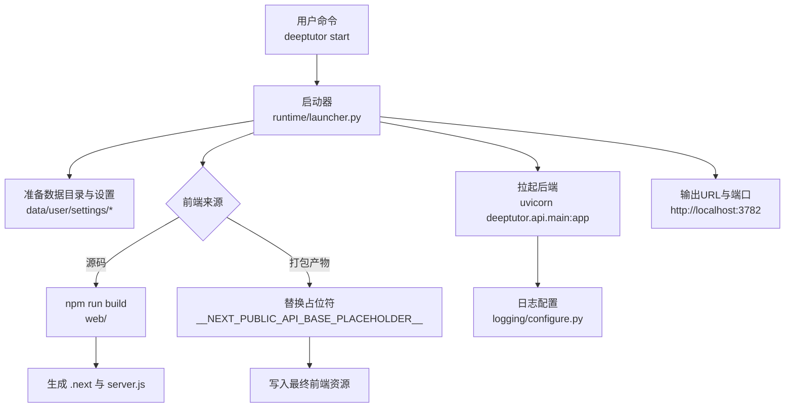
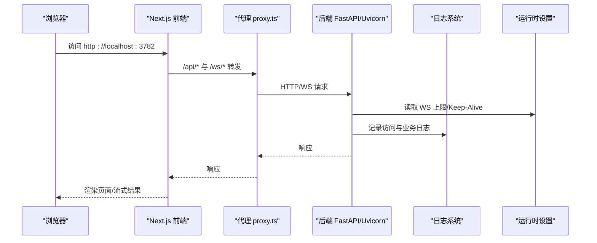
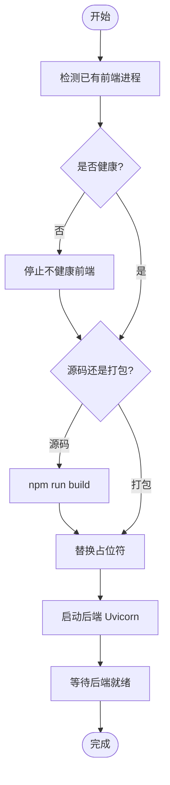
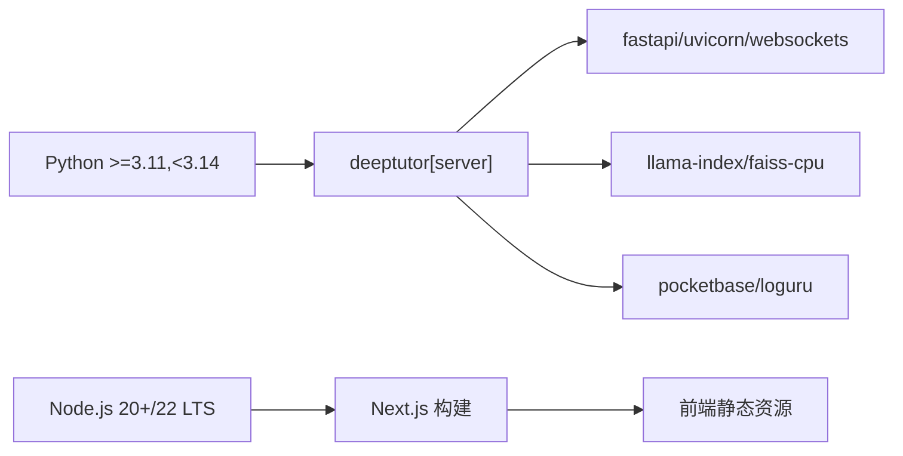

# 故障排除

<cite>
**本文引用的文件**
- [README.md](file://README.md)
- [pyproject.toml](file://pyproject.toml)
- [requirements.txt](file://requirements.txt)
- [deeptutor/runtime/launcher.py](file://deeptutor/runtime/launcher.py)
- [deeptutor/api/run_server.py](file://deeptutor/api/run_server.py)
- [deeptutor/logging/config.py](file://deeptutor/logging/config.py)
- [deeptutor/logging/configure.py](file://deeptutor/logging/configure.py)
- [deeptutor/core/errors.py](file://deeptutor/core/errors.py)
- [deeptutor/services/config/runtime_settings.py](file://deeptutor/services/config/runtime_settings.py)
- [deeptutor/book/kb_health.py](file://deeptutor/book/kb_health.py)
- [deeptutor/partners/channels/mochat.py](file://deeptutor/partners/channels/mochat.py)
- [scripts/start_web.py](file://scripts/start_web.py)
</cite>

## 目录
1. [简介](#简介)
2. [项目结构](#项目结构)
3. [核心组件](#核心组件)
4. [架构总览](#架构总览)
5. [详细组件分析](#详细组件分析)
6. [依赖关系分析](#依赖关系分析)
7. [性能注意事项](#性能注意事项)
8. [故障排除指南](#故障排除指南)
9. [结论](#结论)
10. [附录](#附录)

## 简介
本指南面向DeepTutor的安装、配置与运行阶段的常见问题，提供系统化的诊断方法与解决步骤。内容覆盖前端构建失败、后端启动错误、数据库连接问题、模型加载失败等典型场景；包含日志定位、调试模式启用、性能瓶颈识别与优化建议；并给出社区支持与问题报告的最佳实践。

## 项目结构
DeepTutor由“前端（Next.js）+ 后端（FastAPI/Uvicorn）+ 运行时启动器 + 配置/日志/服务”组成。启动流程由运行时启动器统一编排：准备工作区与设置、检测端口冲突、构建或复用前端、拉起后端Uvicorn进程，并通过环境变量注入API基址与认证开关。

**图表来源**
- [deeptutor/runtime/launcher.py:537-698](file://deeptutor/runtime/launcher.py#L537-L698)
- [deeptutor/runtime/launcher.py:946-1021](file://deeptutor/runtime/launcher.py#L946-L1021)
- [deeptutor/runtime/launcher.py:1045-1112](file://deeptutor/runtime/launcher.py#L1045-L1112)
- [deeptutor/logging/configure.py:46-77](file://deeptutor/logging/configure.py#L46-L77)

**章节来源**
- [README.md:202-246](file://README.md#L202-L246)
- [deeptutor/runtime/launcher.py:537-698](file://deeptutor/runtime/launcher.py#L537-L698)
- [deeptutor/runtime/launcher.py:946-1021](file://deeptutor/runtime/launcher.py#L946-L1021)
- [deeptutor/runtime/launcher.py:1045-1112](file://deeptutor/runtime/launcher.py#L1045-L1112)

## 核心组件
- 启动器：负责工作区初始化、前端构建/复用、端口冲突处理、后端进程管理、健康检查与优雅关闭。
- 后端服务器：基于FastAPI与Uvicorn，支持开发热重载、WS帧大小与Keep-Alive调优。
- 日志系统：从main.yaml读取级别与输出目标，控制台与JSONL文件双路输出，桥接Loguru。
- 配置与环境：通过运行时设置与服务层暴露的函数注入API基址、CORS、附件限制、WebSocket上限等。
- 错误体系：统一的异常层次便于区分配置、验证、服务与LLM上下文错误。

**章节来源**
- [deeptutor/runtime/launcher.py:537-698](file://deeptutor/runtime/launcher.py#L537-L698)
- [deeptutor/api/run_server.py:30-80](file://deeptutor/api/run_server.py#L30-L80)
- [deeptutor/logging/config.py:9-49](file://deeptutor/logging/config.py#L9-L49)
- [deeptutor/logging/configure.py:46-77](file://deeptutor/logging/configure.py#L46-L77)
- [deeptutor/core/errors.py:10-57](file://deeptutor/core/errors.py#L10-L57)

## 架构总览
下图展示一次请求从浏览器到后端的完整链路，以及关键配置点与易错环节。

**图表来源**
- [deeptutor/runtime/launcher.py:1045-1112](file://deeptutor/runtime/launcher.py#L1045-L1112)
- [deeptutor/services/config/runtime_settings.py:1014-1031](file://deeptutor/services/config/runtime_settings.py#L1014-L1031)
- [deeptutor/logging/configure.py:46-77](file://deeptutor/logging/configure.py#L46-L77)

## 详细组件分析

### 启动器（runtime/launcher.py）
- 前端构建与占位符替换：在源码模式下执行npm构建，并在打包产物中替换API基址与认证开关占位符，确保前后端通信地址正确。
- 端口冲突与健康检查：检测已有前端进程与端口占用，必要时重启不健康的前端；等待后端就绪后再继续。
- 进程管理与信号处理：统一管理后端与前端进程生命周期，捕获信号进行优雅关闭。

**图表来源**
- [deeptutor/runtime/launcher.py:537-698](file://deeptutor/runtime/launcher.py#L537-L698)
- [deeptutor/runtime/launcher.py:817-843](file://deeptutor/runtime/launcher.py#L817-L843)
- [deeptutor/runtime/launcher.py:946-1021](file://deeptutor/runtime/launcher.py#L946-L1021)
- [deeptutor/runtime/launcher.py:1045-1112](file://deeptutor/runtime/launcher.py#L1045-L1112)

**章节来源**
- [deeptutor/runtime/launcher.py:537-698](file://deeptutor/runtime/launcher.py#L537-L698)
- [deeptutor/runtime/launcher.py:817-843](file://deeptutor/runtime/launcher.py#L817-L843)
- [deeptutor/runtime/launcher.py:946-1021](file://deeptutor/runtime/launcher.py#L946-L1021)
- [deeptutor/runtime/launcher.py:1045-1112](file://deeptutor/runtime/launcher.py#L1045-L1112)

### 后端服务器（run_server.py）
- 事件循环策略：Windows下切换为ProactorEventLoop以支持子进程调用。
- 输出缓冲：强制无缓冲输出，避免日志丢失。
- 热重载与忽略目录：开发模式下可开启热重载，并排除venv、data、node_modules等目录。
- 启动参数：ws_max_size与timeout_keep_alive来自运行时设置，避免上传断连与空闲连接竞争关闭。

**章节来源**
- [deeptutor/api/run_server.py:14-27](file://deeptutor/api/run_server.py#L14-L27)
- [deeptutor/api/run_server.py:30-80](file://deeptutor/api/run_server.py#L30-L80)
- [deeptutor/services/config/runtime_settings.py:1014-1031](file://deeptutor/services/config/runtime_settings.py#L1014-L1031)

### 日志系统（config.py, configure.py）
- 配置来源：从main.yaml读取日志级别、是否输出到控制台/文件、日志目录与轮转策略。
- 输出方式：控制台使用彩色格式化器；文件输出为JSONL格式，便于机器解析。
- 桥接：安装Loguru桥接，统一日志源。

**章节来源**
- [deeptutor/logging/config.py:9-49](file://deeptutor/logging/config.py#L9-L49)
- [deeptutor/logging/configure.py:46-77](file://deeptutor/logging/configure.py#L46-L77)

### 错误体系（core/errors.py）
- 统一异常层次：基础异常、配置错误、验证错误、服务错误、LLM服务错误、LLM上下文错误、环境配置错误。
- 用途：便于上层路由与服务捕获并返回结构化错误信息，利于排查。

**章节来源**
- [deeptutor/core/errors.py:10-57](file://deeptutor/core/errors.py#L10-L57)

### 运行时设置（runtime_settings.py）
- 集成覆盖：POCKETBASE_*环境变量可覆盖integrations配置。
- WebSocket上限：根据聊天附件限制计算最大帧大小，避免大附件上传被截断。
- Keep-Alive超时：设置为300秒，避免与前端代理空闲回收竞争导致ECONNRESET。

**章节来源**
- [deeptutor/services/config/runtime_settings.py:661-673](file://deeptutor/services/config/runtime_settings.py#L661-L673)
- [deeptutor/services/config/runtime_settings.py:1014-1031](file://deeptutor/services/config/runtime_settings.py#L1014-L1031)

### 知识库健康（kb_health.py）
- 日志解析：从知识库编译日志中统计条目、错误次数、最近错误时间、块失败数等，辅助定位RAG索引问题。

**章节来源**
- [deeptutor/book/kb_health.py:262-283](file://deeptutor/book/kb_health.py#L262-L283)

### 合作伙伴通道（mochat.py）
- 游标持久化：会话游标的读写带有异常保护，失败时仅记录警告，不影响主流程。

**章节来源**
- [deeptutor/partners/channels/mochat.py:975-1010](file://deeptutor/partners/channels/mochat.py#L975-L1010)

## 依赖关系分析
- Python版本约束：要求Python 3.11–3.13，避免3.14因部分依赖无法找到wheel而回退导致构建失败。
- 可选依赖：partners、matrix、math-animator、dev等extras按需安装，减少默认体积。
- 前端依赖：Next.js构建需要Node.js 20+（PyPI安装）或Node.js 22 LTS（源码开发）。

**图表来源**
- [pyproject.toml:8-71](file://pyproject.toml#L8-L71)
- [pyproject.toml:76-235](file://pyproject.toml#L76-L235)
- [README.md:207-246](file://README.md#L207-L246)

**章节来源**
- [pyproject.toml:8-71](file://pyproject.toml#L8-L71)
- [pyproject.toml:76-235](file://pyproject.toml#L76-L235)
- [requirements.txt:1-23](file://requirements.txt#L1-L23)
- [README.md:207-246](file://README.md#L207-L246)

## 性能注意事项
- 前端构建缓存：源码模式下若出现锁文件残留，删除.lock后重试可恢复。
- 后端空闲连接：已设置较长Keep-Alive以避免与前端代理竞争关闭导致的500。
- 附件上传：ws_max_size随附件限额调整，过大需重启生效。
- 日志轮转：合理设置max_bytes与backup_count，避免磁盘爆满影响IO。

[本节为通用指导，无需特定文件引用]

## 故障排除指南

### 常见安装问题
- Python版本不兼容
  - 现象：pip安装或构建时报找不到wheel或回退降级。
  - 原因：Python 3.14不被支持，部分依赖在3.14上无法解析。
  - 处理：使用Python 3.11–3.13。
- Node.js版本不匹配
  - 现象：源码安装时npm构建失败或类型检查报错。
  - 处理：使用Node.js 20+（PyPI安装）或Node.js 22 LTS（源码开发）。
- 可选依赖缺失
  - 现象：知识库解析、Matrix通道、数学动画等功能不可用。
  - 处理：按功能安装对应extras（如parse、partners、matrix、math-animator）。

**章节来源**
- [pyproject.toml:8-18](file://pyproject.toml#L8-L18)
- [pyproject.toml:153-235](file://pyproject.toml#L153-L235)
- [README.md:207-246](file://README.md#L207-L246)

### 前端构建失败
- 症状
  - npm run build返回非零退出码。
  - 构建完成后缺少BUILD_ID或静态资源。
  - 开发服务器卡住或端口被占用。
- 诊断
  - 查看构建输出中的具体错误（TypeScript/依赖解析/内存不足）。
  - 检查web/.next/dev/lock与web/.next/lock是否残留。
  - 确认Node.js与npm版本符合预期。
- 处理
  - 清理锁文件后重试构建。
  - 重新安装依赖：npm ci --legacy-peer-deps。
  - 若为打包部署，确认占位符替换成功且路径正确。

**章节来源**
- [deeptutor/runtime/launcher.py:674-698](file://deeptutor/runtime/launcher.py#L674-L698)
- [deeptutor/runtime/launcher.py:817-843](file://deeptutor/runtime/launcher.py#L817-L843)
- [README.md:272-284](file://README.md#L272-L284)

### 后端启动错误
- 症状
  - 无法监听端口或端口冲突。
  - 启动后立即崩溃或健康检查失败。
  - 上传大附件时连接中断。
- 诊断
  - 检查system.json中的backend_port与frontend_port。
  - 查看启动器输出的后端URL与工作区路径。
  - 检查日志文件data/user/logs/deeptutor.jsonl。
- 处理
  - 释放冲突端口或修改端口配置后重启。
  - 调整ws_max_size与timeout_keep_alive（需重启生效）。
  - 确认环境变量与设置文件未冲突。

**章节来源**
- [deeptutor/runtime/launcher.py:946-1021](file://deeptutor/runtime/launcher.py#L946-L1021)
- [deeptutor/runtime/launcher.py:1045-1112](file://deeptutor/runtime/launcher.py#L1045-L1112)
- [deeptutor/services/config/runtime_settings.py:1014-1031](file://deeptutor/services/config/runtime_settings.py#L1014-L1031)

### 数据库连接问题（PocketBase）
- 症状
  - 多用户或集成相关功能报错。
  - 外部URL或端口配置不生效。
- 诊断
  - 检查POCKETBASE_*环境变量是否覆盖了settings。
  - 确认pocketbase_url/port/external_url/admin凭据正确。
- 处理
  - 修正环境变量或settings中的集成配置。
  - 重启服务使覆盖生效。

**章节来源**
- [deeptutor/services/config/runtime_settings.py:661-673](file://deeptutor/services/config/runtime_settings.py#L661-L673)

### 模型加载失败（LLM/Embedding）
- 症状
  - 模型列表为空或维度不匹配。
  - 测试连接失败或向量维度不一致。
- 诊断
  - 查看模型目录与适配器返回的维度信息。
  - 检查embedding客户端是否刷新。
- 处理
  - 在设置中重新测试连接，触发探针更新维度。
  - 保存目录后重置embedding客户端。

**章节来源**
- [deeptutor/services/config/test_runner.py:149-162](file://deeptutor/services/config/test_runner.py#L149-L162)
- [deeptutor/services/config/test_runner.py:164-207](file://deeptutor/services/config/test_runner.py#L164-L207)
- [deeptutor/services/config/test_runner.py:367-392](file://deeptutor/services/config/test_runner.py#L367-L392)

### 知识库与RAG问题
- 症状
  - 索引构建缓慢或失败。
  - 检索结果异常或文档解析失败。
- 诊断
  - 查看知识库健康报告中的错误条目与最近错误时间。
  - 检查解析引擎选择与依赖是否安装。
- 处理
  - 修复解析错误或更换引擎。
  - 对单个失败文档进行移除并重试索引。

**章节来源**
- [deeptutor/book/kb_health.py:262-283](file://deeptutor/book/kb_health.py#L262-L283)

### 日志分析与调试技巧
- 日志位置
  - 控制台输出：受main.yaml中logging.level控制。
  - 文件输出：data/user/logs/deeptutor.jsonl（JSONL格式）。
- 调试模式
  - 开发模式：设置DEEPTUTOR_DEV_RELOAD=1以启用Uvicorn热重载。
  - 提高日志级别：将level设为DEBUG以获取更详细信息。
- 访问日志
  - 默认仅记录非200响应，避免频繁轮询污染日志。
- 第三方库日志
  - LlamaIndex日志会被转发至统一日志系统，便于集中排查。

**章节来源**
- [deeptutor/logging/config.py:25-49](file://deeptutor/logging/config.py#L25-L49)
- [deeptutor/logging/configure.py:46-77](file://deeptutor/logging/configure.py#L46-L77)
- [deeptutor/api/main.py:259-279](file://deeptutor/api/main.py#L259-L279)
- [deeptutor/logging/adapters/llamaindex.py:42-74](file://deeptutor/logging/adapters/llamaindex.py#L42-L74)
- [deeptutor/api/run_server.py:64-80](file://deeptutor/api/run_server.py#L64-L80)

### 性能问题识别与优化
- 前端构建慢
  - 使用生产构建缓存，避免重复构建。
  - 清理锁文件与node_modules后重装依赖。
- 后端连接不稳定
  - 增大timeout_keep_alive避免与前端代理竞争关闭。
  - 调整ws_max_size以适配附件大小。
- 日志过多
  - 降低日志级别或限制文件轮转数量。
- 知识库检索慢
  - 评估使用FAISS或LightRAG Server等高性能后端。

**章节来源**
- [deeptutor/runtime/launcher.py:1045-1112](file://deeptutor/runtime/launcher.py#L1045-L1112)
- [deeptutor/services/config/runtime_settings.py:1014-1031](file://deeptutor/services/config/runtime_settings.py#L1014-L1031)
- [deeptutor/logging/config.py:9-49](file://deeptutor/logging/config.py#L9-L49)

### 社区支持与问题报告
- 渠道
  - Discord社区群。
  - 飞书与微信群（见仓库说明）。
  - GitHub Discussions与Issues。
- 报告最佳实践
  - 提供操作系统、Python/Node版本、安装方式（PyPI/源码/Docker）。
  - 附上相关日志片段（控制台与data/user/logs/deeptutor.jsonl）。
  - 复现步骤与期望行为。
  - 如涉及模型或知识库，提供模型名称、维度与解析引擎选择。

**章节来源**
- [README.md:37-39](file://README.md#L37-L39)

## 结论
通过理解启动器、后端、日志与配置的协作方式，可以快速定位并解决DeepTutor在安装、配置与运行阶段的问题。建议优先从日志入手，结合运行时设置与端口/依赖检查，逐步缩小问题范围；遇到复杂问题时，携带完整环境与日志信息向社区求助。

## 附录
- 常用入口
  - 启动Web应用：scripts/start_web.py作为兼容入口，内部调用启动器。
  - 直接启动后端：deeptutor/api/run_server.py用于独立运行后端。

**章节来源**
- [scripts/start_web.py:1-40](file://scripts/start_web.py#L1-L40)
- [deeptutor/api/run_server.py:1-85](file://deeptutor/api/run_server.py#L1-L85)