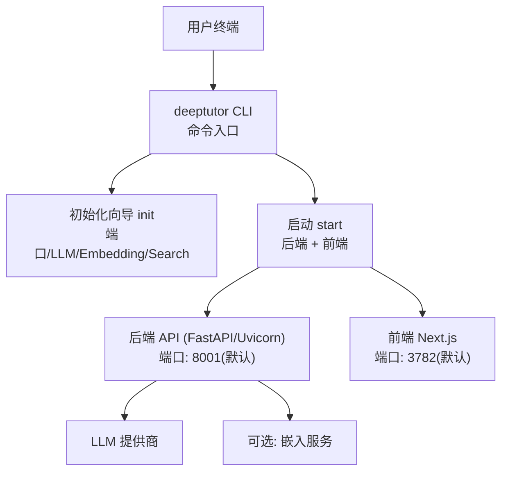
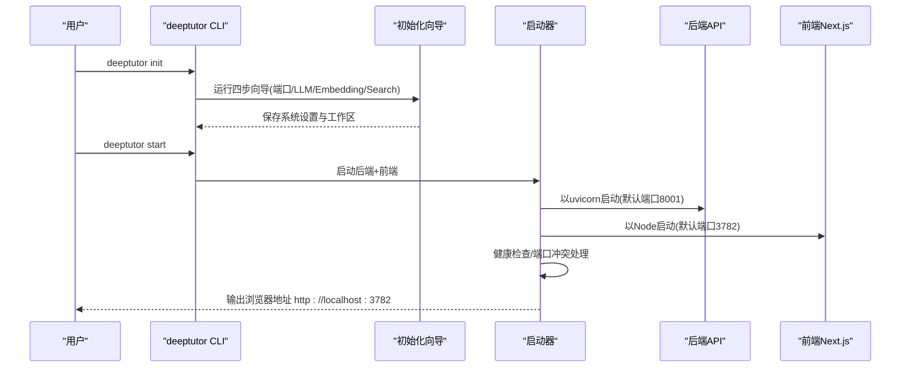
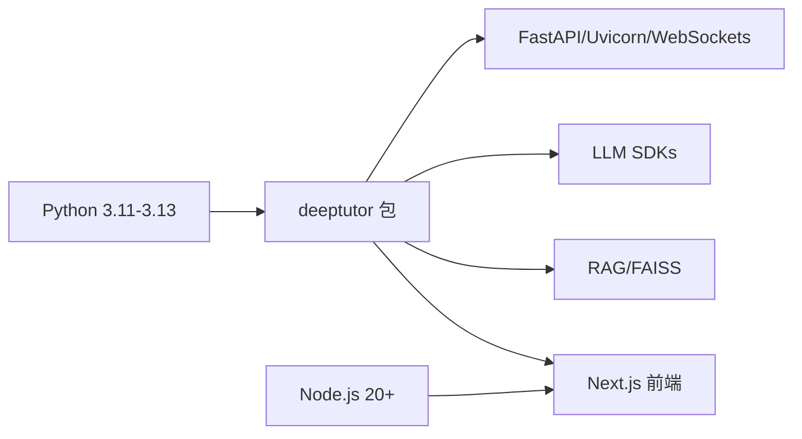

# PyPI安装

<cite>
**本文引用的文件**
- [pyproject.toml](file://pyproject.toml)
- [requirements.txt](file://requirements.txt)
- [deeptutor_cli/__main__.py](file://deeptutor_cli/__main__.py)
- [deeptutor_cli/main.py](file://deeptutor_cli/main.py)
- [deeptutor_cli/init_cmd.py](file://deeptutor_cli/init_cmd.py)
- [deeptutor/runtime/launcher.py](file://deeptutor/runtime/launcher.py)
- [scripts/start_web.py](file://scripts/start_web.py)
- [deeptutor/config/defaults.py](file://deeptutor/config/defaults.py)
</cite>

## 目录
1. [简介](#简介)
2. [项目结构](#项目结构)
3. [核心组件](#核心组件)
4. [架构总览](#架构总览)
5. [详细组件分析](#详细组件分析)
6. [依赖关系分析](#依赖关系分析)
7. [性能注意事项](#性能注意事项)
8. [故障排查指南](#故障排查指南)
9. [结论](#结论)
10. [附录](#附录)

## 简介
本指南面向通过PyPI安装DeepTutor的用户，覆盖Python与Node.js环境要求、pip安装命令、工作目录设置、初始化配置流程、端口配置（后端8001、前端3782）、LLM提供商配置、可选的嵌入服务配置，以及首次启动后的Web界面访问方式与基本配置步骤。文末提供常见安装问题的解决方案。

## 项目结构
- Python包入口：CLI命令由包脚本暴露，支持交互式初始化与一键启动前后端。
- 运行时启动器：负责解析配置、处理端口冲突、拉起后端API与前端Next.js应用，并等待就绪。
- 配置与默认值：包含默认模型、路径等；端口在初始化向导中写入系统设置。

图表来源
- [deeptutor_cli/main.py:75-175](file://deeptutor_cli/main.py#L75-L175)
- [deeptutor_cli/init_cmd.py:412-550](file://deeptutor_cli/init_cmd.py#L412-L550)
- [deeptutor/runtime/launcher.py:929-1155](file://deeptutor/runtime/launcher.py#L929-L1155)

章节来源
- [pyproject.toml:8-74](file://pyproject.toml#L8-L74)
- [requirements.txt:1-23](file://requirements.txt#L1-L23)

## 核心组件
- CLI命令集：提供init、start、serve等命令，封装初始化向导与启动逻辑。
- 初始化向导：引导用户完成端口、LLM、嵌入、搜索等配置，并持久化到工作区。
- 启动器：统一拉起后端与前端，自动检测并解决端口冲突，注入环境变量，健康检查后输出浏览器地址。

章节来源
- [deeptutor_cli/main.py:29-73](file://deeptutor_cli/main.py#L29-L73)
- [deeptutor_cli/init_cmd.py:412-550](file://deeptutor_cli/init_cmd.py#L412-L550)
- [deeptutor/runtime/launcher.py:929-1155](file://deeptutor/runtime/launcher.py#L929-L1155)

## 架构总览
下图展示了从命令行到后端API与前端页面的完整调用链，包括端口解析、冲突处理与环境变量注入。

图表来源
- [deeptutor_cli/main.py:117-175](file://deeptutor_cli/main.py#L117-L175)
- [deeptutor_cli/init_cmd.py:412-550](file://deeptutor_cli/init_cmd.py#L412-L550)
- [deeptutor/runtime/launcher.py:929-1155](file://deeptutor/runtime/launcher.py#L929-L1155)

## 详细组件分析

### 环境与安装要求
- Python版本：>=3.11 且 <3.14（受限于部分编译依赖）。
- Node.js版本：20+（用于运行打包或源码构建的前端）。
- pip安装：推荐使用最新稳定版安装完整应用。

章节来源
- [pyproject.toml:12-18](file://pyproject.toml#L12-L18)
- [deeptutor/runtime/launcher.py:731-773](file://deeptutor/runtime/launcher.py#L731-L773)

### 安装与初始化流程（含完整命令行示例）
- 创建工作目录并进入：
  - mkdir -p my-deeptutor && cd my-deeptutor
- 升级并安装DeepTutor：
  - pip install -U deeptutor
- 初始化配置（交互式向导）：
  - deeptutor init
  - 向导步骤：
    - 端口：后端默认8001，前端默认3782（可在向导中修改并保存）
    - LLM提供商：选择绑定、输入Base URL与API Key，选择模型，可执行连通性探测
    - 嵌入服务（可选）：选择提供商、Endpoint、模型、维度，可跳过
    - 搜索（可选）：可选择禁用或配置第三方搜索
    - 审阅并保存：确认后将写入系统设置
- 启动应用：
  - deeptutor start
  - 启动器将拉起后端与前端，自动处理端口冲突，并在控制台打印浏览器地址

章节来源
- [deeptutor_cli/main.py:117-175](file://deeptutor_cli/main.py#L117-L175)
- [deeptutor_cli/init_cmd.py:412-550](file://deeptutor_cli/init_cmd.py#L412-L550)
- [deeptutor/runtime/launcher.py:929-1155](file://deeptutor/runtime/launcher.py#L929-L1155)

### 端口配置
- 默认端口：
  - 后端：8001
  - 前端：3782
- 配置位置：
  - 初始化向导会提示并允许修改端口，随后保存到系统设置文件中。
- 冲突处理：
  - 启动时若端口被占用，会提示更换端口或尝试终止占用进程；非交互环境直接报错退出。

章节来源
- [deeptutor_cli/init_cmd.py:441-460](file://deeptutor_cli/init_cmd.py#L441-L460)
- [deeptutor/runtime/launcher.py:301-450](file://deeptutor/runtime/launcher.py#L301-L450)
- [deeptutor/runtime/launcher.py:985-1006](file://deeptutor/runtime/launcher.py#L985-L1006)

### LLM提供商配置
- 支持的绑定：向导内置常用提供商列表，也支持自定义绑定。
- 关键参数：
  - binding：提供商名称
  - base_url：API Base URL（可为空，使用默认）
  - api_key：密钥（支持从环境变量读取）
  - model：选择的模型
- 连通性探测：
  - 向导支持对已配置的LLM进行连通性测试，失败时可重试并重新输入密钥。

章节来源
- [deeptutor_cli/init_cmd.py:88-189](file://deeptutor_cli/init_cmd.py#L88-L189)
- [deeptutor_cli/init_cmd.py:462-478](file://deeptutor_cli/init_cmd.py#L462-L478)

### 可选嵌入服务配置
- 作用：为知识库检索等能力提供向量嵌入。
- 配置项：
  - provider：嵌入提供商
  - base_url：Endpoint（可复用LLM的Key）
  - model：嵌入模型
  - dimension：向量维度（可选）
- 可跳过：
  - 向导中可选择跳过嵌入配置，后续再行补充。

章节来源
- [deeptutor_cli/init_cmd.py:207-317](file://deeptutor_cli/init_cmd.py#L207-L317)
- [deeptutor_cli/init_cmd.py:479-500](file://deeptutor_cli/init_cmd.py#L479-L500)

### 首次启动后的Web界面访问与基本配置
- 访问地址：
  - 浏览器打开控制台输出的前端地址，通常为 http://localhost:3782
- 基本配置步骤：
  - 在Web界面的“设置”中可再次调整端口、LLM与嵌入服务、搜索等配置。
  - 如需启用认证，可在设置中开启并配置相关选项。

章节来源
- [deeptutor/runtime/launcher.py:1014-1021](file://deeptutor/runtime/launcher.py#L1014-L1021)
- [deeptutor/runtime/launcher.py:936-950](file://deeptutor/runtime/launcher.py#L936-L950)

## 依赖关系分析
- Python依赖：
  - 核心运行时包含FastAPI、Uvicorn、WebSockets、Pydantic、LLM SDKs、RAG库等。
  - 可选扩展：partners、matrix、math-animator、dev等。
- Node.js依赖：
  - 前端基于Next.js，需要Node 20+与npm；源码模式下会自动安装依赖或构建生产产物。

图表来源
- [pyproject.toml:21-71](file://pyproject.toml#L21-L71)
- [pyproject.toml:76-235](file://pyproject.toml#L76-L235)
- [deeptutor/runtime/launcher.py:731-773](file://deeptutor/runtime/launcher.py#L731-L773)

章节来源
- [pyproject.toml:21-235](file://pyproject.toml#L21-L235)
- [requirements.txt:1-23](file://requirements.txt#L1-L23)

## 性能注意事项
- 建议在生产环境使用打包的前端资源，避免开发服务器带来的额外开销。
- 合理配置附件大小限制与WebSocket帧大小，以避免大文件上传中断。
- 在单用户场景下，启动器会设置内存分配器参数以减少碎片。

章节来源
- [deeptutor/runtime/launcher.py:42-47](file://deeptutor/runtime/launcher.py#L42-L47)
- [deeptutor/runtime/launcher.py:1061-1073](file://deeptutor/runtime/launcher.py#L1061-L1073)

## 故障排查指南
- 端口被占用：
  - 现象：启动时报端口占用错误。
  - 处理：按提示更换端口或终止占用进程；非交互环境需手动释放端口。
- Node.js未安装或版本过低：
  - 现象：启动前端时报缺少Node或版本不满足要求。
  - 处理：安装Node 20+并确保npm可用。
- npm依赖缺失：
  - 现象：源码模式下首次启动可能提示缺少node_modules。
  - 处理：进入web目录执行npm ci或npm install。
- LLM连通性失败：
  - 现象：初始化向导探测失败。
  - 处理：检查Base URL与API Key，必要时重新输入并重试。
- 前端无法连接后端：
  - 现象：浏览器页面加载但无法获取数据。
  - 处理：确认后端端口与API Base配置一致，检查防火墙与代理设置。

章节来源
- [deeptutor/runtime/launcher.py:301-450](file://deeptutor/runtime/launcher.py#L301-L450)
- [deeptutor/runtime/launcher.py:731-773](file://deeptutor/runtime/launcher.py#L731-L773)
- [deeptutor_cli/init_cmd.py:162-189](file://deeptutor_cli/init_cmd.py#L162-L189)

## 结论
通过PyPI安装DeepTutor的流程简洁明了：准备Python与Node环境，使用pip安装，运行init完成配置，再用start一键启动。默认后端端口8001、前端端口3782，可通过向导或Web设置进行调整。遇到端口冲突或依赖问题时，按指南逐步排查即可顺利运行。

## 附录
- 快速参考命令：
  - mkdir -p my-deeptutor && cd my-deeptutor
  - pip install -U deeptutor
  - deeptutor init
  - deeptutor start
- 默认端口：
  - 后端：8001
  - 前端：3782
- 默认模型与提供商（如未配置）：
  - 模型：gpt-4o-mini
  - 提供商：openai

章节来源
- [deeptutor/config/defaults.py:10-17](file://deeptutor/config/defaults.py#L10-L17)
- [deeptutor_cli/init_cmd.py:441-460](file://deeptutor_cli/init_cmd.py#L441-L460)
- [deeptutor/runtime/launcher.py:1014-1021](file://deeptutor/runtime/launcher.py#L1014-L1021)