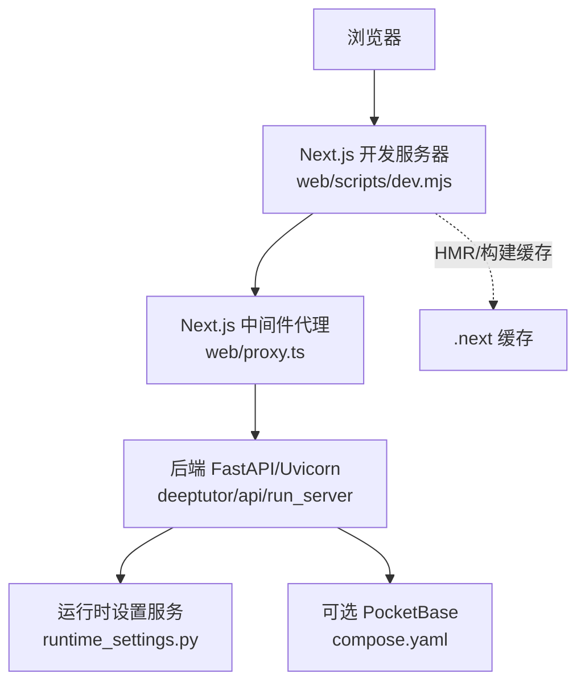
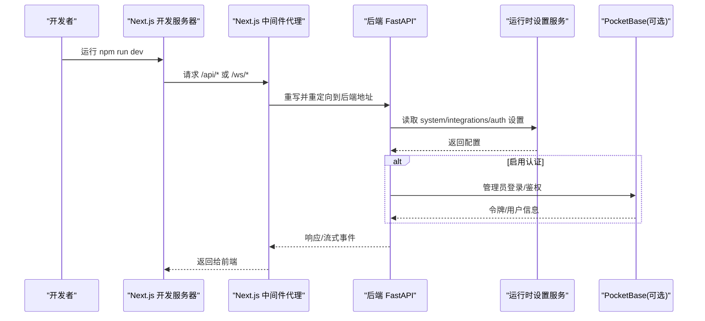
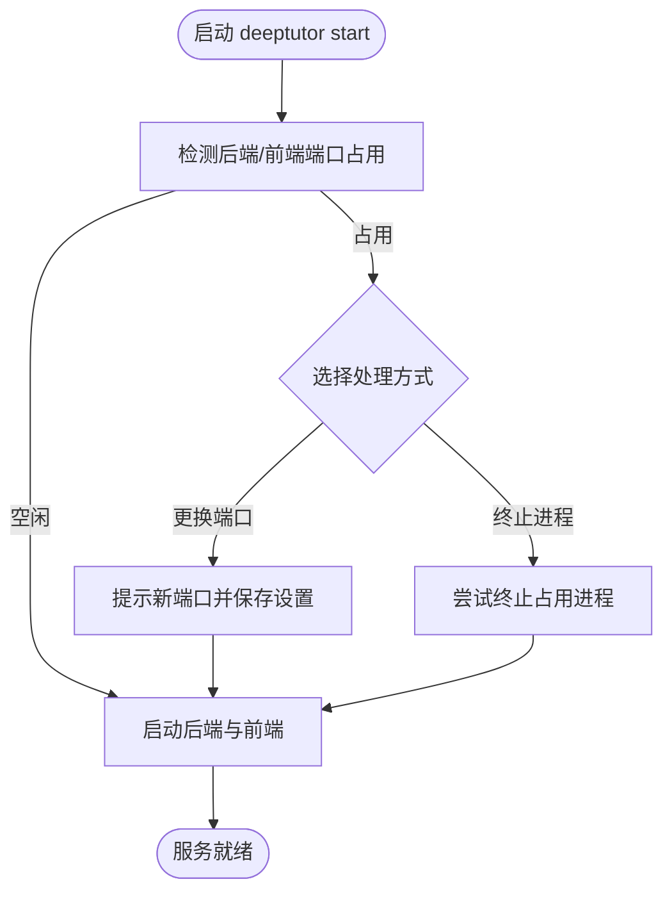
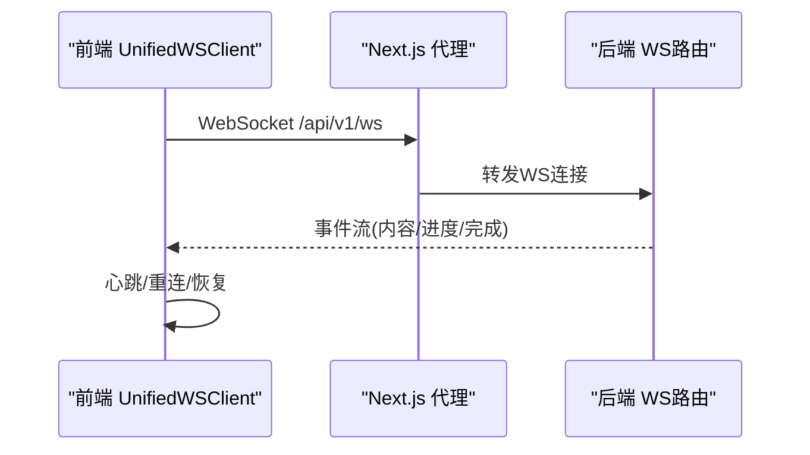
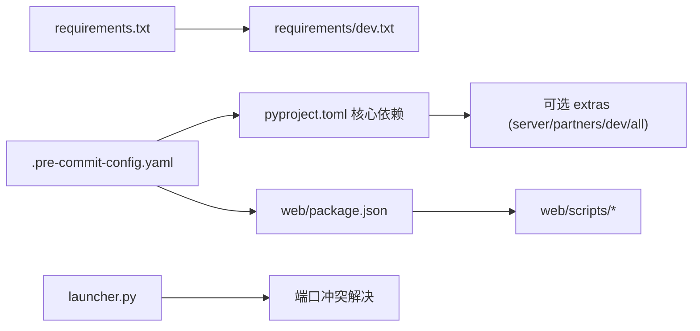

# 开发环境配置

<cite>
**本文引用的文件**
- [pyproject.toml](file://pyproject.toml)
- [requirements.txt](file://requirements.txt)
- [requirements/dev.txt](file://requirements/dev.txt)
- [.pre-commit-config.yaml](file://.pre-commit-config.yaml)
- [web/package.json](file://web/package.json)
- [web/scripts/dev.mjs](file://web/scripts/dev.mjs)
- [web/next.config.js](file://web/next.config.js)
- [web/proxy.ts](file://web/proxy.ts)
- [scripts/start_web.py](file://scripts/start_web.py)
- [scripts/start_backend.bat](file://scripts/start_backend.bat)
- [scripts/start_frontend.bat](file://scripts/start_frontend.bat)
- [docker-compose.dev.yml](file://docker-compose.dev.yml)
- [compose.yaml](file://compose.yaml)
- [tests/conftest.py](file://tests/conftest.py)
- [deeptutor/runtime/launcher.py](file://deeptutor/runtime/launcher.py)
- [deeptutor/services/config/runtime_settings.py](file://deeptutor/services/config/runtime_settings.py)
- [deeptutor/services/pocketbase_client.py](file://deeptutor/services/pocketbase_client.py)
- [scripts/pb_setup.py](file://scripts/pb_setup.py)
- [web/lib/unified-ws.ts](file://web/lib/unified-ws.ts)
</cite>

## 目录
1. [简介](#简介)
2. [项目结构](#项目结构)
3. [核心组件](#核心组件)
4. [架构总览](#架构总览)
5. [详细组件分析](#详细组件分析)
6. [依赖关系分析](#依赖关系分析)
7. [性能考虑](#性能考虑)
8. [故障排查指南](#故障排查指南)
9. [结论](#结论)
10. [附录](#附录)

## 简介
本指南面向DeepTutor开发者，覆盖从本地到容器化的完整开发环境搭建与调试流程。内容包含：Python与Node.js工具链安装、代码规范与预提交钩子、测试环境、前后端分离开发模式、API与WebSocket调试、数据库初始化与测试数据准备、性能监控与常见问题排查，以及贡献代码的最佳实践。

## 项目结构
DeepTutor采用前后端分离架构：
- 后端：FastAPI + Uvicorn（Python），提供REST与WebSocket接口，管理会话、知识库、能力与工具等。
- 前端：Next.js（TypeScript/React），提供Web UI，通过代理转发至后端API与WS。
- 运行时：支持源码热重载与打包产物两种模式；可选PocketBase作为认证与存储侧车。
- 配置：运行时设置集中保存在data/user/settings/*.json；环境变量用于部署覆盖。

图表来源
- [web/scripts/dev.mjs:1-70](file://web/scripts/dev.mjs#L1-L70)
- [web/next.config.js:47-76](file://web/next.config.js#L47-L76)
- [web/proxy.ts:13-24](file://web/proxy.ts#L13-L24)
- [deeptutor/services/config/runtime_settings.py:305-343](file://deeptutor/services/config/runtime_settings.py#L305-L343)
- [compose.yaml:120-182](file://compose.yaml#L120-L182)

章节来源
- [web/scripts/dev.mjs:1-70](file://web/scripts/dev.mjs#L1-L70)
- [web/next.config.js:47-76](file://web/next.config.js#L47-L76)
- [web/proxy.ts:13-24](file://web/proxy.ts#L13-L24)
- [deeptutor/services/config/runtime_settings.py:305-343](file://deeptutor/services/config/runtime_settings.py#L305-L343)
- [compose.yaml:120-182](file://compose.yaml#L120-L182)

## 核心组件
- Python工具链与依赖
  - Python版本要求与核心依赖定义在pyproject中，推荐使用虚拟环境并安装开发依赖。
  - 开发依赖包括pytest、pre-commit、bandit等，便于本地质量门禁。
- Node.js与前端工具
  - Next.js开发脚本位于web/scripts/dev.mjs，自动设置V8堆上限，避免开发时内存溢出。
  - 前端构建与脚本在web/package.json中定义。
- 预提交钩子与代码规范
  - .pre-commit-config.yaml统一了空白行、YAML/JSON校验、Ruff格式化与检查、Prettier、Bandit安全扫描、Mypy类型检查等。
- 启动方式
  - 后端可通过脚本或命令行启动；前端使用npm dev；也可通过统一入口脚本以开发模式启动前后端。
- 配置与运行时
  - 运行时设置集中在data/user/settings/*.json；环境变量用于部署覆盖。
  - 端口冲突检测与自动修复由启动器负责。

章节来源
- [pyproject.toml:8-21](file://pyproject.toml#L8-L21)
- [requirements/dev.txt:1-26](file://requirements/dev.txt#L1-L26)
- [web/package.json:1-22](file://web/package.json#L1-L22)
- [web/scripts/dev.mjs:1-70](file://web/scripts/dev.mjs#L1-L70)
- [.pre-commit-config.yaml:12-107](file://.pre-commit-config.yaml#L12-L107)
- [scripts/start_web.py:17-35](file://scripts/start_web.py#L17-L35)
- [deeptutor/runtime/launcher.py:301-450](file://deeptutor/runtime/launcher.py#L301-L450)

## 架构总览
下图展示了开发模式下前后端交互、代理转发与配置读取的关键路径。

图表来源
- [web/proxy.ts:42-72](file://web/proxy.ts#L42-L72)
- [deeptutor/services/config/runtime_settings.py:305-343](file://deeptutor/services/config/runtime_settings.py#L305-L343)
- [deeptutor/services/pocketbase_client.py:47-108](file://deeptutor/services/pocketbase_client.py#L47-L108)

## 详细组件分析

### 开发工具链安装与环境准备
- Python
  - 使用pyproject中的requires-python约束，建议Python 3.11–3.13。
  - 推荐安装开发依赖：pip install -e ".[dev]"，或使用requirements/dev.txt。
  - 若需额外能力（如伙伴通道、数学动画器、GraphRAG/LightRAG），按需启用对应extras。
- Node.js
  - 进入web目录，执行npm ci或npm install安装依赖。
  - 开发命令：npm run dev；如需Turbopack加速：npm run dev:turbo。
- 代码格式化工具
  - Python：Ruff（lint+format）与Black（已集成在pyproject）。
  - 前端：Prettier（通过pre-commit hooks）。
  - 类型检查：Mypy（pre-commit中启用，默认宽松策略）。

章节来源
- [pyproject.toml:8-21](file://pyproject.toml#L8-L21)
- [pyproject.toml:213-235](file://pyproject.toml#L213-L235)
- [requirements/dev.txt:1-26](file://requirements/dev.txt#L1-L26)
- [web/package.json:1-22](file://web/package.json#L1-L22)
- [.pre-commit-config.yaml:42-107](file://.pre-commit-config.yaml#L42-L107)

### 预提交钩子与代码规范检查
- 安装并启用：
  - pip install pre-commit
  - pre-commit install
- 提交前自动执行：
  - 通用文件检查（尾随空格、EOF、YAML/JSON/TOML校验、大文件限制）
  - Ruff lint/format（Python）
  - Prettier（前端样式与格式）
  - Bandit安全扫描
  - Mypy类型检查（宽松模式）
- 手动全量检查：pre-commit run --all-files

章节来源
- [.pre-commit-config.yaml:12-107](file://.pre-commit-config.yaml#L12-L107)

### 测试环境搭建
- 运行测试：
  - pytest（含异步测试标记与导入模式优化）
  - 前端Node测试：npm run test:node
- 测试夹具与隔离：
  - tests/conftest.py提供统一的上下文、流总线、SQLite临时库、能力stub等fixture。
  - 自动保护真实账户状态树，防止测试污染开发者环境。

章节来源
- [pyproject.toml:415-428](file://pyproject.toml#L415-L428)
- [tests/conftest.py:1-195](file://tests/conftest.py#L1-L195)

### 开发服务器启动与热重载
- 后端启动
  - Windows批处理：scripts/start_backend.bat（激活虚拟环境并启动后端API）。
  - 通用入口：python scripts/start_web.py --dev（开发模式会联动Next.js开发服务器）。
- 前端启动
  - Windows批处理：scripts/start_frontend.bat（启动Next.js开发服务器，默认端口3782）。
  - 跨平台：cd web && npm run dev。
- 热重载
  - Docker开发覆盖：docker-compose.dev.yml挂载源码目录，实现前后端热重载。
  - Next.js开发服务器自带HMR；后端Uvicorn支持热重载。
- 端口冲突处理
  - 启动器会自动检测端口占用并提供交互式解决方案（更换端口或终止占用进程）。

图表来源
- [deeptutor/runtime/launcher.py:301-450](file://deeptutor/runtime/launcher.py#L301-L450)
- [scripts/start_backend.bat:1-25](file://scripts/start_backend.bat#L1-L25)
- [scripts/start_frontend.bat:1-13](file://scripts/start_frontend.bat#L1-L13)
- [docker-compose.dev.yml:12-52](file://docker-compose.dev.yml#L12-L52)

章节来源
- [scripts/start_web.py:17-35](file://scripts/start_web.py#L17-L35)
- [scripts/start_backend.bat:1-25](file://scripts/start_backend.bat#L1-L25)
- [scripts/start_frontend.bat:1-13](file://scripts/start_frontend.bat#L1-L13)
- [docker-compose.dev.yml:12-52](file://docker-compose.dev.yml#L12-L52)
- [deeptutor/runtime/launcher.py:301-450](file://deeptutor/runtime/launcher.py#L301-L450)

### 前后端分离开发与API调试
- 前端代理
  - Next.js中间件将/api/*与/ws/*重写至后端地址，默认读取DEEPTUTOR_API_BASE_URL或系统设置。
  - 开发时NEXT_PUBLIC_API_BASE可由system.json或环境变量覆盖。
- API调试
  - 直接访问后端端口（默认8001）进行Swagger/文档调试。
  - 通过浏览器Network面板观察代理重写后的请求目标。
- WebSocket连接调试
  - 前端UnifiedWSClient连接/ws路径，支持心跳、断线重连与恢复序列号。
  - 可在浏览器控制台查看WS消息与错误日志。

图表来源
- [web/proxy.ts:42-72](file://web/proxy.ts#L42-L72)
- [web/lib/unified-ws.ts:157-242](file://web/lib/unified-ws.ts#L157-L242)

章节来源
- [web/next.config.js:47-76](file://web/next.config.js#L47-L76)
- [web/proxy.ts:13-24](file://web/proxy.ts#L13-L24)
- [web/lib/unified-ws.ts:157-242](file://web/lib/unified-ws.ts#L157-L242)

### 数据库初始化与测试数据准备
- PocketBase（可选）
  - 首次运行后执行scripts/pb_setup.py初始化集合（需要integrations.pocketbase_url与管理员凭据）。
  - 运行时通过deeptutor/services/pocketbase_client.py获取已认证的客户端。
- SQLite会话存储
  - 测试中使用临时SQLite文件路径，避免污染真实数据。
- 运行时设置
  - data/user/settings/system.json、auth.json、integrations.json为运行时配置来源。
  - 环境变量可覆盖部分设置（如POCKETBASE_*）。

章节来源
- [scripts/pb_setup.py:1-84](file://scripts/pb_setup.py#L1-L84)
- [deeptutor/services/pocketbase_client.py:47-108](file://deeptutor/services/pocketbase_client.py#L47-L108)
- [tests/conftest.py:143-155](file://tests/conftest.py#L143-L155)
- [deeptutor/services/config/runtime_settings.py:661-673](file://deeptutor/services/config/runtime_settings.py#L661-L673)

### 性能监控与调优
- 前端内存
  - web/scripts/dev.mjs设置NODE_OPTIONS的max-old-space-size上限，避免开发时内存暴涨。
- 构建与代理大小
  - next.config.js提升代理最大请求体大小以匹配后端上传限制。
- 运行时资源
  - compose.yaml提供tmpfs与可选资源限制（pids_limit/mem_limit/cpus）。

章节来源
- [web/scripts/dev.mjs:24-59](file://web/scripts/dev.mjs#L24-L59)
- [web/next.config.js:108-120](file://web/next.config.js#L108-L120)
- [compose.yaml:127-196](file://compose.yaml#L127-L196)

## 依赖关系分析
- Python依赖
  - 核心依赖与可选依赖（server、partners、matrix、math-animator、dev、all）在pyproject中集中声明。
  - requirements.txt与requirements/dev.txt镜像关键依赖，便于Docker/CI场景。
- 前端依赖
  - web/package.json定义Next.js、React、Tailwind、ESLint、Playwright等。
- 工具链耦合
  - pre-commit聚合多语言检查，确保提交质量。
  - launcher协调前后端端口与启动顺序，减少人工配置。

图表来源
- [pyproject.toml:21-235](file://pyproject.toml#L21-L235)
- [requirements.txt:1-23](file://requirements.txt#L1-L23)
- [requirements/dev.txt:1-26](file://requirements/dev.txt#L1-L26)
- [web/package.json:1-63](file://web/package.json#L1-L63)
- [.pre-commit-config.yaml:12-107](file://.pre-commit-config.yaml#L12-L107)
- [deeptutor/runtime/launcher.py:301-450](file://deeptutor/runtime/launcher.py#L301-L450)

章节来源
- [pyproject.toml:21-235](file://pyproject.toml#L21-L235)
- [requirements.txt:1-23](file://requirements.txt#L1-L23)
- [requirements/dev.txt:1-26](file://requirements/dev.txt#L1-L26)
- [web/package.json:1-63](file://web/package.json#L1-L63)
- [.pre-commit-config.yaml:12-107](file://.pre-commit-config.yaml#L12-L107)
- [deeptutor/runtime/launcher.py:301-450](file://deeptutor/runtime/launcher.py#L301-L450)

## 性能考虑
- 开发阶段优先使用源码热重载，减少构建时间。
- 合理设置V8堆上限，避免长时间开发导致内存压力。
- 使用Turbopack（npm run dev:turbo）提升构建速度（视环境而定）。
- 在生产或容器化部署中，结合tmpfs与资源限制保障稳定性。

## 故障排查指南
- 端口冲突
  - 现象：后端或前端无法启动，提示端口被占用。
  - 处理：使用启动器交互式切换端口或终止占用进程；检查system.json中的端口配置。
- 依赖版本问题
  - 现象：安装失败或运行时导入错误。
  - 处理：确认Python版本满足约束；使用“pip install -e .[dev]”安装开发依赖；必要时清理venv后重试。
- 前端构建失败
  - 现象：Next.js构建报错或HMR不生效。
  - 处理：检查web/node_modules是否完整；确认代理配置与后端地址；清理.next缓存后重试。
- WebSocket连接失败
  - 现象：前端WS连接错误或无消息。
  - 处理：检查代理重写规则与后端WS路由；确认DEEPTUTOR_API_BASE_URL或system.json中的API基础地址正确。
- PocketBase未初始化
  - 现象：认证或集合相关功能不可用。
  - 处理：确保integrations.pocketbase_url与管理员凭据已配置；执行scripts/pb_setup.py初始化。

章节来源
- [deeptutor/runtime/launcher.py:301-450](file://deeptutor/runtime/launcher.py#L301-L450)
- [web/next.config.js:47-76](file://web/next.config.js#L47-L76)
- [web/proxy.ts:13-24](file://web/proxy.ts#L13-L24)
- [scripts/pb_setup.py:1-84](file://scripts/pb_setup.py#L1-L84)

## 结论
通过本指南，你可以在本地或容器中快速搭建DeepTutor开发环境，掌握前后端分离开发、API与WebSocket调试、数据库初始化与测试数据准备，以及常见问题的排查方法。遵循预提交钩子与代码规范，有助于保持代码质量与团队协作效率。

## 附录
- 常用命令速查
  - 安装开发依赖：pip install -e ".[dev]"
  - 前端开发：cd web && npm run dev
  - 统一启动（开发模式）：python scripts/start_web.py --dev
  - 运行测试：pytest
  - 预提交检查：pre-commit run --all-files
- 贡献代码最佳实践
  - 提交前运行pre-commit与测试，确保无新增问题。
  - 变更运行时设置时，更新system.json或说明环境变量覆盖。
  - 涉及API或WS变更时，补充相应测试用例。