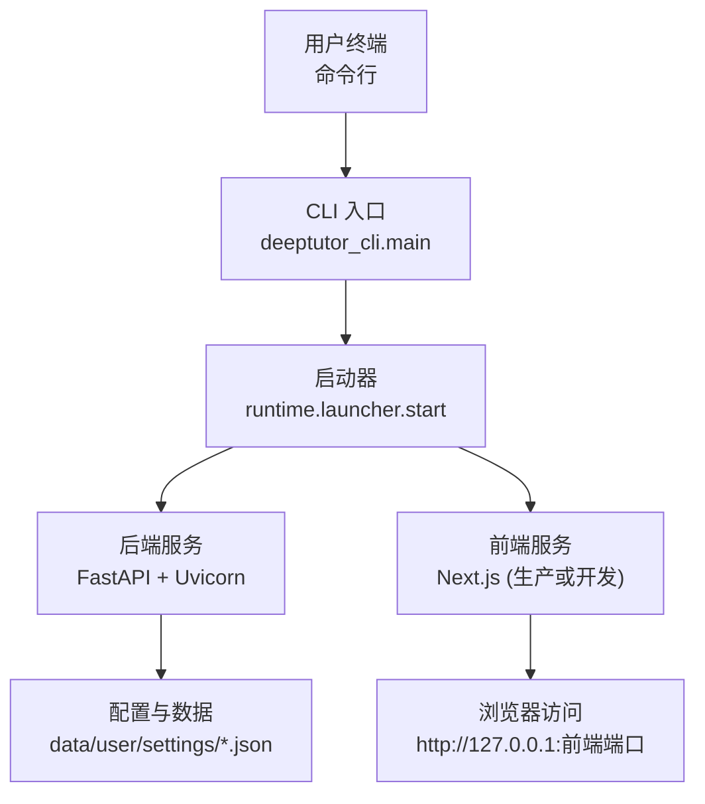
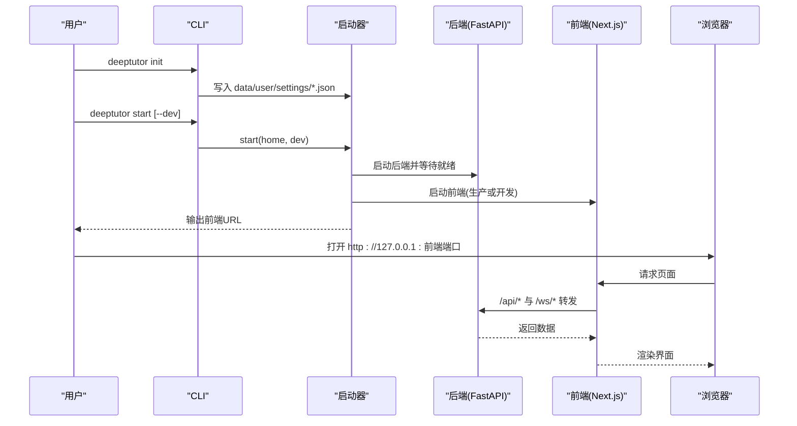
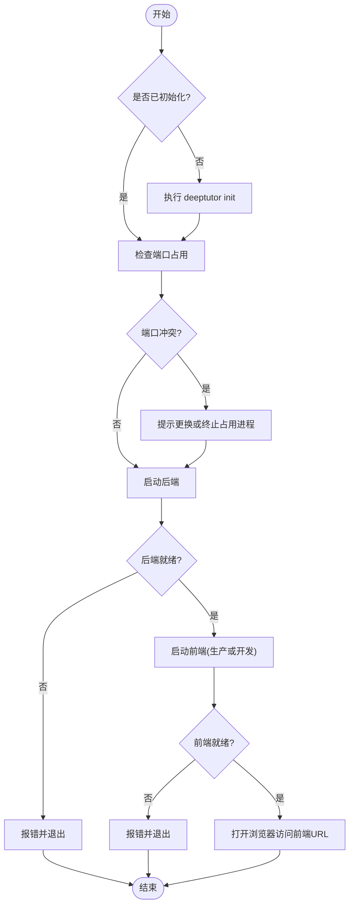

# 本地安装

<cite>
**本文引用的文件**
- [README.md](file://README.md)
- [pyproject.toml](file://pyproject.toml)
- [requirements.txt](file://requirements.txt)
- [requirements/server.txt](file://requirements/server.txt)
- [requirements/cli.txt](file://requirements/cli.txt)
- [deeptutor_cli/main.py](file://deeptutor_cli/main.py)
- [deeptutor_cli/init_cmd.py](file://deeptutor_cli/init_cmd.py)
- [deeptutor/runtime/launcher.py](file://deeptutor/runtime/launcher.py)
- [Dockerfile](file://Dockerfile)
- [CONTAINERIZATION.md](file://CONTAINERIZATION.md)
</cite>

## 目录
1. [简介](#简介)
2. [项目结构](#项目结构)
3. [核心组件](#核心组件)
4. [架构总览](#架构总览)
5. [详细组件分析](#详细组件分析)
6. [依赖分析](#依赖分析)
7. [性能注意事项](#性能注意事项)
8. [故障排除指南](#故障排除指南)
9. [结论](#结论)
10. [附录](#附录)

## 简介
本指南面向希望在本机运行 DeepTutor 的用户，提供两种安装路径：
- 从 PyPI 安装完整应用（推荐）
- 从源码安装开发版本

内容涵盖：
- 环境要求与依赖安装
- 环境变量与配置初始化
- 启动流程与端口说明
- 模型设置与首次使用
- 开发模式与热重载
- 常见问题排查

## 项目结构
DeepTutor 的本地运行由 CLI、后端 API 和前端 Web 三部分组成。CLI 负责引导安装、初始化配置与启动；后端基于 FastAPI + Uvicorn；前端为 Next.js 应用，生产构建后由 Node 独立服务托管，开发模式通过 Next dev 提供 HMR。

图表来源
- [deeptutor_cli/main.py:117-129](file://deeptutor_cli/main.py#L117-L129)
- [deeptutor/runtime/launcher.py:722-773](file://deeptutor/runtime/launcher.py#L722-L773)

章节来源
- [README.md:202-246](file://README.md#L202-L246)
- [deeptutor_cli/main.py:117-129](file://deeptutor_cli/main.py#L117-L129)
- [deeptutor/runtime/launcher.py:722-773](file://deeptutor/runtime/launcher.py#L722-L773)

## 核心组件
- CLI 命令
  - deeptutor init：交互式向导创建/更新 data/user/settings 下的配置文件（端口、LLM、Embedding、Search）。
  - deeptutor start：同时启动后端与前端；--dev 启用前端 HMR。
  - deeptutor serve：仅启动后端 API。
- 运行时启动器
  - 自动处理端口冲突、进程管理、前后端就绪检测、Node/npm 依赖检查与生产构建缓存。
- 配置系统
  - system.json：后端/前端端口、CORS、SSL 校验、附件目录等。
  - model_catalog.json：LLM/Embedding/Search 提供商、API Key、激活模型。
  - auth.json、integrations.json、interface.json、main.yaml、agents.yaml：认证、集成、界面、运行时行为与能力参数。

章节来源
- [deeptutor_cli/init_cmd.py:412-533](file://deeptutor_cli/init_cmd.py#L412-L533)
- [deeptutor_cli/main.py:117-175](file://deeptutor_cli/main.py#L117-L175)
- [CONTAINERIZATION.md:345-362](file://CONTAINERIZATION.md#L345-L362)

## 架构总览
下图展示了本地安装的典型调用链：CLI 接收命令 → 启动器协调后端与前端 → 浏览器访问前端 → 前端代理转发 API/WebSocket 到后端。

图表来源
- [deeptutor_cli/main.py:117-129](file://deeptutor_cli/main.py#L117-L129)
- [deeptutor/runtime/launcher.py:453-474](file://deeptutor/runtime/launcher.py#L453-L474)
- [Dockerfile:369-402](file://Dockerfile#L369-L402)

## 详细组件分析

### 从 PyPI 安装完整应用
适用场景：快速体验完整 Web 应用与 CLI，无需克隆仓库。

前置条件
- Python 3.11–3.13
- Node.js 20+（用于运行打包的 Next.js 独立服务器）

安装步骤
1. 创建工作目录并进入：
   - mkdir -p my-deeptutor && cd my-deeptutor
2. 安装应用：
   - pip install -U deeptutor
3. 初始化配置（交互式向导）：
   - deeptutor init
   - 会提示设置后端端口（默认 8001）、前端端口（默认 3782）、LLM 提供商/基地址/API Key/模型，以及可选的 Embedding 提供商。
4. 启动服务：
   - deeptutor start
   - 保持终端开启以停止服务；Ctrl+C 可同时停止前后端。
5. 访问前端：
   - 打开终端打印的前端 URL，默认 http://127.0.0.1:3782。

补充说明
- 跳过 init 直接 start 也可运行，但需在“设置 → 模型”中配置模型。
- 若端口被占用，启动器会提示选择更换端口或终止占用进程。

章节来源
- [README.md:207-221](file://README.md#L207-L221)
- [deeptutor_cli/init_cmd.py:441-460](file://deeptutor_cli/init_cmd.py#L441-L460)
- [deeptutor/runtime/launcher.py:408-451](file://deeptutor/runtime/launcher.py#L408-L451)

### 从源码安装开发版本
适用场景：需要修改代码、调试或参与开发。

前置条件
- Python 3.11–3.13
- Node.js 22 LTS（匹配 CI/Docker）
- npm

安装步骤
1. 克隆仓库并进入：
   - git clone https://github.com/HKUDS/DeepTutor.git
   - cd DeepTutor
2. 创建虚拟环境并激活：
   - python3 -m venv .venv && source .venv/bin/activate
   - python -m pip install --upgrade pip
3. 安装后端与前端依赖：
   - python -m pip install -e .
   - ( cd web && npm ci --legacy-peer-deps )
4. 初始化配置：
   - deeptutor init
5. 启动服务：
   - deeptutor start --dev
   - --dev 使用 Next.js 开发服务器并提供 HMR；生产模式会构建一次并复用。

可选扩展
- 开发工具：pip install -e ".[dev]"
- 合作伙伴 IM 通道 SDK：pip install -e ".[partners]"
- Matrix 通道：pip install -e ".[matrix]"
- Math Animator（Manim）：pip install -e ".[math-animator]"

章节来源
- [README.md:224-286](file://README.md#L224-L286)
- [pyproject.toml:212-235](file://pyproject.toml#L212-L235)
- [deeptutor_cli/main.py:117-129](file://deeptutor_cli/main.py#L117-L129)

### 环境变量与配置
- 工作区根目录：DEEPTUTOR_HOME 或通过 deeptutor start --home 指定。
- 运行时配置位于 data/user/settings/ 下：
  - system.json：后端/前端端口、公共 API Base、CORS、SSL 校验、附件目录等。
  - model_catalog.json：LLM/Embedding/Search 提供商、API Key、激活模型。
  - auth.json：是否启用认证、用户名、密码哈希、Token/Cookie 设置。
  - integrations.json：PocketBase 等集成设置。
  - interface.json：界面语言、主题、侧边栏偏好。
  - main.yaml：运行时行为默认值与路径注入。
  - agents.yaml：能力/工具的温度与 Token 设置。
- Docker 容器启动时会将 JSON 配置导出为环境变量供进程使用；本地启动同样读取这些 JSON。

章节来源
- [CONTAINERIZATION.md:345-362](file://CONTAINERIZATION.md#L345-L362)
- [Dockerfile:369-402](file://Dockerfile#L369-L402)
- [deeptutor_cli/init_cmd.py:412-533](file://deeptutor_cli/init_cmd.py#L412-L533)

### 端口配置与首次使用
- 默认端口：
  - 后端：8001
  - 前端：3782
- 端口冲突处理：
  - 启动器会检测占用端口，提示更换或终止占用进程，并将新端口持久化到 system.json。
- 首次使用：
  - 完成 deeptutor init 后，在“设置 → 模型”中添加 LLM 提供商（基地址、API Key、模型名），如需知识库/RAG 再添加 Embedding 提供商。

章节来源
- [README.md:207-221](file://README.md#L207-L221)
- [deeptutor/runtime/launcher.py:408-451](file://deeptutor/runtime/launcher.py#L408-L451)
- [deeptutor_cli/init_cmd.py:441-460](file://deeptutor_cli/init_cmd.py#L441-L460)

### 开发模式与热重载
- 开发模式：
  - deeptutor start --dev 使用 Next.js 开发服务器，支持 HMR。
- 生产模式：
  - 源码安装会构建一次 Next.js 生产产物并缓存，后续启动复用，避免开发编译器的开销。
- 前端依赖：
  - 源码安装需确保 web/node_modules 存在；启动器会自动尝试 npm ci 或 npm install。

章节来源
- [README.md:224-286](file://README.md#L224-L286)
- [deeptutor/runtime/launcher.py:572-698](file://deeptutor/runtime/launcher.py#L572-L698)

### 启动流程图

图表来源
- [deeptutor/runtime/launcher.py:408-474](file://deeptutor/runtime/launcher.py#L408-L474)

## 依赖分析
- Python 版本：>=3.11,<3.14（部分重型 RAG 扩展限制 <3.14）。
- 核心依赖：
  - LLM SDK：openai、anthropic、dashscope、perplexityai、oauth-cli-kit
  - HTTP 客户端：aiohttp、httpx、requests
  - 异步与重试：nest_asyncio、tenacity
  - 数据模型与存储：pydantic、aiosqlite
  - RAG：llama-index、BM25、FAISS、PyMuPDF、numpy、arxiv
  - 文档提取与办公技能：python-docx、openpyxl、python-pptx、pypdf、pdfplumber、reportlab、defusedxml
  - Web 搜索：ddgs
  - CLI 框架：typer、rich、prompt_toolkit
  - 服务端：fastapi、uvicorn、websockets、python-multipart、bcrypt、python-jose、pocketbase、loguru、json-repair、croniter

- 可选扩展：
  - partners：IM 通道 SDK（Telegram、Slack、飞书、钉钉、Zulip 等）
  - matrix/matrix-e2e：Matrix 通道及端到端加密
  - math-animator：Manim 动画引擎（需系统级 LaTeX/ffmpeg 等）
  - parse-*：文档解析引擎（markitdown、docling、pymupdf4llm）

章节来源
- [pyproject.toml:21-235](file://pyproject.toml#L21-L235)
- [requirements/cli.txt:1-66](file://requirements/cli.txt#L1-L66)
- [requirements/server.txt:1-32](file://requirements/server.txt#L1-L32)

## 性能注意事项
- 生产模式优先：源码安装默认构建生产产物并缓存，避免开发编译器的资源消耗。
- 内存优化：启动器为单用户分配器设置 MALLOC_ARENA_MAX 与 MALLOC_TRIM_THRESHOLD_，减少碎片。
- 大知识库检索：FAISS 向量库替代暴力扫描，提升查询性能（按需加载，缺失时回退）。
- 前端静态资源：生产构建将 static/public 复制到 standalone 目录，减少运行时开销。

章节来源
- [deeptutor/runtime/launcher.py:42-47](file://deeptutor/runtime/launcher.py#L42-L47)
- [pyproject.toml:47-51](file://pyproject.toml#L47-L51)
- [deeptutor/runtime/launcher.py:700-719](file://deeptutor/runtime/launcher.py#L700-L719)

## 故障排除指南
- 端口占用
  - 现象：启动时报端口被占用。
  - 解决：按提示更换端口或终止占用进程；端口变更会保存到 system.json。
- Node/npm 缺失
  - 现象：前端无法启动或报找不到 next 二进制。
  - 解决：安装 Node.js 20+ 与 npm；源码安装需执行 npm ci 或 npm install。
- 前端锁文件卡住
  - 现象：--dev 模式报告已有前端但未响应。
  - 解决：删除 web/.next/dev/lock 与 web/.next/lock 后重试。
- 构建失败
  - 现象：npm run build 失败。
  - 解决：修复依赖后重试；必要时清理 node_modules 重新安装。
- 模型连接失败
  - 现象：init 探测失败或运行时调用模型报错。
  - 解决：检查基地址、API Key、网络连通性；可在“设置 → 模型”中重新配置。
- 权限与路径
  - 现象：写入 data/user/settings 失败。
  - 解决：确保当前用户对工作区有写权限；或使用 DEEPTUTOR_HOME 指向可写目录。

章节来源
- [README.md:272-286](file://README.md#L272-L286)
- [deeptutor/runtime/launcher.py:408-451](file://deeptutor/runtime/launcher.py#L408-L451)
- [deeptutor_cli/init_cmd.py:162-189](file://deeptutor_cli/init_cmd.py#L162-L189)

## 结论
通过 PyPI 安装适合快速部署与日常使用；从源码安装适合开发与定制。无论哪种方式，均建议先执行 deeptutor init 完成端口与模型配置，再通过 deeptutor start 启动服务。遇到端口冲突、依赖缺失或模型连接问题时，可参考故障排除指南逐步定位与解决。

## 附录
- 常用命令参考
  - deeptutor init：创建或更新 data/user/settings
  - deeptutor start [--home PATH] [--dev]：启动后端与前端
  - deeptutor serve [--port PORT]：仅启动后端 API
  - deeptutor chat：交互式 REPL
  - deeptutor kb list/info/create/add/search/set-default/delete：知识库管理
  - deeptutor memory show/clear：记忆查看与清理
  - deeptutor config show：打印配置摘要

章节来源
- [README.md:721-742](file://README.md#L721-L742)
- [deeptutor_cli/main.py:75-115](file://deeptutor_cli/main.py#L75-L115)