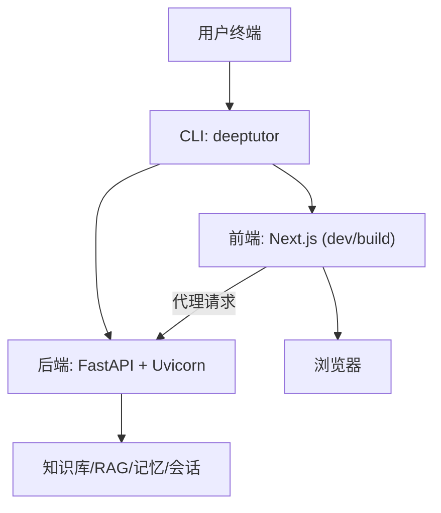
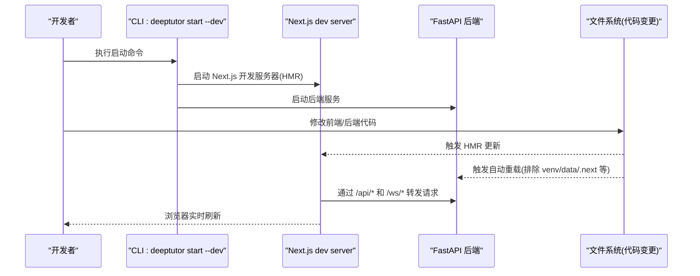
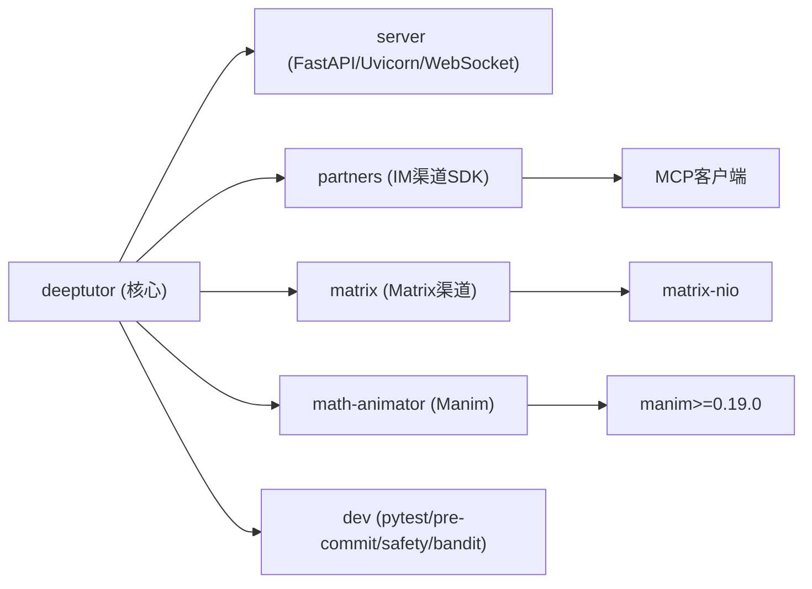

# 源码安装

<cite>
**本文引用的文件**
- [README.md](file://README.md)
- [pyproject.toml](file://pyproject.toml)
- [requirements.txt](file://requirements.txt)
- [web/package.json](file://web/package.json)
- [scripts/start_web.py](file://scripts/start_web.py)
- [deeptutor/api/run_server.py](file://deeptutor/api/run_server.py)
- [web/scripts/dev.mjs](file://web/scripts/dev.mjs)
- [web/next.config.js](file://web/next.config.js)
- [requirements/partners.txt](file://requirements/partners.txt)
- [requirements/matrix.txt](file://requirements/matrix.txt)
- [requirements/math-animator.txt](file://requirements/math-animator.txt)
- [requirements/dev.txt](file://requirements/dev.txt)
</cite>

## 目录
1. [简介](#简介)
2. [项目结构](#项目结构)
3. [核心组件](#核心组件)
4. [架构总览](#架构总览)
5. [详细组件分析](#详细组件分析)
6. [依赖关系分析](#依赖关系分析)
7. [性能注意事项](#性能注意事项)
8. [故障排除指南](#故障排除指南)
9. [结论](#结论)
10. [附录](#附录)

## 简介
本指南面向希望从源码构建并运行 DeepTutor 的开发者。内容涵盖：
- 开发环境要求（Python 3.11–3.13，Node.js 22 LTS）
- 完整克隆、虚拟环境创建与依赖安装流程
- 开发模式与生产模式的区别、热重载机制
- 可选扩展功能安装（dev、partners、matrix、math-animator）
- 前端依赖管理、开发服务器故障排除、Conda 环境配置等高级选项

## 项目结构
DeepTutor 由后端 Python 服务、Next.js 前端以及 CLI 工具组成。仓库根目录包含：
- deeptutor：后端核心包（FastAPI、Agent 循环、RAG、记忆、设置等）
- deeptutor_cli：命令行入口（deeptutor 命令）
- web：Next.js 前端应用
- scripts：启动脚本与辅助工具
- requirements：按功能划分的依赖清单（对应 pyproject 的 optional-dependencies）
- pyproject.toml：Python 包元数据、依赖与工具链配置

图表来源
- [scripts/start_web.py:17-35](file://scripts/start_web.py#L17-L35)
- [deeptutor/api/run_server.py:41-59](file://deeptutor/api/run_server.py#L41-L59)
- [web/package.json:5-21](file://web/package.json#L5-L21)

章节来源
- [README.md:224-286](file://README.md#L224-L286)
- [pyproject.toml:8-71](file://pyproject.toml#L8-L71)
- [web/package.json:1-63](file://web/package.json#L1-L63)

## 核心组件
- 后端服务：基于 FastAPI/Uvicorn，提供 API、WebSocket、任务调度、RAG、记忆、会话管理等能力。
- 前端应用：Next.js 16 + React 19，提供聊天、知识中心、书籍、学习空间、设置等界面。
- CLI：统一入口 deeptutor，支持 init、start、serve、run、chat 等命令。
- 可选扩展：partners（IM 渠道）、matrix（Matrix 渠道）、math-animator（Manim 动画）、dev（测试/质量工具）。

章节来源
- [pyproject.toml:8-71](file://pyproject.toml#L8-L71)
- [pyproject.toml:76-235](file://pyproject.toml#L76-L235)
- [web/package.json:23-61](file://web/package.json#L23-L61)

## 架构总览
下图展示了源码安装后，前后端如何协同工作，以及开发模式下的热重载路径。

图表来源
- [scripts/start_web.py:17-35](file://scripts/start_web.py#L17-L35)
- [deeptutor/api/run_server.py:41-59](file://deeptutor/api/run_server.py#L41-L59)
- [web/scripts/dev.mjs:1-28](file://web/scripts/dev.mjs#L1-L28)

## 详细组件分析

### 环境与依赖
- Python 版本：>=3.11,<3.14（推荐 3.11–3.13）
- Node.js：22 LTS（匹配 CI/Docker）
- 前端依赖：Next.js 16、React 19、Tailwind、Mermaid、Chart.js 等
- 后端依赖：FastAPI、Uvicorn、WebSockets、Pydantic、LLM SDKs、RAG 组件等

章节来源
- [pyproject.toml:12-18](file://pyproject.toml#L12-L18)
- [web/package.json:23-61](file://web/package.json#L23-L61)
- [README.md:224-246](file://README.md#L224-L246)

### 安装步骤（源码）
1. 克隆仓库
   - git clone https://github.com/HKUDS/DeepTutor.git
2. 进入项目目录
   - cd DeepTutor
3. 创建并激活虚拟环境
   - python3 -m venv .venv && source .venv/bin/activate
   - Windows PowerShell: py -3.11 -m venv .venv ; .\.venv\Scripts\Activate.ps1
4. 升级 pip
   - python -m pip install --upgrade pip
5. 安装后端（可编辑模式）
   - python -m pip install -e .
6. 安装前端依赖
   - (cd web && npm ci --legacy-peer-deps)
7. 初始化配置
   - deeptutor init
8. 启动（开发模式）
   - deeptutor start --dev

说明：
- 生产模式：deeptutor start（会构建本地 web/ 前端产物并复用）
- 开发模式：deeptutor start --dev（启用 Next.js 开发服务器与 HMR 热重载）

章节来源
- [README.md:224-286](file://README.md#L224-L286)
- [scripts/start_web.py:17-35](file://scripts/start_web.py#L17-L35)

### 可选扩展安装
按需安装额外功能：
- 开发工具：pip install -e ".[dev]"
- Partners IM 渠道：pip install -e ".[partners]"
- Matrix 渠道（非E2EE）：pip install -e ".[matrix]"
- Matrix E2EE（需 libolm）：pip install -e ".[matrix-e2e]"
- Math Animator（Manim，需系统级 LaTeX/ffmpeg 等）：pip install -e ".[math-animator]"

章节来源
- [pyproject.toml:76-235](file://pyproject.toml#L76-L235)
- [requirements/partners.txt:1-42](file://requirements/partners.txt#L1-L42)
- [requirements/matrix.txt:1-19](file://requirements/matrix.txt#L1-L19)
- [requirements/math-animator.txt:1-17](file://requirements/math-animator.txt#L1-L17)

### 前端依赖管理与开发服务器
- 依赖管理：使用 npm ci 锁定版本；如需调整依赖，运行 npm install --legacy-peer-deps 更新 lock 文件并提交 package.json 与 package-lock.json。
- 开发服务器：web/scripts/dev.mjs 负责为 Next.js dev 进程设置合理的 V8 堆上限（NODE_OPTIONS），避免大内存占用导致崩溃。
- 构建与启动脚本：web/package.json 定义了 dev、build、start 等脚本。

章节来源
- [web/package.json:5-21](file://web/package.json#L5-L21)
- [web/scripts/dev.mjs:1-28](file://web/scripts/dev.mjs#L1-L28)

### 后端自动重载与排除目录
- 开发模式下，后端使用 Uvicorn 自动重载，但会排除一些目录以避免不必要的重启或警告：
  - venv/.venv、data、node_modules、web/node_modules、web/.next、.git、scripts
- 这些排除项确保只监听关键代码变更，提升开发体验。

章节来源
- [deeptutor/api/run_server.py:41-59](file://deeptutor/api/run_server.py#L41-L59)

### 开发模式 vs 生产模式
- 生产模式（默认）：
  - 构建一次本地 web/ 前端产物并复用
  - 适合部署与调试最终行为
- 开发模式（--dev）：
  - 启动 Next.js 开发服务器，启用 HMR 热重载
  - 更适合前端开发与联调

章节来源
- [README.md:224-286](file://README.md#L224-L286)
- [scripts/start_web.py:17-35](file://scripts/start_web.py#L17-L35)

## 依赖关系分析
下图展示可选依赖之间的关系与组合方式。

图表来源
- [pyproject.toml:76-235](file://pyproject.toml#L76-L235)
- [requirements/partners.txt:1-42](file://requirements/partners.txt#L1-L42)
- [requirements/matrix.txt:1-19](file://requirements/matrix.txt#L1-L19)
- [requirements/math-animator.txt:1-17](file://requirements/math-animator.txt#L1-L17)
- [requirements/dev.txt:1-26](file://requirements/dev.txt#L1-L26)

章节来源
- [pyproject.toml:76-235](file://pyproject.toml#L76-L235)
- [requirements.txt:1-23](file://requirements.txt#L1-L23)

## 性能注意事项
- 前端开发服务器内存：web/scripts/dev.mjs 通过 NODE_OPTIONS 限制 V8 堆大小，避免长时间开发会话中内存膨胀。
- 后端自动重载：排除 venv/data/.next 等目录，减少无关重启开销。
- 大型知识库检索：默认使用 FAISS 向量存储加速 ANN 检索（若可用），否则回退到 SimpleVectorStore。

章节来源
- [web/scripts/dev.mjs:1-28](file://web/scripts/dev.mjs#L1-L28)
- [deeptutor/api/run_server.py:41-59](file://deeptutor/api/run_server.py#L41-L59)
- [pyproject.toml:47-51](file://pyproject.toml#L47-L51)

## 故障排除指南
常见问题与处理建议：
- 前端依赖冲突或锁文件过期：
  - 运行 npm install --legacy-peer-deps 刷新依赖，提交 package.json 与 package-lock.json
- 开发服务器卡住或端口占用：
  - 停止提示中的 PID；若无实际 Next.js 进程，删除 web/.next/dev/lock 与 web/.next/lock 后重试
- Conda 环境替代 venv：
  - conda create -n deeptutor python=3.11 && conda activate deeptutor
- 后端自动重载不生效：
  - 检查是否误改了被排除目录（如 data、.next、node_modules）
- 前端构建失败：
  - 确认 Node.js 版本为 22 LTS；清理 node_modules 与 .next 后重新安装依赖

章节来源
- [README.md:273-286](file://README.md#L273-L286)
- [web/scripts/dev.mjs:1-28](file://web/scripts/dev.mjs#L1-L28)
- [deeptutor/api/run_server.py:41-59](file://deeptutor/api/run_server.py#L41-L59)

## 结论
通过源码安装 DeepTutor，你可以获得完整的开发体验：灵活的前端热重载、稳定的后端自动重载、丰富的可选扩展与完善的依赖管理。按照本指南的步骤操作，即可快速搭建本地开发环境并进行功能迭代。

## 附录

### 完整安装命令示例
- 克隆与初始化
  - git clone https://github.com/HKUDS/DeepTutor.git
  - cd DeepTutor
- 虚拟环境
  - python3 -m venv .venv && source .venv/bin/activate
  - python -m pip install --upgrade pip
- 安装依赖
  - python -m pip install -e .
  - (cd web && npm ci --legacy-peer-deps)
- 初始化与启动
  - deeptutor init
  - deeptutor start --dev

章节来源
- [README.md:224-286](file://README.md#L224-L286)

### 可选扩展一键安装
- 全部扩展（含 partners、matrix、math-animator、dev）
  - pip install -e ".[all]"
- 单独安装
  - pip install -e ".[partners]"
  - pip install -e ".[matrix]"
  - pip install -e ".[matrix-e2e]"
  - pip install -e ".[math-animator]"
  - pip install -e ".[dev]"

章节来源
- [pyproject.toml:76-235](file://pyproject.toml#L76-L235)

### 前端依赖管理最佳实践
- 新增/升级依赖：在 web/package.json 中声明，然后运行 npm install --legacy-peer-deps 更新 lock 文件并提交变更。
- 开发服务器：优先使用 npm run dev（通过 scripts/dev.mjs 启动），以获得合理的内存限制与 HMR。

章节来源
- [web/package.json:5-21](file://web/package.json#L5-L21)
- [web/scripts/dev.mjs:1-28](file://web/scripts/dev.mjs#L1-L28)