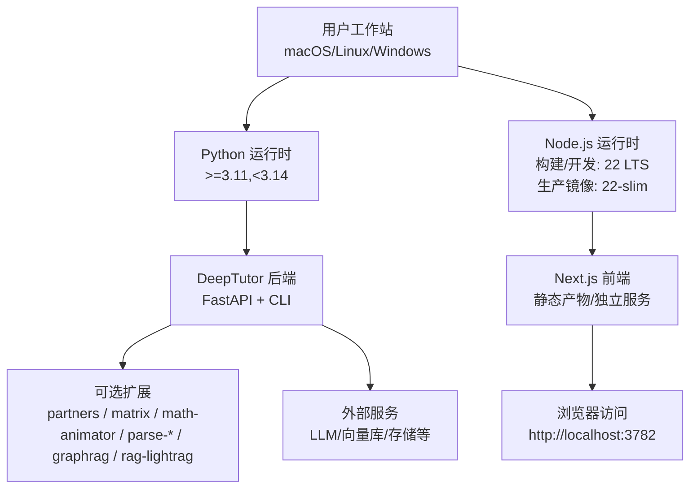
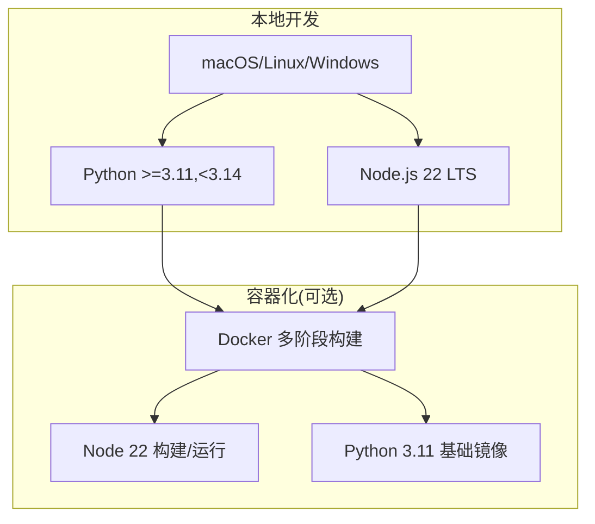
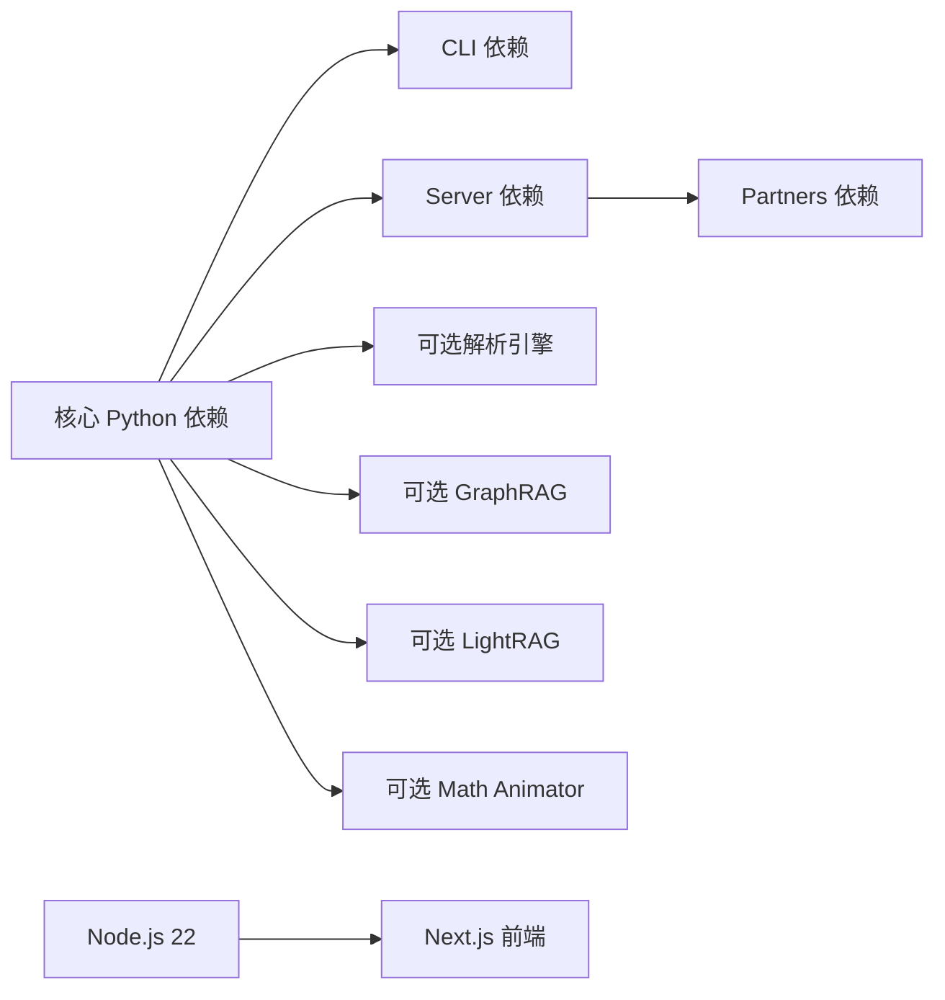

# 环境要求

<cite>
**本文引用的文件**
- [pyproject.toml](file://pyproject.toml)
- [requirements.txt](file://requirements.txt)
- [requirements/cli.txt](file://requirements/cli.txt)
- [requirements/server.txt](file://requirements/server.txt)
- [requirements/partners.txt](file://requirements/partners.txt)
- [requirements/math-animator.txt](file://requirements/math-animator.txt)
- [web/package.json](file://web/package.json)
- [Dockerfile](file://Dockerfile)
</cite>

## 目录
1. [简介](#简介)
2. [项目结构与环境定位](#项目结构与环境定位)
3. [核心组件与最低版本要求](#核心组件与最低版本要求)
4. [架构总览](#架构总览)
5. [详细组件分析](#详细组件分析)
6. [依赖关系分析](#依赖关系分析)
7. [性能与兼容性注意事项](#性能与兼容性注意事项)
8. [故障排查指南](#故障排查指南)
9. [结论](#结论)
10. [附录：安装与验证步骤](#附录安装与验证步骤)

## 简介
本文件为 DeepTutor 的环境要求说明，聚焦系统依赖、最低版本与兼容性矩阵、可选依赖（如 math-animator）的系统库要求，以及环境验证与常见问题解决方案。目标是帮助用户在 macOS、Linux、Windows 上正确配置开发/运行环境，以启用 DeepTutor 的各项功能。

## 项目结构与环境定位
DeepTutor 由 Python 后端（FastAPI + CLI）、Next.js 前端（Node.js）以及若干可选扩展组成。关键环境约束来自以下位置：
- Python 运行时与依赖声明：pyproject.toml
- Node.js 前端构建与运行：web/package.json
- 容器化镜像中的系统依赖与 Node/Python 版本：Dockerfile
- 各角色依赖清单：requirements/*.txt

图表来源
- [pyproject.toml:8-18](file://pyproject.toml#L8-L18)
- [web/package.json:1-63](file://web/package.json#L1-L63)
- [Dockerfile:23-64](file://Dockerfile#L23-L64)

章节来源
- [pyproject.toml:8-18](file://pyproject.toml#L8-L18)
- [web/package.json:1-63](file://web/package.json#L1-L63)
- [Dockerfile:23-64](file://Dockerfile#L23-L64)

## 核心组件与最低版本要求
- Python
  - 支持范围：>=3.11 且 <3.14（受限于部分编译依赖与第三方包标记）
  - 建议：使用 3.11/3.12/3.13 任一稳定版本
- Node.js
  - 开发/构建：推荐使用 Node.js 22 LTS（Docker 前端构建阶段基于 node:22-slim）
  - 生产镜像：内置 Node.js 22（node:22-slim）
- 操作系统
  - 官方文档与脚本表明支持 macOS、Linux、Windows；数学动画器在 Windows 上有支持记录
- 其他系统工具（按需）
  - LaTeX、pkg-config、cairo、cmake、ffmpeg（math-animator 扩展需要）
  - Rust/Cargo（构建 tiktoken 等无预编译 wheel 的包时需要）
  - OpenCV 相关系统库（libgl1、libglib2.0-0 等，用于 MinerU 等解析能力）

章节来源
- [pyproject.toml:8-18](file://pyproject.toml#L8-L18)
- [Dockerfile:23-64](file://Dockerfile#L23-L64)
- [requirements/math-animator.txt:11-16](file://requirements/math-animator.txt#L11-L16)
- [README.md:160](file://README.md#L160)

## 架构总览
下图展示本地开发与容器化部署时的环境与组件关系：

图表来源
- [Dockerfile:23-64](file://Dockerfile#L23-L64)
- [pyproject.toml:8-18](file://pyproject.toml#L8-L18)

## 详细组件分析

### Python 运行时与依赖
- 版本约束
  - requires-python: >=3.11,<3.14
  - 原因：部分重型 RAG 扩展对 python_version 有 <3.14 标记，避免 pip 静默回退到旧版本
- 核心依赖分组
  - CLI：基础 LLM SDK、HTTP 客户端、RAG（LlamaIndex）、文档提取、CLI 框架
  - Server：FastAPI、Uvicorn、WebSocket、认证、PocketBase、日志与定时任务
  - Partners：IM 渠道 SDK、MCP 客户端、网络与安全库
  - Optional extras：parse-*、matrix、math-animator、graphrag、rag-lightrag、dev
- 重要兼容点
  - pdfplumber 上限至 <0.11.8，以避免与 mineru 冲突
  - faiss-cpu 与 llama-index-vector-stores-faiss 提供向量检索加速
  - croniter 用于计划任务

章节来源
- [pyproject.toml:21-71](file://pyproject.toml#L21-L71)
- [pyproject.toml:76-235](file://pyproject.toml#L76-L235)
- [requirements/cli.txt:1-66](file://requirements/cli.txt#L1-L66)
- [requirements/server.txt:1-32](file://requirements/server.txt#L1-L32)
- [requirements/partners.txt:1-42](file://requirements/partners.txt#L1-L42)

### Node.js 与前端
- 版本要求
  - 构建阶段使用 node:22-slim（Node.js 22）
  - 生产镜像内嵌 Node.js 22 二进制
- 前端工程
  - Next.js 应用，依赖通过 web/package.json 管理
  - 构建产物为 standalone 模式，便于在生产中直接运行

章节来源
- [Dockerfile:23-59](file://Dockerfile#L23-L59)
- [Dockerfile:148-164](file://Dockerfile#L148-L164)
- [web/package.json:1-63](file://web/package.json#L1-L63)

### 可选扩展：Math Animator（Manim）
- 系统前置
  - LaTeX（用于 Tex/MathTex 渲染）
  - pkg-config、cairo、cmake（用于 pycairo/manimpango 构建路径）
  - ffmpeg（视频编码）
- Python 依赖
  - manim>=0.19.0（通过 extra math-animator 或 requirements/math-animator.txt 安装）
- 平台注意
  - Windows 支持有明确记录；Linux/macOS 需确保系统库可用

章节来源
- [requirements/math-animator.txt:11-16](file://requirements/math-animator.txt#L11-L16)
- [pyproject.toml:188-190](file://pyproject.toml#L188-L190)
- [README.md:160](file://README.md#L160)

### 可选扩展：文档解析与知识图谱
- 文档解析引擎（可选）
  - parse-markitdown、parse-docling、parse-pymupdf4llm
  - 这些引擎按需引入，缺失时设置界面会显示不可用
- 知识图谱/RAG 引擎（可选）
  - graphrag：microsoft/graphrag，带 python_version <3.14 标记
  - rag-lightrag：HKUDS/LightRAG + RAG-Anything，同样带有 python_version <3.14 标记

章节来源
- [pyproject.toml:153-210](file://pyproject.toml#L153-L210)

### 容器化与系统依赖
- 构建阶段
  - 前端构建：node:22-slim
  - Python 基础：python:3.11-slim，并安装构建所需系统库与 Rust
- 生产阶段
  - 复制 Node 22 二进制与 Python 包
  - 安装运行期系统库（OpenCV 相关等）
  - 启动 FastAPI 后端与 Next.js 前端

章节来源
- [Dockerfile:75-99](file://Dockerfile#L75-L99)
- [Dockerfile:129-164](file://Dockerfile#L129-L164)

## 依赖关系分析

图表来源
- [pyproject.toml:21-235](file://pyproject.toml#L21-L235)
- [web/package.json:1-63](file://web/package.json#L1-L63)

章节来源
- [pyproject.toml:21-235](file://pyproject.toml#L21-L235)
- [web/package.json:1-63](file://web/package.json#L1-L63)

## 性能与兼容性注意事项
- Python 版本上限
  - 严格限制 <3.14，避免某些依赖无法找到 wheel 或触发源构建失败
- 向量检索
  - 使用 FAISS 替代简单暴力检索，提升大规模知识库查询性能
- 文档解析
  - pdfplumber 上限至 <0.11.8，避免与 mineru 冲突
- 容器内存与超时
  - Uvicorn 的 ws-max-size 与 keep-alive 根据配置动态计算，避免大附件上传被截断
- Node.js 构建
  - 使用 node:22-slim 进行前端构建，保证跨平台一致性与可重现性

章节来源
- [pyproject.toml:47-51](file://pyproject.toml#L47-L51)
- [pyproject.toml:59-60](file://pyproject.toml#L59-L60)
- [Dockerfile:280-292](file://Dockerfile#L280-L292)
- [Dockerfile:23-59](file://Dockerfile#L23-L59)

## 故障排查指南
- Python 版本不匹配
  - 现象：pip 报错 Requires a different Python 或静默降级
  - 处理：将 Python 切换至 3.11/3.12/3.13 之一
- 缺少系统库导致构建失败
  - 现象：tiktoken、manim 等包构建失败
  - 处理：安装 Rust/Cargo、LaTeX、pkg-config、cairo、cmake、ffmpeg 及 OpenCV 相关库
- 文档解析不可用
  - 现象：设置中显示解析引擎不可用
  - 处理：按需安装对应解析引擎 extra（parse-markitdown/docling/pymupdf4llm）
- 前端构建失败
  - 现象：npm ci/build 失败
  - 处理：确认 Node.js 版本为 22 LTS，清理缓存后重试
- 容器启动异常
  - 现象：端口冲突或服务未就绪
  - 处理：检查 BACKEND_HOST/FRONTEND_HOST 绑定地址与端口，查看健康检查与日志

章节来源
- [pyproject.toml:8-18](file://pyproject.toml#L8-L18)
- [requirements/math-animator.txt:11-16](file://requirements/math-animator.txt#L11-L16)
- [Dockerfile:129-164](file://Dockerfile#L129-L164)
- [Dockerfile:280-292](file://Dockerfile#L280-L292)

## 结论
DeepTutor 的核心运行环境为 Python 3.11–3.13 与 Node.js 22 LTS。通过可选扩展可启用 IM 渠道、矩阵通信、数学动画、文档解析与多种 RAG 引擎。遵循本文的版本与系统库要求，可在 macOS/Linux/Windows 上顺利搭建开发与运行环境。

## 附录：安装与验证步骤

### 推荐环境
- Python：3.11、3.12 或 3.13
- Node.js：22 LTS（开发/构建）
- 操作系统：macOS、Linux、Windows

### 安装后端（Python）
- 完整安装（含 CLI、服务器、合作伙伴通道等）
  - 从源码：pip install -e ".[all]"
  - 或使用 requirements 清单（CI/Docker 场景）
- 仅 CLI
  - pip install deeptutor-cli 或 pip install -e ".[cli]"
- 仅服务器
  - pip install -e ".[server]"
- 可选扩展
  - partners：pip install -e ".[partners]"
  - matrix：pip install -e ".[matrix]"
  - math-animator：pip install -e ".[math-animator]"（需系统库）
  - parse：pip install -e ".[parse]"
  - graphrag：pip install -e ".[graphrag]"
  - rag-lightrag：pip install -e ".[rag-lightrag]"
  - dev：pip install -e ".[dev]"

章节来源
- [requirements.txt:1-23](file://requirements.txt#L1-L23)
- [pyproject.toml:76-235](file://pyproject.toml#L76-L235)

### 安装前端（Node.js）
- 进入 web 目录
- 使用 Node.js 22 LTS
- 执行依赖安装与构建命令（参考 package.json scripts）

章节来源
- [web/package.json:1-63](file://web/package.json#L1-L63)

### 可选系统库（Math Animator）
- 安装 LaTeX、pkg-config、cairo、cmake、ffmpeg
- 再安装 manim 扩展

章节来源
- [requirements/math-animator.txt:11-16](file://requirements/math-animator.txt#L11-L16)

### 环境验证
- Python
  - 检查版本：python --version（应在 3.11–3.13）
  - 导入测试：python -c "import deeptutor; print('OK')"
- Node.js
  - 检查版本：node --version（应为 22.x）
  - 前端构建：cd web && npm run build
- 后端服务
  - 启动后端：deeptutor start 或 uvicorn 启动
  - 健康检查：访问 http://localhost:8001/
- 前端服务
  - 启动前端：cd web && npm start
  - 访问：http://localhost:3782

章节来源
- [Dockerfile:264-315](file://Dockerfile#L264-L315)
- [web/package.json:5-21](file://web/package.json#L5-L21)