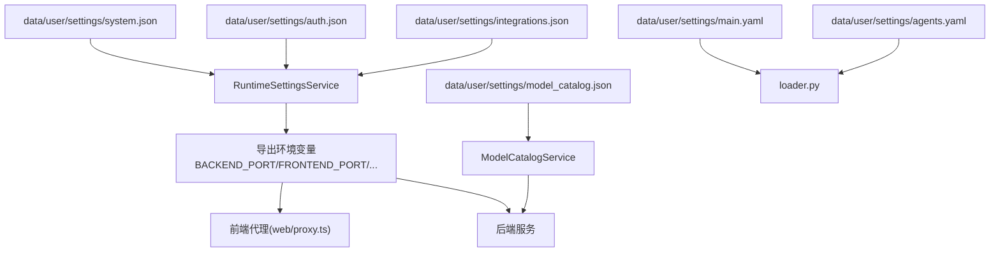
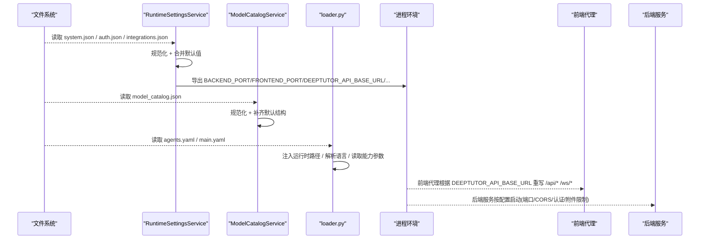
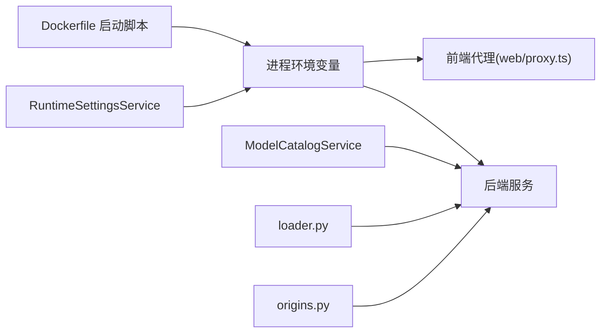

# 配置管理

<cite>
**本文引用的文件**
- [CONTAINERIZATION.md](file://CONTAINERIZATION.md)
- [Dockerfile](file://Dockerfile)
- [README.md](file://README.md)
- [compose.yaml](file://compose.yaml)
- [deeptutor/services/config/runtime_settings.py](file://deeptutor/services/config/runtime_settings.py)
- [deeptutor/services/config/model_catalog.py](file://deeptutor/services/config/model_catalog.py)
- [deeptutor/services/config/loader.py](file://deeptutor/services/config/loader.py)
- [deeptutor/services/config/origins.py](file://deeptutor/services/config/origins.py)
- [deeptutor/config/settings.py](file://deeptutor/config/settings.py)
- [deeptutor/config/schema.py](file://deeptutor/config/schema.py)
- [deeptutor/config/defaults.py](file://deeptutor/config/defaults.py)
- [deeptutor/agents/base_agent.py](file://deeptutor/agents/base_agent.py)
- [deeptutor/agents/chat/agentic_pipeline.py](file://deeptutor/agents/chat/agentic_pipeline.py)
</cite>

## 目录
1. [简介](#简介)
2. [项目结构](#项目结构)
3. [核心组件](#核心组件)
4. [架构总览](#架构总览)
5. [详细组件分析](#详细组件分析)
6. [依赖关系分析](#依赖关系分析)
7. [性能考虑](#性能考虑)
8. [故障排查指南](#故障排查指南)
9. [结论](#结论)
10. [附录](#附录)

## 简介
本文件面向DeepTutor的配置管理体系，聚焦运行时配置文件的存放位置、结构与字段含义，覆盖system.json、auth.json、model_catalog.json等关键配置；说明开发、测试与生产环境的差异化配置方法；解释配置的热重载与动态更新机制；梳理安全相关选项（CORS、认证、API密钥）；并提供配置校验与错误诊断方法。

## 项目结构
- 运行时配置统一位于数据目录下的 settings 子目录：data/user/settings/。容器化部署时该目录持久化在卷中，便于跨重启保留配置。
- 主要配置文件
  - system.json：后端/前端端口、对外API基址、CORS、SSL校验、附件目录与大小限制等系统级设置。
  - auth.json：是否启用认证、用户名、密码哈希、令牌过期时间、Cookie安全标志等。
  - model_catalog.json：LLM、Embedding、Search、TTS/STT、图像/视频生成等服务的Profile与模型清单、激活状态与API密钥。
  - integrations.json：可选的PocketBase等侧车集成配置。
  - interface.json：界面语言、主题、侧边栏偏好等。
  - main.yaml：运行时行为默认值与路径注入。
  - agents.yaml：能力/工具的温度与最大Token等参数。
- 入口与加载
  - 容器启动时会从JSON导出环境变量（如DEEPTUTOR_API_BASE_URL、DEEPTUTOR_AUTH_ENABLED），供前端代理与服务进程使用。
  - 服务进程通过RuntimeSettingsService与ModelCatalogService读取并规范化配置，支持原子写入与环境变量覆盖。

图示来源
- [Dockerfile:369-402](file://Dockerfile#L369-L402)
- [deeptutor/services/config/runtime_settings.py:309-558](file://deeptutor/services/config/runtime_settings.py#L309-L558)
- [deeptutor/services/config/model_catalog.py:53-125](file://deeptutor/services/config/model_catalog.py#L53-L125)
- [deeptutor/services/config/loader.py:19-27](file://deeptutor/services/config/loader.py#L19-L27)

章节来源
- [CONTAINERIZATION.md:345-362](file://CONTAINERIZATION.md#L345-L362)
- [README.md:434-446](file://README.md#L434-L446)
- [Dockerfile:369-402](file://Dockerfile#L369-L402)
- [compose.yaml:48-62](file://compose.yaml#L48-L62)

## 核心组件
- RuntimeSettingsService
  - 负责system.json、auth.json、integrations.json、document_parsing.json、llamaindex.json、graphrag.json、lightrag.json、pageindex.json等的加载、规范化、保存与环境变量渲染。
  - 支持进程环境变量覆盖（如BACKEND_PORT、AUTH_ENABLED、POCKETBASE_*等），并在render_environment中输出给子进程与前端代理。
- ModelCatalogService
  - 负责model_catalog.json的加载、规范化、保存与并发安全访问；维护各服务（LLM/Embedding/Search/TTS/STT/ImageGen/VideoGen）的Profile与Active Model。
- loader.py
  - 提供YAML配置加载、路径注入、语言解析、agent参数与chat参数读取（agents.yaml）。
- origins.py
  - CORS源规范化，兼容多种输入格式，输出Starlette CORSMiddleware所需形式。
- config/settings.py / schema.py / defaults.py
  - 应用内Pydantic Settings与默认值、迁移占位等。

章节来源
- [deeptutor/services/config/runtime_settings.py:15-188](file://deeptutor/services/config/runtime_settings.py#L15-L188)
- [deeptutor/services/config/runtime_settings.py:309-558](file://deeptutor/services/config/runtime_settings.py#L309-L558)
- [deeptutor/services/config/model_catalog.py:53-125](file://deeptutor/services/config/model_catalog.py#L53-L125)
- [deeptutor/services/config/loader.py:19-27](file://deeptutor/services/config/loader.py#L19-L27)
- [deeptutor/services/config/loader.py:202-312](file://deeptutor/services/config/loader.py#L202-L312)
- [deeptutor/services/config/origins.py:21-55](file://deeptutor/services/config/origins.py#L21-L55)
- [deeptutor/config/settings.py:15-50](file://deeptutor/config/settings.py#L15-L50)
- [deeptutor/config/schema.py:6-31](file://deeptutor/config/schema.py#L6-L31)
- [deeptutor/config/defaults.py:5-17](file://deeptutor/config/defaults.py#L5-L17)

## 架构总览
下图展示配置从磁盘到运行时的流转过程，包括JSON/YAML加载、规范化、环境变量导出以及前后端消费。

图示来源
- [deeptutor/services/config/runtime_settings.py:350-558](file://deeptutor/services/config/runtime_settings.py#L350-L558)
- [deeptutor/services/config/model_catalog.py:68-125](file://deeptutor/services/config/model_catalog.py#L68-L125)
- [deeptutor/services/config/loader.py:111-148](file://deeptutor/services/config/loader.py#L111-L148)
- [Dockerfile:369-402](file://Dockerfile#L369-L402)

## 详细组件分析

### system.json（系统设置）
- 作用
  - 控制后端/前端端口、对外API基址、CORS策略、SSL校验、附件目录与大小限制、沙箱子进程开关等。
- 关键字段（节选）
  - backend_port / frontend_port：服务监听端口。
  - next_public_api_base / next_public_api_base_external：前端可访问的后端API基址（内部网络/外部覆盖）。
  - cors_origin / cors_origins：允许的浏览器Origin列表。
  - disable_ssl_verify：是否禁用SSL证书校验。
  - chat_attachment_dir / chat_attachment_max_file_mb / chat_attachment_max_total_mb / chat_attachment_max_chars_per_doc / chat_attachment_max_chars_total：附件目录与大小/字符上限。
  - sandbox_allow_subprocess：是否允许受限子进程执行（文档生成等场景）。
- 动态更新
  - 修改后下次请求生效；WebSocket帧上限受启动时计算影响，可能需要重启以完全生效。
- 环境变量覆盖
  - 可通过BACKEND_PORT、FRONTEND_PORT、NEXT_PUBLIC_API_BASE_EXTERNAL、PUBLIC_API_BASE、NEXT_PUBLIC_API_BASE、CORS_ORIGIN、CORS_ORIGINS、DISABLE_SSL_VERIFY、CHAT_ATTACHMENT_DIR、DEEPTUTOR_SANDBOX_ALLOW_SUBPROCESS、CHAT_ATTACHMENT_MAX_FILE_MB、CHAT_ATTACHMENT_MAX_TOTAL_MB、CHAT_ATTACHMENT_MAX_CHARS_PER_DOC、CHAT_ATTACHMENT_MAX_CHARS_TOTAL进行覆盖。

章节来源
- [deeptutor/services/config/runtime_settings.py:15-42](file://deeptutor/services/config/runtime_settings.py#L15-L42)
- [deeptutor/services/config/runtime_settings.py:612-642](file://deeptutor/services/config/runtime_settings.py#L612-L642)
- [deeptutor/services/config/runtime_settings.py:500-546](file://deeptutor/services/config/runtime_settings.py#L500-L546)

### auth.json（认证设置）
- 作用
  - 控制是否启用内置认证、管理员用户名、密码哈希、令牌过期时间、Cookie安全标志等。
- 关键字段（节选）
  - enabled：是否启用认证。
  - username / password_hash：管理员凭据。
  - token_expire_hours：令牌有效期（小时）。
  - cookie_secure：Cookie是否仅HTTPS传输。
- 环境变量覆盖
  - AUTH_ENABLED / NEXT_PUBLIC_AUTH_ENABLED、AUTH_USERNAME、AUTH_PASSWORD_HASH、AUTH_TOKEN_EXPIRE_HOURS、AUTH_COOKIE_SECURE。
- 前端联动
  - 导出DEEPTUTOR_AUTH_ENABLED用于前端代理决定是否重定向登录。

章节来源
- [deeptutor/services/config/runtime_settings.py:51-58](file://deeptutor/services/config/runtime_settings.py#L51-L58)
- [deeptutor/services/config/runtime_settings.py:644-659](file://deeptutor/services/config/runtime_settings.py#L644-L659)
- [deeptutor/services/config/runtime_settings.py:500-546](file://deeptutor/services/config/runtime_settings.py#L500-L546)

### model_catalog.json（模型目录）
- 作用
  - 集中管理LLM、Embedding、Search、TTS/STT、ImageGen、VideoGen等服务Profile与模型，记录激活的Profile与模型及API密钥。
- 数据结构要点
  - services.*.profiles：服务配置清单（id/name/api_version/base_url/api_key/models等）。
  - services.*.active_profile_id / active_model_id：当前激活项。
- 并发与持久化
  - 读写加锁，原子写入临时文件后替换，避免损坏。
- 多用户
  - 非管理员使用管理员路径下的catalog；管理员使用当前PathService设置的catalog。

章节来源
- [deeptutor/services/config/model_catalog.py:38-50](file://deeptutor/services/config/model_catalog.py#L38-L50)
- [deeptutor/services/config/model_catalog.py:53-125](file://deeptutor/services/config/model_catalog.py#L53-L125)
- [deeptutor/services/config/model_catalog.py:212-249](file://deeptutor/services/config/model_catalog.py#L212-L249)

### agents.yaml（能力/工具参数）
- 作用
  - 统一的能力/工具温度与最大Token等参数，是各Agent读取温度的单一事实来源。
- 读取方式
  - get_agent_params(module_name)：按模块名返回temperature/max_tokens。
  - get_chat_params()：读取capabilities.chat，包含全局temperature、max_rounds与exploring/responding阶段的max_tokens。
- 热更新
  - Agent可在运行时调用refresh_config刷新配置，无需重启服务。

章节来源
- [deeptutor/services/config/loader.py:202-312](file://deeptutor/services/config/loader.py#L202-L312)
- [deeptutor/agents/base_agent.py:167-213](file://deeptutor/agents/base_agent.py#L167-L213)
- [deeptutor/agents/chat/agentic_pipeline.py:218-242](file://deeptutor/agents/chat/agentic_pipeline.py#L218-L242)

### 其他配置
- integrations.json：PocketBase等侧车集成（URL、端口、外部地址、管理员账号）。
- document_parsing.json：文档解析引擎选择与参数（text_only/mineru/docling/markitdown/pymupdf4llm）。
- llamaindex.json / graphrag.json / lightrag.json / pageindex.json：检索与RAG相关参数。

章节来源
- [deeptutor/services/config/runtime_settings.py:60-67](file://deeptutor/services/config/runtime_settings.py#L60-L67)
- [deeptutor/services/config/runtime_settings.py:69-188](file://deeptutor/services/config/runtime_settings.py#L69-L188)
- [deeptutor/services/config/runtime_settings.py:444-488](file://deeptutor/services/config/runtime_settings.py#L444-L488)

## 依赖关系分析
- 配置加载链路
  - Dockerfile在启动时调用export_runtime_settings_to_env，将system/auth/integrations等配置渲染为环境变量，供web/proxy.ts与后端使用。
  - RuntimeSettingsService负责JSON加载、规范化与环境变量导出；ModelCatalogService负责模型目录的并发读写。
  - loader.py负责YAML加载与路径注入，并为Agent提供统一的参数读取接口。
- CORS处理
  - origins.py对Origin进行规范化，确保符合Starlette CORSMiddleware要求。

图示来源
- [Dockerfile:369-402](file://Dockerfile#L369-L402)
- [deeptutor/services/config/runtime_settings.py:500-558](file://deeptutor/services/config/runtime_settings.py#L500-L558)
- [deeptutor/services/config/model_catalog.py:68-125](file://deeptutor/services/config/model_catalog.py#L68-L125)
- [deeptutor/services/config/loader.py:111-148](file://deeptutor/services/config/loader.py#L111-L148)
- [deeptutor/services/config/origins.py:21-55](file://deeptutor/services/config/origins.py#L21-L55)

章节来源
- [Dockerfile:369-402](file://Dockerfile#L369-L402)
- [compose.yaml:48-62](file://compose.yaml#L48-L62)

## 性能考虑
- 附件限制
  - chat_attachment_max_file_mb / chat_attachment_max_total_mb / chat_attachment_max_chars_per_doc / chat_attachment_max_chars_total 控制上传与上下文注入规模，过大可能影响响应延迟与内存占用。
- WebSocket帧上限
  - 某些大附件的base64负载超过WebSocket帧上限时需重启以重新计算最大帧尺寸。
- 并发安全
  - model_catalog.json读写加锁并使用原子替换，避免并发写导致文件损坏。
- 路径注入
  - loader.py注入运行时路径，减少硬编码路径带来的不一致性。

[本节为通用指导，不直接分析具体文件]

## 故障排查指南
- 常见问题定位
  - 找不到配置文件：loader.resolve_config_path会抛出FileNotFoundError，检查data/user/settings是否存在目标文件。
  - JSON解析失败：runtime_settings._json_object在异常时返回空字典，建议检查文件格式与权限。
  - 端口冲突或无法绑定：确认system.json中的backend_port/frontend_port未被占用，且与compose映射一致。
  - CORS报错：检查cors_origin/cors_origins是否正确，或使用origins.normalize_origins规范化后再保存。
  - 认证未生效：确认auth.enabled与DEEPTUTOR_AUTH_ENABLED一致，前端代理会根据该变量决定是否重定向登录。
  - 模型未激活：若Agent提示未配置模型，请在Settings > Catalog中激活对应模型。
- 验证与诊断
  - 使用“Settings → LLM诊断探针”（由agents.yaml中的diagnostics.llm_probe驱动）验证模型连通性与参数。
  - 查看容器启动日志，确认导出的环境变量（如DEEPTUTOR_API_BASE_URL、DEEPTUTOR_AUTH_ENABLED）是否符合预期。
  - 对于文档解析问题，切换engine并检查相应引擎的参数（如mineru.mode、allow_local_model_download等）。

章节来源
- [deeptutor/services/config/loader.py:86-108](file://deeptutor/services/config/loader.py#L86-L108)
- [deeptutor/services/config/runtime_settings.py:295-302](file://deeptutor/services/config/runtime_settings.py#L295-L302)
- [deeptutor/services/config/runtime_settings.py:500-546](file://deeptutor/services/config/runtime_settings.py#L500-L546)
- [deeptutor/agents/base_agent.py:167-178](file://deeptutor/agents/base_agent.py#L167-L178)

## 结论
DeepTutor采用“JSON/YAML + 环境变量覆盖”的统一配置体系，通过RuntimeSettingsService与ModelCatalogService实现配置的加载、规范化、持久化与动态导出；agents.yaml作为Agent参数的单一事实来源，支持运行时刷新。结合CORS与认证配置，可满足开发、测试与生产的多样化部署需求。建议优先通过Web Settings页面编辑配置，并通过容器日志与诊断探针进行验证与排障。

[本节为总结性内容，不直接分析具体文件]

## 附录

### 不同部署场景的配置示例
- 开发环境
  - 本地端口：system.json中backend_port=8001、frontend_port=3782（默认）。
  - 认证：auth.json中enabled=false（快速调试）。
  - 模型：在Settings > Catalog添加LLM Profile（Base URL/API Key/Model Name）。
- 测试环境
  - 开启认证：auth.json中enabled=true，设置username/password_hash。
  - CORS：设置cors_origins为测试域名列表。
  - 附件限制：适当降低chat_attachment_max_file_mb/total_mb以控制资源消耗。
- 生产环境
  - 关闭DEBUG与不必要的功能，严格设置CORS与认证。
  - 使用next_public_api_base_external指定外部可达的API基址。
  - 谨慎调整sandbox_allow_subprocess与SSL校验策略。
  - 使用环境变量覆盖敏感信息（如POCKETBASE_*、MINERU_*、PAGEINDEX_*）。

章节来源
- [CONTAINERIZATION.md:345-362](file://CONTAINERIZATION.md#L345-L362)
- [README.md:434-446](file://README.md#L434-L446)
- [Dockerfile:369-402](file://Dockerfile#L369-L402)

### 配置热重载与动态更新
- 运行时刷新
  - Agent通过refresh_config从统一配置服务重新加载LLM配置，无需重启服务。
  - 聊天参数通过get_chat_params每次读取时合并默认值，支持按需调整。
- 环境变量生效
  - 容器启动时导出环境变量；部分设置（如WebSocket帧上限）需重启才能完全生效。
- 原子写入
  - 所有JSON保存均使用原子写入，避免并发写导致的损坏。

章节来源
- [deeptutor/agents/base_agent.py:207-213](file://deeptutor/agents/base_agent.py#L207-L213)
- [deeptutor/services/config/loader.py:290-312](file://deeptutor/services/config/loader.py#L290-L312)
- [deeptutor/services/config/model_catalog.py:95-115](file://deeptutor/services/config/model_catalog.py#L95-L115)

### 安全相关配置
- CORS
  - 使用cors_origin/cors_origins精确限定允许的Origin；origins.normalize_origins可规范化输入。
- 认证
  - 通过auth.enabled启用内置认证；配合DEEPTUTOR_AUTH_ENABLED控制前端代理行为。
- API密钥管理
  - 模型目录集中于model_catalog.json；各服务Profile中存储base_url与api_key。
  - 第三方服务（如MinerU、PageIndex）通过各自配置块管理密钥与端点。

章节来源
- [deeptutor/services/config/origins.py:21-55](file://deeptutor/services/config/origins.py#L21-L55)
- [deeptutor/services/config/runtime_settings.py:500-546](file://deeptutor/services/config/runtime_settings.py#L500-L546)
- [deeptutor/services/config/model_catalog.py:137-152](file://deeptutor/services/config/model_catalog.py#L137-L152)