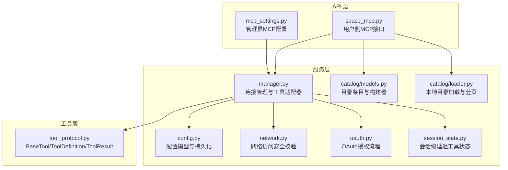
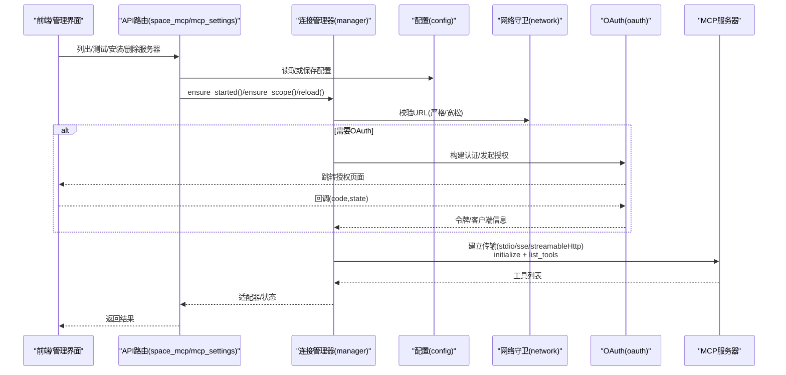
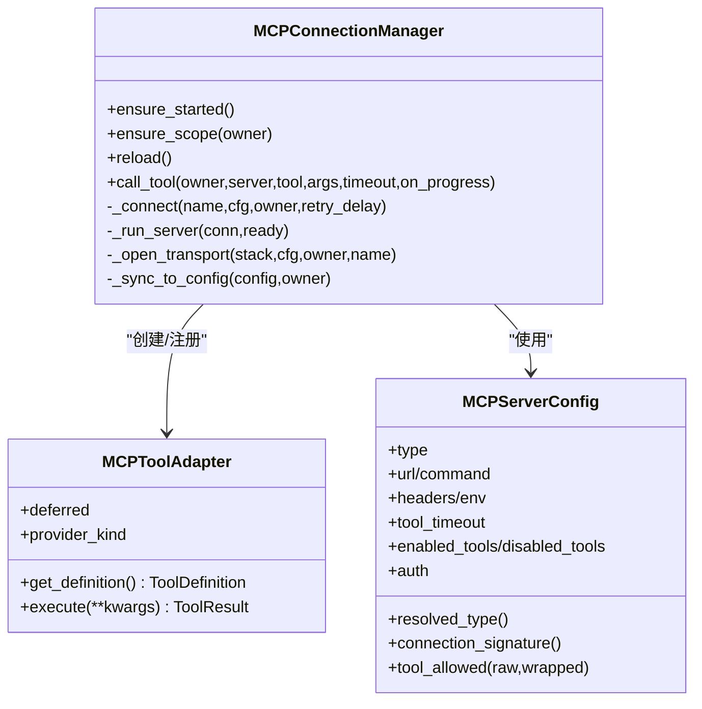
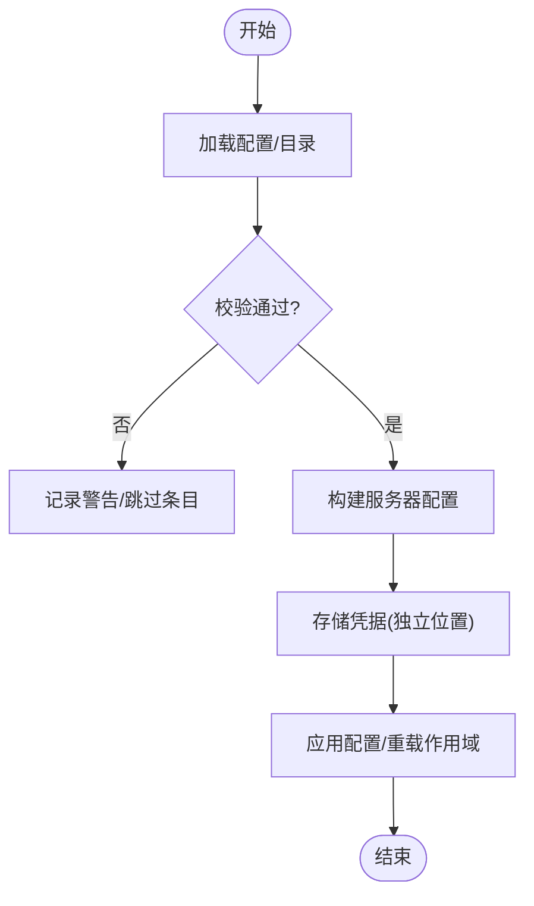
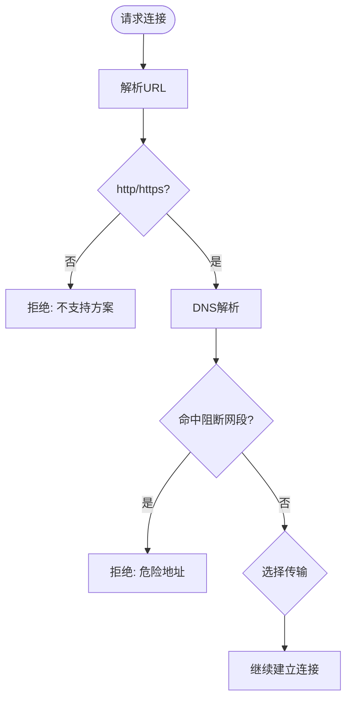
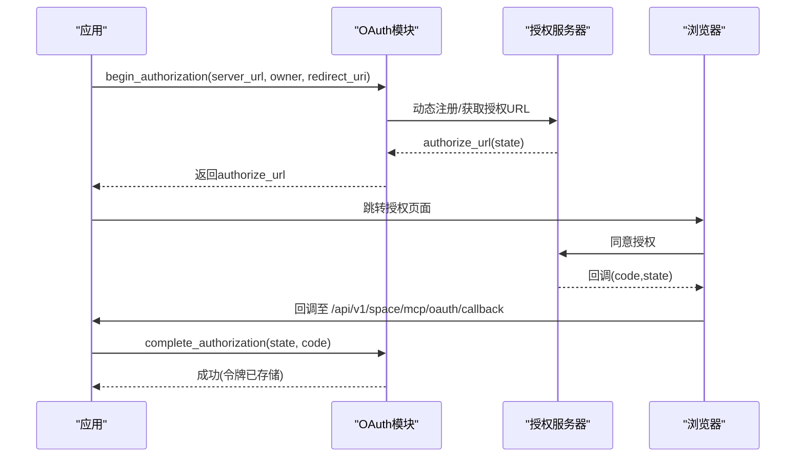
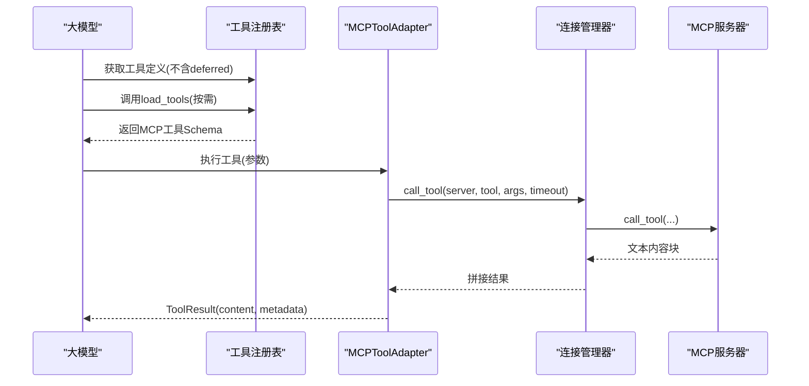
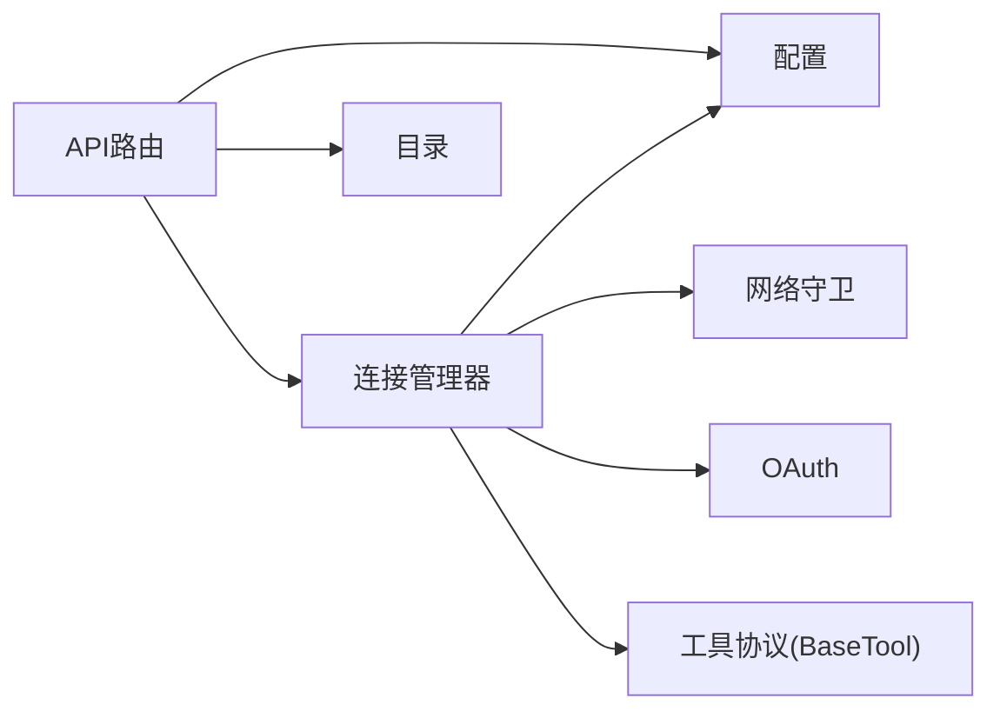

# MCP协议概述

<cite>
**本文引用的文件**
- [manager.py](file://deeptutor/services/mcp/manager.py)
- [config.py](file://deeptutor/services/mcp/config.py)
- [network.py](file://deeptutor/services/mcp/network.py)
- [oauth.py](file://deeptutor/services/mcp/oauth.py)
- [session_state.py](file://deeptutor/services/mcp/session_state.py)
- [models.py](file://deeptutor/services/mcp/catalog/models.py)
- [loader.py](file://deeptutor/services/mcp/catalog/loader.py)
- [space_mcp.py](file://deeptutor/api/routers/space_mcp.py)
- [mcp_settings.py](file://deeptutor/api/routers/mcp_settings.py)
- [tool_protocol.py](file://deeptutor/core/tool_protocol.py)
</cite>

## 目录
1. [简介](#简介)
2. [项目结构](#项目结构)
3. [核心组件](#核心组件)
4. [架构总览](#架构总览)
5. [详细组件分析](#详细组件分析)
6. [依赖关系分析](#依赖关系分析)
7. [性能与可靠性](#性能与可靠性)
8. [故障排查指南](#故障排查指南)
9. [结论](#结论)
10. [附录：协议版本兼容与迁移](#附录协议版本兼容与迁移)

## 简介
本文件系统性阐述 DeepTutor 中的 MCP（Model Context Protocol）协议实现，覆盖服务器发现、能力协商、工具定义与消息传递机制；说明连接管理、会话生命周期与错误处理策略；解释与 DeepTutor 工具系统的集成方式（适配器模式与延迟加载）；并提供流程图与关键数据结构示例。文档面向不同技术背景的读者，既提供高层概览，也给出代码级映射与可操作建议。

## 项目结构
DeepTutor 的 MCP 能力集中在 services/mcp 模块，并通过 API 路由暴露给前端与管理端；工具层通过统一的 BaseTool 协议将外部 MCP 工具适配为聊天工具。

图表来源
- [space_mcp.py:92-166](file://deeptutor/api/routers/space_mcp.py#L92-L166)
- [mcp_settings.py:107-133](file://deeptutor/api/routers/mcp_settings.py#L107-L133)
- [manager.py:216-471](file://deeptutor/services/mcp/manager.py#L216-L471)
- [config.py:31-163](file://deeptutor/services/mcp/config.py#L31-L163)
- [network.py:1-122](file://deeptutor/services/mcp/network.py#L1-L122)
- [oauth.py:1-439](file://deeptutor/services/mcp/oauth.py#L1-L439)
- [session_state.py:1-60](file://deeptutor/services/mcp/session_state.py#L1-L60)
- [models.py:1-333](file://deeptutor/services/mcp/catalog/models.py#L1-L333)
- [loader.py:1-250](file://deeptutor/services/mcp/catalog/loader.py#L1-L250)
- [tool_protocol.py:1-275](file://deeptutor/core/tool_protocol.py#L1-L275)

章节来源
- [space_mcp.py:92-166](file://deeptutor/api/routers/space_mcp.py#L92-L166)
- [manager.py:216-471](file://deeptutor/services/mcp/manager.py#L216-L471)
- [config.py:31-163](file://deeptutor/services/mcp/config.py#L31-L163)

## 核心组件
- 连接管理器（MCPConnectionManager）：维护每个部署/租户的MCP服务器连接、重试与退避、工具适配器注册与注销、调用转发与进度上报。
- 配置模型（MCPServerConfig/MCPConfig）：声明传输类型（stdio/sse/streamableHttp）、超时、工具白/黑名单、认证方式等，并支持原子持久化。
- 网络守卫（network.py）：对远程URL进行DNS解析与地址段拦截，区分管理员与自服务的严格策略，防止SSRF。
- OAuth 授权（oauth.py）：封装MCP SDK的OAuth流程，存储令牌与客户端信息，支持非交互式刷新与交互式授权回调。
- 会话状态（session_state.py）：记录会话中已加载的延迟工具名称，避免重复加载。
- 目录系统（catalog）：本地JSON目录描述可安装的服务模板、凭据目标与元数据，支持搜索、分页与安装构建。
- 工具协议（tool_protocol.py）：统一工具抽象，MCP工具以适配器形式接入，支持延迟加载与OpenAI函数调用Schema导出。

章节来源
- [manager.py:89-155](file://deeptutor/services/mcp/manager.py#L89-L155)
- [config.py:31-163](file://deeptutor/services/mcp/config.py#L31-L163)
- [network.py:1-122](file://deeptutor/services/mcp/network.py#L1-L122)
- [oauth.py:1-439](file://deeptutor/services/mcp/oauth.py#L1-L439)
- [session_state.py:1-60](file://deeptutor/services/mcp/session_state.py#L1-L60)
- [models.py:105-333](file://deeptutor/services/mcp/catalog/models.py#L105-L333)
- [loader.py:56-250](file://deeptutor/services/mcp/catalog/loader.py#L56-L250)
- [tool_protocol.py:16-95](file://deeptutor/core/tool_protocol.py#L16-L95)

## 架构总览
DeepTutor 将外部 MCP 服务器作为“工具提供者”，通过连接管理器建立会话、枚举工具，并以适配器暴露给聊天引擎。管理员与用户分别拥有独立的配置与作用域，确保多租户隔离与安全。

图表来源
- [space_mcp.py:92-166](file://deeptutor/api/routers/space_mcp.py#L92-L166)
- [mcp_settings.py:107-133](file://deeptutor/api/routers/mcp_settings.py#L107-L133)
- [manager.py:493-708](file://deeptutor/services/mcp/manager.py#L493-L708)
- [network.py:69-118](file://deeptutor/services/mcp/network.py#L69-L118)
- [oauth.py:256-300](file://deeptutor/services/mcp/oauth.py#L256-L300)

## 详细组件分析

### 连接管理与工具适配器
- 生命周期：每个服务器一个连接任务，持有 AsyncExitStack，负责打开传输、初始化会话、列举工具、等待关闭事件。
- 作用域隔离：按 owner（共享部署/用户账户）键控连接，冷作用域空闲回收，避免进程内连接膨胀。
- 工具适配器：MCPToolAdapter 继承 BaseTool，标记 deferred，执行时委托 manager.call_tool 并透传进度事件。
- 重试与退避：失败连接指数退避重试；瞬时网络错误在调用时自动重试一次。
- 注册同步：仅部署级（共享）工具注册到全局工具注册表；用户级工具通过作用域视图避免名称冲突。

图表来源
- [manager.py:89-155](file://deeptutor/services/mcp/manager.py#L89-L155)
- [manager.py:216-753](file://deeptutor/services/mcp/manager.py#L216-L753)
- [config.py:31-99](file://deeptutor/services/mcp/config.py#L31-L99)

章节来源
- [manager.py:89-155](file://deeptutor/services/mcp/manager.py#L89-L155)
- [manager.py:216-753](file://deeptutor/services/mcp/manager.py#L216-L753)
- [config.py:31-99](file://deeptutor/services/mcp/config.py#L31-L99)

### 配置与目录
- 配置模型：支持传输类型推断、工具白/黑名单、超时、认证方式；连接签名用于 reload 差异检测。
- 持久化：原子写入 mcp.json，异常回退为空配置，保证高可用。
- 目录系统：本地 curated.json 描述可安装条目，包含凭据注入目标（env/header/url_param/arg），构建器生成最终配置与独立密钥存储。

图表来源
- [config.py:116-163](file://deeptutor/services/mcp/config.py#L116-L163)
- [models.py:238-333](file://deeptutor/services/mcp/catalog/models.py#L238-L333)
- [loader.py:56-250](file://deeptutor/services/mcp/catalog/loader.py#L56-L250)

章节来源
- [config.py:31-163](file://deeptutor/services/mcp/config.py#L31-L163)
- [models.py:105-333](file://deeptutor/services/mcp/catalog/models.py#L105-L333)
- [loader.py:56-250](file://deeptutor/services/mcp/catalog/loader.py#L56-L250)

### 网络与安全
- 传输选择：stdio（仅限管理员）、sse、streamableHttp。
- URL 校验：解析主机名并解析IP，阻止链路本地/云元数据/私有网段；自服务模式更严格，禁止环回与内网。
- 重定向策略：自服务模式禁用重定向，管理员模式允许但受限于地址策略。

图表来源
- [network.py:69-118](file://deeptutor/services/mcp/network.py#L69-L118)
- [manager.py:610-708](file://deeptutor/services/mcp/manager.py#L610-L708)

章节来源
- [network.py:1-122](file://deeptutor/services/mcp/network.py#L1-L122)
- [manager.py:610-708](file://deeptutor/services/mcp/manager.py#L610-L708)

### OAuth 授权流程
- 非交互模式：后台重连遇到需授权时抛出 AuthorizationRequired，设置 needs_auth 状态，由UI引导用户授权。
- 交互模式：路由触发 begin_authorization，浏览器跳转到授权页，回调完成授权码交换，存储令牌与客户端信息。
- 存储隔离：令牌与客户端信息保存在所有者 secrets 树下的私有目录，权限收紧。

图表来源
- [oauth.py:329-414](file://deeptutor/services/mcp/oauth.py#L329-L414)
- [space_mcp.py:169-227](file://deeptutor/api/routers/space_mcp.py#L169-L227)

章节来源
- [oauth.py:1-439](file://deeptutor/services/mcp/oauth.py#L1-L439)
- [space_mcp.py:169-227](file://deeptutor/api/routers/space_mcp.py#L169-L227)

### 工具系统与延迟加载
- 适配器模式：MCPToolAdapter 实现 BaseTool，统一 get_definition/execute，屏蔽底层MCP细节。
- 延迟加载：工具标记 deferred，初始不进入工具清单，通过 load_tools 渐进披露，减少提示词开销。
- 会话状态：记录已加载工具名，跨轮次复用，避免重复加载。

图表来源
- [tool_protocol.py:206-275](file://deeptutor/core/tool_protocol.py#L206-L275)
- [manager.py:89-155](file://deeptutor/services/mcp/manager.py#L89-L155)
- [manager.py:404-471](file://deeptutor/services/mcp/manager.py#L404-L471)
- [session_state.py:23-59](file://deeptutor/services/mcp/session_state.py#L23-L59)

章节来源
- [tool_protocol.py:206-275](file://deeptutor/core/tool_protocol.py#L206-L275)
- [manager.py:89-155](file://deeptutor/services/mcp/manager.py#L89-L155)
- [session_state.py:23-59](file://deeptutor/services/mcp/session_state.py#L23-L59)

## 依赖关系分析
- API 路由依赖连接管理器与配置模块，负责用户/管理员视角的CRUD与测试。
- 连接管理器依赖配置模型、网络守卫、OAuth模块，负责传输建立、会话生命周期与工具调用。
- 目录模块提供可安装服务模板，供用户侧快速安装与凭据注入。
- 工具协议为所有工具的统一抽象，MCP适配器遵循该协议。

图表来源
- [space_mcp.py:92-166](file://deeptutor/api/routers/space_mcp.py#L92-L166)
- [manager.py:216-753](file://deeptutor/services/mcp/manager.py#L216-L753)
- [config.py:31-163](file://deeptutor/services/mcp/config.py#L31-L163)
- [network.py:69-118](file://deeptutor/services/mcp/network.py#L69-L118)
- [oauth.py:256-300](file://deeptutor/services/mcp/oauth.py#L256-L300)
- [loader.py:56-250](file://deeptutor/services/mcp/catalog/loader.py#L56-L250)
- [tool_protocol.py:206-275](file://deeptutor/core/tool_protocol.py#L206-L275)

章节来源
- [space_mcp.py:92-166](file://deeptutor/api/routers/space_mcp.py#L92-L166)
- [manager.py:216-753](file://deeptutor/services/mcp/manager.py#L216-L753)

## 性能与可靠性
- 连接池与作用域回收：按 owner 隔离，冷作用域空闲回收，限制最大并发作用域数量，避免内存与连接泄漏。
- 重试与退避：连接失败采用指数退避；调用时瞬时错误自动重试一次，提高鲁棒性。
- 超时控制：连接与工具调用均设超时，避免阻塞事件循环。
- 进度上报：长耗时工具通过 progress_callback 推送进度，提升用户体验与可观测性。
- 目录与配置缓存：目录加载使用 lru_cache，配置读写原子化，降低I/O抖动影响。

[本节为通用指导，无需特定文件引用]

## 故障排查指南
- 无法连接/超时：检查网络守卫是否阻断、URL是否正确、DNS是否可达；查看连接状态与错误信息。
- 需要授权：当服务器标记 oauth 且未授权时，状态为 needs_auth，需通过授权路由启动交互流程。
- 工具不可用：确认工具在白名单中且未被禁用；检查作用域是否已加载对应工具。
- 配置保存失败：检查JSON格式与字段合法性；注意原子写入失败会回退为空配置。
- 进度无输出：确认调用时传入 event_sink/on_progress，否则不会收集进度事件。

章节来源
- [manager.py:404-471](file://deeptutor/services/mcp/manager.py#L404-L471)
- [manager.py:534-587](file://deeptutor/services/mcp/manager.py#L534-L587)
- [oauth.py:64-75](file://deeptutor/services/mcp/oauth.py#L64-L75)
- [config.py:134-163](file://deeptutor/services/mcp/config.py#L134-L163)

## 结论
DeepTutor 的 MCP 实现以连接管理器为核心，结合严格的网络与安全策略、灵活的OAuth支持与目录化安装，将外部工具无缝接入聊天工作流。通过适配器与延迟加载，既保证了可扩展性，又优化了提示词与性能。多租户作用域与连接回收确保了大规模部署下的稳定性。

[本节为总结，无需特定文件引用]

## 附录：协议版本兼容与迁移
- 传输别名兼容：目录模块对 streamable-http/streamable_http/http 等别名进行归一化为 streamableHttp，便于历史配置平滑过渡。
- 配置签名稳定：连接签名排除 catalog_entry，避免新增字段导致误判变更而断开活跃会话。
- 迁移建议：
  - 从旧版 http 传输迁移到 streamableHttp：更新目录或配置中的 transport 字段，或使用别名自动归一化。
  - 从静态头凭据迁移到OAuth：将 auth 设置为 oauth，并在用户侧完成授权流程；保留现有 headers 以便回退。
  - 工具命名规范：MCP工具会被包装为 mcp_<server>_<tool>，避免与内置工具冲突；如需自定义，请调整 enabled/disabled 列表。

章节来源
- [models.py:71-93](file://deeptutor/services/mcp/catalog/models.py#L71-L93)
- [config.py:82-91](file://deeptutor/services/mcp/config.py#L82-L91)
- [manager.py:84-87](file://deeptutor/services/mcp/manager.py#L84-L87)