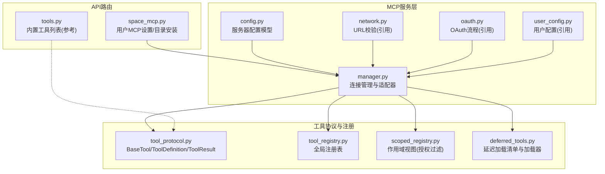
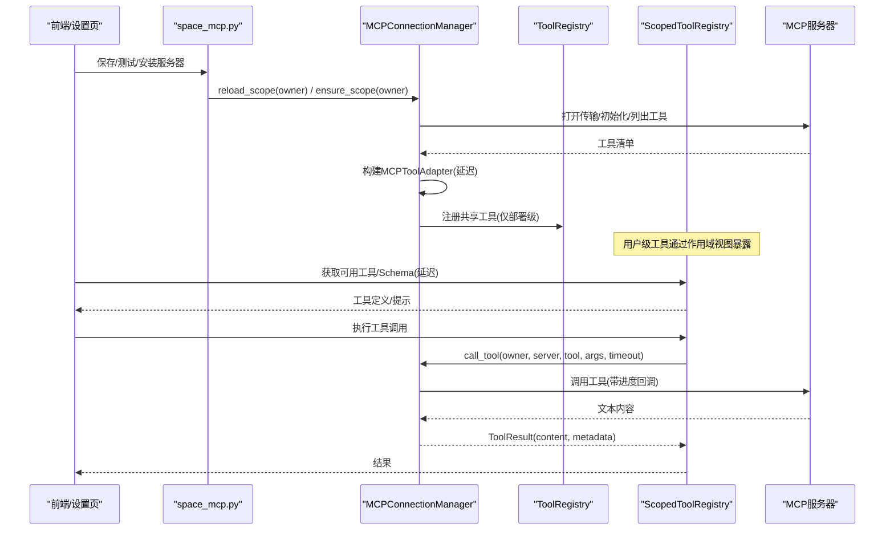
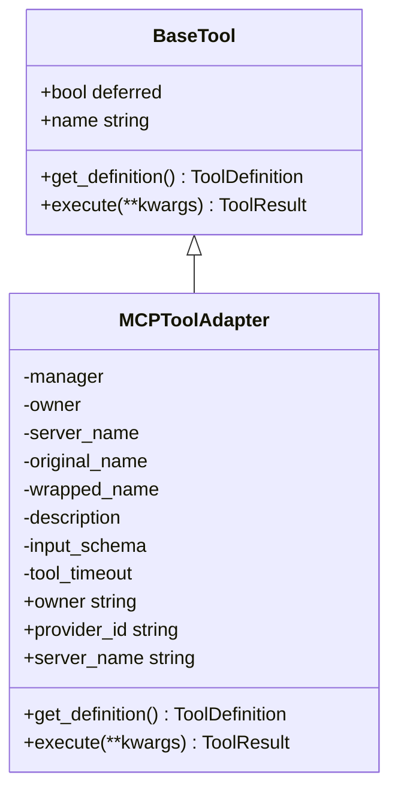
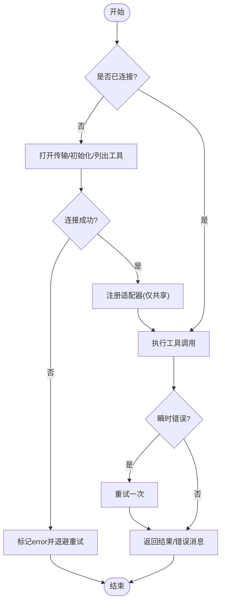
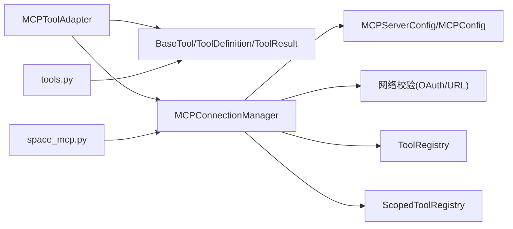
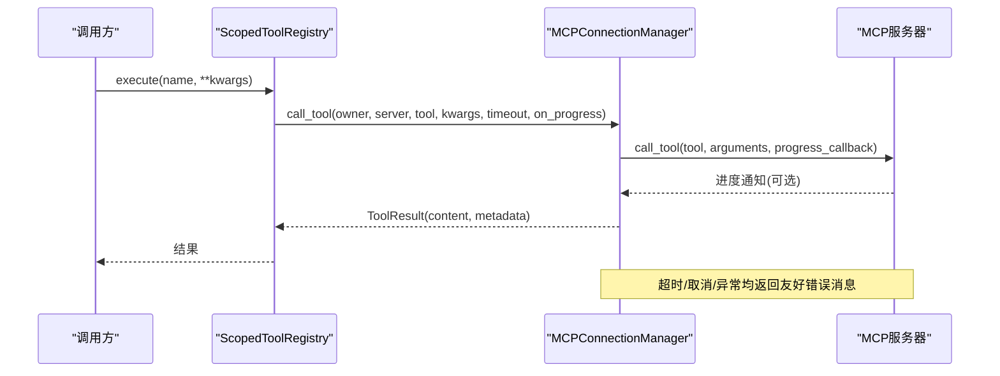

# MCP工具适配器

<cite>
**本文引用的文件**
- [manager.py](file://deeptutor/services/mcp/manager.py)
- [config.py](file://deeptutor/services/mcp/config.py)
- [tool_protocol.py](file://deeptutor/core/tool_protocol.py)
- [tool_registry.py](file://deeptutor/runtime/registry/tool_registry.py)
- [deferred_tools.py](file://deeptutor/runtime/registry/deferred_tools.py)
- [scoped_registry.py](file://deeptutor/runtime/registry/scoped_registry.py)
- [space_mcp.py](file://deeptutor/api/routers/space_mcp.py)
- [tools.py](file://deeptutor/api/routers/tools.py)
</cite>

## 目录
1. [简介](#简介)
2. [项目结构](#项目结构)
3. [核心组件](#核心组件)
4. [架构总览](#架构总览)
5. [详细组件分析](#详细组件分析)
6. [依赖关系分析](#依赖关系分析)
7. [性能考虑](#性能考虑)
8. [故障排查指南](#故障排查指南)
9. [结论](#结论)
10. [附录](#附录)

## 简介
本文件面向DeepTutor的MCP（Model Context Protocol）工具适配子系统，系统性说明外部MCP服务器提供的工具如何被转换为DeepTutor可识别的工具适配器对象，覆盖工具发现、注册与生命周期管理；阐述适配器属性（名称生成规则、描述、输入Schema、超时控制）；解释延迟加载机制与性能优化策略；详述工具调用执行流程（参数传递、错误处理、结果转换）；并提供自定义工具开发指南与最佳实践，以及监控与调试方法。

## 项目结构
围绕MCP工具适配的关键代码分布在以下模块：
- 服务层MCP集成：连接管理、配置、网络校验、OAuth、用户配置等
- 工具协议与注册：统一的BaseTool抽象、全局注册表、作用域视图、延迟加载
- API路由：用户级MCP设置与目录安装、内置工具列表展示

图表来源
- [manager.py:89-154](file://deeptutor/services/mcp/manager.py#L89-L154)
- [config.py:31-99](file://deeptutor/services/mcp/config.py#L31-L99)
- [tool_protocol.py:206-242](file://deeptutor/core/tool_protocol.py#L206-L242)
- [tool_registry.py:21-154](file://deeptutor/runtime/registry/tool_registry.py#L21-L154)
- [scoped_registry.py:40-176](file://deeptutor/runtime/registry/scoped_registry.py#L40-L176)
- [deferred_tools.py:55-111](file://deeptutor/runtime/registry/deferred_tools.py#L55-L111)
- [space_mcp.py:92-166](file://deeptutor/api/routers/space_mcp.py#L92-L166)
- [tools.py:169-223](file://deeptutor/api/routers/tools.py#L169-L223)

章节来源
- [manager.py:1-800](file://deeptutor/services/mcp/manager.py#L1-L800)
- [config.py:1-163](file://deeptutor/services/mcp/config.py#L1-L163)
- [tool_protocol.py:1-275](file://deeptutor/core/tool_protocol.py#L1-L275)
- [tool_registry.py:1-154](file://deeptutor/runtime/registry/tool_registry.py#L1-L154)
- [scoped_registry.py:1-176](file://deeptutor/runtime/registry/scoped_registry.py#L1-L176)
- [deferred_tools.py:1-203](file://deeptutor/runtime/registry/deferred_tools.py#L1-L203)
- [space_mcp.py:1-461](file://deeptutor/api/routers/space_mcp.py#L1-L461)
- [tools.py:1-223](file://deeptutor/api/routers/tools.py#L1-L223)

## 核心组件
- MCP工具适配器（MCPToolAdapter）：将MCP服务器的每个工具包装为DeepTutor的BaseTool实现，提供统一定义与执行接口，默认延迟加载。
- 连接管理器（MCPConnectionManager）：进程级单例，负责MCP服务器连接的创建、维护、重试、断开与工具适配器注册/注销。
- 配置模型（MCPServerConfig/MCPConfig）：声明传输类型、认证方式、工具白名单/黑名单、超时等，并支持原子持久化。
- 工具协议（BaseTool/ToolDefinition/ToolResult）：所有工具的抽象契约，包含定义、提示、结果与事件通道。
- 注册表与视图（ToolRegistry/ScopedToolRegistry）：全局注册与按会话的作用域视图，支持别名解析、授权过滤与执行分发。
- 延迟加载（DeferredToolLoader/manifest）：按需加载工具Schema，减少初始提示开销。

章节来源
- [manager.py:89-154](file://deeptutor/services/mcp/manager.py#L89-L154)
- [manager.py:216-470](file://deeptutor/services/mcp/manager.py#L216-L470)
- [config.py:31-99](file://deeptutor/services/mcp/config.py#L31-L99)
- [tool_protocol.py:206-242](file://deeptutor/core/tool_protocol.py#L206-L242)
- [tool_registry.py:21-154](file://deeptutor/runtime/registry/tool_registry.py#L21-L154)
- [scoped_registry.py:40-176](file://deeptutor/runtime/registry/scoped_registry.py#L40-L176)
- [deferred_tools.py:55-111](file://deeptutor/runtime/registry/deferred_tools.py#L55-L111)

## 架构总览
MCP工具从“外部服务器”到“DeepTutor工具调用”的整体路径如下：
- 配置加载：读取部署级或用户级MCP配置，解析传输类型与认证信息。
- 连接建立：按owner隔离连接任务，打开传输（stdio/SSE/streamableHttp），初始化会话并列出工具。
- 适配器构建：为每个允许的工具创建MCPToolAdapter，注入超时、描述与Schema。
- 注册与可见性：共享服务器工具注册到全局注册表；用户服务器工具通过作用域视图暴露，避免命名冲突。
- 延迟加载：默认deferred=true，仅在需要时加载Schema，降低提示成本。
- 调用执行：调度器通过注册表查找工具，执行execute，封装ToolResult返回。

图表来源
- [space_mcp.py:92-166](file://deeptutor/api/routers/space_mcp.py#L92-L166)
- [manager.py:216-470](file://deeptutor/services/mcp/manager.py#L216-L470)
- [tool_registry.py:21-154](file://deeptutor/runtime/registry/tool_registry.py#L21-L154)
- [scoped_registry.py:40-176](file://deeptutor/runtime/registry/scoped_registry.py#L40-L176)

## 详细组件分析

### 工具适配器（MCPToolAdapter）
- 名称生成：采用“mcp_<server>_<tool>”形式，并对非标识符字符进行清洗，避免命名冲突。
- 描述信息：以“[服务器名] 原始描述”形式呈现，便于追踪来源。
- 输入Schema：直接透传上游MCP工具的inputSchema，保持高保真。
- 超时控制：由服务器配置的tool_timeout决定，调用时使用异步超时保护。
- 延迟加载：默认deferred=true，不在初始工具清单中，按需加载Schema。
- 执行流程：execute内部委托给连接管理器的call_tool，封装ToolResult并附带元数据（服务器名、工具名）。

图表来源
- [tool_protocol.py:206-242](file://deeptutor/core/tool_protocol.py#L206-L242)
- [manager.py:89-154](file://deeptutor/services/mcp/manager.py#L89-L154)

章节来源
- [manager.py:84-154](file://deeptutor/services/mcp/manager.py#L84-L154)
- [tool_protocol.py:206-242](file://deeptutor/core/tool_protocol.py#L206-L242)

### 连接管理器（MCPConnectionManager）
- 生命周期：ensure_started首次启动部署级服务器；ensure_scope按owner加载用户服务器；reload应用配置变更；shutdown清理所有连接。
- 连接任务：每个服务器一个独立任务持有AsyncExitStack，确保资源正确释放。
- 状态管理：connecting/connected/error/needs_auth/disabled，失败指数退避重试。
- 工具注册：仅部署级（SHARED_OWNER）工具注册到全局注册表；用户级工具通过作用域视图暴露，避免命名冲突。
- 调用执行：call_tool封装一次调用，支持瞬时错误重试、超时、取消与异常兜底，返回人类可读的错误消息。

图表来源
- [manager.py:216-470](file://deeptutor/services/mcp/manager.py#L216-L470)
- [manager.py:493-587](file://deeptutor/services/mcp/manager.py#L493-L587)

章节来源
- [manager.py:216-470](file://deeptutor/services/mcp/manager.py#L216-L470)
- [manager.py:493-587](file://deeptutor/services/mcp/manager.py#L493-L587)

### 配置模型（MCPServerConfig/MCPConfig）
- 传输类型：自动推断（command→stdio；url结尾/sse→sse；否则streamableHttp）。
- 行为控制：tool_timeout（1-600秒）、enabled_tools/disabled_tools（支持通配与包裹名）。
- 认证：支持空或oauth；交互式授权由API路由触发，后台连接使用存储令牌。
- 持久化：原子写入，崩溃不破坏配置。

章节来源
- [config.py:31-99](file://deeptutor/services/mcp/config.py#L31-L99)
- [config.py:116-153](file://deeptutor/services/mcp/config.py#L116-L153)

### 工具协议与注册（BaseTool/ToolRegistry/ScopedToolRegistry）
- BaseTool：统一抽象，支持延迟加载、提示与结果。
- ToolRegistry：全局注册表，加载内置工具，支持别名解析与执行分发。
- ScopedToolRegistry：每会话视图，叠加用户级工具，执行时进行授权过滤，拒绝未授权提供者工具。

章节来源
- [tool_protocol.py:206-242](file://deeptutor/core/tool_protocol.py#L206-L242)
- [tool_registry.py:21-154](file://deeptutor/runtime/registry/tool_registry.py#L21-L154)
- [scoped_registry.py:40-176](file://deeptutor/runtime/registry/scoped_registry.py#L40-L176)

### 延迟加载机制（DeferredToolLoader/Manifest）
- 清单渲染：按提供者分组输出简短条目，指导模型先调用load_tools再使用。
- 加载器：维护已加载集合，绑定当前会话的tool_schemas列表，增量追加Schema。
- 权限控制：允许列表限制可加载工具，防止越权。

章节来源
- [deferred_tools.py:55-111](file://deeptutor/runtime/registry/deferred_tools.py#L55-L111)
- [deferred_tools.py:111-203](file://deeptutor/runtime/registry/deferred_tools.py#L111-L203)

### API路由（用户MCP设置与目录安装）
- 列出服务器：预热连接状态，返回服务器、状态、凭据存在性、OAuth授权状态与部署只读上下文。
- 增删改服务器：校验名称可用性、分离凭据存储、刷新作用域。
- OAuth流程：发起授权、回调页面完成授权。
- 测试连接：无副作用探测，复用真实地址策略与凭据解析。
- 目录安装：仅self_service条目可安装，填充凭据并刷新作用域。

章节来源
- [space_mcp.py:92-166](file://deeptutor/api/routers/space_mcp.py#L92-L166)
- [space_mcp.py:169-252](file://deeptutor/api/routers/space_mcp.py#L169-L252)
- [space_mcp.py:255-352](file://deeptutor/api/routers/space_mcp.py#L255-L352)

## 依赖关系分析
- MCP工具适配器依赖工具协议抽象，并通过连接管理器访问MCP会话。
- 连接管理器依赖配置模型与网络/OAuth能力，负责传输选择与认证。
- 注册表与作用域视图解耦了工具生命周期与执行授权。
- API路由与连接管理器协作，完成用户级配置与连接刷新。

图表来源
- [manager.py:89-154](file://deeptutor/services/mcp/manager.py#L89-L154)
- [manager.py:216-470](file://deeptutor/services/mcp/manager.py#L216-L470)
- [config.py:31-99](file://deeptutor/services/mcp/config.py#L31-L99)
- [tool_protocol.py:206-242](file://deeptutor/core/tool_protocol.py#L206-L242)
- [tool_registry.py:21-154](file://deeptutor/runtime/registry/tool_registry.py#L21-L154)
- [scoped_registry.py:40-176](file://deeptutor/runtime/registry/scoped_registry.py#L40-L176)
- [space_mcp.py:92-166](file://deeptutor/api/routers/space_mcp.py#L92-L166)
- [tools.py:169-223](file://deeptutor/api/routers/tools.py#L169-L223)

章节来源
- [manager.py:216-470](file://deeptutor/services/mcp/manager.py#L216-L470)
- [config.py:31-99](file://deeptutor/services/mcp/config.py#L31-L99)
- [tool_protocol.py:206-242](file://deeptutor/core/tool_protocol.py#L206-L242)
- [tool_registry.py:21-154](file://deeptutor/runtime/registry/tool_registry.py#L21-L154)
- [scoped_registry.py:40-176](file://deeptutor/runtime/registry/scoped_registry.py#L40-L176)
- [space_mcp.py:92-166](file://deeptutor/api/routers/space_mcp.py#L92-L166)
- [tools.py:169-223](file://deeptutor/api/routers/tools.py#L169-L223)

## 性能考虑
- 延迟加载：MCP工具默认deferred，减少初始提示长度，提升弱模型工具选择效率。
- 连接池与冷回收：按owner隔离连接，空闲作用域在超时时序后回收，避免进程内存膨胀。
- 重试与退避：连接失败指数退避，避免雪崩；调用层对瞬时错误进行一次重试。
- 超时控制：连接与调用均设超时，防止阻塞；HTTP传输显式设置客户端超时，避免继承默认值。
- 并发连接：新增/变更服务器并发连接，缩短冷启动时间。
- 安全校验前置：用户级服务器在保存与连接前进行URL严格校验，避免DNS劫持与内网访问。

章节来源
- [deferred_tools.py:55-111](file://deeptutor/runtime/registry/deferred_tools.py#L55-L111)
- [manager.py:319-347](file://deeptutor/services/mcp/manager.py#L319-L347)
- [manager.py:348-370](file://deeptutor/services/mcp/manager.py#L348-L370)
- [manager.py:404-470](file://deeptutor/services/mcp/manager.py#L404-L470)
- [manager.py:610-708](file://deeptutor/services/mcp/manager.py#L610-L708)

## 故障排查指南
- 连接失败：查看服务器状态行与错误消息；必要时使用“测试”端点验证连通性与凭据解析。
- 需要授权：当状态为needs_auth时，需通过授权路由完成OAuth同意；后台连接不会阻塞等待。
- 工具不可用：检查enabled_tools/disabled_tools与包裹名匹配；确认工具未被禁用。
- 调用超时：调整tool_timeout；检查远端响应时间与网络状况。
- 瞬时错误：系统会自动重试一次；若持续失败，检查网络稳定性与服务端健康。
- 作用域隔离：确认调用来自正确的owner；用户级工具不会进入全局注册表，需通过作用域视图访问。

章节来源
- [space_mcp.py:255-285](file://deeptutor/api/routers/space_mcp.py#L255-L285)
- [manager.py:534-587](file://deeptutor/services/mcp/manager.py#L534-L587)
- [manager.py:404-470](file://deeptutor/services/mcp/manager.py#L404-L470)
- [config.py:93-99](file://deeptutor/services/mcp/config.py#L93-L99)

## 结论
MCP工具适配器通过统一的BaseTool抽象、连接管理器与注册表体系，将外部MCP工具无缝接入DeepTutor工具生态。其设计强调安全性（作用域隔离、URL校验、凭据分离）、可观测性（进度事件、状态行）与性能（延迟加载、超时与重试、冷回收）。遵循本文档的配置与调用规范，可实现稳定高效的工具扩展。

## 附录

### 工具调用执行序列（含进度与错误处理）

图表来源
- [manager.py:404-470](file://deeptutor/services/mcp/manager.py#L404-L470)
- [scoped_registry.py:129-154](file://deeptutor/runtime/registry/scoped_registry.py#L129-L154)

### 自定义工具开发指南与最佳实践
- 实现BaseTool：提供get_definition与execute；如需延迟加载，设置deferred=true。
- 名称与描述：保证唯一且具描述性；对外部来源的名称进行清洗与转义。
- Schema设计：尽量使用raw_parameters保留上游Schema完整性；数组参数需提供items。
- 超时与错误：合理设置超时；捕获并返回结构化错误，便于上层处理。
- 注册与可见性：部署级工具可通过全局注册表注册；用户级工具通过作用域视图暴露。
- 安全与权限：对用户级工具实施授权过滤；避免敏感信息泄露。
- 测试与调试：使用“测试”端点验证连接与工具清单；通过进度事件观察长任务。

章节来源
- [tool_protocol.py:206-242](file://deeptutor/core/tool_protocol.py#L206-L242)
- [tool_registry.py:21-154](file://deeptutor/runtime/registry/tool_registry.py#L21-L154)
- [scoped_registry.py:40-176](file://deeptutor/runtime/registry/scoped_registry.py#L40-L176)
- [space_mcp.py:255-285](file://deeptutor/api/routers/space_mcp.py#L255-L285)

### 监控与调试
- 进度事件：通过event_sink上报tool_progress，包含百分比与来源信息，便于前端展示。
- 状态行：服务器状态（connecting/connected/error/needs_auth/disabled）与工具清单可用于UI展示。
- 日志记录：连接失败、重试、取消与异常均有日志输出，便于定位问题。
- 测试端点：无需持久化即可探测服务器连通性与工具清单，适合集成测试。

章节来源
- [manager.py:157-194](file://deeptutor/services/mcp/manager.py#L157-L194)
- [manager.py:373-394](file://deeptutor/services/mcp/manager.py#L373-L394)
- [space_mcp.py:255-285](file://deeptutor/api/routers/space_mcp.py#L255-L285)