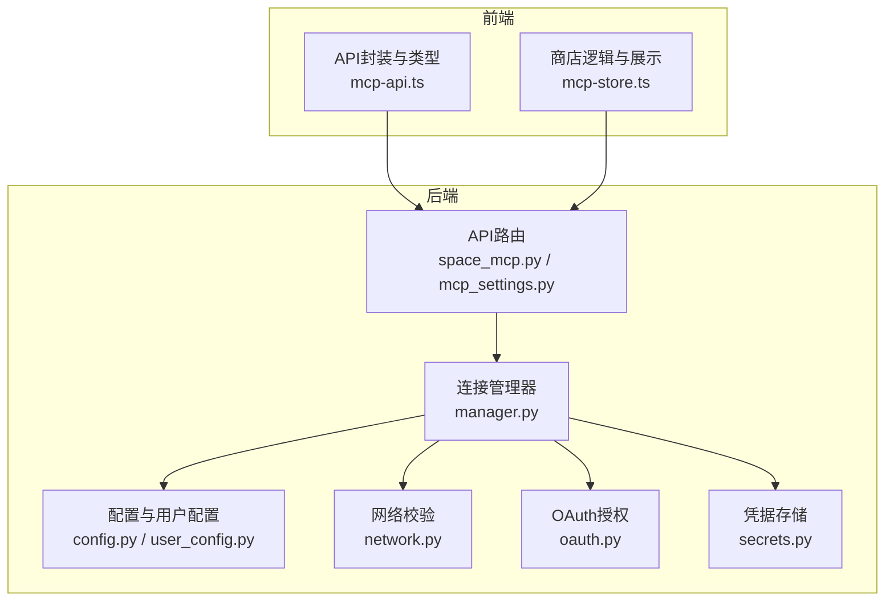
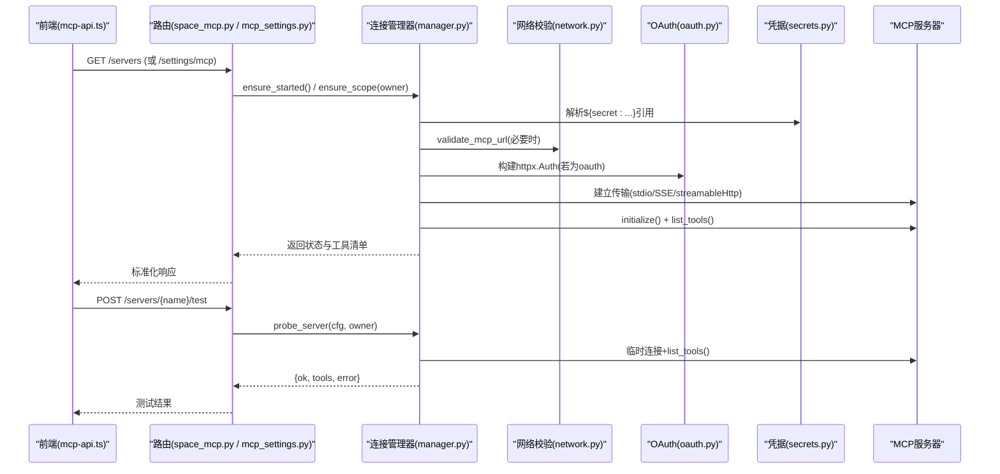
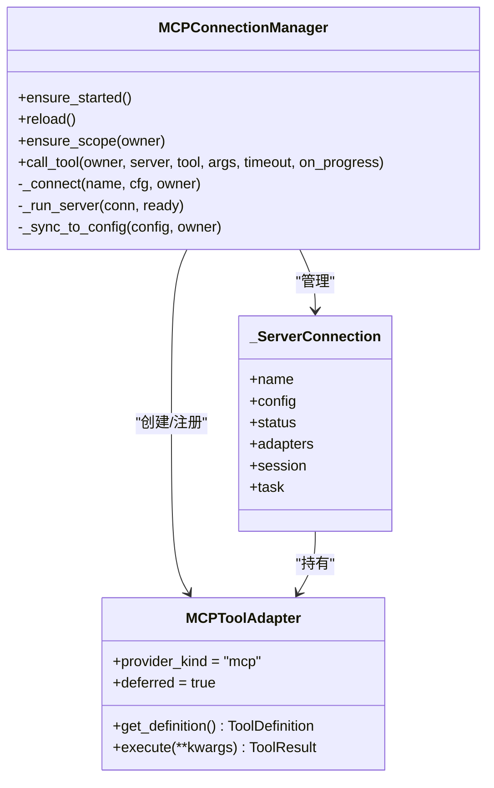
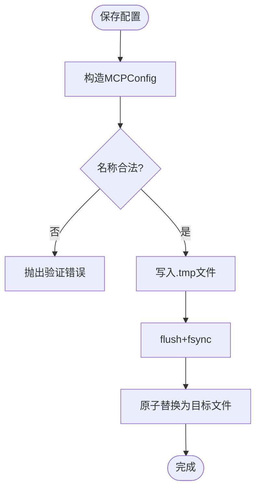
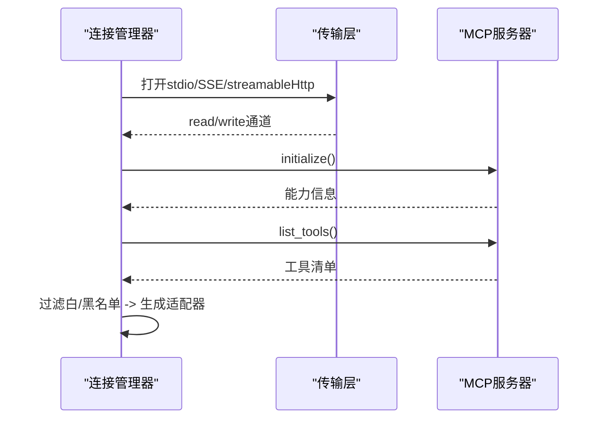
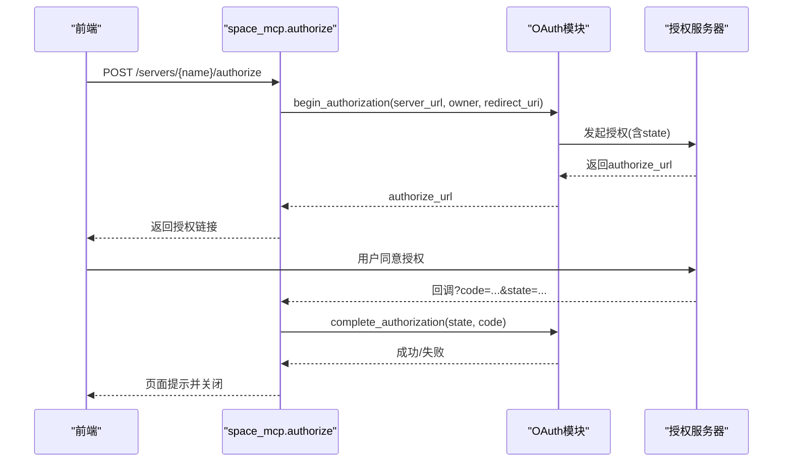
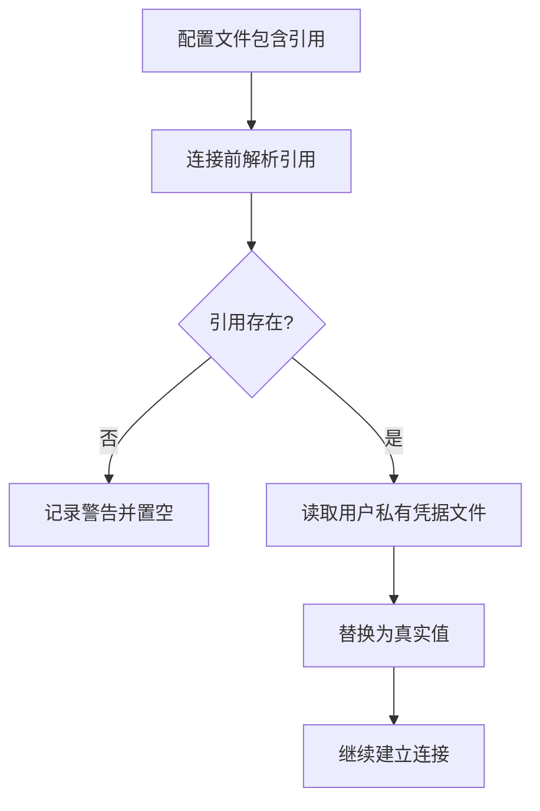
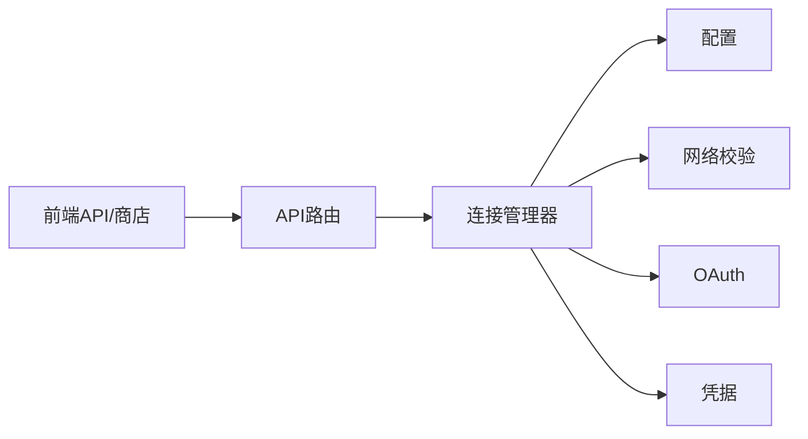

# MCP协议基础

<cite>
**本文引用的文件**
- [manager.py](file://deeptutor/services/mcp/manager.py)
- [config.py](file://deeptutor/services/mcp/config.py)
- [network.py](file://deeptutor/services/mcp/network.py)
- [oauth.py](file://deeptutor/services/mcp/oauth.py)
- [user_config.py](file://deeptutor/services/mcp/user_config.py)
- [secrets.py](file://deeptutor/services/mcp/secrets.py)
- [space_mcp.py](file://deeptutor/api/routers/space_mcp.py)
- [mcp_settings.py](file://deeptutor/api/routers/mcp_settings.py)
- [mcp-api.ts](file://web/lib/mcp-api.ts)
- [mcp-store.ts](file://web/lib/mcp-store.ts)
</cite>

## 目录
1. [简介](#简介)
2. [项目结构](#项目结构)
3. [核心组件](#核心组件)
4. [架构总览](#架构总览)
5. [详细组件分析](#详细组件分析)
6. [依赖关系分析](#依赖关系分析)
7. [性能与可靠性](#性能与可靠性)
8. [故障排查指南](#故障排查指南)
9. [结论](#结论)
10. [附录：API与数据模型速查](#附录api与数据模型速查)

## 简介
本文件面向需要在DeepTutor中集成或扩展MCP（Model Context Protocol）的开发者，系统性说明协议在工程中的落地方式：连接管理、传输层（stdio、SSE、可流式HTTP）、会话生命周期、能力协商与工具发现、OAuth授权流程、错误处理、以及前后端交互契约。文档同时提供最佳实践与性能优化建议，帮助你在多租户部署中安全、稳定地接入外部MCP服务。

## 项目结构
后端将MCP能力集中在services/mcp模块，通过API路由暴露给前端；前端在web/lib下提供类型、状态管理与API封装。关键路径如下：
- 连接与工具适配：manager.py
- 配置与持久化：config.py、user_config.py
- 网络与安全校验：network.py
- OAuth授权：oauth.py
- 凭据存储与引用解析：secrets.py
- 管理员设置API：mcp_settings.py
- 用户空间API：space_mcp.py
- 前端API与状态：mcp-api.ts、mcp-store.ts

图表来源
- [space_mcp.py:92-135](file://deeptutor/api/routers/space_mcp.py#L92-L135)
- [mcp_settings.py:57-78](file://deeptutor/api/routers/mcp_settings.py#L57-L78)
- [manager.py:216-303](file://deeptutor/services/mcp/manager.py#L216-L303)
- [config.py:31-102](file://deeptutor/services/mcp/config.py#L31-L102)
- [network.py:69-105](file://deeptutor/services/mcp/network.py#L69-L105)
- [oauth.py:256-281](file://deeptutor/services/mcp/oauth.py#L256-L281)
- [secrets.py:96-155](file://deeptutor/services/mcp/secrets.py#L96-L155)
- [mcp-api.ts:106-127](file://web/lib/mcp-api.ts#L106-L127)
- [mcp-store.ts:1-40](file://web/lib/mcp-store.ts#L1-L40)

章节来源
- [space_mcp.py:1-461](file://deeptutor/api/routers/space_mcp.py#L1-L461)
- [mcp_settings.py:1-134](file://deeptutor/api/routers/mcp_settings.py#L1-L134)
- [manager.py:1-863](file://deeptutor/services/mcp/manager.py#L1-L863)
- [config.py:1-163](file://deeptutor/services/mcp/config.py#L1-L163)
- [network.py:1-122](file://deeptutor/services/mcp/network.py#L1-L122)
- [oauth.py:1-439](file://deeptutor/services/mcp/oauth.py#L1-L439)
- [user_config.py:1-234](file://deeptutor/services/mcp/user_config.py#L1-L234)
- [secrets.py:1-193](file://deeptutor/services/mcp/secrets.py#L1-L193)
- [mcp-api.ts:1-756](file://web/lib/mcp-api.ts#L1-L756)
- [mcp-store.ts:1-222](file://web/lib/mcp-store.ts#L1-L222)

## 核心组件
- 连接管理器（MCPConnectionManager）：负责所有MCP服务器的连接生命周期、工具发现、适配器注册、重试与退避、按租户隔离作用域、空闲回收等。
- 配置系统（MCPServerConfig/MCPConfig）：声明传输类型、超时、工具白/黑名单、认证模式、启用状态等，并支持原子持久化。
- 网络守卫（network.py）：对远程URL进行SSRF防护，区分管理员配置与用户自配置的严格策略。
- OAuth授权（oauth.py）：实现非交互式令牌刷新与交互式授权码流程，存储于用户专属安全目录。
- 凭据存储（secrets.py）：以引用形式存储敏感值，连接时再解析，避免落盘泄露。
- API路由（space_mcp.py、mcp_settings.py）：分别暴露“用户空间”和“管理员设置”两类接口，统一返回服务器列表、状态、工具清单与测试能力。
- 前端API与商店（mcp-api.ts、mcp-store.ts）：定义类型、规范化响应、分页与分类、拒绝原因映射、表单构建与安装流程。

章节来源
- [manager.py:89-155](file://deeptutor/services/mcp/manager.py#L89-L155)
- [config.py:31-102](file://deeptutor/services/mcp/config.py#L31-L102)
- [network.py:1-23](file://deeptutor/services/mcp/network.py#L1-L23)
- [oauth.py:1-31](file://deeptutor/services/mcp/oauth.py#L1-L31)
- [secrets.py:1-21](file://deeptutor/services/mcp/secrets.py#L1-L21)
- [space_mcp.py:92-135](file://deeptutor/api/routers/space_mcp.py#L92-L135)
- [mcp_settings.py:57-78](file://deeptutor/api/routers/mcp_settings.py#L57-L78)
- [mcp-api.ts:14-127](file://web/lib/mcp-api.ts#L14-L127)
- [mcp-store.ts:1-40](file://web/lib/mcp-store.ts#L1-L40)

## 架构总览
下图展示了从前端到后端的完整调用链：前端通过API获取服务器列表与状态，触发测试/安装/授权等操作；后端路由调用连接管理器建立会话、列举工具、执行工具调用，并通过网络守卫与OAuth保障安全。

图表来源
- [space_mcp.py:92-135](file://deeptutor/api/routers/space_mcp.py#L92-L135)
- [mcp_settings.py:57-78](file://deeptutor/api/routers/mcp_settings.py#L57-L78)
- [manager.py:243-303](file://deeptutor/services/mcp/manager.py#L243-L303)
- [manager.py:755-793](file://deeptutor/services/mcp/manager.py#L755-L793)
- [network.py:69-105](file://deeptutor/services/mcp/network.py#L69-L105)
- [oauth.py:256-281](file://deeptutor/services/mcp/oauth.py#L256-L281)
- [secrets.py:96-155](file://deeptutor/services/mcp/secrets.py#L96-L155)

## 详细组件分析

### 连接管理器与工具适配器
- 职责：维护每个服务器连接的任务、会话、工具适配器集合；按owner隔离；失败重试与退避；空闲作用域回收；将MCP工具包装为内部BaseTool以便统一调度。
- 关键点：
  - 连接任务拥有AsyncExitStack，确保资源正确释放。
  - 工具适配器默认deferred，通过渐进披露加载schema，减少初始开销。
  - 工具调用支持进度回调，将MCP进度通知转为trace事件。
  - 工具名规范化为mcp_<server>_<tool>，避免命名冲突。

图表来源
- [manager.py:89-155](file://deeptutor/services/mcp/manager.py#L89-L155)
- [manager.py:197-214](file://deeptutor/services/mcp/manager.py#L197-L214)
- [manager.py:216-303](file://deeptutor/services/mcp/manager.py#L216-L303)
- [manager.py:404-470](file://deeptutor/services/mcp/manager.py#L404-L470)

章节来源
- [manager.py:89-155](file://deeptutor/services/mcp/manager.py#L89-L155)
- [manager.py:197-214](file://deeptutor/services/mcp/manager.py#L197-L214)
- [manager.py:216-303](file://deeptutor/services/mcp/manager.py#L216-L303)
- [manager.py:404-470](file://deeptutor/services/mcp/manager.py#L404-L470)
- [manager.py:474-589](file://deeptutor/services/mcp/manager.py#L474-L589)

### 配置模型与持久化
- MCPServerConfig：声明传输类型（stdio/sse/streamableHttp）、命令与环境、URL与头、工具超时、工具白/黑名单、认证模式、是否启用、目录来源等。
- MCPConfig：服务器字典容器，带名称合法性校验。
- 持久化：原子写入（tmp+fsync+replace），异常回退为空配置，保证高可用。

图表来源
- [config.py:31-102](file://deeptutor/services/mcp/config.py#L31-L102)
- [config.py:120-152](file://deeptutor/services/mcp/config.py#L120-L152)

章节来源
- [config.py:31-102](file://deeptutor/services/mcp/config.py#L31-L102)
- [config.py:116-152](file://deeptutor/services/mcp/config.py#L116-L152)

### 传输层与握手流程
- 传输类型：
  - stdio：本地进程通信，仅限管理员配置。
  - sse：基于SSE的长连接。
  - streamableHttp：可流式HTTP传输。
- 握手与能力协商：
  - 建立传输后初始化ClientSession并调用initialize。
  - 通过list_tools获取可用工具，过滤enabled/disabled后生成适配器。
- 安全校验：
  - 用户自配置URL需严格校验（禁止内网/云元数据等）。
  - 管理员配置允许更宽松规则，但仍阻止危险地址。

图表来源
- [manager.py:542-589](file://deeptutor/services/mcp/manager.py#L542-L589)
- [manager.py:610-708](file://deeptutor/services/mcp/manager.py#L610-L708)
- [network.py:69-105](file://deeptutor/services/mcp/network.py#L69-L105)

章节来源
- [manager.py:542-589](file://deeptutor/services/mcp/manager.py#L542-L589)
- [manager.py:610-708](file://deeptutor/services/mcp/manager.py#L610-L708)
- [network.py:69-105](file://deeptutor/services/mcp/network.py#L69-L105)

### OAuth授权流程
- 非交互式：后台重连时使用已存储令牌并自动刷新；如需授权则抛出AuthorizationRequired，使服务器状态变为needs_auth。
- 交互式：用户点击“授权”后，后端返回授权URL；浏览器跳转至提供商同意页；回调至应用内置回调路径，完成code交换并存储令牌。
- 存储：令牌与客户端注册信息保存在用户专属安全目录，独立于静态凭据。

图表来源
- [space_mcp.py:169-226](file://deeptutor/api/routers/space_mcp.py#L169-L226)
- [oauth.py:329-414](file://deeptutor/services/mcp/oauth.py#L329-L414)

章节来源
- [space_mcp.py:169-226](file://deeptutor/api/routers/space_mcp.py#L169-L226)
- [oauth.py:64-75](file://deeptutor/services/mcp/oauth.py#L64-L75)
- [oauth.py:256-281](file://deeptutor/services/mcp/oauth.py#L256-L281)
- [oauth.py:329-414](file://deeptutor/services/mcp/oauth.py#L329-L414)

### 凭据与引用机制
- 设计原则：配置文件中不直接存放密钥，而是使用${secret:server/field}引用；连接时再解析为真实值。
- 存储位置：用户专属私有目录，沙箱不可访问，防止越权读取。
- URL参数支持：查询参数中的引用会被单独解析并重新编码，避免破坏URL结构。

图表来源
- [secrets.py:36-45](file://deeptutor/services/mcp/secrets.py#L36-L45)
- [secrets.py:96-155](file://deeptutor/services/mcp/secrets.py#L96-L155)

章节来源
- [secrets.py:36-45](file://deeptutor/services/mcp/secrets.py#L36-L45)
- [secrets.py:96-155](file://deeptutor/services/mcp/secrets.py#L96-L155)

### 用户自配置限制与安全
- 仅允许远程传输（sse/streamableHttp），禁止stdio以避免提权风险。
- 每账户最多N个服务器（默认8），连接管理器按owner隔离作用域并做空闲回收。
- 名称保留前缀（如mcp_/cli_）用于防混淆。
- URL严格校验，禁止指向内网/云元数据等危险地址。

章节来源
- [user_config.py:16-23](file://deeptutor/services/mcp/user_config.py#L16-L23)
- [user_config.py:40-52](file://deeptutor/services/mcp/user_config.py#L40-L52)
- [user_config.py:121-138](file://deeptutor/services/mcp/user_config.py#L121-L138)
- [user_config.py:149-189](file://deeptutor/services/mcp/user_config.py#L149-L189)
- [network.py:1-23](file://deeptutor/services/mcp/network.py#L1-L23)

### 前端API与数据模型
- 类型定义：服务器配置、状态、工具、测试结果、用户视图、目录条目等。
- 规范化：对后端返回进行严格类型归一化，缺失字段有合理默认值。
- 工作流：获取设置、更新设置、测试服务器、安装目录条目、发起OAuth授权等。
- 商店逻辑：分类筛选、分页合并、拒绝原因映射、表单构建与必填校验。

章节来源
- [mcp-api.ts:14-127](file://web/lib/mcp-api.ts#L14-L127)
- [mcp-api.ts:270-313](file://web/lib/mcp-api.ts#L270-L313)
- [mcp-api.ts:478-512](file://web/lib/mcp-api.ts#L478-L512)
- [mcp-api.ts:523-601](file://web/lib/mcp-api.ts#L523-L601)
- [mcp-api.ts:603-756](file://web/lib/mcp-api.ts#L603-L756)
- [mcp-store.ts:1-40](file://web/lib/mcp-store.ts#L1-L40)
- [mcp-store.ts:68-120](file://web/lib/mcp-store.ts#L68-L120)
- [mcp-store.ts:122-155](file://web/lib/mcp-store.ts#L122-L155)
- [mcp-store.ts:157-192](file://web/lib/mcp-store.ts#L157-L192)

## 依赖关系分析
- 模块耦合：
  - 路由层依赖连接管理器与配置模块，负责鉴权与输入校验。
  - 连接管理器依赖配置、网络校验、OAuth与凭据模块，负责实际连接与工具调用。
  - 前端依赖后端API契约，通过类型与规范化函数保证一致性。
- 潜在循环：无直接循环依赖；各模块职责清晰。
- 外部依赖：MCP SDK（client.sse、client.stdio、client.streamable_http、auth等）。

图表来源
- [space_mcp.py:92-135](file://deeptutor/api/routers/space_mcp.py#L92-L135)
- [mcp_settings.py:57-78](file://deeptutor/api/routers/mcp_settings.py#L57-L78)
- [manager.py:243-303](file://deeptutor/services/mcp/manager.py#L243-L303)
- [mcp-api.ts:106-127](file://web/lib/mcp-api.ts#L106-L127)

章节来源
- [space_mcp.py:92-135](file://deeptutor/api/routers/space_mcp.py#L92-L135)
- [mcp_settings.py:57-78](file://deeptutor/api/routers/mcp_settings.py#L57-L78)
- [manager.py:243-303](file://deeptutor/services/mcp/manager.py#L243-L303)
- [mcp-api.ts:106-127](file://web/lib/mcp-api.ts#L106-L127)

## 性能与可靠性
- 连接生命周期：
  - 懒启动：首次调用才建立连接，后续复用；支持reload增量同步。
  - 失败重试：指数退避，避免雪崩；瞬态错误自动重试一次。
  - 作用域回收：按owner隔离，空闲超过阈值断开，限制最大并发作用域数量。
- 工具调用：
  - 超时控制：per-tool超时与连接级超时分离，避免长时间阻塞。
  - 进度上报：可选progress_callback，降低无效通知开销。
- 配置持久化：
  - 原子写入与fsync，崩溃恢复安全。
- 网络安全：
  - 连接时再次校验URL，防止DNS劫持或动态解析带来的风险。
- 前端优化：
  - 响应规范化与去重，避免重复渲染。
  - 按需加载目录条目，分页与缓存控制。

[本节为通用指导，无需特定文件来源]

## 故障排查指南
- 连接失败：
  - 检查传输类型与URL是否正确；确认域名可解析且未被网络守卫拦截。
  - 查看服务器状态行中的error字段；必要时使用“测试”接口复现问题。
- 需要授权：
  - 若状态为needs_auth，引导用户完成OAuth授权流程；回调完成后重试连接。
- 工具不可用：
  - 检查enabled_tools与disabled_tools配置；确认工具名未因命名规范被过滤。
- 凭据问题：
  - 确认${secret:...}引用对应的字段已在用户私有凭据中配置；URL查询参数中的引用需正确编码。
- 前端报错：
  - 捕获McpApiError并显示detail.message；对于特定code（如blocked_url）保留后端详情以便定位。

章节来源
- [manager.py:534-541](file://deeptutor/services/mcp/manager.py#L534-L541)
- [manager.py:795-800](file://deeptutor/services/mcp/manager.py#L795-L800)
- [space_mcp.py:255-284](file://deeptutor/api/routers/space_mcp.py#L255-L284)
- [mcp-settings.py:121-133](file://deeptutor/api/routers/mcp_settings.py#L121-L133)
- [mcp-api.ts:270-313](file://web/lib/mcp-api.ts#L270-L313)

## 结论
DeepTutor对MCP协议的实现以连接管理器为核心，围绕配置、网络、凭据与OAuth构建了安全可靠的接入体系。通过严格的传输限制、URL校验、凭据引用与用户作用域隔离，既满足了多租户场景下的安全性，又提供了灵活的工具发现与调用能力。结合前端的类型化API与商店逻辑，形成了端到端的易用体验。建议在部署中合理设置超时、工具白名单与服务器上限，并结合测试接口与日志进行持续监控与调优。

[本节为总结性内容，无需特定文件来源]

## 附录：API与数据模型速查
- 管理员设置API（/api/v1/settings/mcp）：
  - GET：获取全局服务器配置与状态
  - PUT：更新全局配置
  - PUT /servers/{name}：单条增改
  - DELETE /servers/{name}：删除
  - POST /test：测试服务器连通性与工具清单
- 用户空间API（/api/v1/space/mcp）：
  - GET /servers：获取当前用户的服务器、状态、已配置凭据字段、OAuth授权状态、部署只读上下文与限制
  - PUT /servers/{name}：保存用户服务器配置与凭据
  - DELETE /servers/{name}：删除用户服务器
  - POST /servers/{name}/authorize：发起OAuth授权
  - GET /oauth/callback：授权回调
  - POST /servers/{name}/test：测试用户服务器
  - GET /catalog：浏览可安装目录
  - POST /catalog/{entry_id}/install：安装目录条目
- 核心数据模型：
  - McpServerConfig：传输、命令/环境、URL/头、工具超时、工具白/黑名单、认证、启用、目录来源
  - McpStatusRow：服务器名称、传输、状态、错误、工具清单
  - McpTestResult：是否成功、工具清单、错误信息
  - McpCatalogEntry：目录条目元信息与字段定义

章节来源
- [mcp_settings.py:57-133](file://deeptutor/api/routers/mcp_settings.py#L57-L133)
- [space_mcp.py:92-352](file://deeptutor/api/routers/space_mcp.py#L92-L352)
- [mcp-api.ts:14-127](file://web/lib/mcp-api.ts#L14-L127)
- [mcp-api.ts:478-756](file://web/lib/mcp-api.ts#L478-L756)