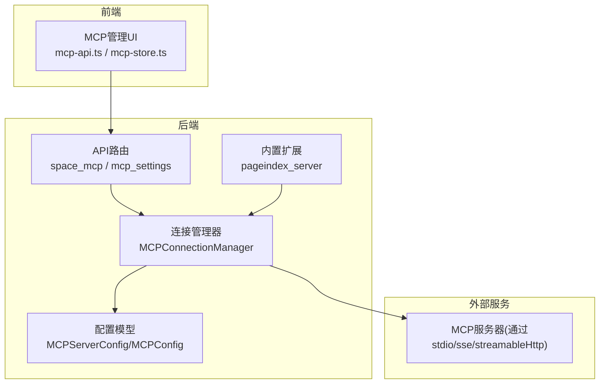
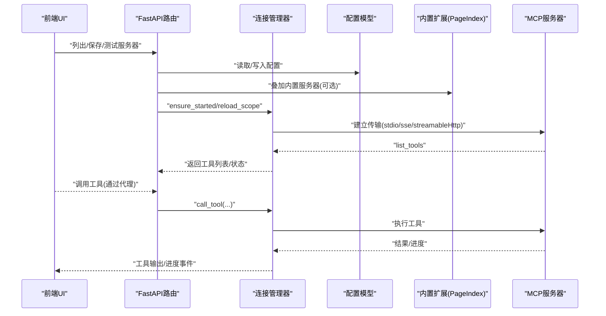
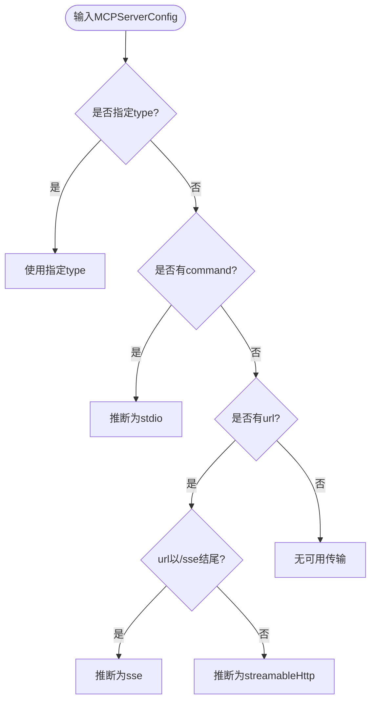
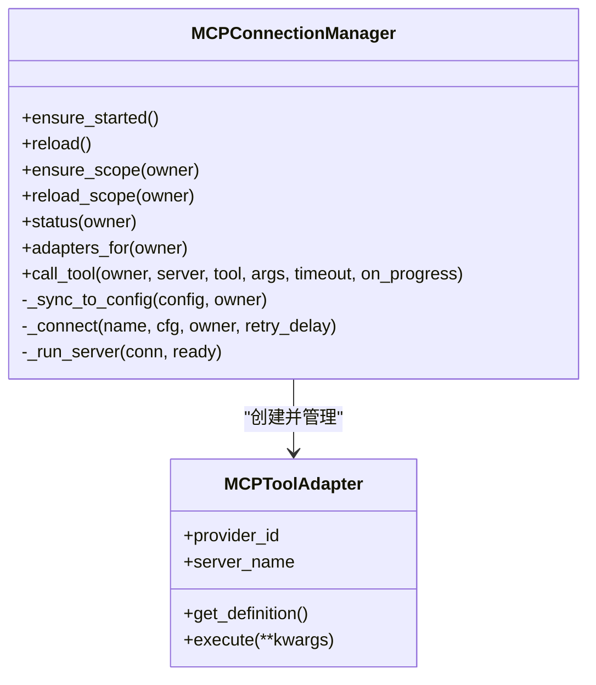
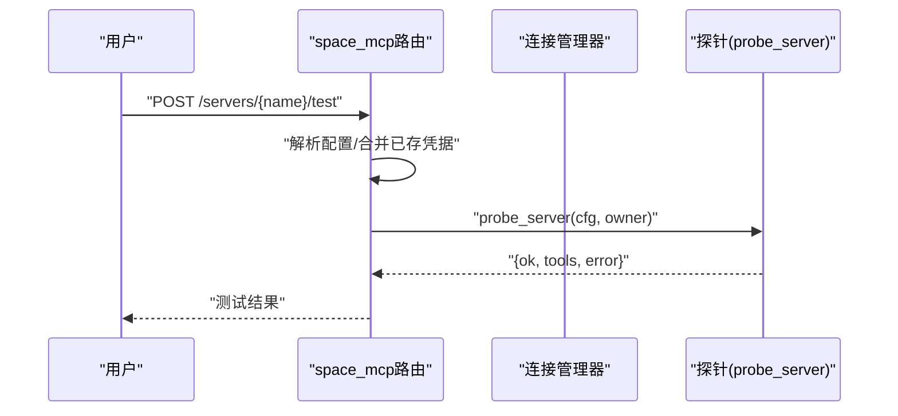
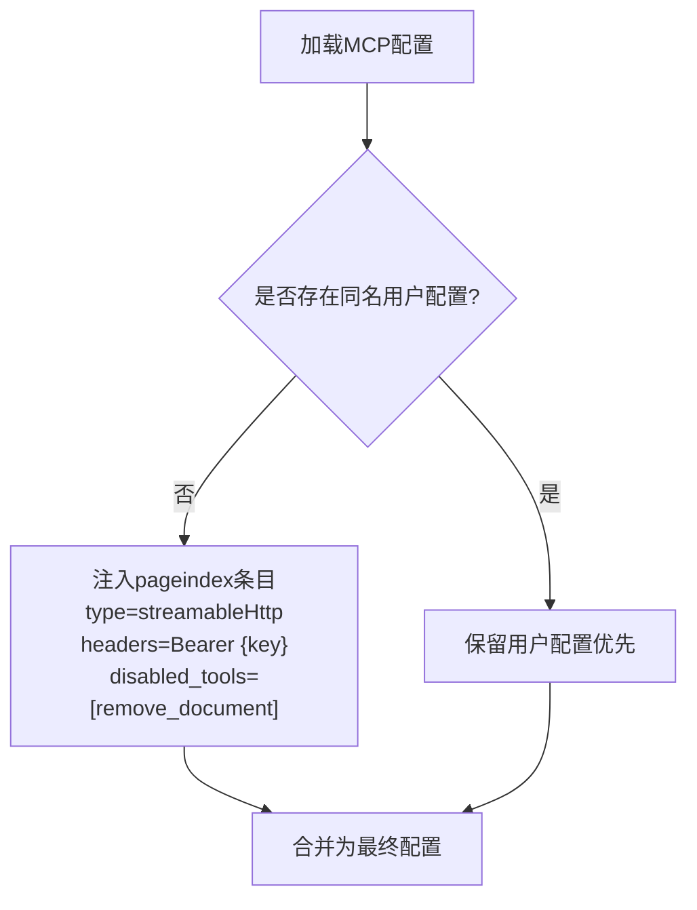
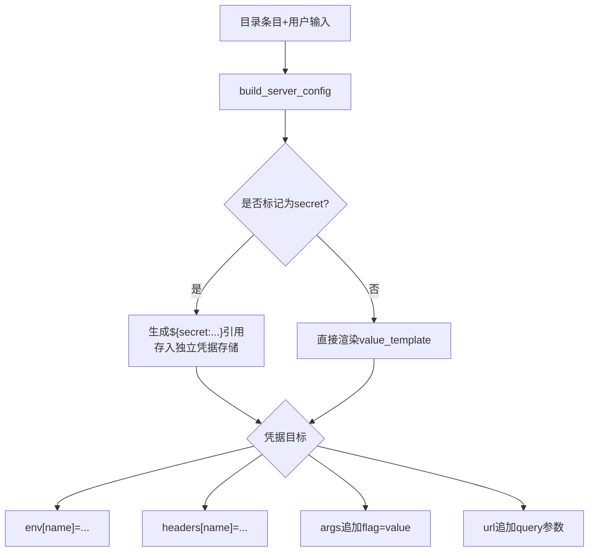
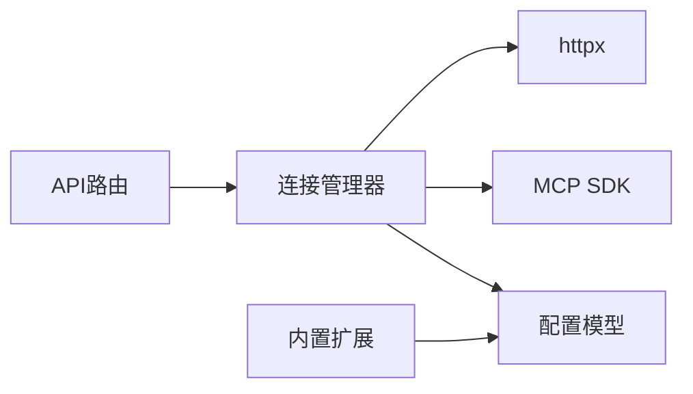

# MCP服务器开发指南

<cite>
**本文引用的文件**
- [deeptutor/services/mcp/__init__.py](file://deeptutor/services/mcp/__init__.py)
- [deeptutor/services/mcp/config.py](file://deeptutor/services/mcp/config.py)
- [deeptutor/services/mcp/manager.py](file://deeptutor/services/mcp/manager.py)
- [deeptutor/services/mcp/pageindex_server.py](file://deeptutor/services/mcp/pageindex_server.py)
- [deeptutor/services/mcp/catalog/models.py](file://deeptutor/services/mcp/catalog/models.py)
- [deeptutor/api/routers/space_mcp.py](file://deeptutor/api/routers/space_mcp.py)
- [deeptutor/api/routers/mcp_settings.py](file://deeptutor/api/routers/mcp_settings.py)
- [tests/api/test_space_mcp.py](file://tests/api/test_space_mcp.py)
- [web/lib/mcp-api.ts](file://web/lib/mcp-api.ts)
- [web/lib/mcp-store.ts](file://web/lib/mcp-store.ts)
</cite>

## 目录
1. [简介](#简介)
2. [项目结构](#项目结构)
3. [核心组件](#核心组件)
4. [架构总览](#架构总览)
5. [详细组件分析](#详细组件分析)
6. [依赖关系分析](#依赖关系分析)
7. [性能与可靠性](#性能与可靠性)
8. [故障排查指南](#故障排查指南)
9. [结论](#结论)
10. [附录：开发与测试清单](#附录开发与测试清单)

## 简介
本指南面向需要在DeepTutor中开发符合MCP协议的服务器、工具与集成的工程师。内容涵盖：
- 协议实现要点（连接管理、工具适配、消息处理）
- 工具定义规范（参数、错误处理、性能优化）
- 内置扩展机制（如PageIndex服务器的注入方式）
- 开发环境搭建与调试方法
- 完整示例与最佳实践
- 服务器测试方法与质量保证流程
- 部署与运维注意事项

## 项目结构
DeepTutor的MCP能力由“配置—连接管理—API路由—前端”四层构成：
- 配置层：定义服务器类型、传输、认证、工具白名单/黑名单等
- 连接管理层：维护进程内所有MCP会话的生命周期、重试、隔离与工具注册
- API路由层：提供管理员与用户侧的MCP配置、目录安装、OAuth授权、测试等接口
- 前端层：提供MCP服务器管理界面、目录浏览、错误提示与状态展示

图表来源
- [deeptutor/services/mcp/config.py:31-103](file://deeptutor/services/mcp/config.py#L31-L103)
- [deeptutor/services/mcp/manager.py:216-300](file://deeptutor/services/mcp/manager.py#L216-L300)
- [deeptutor/api/routers/space_mcp.py:92-166](file://deeptutor/api/routers/space_mcp.py#L92-L166)
- [deeptutor/api/routers/mcp_settings.py:57-133](file://deeptutor/api/routers/mcp_settings.py#L57-L133)
- [deeptutor/services/mcp/pageindex_server.py:20-47](file://deeptutor/services/mcp/pageindex_server.py#L20-L47)
- [web/lib/mcp-api.ts:106-205](file://web/lib/mcp-api.ts#L106-L205)

章节来源
- [deeptutor/services/mcp/config.py:31-103](file://deeptutor/services/mcp/config.py#L31-L103)
- [deeptutor/services/mcp/manager.py:216-300](file://deeptutor/services/mcp/manager.py#L216-L300)
- [deeptutor/api/routers/space_mcp.py:92-166](file://deeptutor/api/routers/space_mcp.py#L92-L166)
- [deeptutor/api/routers/mcp_settings.py:57-133](file://deeptutor/api/routers/mcp_settings.py#L57-L133)
- [deeptutor/services/mcp/pageindex_server.py:20-47](file://deeptutor/services/mcp/pageindex_server.py#L20-L47)
- [web/lib/mcp-api.ts:106-205](file://web/lib/mcp-api.ts#L106-L205)

## 核心组件
- 配置模型
  - MCPServerConfig：描述单个MCP服务器（传输类型、命令/URL、头/环境变量、工具超时、启用/禁用工具、认证方式等）
  - MCPConfig：聚合多个服务器条目，支持名称校验与持久化
- 连接管理器
  - MCPConnectionManager：进程级单例，负责连接生命周期、按租户隔离、失败重试、工具适配器注册与调用转发
- API路由
  - space_mcp：用户侧MCP管理（仅远程传输、凭据分离存储、OAuth授权、目录安装）
  - mcp_settings：管理员侧全局MCP注册表（读写配置、探测、状态）
- 内置扩展
  - pageindex_server：在加载时向配置叠加内置PageIndex服务器（可被用户同名覆盖），并屏蔽危险工具
- 目录与凭证
  - catalog/models：可安装条目模板、凭据目标映射（env/header/url_param/arg）、构建配置与秘密引用
- 前端集成
  - mcp-api.ts / mcp-store.ts：统一封装API、错误码映射、状态渲染与拒绝文案本地化

章节来源
- [deeptutor/services/mcp/config.py:31-103](file://deeptutor/services/mcp/config.py#L31-L103)
- [deeptutor/services/mcp/manager.py:89-155](file://deeptutor/services/mcp/manager.py#L89-L155)
- [deeptutor/api/routers/space_mcp.py:92-166](file://deeptutor/api/routers/space_mcp.py#L92-L166)
- [deeptutor/api/routers/mcp_settings.py:57-133](file://deeptutor/api/routers/mcp_settings.py#L57-L133)
- [deeptutor/services/mcp/pageindex_server.py:20-47](file://deeptutor/services/mcp/pageindex_server.py#L20-L47)
- [deeptutor/services/mcp/catalog/models.py:105-236](file://deeptutor/services/mcp/catalog/models.py#L105-L236)
- [web/lib/mcp-api.ts:106-205](file://web/lib/mcp-api.ts#L106-L205)

## 架构总览
下图展示了从前端到后端再到MCP服务器的请求链路，以及内置扩展注入点。

图表来源
- [deeptutor/api/routers/space_mcp.py:92-166](file://deeptutor/api/routers/space_mcp.py#L92-L166)
- [deeptutor/api/routers/mcp_settings.py:57-133](file://deeptutor/api/routers/mcp_settings.py#L57-L133)
- [deeptutor/services/mcp/manager.py:241-300](file://deeptutor/services/mcp/manager.py#L241-L300)
- [deeptutor/services/mcp/pageindex_server.py:40-47](file://deeptutor/services/mcp/pageindex_server.py#L40-L47)

## 详细组件分析

### 配置模型与传输解析
- 自动推断传输类型：未显式type时，根据command或url后缀判断stdio/sse/streamableHttp
- 工具过滤：enabled_tools/disabled_tools组合控制暴露的工具集合
- 连接签名：用于reload时检测变更，排除catalog_entry以稳定比对
- 持久化：原子写入避免损坏导致全量断开

图表来源
- [deeptutor/services/mcp/config.py:31-81](file://deeptutor/services/mcp/config.py#L31-L81)

章节来源
- [deeptutor/services/mcp/config.py:31-103](file://deeptutor/services/mcp/config.py#L31-L103)

### 连接管理与工具适配器
- 生命周期：每个服务器一个连接任务，持有AsyncExitStack，确保session正确关闭
- 隔离：按owner键控连接；用户作用域工具不进入全局注册表，避免冲突
- 重试与退避：失败后指数退避重连；冷作用域空闲回收，限制最大并发作用域数
- 工具调用：包装为BaseTool，支持超时、进度上报、一次性重试瞬态错误

图表来源
- [deeptutor/services/mcp/manager.py:89-155](file://deeptutor/services/mcp/manager.py#L89-L155)
- [deeptutor/services/mcp/manager.py:216-300](file://deeptutor/services/mcp/manager.py#L216-L300)
- [deeptutor/services/mcp/manager.py:404-470](file://deeptutor/services/mcp/manager.py#L404-L470)

章节来源
- [deeptutor/services/mcp/manager.py:89-155](file://deeptutor/services/mcp/manager.py#L89-L155)
- [deeptutor/services/mcp/manager.py:216-300](file://deeptutor/services/mcp/manager.py#L216-L300)
- [deeptutor/services/mcp/manager.py:404-470](file://deeptutor/services/mcp/manager.py#L404-L470)

### API路由：用户侧与管理员侧
- 用户侧（/api/v1/space/mcp）
  - 仅允许远程传输（sse/streamableHttp），禁止stdio
  - 凭据分离存储，绝不回显明文
  - OAuth授权流程（开始/回调）
  - 目录浏览与安装（仅self_service条目）
  - 测试接口（无副作用）
- 管理员侧（/api/v1/settings/mcp）
  - 全局注册表CRUD
  - URL校验与探测

图表来源
- [deeptutor/api/routers/space_mcp.py:255-284](file://deeptutor/api/routers/space_mcp.py#L255-L284)
- [deeptutor/services/mcp/manager.py:755-792](file://deeptutor/services/mcp/manager.py#L755-L792)

章节来源
- [deeptutor/api/routers/space_mcp.py:92-166](file://deeptutor/api/routers/space_mcp.py#L92-L166)
- [deeptutor/api/routers/space_mcp.py:255-284](file://deeptutor/api/routers/space_mcp.py#L255-L284)
- [deeptutor/api/routers/mcp_settings.py:57-133](file://deeptutor/api/routers/mcp_settings.py#L57-L133)

### 内置扩展：PageIndex服务器
- 注入时机：加载配置时叠加内置pageindex条目（若未存在）
- 凭据来源：从PageIndex运行时设置读取API Key，构造Authorization头
- 安全策略：默认禁用remove_document工具，防止误删云文档导致本地索引不一致
- 热重载：修改Key会改变连接签名，触发重新连接

图表来源
- [deeptutor/services/mcp/pageindex_server.py:20-47](file://deeptutor/services/mcp/pageindex_server.py#L20-L47)

章节来源
- [deeptutor/services/mcp/pageindex_server.py:20-47](file://deeptutor/services/mcp/pageindex_server.py#L20-L47)

### 目录与凭据注入
- 条目模板：声明传输、服务端模板、凭据字段（目标位置、是否密钥、占位符模板）
- 构建规则：将用户输入转换为配置值与秘密引用；secret值不入配置，仅存引用
- 目标映射：env/header/url_param/arg四类目标，分别注入到对应位置
- 安全约束：stdio条目不可自服务；远程条目不得携带command

图表来源
- [deeptutor/services/mcp/catalog/models.py:105-236](file://deeptutor/services/mcp/catalog/models.py#L105-L236)
- [deeptutor/services/mcp/catalog/models.py:238-313](file://deeptutor/services/mcp/catalog/models.py#L238-L313)

章节来源
- [deeptutor/services/mcp/catalog/models.py:105-236](file://deeptutor/services/mcp/catalog/models.py#L105-L236)
- [deeptutor/services/mcp/catalog/models.py:238-313](file://deeptutor/services/mcp/catalog/models.py#L238-L313)

### 前端集成与错误处理
- 传输识别：前端与后端一致的传输推断逻辑，便于预览
- 状态渲染：根据配置enabled与后端状态行决定显示
- 错误映射：后端返回detail.code，前端映射为本地化拒绝文案
- 安全提示：对blocked_url等错误保留原始细节以便定位

章节来源
- [web/lib/mcp-api.ts:106-205](file://web/lib/mcp-api.ts#L106-L205)
- [web/lib/mcp-store.ts:82-120](file://web/lib/mcp-store.ts#L82-L120)

## 依赖关系分析
- 模块耦合
  - 路由依赖配置与连接管理器，连接管理器依赖配置与外部MCP SDK
  - 内置扩展在配置加载阶段注入，不影响用户配置优先级
- 外部依赖
  - MCP SDK用于建立传输与会话、列举工具、调用工具与进度通知
  - httpx用于HTTP客户端（SSE/Streamable HTTP）
- 潜在循环
  - 通过延迟导入避免启动期强依赖（如mcp包可选依赖）

图表来源
- [deeptutor/services/mcp/manager.py:610-708](file://deeptutor/services/mcp/manager.py#L610-L708)
- [deeptutor/services/mcp/pageindex_server.py:40-47](file://deeptutor/services/mcp/pageindex_server.py#L40-L47)

章节来源
- [deeptutor/services/mcp/manager.py:610-708](file://deeptutor/services/mcp/manager.py#L610-L708)

## 性能与可靠性
- 连接池与作用域
  - 每租户作用域上限与空闲回收，避免进程内存膨胀
  - 首次连接懒加载，降低冷启动成本
- 重试与超时
  - 瞬态网络错误一次重试；连接失败指数退避
  - 工具调用带超时保护，避免长任务阻塞
- 进度上报
  - 将MCP进度转化为trace事件，便于前端展示百分比或步数
- 安全与隔离
  - 用户作用域工具不进入全局注册表，避免命名冲突
  - 严格地址策略与重定向控制，防止内网访问

章节来源
- [deeptutor/services/mcp/manager.py:65-82](file://deeptutor/services/mcp/manager.py#L65-L82)
- [deeptutor/services/mcp/manager.py:319-347](file://deeptutor/services/mcp/manager.py#L319-L347)
- [deeptutor/services/mcp/manager.py:404-470](file://deeptutor/services/mcp/manager.py#L404-L470)
- [deeptutor/services/mcp/manager.py:542-587](file://deeptutor/services/mcp/manager.py#L542-L587)

## 故障排查指南
- 常见问题定位
  - 连接失败：查看状态行的error字段与日志中的describe_connect_failure输出
  - 需要授权：状态为needs_auth时，引导用户完成OAuth授权
  - 工具不可用：检查enabled_tools/disabled_tools与wrapped_name匹配
- 测试建议
  - 使用测试接口验证连通性与工具列表
  - 通过单元测试覆盖拒绝场景（stdio不允许、URL被拦截、凭据分离存储等）

章节来源
- [deeptutor/services/mcp/manager.py:795-800](file://deeptutor/services/mcp/manager.py#L795-L800)
- [tests/api/test_space_mcp.py:105-121](file://tests/api/test_space_mcp.py#L105-L121)
- [tests/api/test_space_mcp.py:123-145](file://tests/api/test_space_mcp.py#L123-L145)

## 结论
DeepTutor的MCP集成提供了完整的服务器接入、工具适配、凭据管理与前端展示能力。通过严格的配置校验、连接隔离、重试与进度上报，既保证了安全性与稳定性，也提升了用户体验。开发者可基于目录模板快速集成第三方服务，或通过内置扩展机制无缝接入系统能力。

## 附录：开发与测试清单
- 开发步骤
  - 定义服务器配置（传输、URL/命令、头/环境变量、工具过滤）
  - 如需目录条目，编写模板与凭据目标映射
  - 使用测试接口验证连通性与工具列表
  - 在前端进行安装与授权流程联调
- 质量保证
  - 覆盖拒绝路径（stdio、URL拦截、凭据缺失、名称冲突）
  - 验证凭据分离存储与不回显
  - 验证作用域隔离与冷作用域回收
- 部署与运维
  - 管理员集中配置全局服务器；用户自助配置远程服务
  - 关注连接状态与错误日志，及时处理授权与网络问题
  - 定期评估作用域数量与资源占用，必要时调整上限与TTL

章节来源
- [deeptutor/api/routers/space_mcp.py:92-166](file://deeptutor/api/routers/space_mcp.py#L92-L166)
- [deeptutor/api/routers/mcp_settings.py:57-133](file://deeptutor/api/routers/mcp_settings.py#L57-L133)
- [tests/api/test_space_mcp.py:159-183](file://tests/api/test_space_mcp.py#L159-L183)
- [tests/api/test_space_mcp.py:292-327](file://tests/api/test_space_mcp.py#L292-L327)