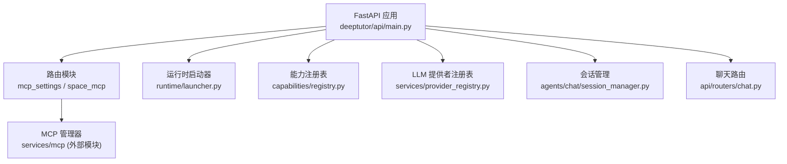
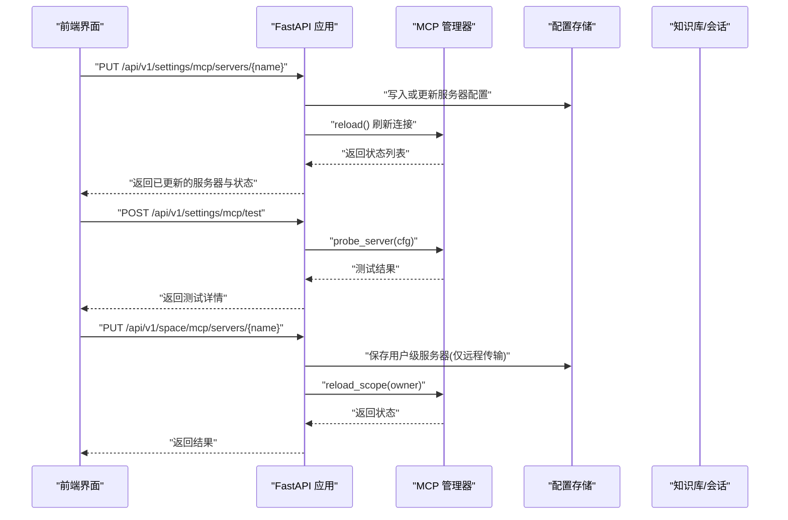
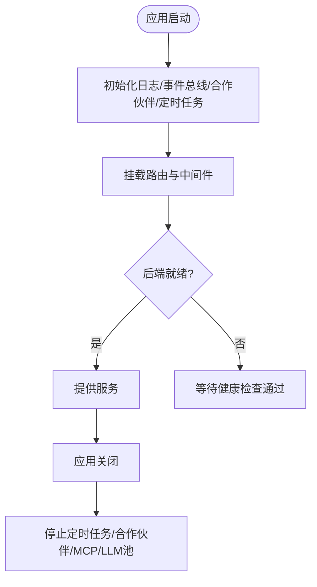
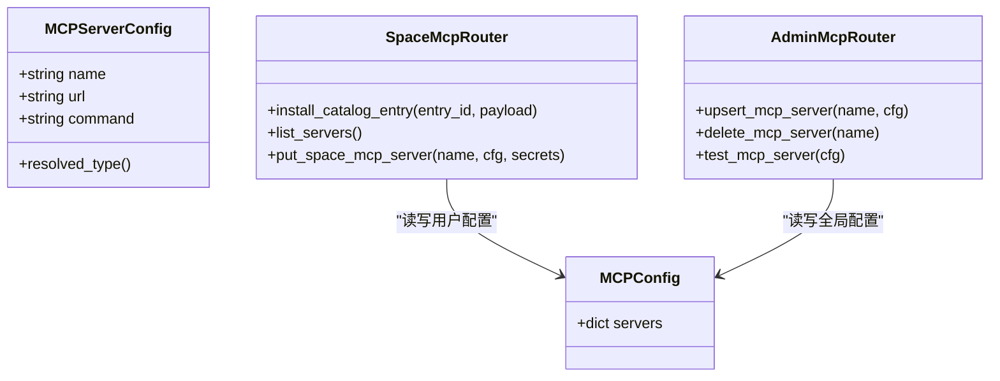
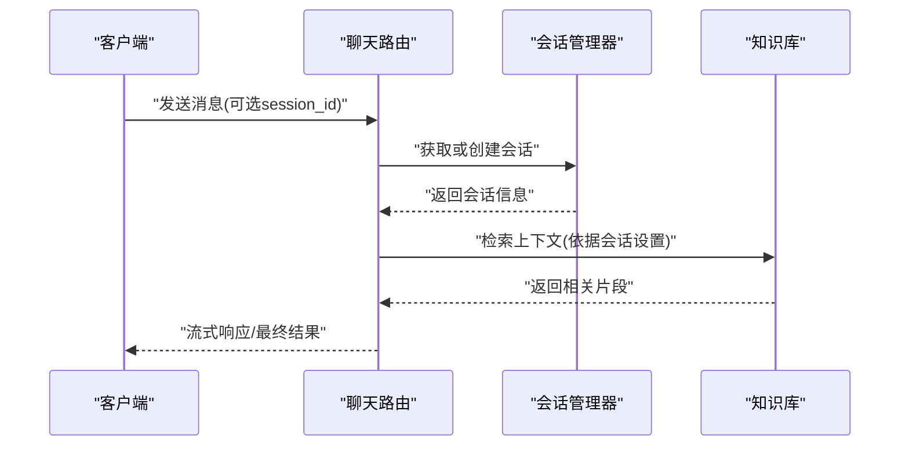
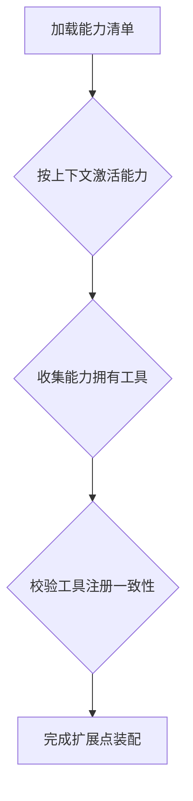
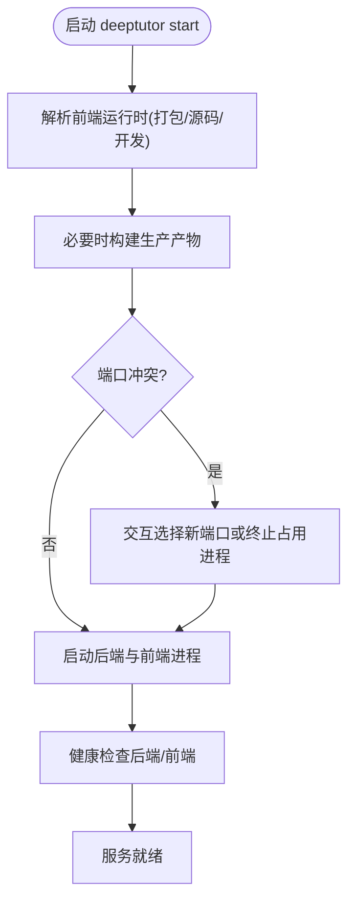
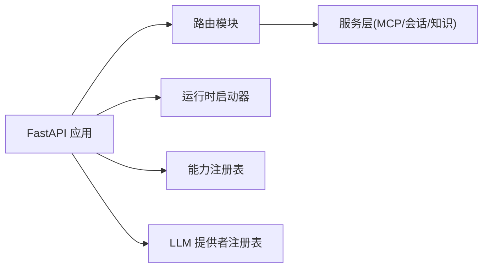
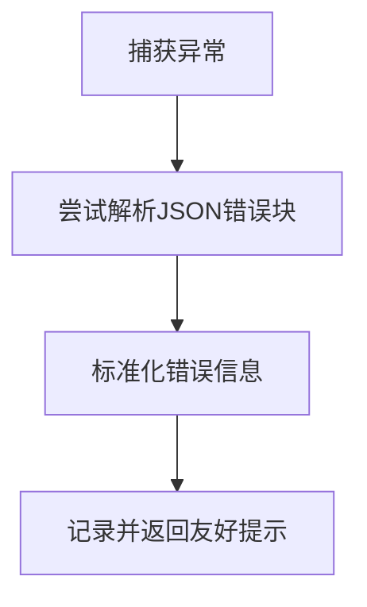

# 内置服务器扩展

<cite>
**本文引用的文件**
- [deeptutor/api/main.py](file://deeptutor/api/main.py)
- [deeptutor/runtime/launcher.py](file://deeptutor/runtime/launcher.py)
- [deeptutor/services/provider_registry.py](file://deeptutor/services/provider_registry.py)
- [deeptutor/capabilities/registry.py](file://deeptutor/capabilities/registry.py)
- [deeptutor/api/routers/mcp_settings.py](file://deeptutor/api/routers/mcp_settings.py)
- [deeptutor/api/routers/space_mcp.py](file://deeptutor/api/routers/space_mcp.py)
- [web/lib/mcp-api.ts](file://web/lib/mcp-api.ts)
- [tests/api/test_mcp_settings_auth.py](file://tests/api/test_mcp_settings_auth.py)
- [deeptutor/agents/chat/session_manager.py](file://deeptutor/agents/chat/session_manager.py)
- [deeptutor/api/routers/chat.py](file://deeptutor/api/routers/chat.py)
- [deeptutor/utils/error_rate_tracker.py](file://deeptutor/utils/error_rate_tracker.py)
- [deeptutor/utils/error_utils.py](file://deeptutor/utils/error_utils.py)
</cite>

## 目录
1. [简介](#简介)
2. [项目结构](#项目结构)
3. [核心组件](#核心组件)
4. [架构总览](#架构总览)
5. [详细组件分析](#详细组件分析)
6. [依赖关系分析](#依赖关系分析)
7. [性能考量](#性能考量)
8. [故障排查指南](#故障排查指南)
9. [结论](#结论)
10. [附录](#附录)

## 简介
本指南面向需要基于 DeepTutor 构建“内置服务器扩展”的开发者，重点围绕 PageIndex 检索服务与 MCP（Model Context Protocol）服务器集成展开。内容涵盖：
- 服务器注册机制、配置管理与生命周期控制
- 与知识库、会话管理等系统组件的集成方式
- 扩展点设计、插件接口与钩子机制
- 扩展开发模板、示例代码路径与部署配置
- 性能监控、故障排查与运维维护建议

## 项目结构
DeepTutor 采用分层模块化组织：
- API 层：FastAPI 应用入口、路由挂载、中间件与生命周期管理
- 运行时层：进程启动器、端口冲突处理、前后端协调
- 能力与工具层：能力注册表、工具注册、插件发现
- 服务层：MCP 管理、LLM 提供者、会话、知识、记忆等
- 前端：Next.js 应用，提供 MCP 配置与管理界面

**图表来源**
- [deeptutor/api/main.py:116-246](file://deeptutor/api/main.py#L116-L246)
- [deeptutor/api/main.py:334-499](file://deeptutor/api/main.py#L334-L499)
- [deeptutor/runtime/launcher.py:453-474](file://deeptutor/runtime/launcher.py#L453-L474)
- [deeptutor/capabilities/registry.py:13-44](file://deeptutor/capabilities/registry.py#L13-L44)
- [deeptutor/services/provider_registry.py:118-479](file://deeptutor/services/provider_registry.py#L118-L479)

**章节来源**
- [deeptutor/api/main.py:116-246](file://deeptutor/api/main.py#L116-L246)
- [deeptutor/api/main.py:334-499](file://deeptutor/api/main.py#L334-L499)
- [deeptutor/runtime/launcher.py:453-474](file://deeptutor/runtime/launcher.py#L453-L474)

## 核心组件
- FastAPI 应用与生命周期：负责初始化日志、事件总线、合作伙伴、定时任务、MCP 连接关闭、LLM 池关闭等
- 路由挂载：将各功能域路由挂载到统一前缀，并设置认证依赖
- 运行时启动器：负责后端与前端进程的启动、健康检查、端口冲突处理、资源清理
- 能力与工具注册：集中管理循环能力与工具归属，支持插件加载
- LLM 提供者注册表：统一管理多提供商元数据、网关识别、默认基地址等
- MCP 配置与空间管理：管理员级与用户级 MCP 服务器配置、安装、测试、状态同步
- 会话管理：创建/更新会话，支撑聊天与长时任务

**章节来源**
- [deeptutor/api/main.py:116-246](file://deeptutor/api/main.py#L116-L246)
- [deeptutor/api/main.py:334-499](file://deeptutor/api/main.py#L334-L499)
- [deeptutor/runtime/launcher.py:453-474](file://deeptutor/runtime/launcher.py#L453-L474)
- [deeptutor/capabilities/registry.py:13-44](file://deeptutor/capabilities/registry.py#L13-L44)
- [deeptutor/services/provider_registry.py:118-479](file://deeptutor/services/provider_registry.py#L118-L479)
- [deeptutor/api/routers/mcp_settings.py:81-133](file://deeptutor/api/routers/mcp_settings.py#L81-L133)
- [deeptutor/api/routers/space_mcp.py:319-416](file://deeptutor/api/routers/space_mcp.py#L319-L416)
- [deeptutor/agents/chat/session_manager.py:140-179](file://deeptutor/agents/chat/session_manager.py#L140-L179)

## 架构总览
下图展示了从请求进入 FastAPI 到 MCP 服务器管理的整体流程，包括管理员与用户空间的差异、前端交互与后端校验。

**图表来源**
- [deeptutor/api/routers/mcp_settings.py:81-133](file://deeptutor/api/routers/mcp_settings.py#L81-L133)
- [deeptutor/api/routers/space_mcp.py:319-416](file://deeptutor/api/routers/space_mcp.py#L319-L416)
- [web/lib/mcp-api.ts:475-512](file://web/lib/mcp-api.ts#L475-L512)
- [web/lib/mcp-api.ts:532-566](file://web/lib/mcp-api.ts#L532-L566)

## 详细组件分析

### 服务器注册机制与生命周期控制
- 应用生命周期：在 lifespan 中完成事件总线、合作伙伴、定时任务、MCP 连接的启动与关闭；确保进程退出时释放资源
- 路由挂载：按领域划分路由，统一认证依赖；MCP 相关路由分为管理员级与用户级
- 启动器：负责后端与前端进程的生命周期管理、健康检查、端口冲突处理与清理

**图表来源**
- [deeptutor/api/main.py:116-246](file://deeptutor/api/main.py#L116-L246)
- [deeptutor/runtime/launcher.py:453-474](file://deeptutor/runtime/launcher.py#L453-L474)

**章节来源**
- [deeptutor/api/main.py:116-246](file://deeptutor/api/main.py#L116-L246)
- [deeptutor/runtime/launcher.py:453-474](file://deeptutor/runtime/launcher.py#L453-L474)

### 配置管理（管理员与用户空间）
- 管理员级：全量 PUT 覆盖整个服务器映射；单条 PUT 上替换指定服务器；删除指定服务器；测试配置连通性
- 用户级：仅允许远程传输（SSE/streamableHttp），避免本地命令执行风险；支持安装目录条目、凭据分离存储、按所有者范围重载
- 前端：统一的 API 封装，区分管理员与用户空间，自动解析传输类型、错误码与行状态

**图表来源**
- [deeptutor/api/routers/mcp_settings.py:81-133](file://deeptutor/api/routers/mcp_settings.py#L81-L133)
- [deeptutor/api/routers/space_mcp.py:319-416](file://deeptutor/api/routers/space_mcp.py#L319-L416)
- [web/lib/mcp-api.ts:475-566](file://web/lib/mcp-api.ts#L475-L566)

**章节来源**
- [deeptutor/api/routers/mcp_settings.py:81-133](file://deeptutor/api/routers/mcp_settings.py#L81-L133)
- [deeptutor/api/routers/space_mcp.py:319-416](file://deeptutor/api/routers/space_mcp.py#L319-L416)
- [web/lib/mcp-api.ts:475-566](file://web/lib/mcp-api.ts#L475-L566)
- [tests/api/test_mcp_settings_auth.py:121-127](file://tests/api/test_mcp_settings_auth.py#L121-L127)

### 与知识库、会话管理的集成
- 知识库：作为 RAG 的基础设施，Chat、Co-Writer、Book、Partner 均依赖知识库进行上下文增强；PageIndex 作为托管检索引擎之一，提供页面级引用与推理检索
- 会话管理：聊天路由根据 session_id 是否存在决定创建新会话或复用；会话设置包含知识库名称、RAG 开关、网页搜索开关等
- 流式通信：长时任务（如 Book 生成）使用 WebSocket 传输，避免 HTTP 代理超时导致的中断

**图表来源**
- [deeptutor/api/routers/chat.py:97-128](file://deeptutor/api/routers/chat.py#L97-L128)
- [deeptutor/agents/chat/session_manager.py:140-179](file://deeptutor/agents/chat/session_manager.py#L140-L179)

**章节来源**
- [deeptutor/api/routers/chat.py:97-128](file://deeptutor/api/routers/chat.py#L97-L128)
- [deeptutor/agents/chat/session_manager.py:140-179](file://deeptutor/agents/chat/session_manager.py#L140-L179)

### 扩展点设计、插件接口与钩子机制
- 能力注册表：集中声明内置循环能力，支持按上下文激活；可查询能力拥有的工具归属
- 插件加载：运行时能力注册表支持发现并加载插件能力（排除 tool.py 入口），失败时记录警告
- 工具一致性校验：启动时校验能力清单引用的工具是否已注册，防止漂移

**图表来源**
- [deeptutor/capabilities/registry.py:13-44](file://deeptutor/capabilities/registry.py#L13-L44)
- [deeptutor/runtime/registry/capability_registry.py:49-84](file://deeptutor/runtime/registry/capability_registry.py#L49-L84)
- [deeptutor/api/main.py:57-82](file://deeptutor/api/main.py#L57-L82)

**章节来源**
- [deeptutor/capabilities/registry.py:13-44](file://deeptutor/capabilities/registry.py#L13-L44)
- [deeptutor/runtime/registry/capability_registry.py:49-84](file://deeptutor/runtime/registry/capability_registry.py#L49-L84)
- [deeptutor/api/main.py:57-82](file://deeptutor/api/main.py#L57-L82)

### 部署配置与运行流程
- 启动器：检测并复制打包的前端资源，注入环境变量；构建源码生产版本；处理端口冲突；健康检查后端与前端
- 运行时设置：持久化后端与前端端口；支持交互式选择新端口或终止占用进程
- 环境变量：为前端注入 API 基址与认证开关；为后端提供运行时设置

**图表来源**
- [deeptutor/runtime/launcher.py:494-534](file://deeptutor/runtime/launcher.py#L494-L534)
- [deeptutor/runtime/launcher.py:646-697](file://deeptutor/runtime/launcher.py#L646-L697)
- [deeptutor/runtime/launcher.py:722-773](file://deeptutor/runtime/launcher.py#L722-L773)
- [deeptutor/runtime/launcher.py:408-451](file://deeptutor/runtime/launcher.py#L408-L451)

**章节来源**
- [deeptutor/runtime/launcher.py:494-534](file://deeptutor/runtime/launcher.py#L494-L534)
- [deeptutor/runtime/launcher.py:646-697](file://deeptutor/runtime/launcher.py#L646-L697)
- [deeptutor/runtime/launcher.py:722-773](file://deeptutor/runtime/launcher.py#L722-L773)
- [deeptutor/runtime/launcher.py:408-451](file://deeptutor/runtime/launcher.py#L408-L451)

## 依赖关系分析
- 应用层依赖路由模块，路由模块依赖服务层（MCP、会话、知识等）
- 运行时启动器依赖服务配置与路径服务，负责进程与端口管理
- 能力与工具注册表依赖具体能力实现，提供静态查询与动态激活
- LLM 提供者注册表提供统一元数据与网关识别，供上层调用

**图表来源**
- [deeptutor/api/main.py:334-499](file://deeptutor/api/main.py#L334-L499)
- [deeptutor/runtime/launcher.py:453-474](file://deeptutor/runtime/launcher.py#L453-L474)
- [deeptutor/capabilities/registry.py:13-44](file://deeptutor/capabilities/registry.py#L13-L44)
- [deeptutor/services/provider_registry.py:118-479](file://deeptutor/services/provider_registry.py#L118-L479)

**章节来源**
- [deeptutor/api/main.py:334-499](file://deeptutor/api/main.py#L334-L499)
- [deeptutor/runtime/launcher.py:453-474](file://deeptutor/runtime/launcher.py#L453-L474)
- [deeptutor/capabilities/registry.py:13-44](file://deeptutor/capabilities/registry.py#L13-L44)
- [deeptutor/services/provider_registry.py:118-479](file://deeptutor/services/provider_registry.py#L118-L479)

## 性能考量
- 长时任务使用 WebSocket 传输，避免 HTTP 代理超时导致的假失败
- 启动器对前端资源进行缓存与增量构建，减少重复构建开销
- 错误率追踪与熔断回调可用于外部服务降级与告警
- 访问日志仅输出非 200 状态，降低噪音并聚焦异常

[本节为通用指导，不直接分析具体文件]

## 故障排查指南
- 配置漂移：启动时校验能力清单引用的工具是否已注册，若不一致抛出明确错误
- 端口冲突：启动器检测占用端口并提供交互选项；在非 TTY 环境下直接报错退出
- MCP 配置校验：管理员路由拒绝非法服务器名；用户路由限制为远程传输
- 错误格式化：提取 JSON 错误块并标准化展示，便于定位问题

**图表来源**
- [deeptutor/utils/error_utils.py:10-81](file://deeptutor/utils/error_utils.py#L10-L81)
- [deeptutor/utils/error_rate_tracker.py:43-111](file://deeptutor/utils/error_rate_tracker.py#L43-L111)
- [deeptutor/api/routers/mcp_settings.py:121-133](file://deeptutor/api/routers/mcp_settings.py#L121-L133)
- [tests/api/test_mcp_settings_auth.py:121-127](file://tests/api/test_mcp_settings_auth.py#L121-L127)

**章节来源**
- [deeptutor/utils/error_utils.py:10-81](file://deeptutor/utils/error_utils.py#L10-L81)
- [deeptutor/utils/error_rate_tracker.py:43-111](file://deeptutor/utils/error_rate_tracker.py#L43-L111)
- [deeptutor/api/routers/mcp_settings.py:121-133](file://deeptutor/api/routers/mcp_settings.py#L121-L133)
- [tests/api/test_mcp_settings_auth.py:121-127](file://tests/api/test_mcp_settings_auth.py#L121-L127)

## 结论
DeepTutor 提供了完善的内置服务器扩展框架：以 FastAPI 为核心，结合运行时启动器、能力与工具注册、MCP 配置与空间管理、会话与知识库集成，形成可扩展、可观测、易运维的系统。开发者可通过管理员与用户空间的双轨配置、插件钩子与能力激活机制，快速集成 PageIndex 等检索服务，并在生产环境中获得稳定的生命周期管理与性能保障。

## 附录
- 扩展开发模板与示例代码路径
  - MCP 管理员路由：[deeptutor/api/routers/mcp_settings.py](file://deeptutor/api/routers/mcp_settings.py)
  - MCP 用户空间路由：[deeptutor/api/routers/space_mcp.py](file://deeptutor/api/routers/space_mcp.py)
  - 前端 MCP API 封装：[web/lib/mcp-api.ts](file://web/lib/mcp-api.ts)
  - 能力注册与插件加载：[deeptutor/capabilities/registry.py](file://deeptutor/capabilities/registry.py)、[deeptutor/runtime/registry/capability_registry.py](file://deeptutor/runtime/registry/capability_registry.py)
  - 启动器与部署：[deeptutor/runtime/launcher.py](file://deeptutor/runtime/launcher.py)
  - 会话与聊天集成：[deeptutor/api/routers/chat.py](file://deeptutor/api/routers/chat.py)、[deeptutor/agents/chat/session_manager.py](file://deeptutor/agents/chat/session_manager.py)
  - 错误处理与监控：[deeptutor/utils/error_utils.py](file://deeptutor/utils/error_utils.py)、[deeptutor/utils/error_rate_tracker.py](file://deeptutor/utils/error_rate_tracker.py)

[本节为参考指引，不直接分析具体文件]