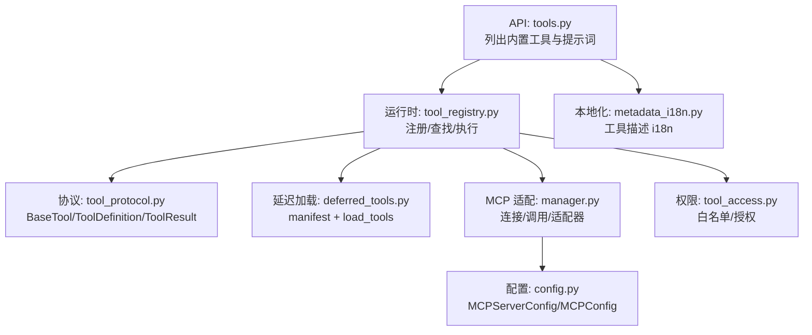
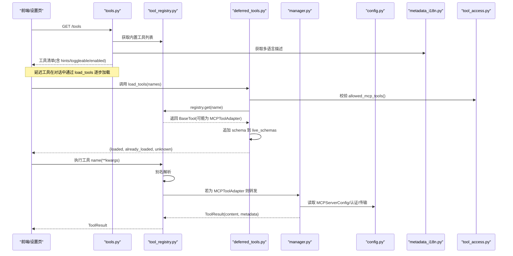
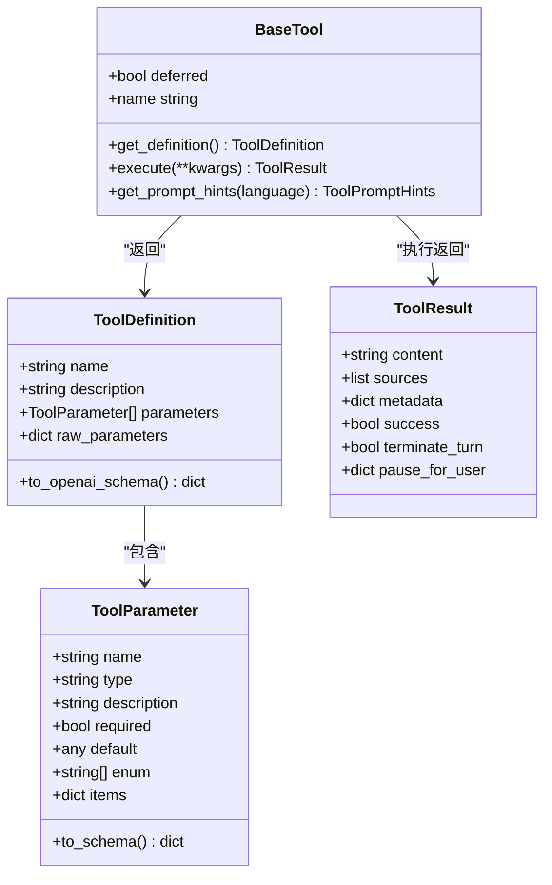
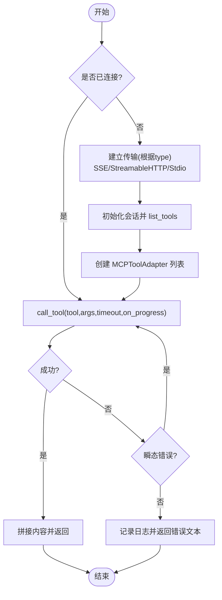
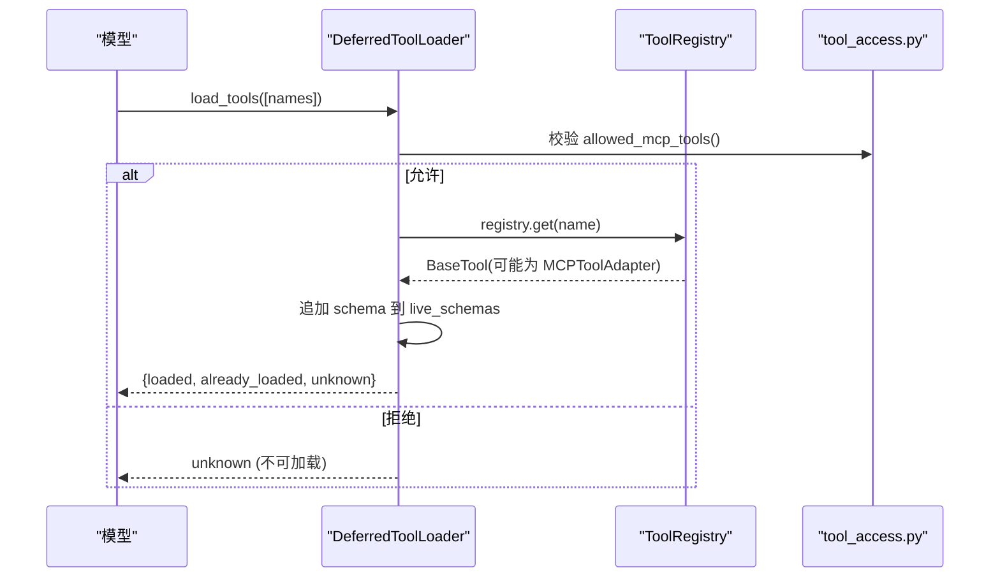
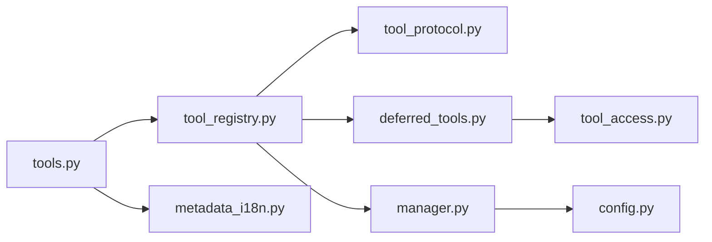

# 工具定义规范

<cite>
**本文引用的文件**
- [tool_protocol.py](file://deeptutor/core/tool_protocol.py)
- [tools.py](file://deeptutor/api/routers/tools.py)
- [manager.py](file://deeptutor/services/mcp/manager.py)
- [config.py](file://deeptutor/services/mcp/config.py)
- [tool_registry.py](file://deeptutor/runtime/registry/tool_registry.py)
- [deferred_tools.py](file://deeptutor/runtime/registry/deferred_tools.py)
- [metadata_i18n.py](file://deeptutor/i18n/metadata_i18n.py)
- [tool_access.py](file://deeptutor/multi_user/tool_access.py)
</cite>

## 目录
1. [简介](#简介)
2. [项目结构](#项目结构)
3. [核心组件](#核心组件)
4. [架构总览](#架构总览)
5. [详细组件分析](#详细组件分析)
6. [依赖关系分析](#依赖关系分析)
7. [性能考量](#性能考量)
8. [故障排查指南](#故障排查指南)
9. [结论](#结论)
10. [附录](#附录)

## 简介
本规范面向 DeepTutor 的“工具”体系，聚焦 MCP（Model Context Protocol）工具的定义、注册、执行与治理。文档覆盖：
- 工具接口定义：参数类型、返回值格式、错误码约定
- 工具元数据：描述信息、提示词引导、本地化支持
- 权限与安全：访问控制、安全验证、资源访问限制
- 注册与加载：工具注册机制、动态加载、版本管理
- 开发模板与示例：如何编写工具、如何测试与验证
- 质量保障：测试方法、性能基准与流程建议

## 项目结构
DeepTutor 的工具系统由“协议层 + 运行时注册 + MCP 适配层 + API 暴露面”组成：
- 协议层：统一工具抽象、参数与返回结构、提示词元数据
- 运行时注册：全局工具注册表、延迟加载（渐进式披露）
- MCP 适配层：连接外部 MCP 服务器，将其工具暴露为 chat 工具
- API 暴露面：提供内置工具清单与多语言提示词，供前端设置页渲染

**图表来源**
- [tools.py:169-223](file://deeptutor/api/routers/tools.py#L169-L223)
- [tool_registry.py:21-154](file://deeptutor/runtime/registry/tool_registry.py#L21-L154)
- [tool_protocol.py:16-275](file://deeptutor/core/tool_protocol.py#L16-L275)
- [deferred_tools.py:55-203](file://deeptutor/runtime/registry/deferred_tools.py#L55-L203)
- [manager.py:89-155](file://deeptutor/services/mcp/manager.py#L89-L155)
- [config.py:31-163](file://deeptutor/services/mcp/config.py#L31-L163)
- [metadata_i18n.py:36-100](file://deeptutor/i18n/metadata_i18n.py#L36-L100)
- [tool_access.py:44-105](file://deeptutor/multi_user/tool_access.py#L44-L105)

**章节来源**
- [tools.py:169-223](file://deeptutor/api/routers/tools.py#L169-L223)
- [tool_registry.py:21-154](file://deeptutor/runtime/registry/tool_registry.py#L21-L154)
- [tool_protocol.py:16-275](file://deeptutor/core/tool_protocol.py#L16-L275)
- [deferred_tools.py:55-203](file://deeptutor/runtime/registry/deferred_tools.py#L55-L203)
- [manager.py:89-155](file://deeptutor/services/mcp/manager.py#L89-L155)
- [config.py:31-163](file://deeptutor/services/mcp/config.py#L31-L163)
- [metadata_i18n.py:36-100](file://deeptutor/i18n/metadata_i18n.py#L36-L100)
- [tool_access.py:44-105](file://deeptutor/multi_user/tool_access.py#L44-L105)

## 核心组件
- 工具协议
  - BaseTool：所有工具的抽象基类，要求实现 get_definition 与 execute
  - ToolDefinition：工具元数据（名称、描述、参数 schema），支持 raw_parameters 透传上游 JSON Schema
  - ToolParameter：参数项（name/type/description/required/default/enum/items）
  - ToolResult：标准化返回体（content/sources/metadata/success/terminate_turn/pause_for_user）
  - ToolPromptHints / ToolAlias：提示词级使用指导与别名
- 运行时注册
  - ToolRegistry：全局注册表，负责内置工具加载、别名解析、schema 生成、执行分发
  - DeferredToolLoader：延迟加载器，按会话维护已加载的延迟工具 schema，并持久化
- MCP 适配
  - MCPConnectionManager：生命周期管理、连接重试、超时、OAuth、传输选择（stdio/SSE/streamableHttp）
  - MCPToolAdapter：将 MCP 工具包装为 BaseTool，默认 deferred，provider_kind="mcp"
- API 暴露
  - tools.py：列出内置工具、多语言提示词、用户可开关工具状态
- 本地化
  - metadata_i18n.py：工具与能力的多语言描述映射
- 权限控制
  - tool_access.py：可选内置工具、MCP 工具、CLI 应用、exec 的白名单策略

**章节来源**
- [tool_protocol.py:16-275](file://deeptutor/core/tool_protocol.py#L16-L275)
- [tool_registry.py:21-154](file://deeptutor/runtime/registry/tool_registry.py#L21-L154)
- [deferred_tools.py:55-203](file://deeptutor/runtime/registry/deferred_tools.py#L55-L203)
- [manager.py:89-155](file://deeptutor/services/mcp/manager.py#L89-L155)
- [tools.py:169-223](file://deeptutor/api/routers/tools.py#L169-L223)
- [metadata_i18n.py:36-100](file://deeptutor/i18n/metadata_i18n.py#L36-L100)
- [tool_access.py:44-105](file://deeptutor/multi_user/tool_access.py#L44-L105)

## 架构总览
下图展示从 API 到 MCP 调用的端到端流程，包括延迟加载、权限校验与结果回传。

**图表来源**
- [tools.py:169-223](file://deeptutor/api/routers/tools.py#L169-L223)
- [deferred_tools.py:111-203](file://deeptutor/runtime/registry/deferred_tools.py#L111-L203)
- [tool_registry.py:128-142](file://deeptutor/runtime/registry/tool_registry.py#L128-L142)
- [manager.py:404-470](file://deeptutor/services/mcp/manager.py#L404-L470)
- [config.py:31-163](file://deeptutor/services/mcp/config.py#L31-L163)
- [metadata_i18n.py:36-100](file://deeptutor/i18n/metadata_i18n.py#L36-L100)
- [tool_access.py:55-69](file://deeptutor/multi_user/tool_access.py#L55-L69)

## 详细组件分析

### 工具协议与数据结构
- 参数类型
  - 支持 string/integer/boolean/number/array/object；数组需声明 items，否则对严格提供商（如 Gemini）会失败
  - 支持 enum 约束与 required 标记
- 返回值格式
  - ToolResult.content 作为 role=tool 消息体；success=False 表示显式失败路径；metadata 可用于 UI 结构化提示
  - terminate_turn 用于真正结束本轮；pause_for_user 用于暂停等待用户输入
- 错误处理
  - 工具内部应返回 ToolResult(success=False, content=错误信息)，由上层统一呈现
  - MCP 调用异常被捕获并转为文本错误，包含超时、取消、瞬态错误重试等

**图表来源**
- [tool_protocol.py:16-275](file://deeptutor/core/tool_protocol.py#L16-L275)

**章节来源**
- [tool_protocol.py:16-275](file://deeptutor/core/tool_protocol.py#L16-L275)

### MCP 工具适配器与连接管理
- MCPToolAdapter
  - 默认 deferred，provider_kind="mcp"，wrapped_tool_name 以 mcp_<server>_<tool> 形式命名
  - get_definition 使用 raw_parameters 透传上游 inputSchema
  - execute 通过 MCPConnectionManager.call_tool 调用，并将进度事件桥接到 event_sink
- MCPConnectionManager
  - ensure_started/reload/shutdown 管理连接生命周期
  - call_tool 支持超时、瞬态错误一次重试、取消与超时友好提示
  - _open_transport 支持 stdio/SSE/streamableHttp，并在用户侧服务时强制地址校验与重定向策略
  - OAuth 支持：构建 auth 并在连接时使用存储令牌刷新

**图表来源**
- [manager.py:404-470](file://deeptutor/services/mcp/manager.py#L404-L470)
- [manager.py:493-708](file://deeptutor/services/mcp/manager.py#L493-L708)
- [manager.py:89-155](file://deeptutor/services/mcp/manager.py#L89-L155)

**章节来源**
- [manager.py:89-155](file://deeptutor/services/mcp/manager.py#L89-L155)
- [manager.py:404-470](file://deeptutor/services/mcp/manager.py#L404-L470)
- [manager.py:493-708](file://deeptutor/services/mcp/manager.py#L493-L708)

### 工具注册与延迟加载
- ToolRegistry
  - load_builtins 自动发现并注册内置工具
  - build_openai_schemas 生成 OpenAI function-calling 兼容 schema
  - execute 支持别名解析与位置参数隔离
- DeferredToolLoader
  - render_deferred_tools_manifest 生成本地化的扩展工具清单
  - load 将指定延迟工具的 schema 追加到当前轮次的 live_schemas，并持久化到会话
  - 允许集合（allowed）拦截未授权工具加载

**图表来源**
- [deferred_tools.py:55-203](file://deeptutor/runtime/registry/deferred_tools.py#L55-L203)
- [tool_registry.py:21-154](file://deeptutor/runtime/registry/tool_registry.py#L21-L154)
- [tool_access.py:55-69](file://deeptutor/multi_user/tool_access.py#L55-L69)

**章节来源**
- [tool_registry.py:21-154](file://deeptutor/runtime/registry/tool_registry.py#L21-L154)
- [deferred_tools.py:55-203](file://deeptutor/runtime/registry/deferred_tools.py#L55-L203)
- [tool_access.py:55-69](file://deeptutor/multi_user/tool_access.py#L55-L69)

### 工具元数据与本地化
- 工具描述的多语言映射由 metadata_i18n 提供，API 层在序列化时注入 description_i18n
- 提示词引导（hints）由 BaseTool.get_prompt_hints 提供，支持 en/zh 双语
- 延迟工具清单（manifest）也支持本地化文案

**章节来源**
- [tools.py:94-166](file://deeptutor/api/routers/tools.py#L94-L166)
- [metadata_i18n.py:36-100](file://deeptutor/i18n/metadata_i18n.py#L36-L100)
- [deferred_tools.py:55-108](file://deeptutor/runtime/registry/deferred_tools.py#L55-L108)

### 权限控制、安全验证与资源访问限制
- 可选内置工具：allowed_optional_tools 决定用户可切换的工具集合
- MCP 工具：allowed_mcp_tools 为白名单，缺失即默认拒绝（非管理员）
- CLI 应用：allowed_cli_apps 同样采用白名单策略
- exec 覆盖：exec_override 可在部署策略之上进行用户级覆盖
- 网络与传输安全：
  - 用户侧服务强制地址校验与禁止重定向
  - stdio 仅管理员可用
  - OAuth 支持存储令牌刷新与无交互连接

**章节来源**
- [tool_access.py:44-105](file://deeptutor/multi_user/tool_access.py#L44-L105)
- [manager.py:611-708](file://deeptutor/services/mcp/manager.py#L611-L708)

### 版本管理与配置
- MCPServerConfig 提供 enabled/disabled、enabled_tools/disabled_tools、tool_timeout、auth 等
- connection_signature 用于检测变更并触发重载
- catalog_entry 记录来源，便于安装溯源
- 配置持久化采用原子写入（tmp+replace），避免损坏导致全量断开

**章节来源**
- [config.py:31-163](file://deeptutor/services/mcp/config.py#L31-L163)

## 依赖关系分析
- 模块耦合
  - API 层依赖工具注册表与本地化模块
  - 运行时注册表依赖协议层与提示词组合器
  - MCP 适配层依赖配置与网络校验，并与注册表交互（仅共享作用域）
  - 延迟加载器依赖注册表与权限模块
- 外部依赖
  - MCP SDK（mcp）用于会话与传输
  - httpx 用于 HTTP 客户端与超时控制
- 潜在循环依赖
  - 通过延迟导入（如 from ... import 在函数内）避免启动期循环

**图表来源**
- [tools.py:169-223](file://deeptutor/api/routers/tools.py#L169-L223)
- [tool_registry.py:21-154](file://deeptutor/runtime/registry/tool_registry.py#L21-L154)
- [deferred_tools.py:55-203](file://deeptutor/runtime/registry/deferred_tools.py#L55-L203)
- [manager.py:89-155](file://deeptutor/services/mcp/manager.py#L89-L155)
- [config.py:31-163](file://deeptutor/services/mcp/config.py#L31-L163)
- [metadata_i18n.py:36-100](file://deeptutor/i18n/metadata_i18n.py#L36-L100)
- [tool_access.py:44-105](file://deeptutor/multi_user/tool_access.py#L44-L105)

**章节来源**
- [tool_registry.py:21-154](file://deeptutor/runtime/registry/tool_registry.py#L21-L154)
- [manager.py:89-155](file://deeptutor/services/mcp/manager.py#L89-L155)
- [deferred_tools.py:55-203](file://deeptutor/runtime/registry/deferred_tools.py#L55-L203)

## 性能考量
- 延迟加载：减少初始 schema 体积，提升弱模型工具选择准确率
- 连接复用与作用域回收：按 owner 隔离连接，空闲作用域定时清理，防止进程内存膨胀
- 超时与重试：工具调用支持超时；瞬态网络错误自动重试一次
- 并发连接：新/变更服务器并行连接，缩短冷启动时间
- 提示词优化：manifest 描述长度限制，避免过长影响上下文

[本节为通用性能讨论，不直接分析具体文件]

## 故障排查指南
- 连接失败
  - 检查 MCPServerConfig 的 type/url/command 与 headers
  - 查看 status 与 error 字段定位原因（超时、DNS、401 等）
  - 对于需要 OAuth 的服务，确认已授权且令牌有效
- 工具不可用
  - 确认工具名是否在 allowed_mcp_tools 白名单中
  - 检查工具是否已被卸载或改名（延迟加载器会清理失效条目）
- 执行异常
  - 关注 ToolResult.success 与 content 中的错误信息
  - 检查超时与取消情况（MCP 调用可能抛出 TimeoutError/CancelledError）
- 配置问题
  - 使用 probe_server 测试连通性与工具列表
  - 确保 mcp.json 原子写入成功，避免损坏

**章节来源**
- [manager.py:755-800](file://deeptutor/services/mcp/manager.py#L755-L800)
- [config.py:120-163](file://deeptutor/services/mcp/config.py#L120-L163)
- [deferred_tools.py:165-196](file://deeptutor/runtime/registry/deferred_tools.py#L165-L196)

## 结论
DeepTutor 的工具系统通过统一的协议抽象、严格的权限控制、灵活的 MCP 适配与延迟加载机制，实现了可扩展、安全且高性能的工具生态。建议在新增工具时遵循以下原则：
- 明确参数 schema，必要时使用 raw_parameters 透传上游定义
- 提供清晰的 description 与 prompt hints，并补充多语言描述
- 合理设置 deferred 标志，配合 load_tools 渐进披露
- 遵守权限白名单与传输安全策略，避免越权访问
- 完善错误处理与日志，便于追踪与排障

[本节为总结性内容，不直接分析具体文件]

## 附录

### 工具开发模板与示例
- 新建工具步骤
  - 继承 BaseTool，实现 get_definition 与 execute
  - 在 get_definition 中声明 name、description、parameters（或使用 raw_parameters）
  - 在 execute 中返回 ToolResult，妥善处理 success/content/metadata
  - 如需延迟加载，设置 deferred=True
  - 如需本地化，补充提示词与描述
- 示例参考路径
  - 协议定义与返回结构：[tool_protocol.py:16-275](file://deeptutor/core/tool_protocol.py#L16-L275)
  - 注册与执行入口：[tool_registry.py:21-154](file://deeptutor/runtime/registry/tool_registry.py#L21-L154)
  - MCP 适配器实现：[manager.py:89-155](file://deeptutor/services/mcp/manager.py#L89-L155)
  - 延迟加载与清单：[deferred_tools.py:55-203](file://deeptutor/runtime/registry/deferred_tools.py#L55-L203)

**章节来源**
- [tool_protocol.py:16-275](file://deeptutor/core/tool_protocol.py#L16-L275)
- [tool_registry.py:21-154](file://deeptutor/runtime/registry/tool_registry.py#L21-L154)
- [manager.py:89-155](file://deeptutor/services/mcp/manager.py#L89-L155)
- [deferred_tools.py:55-203](file://deeptutor/runtime/registry/deferred_tools.py#L55-L203)

### 测试方法与验证工具
- 单元测试
  - 针对工具 execute 的边界条件与错误分支
  - 针对延迟加载器的 load/initial_schemas 行为
  - 针对权限白名单的交集与拒绝场景
- 集成测试
  - 使用 probe_server 验证 MCP 服务器连通性与工具列表
  - 模拟不同传输（stdio/SSE/streamableHttp）与认证方式
- 性能基准
  - 测量延迟加载前后 schema 大小与模型选择耗时
  - 评估连接池与作用域回收对内存的影响

**章节来源**
- [manager.py:755-800](file://deeptutor/services/mcp/manager.py#L755-L800)
- [deferred_tools.py:111-203](file://deeptutor/runtime/registry/deferred_tools.py#L111-L203)
- [tool_access.py:44-105](file://deeptutor/multi_user/tool_access.py#L44-L105)

### 质量保证流程建议
- 代码审查要点
  - 参数 schema 完整性与兼容性（尤其 array.items）
  - 错误处理与日志输出
  - 权限白名单与网络策略的正确性
- 发布前检查
  - 运行冒烟测试（连接、列举、调用）
  - 验证多语言文案一致性
  - 确认配置原子写入与回滚策略

[本节为通用流程建议，不直接分析具体文件]