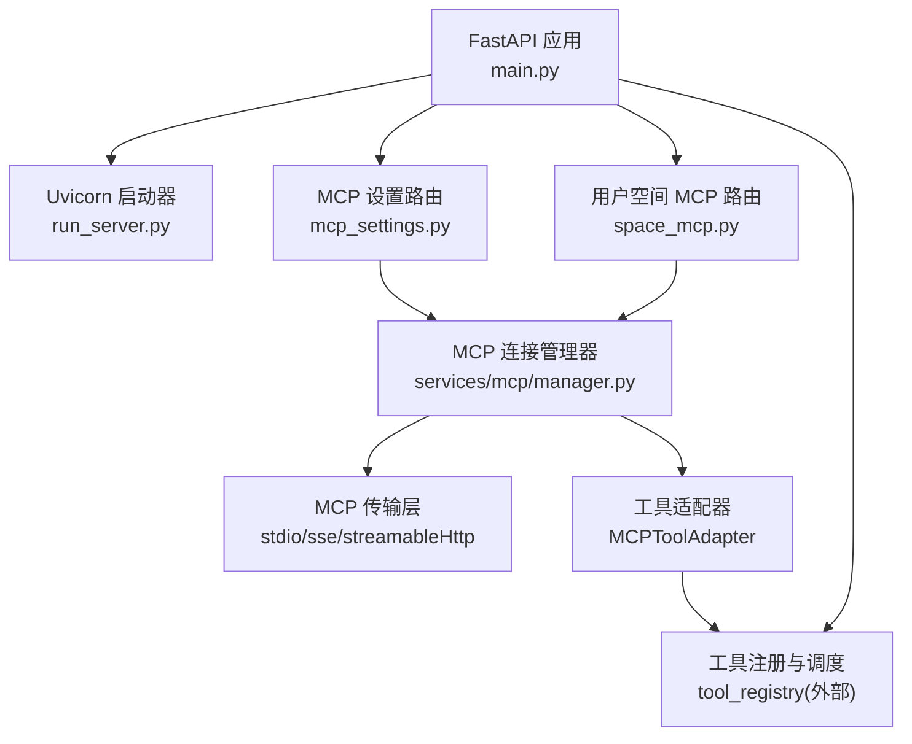
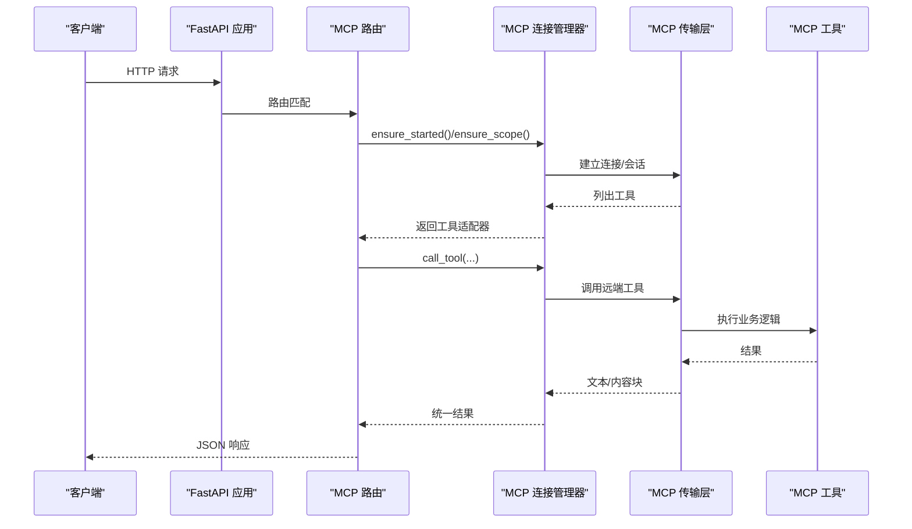
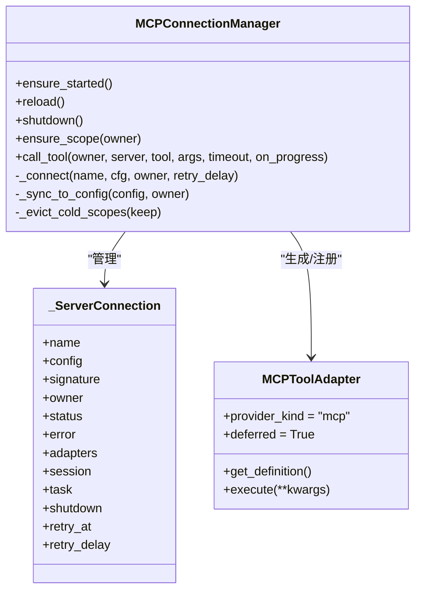
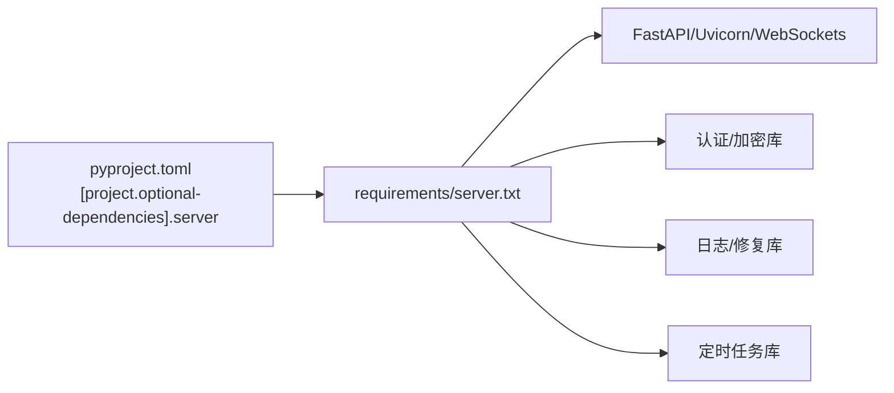

# 服务器开发步骤

<cite>
**本文引用的文件**
- [deeptutor/api/main.py](file://deeptutor/api/main.py)
- [deeptutor/api/run_server.py](file://deeptutor/api/run_server.py)
- [deeptutor/services/mcp/__init__.py](file://deeptutor/services/mcp/__init__.py)
- [deeptutor/services/mcp/manager.py](file://deeptutor/services/mcp/manager.py)
- [deeptutor/api/routers/space_mcp.py](file://deeptutor/api/routers/space_mcp.py)
- [deeptutor/api/routers/mcp_settings.py](file://deeptutor/api/routers/mcp_settings.py)
- [deeptutor/core/tool_protocol.py](file://deeptutor/core/tool_protocol.py)
- [requirements/server.txt](file://requirements/server.txt)
- [pyproject.toml](file://pyproject.toml)
- [tests/api/test_space_mcp.py](file://tests/api/test_space_mcp.py)
</cite>

## 目录
1. [简介](#简介)
2. [项目结构](#项目结构)
3. [核心组件](#核心组件)
4. [架构总览](#架构总览)
5. [详细组件分析](#详细组件分析)
6. [依赖分析](#依赖分析)
7. [性能考虑](#性能考虑)
8. [故障排查指南](#故障排查指南)
9. [结论](#结论)
10. [附录](#附录)

## 简介
本指南面向希望在 DeepTutor 中开发并集成 MCP（Model Context Protocol）服务器的工程师。内容从环境搭建、项目结构与依赖配置入手，逐步讲解如何定义工具接口、实现业务逻辑、处理请求与响应；并提供调试技巧、日志记录、错误诊断方法；最后给出测试策略（单元、集成、端到端）、完整示例路径、常见问题解决方案以及代码规范、最佳实践和性能调优建议。

## 项目结构
DeepTutor 的 API 服务基于 FastAPI + Uvicorn，MCP 能力通过 services/mcp 模块以连接管理器为中心进行生命周期管理，并通过路由层暴露管理员与用户侧的 MCP 配置与管理接口。

**图表来源**
- [deeptutor/api/main.py:116-257](file://deeptutor/api/main.py#L116-L257)
- [deeptutor/api/run_server.py:30-80](file://deeptutor/api/run_server.py#L30-L80)
- [deeptutor/api/routers/mcp_settings.py:57-133](file://deeptutor/api/routers/mcp_settings.py#L57-L133)
- [deeptutor/api/routers/space_mcp.py:92-166](file://deeptutor/api/routers/space_mcp.py#L92-L166)
- [deeptutor/services/mcp/manager.py:216-300](file://deeptutor/services/mcp/manager.py#L216-L300)

**章节来源**
- [deeptutor/api/main.py:1-514](file://deeptutor/api/main.py#L1-L514)
- [deeptutor/api/run_server.py:1-85](file://deeptutor/api/run_server.py#L1-L85)

## 核心组件
- 应用生命周期与中间件：在应用启动时初始化 LLM、事件总线、合作伙伴、定时任务、内存迁移等，并在关闭时有序释放资源（包括 MCP 连接）。
- 路由层：提供 MCP 管理员配置（部署级）和用户空间 MCP（租户级）两类接口，支持增删改查、测试连接、OAuth 授权回调等。
- MCP 连接管理器：维护所有 MCP 服务器连接的生命周期，将远端工具适配为本地 BaseTool，支持延迟加载、重试退避、作用域隔离、进度上报等。
- 工具协议：统一的工具抽象（BaseTool、ToolDefinition、ToolResult），使 MCP 工具与内置工具在同一调度通道执行。

**章节来源**
- [deeptutor/api/main.py:116-257](file://deeptutor/api/main.py#L116-L257)
- [deeptutor/services/mcp/manager.py:89-155](file://deeptutor/services/mcp/manager.py#L89-L155)
- [deeptutor/core/tool_protocol.py:206-242](file://deeptutor/core/tool_protocol.py#L206-L242)

## 架构总览
下图展示了从 HTTP 请求到 MCP 工具执行的完整调用链，包括认证、路由分发、连接管理与工具适配。

**图表来源**
- [deeptutor/api/main.py:282-311](file://deeptutor/api/main.py#L282-L311)
- [deeptutor/api/routers/mcp_settings.py:57-133](file://deeptutor/api/routers/mcp_settings.py#L57-L133)
- [deeptutor/api/routers/space_mcp.py:92-166](file://deeptutor/api/routers/space_mcp.py#L92-L166)
- [deeptutor/services/mcp/manager.py:404-470](file://deeptutor/services/mcp/manager.py#L404-L470)

## 详细组件分析

### 应用启动与生命周期
- 启动阶段：确保运行时设置文件存在并导出到环境变量；配置日志；校验工具一致性；初始化 LLM 客户端、事件总线、合作伙伴、定时任务；迁移旧版记忆数据；探测 PocketBase。
- 关闭阶段：停止定时任务、合作伙伴、MCP 连接、LLM 提供者池、Agentic 客户端池、事件总线。
- CORS 与访问日志：根据认证开关动态构建允许源；仅记录非 200 的访问日志以减少噪音。

**章节来源**
- [deeptutor/api/main.py:116-257](file://deeptutor/api/main.py#L116-L257)
- [deeptutor/api/main.py:282-311](file://deeptutor/api/main.py#L282-L311)

### 服务器启动脚本
- 平台兼容：Windows 下切换事件循环策略以支持子进程 API。
- 工作目录：切换到运行时根目录，读取后端端口并运行 Uvicorn。
- 热重载：开发模式下可启用自动重载，排除大型目录避免误触发。

**章节来源**
- [deeptutor/api/run_server.py:14-80](file://deeptutor/api/run_server.py#L14-L80)

### MCP 连接管理器
- 连接模型：每个服务器一个连接任务，持有 AsyncExitStack，负责打开传输、创建会话、列举工具、等待关闭事件。
- 工具适配：将远端工具包装为 MCPToolAdapter，标记为 deferred，进入全局或作用域工具注册表。
- 重试与退避：失败连接按指数退避重试；瞬态网络错误自动重试一次。
- 作用域隔离：共享（部署级）与用户级（租户级）作用域互不干扰；冷作用域空闲超时后回收。
- 进度上报：将 MCP 进度通知转换为 trace 事件，便于前端展示。

**图表来源**
- [deeptutor/services/mcp/manager.py:89-155](file://deeptutor/services/mcp/manager.py#L89-L155)
- [deeptutor/services/mcp/manager.py:197-240](file://deeptutor/services/mcp/manager.py#L197-L240)
- [deeptutor/services/mcp/manager.py:216-300](file://deeptutor/services/mcp/manager.py#L216-L300)
- [deeptutor/services/mcp/manager.py:404-470](file://deeptutor/services/mcp/manager.py#L404-L470)

**章节来源**
- [deeptutor/services/mcp/manager.py:1-800](file://deeptutor/services/mcp/manager.py#L1-L800)

### 管理员 MCP 设置路由
- 功能：读取/更新部署级 MCP 配置，查看连接状态，测试服务器连通性。
- 安全：需要管理员权限；对远程传输（SSE/HTTP）进行 URL 校验。
- 变更生效：保存配置后触发管理器 reload，按需重连。

**章节来源**
- [deeptutor/api/routers/mcp_settings.py:1-134](file://deeptutor/api/routers/mcp_settings.py#L1-L134)

### 用户空间 MCP 路由
- 功能：用户可添加/删除/测试自己的 MCP 服务器；支持 OAuth 授权流程；提供目录浏览与一键安装。
- 安全：仅允许远程传输（stdio 仅限管理员）；凭据分离存储且从不回显；写操作限定当前用户文件。
- 列表预热：获取列表时会尝试预热连接以提升 UI 响应速度。

**章节来源**
- [deeptutor/api/routers/space_mcp.py:1-461](file://deeptutor/api/routers/space_mcp.py#L1-L461)

### 工具协议与适配器
- 工具协议：BaseTool 抽象出 get_definition 与 execute；ToolDefinition 描述参数 schema；ToolResult 标准化返回。
- MCP 适配器：MCPToolAdapter 继承 BaseTool，将远端工具纳入统一调度；支持 provider_kind="mcp" 与 deferred 模式。

**章节来源**
- [deeptutor/core/tool_protocol.py:16-94](file://deeptutor/core/tool_protocol.py#L16-L94)
- [deeptutor/core/tool_protocol.py:121-167](file://deeptutor/core/tool_protocol.py#L121-L167)
- [deeptutor/core/tool_protocol.py:206-242](file://deeptutor/core/tool_protocol.py#L206-L242)
- [deeptutor/services/mcp/manager.py:89-155](file://deeptutor/services/mcp/manager.py#L89-L155)

## 依赖分析
- 服务器依赖：FastAPI、Uvicorn、WebSockets、python-multipart、bcrypt、python-jose、pocketbase、loguru、json-repair、croniter。
- 包管理：pyproject.toml 定义了可选依赖集 server，requirements/server.txt 与之同步用于 Docker/CI。
- 运行时约束：Python 版本要求 3.11-3.13；部分重型 RAG 扩展限制 Python < 3.14 以避免构建问题。

**图表来源**
- [pyproject.toml:109-121](file://pyproject.toml#L109-L121)
- [requirements/server.txt:11-32](file://requirements/server.txt#L11-L32)

**章节来源**
- [pyproject.toml:8-21](file://pyproject.toml#L8-L21)
- [pyproject.toml:109-121](file://pyproject.toml#L109-L121)
- [requirements/server.txt:1-32](file://requirements/server.txt#L1-L32)

## 性能考虑
- 连接复用与作用域回收：冷作用域空闲 TTL 到期后断开连接，限制最大作用域数量，避免多租户场景下资源膨胀。
- 延迟加载工具：MCP 工具默认 deferred，减少初始提示词体积与无效 schema 开销。
- 重试与退避：连接失败采用指数退避，瞬态错误自动重试一次，提升鲁棒性。
- 传输超时控制：工具调用使用 per-tool 超时，避免长尾阻塞。
- 日志降噪：抑制 WebSocket 频繁连接/关闭日志；仅记录非 200 访问日志，降低 I/O 压力。

**章节来源**
- [deeptutor/services/mcp/manager.py:319-347](file://deeptutor/services/mcp/manager.py#L319-L347)
- [deeptutor/services/mcp/manager.py:404-441](file://deeptutor/services/mcp/manager.py#L404-L441)
- [deeptutor/api/main.py:25-35](file://deeptutor/api/main.py#L25-L35)
- [deeptutor/api/main.py:282-294](file://deeptutor/api/main.py#L282-L294)

## 故障排查指南
- 连接失败诊断：
  - 检查传输类型与 URL 合法性（SSE/HTTP 需通过 validate_mcp_url）。
  - 观察管理器 status 中的 error 字段与连接状态（connecting/connected/error/needs_auth/disabled）。
  - 使用“测试”接口 probe_server 验证连通性与工具列表。
- 认证问题：
  - OAuth 流需在浏览器完成授权，回调页面会显示成功/失败并自动关闭。
  - 若状态为 needs_auth，说明等待用户授权，后台不会重复发起交互。
- 工具不可用：
  - 确认工具名未被禁用（tool_allowed 白名单）。
  - 检查是否属于当前作用域（共享 vs 用户级）。
- 日志定位：
  - 关注 manager 与 router 的错误日志，包含具体异常类型与消息。
  - 访问日志仅输出非 200 状态，便于快速发现异常请求。

**章节来源**
- [deeptutor/api/routers/mcp_settings.py:41-55](file://deeptutor/api/routers/mcp_settings.py#L41-L55)
- [deeptutor/api/routers/space_mcp.py:169-226](file://deeptutor/api/routers/space_mcp.py#L169-L226)
- [deeptutor/services/mcp/manager.py:517-533](file://deeptutor/services/mcp/manager.py#L517-L533)
- [deeptutor/api/main.py:282-294](file://deeptutor/api/main.py#L282-L294)

## 结论
DeepTutor 的 MCP 集成以连接管理器为核心，结合管理员与用户空间路由，提供了安全、可扩展的工具接入能力。通过延迟加载、作用域隔离、重试退避与严格的凭据管理，既保证了多租户下的稳定性，又提升了用户体验。遵循本文的步骤与实践，可以快速搭建、调试并优化 MCP 服务器集成。

## 附录

### 环境搭建与启动
- 安装依赖：使用 requirements/server.txt 或 pyproject.toml 的 server 可选依赖。
- 启动服务：运行 run_server.py 以 Uvicorn 方式启动，支持开发热重载。
- 配置 MCP：通过 /api/v1/settings/mcp（管理员）或 /api/v1/space/mcp（用户）进行配置。

**章节来源**
- [requirements/server.txt:11-32](file://requirements/server.txt#L11-L32)
- [pyproject.toml:109-121](file://pyproject.toml#L109-L121)
- [deeptutor/api/run_server.py:30-80](file://deeptutor/api/run_server.py#L30-L80)
- [deeptutor/api/routers/mcp_settings.py:57-133](file://deeptutor/api/routers/mcp_settings.py#L57-L133)
- [deeptutor/api/routers/space_mcp.py:92-166](file://deeptutor/api/routers/space_mcp.py#L92-L166)

### 定义工具接口与实现业务逻辑
- 接口定义：实现 BaseTool.get_definition 返回 ToolDefinition，描述名称、描述与参数 schema。
- 业务执行：实现 BaseTool.execute 异步执行并返回 ToolResult，包含 content、metadata、success 等。
- MCP 工具：通过 MCPToolAdapter 将远端工具纳入统一调度，支持 deferred 与进度上报。

**章节来源**
- [deeptutor/core/tool_protocol.py:206-242](file://deeptutor/core/tool_protocol.py#L206-L242)
- [deeptutor/services/mcp/manager.py:89-155](file://deeptutor/services/mcp/manager.py#L89-L155)

### 调试技巧、日志与错误诊断
- 调试：使用“测试”接口 probe_server 验证配置与连通性；观察 status 与 error 字段。
- 日志：关注 manager 与 router 的错误日志；访问日志仅记录非 200。
- 诊断：区分 needs_auth 与 error；检查 URL 合法性与作用域隔离。

**章节来源**
- [deeptutor/api/routers/mcp_settings.py:121-133](file://deeptutor/api/routers/mcp_settings.py#L121-L133)
- [deeptutor/api/routers/space_mcp.py:255-284](file://deeptutor/api/routers/space_mcp.py#L255-L284)
- [deeptutor/api/main.py:282-294](file://deeptutor/api/main.py#L282-L294)

### 测试策略
- 单元测试：针对工具实现与协议转换编写用例，覆盖参数校验与返回值结构。
- 集成测试：通过 space_mcp 路由进行端到端配置与连接测试，验证管理员与用户空间行为。
- 端到端测试：模拟完整请求链路，包括认证、路由、连接、工具调用与响应。

参考测试文件：
- [tests/api/test_space_mcp.py](file://tests/api/test_space_mcp.py)

**章节来源**
- [tests/api/test_space_mcp.py](file://tests/api/test_space_mcp.py)

### 代码规范与最佳实践
- 代码风格：遵循 Black/Ruff 配置，行宽 100，目标 Python 3.11+。
- 导入顺序：第三方库、标准库、本地模块分组清晰。
- 错误处理：捕获并记录异常，返回结构化错误信息；避免吞掉关键异常。
- 安全实践：凭据分离存储，URL 严格校验，仅允许远程传输给用户配置。

**章节来源**
- [pyproject.toml:268-387](file://pyproject.toml#L268-L387)
- [deeptutor/api/routers/space_mcp.py:10-21](file://deeptutor/api/routers/space_mcp.py#L10-L21)

### 性能调优建议
- 合理设置工具超时与连接超时，避免长尾请求。
- 利用 deferred 工具减少初始负载。
- 监控连接状态与错误率，及时扩容或降级。
- 使用作用域隔离与冷作用域回收，控制内存与句柄占用。

**章节来源**
- [deeptutor/services/mcp/manager.py:319-347](file://deeptutor/services/mcp/manager.py#L319-L347)
- [deeptutor/services/mcp/manager.py:404-441](file://deeptutor/services/mcp/manager.py#L404-L441)